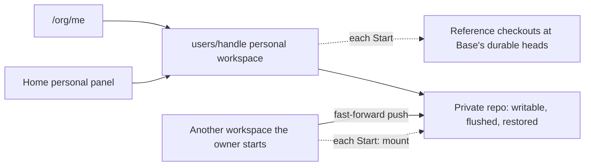

# Personal workspace

A personal workspace gives each organization member a place to chat with an agent and
keep artifacts without choosing or creating a piece of work. It is an ordinary
[workspace](workspaces.g5.md) in the existing task, conversation, durability and lifecycle
model, with one private repository and read-only checkouts of the organization's
codebases. Every other workspace its owner starts mounts that private repository. The
rules below are its only exceptions.

[I · g5.purpose.personal]

Each organization member can chat from Home without choosing or creating a workspace, so they can customize how G5 works for them.

[I · g5.purpose.personal.persistence]

What the agent writes in that chat stays across chats, Stops and Starts.

[I · g5.purpose.personal.codebases]

That chat runs against the organization's existing codebases.

[I · g5.purpose.personal.notes]

A member pulls their personal notes into the workspaces they work on. Showing selected personal files to another person is deferred; until it returns, people push ideas out of the personal workspace as tracker issues.

## Identity and naming

[D · g5.personal.identity]

A personal workspace has the immutable registry kind personal, bound to one organization and one user, with at most one live personal workspace per pair. Like Base, its kind is never inferred from its name, owner or ancestry, and it has no parent. Its owner is always the bound user. A user who leaves and later rejoins receives a new personal workspace; the retired one is not revived.

[D · g5.personal.names]

The system names a personal workspace `users/<handle>`. The handle is derived once, at creation, from the local part of the user's email: lowercase, characters outside `a-z`, `0-9` and `-` become `-`, repeated `-` collapse, leading and trailing `-` are dropped, at most 64 characters, `user` when empty. A collision with any name a workspace in the organization holds or [reserves](workspaces.g5.md#g5.workspace.former-names), compared case-insensitively, appends `-2`, `-3`, … . The name never changes afterwards, even when the email does. Ordinary [name admission](ui.g5.md#g5.workbench.tabs) refuses `me`, `users` and every name under `users/`. Workspaces already holding such names keep them and remain ordinary; they are reported, and nothing is renamed.

[D · g5.personal.routes]

The owner reaches their personal workspace at `/{org}/me`; anyone the [read rule](#g5.personal.access) admits reaches it at `/{org}/users/{handle}`. Both resolve by registry kind, never by matching a workspace name. Opening `/{org}/me` [ensures creation](#g5.personal.lifecycle) first, so a missed creation never leaves the owner without one. A link that names a personal workspace by its `users/<handle>` name, as lists of workspaces by name do, lands on the kind route for the caller, and the [workspace tab](ui.g5.md#g5.workbench.tabs) the arrival opened moves with it, so the personal workspace is one tab however it was reached.

## Members

[D · g5.workspace.identity.reference]

A personal workspace's only repository member is a new providerless internal repository that no other workspace has as a member; it carries the workspace branch. The owner's other workspaces mount it without making it a member ([mount](#g5.personal.mount)). The organization's docs repository and Base's code repositories are its reference checkouts. They are derived from Base's members at each Start, not stored as members: each Start pins Base's durable head of each into the boot specification and checks it out writable, so builds and tests can run. Reference checkouts have no workspace branch and no receipt, and are never flushed, restored, forked, compared, rebased, published or pushed; their edits are discarded at the next Start, which shows Base's newer commits. The platform never refreshes them within a session, but each one's origin tracks its Base branch, so the owner or agent can pull Base's newer commits on demand. The [docs repository](repositories.g5.md#g5.repo.docs) is therefore included read-only. [Image selection](../software_architecture/hosts.g5.md#g5.host.image-selection) uses the reference code checkouts' pins at their pinned heads, never the private repository; with no reference code checkout (no Base code repository has a durable head) it uses the organization's default image.

[D · g5.personal.project-docs]

A personal workspace has no [Project Docs folder](workspaces.g5.md#g5.workspace.project-docs) in the docs repository. The agent launches in the private repository, which holds the owner's [native memory](#g5.personal.memory) in every workspace. The harness tells it to keep documents and G5 workflow records (chat intent, plans, ontology drafts) in the private repository, never in a reference checkout. When work moves to a fork of Base, that fork [mounts](#g5.personal.mount) the private repository, so its agent reads those records there and copies into the fork what the fork should keep.

## Access

[D · g5.personal.access]

Personal registry identity fixes the [audience](workspaces.g5.md#g5.workspace.audience): only the owner and active organization Admins can read personal repositories, conversations, artifacts and agent memory through API, Git, UI or agent reads. No configurable sharing or reader invitations apply. The product tells the owner that administrators can see their personal work. Because Git read access is per repository, putting personal content in a shared repository would expose it to every reader of any workspace that includes that repository; the private repository avoids that. The [mount](#g5.personal.mount) gives the owner's other workspace VMs, not other people, read and push access: only the current owner uses a workspace VM ([owner authority](../software_architecture/workspace_vm.g5.md#g5.security.owner)). Whatever the owner or their agent copies out of the mount, into a workspace's repositories or its conversations, then follows that workspace's read grants. The owner accepts that: carrying notes into their work is the point.

[D · g5.personal.refusals]

A personal workspace is never a fork source, merge target, review copy, ownership-transfer subject, [renamed](workspaces.g5.md#g5.workspace.rename) or owner-deleted workspace, and it has no [stages](workspaces.g5.md#g5.workspace.stages), rebase, update-from-parent, publication, PR or Make Remote. Admission refuses these by registry kind, including for an ordinary workspace whose name looks personal. Forking would copy the private repository and its history to the fork's readers. Code changes move to an ordinary fork of Base, which may carry [copies of selected personal conversations](chat.g5.md#g5.chat.fork).

## Lifecycle

[D · g5.personal.lifecycle]

One idempotent operation keyed by (organization, user) creates the registry row, private repository, its member row and settings together, then initializes the repository's branch; a retry completes a partial creation. It runs after someone becomes an eligible workspace owner: creating the organization, joining it or being promoted from viewer. Name selection is serialized per organization, so concurrent creations cannot pick the same handle. It is the one workspace creator besides Base creation and checked fork. It runs after the triggering membership change commits, so a failure never blocks that change; a reconciler retries for every eligible member without a live personal workspace, which also backfills existing members, and `/{org}/me` calls the same operation.

[D · g5.personal.retirement]

Removing a member, or demoting them to viewer, retires their personal workspace in the same transaction: it is tombstoned, Start consent is withdrawn and a system Stop is requested. A running VM is then stopped without waiting for a save, under its own stop reason, and the lifecycle reconciler retries that stop. The personal workspace never blocks the membership change that [owner removal](workspaces.g5.md#g5.workspace.transfer.formal) otherwise refuses. The private repository, its history and the workspace's records are retained; erasure stays under the open erasure policy.

## Execution

[D · g5.personal.start-and-send]

The personal composer offers [Start and send](chat.g5.md#g5.chat.start-and-send) as every owner composer does: one owner request records Start consent and queues the input bound to it, with Start progress inline. Home's personal panels show the same notice and progress as the workbench composer.

[D · g5.personal.capacity]

Personal VMs count against the organization [VM quota](../software_architecture/host_control_plane.g5.md#g5.runtime.placement.capacity). A personal workspace gets the organization's personal idle default at creation, initially 30 minutes, instead of the ordinary [idle default](../software_architecture/workspace_vm.g5.md#g5.lifecycle.idle.settings); the owner may override it, and changing the default never rewrites existing workspaces.

## Durability

[D · g5.personal.durability]

The personal branch has no protection, review or publication policy. The harness tells the agent to commit and push artifacts as it makes them; Stop and idle Stop [flush](../software_architecture/workspace_vm.g5.md#g5.vm.flush) the rest. The platform makes no implicit commit beyond [memory sync](#g5.personal.memory-sync). Unplanned VM loss loses only work that was not pushed, as for every [workspace VM](../concepts/data_model.g5.md#g5.concept.workspace-vm). The branch also advances by [pushes from the owner's other workspaces](#g5.personal.mount-push), which the running personal VM [follows](#g5.personal.follow).

## Mount in the owner's other workspaces

[D · g5.personal.mount]

Each Start of a workspace that is neither personal nor a [formal review workspace](agent_approvals.g5.md#g5.agent-approval.execution), whose current owner has a live personal workspace in its organization, checks out that private repository at `personal` beside the members, on the personal branch at its durable head when Start was admitted. Like a [reference checkout](#g5.workspace.identity.reference) it is not a member: it has no receipt, flush, restore, Changes, comparison, fork, publication or image selection, and the UI does not render it. G5 commits and pushes in it only for [memory sync](#g5.personal.memory-sync). The next Start rebuilds it from the then-durable head, so anything not pushed from it is lost at Stop. Its origin tracks the personal branch, so an ordinary pull brings in what the personal VM or the owner's other workspaces pushed since Start. Start leaves the mount out rather than failing when the personal branch has no durable head yet (it is unborn) or a member's root overlaps `personal`. The VM reads the private repository while its incarnation is current and its workspace's current owner is the personal workspace's owner; retirement, transfer or a newer incarnation ends that at the next request. The harness tells the agent what the mount is and that only pushed work survives.

[D · g5.personal.mount-push]

From the mount, the incarnation pushes only the personal branch: update-only, fast-forward only, with Git's old-head check final. Admission treats the push as a move of the personal workspace's branch and credits it there. It holds that workspace's commit fence, which Start takes, and a share lock on its VM row, which Stop waits for, until Git commits or refuses. The push lands while the personal VM runs, or while it is stopped with a clean, fully published saved state, as for a [stopped rebase](../software_architecture/git.g5.md#g5.git.stopped-rebase), so its next Start restores from the new head. While the personal workspace starts or stops, or is stopped holding flushed, unpublished work, the push is refused with a conflict rather than queued or switched to another path.

[D · g5.personal.follow]

A running personal VM's checkout follows its branch. Each tracking refresh, every 30 seconds and before every agent turn, fast-forwards the checkout when it is on the personal branch with no commits of its own beyond the branch head, and the fast-forward overwrites no local change. Otherwise the checkout is left alone and the VM's next push of its own reports the move, which the agent resolves with an ordinary pull and rebase. This is the only exception to [imports leaving live VM files unchanged](../software_architecture/git.g5.md#g5.git.pull-policy), and it is limited to the private repository.

## Agent memory

[D · g5.personal.memory]

Claude's [native memory](chat.g5.md#g5.story.reuse-native-memory) lives in `memory/claude/` and Codex's in `memory/codex/` of the owner's personal repository at `/work/personal`: the member in the personal workspace, the [mount](#g5.personal.mount) elsewhere. New and resumed Codex chats use this memory; generation follows native eligibility and timing and is disabled for read-only turns. Credentials, session history and SQLite state stay in the private provider home. Its readers are the personal repository's ([access](#g5.personal.access)). A launch without the personal repository, including after a Start that left the mount out, runs with memory off and says so; formal reviews keep memory off silently. It never binds a workspace repository, whose readers would see the memory. Binding refuses a folder that ignore rules exclude, that is not writable when writes are allowed, or that holds symlinks or Git state, and the personal workspace's flush refuses to omit these folders under ignore rules. Memory under `.g5/memory/` in workspace repositories is no longer bound; G5 leaves it unchanged.

[D · g5.personal.memory-sync]

Memory follows code pushes. After each push of a workspace repository from the VM completes, by native Git, Save or another Changes publication, G5 commits the changed files under the memory folders, and nothing else, then fast-forwards the personal branch: as a [mount push](#g5.personal.mount-push), or as the member's own push in the personal workspace. When the branch moved, it first replays its memory commits onto the new head, merging `MEMORY.md` index lines as a union. It is best effort and never discards a checkout change. It skips, leaving the work for the next push, when the checkout is off its branch or mid-operation, holds unpublished commits outside the memory folders, has other tracked changes when a replay is needed, conflicts, or the push is refused. Pushes during a sync cause one more; flush captures cause none. In a mount, memory not yet published is lost at Stop.

## Reading other workspaces

Git content needs no new credential: every workspace VM already receives the organization's pushed history through the host repository cache, so the personal agent reads other workspaces with ordinary Git in its reference checkouts, under the per-repository read rule.

[D · g5.security.credentials.delegated-read]

The personal agent gets no separate delegated-read credential. Like every workspace agent, it reads other workspaces' platform records (conversation text, timelines, tasks, files) under [agent read scope](../concepts/security.g5.md#g5.security.agent-read-scope) with its VM's existing credential, which settles the exposure question this deferral waited on; the same credential lets it fork Base and operate on its owner's other workspaces under [agent scope](../concepts/security.g5.md#g5.security.agent-workspace-scope). The Home attention list itself stays unread by agents; an agent may, however, read approval requests addressed to the owner through the [approval activity feed](reviews.g5.md#g5.governance.approval.activity-feed), reached by workspace readability rather than through the attention surface, since a reviewer must already read a workspace to decide there. [Provider PR reads](#g5.personal.pr-reads) are not delegated reads.

[D · g5.personal.pr-reads]

A personal workspace's [provider PR reads](../software_architecture/git.g5.md#g5.git.pr-read-repositories) (`g5d pr view`, `view -c`, `checks` and repository `list`) may select its reference repositories: the current members of its organization's Base, rechecked at each request as for [Git reads](#g5.workspace.identity.reference), not the set pinned at Start. They are read-only. Comments, thread resolution, create and update stay with members, and the personal workspace still has no PR of its own ([refusals](#g5.personal.refusals)). They use the same per-repository read authority as an ordinary workspace that has the repository as a member. These reads return GitHub's data, which the owner can already read from any workspace with that repository and on GitHub. G5's stored records of other workspaces' PRs follow the [PR read rule](../software_architecture/git.g5.md#g5.git.pr-reads): any PR of a workspace the owner can open. Any guest process can make these reads, including code from the reference checkouts, as in every workspace whose members include the repository; the owner accepted that exposure.

## Presentation

[D · g5.personal.home]

Home has a side panel holding the personal workspace's Chat, which behaves as it does in the workbench: sessions, streaming replies and tool activity, queued inputs, approvals, Stop and Start and send. Its header shows the workspace's status and the admin-visibility notice. Below the width at which the side panel shows, a compact personal panel in the main column offers the same status, notice and a composer instead. Both supply the same live gate the workbench uses, rather than a second gating path. Files are not on Home: they open in the personal workbench, where committed files read without starting the VM. Personal workspaces are left out of the Home workspaces table, the lineage tree and the fork picker.

[D · g5.personal.file-citations]

[Chat file citations](chat.g5.md#g5.chat.file-citations) do not apply in a personal workspace: its Chat also shows in Home's side panel, which does not open file links. The personal guidance tells the agent to keep plain paths there.

[D · g5.personal.workbench]

`/{org}/me` and `/{org}/users/{handle}` open the workbench in a personal presentation chosen by registry kind. It keeps files, Chat, Changes, terminal and preview, and removes phases, the Guided panel, publication and PRs, fork, rebase and update-from-parent, visibility, invitations, transfer and Make Remote.

## Metadata

### g5.purpose.personal

- human-provided
- Expands: [Product goals](../root.g5.md#g5.purpose).
- Source: [G5-Lean#624](https://github.com/G5Labs/G5-Lean/issues/624) "Goal", opened by @bvandiver-g5 on 2026-10-17; [chat intent](../../chat_intent/issue-624-personal-workspace/request.md).
- Supersedes the earlier V2 deferral of homepage chat, which the current ontology no longer records.
- Implemented on branch `issue-624-personal-workspace-per-user-chat-and-persistent`; per-block locations and tests follow. Evidence is from this checkout's integration and frontend suites, not a QA deployment.

### g5.purpose.personal.persistence

- human-provided
- Source: [G5-Lean#624](https://github.com/G5Labs/G5-Lean/issues/624) "Goal"; split from [g5.purpose.personal](#g5.purpose.personal). Owned in detail by [durability](#g5.personal.durability).

### g5.purpose.personal.codebases

- human-provided
- Source: [G5-Lean#624](https://github.com/G5Labs/G5-Lean/issues/624) "Goal"; split from [g5.purpose.personal](#g5.purpose.personal). Owned in detail by [reference checkouts](#g5.workspace.identity.reference).

### g5.purpose.personal.notes

- human-provided
- Source: on 2026-10-19 the owner replaced G5-Lean#624's goal of showing selected files to another person: notes pulled into their own workspaces, sharing deferred, issues as the interim route ([chat intent](../../chat_intent/issue-624-personal-workspace/request.md)); split from [g5.purpose.personal](#g5.purpose.personal). Owned in detail by the [mount](#g5.personal.mount).

### g5.personal.identity

- human-verified
- Source: G5-Lean#624 "Identity and naming" and "Lifecycle". Rejoin creating a fresh workspace was an agent proposal the owner accepted on 2026-10-18; see the [design](../../pr_ontology_diff_design/issue-624-personal-workspace/ontology-plan.md#decisions).
- The kind markers are `workspaces.is_base`, kept immutable by 108's `workspace_identity_immutable` trigger (039's before workspace rename), and `workspaces.personal_user_id`, kept immutable by 110's `workspace_personal_kind_immutable` trigger; a workspace with neither is ordinary.
- Implemented: migration `110_personal_workspaces.sql` (`personal_user_id`, owner/Base/parent check, one-live index, kind immutability), `WorkspaceKind`, `services/workspace/workspace_kind.rs`. Tests: `backend/g5-api/tests/api_personal_workspaces.rs`, `migration_110_personal_workspaces.rs`.

### g5.personal.names

- human-verified
- Source: G5-Lean#624 "Identity and naming" and "Assumptions to verify". Users have no handle field today (only `email`, `display_name` and OAuth identifiers, none immutable or branch-safe), so the email-local-part derivation was an agent proposal the owner accepted on 2026-10-18 ([decisions](../../pr_ontology_diff_design/issue-624-personal-workspace/ontology-plan.md#decisions)).
- Implemented: `personal_workspace::derive_handle`, reserved names in `workspace_names::is_reserved_workspace_name`, handle collisions by `workspace_names::name_holder` and the client `NON_WORKSPACE_SEGMENTS`; legacy names are logged by `personal_workspace::reconcile_org`. Tests: `backend/g5-api/tests/api_personal_workspaces.rs` (handles, suffixes, reserved names), unit tests in `personal_workspace.rs`.

### g5.personal.routes

- human-verified
- Source: G5-Lean#624 "Identity and naming" and "Lifecycle".
- Implemented: `routes/personal.rs` (`/orgs/:orgId/me`, `/orgs/:orgId/users/:handle/workspace`), frontend `/:org/me` and `/:org/users/:handle` in `lib/shellRoutes.ts`, `App.tsx`. Tests: `backend/g5-api/tests/api_personal_workspaces.rs`, `shellRoutes.test.ts`.
- Name links move onto the kind route with their tab ([G5-Lean#947](https://github.com/G5Labs/G5-Lean/issues/947), 2026-10-29): the Workers page links every workspace by name, and the name arrival had opened a name tab beside the personal tab the redirect opened, both showing the Business Engineering phase icon of the listed workspace before personal tabs showed the owner's avatar. `WorkspacePage.tsx` moves the tab through the strip's rename (`renameWorkspaceTab` keeps the route kind); when the cached page redirects before the strip records the name arrival, the rename notes the unlisted name and that arrival is skipped (`useWorkspaceTabs.tsx`, a fresh-context review finding). Tests: `workspaceTabs.test.ts`, `WorkspacePagePersonal.test.tsx` (cold name link → `/me` and → `/users/:handle`; cached name link → `/users/:handle` with the personal tab already open; one tab each).

### g5.workspace.identity.reference

- human-verified
- Source: G5-Lean#624 "Members". The issue proposed a new member role; deriving reference checkouts from Base at Start was an agent proposal, accepted by the owner on 2026-10-18, that keeps every member-vector consumer (flush, restore, receipts, fork, Changes, comparison, rebase, publication, `docs_repo_id` readers) unchanged. See the [design](../../pr_ontology_diff_design/issue-624-personal-workspace/ontology-plan.md#members).
- Implemented: `load_reference_repos` at Start intent and `VmSpec.reference_repos` (`g5-internal-api/src/host_ctl.rs`, omitted when empty); host materialization at the pin with the docs role withheld, so no `project_docs` alias; dispatcher `WorkspaceLayout.references` with an origin remote but no capture, flush or push; the dispatcher's Git relay credentials a reference's transport upstream like a member's (`GitRuntime::credential_for_url`; in a microVM guest the [host-door view](../software_architecture/hosts.g5.md#g5.architecture.microvm_backend.git_transport) of a loopback origin, [G5Labs/G5-Lean#1020](https://github.com/G5Labs/G5-Lean/issues/1020)), and the host's generic path fetches `origin/<branch>` with a branch refspec as guest bootstrap does (`restore_reference_checkouts`), so `git pull` works (the owner's 2026-10-22 request: pull the code repository in a personal workspace and the personal repository elsewhere); `workspace_incarnation::personal_reference_readable` admits Git reads of current Base members, and receive-pack refuses them; image pins from the reference code checkouts. Tests: `api_personal_workspace_runtime.rs`, `g5d-host` `reference_checkouts_*`, `g5d-dispatch` `personal_layout_admits_references_beside_members_only`, `a_reference_origin_gets_the_credential_and_nothing_else_does`, `guest_git_transport_maps_loopback_without_changing_membership_or_route_guards` (the reference's `transport_url` and `personal_repository()`) and `native_remotes_key_on_the_persisted_origin_and_relay_through_the_door` (the mount's `insteadOf` key and credentialed upstream), `g5d` `dispatch_modules::a_reference_checkout_pulls_and_pushes_its_origin_through_the_relay`. Start latency with reference checkouts has not been measured.

### g5.personal.project-docs

- human-verified
- Source: G5-Lean#624 "Durability and memory". Reading records through the mount instead of copying them follows the owner's 2026-10-19 request to pull personal notes into their workspaces ([chat intent](../../chat_intent/issue-624-personal-workspace/request.md)).
- Memory location: [g5.personal.memory](#g5.personal.memory) (2026-10-27).
- Implemented: personal agent tasks carry `workspaceTarget {relativePath: personal, personal: true}` (`agent_dispatch.rs`); `g5d-agent` launches there and appends `harness::PERSONAL_GUIDANCE` for both providers. Tests: `api_personal_workspace_runtime.rs` (`personal_agent_turns_launch_in_the_private_repository`), `harness::tests::a_personal_launch_adds_the_personal_guidance_to_both_providers`.

### g5.personal.access

- human-verified
- Source: G5-Lean#624 "Read access" and the rejected docs-repo option; Git read follows the [issue 423 decision](../../chat_intent/issue-423-git-read-boundary/request.md). The owner accepted on 2026-10-19 that notes leave the private repository through the mount ("I think that's often the goal", [chat intent](../../chat_intent/issue-624-personal-workspace/request.md)).
- Implemented through the unchanged audience rule; the private repository is the only Git target of its workspace. Tests: `backend/g5-api/tests/api_personal_workspaces.rs` (`only_the_owner_and_admins_read_a_personal_workspace`, API and smart-HTTP).

### g5.personal.refusals

- human-verified
- Source: G5-Lean#624 "Read access", "Members" and acceptance criteria. Today transfer and workspace member grants originally had no kind check at all, not even for Base. The rename refusal is an agent inference from [g5.personal.names](#g5.personal.names) (the name never changes), added when workspace rename reached main (2026-10-23).
- Implemented: `G5Error::WorkspaceIsPersonal` at fork admission (also reviews), merge-target admission, transfer, rename, owner delete (before its stop), phases and journey marks, coordinated publication/push/Make Remote, and PR targets. Tests: `backend/g5-api/tests/api_personal_workspaces.rs`, which also refuses renames to `me`, `users` and `users/…`; a working workspace named `users/…` stays ordinary. The Workspace details Name row offers no Rename on a personal workspace (`WorkspaceDetailsPanel.test.tsx`, "Overview Name row").

### g5.personal.lifecycle

- human-verified
- Source: G5-Lean#624 "Lifecycle". Today the only workspace inserts are Base in organization creation and fork finalize.
- Implemented: `services/workspace/personal_workspace.rs` (`ensure`, `reconcile_org`), callers in `routes/orgs.rs`, the lifecycle loop and `/me`; initial branch commit admits personal workspaces through `may_be_unborn`. The OAuth login callback, which may auto-accept invitations, runs `ensure_after_login` beside its redirect. Tests: `backend/g5-api/tests/api_personal_workspaces.rs` (creation, concurrency, viewers, reconciler).

### g5.personal.retirement

- human-verified
- Source: G5-Lean#624 "Lifecycle". Today owner removal and demotion are refused while the user owns any nondeleted workspace (`reject_active_workspace_owner_change`), and owner delete requires a stopped VM.
- Implemented: `personal_workspace::retire_in_tx` in `remove_member` and demotion, `WorkspaceVmService::stop_retired_personal` / `reconcile_retired_personal`, stop reason `owner_removed`; migration 110 grants the system pool only the tombstone columns. Tests: `backend/g5-api/tests/api_personal_workspaces.rs` (`removing_or_demoting_a_member_retires_their_personal_workspace`). `api_personal_workspace_runtime.rs` (`removing_a_member_stops_their_running_personal_vm`) covers a running VM: removal returns at once and the host kills the VM with no grace. Migration 111 lets the `owner_removed` stop supersede a pending deadline stop, and stop outcomes read the tombstoned row (`stop_view`); `retirement_supersedes_a_pending_deadline_stop_and_reports_its_outcome` covers both.

### g5.personal.start-and-send

- human-verified
- Source: G5-Lean#624 "Execution and capacity" and acceptance criteria. Today queued input never wakes compute, and no request records Start consent together with an input; fork's `start_chat` queues first and starts separately.
- Implemented: `startCompute` on send/start-session (`routes/start_and_send.rs`), `compound_start` consent, `agent_dispatch::bind_input_to_start_consent`, trigger `workspace_vms_settle_start_bound_inputs` (migration 110), `agent_dispatch::cancel_tasks_left_by_ended_starts_in_org`; frontend Start and send in the composer, generalised to every owner workspace on 2026-11-03 under [g5.chat.start-and-send](chat.g5.md#g5.chat.start-and-send) (`StartAndSendNotice`). Tests: `api_personal_start_and_send.rs` (bind and Stop withdrawal, ready release, expiry withdrawal, non-owner refusal), `WorkspacePagePersonal.test.tsx`, `PersonalPanel.test.tsx`; Playwright `e2e/flows/personal-workspace.spec.ts` not run locally.

### g5.personal.capacity

- human-verified
- Source: G5-Lean#624 "Execution and capacity".
- Implemented: `default_personal_idle_timeout_secs` in `org_admin_settings.rs` and the Admin settings card. Tests: `backend/g5-api/tests/api_personal_workspaces.rs` (`admins_set_the_personal_idle_default_for_new_personal_workspaces`), `OrgAdminSettingsCard.test.tsx`.

### g5.personal.durability

- human-verified
- Source: G5-Lean#624 "Durability and memory".

### g5.personal.mount

- human-verified
- Source: the owner's 2026-10-19 requests to mount the personal repository implicitly at every Start, unrendered, and to remove copy-out ([chat intent](../../chat_intent/issue-624-personal-workspace/request.md)); it replaces G5-Lean#624's copy-out snapshot. Reusing the reference-checkout path, the `personal` root shared with the personal workspace, and leaving the mount out on a root collision or an unborn personal branch rather than failing Start are agent choices. Excluding formal review workspaces, whose execution may read only the reviewed content, is an agent integration with main's G5-Lean#640 after its review VM failed to boot reading the mount.
- Implemented: `load_personal_mount` at Start intent (`workspace_vm_service.rs`) adds a role-less `VmReferenceRepoSpec`; the host's generic path and, after a seed hit, guest bootstrap (`restore_references_with_git`) check it out; `workspace_incarnation::personal_mount_target` admits its Git reads; the packaged harness (`.agents/AGENTS.md`) describes it. Tests: `api_personal_workspace_runtime.rs` (`an_ordinary_workspace_mounts_its_owners_personal_repository_at_start`, including the root collision; `only_the_owners_workspaces_reach_their_personal_repository`), `api_formal_agent_approvals::the_review_vm_never_mounts_the_owners_personal_repository`, `harness::tests::a_personal_launch_adds_the_personal_guidance_to_both_providers`. The guest-bootstrap path needs Cloud Hypervisor and has not run in this checkout.

### g5.personal.mount-push

- human-verified
- Source: write strategy 1, chosen by the owner on 2026-10-19 ([chat intent](../../chat_intent/issue-624-personal-workspace/request.md)). Holding the commit fence and the VM-row share lock across receive-pack, and reusing the stopped-rebase predicate, are agent choices; copy-out's stopped landing used the same predicate under the same fence.
- Implemented: `routes/git.rs` coordinates (`require_mount_ref_updates`; `acquire_push_admission` takes the fence before the personal rows and the pusher's lock); `workspace_vm_service::admit_personal_mount_push` holds the personal VM row and decides by `source_rebase_execution`; `ReceiveRefUpdate.fast_forward_only` makes `NativeGit::receive_pack` deny non-fast-forwards. Tests: `api_personal_workspace_runtime.rs` (`the_owners_other_workspaces_fast_forward_the_personal_branch`: running and stopped-clean landings, exact-lease rewrite, other branch and tag refused, dirty receipt and pending Start refused, next personal Start at the pushed head), `g5-scm` `fast_forward_only_commands_refuse_a_rewrite_that_policy_would_otherwise_admit`.

### g5.personal.follow

- human-verified
- Source: write strategy 1 ("a running personal VM fetches and fast-forwards when its branch moves"), chosen by the owner on 2026-10-19 ([chat intent](../../chat_intent/issue-624-personal-workspace/request.md)). Limiting it to a fast-forward that overwrites no local change, and leaving divergence to the agent, are agent choices.
- Implemented: `VmRepoSpec.follow_branch`, set by `load_vm_repos` for a personal workspace's member and carried into the dispatcher layout; `MemberGit::refresh_tracking` fast-forwards with `merge --ff-only` when asked. Tests: `g5d` `dispatch_modules::a_followed_branch_fast_forwards_only_a_checkout_without_its_own_work`, `api_personal_workspace_runtime.rs` (`follow_branch` on the personal member only).

### g5.personal.memory

- human-verified
- Source: the owner's 2026-10-27 decisions ([chat intent](../../chat_intent/personal-agent-memory/request.md)): "we want to go fully private", the per-provider paths with Codex as a placeholder, and "Existing shared memories: do not touch them". Turning memory off without a personal repository, rather than falling back to a workspace repository, is the agent's reading of "fully private". [Design](../../pr_ontology_diff_design/personal-agent-memory/ontology-plan.md).
- The owner's [2026-10-28 request](../../chat_intent/codex-memory/request.md) enables Codex memory in `memory/codex/`, superseding the [earlier deferral](../../chat_intent/g5-lean/agent-memory.md#codex-memory-decision). Agent choices: bind only the native `memories` directory from the private home; preserve existing local memory rather than replacing it; keep formal reviews isolated and read-only turns from generating memory.
- Implemented: `WorkspaceLayout::personal_repository` (`g5d-dispatch/src/config.rs`) derives the repository from the layout (the followed member, else the reference at `personal`); `runner.rs` passes its root as `G5D_AGENT_PERSONAL_ROOT`, and `g5d-agent/src/memory.rs` binds the provider's memory folder or skips with `shared_memory_skipped`. Codex's private-home `memories` link targets `memory/codex`; `runtime.rs` configures native use/generation for the App Server launch, granting workspace-write access to this folder. `formal_review.rs` keeps all memory switches off. `workspace_flush.rs` guards `memory/claude` and `memory/codex` for the followed member only. The packaged `.agents/AGENTS.md` states the location, readers and best-effort saving. The owner's own 26 shared memories were copied by hand (personal commit `29dc56b`); the platform migrates nothing.
- Gap: memory a personal-workspace agent saved before this change sits at `.g5/memory/claude/` in the personal repository; it is left there and no longer loaded.
- Tests: `memory::tests` (personal binding, no fallback, ignore rules, symlinks, write access), `config::tests::the_personal_repository_is_the_followed_member_or_the_mount`, `g5d` `dispatch_modules::personal_memory_binds_the_personal_member_and_flush_guards_it` and `personal_memory_is_off_without_the_personal_repository_and_refuses_unsafe_paths`. With Claude 2.1.308, `personal_memory_native_save_sync_and_fresh_session_recall` (opt-in) and `scripts/tests/agent-memory-native-test.py` passed on 2026-10-27: native Write saves into the personal repository outside the launch directory under `dontAsk`; other permission modes were not run.
- Codex evidence (2026-10-28, CLI 0.164.0): `scripts/tests/codex-memory-native-test.py` passed through `g5d agent-turn` over App Server (the exec leg retired with #910 had also passed): native memory writes, Git push/clone and recall from a fresh home, unrelated personal files protected under workspace-write, and memory writes denied under read-only. A scripted local model supplied tool calls; autonomous background extraction and consolidation were not exercised. Runtime unit tests cover the memory switches on both new and resumed launches and formal-review exclusion.

### g5.personal.memory-sync

- human-verified
- Source: the owner chose "Every code push" and accepted best effort: "memory is best effort, it is fine if we lose it in some corner cases" ([chat intent](../../chat_intent/personal-agent-memory/request.md)). The skip conditions, the union merge of `MEMORY.md`, and leaving flush captures out are agent choices ([design](../../pr_ontology_diff_design/personal-agent-memory/ontology-plan.md#choices)).
- Implemented: the relay's observed leases (`git_transport.rs`: member native routes in `git.rs`, Changes push, update, rebase and adopt in `modules/builtin.rs`) wake `workspace_git::memory_sync_loop`, which runs `builtin::sync_personal_memory` under the Git-operation lock; `MemberGit::sync_paths` (`g5-scm/src/native/member/path_sync.rs`) commits through the selected-path checkpoint, publishes with a lease on the fetched head, and replays with `rebase` under a dispatcher-owned `core.attributesFile`, aborting rather than resetting.
- Tests: `git_transport::tests::only_completed_pushes_under_observed_leases_wake_observers`; `g5d` `dispatch_modules::personal_memory_follows_code_pushes_into_the_mount` (memory-only commit, the owner's dirty and staged work kept, replay skipped over tracked changes, union replay onto another workspace's push, unpublished foreign commit left alone).
- Gap: no test drives a Save, publication or flush through the sync trigger; they reuse the observed and unobserved leases the relay test covers.

### g5.security.credentials.delegated-read

- human-verified
- Source: G5-Lean#624 "Reading other workspaces" and "Open question"; the owner deferred delegated reads on 2026-10-18 ([chat intent](../../chat_intent/issue-624-personal-workspace/request.md)). The deferral retires the open question `g5.security.delegated-read.exposure` until delegated reads are revived.
- Reconciled on 2026-10-26, when this reached PR #712 (G5-Lean#710): the owner chose read parity for every workspace agent on 2026-10-22 and the existing VM credential with server scope checks and per-operation audit (#710 decision 3), both after the deferral; [request](../../chat_intent/issue-710-workspace-agent-parity/request.md).

### g5.personal.pr-reads

- human-verified
- Source: [G5-Lean#831](https://github.com/G5Labs/G5-Lean/issues/831) "Proposal" and "Decision needed"; the owner allowed the exposure, read-only, on 2026-10-27 ([chat intent](../../chat_intent/issue-830-g5d-pr-cross-workspace/decisions.md)). Selecting Base's current members per request is agent design in the [plan](../../pr_ontology_diff_design/issue-830-g5d-pr-cross-workspace/ontology-plan.md#personal-workspace-reads).
- Implemented: `readable_repositories` (`RepositoryUse::Read`) in `g5-api-core/src/services/git/workspace_pull_request_read.rs` adds current Base members for a personal workspace; comments and resolution select with `RepositoryUse::Write`. Test: `api_pull_request_listing::personal_workspaces_read_base_prs_but_never_write_through_them`.

### g5.personal.home

- human-verified
- The side-panel Chat follows the owner's 2026-10-19 request, and moving files off Home follows their later request that day that the files and copy-out cluttered it ([chat intent](../../chat_intent/issue-624-personal-workspace/request.md)); copy-out has since been removed in favour of the [mount](#g5.personal.mount). Placing the status and notice in the side panel's header, and files in the workbench rather than the side panel, are agent choices; the workbench already had the file tree.
- Source: G5-Lean#624 "Presentation" and "Assumptions to verify". `ChatPanel` is mounted only from `WorkspacePage`, and Start is a window event only `WorkspacePage` handles; the Home panel must supply both.
- Implemented: `components/personal/PersonalChatSidePanel.tsx` mounts the workbench `ChatPanel` through `hooks/useWorkspaceChatController.ts`, which composes the same chat hooks and the shared turn rules in `lib/chatTurns.ts`; `PersonalHomeProvider` computes the live gate and Start once for the side panel (header status and notice through `PersonalVmStatus.tsx`) and `PersonalPanel` (status, notice and compact composer, shown below the `lg` width only). The workbench keeps its own chat wiring in `WorkspacePage`; migrating it onto the controller is not done. Tests: `PersonalChatSidePanel.test.tsx` (conversation with replies, header status and notice, Start and send, collapse memory), `PersonalPanel.test.tsx` (no files on Home, narrow screens only), `HomePage.test.tsx`, `e2e/flows/personal-workspace.spec.ts`.

### g5.personal.file-citations

- human-verified
- Owner answer "Exclude personal chats" (question `personal-workspace-chat`, 2026-10-27) in the Project Docs set `docs/dc2d7087-7895-46c6-a5ca-f20e910fba19/questions/agent-file-links.g5q.json`, issue [#875](https://github.com/G5Labs/G5-Lean/issues/875). [Design](../../pr_ontology_diff_design/issue-875-agents-cite-workspace-files/ontology-plan.md).
- Implemented in `PERSONAL_GUIDANCE` (`backend/g5d-agent/src/harness.rs`), appended after the packaged rule for personal launches only. Evidence: `harness::tests::a_personal_launch_adds_the_personal_guidance_to_both_providers`. Home's side panel itself still does not open file links.

### g5.personal.workbench

- human-verified
- Source: G5-Lean#624 "Presentation". No presentation switch exists today; behaviour branches on Base, review-copy and layout flags in `WorkspacePage.tsx`.
- Implemented in `pages/WorkspacePage.tsx` by kind, with `PersonalWorkspaceNotice.tsx`. Tests: `WorkspacePagePersonal.test.tsx`.

