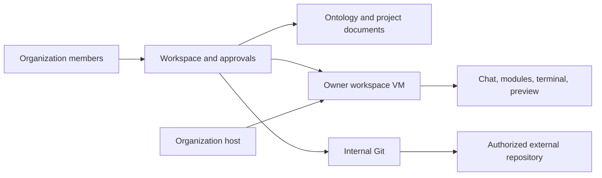

# G5

G5 helps organizations build software with agents. People agree on intent in project
documents, work in isolated workspaces through chat and development tools, and publish
reviewed changes. Each workspace owns its Git branches and has compute that only its
current owner may use. Git stores repository content; G5 records collaboration,
permissions and execution history. The pages below define the rules and exceptions.

## Product goals

[I · g5.purpose]

G5’s product goals say what G5 must achieve for the people and organizations that use it.

[I · g5.purpose.enterprise-personas]

Enable people across enterprise roles, from less technical product owners to experienced developers, to build complex software with agents.

[I · g5.purpose.intent-guidance]

Let people guide development by stating and evaluating high-level intent. Keep that intent and its history so agents can build software that follows it.

[I · g5.purpose.alignment]

Help people in different enterprise roles agree on what the software should do.

[I · g5.purpose.software-quality]

Produce well-designed, maintainable software that follows the agreed intent.

[I · g5.purpose.thin-client]

Require only a thin client; host all development resources remotely.

[I · g5.purpose.enterprise-integration]

Integrate with the infrastructure enterprises use to develop and deliver software.

[I · g5.purpose.models]

Support a choice of models and adapt as models improve.

## Reading paths

- [Core concepts](concepts/data_model.g5.md)
- [Organization](features/organizations.g5.md)
- [Users](features/users.g5.md)
- [Repositories](features/repositories.g5.md)
- [Workspace](features/workspaces.g5.md)
- [Workspace reviews and approvals](features/reviews.g5.md)
- [Personal workspace](features/personal_workspace.g5.md)
- [Workspace VM](software_architecture/workspace_vm.g5.md)
- [Host](software_architecture/hosts.g5.md)
- [Host Control Plane](software_architecture/host_control_plane.g5.md)
- [Git](software_architecture/git.g5.md)
- [Outbound email](software_architecture/email.g5.md)
- [Formal agent approvals](features/agent_approvals.g5.md)
- [Chat](features/chat.g5.md)
- [Workspace VM shell access](features/terminal.g5.md)
- [Security](concepts/security.g5.md)
- [Issues](features/issues.g5.md)
- [Ontology](features/ontology_and_harness.g5.md)
- [Documents and discussion](features/documents.g5.md)
- [Diff Graph](features/diff_graph.g5.md)
- [Platform operations](features/operations.g5.md)
- [UI](features/ui.g5.md)
- [System design principles](concepts/system_design_principles.g5.md)
- [System invariants](concepts/system_invariants.g5.md)

## Metadata

Model summaries on these pages describe archived, finite TLA+/TLC checks, not proofs
of the production code. Each summary states what was checked and its main limit;
[coverage and evidence baselines](../uplift/ben-ontology/coverage.md) give the scope.
The recovered model catalog and gap assessment are not part of this checkout.

### g5.purpose

- agent
- Defines the `g5.purpose` level for [ID levels](features/ontology_and_harness.g5.md#g5.ontology.writing.id-levels).
- Children: [Enterprise personas](#g5.purpose.enterprise-personas), [Intent guidance](#g5.purpose.intent-guidance), [Alignment](#g5.purpose.alignment), [Software quality](#g5.purpose.software-quality), [Thin client](#g5.purpose.thin-client), [Enterprise integration](#g5.purpose.enterprise-integration), [Models](#g5.purpose.models), [Agents](features/chat.g5.md#g5.purpose.agents), [Personal](features/personal_workspace.g5.md#g5.purpose.personal).

### g5.purpose.enterprise-personas

- human-provided
- Expands: [Product goals](#g5.purpose).
- Source: [Ben, line 5](../../docs/ben_new_ontology.md#L5).

### g5.purpose.intent-guidance

- human-provided
- Expands: [Product goals](#g5.purpose).
- Source: [Ben, line 6](../../docs/ben_new_ontology.md#L6).

### g5.purpose.alignment

- human-provided
- Expands: [Product goals](#g5.purpose).
- Source: [Ben, line 7](../../docs/ben_new_ontology.md#L7).

### g5.purpose.software-quality

- human-provided
- Expands: [Product goals](#g5.purpose).
- Source: [Ben, line 8](../../docs/ben_new_ontology.md#L8).

### g5.purpose.thin-client

- human-provided
- Expands: [Product goals](#g5.purpose).
- Source: [Ben, line 9](../../docs/ben_new_ontology.md#L9).

### g5.purpose.enterprise-integration

- human-provided
- Expands: [Product goals](#g5.purpose).
- Source: [Ben, line 10](../../docs/ben_new_ontology.md#L10).

### g5.purpose.models

- human-provided
- Expands: [Product goals](#g5.purpose).
- Source: [Ben, line 11](../../docs/ben_new_ontology.md#L11).
