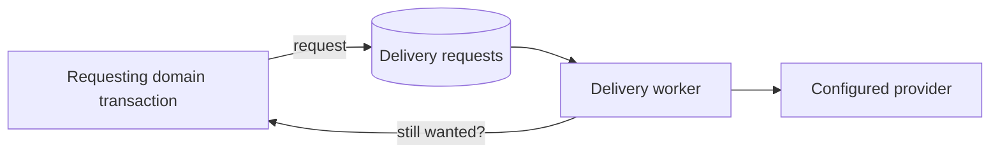

# Outbound email

Outbound email is G5's shared mechanism for transactional messages. The first consumer
is the [organization invitation email](../features/organizations.g5.md#g5.organization.invitation-email);
more are planned.

[D · g5.email]

The outbound email module delivers transactional messages that any G5 domain requests. It renders the message, records the request, sends it through the configured provider, and reports the outcome. These are outside it:

- inbound mail, and marketing or bulk mail;
- user-managed templates and attachments;
- a general notification framework, with audiences, preferences and digests;
- multi-provider failover and bounce or complaint analytics.

## Boundary

[D · g5.email.boundary]

Callers request a typed message for one recipient and read its delivery status; nothing else is public. The module privately owns rendering, absolute links from the platform's public URL, sender identity, provider credentials, transport and retry state. It depends on no consumer domain and reaches a consumer's rules only through that consumer's [validity check](#g5.email.validity).

- Rendering covers the [Markdown subset](#g5.email.markdown) and [link policy](#g5.email.link-policy) for text G5 did not write.
- A caller names only its [sender mailbox](#g5.email.sender); it cannot pick a provider, domain, template or raw transport, so changing those leaves consumers untouched ([abstraction](../concepts/system_design_principles.g5.md#g5.design.abstraction)).

[D · g5.email.consumers]

A new use supplies three things, and adding a kind needs no schema change:

- a message kind and template, with the [sender mailbox](#g5.email.sender) its requests use;
- a purpose kind and key that defines the live request it [coalesces with](#g5.email.identity);
- a [validity check](#g5.email.validity) it owns, supplied before the kind can send.

Every request has one recipient and names its organization; the consumer owns recipient selection and authorization, any per-recipient preference or opt-out, and the decision that a message is warranted. The [delivery](#g5.email.handoff), [identity](#g5.email.identity), [retry](#g5.email.retry) and [ambiguity](#g5.email.ambiguity) rules apply to every kind unchanged.

[D · g5.email.sender]

Each consumer names the mailbox its messages come from, such as `invitations` or `approvals`, so recipients can tell kinds of mail apart. The module joins the mailbox and a display name with the one configured sending domain, giving for example `G5 <invitations@mail.g5labs.ai>` or `G5 Approvals <approvals@mail.g5labs.ai>`; a consumer cannot choose the domain, so every message stays on the verified domain. Mailbox and display name are code constants checked when G5 is built, so neither can inject header syntax.

- A consumer may set its display name; otherwise the deployment's configured name is used.
- A mailbox is 1–32 lowercase letters, digits, dots, hyphens or underscores, starts and ends with a letter or digit, and repeats no dot.
- A display name is 1–64 letters, digits, spaces, dots, hyphens or underscores.
- Role mailboxes (`postmaster`, `abuse`, `hostmaster`, `webmaster`, `security`, `root`, `mailer-daemon`) are refused.
- These mailboxes send only and receive no replies; inbound mail is outside the module.

## Written content

[D · g5.email.authored-content]

Some kinds carry text that G5 did not write, such as an [agent's message to its owner](../features/workspaces.g5.md#g5.workspace.owner-email), and the module treats that text as untrusted. A notice naming the author comes before the text in both the HTML and text parts, so nothing the author writes can appear above it and look like G5's own words.

- The text is rendered as plain text, or as the [Markdown subset](#g5.email.markdown) when the kind or request calls for it.
- The text part is always the author's source as written, normalized but not rendered.

[D · g5.email.markdown]

The Markdown subset is a fixed part of CommonMark with GFM tables: headings 1–3, paragraphs, bold, italic, ordered and unordered lists, block quotes, inline and fenced code, horizontal rules and simple tables. The module renders it into its own template with fixed inline styles and always escapes author text, so no input can produce markup or a style. Links follow the [link policy](#g5.email.link-policy).

- An in-paragraph line break is kept, as in GitHub comments.
- Anything outside the subset appears as escaped source text: raw HTML, images, headings 4–6, footnotes, task lists and strikethrough. None of the author's text is dropped.
- A reference-style link definition is refused, because the parser consumes it and it cannot be shown in place.
- Bounds stop pathological input: lists and block quotes nest at most 2 levels, a table has at most 10 columns and 200 rows, and the rendered HTML is at most 256 KiB.
- A body over a bound is refused when requested, naming the reason, construct and line; nothing is recorded, and a body is never partly sent or quietly downgraded to plain text.

[D · g5.email.link-policy]

A link in written content is clickable only when all of these hold:

- its target is an absolute `https` URL without user information;
- after normalization, the target is on the deployment's public G5 host (when G5 is
  served over `https`), or within one
  of the `https` repository scopes the requesting kind supplies, for example
  `https://github.com/acme/api` and paths below it;
- its visible text is the target itself or contains nothing URL-like: no `://`, no `www.` word, no `host.tld/` path.

Any other link — `mailto:`, `javascript:`, `data:`, `http`, relative and foreign links — shows its visible text followed by its full target and is not clickable; a bare `https` URL becomes clickable under the same rule and otherwise stays text, with the `href` always the normalized URL checked. So every link G5 makes points at an allowed target and every other target is shown in full, though a mail client may still linkify visible URL text itself.

## Delivery

[D · g5.email.handoff]

A request is recorded in the requesting domain's own transaction, so it exists exactly when that domain's change commits: a rolled-back change never sends, and a committed one survives a crash or restart. A background worker on the maintenance role sends due requests, claiming each with a lease that is reclaimed if it expires. Delivery starts within a few seconds of a healthy worker's commit; it is not synchronous with the request.

[D · g5.email.validity]

Before every send attempt, the requesting domain decides whether the message is still wanted; when it is not, the request ends as cancelled and is never sent, as when an invitation is revoked, accepted or expired. A domain change that commits between this check and the provider call can still be followed by a send. Messages therefore never carry authority: acting on one still passes the domain's own current checks.

[D · g5.email.identity]

Each request is one message identity: rendered once when recorded, with its provider idempotency key fixed then, so every attempt resends the same key and content. Only an explicit domain operation creates a request; automatic retries never do.

- A purpose, named by its kind and key (for example one invitation), has at most one live request, queued or sending. Asking again while one is live makes it due now instead of creating a second; a request made after the previous one ended is a new message.
- A kind may instead declare single-use keys, for a key that names one caller request rather than a lasting object. Repeating such a key returns the existing request, live or ended, while it is retained, so a caller's retry cannot send twice.

[D · g5.email.retry]

Transient failures retry with capped, jittered exponential backoff: rate limits, provider unavailability, connection failures, rejected credentials or an unverified sender. A provider outage never undoes the requesting domain's committed change.

- Credential and sender failures also log a configuration error.
- A request the provider permanently rejects, such as an invalid recipient, ends as failed without retry.
- Retries stop 23 hours after the first attempt, inside the provider's 24-hour idempotency window, and the request ends as failed.

[D · g5.email.ambiguity]

An attempt with no definite answer may have sent the message: a timeout after the request was written, a 5xx response or a lost worker lease. Within the retry window, the provider's idempotency key deduplicates retries, so the recipient gets at most one copy of that identity.

- A request that ends without a definite answer is marked possibly sent and never retried automatically; a new request may duplicate it.
- Provider acceptance is not proof of inbox delivery. Bounces, spam filtering and the provider's suppression of bouncing or complaining addresses happen after acceptance and are not tracked.

## Observability and data

[D · g5.email.observability]

Each request keeps its status (queued, sending, sent, failed or cancelled), attempt count, terminal reason, classified last error, whether the outcome is uncertain, the provider message id and timestamps. Delivery logs carry the request, purpose and organization identifiers and the outcome class, never credentials, the recipient address or message content. Terminal failures and configuration errors are logged at error level.

- The `capture` transport is the one exception: for tests and local development it logs each message, including recipient and text, so a developer can follow the link. Deployments with real addresses use `resend` or `disabled`.

[D · g5.email.data]

Requests are system data reachable only through this module, granted to the system role
and denied to the tenant role like
[other system-only stores](../concepts/security.g5.md#g5.security.tenant.rls). Each row
names its organization and is deleted with it. Rendered content is cleared when a
request ends, and ended requests are deleted after 30 days.

## Provider and configuration

[D · g5.email.provider]

The one configured provider is Resend, whose HTTP API accepts an idempotency key that suppresses duplicate sends for 24 hours, which the [ambiguity rule](#g5.email.ambiguity) relies on; Postmark, SendGrid and Amazon SES offer no equivalent and would need provider-side reconciliation. A deployment selects `disabled` (the default, recording nothing), `capture` (messages kept in memory and logged, for tests and local development) or `resend`.

- Selecting `resend` or `capture` without a sending domain, or `resend` without an API key, fails at startup rather than silently dropping mail. Compose and browser test stacks point the Resend client at a local stub.
- G5's deployments send from the dedicated subdomain `mail.g5labs.ai` as `G5`, which keeps transactional reputation apart from company mail; the owner provisions the Resend account, DNS records and API key.
- Self-hosted deployments configure their own domain and display name.

[D · g5.email.volume-limits]

Every message kind shares one provider account and sending reputation, so a kind whose recipients or volume a user controls carries a per-organization limit on new requests in a rolling 24 hours, defined with the kind. The [invitation email limit](../features/organizations.g5.md#g5.organization.invitation-email-limit) is the first.

- A kind may add a per-recipient limit over the same window, so one recipient cannot use up the organization's allowance.
- A request over a limit fails inside the requesting transaction, refusing the change with nothing written; coalescing into a live request is not a new request.
- Concurrent requests for one organization and kind are counted one at a time, so they cannot together exceed the limit ([shared quota](../features/operations.g5.md#g5.platform.shared-quota)).
- A local development stack may turn every limit off; a deployment sending through the provider's public API cannot, because its mail reaches real recipients.

[Q · g5.email.preference-question]

Which later message kinds need recipient preferences or an unsubscribe link, and who owns them? The recommended option is a preference owned by the [notification settings](../features/users.g5.md#g5.user.notifications) and checked by the consumer before requesting, with the module adding a one-click `List-Unsubscribe` header for subscribed kinds.

- Invitations are one-off and directly requested, so they need neither; [agent-to-owner email](../features/workspaces.g5.md#g5.workspace.owner-email-preference) is owner-requested and also needs neither.
- Activity notifications people did not ask for each time, such as mentions, normally need a per-recipient preference.
- Settled: the [approval-request](../features/reviews.g5.md#g5.governance.approval.request-email) and [approval-decision](../features/reviews.g5.md#g5.governance.approval.decision-email) emails use one account-wide preference in the notification settings, checked by each consumer; their `List-Unsubscribe` header is deferred.
- Open: the general framework and later kinds.

## Metadata

### g5.email

- agent
- Defines the `g5.email` ID level: the outbound email module and its scope. Source is the [issue #621 module boundary](../../chat_intent/issue-621/request.md); planned reuse beyond identity and invitations is the owner's 2026-10-17 [follow-up](../../chat_intent/issue-621/request.md#follow-up).

### g5.email.boundary

- human-verified
- Source: [issue #621 module boundary](../../chat_intent/issue-621/request.md).
- Implementation: `backend/g5-api-core/src/services/email/`, its own lowest service context; table `email_deliveries` (migration 093); operator guide `docs/email-delivery.md`.
- Evidence: `backend/g5-api/tests/email_delivery.rs` and the module's `compile_fail` doctests ([validation results](../../pr_ontology_diff_design/issue-621/ontology-plan.md#validation-results)).
- Owner (2026-10-17): the mechanism will be reused for many purposes unrelated to identity or invitations ([chat intent](../../chat_intent/issue-621/request.md#follow-up)).

### g5.email.consumers

- human-verified
- Source: owner follow-up on reuse ([chat intent](../../chat_intent/issue-621/request.md#follow-up)); the extension contract is the agent's [design](../../pr_ontology_diff_design/issue-621/ontology-plan.md#module-and-ownership).

### g5.email.sender

- human-verified
- Source: owner request (2026-10-18) that a calling module specify, "within reason", the mailbox name its email comes from, for example `invitations` or `approvals` at `mail.g5labs.ai` ([chat intent](../../chat_intent/issue-621/request.md#sender-mailbox)). The validation rules and reserved names are the agent's reading of "within reason". Owner follow-up (2026-10-18): "caller can set its own display name too". Invitations keep the configured name, as in the owner's earlier `G5 <invitations@mail.g5labs.ai>` answer.
- Implementation: `email::Sender::new` and `Sender::with_display_name`, `const fn`s whose checks fail compilation; `compile_fail` doctests cover a malformed name, a reserved name and a header-like display name.

### g5.email.authored-content

- human-verified
- Source: [issue #834](https://github.com/G5Labs/G5-Lean/issues/834) asks that the notice that the agent wrote the message move above the content, so formatting cannot make it look like G5's, and that the text part be the Markdown source. Applying the notice to plain-text bodies too, and placing it in the text part, are agent decisions ([design](../../pr_ontology_diff_design/issue-834/ontology-plan.md)).
- Evidence: `email::render::tests::markdown_bodies_render_the_subset_under_the_notice` and `workspace_owner_email::the_owner_receives_the_agents_message_with_attribution_and_a_workspace_link`.

### g5.email.markdown

- human-verified
- Source: [issue #834](https://github.com/G5Labs/G5-Lean/issues/834). The owner asked "can we do better?" than plain text and said "Wanting basic, safe formatting will be a common need". The subset, the escaped text for unsupported constructs and the refusal on bounds come from the issue. The owner chose to keep in-paragraph line breaks "like GitHub comments" (decision, 2026-10-26). The concrete bounds and refusing reference-style link definitions are agent decisions ([design](../../pr_ontology_diff_design/issue-834/ontology-plan.md#markdown-rendering)).
- Implementation: `backend/g5-api-core/src/services/email/markdown.rs`, which uses `pulldown-cmark` with only tables enabled.
- Evidence: `email::markdown::tests` (the subset, each unsupported construct, each bound with its line) and `workspace_owner_email::a_markdown_body_outside_the_bounds_is_refused_with_its_reason_and_nothing_written`.

### g5.email.link-policy

- human-verified
- Source: [issue #834](https://github.com/G5Labs/G5-Lean/issues/834) link policy. What counts as URL-like text, requiring an `https` public URL for G5's own links, and the limit that a mail client can make visible URLs clickable itself, are agent decisions ([design](../../pr_ontology_diff_design/issue-834/ontology-plan.md#link-policy)).
- Evidence: `email::markdown::tests::links_to_g5_and_supplied_repositories_are_clickable` and `other_links_show_their_target_and_are_not_clickable` (foreign host, prefix boundary, URL-like text, `http`, `mailto`, `javascript`, `data`, relative, user information, `..` and encoded dots), and `workspace_owner_email::a_markdown_body_links_only_to_g5_and_the_organizations_repositories`.

### g5.email.handoff

- human-verified
- Source: [issue #621 handoff requirement](../../chat_intent/issue-621/request.md); the reuse evaluation and worker placement are agent decisions in the [design](../../pr_ontology_diff_design/issue-621/ontology-plan.md).
- The module adds its own queue because the platform-report outbox is [GitHub-specific](../features/operations.g5.md#g5.platform.report-delivery) and the removed jobs system left no generic queue to reuse.

### g5.email.validity

- agent
- Source: issue #621 asks how queued delivery treats revoked, expired or accepted invitations; [design](../../pr_ontology_diff_design/issue-621/ontology-plan.md).

### g5.email.identity

- agent
- Source: issue #621 asks for duplicate suppression and that automatic retries cannot become resends; [design](../../pr_ontology_diff_design/issue-621/ontology-plan.md).
- Single-use keys: agent design for [`g5d workspace email-owner`](../features/workspaces.g5.md#g5.workspace.owner-email) retries (2026-10-19); evidence `workspace_owner_email::a_repeated_idempotency_key_returns_the_earlier_request_and_sends_nothing_more`.

### g5.email.retry

- human-verified
- Source: [issue #621 failure requirements](../../chat_intent/issue-621/request.md); the classification and the 23-hour window are agent decisions in the [design](../../pr_ontology_diff_design/issue-621/ontology-plan.md).

### g5.email.ambiguity

- agent
- Source: issue #621 asks to define the limits of delivery guarantees for ambiguous outcomes; Resend's [idempotency keys](https://resend.com/docs/dashboard/emails/idempotency-keys) are kept for 24 hours.

### g5.email.observability

- human-verified
- Source: [issue #621 observability requirement](../../chat_intent/issue-621/request.md); the stored fields and log policy are agent decisions.
- The capture-transport exception was made explicit after review on PR #638. That transport already logged messages under [`g5.email.provider`](#g5.email.provider).

### g5.email.data

- agent
- Source: [design](../../pr_ontology_diff_design/issue-621/ontology-plan.md); follows the system-only grant pattern of `platform_issue_outbox`.

### g5.email.provider

- human-verified
- Source: issue #621 delegated the choice to design ([design](../../pr_ontology_diff_design/issue-621/ontology-plan.md#provider)); owner answers `outbound-email` / `provider` = Resend and `sender-domain` = `G5 <invitations@mail.g5labs.ai>`, owner-provisioned (decisions, 2026-10-17).
- Gap: production delivery is unverified until the owner provisions the account, domain and key.

### g5.email.volume-limits

- human-verified
- Source: owner answer `outbound-email` / `invitation-email-cap` = "Cap at 100 per organization per 24 hours" (decision, 2026-10-17), which settled the former `g5.email.abuse-question`. Generalizing the limit to every user-controlled kind is the agent's reading of the reuse follow-up and of that question's shared-reputation reason.
- Per-recipient limits: agent design for [owner email](../features/workspaces.g5.md#g5.workspace.owner-email-limit) (2026-10-19); evidence `workspace_owner_email::the_fifty_first_message_to_one_owner_in_a_day_is_refused`.
- Owner instruction (2026-10-19) to lift the cap for local development ([chat intent](../../chat_intent/issue-621/request.md#local-cap-and-owner-email-command)). Refusing the switch against the public API, and keeping it in test stacks, is the agent's reading of "local dev".
- The [approval-request](../features/reviews.g5.md#g5.governance.approval.request-email) and [approval-decision](../features/reviews.g5.md#g5.governance.approval.decision-email) emails ([issue #991](https://github.com/G5Labs/G5-Lean/issues/991)) state their per-organization and per-recipient limits in those commitments, mirroring owner email.

- PR448 integration applies the existing local switch to disposable Cloud and compose test APIs pinned to the hermetic email stub, matching the development stack. Full review fixtures exceeded the invitation cap; the existing default/public-provider guard, concurrent cap refusal and past-cap local-delivery regressions all pass. [Integration evidence](../../../docs/review-flow.md#october-19-latest-main-integration).

### g5.email.preference-question

- agent; uncertain
- Source: owner follow-up on reuse; [CI-G4](../../../docs/code_gaps.md) records that notification preferences are missing. Not needed for invitations.
- The approval-request and approval-decision cases are settled in the block above, following the recommended option ([issue #991](https://github.com/G5Labs/G5-Lean/issues/991), [design](../../pr_ontology_diff_design/issue-991/ontology-plan.md)); the general framework and the deferred one-click `List-Unsubscribe` header stay open.
