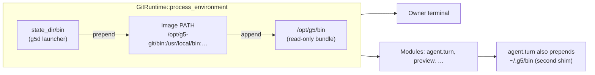

# Runtime bundle tools reachable on the guest command path

## Ontology changes and governance

Comparison base: `5af3b761` (branch `add-gcloud-to-image`, clean tree).

One new block, `g5.runtime.bundle.tools`, in
[`software_architecture/runtime.g5.md`](../../ontology/software_architecture/runtime.g5.md).
No existing block is amended: `g5.runtime.workspace-cli` constrains the *launcher* to
preserve image tools and to scope G5 library paths to G5 processes, and both constraints
are preserved here. Its "exposes only `g5d`" reading lives in code comments
(`runtime_environment.rs:15-16`) and in a test-guard note
([CLI review F1](../../chat_intent/codex-pr-user-authorship/reviews/cli-ux-one.md)), not
in a commitment, so the narrowing is a code decision this block now supersedes.

```diff
+## The bundle's tools are reachable without displacing the image
+
+[D · g5.runtime.bundle.tools]
+
+Guest shells reach the bundle's tools by name, because the bundle supplies several of
+them for agent and owner shell use rather than only for platform processes. The runtime
+appends its bundle directory after the image's own command directories, so an
+image-supplied tool of the same name always wins and a minimal image still gets a
+working tool. Exposure is command lookup only: no G5 library path reaches a repository
+or provider process, per the [workspace CLI launcher](#make-the-workspace-cli-available-to-people-and-agents),
+whose prepended launcher keeps `g5d` resolving to the shim rather than the bundle binary.
```

```diff
+### g5.runtime.bundle.tools
+
+- human-verified
+- [Runtime tools on PATH request](../../chat_intent/add-gcloud-to-image/runtime-tools-on-path.md). The per-tool shell-use purpose is already declared by the bundle staging contract (`scripts/stage-local-worker-runtime.sh:15-21`) and the worker image (`infra/packer/g5-worker/variables.pkr.hcl:333,350`); append-after-image precedence follows the existing preview fallback rule (`g5d-cli/src/preview_serve.rs:138-144`).
+- Unassessed · not implemented. `GitRuntime::process_environment` (`g5d-dispatch/src/git.rs:150-160`) is the single command path feeding owner terminals (`g5d-dispatch/src/server.rs:256-259`) and every module including `agent.turn` (`g5d-dispatch/src/modules/runner.rs:259`), and today exposes only the prepended `g5d` launcher directory; `gcloud`, `gh`, `kubectl`, `gke-gcloud-auth-plugin` and `cargo-nextest` are consequently unreachable by name. Only `workspace.preview` customer commands currently append the bundle directory. Observed in a deployed guest: every bundle executable runs with `LD_LIBRARY_PATH` unset, and the bundle's wrapper scripts resolve siblings via `dirname "$0"` without `readlink -f`, so symlinking them elsewhere breaks them.
```

### Relevant and governing ontology

| Block | Why relevant | What implementation must enforce or consider |
|---|---|---|
| [`g5.runtime.bundle`](../../ontology/software_architecture/runtime.g5.md#the-platform-supplies-its-complete-runtime) | Owns what the read-only bundle supplies, independently of the customer image | Exposure must not become a guest-copy fallback or a readiness requirement; the bundle stays read-only and its contents unchanged |
| [`g5.runtime.bundle.tools`](../../ontology/software_architecture/runtime.g5.md#the-bundles-tools-are-reachable-without-displacing-the-image) | New owner of reachability | Append after image directories; command lookup only; `g5d` must still resolve to the launcher shim |
| [`g5.runtime.workspace-cli`](../../ontology/software_architecture/runtime.g5.md#make-the-workspace-cli-available-to-people-and-agents) | Owns the launcher setup, image-tool preservation and library scoping | Keep `state_dir/bin` *prepended* and `/usr/local/bin/g5d` intact; add no loader variable to repository or provider processes |
| [`g5.security.credentials.reserved-env`](../../ontology/concepts/security.g5.md#protect-platform-owned-environment-keys) | `is_exportable_task_env_key` already rejects `PATH` at terminal and runner admission | Runtime remains the sole owner of the command path; tenant settings must not be able to replace it |
| [`g5.preview.service`](../../ontology/features/preview_terminal.g5.md#preview-is-a-visible-service-with-explicit-lifetime) | Preview customer commands already append the bundle directory | The shared append must stay idempotent so preview does not double-append, and a customer `preview.env` `PATH` must still replace it entirely |
| [`system_design_principles`](../../ontology/concepts/system_design_principles.g5.md#justify-each-new-mechanism) | New mechanism must be justified against existing operations | Reuse the existing append helper and bundle-path constant; no per-tool shims, allowlist or new state |

## Requested outcome and design

Agents and owner terminals in future VMs can run `gcloud`, `gh`, `kubectl`,
`gke-gcloud-auth-plugin` and `cargo-nextest` by name, permanently, without displacing
the image toolchain.



`GitRuntime::process_environment` is the single place that assembles the guest command
path, and it already feeds owner terminals and every module, so one change there reaches
both surfaces and `agent.turn` keeps its own prepend on top. The bundle directory is
appended rather than prepended because that is the only ordering that satisfies
`g5.runtime.workspace-cli`'s image-tool preservation under an unknown customer image:
collisions (`node`, `cargo`, `just`, `python3`, `npm`) resolve to the image, while a
minimal image falls through to the bundle — the precedence rule `preview_serve` already
states and implements. No per-tool shim or allowlist is introduced: every bundle
executable was observed to run with `LD_LIBRARY_PATH` unset, so plain lookup suffices,
and the bundle's `dirname "$0"` wrapper scripts only work when invoked *through* the
bundle directory, which appending achieves and symlinking does not. The duplicated
`RUNTIME_BIN_DIR` and `customer_path_with_runtime_bin` in `preview_serve` fold onto the
existing `GUEST_RUNTIME_LIBRARY_PATH` constant and an `append_path` sibling to
`prepend_path` in `runtime_environment`, keeping one owner for the path algebra. The
append should be guarded on the running executable being the bundle's `g5d`, mirroring
the existing `/usr/local/bin/g5d` guard, so local and macOS process fixtures keep their
current environment.

### Acceptance outcomes

- In a real guest, an `agent.turn` bash and an owner terminal both resolve `gcloud`,
  `gh`, `kubectl`, `gke-gcloud-auth-plugin` and `cargo-nextest` by name and run them.
- An image-supplied tool of the same name still wins. The existing terminal regression
  asserting `command -v git` equals the image path and `command -v g5d` equals
  `var/lib/g5d/bin/g5d` (`backend/g5d/tests/dispatch.rs`) stays green and still
  discriminates a launcher that shadows image tools.
- `command -v g5d` never resolves to `/opt/g5/bin/g5d`.
- No `LD_LIBRARY_PATH`/`DYLD_LIBRARY_PATH` appears in the terminal, module or provider
  environment; existing scrub assertions stay green.
- Preview commands see the bundle directory exactly once, and a customer `preview.env`
  `PATH` still replaces the whole value.

### Risks and accepted consequences

- **Provider CLIs become discoverable.** `claude` and `codex` gain name reachability in
  agent shells. Capability is unchanged (both are already runnable by absolute path), but
  discoverability is not. Flagged for human acceptance rather than silently narrowed by
  an allowlist, which would add state this design otherwise avoids.
- **Minimal images gain fallback tools.** An image without `node`/`python3` would newly
  resolve the bundle's copies in agent and terminal shells. This already holds for
  preview commands; the change extends the same fallback, and the pinned bundle versions
  may differ from what such an image would have installed.
- **Bundle contents become a shell-visible contract.** Removing or renaming a bundle tool
  would become an observable change for agents. The bundle is already version-pinned per
  tool in Packer, so this is a documentation obligation rather than a new mechanism.

### Unresolved assumptions

- Whether the human wants the full bundle appended or only the five currently-missing
  tools exposed. The plan takes the former as the minimal mechanism; the latter needs a
  maintained allowlist and per-tool forwarders, because symlinks break the wrappers.

## Review summary

Implementation review on 2026-10-07 found no functional defect in PATH construction,
its terminal/provider consumers or preview override order. It corrected stale memory
notes and updated `g5.runtime.bundle.tools` evidence without changing the governing
text or the original handoff diff above. The actual mounted-binary gate and all five
tools passed through a real terminal and controlled Claude/Codex provider shell
fixtures in a private mount namespace. Fresh VM boot, live models, arm64 and other
image profiles remain unverified. See [review findings and checks](review.md).

Original design review:

Challenged the append against the contract most likely to forbid it. `g5.runtime.workspace-cli`
turned out to constrain shadowing and library scoping, not exposure, and both hold under
an append; the stricter "only `g5d`" reading exists in a code comment and in CLI review
F1's *test-guard* advice ("keep `/opt/g5/bin` out of this image-tool PATH so the
regression still detects broad bundle PATH injection"), which concerns a prepending
launcher and remains satisfied — the bundle ships no `git`, so that assertion is
untouched. The opposing evidence is weaker than the bundle's own staging contract, which
declares these tools present *for agent bash*.

Remaining uncertainty for coding:

- **Reuse to verify before relying on it:** `customer_path_with_runtime_bin` is
  idempotent by inspection (`preview_serve.rs:154`), which is what keeps preview from
  double-appending after the shared constant moves. Confirm against the actual call order
  in `preview_serve`, since `preview.env` is applied *after* the append.
- **Guard condition:** whether `std::env::current_exe() == /opt/g5/bin/g5d` holds in the
  CI workspace-VM lane as well as the deployed guest; if the lane stages the bundle
  elsewhere, the guard must key off the configured runtime root instead.
- **Unexecuted coverage:** the acceptance outcomes above need a real guest; the
  `LD_LIBRARY_PATH`-unset and `dirname "$0"` observations come from one deployed VM on
  one architecture, not from the x64 lane.

## Implementation record

Both coding uncertainties resolved as designed, so the design stands unamended.

- **Preview call order confirmed.** `append_runtime_bin_to_customer_path`
  (`preview_serve.rs:280`) reads the ambient PATH and `preview.env` is applied after it
  (`:286`), so a customer `PATH` still replaces the whole value and
  `customer_path_override_from_preview_env_still_wins` keeps covering it. Because
  `preview-serve` now inherits a path that already carries the bundle, the shared
  helper's idempotence is what keeps preview from double-appending.
- **Guard condition resolved, not relocated.** The host pins the entrypoint to
  `/opt/g5/bin/g5d` (`workspace_vm.rs:897`) and the bundle always mounts at that
  directory, so `current_exe()` matches in every real guest including the CI
  workspace-VM lane. No configured-runtime-root fallback was needed. The same gate now
  also drives the pre-existing guest standard-path symlink, replacing its duplicate
  literal.

Executed: the `g5d-runtime-core` suite (15 passed), the `g5d-dispatch` lib suite
(110 passed, including ordering, idempotence, image-tool precedence, shim precedence and
the image-only local-fixture path), the `g5d-cli` preview suite (30 passed), and
`clippy --all-targets -D warnings` plus `cargo fmt --check` on `g5d-runtime-core`,
`g5d-dispatch`, `g5d-cli` and `g5d --no-default-features --features test-helpers`.

One test had to be tightened during implementation: asserting the bundle directory is
*absent* from a local fixture's PATH is wrong, because a test runner launched through
the bundle's own `cargo` wrapper already inherits that directory. The assertion is now
"the runtime contributes no bundle entry" — the produced path equals the launcher plus
the inherited path, unchanged.

Unexecuted coverage, carried into the block's metadata:

- The appended branch is unreachable off a mounted bundle, so the five tools resolving
  by name in a real agent turn and owner terminal is established by composition, not
  observed. This needs the workspace-VM lane or a deployed guest.
- The dispatcher integration suite (`backend/g5d/tests/dispatch.rs`), including the
  terminal regression asserting image `git` and the shim `g5d`, type-checks under the
  repo's own `-p g5d --no-default-features` lint recipe but was not executed:
  `g5d-isolation/build.rs` requires libkrun via pkg-config, which this VM lacks.
- Guest observations are from one deployed x86_64 guest, not the arm64 path.

### Subsequent implementation review evidence

The earlier integration-test blocker was resolved with `--no-default-features`:
the real terminal regression and both provider-launch regressions passed. The mounted
path is also executable in an isolated mount namespace without changing the installed
guest runtime; all five tools ran by name through the terminal and both provider
fixtures, preserving image `node`, launcher precedence and loader isolation. This
narrows the earlier composition-only gap while retaining fresh-VM and live-model limits.
The review ran 110 dispatcher, 15 core and 20 preview tests successfully; a broader
CLI suite had three failures in unchanged doctor/push code. Full method and remaining
gaps are in [the review](review.md). No production code or contract amendment was needed.
