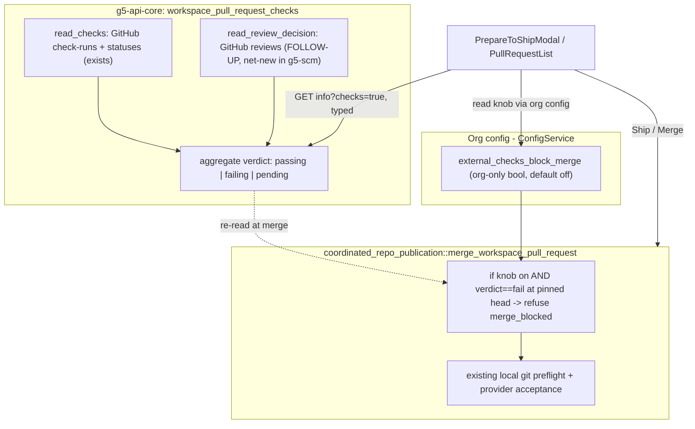

# External PR status in Prepare to Ship, with an org merge-block policy

## Ontology changes and governance

**Comparison base:** `origin/main` at `49f2de51`.

**Changed blocks** (all in [governance](../../ontology/features/governance.g5.md)):

- **Add** `g5.governance.pr.checks.surface` — Prepare to Ship / Pull Requests display an
  external PR's commit statuses, check runs and review decision per provider repo with an
  aggregate verdict; advisory, head-bound, honest about pending/unavailable.
- **Add** `g5.governance.merge.external-policy` — an org-admin, default-off policy that
  blocks merge on a definite external failure, enforced authoritatively server-side at the
  merge boundary and mirrored by the Ship/Merge control.
- Metadata entries added for both (status: Planned).

No other block changes meaning. The new blocks reference, and do not restate,
`g5.governance.pr.checks` (read), `g5.governance.pr.checks.revision` (head binding),
`g5.governance.approval.requirements` (org-admin merge-gate authority) and
`g5.governance.merge` (recoverable merge).

Actual added ontology (bodies elided — see the file; metadata included):

```diff
+### Show external PR status while preparing to ship
+[D · g5.governance.pr.checks.surface]
+... per-repo commit statuses + check runs + review decision, aggregate verdict,
+   head-bound, advisory; merge-blocking is the separate org policy ...
+
+### An organization policy can block merge on failing external checks
+[D · g5.governance.merge.external-policy]
+... org-admin default-off boolean; blocks on definite failure (fail/cancel check or
+   status, or changes-requested review) on any repo the PR spans; authoritative
+   server-side re-read at merge; additive to provider branch protection ...
+
+### g5.governance.pr.checks.surface   (metadata: human-provided; Planned)
+### g5.governance.merge.external-policy (metadata: human-provided; Planned)
```

### Relevant and governing ontology

| Block | Why relevant | What implementation must enforce/consider |
|---|---|---|
| [g5.governance.pr.checks](../../ontology/features/governance.g5.md#inspect-provider-checks-from-a-workspace-agent) | Already reads GitHub check runs + commit status contexts for a PR | Reuse `workspace_pull_request_checks::read_checks`; do not add a second provider read for checks/statuses. Missing/incomplete stays explicit, never a pass. |
| [g5.governance.pr.checks.revision](../../ontology/features/governance.g5.md#bind-check-observations-to-the-requested-revision) | Checks are observations bound to a revision | Display and the merge gate bind to the current provider head; a mismatch is pending, not success; stale passing checks never satisfy a newer head. |
| [g5.governance.pr.checks.details](../../ontology/features/governance.g5.md#read-the-failure-evidence-published-to-github) | Redaction/bounding of provider output | Any failure text surfaced in the UI applies the public-output redaction + bounding already enforced by the checks owner. |
| [g5.governance.approval.requirements](../../ontology/features/governance.g5.md#organization-administrators-administer-approval-requirements) | Precedent: org admins administer merge gates without workspace ownership, tenant-isolated | New policy uses the same `org:admin` authority and tenant isolation; composes with (does not replace) IE merge requirements. |
| [g5.governance.merge](../../ontology/features/governance.g5.md#merge-is-a-recoverable-application-of-pinned-intent) / [.target](../../ontology/features/governance.g5.md#respect-live-target-ownership-during-merge) | The merge is recoverable, pinned, provider-first then local | Gate is an admission check before the existing preflight/provider-merge path; a refusal must be a clean `merge_blocked`, not a partial merge; retries re-read, never repin. |
| [g5.data.configuration](../../ontology/concepts/data_model.g5.md#keep-the-retained-configuration-owners-clear) / [.typed](../../ontology/concepts/data_model.g5.md#keep-typed-configuration-limited-to-its-declared-keys) | Where an org-only setting lives | Store as a declared org-only key in `org_configs` via `ConfigService` (like `external_issues_enabled`); no new column/migration; narrower scopes refused. |
| [g5.governance.publish.github-author](../../ontology/features/governance.g5.md#attribute-github-pr-creation-to-the-initiating-user) | Provider reads use server-side credentials under the actor's authority | The new review read and the merge-time re-read use the existing workspace/provider credential + read-authority path; no new token handling. |

## Requested outcome

When a workspace's source branch has a provider PR, **Prepare to Ship** (and the Base
**Pull Requests** list) show that PR's **commit statuses**, **check runs**, and **external
review decision**, per provider repo, with one aggregate verdict. An **org-admin boolean**
(default off) decides whether a definite external **failure blocks Merge**; when on, G5
refuses the merge **server-side** and the Ship/Merge button is disabled with the reason.

## Minimal high-level design



**Operations and owners.** (1) *Display:* a typed projection over the existing
`read_checks` output (buckets → `pass|fail|cancel|skipping|pending`, `availability`) plus a
net-new per-repo `reviewDecision` read in `g5-scm`, exposed through the existing
`GET /:id/pull-requests/info?checks=true` path, consumed by a new frontend hook and
rendered in `PrepareToShipModal` beside the provider links (and the `PullRequestList`
provider column). (2) *Policy storage:* one org-only boolean key in `ConfigService`
mirroring `external_issues_enabled` end to end (validation, `org:admin`-escalated
`PUT /orgs/:orgId/config`, read helper); an admin toggle component mirrors
`ExternalIssuesSwitch`. (3) *Enforcement:* `merge_workspace_pull_request` gains one
admission check — when the org knob is on, it re-reads the external verdict for the PR's
pinned provider head and, on a definite failure, persists `merge_blocked` with a clear
reason **before** the existing git preflight / provider merge. The UI's `ready`/`canShip`
predicates and `mergeBlockReason` consult the same verdict + knob through a shared helper so
the button is pre-emptively disabled, but the server gate is authoritative.

**Boundaries & rationale.** No new table (JSON org key) and no second checks read reuse
the smallest existing state. The authoritative gate lives at the one merge boundary that
already owns merge admission, so a client snapshot can never authorize a merge; display is
explicitly advisory and separate from the gate. Multi-repo PRs aggregate to the worst repo.
The policy is additive to provider branch protection (which still gates a provider merge) and
also covers local-application merges where GitHub is not the gate.

## Resolved decisions (2026-10-08) and increment scope

1. **Increment 1 = checks + commit statuses.** Provider **review decision** (the only
   net-new provider read) and the Pull Requests list surfacing are a fast follow.
2. Gate blocks on **any** failing check/status; branch-protection required contexts deferred.
3. **Default off.** When on, **require passing**: both failing and pending/incomplete block.
4. Toggle on the org **Approval Definitions** page (`OrgApprovalsPageContent`).

### Aggregate verdict (per PR, over repos that have a provider PR)

Derived from `read_checks` output per repo, then aggregated worst-wins:

- **failing** — any check run or commit status in bucket `fail`/`cancel`.
- **pending** — not failing, and any check/status/suite in bucket `pending`, or the repo's
  `availability` is `pending` or `unavailable` (head not yet readable).
- **passing** — the repo is `availability: ready` with no failing or pending checks
  (a repo with zero configured checks is passing).

Gate (knob on): admit only when every provider repo is **passing**; otherwise refuse with a
reason naming the worst state. Repos with no provider PR are outside the policy.

## Material acceptance outcomes

- With a provider PR, Prepare to Ship lists per-repo statuses and checks and an aggregate
  verdict; no provider PR → the sections are absent, not errored.
- Pending/unavailable evidence renders as such and never as a pass.
- Knob **off** (default): behavior unchanged; failures are advisory; merge proceeds on the
  existing `localMergeStatus === "ready"` gate.
- Knob **on** + any repo failing **or pending/incomplete**: server refuses the merge with a
  `merge_blocked` reason; the Ship button is disabled showing that reason; no ref advances.
- Knob **on** + every provider repo passing: this policy does not block (other gates still apply).
- The merge-time check re-reads the pinned provider head; a stale client "pass" cannot admit
  a merge after a newer push.
- Only `org:admin` can toggle the knob; a workspace/user-scoped write is refused.

## Risks and unresolved assumptions

- **External review reads are net-new** (`g5-scm`) — deferred to the fast-follow increment;
  increment 1 reads/display checks + statuses only. The ontology surface block still names
  review decision as intent; its metadata records the split.
- **Provider-merge interaction:** for provider-bound targets GitHub also enforces its own
  required checks/reviews; the G5 knob is earlier/additive. It must not present a provider
  rejection as a G5 policy block or vice-versa — the blocking reason names its source.
- **Permanent-block edge:** with the knob on, a provider repo whose checks are never readable
  (persistent `unavailable`) stays blocked. This is accepted (admins opt in and can toggle
  off); a repo with zero configured checks reads `ready`/empty and is passing, so ordinary
  no-CI repos are not blocked.
- **Verdict reuse assumption to verify in coding:** `read_checks` returns untyped JSON today;
  the typed projection must be derived from its real shape (`kind`, `bucket`, `availability`,
  per-repo `repositories[]`) rather than an assumed schema, and the merge-time re-read must
  use the same resolver that binds to the pinned provider head.

## Review summary

Remaining uncertainty is concentrated in the four open decisions above; none changes the
ownership boundary (display advisory; one authoritative server gate; org-only config key).
The main consequential reuse assumptions to verify during implementation: (a) `read_checks`'
actual JSON shape and head-binding path support a faithful typed verdict and a merge-time
re-read without a second provider round-trip model; (b) `merge_workspace_pull_request` can
host the admission check cleanly ahead of the existing preflight and persist `merge_blocked`
through the existing path; (c) the `external_issues_enabled` plumbing (validation, admin
escalation, hooks, switch) generalizes to a second org-only key without special-casing.
External review reading has no precedent and is the largest net-new surface — size it, and
confirm whether it lands in this change or a follow-up, before implementation.
