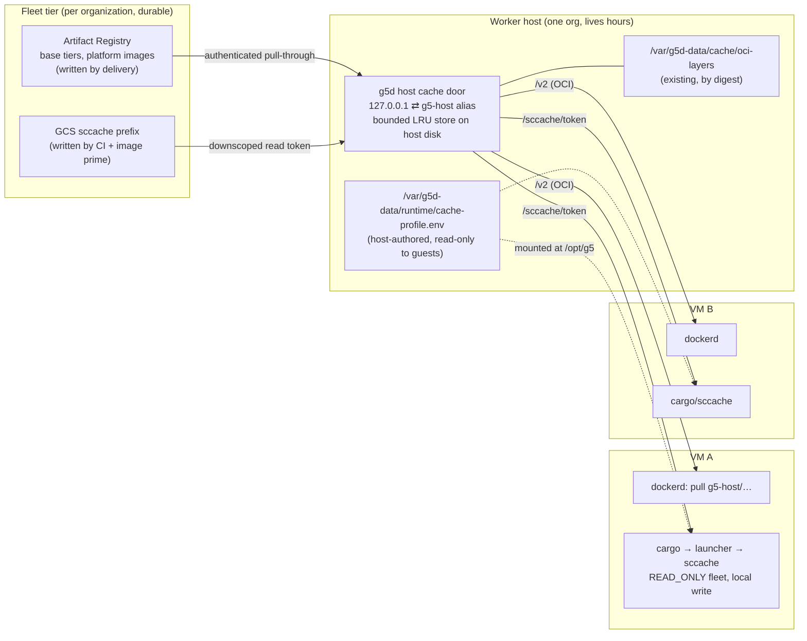

# Cross-VM cache sharing: a host cache door over a fleet tier

The design (sections through "Review summary") was published first as a draft; the
implementation then landed on the same PR, and the "Implementation amendments" and
"Review amendments" sections record what changed on the way. Request lineage:
[request.md](../../chat_intent/cross-vm-cache-sharing/request.md).

## Ontology changes and governance

Comparison base: main `66b27207` (2026-10-08) plus PR #392.

Three new blocks under a new section "Shared caches" in
[`software_architecture/runtime.g5.md`](../../ontology/software_architecture/runtime.g5.md),
one amendment to `g5.runtime.placement.host-disk`, two open questions. No existing
decision is reversed: `g5.scope.warm-roots` and `g5.runtime.materialization` keep every
Start on a fresh root, and the design never reuses a workspace tree; it shares content
that no tree owns.

```diff
+## Shared caches
+
+## A cache is never evidence
+
+[D · g5.runtime.cache.trust]
+
+Shared caches hold two kinds of content and the platform treats them differently.
+Verified artifacts (registry crates, npm tarballs, OCI layers, browser bundles, signed
+packages) are checked by their consumer against a lockfile checksum, integrity hash,
+digest or signature, so a cache entry can only fail, never substitute; they may be
+shared by every VM of a host and across hosts. Derived objects (compiler outputs such as
+sccache entries) are executed without verification, so a guest-written entry is a
+silent poisoning channel for every later reader; derived objects are shared only from
+trusted producers (the image prime, CI builds of the organization's repositories) and a
+guest's own derived objects never leave its VM. A missing or discarded cache changes
+only time, never results, which is what keeps [every Start on a fresh root](#every-start-builds-a-fresh-workspace-root)
+and [`g5.scope.warm-roots`](../scope.g5.md#keep-no-warm-workspace-roots) intact.
+
+## The host serves one cache door to its VMs
+
+[D · g5.runtime.cache.door]
+
+Each worker host runs one read-through cache door on the host loopback that every VM
+reaches by the existing `g5-host` alias. It serves verified artifacts and
+trusted-producer derived objects from a bounded, content-addressed store on the host
+disk, filling misses from the fleet tier or the public upstream, and it is single-tenant
+by construction because a host serves one organization. The door never accepts a guest
+write into anything another VM can read. The guest learns the door's facades from a
+host-authored profile in the read-only runtime mount, never from task settings. The
+store is disposable: it is bounded by its own share of the host disk, evicted least
+recently used, and dies with the host.
+
+## The fleet tier is written by producers the organization trusts
+
+[D · g5.runtime.cache.fleet]
+
+Across hosts, warmth comes from a per-organization fleet tier: Artifact Registry for
+platform and base images already published by delivery, and an object-storage sccache
+bucket prefix written only by that organization's CI builds and the image prime.
+Hosts read it through the door with a credential downscoped to the organization's
+prefix, so a VM in one organization can never read another's compiled objects. Because
+hosts live hours, the fleet tier, not the host store, is what makes a fresh host warm.
```

```diff
 [D · g5.runtime.placement.host-disk]
 ...
-a fixed 40 GB host allowance (OS, swap, image cache and assembled template, with room
-for a second image during an update) plus one start requirement per slot,
+a fixed 40 GB host allowance (OS, swap, image cache and assembled template, with room
+for a second image during an update) plus the cache door's own bounded share plus one
+start requirement per slot,
```

```diff
+[Q · g5.runtime.cache.org-writes]
+
+Should VMs of the same organization be allowed to write derived objects (sccache) into
+the host store for each other? Yes trades a within-organization poisoning channel (any
+workspace owner can plant a compiled object every colleague's build will execute, with
+no review step) for warm workspace-crate objects before CI has built that commit. No
+keeps derived sharing to trusted producers only. Recommendation: No for the first
+delivery; revisit with the measurement the rollout produces.
+
+[Q · g5.runtime.cache.npm]
+
+For the frontend, is an npm registry facade on the door (tarballs shared, extraction
+still per VM, about a minute saved) worth more than the deferred baked node_modules
+tarball (about two minutes saved, 545 MB of image growth)? Recommendation: neither in
+the first delivery; decide on the measured share of VM warm-up that npm represents.
```

Metadata: all three D blocks `human-verified` from the request, lineage to the QA audit
evidence (`g5dev-warm-toolchain`), the retained-roots decision and H013; coverage
"unassessed · not implemented". The Q blocks carry `uncertain`.

### Relevant and governing ontology

| Block | Why relevant | What implementation must enforce or consider |
|---|---|---|
| [`g5.scope.warm-roots`](../../ontology/scope.g5.md#keep-no-warm-workspace-roots) | Warm caching returns only with a measured benefit and fresh roots | No workspace root is kept; the rollout gate is the measurement in this design |
| [`g5.runtime.materialization`](../../ontology/software_architecture/runtime.g5.md#every-start-builds-a-fresh-workspace-root) | Fresh root; host Git never runs in guest content | The door's store is outside every root; host processes never execute cached content |
| [`g5.runtime.placement.host-disk`](../../ontology/software_architecture/runtime.g5.md#size-the-host-boot-disk-for-its-slot-count) | Shared host disk, start gate on free space | The store's share is explicit in sizing and enforced by eviction; the store never competes with a slot's scratch |
| [`g5.runtime.placement`](../../ontology/software_architecture/runtime.g5.md) and `.scope` | Single-organization pools, no host preference | Single tenancy of the host store follows from placement; no affinity is added |
| [`g5.security.tenant`](../../ontology/concepts/system_invariants.g5.md#tenant-scope-survives-privileged-operations) | Cross-tenant identifiers never grant access | Fleet credentials are downscoped per organization; the door holds no cross-organization content |
| [`g5.security.mvp-exposure.root`](../../ontology/concepts/security.g5.md#treat-guest-user-setup-as-compatibility) | Any guest is effectively root in its VM | Every door facade assumes a hostile client: no guest write reaches shared readers |
| [`g5.security.credentials.reserved-env`](../../ontology/concepts/security.g5.md#protect-platform-owned-environment-keys) | Platform keys stay runtime-owned | The cache profile is read from the runtime mount, not from task settings or image env |
| [`g5.runtime.bundle`](../../ontology/software_architecture/runtime.g5.md#the-platform-supplies-its-complete-runtime) | Read-only runtime mount at /opt/g5 | The host-authored cache profile lives there; guests cannot alter it |
| [`g5.runtime.image-env`](../../ontology/software_architecture/runtime.g5.md#image-declared-environment-reaches-agents-terminals-and-previews) | Image env reaches agents | Image-declared `SCCACHE_*`/registry defaults may name the door; deployment-specific values come from the profile |
| [`g5.scope.deployment.images.g5dev-toolchain`](../../ontology/concepts/deployment.g5.md#make-the-development-images-toolchain-work-in-the-cleared-guest-environment) | Launchers fill unset toolchain keys; prime-to-guest hit gate | The launcher reads the profile as the default for its own VM; a caller's explicit endpoint still wins; the gate must keep passing with the fleet backend configured |
| [`g5.quality.delivery.ci.base-image-mirror`](../../ontology/concepts/deployment.g5.md#mirror-ci-base-images-by-content-key) | Content-keyed base tiers already in Artifact Registry | The Docker facade serves exactly those; dev-up pulls instead of building |
| [`g5.git.exclusions`](../../ontology/software_architecture/durability.g5.md) | Cache artifacts never enter Git | Nothing the door serves lands in a tracked path |
| [`g5.design.minimal-mechanism`](../../ontology/concepts/system_design_principles.g5.md#justify-each-new-mechanism) | Justify new state | One door process reusing the existing OCI client and layer store; no new database, no placement state, no guest daemon |
| H013 (human decision: do not persist ignored caches or Docker images) | Prior rejection of cache persistence | The store is a transparent read-through cache, not a save of any workspace's state; nothing a user wrote is retained |

## Requested outcome and design

A fresh workspace VM on any host starts warm beyond its image on the two paths this
delivery covers: the dev-up preview pulls prebuilt base tiers instead of building them,
`cargo test` on a main-identical checkout hits CI-built objects for workspace crates as
well as dependencies, and a second VM on the same host pays none of the download again.
Results are identical with the cache present, absent or discarded. Cargo Git checkouts,
Playwright browser archives (which Playwright's installer does not verify by digest, so
they are not a verified artifact the door may share) and apt packages are out of this
delivery's scope; they stay as the image bakes them or as the guest fetches them.



**One door, two facades, one profile.** The door is a `g5d host` subcommand (the host
already runs as a daemon and already carries an authenticated OCI client and a
content-addressed layer cache), listening on host loopback where every VM already
reaches it through the `g5-host` passt alias. It exposes:

1. An **OCI pull-through facade** (`/v2/<name>/manifests/<ref>`, `/v2/<name>/blobs/<digest>`)
   for the organization's Artifact Registry repositories and the public Hub mirror,
   served from the existing layer store and filled with the host's own service account.
   Guest dockerd lists `g5-host` as an insecure registry (loopback-only reachability
   makes plain HTTP acceptable) and `mirror.gcr.io` as the Hub mirror. `dev-stack-up`
   resolves `G5_BASE_IMAGE_REGISTRY` to the door, so `ensure-base-images.sh` pulls the
   content-keyed tiers delivery already publishes instead of building `base`,
   `base-rust` (libkrun from source) and `base-rust-warm` in the guest. Layers are
   digest-verified by dockerd and by the door itself.
2. A **downscoped sccache token facade** (`/sccache/token`) in the shape sccache already
   consumes in this repository's deploy builds (`SCCACHE_GCS_CREDENTIALS_URL`): the host
   exchanges its service-account token for one bounded to the organization's bucket
   prefix (STS credential access boundary) with read-only object access. Guests run
   sccache with `SCCACHE_GCS_RW_MODE=READ_ONLY`: hits come from the fleet tier, misses
   compile locally and are not written anywhere shared (the local disk cache from the
   image stays the guest's own). Workspace-crate objects hit whenever the checkout
   matches a commit CI has built, which is the common case right after Start.

The **profile** is a small env file the host writes into its runtime root at start
(`/var/g5d-data/runtime/cache-profile.env`, visible to guests read-only at
`/opt/g5/cache-profile.env`): the door URL, the sccache bucket and prefix, the token URL,
the registry prefix. The g5dev launcher and dockerd start helper read it as data for any
key the caller left unset: deployment-specific values never have to pass through task
settings, image env or the dispatcher. A caller's explicit value still wins, deliberately:
it only changes where that VM's own sccache or dockerd goes, never what the door serves to
anyone, so the override widens nothing. Hosts without a profile behave exactly as today.

> Correction (2026-10-28, [#918](https://github.com/G5Labs/G5-Lean/issues/918)): microVM
> guests mount the frozen `runtime.ext4`, not the runtime directory, so a file written
> there after the image build never reached them. The profile now reaches every guest per
> boot through the projection in
> [issue-918-cache-profile-projection](../issue-918-cache-profile-projection/ontology-plan.md)
> (ontology `g5.runtime.cache.profile`); the guest path and the consumers are unchanged.

**Why not the alternatives.** A cargo source replacement (crates mirror) was rejected:
it renames the registry source directory and therefore forks every sccache key away from
the image prime, costing more than it saves; crates stay baked by the prime and fetched
directly otherwise. A shared sccache directory over virtiofs was rejected: guests would
write into what other guests execute, and sccache's size accounting is per process. Host
placement affinity was rejected: it would amend `g5.runtime.placement`, and the fleet
tier makes it unnecessary. Off-the-shelf daemons (registry proxy, nginx) were considered
and set aside for the first delivery: a pull-through registry cannot refresh an
hourly token, and two more daemons in the worker image add more surface than one
subcommand reusing the OCI client the host already has.

**Bounding.** The door's store gets its own term in the host disk sizing (the
amendment above), evicts least recently used below that bound, counts the existing OCI
layer directory within it, and refuses to fill when the start gate would be endangered.
It is reset by host rotation, which already happens within hours.

**Measuring, as `g5.scope.warm-roots` requires.** The door records per facade: hits,
misses, bytes served from store, from fleet and from upstream. The guest side records
VM-start-to-first-green `just test` and dev-up preview ready time (the dispatcher already
times tasks). The rollout gate is a before/after on QA Base workspaces: preview start
minus base-tier builds, and `cargo test` wall time on a main-identical checkout. If the
measured benefit does not clear the bar the human sets, the door stays off.

### Delivery order

1. Door with the OCI facade; dev-up switched to pulled tiers; measurement of preview
   start. Largest win, no trust question (digest-verified content).
2. sccache token facade; CI's existing GCS sccache made the fleet tier (prefix per
   organization, write from CI only); launcher sources the profile. Measurement of
   `cargo test` on main-identical checkouts.
3. Decide the two Q blocks on the measurements.

### Acceptance outcomes

- A dev-up preview in a fresh Base VM on a fresh host starts without building any
  `g5/base*` tier; a second VM on the same host pulls every layer from the host store.
- `cargo test` on a main-identical checkout in a fresh VM shows sccache hits for
  workspace crates; a modified crate compiles locally and its objects appear in no
  shared store.
- A guest `PUT`/`POST` to any door facade is refused; a guest cannot read another
  organization's prefix with the token it is given (verified by attempting with a
  foreign prefix).
- The host store never exceeds its sizing term; a full store evicts and keeps serving.
- With the profile absent, every behaviour above matches today's.

### Risks and accepted consequences

- **Hourly token freshness.** The door refreshes tokens itself; a stale fleet credential
  degrades to upstream fetches or local compiles, never to failures.
- **Organization isolation rests on credential downscoping.** If the deployment's STS
  boundary cannot express a prefix, the fallback is one bucket per organization; either
  way a cross-organization read is impossible by construction, not by convention.
- **Host disk pressure.** The bounded store adds to the allowance; its sizing term must
  be set from measured layer volume (QA base tiers are several GB). Eviction is the
  guard; the start gate remains the backstop.
- **sccache read-only write errors.** Rejected writes count as write errors in sccache's
  stats; the g5dev gate must assert hits, not zero write errors, once the fleet backend
  is on (or the gate runs with the backend unset).

### Unresolved assumptions

- The pinned sccache 0.10 musl binary includes the GCS backend and honours
  `SCCACHE_GCS_RW_MODE` and `SCCACHE_GCS_CREDENTIALS_URL` (the deploy builds use the
  latter with a newer image; verify for 0.10).
- The organization's CI writes under a per-organization prefix today (the CI bucket is
  deployment-wide); the fleet tier needs that prefix convention.
- Staging and production run passt with the `g5-host` door as QA does (only the QA
  values file states it).
- Host rotation reclaims orphaned per-VM rootfs clones and the door's store alike; no
  separate sweep is designed.

## Implementation amendments (2026-10-08, before dependent code)

Four discoveries from the host code change how the design is realized; the three
blocks' commitments stand, their mechanics shift:

1. **The profile is written by host bring-up, not by the door.** The host service runs
   under `ReadOnlyPaths=/var/g5d-data/runtime`, so `g5d host` cannot create a file there.
   The cloud startup script (which already writes `/etc/g5/host.env` as root before the
   service starts) writes `/var/g5d-data/runtime/cache-profile.env` from the same
   per-host values the API renders (door port, sccache bucket, the organization's prefix,
   the registry prefix). The block's "host-authored, read-only to guests" holds: the file
   is authored by the host's own bring-up and the guest sees it read-only at
   `/opt/g5/cache-profile.env`. Hosts without the script (self-hosted, local) have no
   profile and behave as today.
2. **The door has its own content-addressed store.** The existing OCI layer cache keeps
   extracted trees and deletes the compressed blob; manifests are never kept. The door
   therefore stores raw manifests and blobs by digest under `/var/g5d-data/cache/door`,
   bounded by `G5D_CACHE_DOOR_MAX_BYTES` with least-recently-used eviction, and the
   registry client gains two raw-fetch operations (manifest bytes with media type and
   digest; blob stream) that the door uses. The host disk sizing term from the block is
   that bound.
3. **The fleet sccache tier has a dedicated producer.** No existing CI or deploy sccache
   object can match a guest compile: they are release-profile builds under another
   `CARGO_HOME`, another working directory, another sccache version and, in deploy,
   without the workspace rustflags. "Written by the organization's CI" is realized as a
   deploy-pipeline step that runs the freshly built g5dev image itself, with the
   repository checked out at the guest's own path and the guest's own launchers, and
   compiles the runner's exact package sets with `SCCACHE_GCS_RW_MODE=READ_WRITE` into
   the organization's prefix of the deploy-artifacts bucket. Only main merges run it, so
   PR branches cannot write the fleet tier.
4. **Delivery publishes every tier dev-up needs.** CI mirrors only `base` and
   `base-rust`; `base-rust-warm` and `base-node` were never published, so the guest
   would still build them. The deploy pipeline, which builds all four anyway, publishes
   all four to the `g5-ci` mirror under their content keys.

Two further facts bound the first delivery: only QA is known to run passt (the door is
reachable only where `G5D_VM_NET=passt`), and whether a guest can reach the GCE metadata
server through passt is unverified; if it can, a guest can already mint the host's full
service-account token and the downscoped sccache token narrows nothing until that is
closed. The door still downscopes, so the exposure does not widen.

5. **The sccache facade serves objects; guests hold no credential.** sccache 0.10 has
   no tiering: once a remote backend is configured, the image's local primed cache is
   bypassed. A guest-side GCS token would therefore have cost the prime. Instead the
   door speaks the layout of sccache's WebDAV backend at `<door>/sccache/<key>`: a read
   falls through the host store, every prepared image template's primed objects on
   this host, and the organization's fleet prefix, which the door reads with the host's
   own identity scoped by configuration; every mutating method is refused (sccache
   counts it as a write error and keeps compiling). The guest sets only
   `SCCACHE_WEBDAV_ENDPOINT` from the profile, plus `SCCACHE_IGNORE_SERVER_IO_ERROR=1`
   so an unreachable door can never fail a compile. The token facade and STS
   downscoping from the first draft are not built; the "credential downscoped to the
   organization's prefix" in the fleet block is realized as the door's per-host
   configuration, which the API renders from the host's organization.
6. **Delivery, not CI, publishes the two missing tiers.** CI's mirror list stays
   `base base-rust` (its contract test pins it); the deploy pipeline's new
   `publish-base-tiers` step pulls or builds `base-rust-warm` and `base-node` and
   pushes them to the same content-keyed mirror, best-effort, with the deploy service
   account granted writer on `g5-ci`. The deploy's new `warm-guest-sccache` step is the
   fleet producer of amendment 3.

### Review amendments (2026-10-08, Codex round 1)

Twelve findings from the independent review; the blocks' commitments stand, these
mechanics change:

7. **Seeds are read in sccache's disk layout, without following symlinks.** sccache 0.10's
   disk cache (the image prime) stores `a/b/<key>` while its remote backends store
   `a/b/c/<key>`; the facade translates, or the prime would never hit once the guest
   points at the door. A template rootfs is guest-authored content, so the seed walk
   refuses a symlink at any component rather than letting an image point the door at a
   host file.
8. **The OCI allowlist is a repository prefix, not a host.** Bring-up passes the whole CI
   mirror prefix (`us-central1-docker.pkg.dev/<project>/g5-ci`); a guest cannot use the
   host identity's project-wide read access on other repositories, cached or not.
9. **In-flight transfers count against the bound.** A fill reserves bytes (in steps,
   evicting committed entries to make room) before writing them, no object may exceed
   half the store, at most sixteen fills run at once, and a cancelled or failed fill
   releases its reservation and removes its temporary. Replacing an entry is accounted as
   a delta, and every eviction walk resynchronizes the byte count with the disk.
10. **A stored manifest is one file.** The media type line precedes the bytes, so the pair
    is accounted, touched and evicted together instead of a sidecar being evicted alone.
11. **The launcher probes the door.** sccache 0.10 aborts server startup when its backend
    cannot be read, and `SCCACHE_IGNORE_SERVER_IO_ERROR` covers only later compile
    responses; the launcher pings `<door>/v2/` (2 s) and keeps the image's local cache
    when the door does not answer. Both guest readers treat the profile as data: sourced,
    the tier list `base base-rust ...` runs `base-rust` as a command.
12. **The sizing term is set.** `WORKER_HOST_CACHE_DOOR_GB` (20 GB) joins the published
    base allowance and is the bound bring-up hands the door. Delivery publishes tiers that
    are current locally as well as ones it built, since the deploy's image build produces
    them first. The fleet read grant is conditioned to the `guest-sccache/` prefix: the
    metadata-server reachability question above stays open, so the host identity must not
    read the bucket's other deploy artifacts.

### Review amendments (2026-10-08, Codex round 2)

13. **Guests pull tiers from a repository only delivery writes.** PR CI holds writer on
    `g5-ci`, so a pull request could plant a tier under a predictable key that a guest
    (or the deploy's own publication step) would then pull. Tiers now live in
    `g5-tiers` (deploy identity writer; hosts read with the project-level reader they
    already hold), and the publication step runs as producer: it never pulls, builds what
    it lacks, and always pushes, replacing any entry under the key.
14. **Only the host's own template seeds.** A workspace may select a custom image; its
    rootfs would otherwise become a trusted sccache producer for every VM on the host.
    The host passes the door exactly the template it prepared for its organization's
    platform image, and a template without its completion marker (still assembling) is
    skipped. Seeds are opened through directory descriptors with `O_NOFOLLOW` on every
    component, so no check-then-open window exists.
15. **References are validated before they reach a URL.** A manifest reference is a
    digest or a tag `[A-Za-z0-9_][A-Za-z0-9._-]{0,127}`; percent-encoded path structure
    is refused, so the upstream URL cannot escape the allowlisted repository.
16. **Readers lease entries.** An entry a response is still streaming cannot be evicted
    or dropped from the accounting, so slow readers cannot pin unlinked blocks past the
    bound; with only leased entries left, new fills are refused instead. Commits and
    eviction walks are serialized by one maintenance lock, so a walk's view of the disk
    never loses a concurrent commit.
17. **Open: the metadata server.** The fleet read grant is conditioned to the
    `guest-sccache/` prefix, which still spans every organization's prefix; whether a
    guest can reach the GCE metadata server through passt is the QA verification that
    decides whether per-organization credentials are required before a second
    organization shares a project.

### Review amendments (2026-10-08, Codex round 3)

18. **Upstream manifests are bounded and admitted.** The registry client never buffers
    more than 4 MiB of manifest (the registries' own cap), and the door admits upstream
    manifest fetches through a semaphore the size of its fill limit, so a burst of guest
    requests cannot hold unbounded host memory.
19. **Accounting races closed.** The lease check and the unlink happen under the lease
    map's lock; a commit counts its bytes before releasing the fill's reservation; a
    reservation belongs to its temporary before any await, so a request cancelled while
    room is being made releases it on drop.
20. **The launcher confirms the server.** After the ping, `sccache --show-stats` makes
    the server start on the door (or answer if already up); if that fails, the endpoint
    is unset and the local cache stays, since sccache propagates a server-start failure
    to the compile.
21. **Metadata reachability: decided out of scope, verified next.** Blocking guest
    access to the GCE metadata server is a host egress-policy change; the structure for
    it exists (passt runs under a dedicated uid when `G5D_PASST_UID` is set, the key an
    `skuid` nftables rule needs) but no uid or rule is deployed, and introducing egress
    rules is a network-policy decision beyond this delivery. The QA check after deploy
    (a metadata request from a workspace terminal) decides whether per-organization
    credentials or that rule must land before a second organization shares a project.

### Review amendments (2026-10-08, Codex round 4)

22. **One admission counter.** Committed plus reserved bytes are one number; a
    reservation turning into committed bytes moves it in a single step, so no reader of
    two counters can see a gap and admit past the bound.
23. **Publication completes.** A commit's rename and accounting run on a blocking thread
    to completion; a request cancelled mid-commit leaves the file either counted and
    present or absent and uncounted.
24. **Manifests stream.** A cached manifest is served from disk under its lease, not
    buffered; an upstream manifest's buffered bytes travel with the admission permit, so
    the memory a fetch holds is released only once the response has been sent.
25. **The launcher starts the server.** `sccache --start-server` (not `--show-stats`,
    which prints synthetic statistics without a server) proves the backend is readable;
    "Address in use" means a server is already up and is accepted.

### Review amendments (2026-10-08, Codex round 5)

26. **Blocking work owns the lock.** A publication (the optional write, the rename and
    the accounting) and an eviction walk (the removals and the resynchronization) each
    run on a blocking thread that owns the maintenance lock; a cancelled request neither
    releases the lock early nor leaves a walk's accounting half-applied.
27. **Temporaries cannot be orphaned.** The temporary is created synchronously with its
    handle and only ever opened, never re-created, so a request cancelled while an open
    or a write is queued cannot leave a file the accounting does not know; walks sweep
    hour-old leftovers as a backstop against a crashed host.

### Review amendments (2026-10-08, Codex round 6)

28. **Admission precedes the network.** A fill takes its slot before the upstream or
    fleet request is opened, so a guest cannot hold more upstream transfers open than
    the door will store.
29. **A new entry is leased under the lock.** The publication takes the entry's read
    lease before it releases the maintenance lock, so an eviction walk racing the fill
    cannot remove what the fill is about to serve.
30. **A free-space floor.** The byte bound is the door's share of the disk; when VM
    scratch or templates have grown into that share, admission also stops once the
    filesystem would drop under `G5D_CACHE_DOOR_MIN_FREE_BYTES` (4 GiB), so the door
    never spends the host's start reserve.

### Review amendments (2026-10-08, Codex round 7)

31. **The floor is the start reserve.** Bring-up sets the door's free-space floor to
    the host's own VM-start requirement (scratch plus 512 MiB), so a permitted fill can
    never be what makes the next Start fail on a host with a free slot.
32. **Transfers have deadlines.** A blob transfer (15 min) or a fleet object read
    (2 min) that overruns releases its slot and temporary, so a stalled upstream cannot
    hold the door's sixteen fill slots.
33. **The tier cook is serialized.** `publish-base-tiers` runs after
    `warm-guest-sccache`, itself after the g5dev image push, so the warm tier's
    workspace dependency cook never overlaps the image builds the pipeline's isolation
    barrier keeps apart.

### Review amendments (2026-10-08, Codex round 8)

34. **Free-space admission is one critical section.** The check counts every
    outstanding reservation as if already written and charges under the same lock, so
    sixteen fills cannot all pass the check on the same free space.
35. **Manifest fetches have a deadline** (60 s, authentication and body included), as
    blob and fleet transfers do.
36. **Single-flight membership precedes the wait.** A waiter takes its membership in a
    key's entry before awaiting the lock, so a waiter cancelled mid-wait still drops the
    entry when it was the last participant.

### QA amendment (2026-10-09, first live dev-up)

37. **Tiers are keyed, not layered, and leaves come first.** The first dev-up through
    the door pulled all four tiers and then rebuilt `base-rust-warm` locally anyway: two
    concurrent deploys had published `base-rust` and `base-rust-warm` from different
    builds, and the tier script required a mirrored child's bottom layers to be the
    local parent's layers. The key already folds the parent's key, so lineage needs no
    layer identity when the parent is absent; the script now accepts a tier on its recipe
    label and its content key (labelled `g5.tier.key` from now on; a populated label that
    disagrees is rejected; an unlabelled image is accepted only as the mirror's own image
    for the key), looks a requested tier up in the mirror before touching its parents, and
    ensures parents only for a local build. Layer identity with a present parent is enforced
    only under `G5_BASE_IMAGE_STRICT_LINEAGE=1`, which `ci-docker` sets because its
    single-base oracle ([D2]) is about layer digests; everyone else, guests above all, is
    served by the key, so a same-key parent from another build never costs a rebuild.
    `ci-docker` asks for the chain parent-first; dev-up asks for `base-rust-warm base-node
    base`, so a guest never pulls the 9 GB `base-rust` tier; the deploy's publication asks
    for all four tiers explicitly, since a current tier returns before touching its parents.

### QA amendment (2026-10-09, second live dev-up)

38. **The guest's own build limits.** With the tiers pulled and accepted (about four
    minutes, no cook, VM alive), the preview failed in the compose build: vite's
    production build hit V8's default heap cap in the 14 GB guest while the API image
    compiled beside it. The edge builder stage pins `NODE_OPTIONS=--max-old-space-size=4096`;
    inside a workspace VM dev-up builds the service images one at a time
    (`COMPOSE_PARALLEL_LIMIT=1`) and never pushes tiers back to the door
    (`G5_BASE_IMAGE_MIRROR_PUSH=0`), which serves reads only.

### QA amendment (2026-10-09, fleet producer)

39. The fleet sccache producer (`warm-guest-sccache`) had never completed a compile: the
    one green run was the step's early exit before the bucket substitution was wired, and
    every deploy since has failed both runner targets about five minutes in, silently,
    because the step prints only the runner's summary and the step is best-effort. A
    replay of the same step on a clean build VM (same image, identity, shim and
    substitutions; build `56e17bc1`) passed in 685 s with an 86 % hit rate and 119
    objects written, so the image, the token shim and the bucket grant are sound; the
    deploy differs in running the compile on the default 100 GB disk after eight image
    builds, so disk exhaustion is the suspected cause, a hypothesis until a deploy prints
    the figures. Decision: the deploy build gets a 250 GB disk (`options.diskSizeGb`; the
    150 GB above the free allowance is billed per build minute, a small fraction of the
    machine rate), and the step prints the build disk and docker usage before the compile
    and, after a failure, the runner's log tails, the guest disk and the sccache stats
    (bounded by a timeout, since a listening but unresponsive daemon would otherwise hold
    the step until the build's deadline), so a failed seed is never silent again. The next
    main deploy is the verification: warm step green, stats showing writes, fresh objects
    under the fleet prefix; if the disk was not full, the printed logs name the cause.

### QA evidence (2026-10-10, both tiers measured)

40. Verification of amendment 39 and of the fleet tier, with the preview timings the
    delivery was asked to prove. The first deploy after #412 (build f5059699) ran the
    producer to completion in 525 s with 1,219 compile requests and 0 errors; its printed
    figures showed 148 GB used on the build disk before the compile (images 101.8 GB,
    volumes 31.1 GB, build cache 14.2 GB), which is consistent with the default 100 GB disk
    as the earlier failures' cause; those runs printed nothing, so that remains the best
    supported explanation rather than a direct observation. A guest on a c3-standard-22 host, pinned to the
    producer's commit and running the producer's exact `cargo test --workspace --exclude
    g5d --exclude g5-e2e --no-run` with sccache untouched beforehand, got 752 hits and 0
    misses in 15 min 14 s; the door attributed 411 hits to the fleet prefix, 340 to the
    seed, 1 to the store, 4 misses. Key matching holds for the test profile. A
    single-crate `cargo test -p g5-contracts --no-run` the hour before got 32 seed hits
    and 0 fleet hits, the feature-unification gap. Preview timings on the 4 vCPU / 14 GB
    VM: fresh VM on a warm host with all 24 blobs from the store 16 min 42 s (an earlier
    run on the same shape 14 min 45 s); preview re-run on the same VM 1 min 01 s; cold
    host inside a key window, cooking the warm tier, 23 min 16 s.
    Two findings outside the cache's scope, recorded for the next design: (a) the
    merge-to-publish window: #411 (lockfile) and #414 (libkrun build script) each changed
    tier keys and their deploys published the new tiers about 75 minutes later; every
    preview started in between asked the door for a key the registry lacked (404) and
    cooked, and four of five such VMs were lost; the remedy is to accept the newest
    published tier when the exact key is missing, or to publish tiers early in the deploy;
    (b) the 4 vCPU / 14 GB guest dies in the ordinary service-image build about half the
    time with or without a cook. Observed at the stall: the VMM sits at the guest's full
    allowance (13,973 to 14,041 MiB resident), the host is calm, the guest's network goes
    quiet in both directions while its processes keep logging, and on the host the relay
    process (passt, single-threaded) sleeps in `sock_alloc_send_pskb`, blocked writing into
    a tap the guest is not draining; the guest kernel has no swap support (`swapon:
    Function not implemented`). The reading, with that evidence, is guest memory
    exhaustion stopping the guest's receive path and the relay's blocking write turning
    it into a total network death. Candidate fixes under test are an early-OOM guard in
    the guest and a memory fence for build containers.
    One modelling correction: the door-served copy of the image's baked sccache directory
    is not a tier of its own; it is tier 0 data re-served because sccache has a single
    backend. The cleaner wiring is a guest-side forwarder (local directory first, door on
    a miss), which would also restore local write caching; recorded as an open decision in
    the Workspace Cache Design doc rather than changed here.

### QA evidence (2026-10-12, edit loop and dev-up breakdown)

Asked by review of the cache rollout: does losing incremental compilation (the guest runs
every cargo build with `RUSTC_WRAPPER=sccache` and `CARGO_INCREMENTAL=0`) hurt the edit
loop in a warm VM, and would sccache inside the service Dockerfiles help previews.
Measured on fresh c3-standard-4 VMs (4 vCPU / 14 GB), g5-api crate, main at 2026-10-12.

| Workload | sccache on, incremental off (today) | sccache off, incremental on |
| --- | --- | --- |
| `cargo test -p g5-api --no-run`, first build | 20 min 55 s (728 hits, 16 misses) | 27 min 01 s |
| same after a one-line edit (links 129 test binaries) | 12 min 15 s, 12 min 33 s | 15 min 08 s, 17 min 50 s |
| `cargo check -p g5-api`, first / after edit | 8 min 15 s / 8 s | 6 min 37 s / 6 s |
| `cargo build -p g5-api --bin g5-api`, after edit | 3 min 31 s | 33 s |
| `cargo test -p g5-api --lib --no-run`, after edit | 8 s | 8 s |
| one integration test (`--test`), after edit | 30 s, 24 s | 42 s, 22 s |

Findings:

- sccache saves about 6 minutes of a 27-minute first build on this shape; the rest is
  linking, build scripts and proc-macros, which no cache removes. `cargo check` is not
  cacheable (no `link` emit) and sccache adds about 100 s of overhead to a first check.
- Incremental compilation matters only where a heavy workspace crate is recompiled after
  an edit: the g5-api binary rebuild drops from 3 min 31 s to 33 s. Check, lib tests and a
  single integration test are the same either way, and the full test build is slower
  with incremental because relinking 129 test binaries dominates.
- sccache 0.10 refuses an incremental compile outright ("increment compilation is
  prohibited", exit 101) rather than passing it through, so the two cannot be mixed by
  environment alone. Cargo applies incremental only to workspace members and path
  dependencies, so a wrapper that sends those crates straight to rustc and everything
  else through sccache would keep dependency hits and restore the fast binary rebuild,
  at the price of the fleet hits for our own crates at deployed commits.
- dev-up on a fresh VM inside the tier publish window: 25 min 20 s = tier cook 14 min
  (all four tiers built locally; the dependency graph alone 6 min 52 s) + service images
  11 min 21 s, of which cargo inside the g5-api image 8 min 05 s (dependency step
  2 min 26 s, g5-api and g5d 4 min 04 s, tools 1 min 35 s), edge npm ci 34 s and vite
  1 min 39 s, the rest about 1 min. The service Dockerfiles already run cargo through
  sccache against the tier's baked local cache; they are not pointed at the door and no
  producer warms the release profile, so our own crates always compile there. Door
  wiring plus release warming could remove at most the 5.5 min of our-crate steps,
  realistically 3 to 4 min, against the 14 min the window costs when it is hit.

Recommendation recorded here, not decided: fix the tier publish window first; defer
door wiring for previews; consider the workspace-crate wrapper for the edit loop only if
agents are observed rebuilding heavy binaries after edits (the common check and
single-test loops do not benefit).
### Design amendment (2026-10-12, the publish window)

Between a merge that changes a tier recipe and that deploy's `publish-base-tiers` step,
about 75 minutes, every preview on main asked the door for a key the registry did not
have and cooked the tiers in its VM: 14 min on the 4 vCPU shape, and the build that lost
the VM before the libkrun fix (#422). Two changes close it; both keep the trust model.

| Change | Owner | Consequence |
| --- | --- | --- |
| Publish first. `publish-base-tiers` runs right after `validate-inputs`, alone, and every image build waits for it. | `infra/ci/cloudbuild-deploy.yaml` | Tiers for a merged commit are in `g5-tiers` minutes into the deploy. The cook moves onto the deploy's critical path: the first run cooked all four tiers in 19 min 09 s (2026-10-12), so the step now pulls tiers the trusted repository already holds under their key (only the deploy identity writes it) and cooks only changed ones, which makes a deploy without recipe changes publish in about a minute; an entry it pulls and rejects is replaced by its local build, and a hit restores a missing newest name (never moves an existing one, so a superseded deploy running late cannot move it back). The g5dev barrier's reason (no cold cook beside the image builds) is preserved by the ordering. PR CI's `g5-ci` cache, writable by any pull request, is never read. |
| Fallback to the newest dependency tier on the same parent. Publication also moves `g5-base-rust-warm-newest:<parent key>`; a guest whose exact warm key is not published takes it, and cargo rebuilds the recipe change on top. Toolchain tiers never fall back (review round 1: a stale toolchain under a current key would persist). | `scripts/ensure-base-images.sh`, `Justfile` `dev-stack-up` (`G5_BASE_IMAGE_FALLBACK_NEWEST=1` behind the door) | A window that is hit costs a partial dependency rebuild instead of a cook. Keyed by the parent's key, so a toolchain change still cooks; the pulled image keeps the labels of its own recipe, so the next run looks for the exact key again and replaces it once published. Off for CI's strict-lineage callers. New block `g5.runtime.cache.tier-fallback`. |

Decision notes: the newest name is moved by whichever publication finishes last, so two
overlapping deploys can leave it on the older of two recipes; the consequence is a
slightly larger partial rebuild, never a wrong result. `base` has no G5 parent and no
fallback; its recipe changes rarely and its cook is short.

### Implementation map

| Piece | Location |
|---|---|
| Raw manifest and blob fetch; upstream client selection | `backend/g5d-foundation/src/oci/registry.rs` (`DistributionClient::fetch_manifest_raw`, `open_blob`, `upstream_client`, `RawManifest`) |
| Door: config, server, stats, store, OCI facade, sccache facade, fleet reader | `backend/g5d-host/src/cache_door/{mod,store,oci,sccache,gcs}.rs`, started from `backend/g5d/src/cli/host.rs` |
| Host bring-up: host.env keys and the guest profile | `backend/g5-api-core/src/cloud/startup_script.rs` (`HostCacheDoor`, `worker_cache_door`, `CACHE_PROFILE_PATH`), `bringup.rs` |
| Guest: dockerd registry settings, launcher endpoint, dev-up registry prefix | `infra/docker/g5-dev-dockerd-start.sh`, `infra/docker/g5-dev-rust-launcher.sh`, `Justfile` `dev-stack-up` |
| Delivery: tier publication, fleet producer, substitutions | `infra/ci/cloudbuild-deploy.yaml` (`publish-base-tiers`, `warm-guest-sccache`), `infra/qa/delivery/main.tf` |
| IAM and QA values | `infra/qa/foundation/main.tf` (deploy writer on `g5-ci`), `infra/qa/platform/main.tf` (compute reader on deploy-artifacts), `infra/helm/g5/values-qa.yaml` |

## Review summary

Pending human review. The design keeps every existing decision about fresh roots and
single-organization hosts, adds one host subcommand and one host-authored file, and
reuses the OCI client, the layer store, the `g5-host` alias, the CI sccache bucket and
the token-shim pattern already in the repository. The questions that need a human are
the two Q blocks and the measurement bar for the rollout gate.
