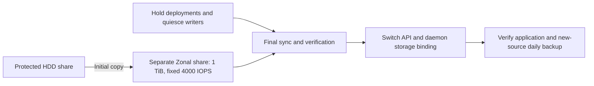

# Filestore Zonal migration

## Ontology changes and governance

Comparison base: `6a272803e2da240fe396c227c4af6ca3b5841b70` (main, 2026-11-07).
The actual branch diff adds `g5.quality.delivery.filestore-migration` in
[operations](../../ontology/features/operations.g5.md#g5.quality.delivery.filestore-migration).
It owns the storage selection and migration boundary; existing backup retention
and repository durability contracts remain in force.

| Governing contract | Consequence |
| --- | --- |
| [Daily Filestore backups](../../ontology/features/operations.g5.md#g5.quality.delivery.backups.filestore) | Preserve the workflow, identities and 30-day policy; change its source only with cutover and verify a new-source backup. |
| [Repository durability](../../ontology/features/repositories.g5.md#g5.repo.durability) | Preserve all persisted Git data, including private refs and flush evidence; a successful copy or native backup alone is not a recovery proof. |
| [Forward-only application recovery](../../ontology/features/operations.g5.md#g5.quality.delivery.qa-forward-only) | Storage cutover retains deployed images and SQL schema; no application upgrade or automatic Helm rollback. |

## Outcome and ownership

Terraform owns both instances and the existing backup automation. One committed
per-environment selection drives platform outputs, backup source and deployment
inputs. Provisioning alone never switches a live mount. The operator coordinates the
temporary maintenance interval; no new persistent migration controller is needed.
The owner approved Zonal/4,000 IOPS and backups for all three environments and
merged preparation PR #1166. The owner requested enabling all three candidates without more PRs. The existing
rollout PR commits `provision_zonal=true` and `active=zonal` for all three; no
follow-up migration PR is needed. Before that merge, hold all Terraform apply,
bundle publication, application deployment, promotion and train paths and retire
incompatible captured builds. Keep that hold until all three live environments
agree with the final map. Targeted candidate applies can publish desired Zonal
outputs before live mounts switch; treat those outputs as desired state, never
as proof of live storage. Do not apply addons, backup or delivery changes early.
Perform the whole-share copy and each environment's controlled switch manually.
Apply each backup source only at its cutover; if the shared delivery root updates
all environment inputs together, its trigger/scheduler holds must remain intact
and no deployment may start for an environment still on HDD.
The owner requested an ASAP QA write-pause window after the copy and safety
checks pass. Staging/prod follow QA verification with their own coordinated cutovers.
The owner merges the one enablement PR only after the global hold is verified.
Retire incompatible running/queued/approval-pending bundles before provisioning;
merge does not alter captured source. Keep source/bundle compatibility and all
holds until every live environment agrees with the final map. App traffic can
remain available during initial copying. Use direct refreshed operator plans:
the disabled QA apply trigger rejects normal execution and its full-root pipeline
is too broad for staged provisioning; staging/prod CI plans skip refresh.
Use the already locked google-beta provider for the new custom-performance
resource, leaving the legacy provider and existing resource addresses unchanged.

Copy the whole NFS share through a dedicated client with the source mounted
read-only. Preserve numeric ownership, modes, links and required metadata; refuse
unsupported ACL/xattr cases rather than silently discarding them. Initial copying
may run with writers; the final checksum mirror requires all writers stopped.

Pause environment deployment/apply paths and release promotion, and account for
already queued/running builds. Delivery applies must preserve these holds in their
planned configuration, never transiently re-enable and then re-pause a trigger.
Drain active workspaces through existing durable
flush/stop behavior without force-discarding work, then stop API and daemon and
check for any other NFS or SQL writers. Capture a paired SQL and Filestore recovery
point in the same quiescent interval. Verify file equality, Git integrity and
required database-to-file references before starting the existing images on the
new binding. Use distinct PV/PVC names; retain old data and the original binding
manifests. Static NFS volumes use Retain; removing a binding object does not
delete the old Filestore. Recreate the saved binding if pre-start recovery needs
it, instead of introducing a permanent second set of Helm-managed storage objects. Ordinary
deployment must refuse a storage identity mismatch instead of silently switching
volumes. A manual cutover is the sole binding switch.

The cutover establishes an operator-enforced release boundary. Retire incompatible
application and Terraform executions and record the first compatible source and
Zonal-selection bundle. Previously allowed same-SHA retries from pre-guard source,
older bundles and historical Helm rollback are no longer supported after writer
startup. Resume only compatible releases. No new admission controller is added:
it cannot prevent old SQL hooks, and privileged historical replay remains an
explicit operational restriction rather than a guarantee of the new script.
Uninstall/reset of the release or its bindings is likewise not a supported way to
bypass a storage refusal; the empty-install guard exception is for real bootstrap.

Run QA first; use its verified procedure and measured timings for staging/prod.
Take and verify a new-source backup after cutover. The previous source's backups
remain intact and are outside the new source's retention sweep; retiring them and
the old HDD requires a later explicit cleanup decision.

## Acceptance and recovery

- Reviewed create plans add only the intended candidate storage and required
  existing-key wiring; no replacement/destruction of old storage or unrelated IAM.
- Exact whole-share verification includes repos and attachments. Private refs,
  HEADs, ownership and content survive; existing corruption is reported separately.
- Both API and daemon use the selected Bound PVC/PV/NFS identity. Clone/fetch/push,
  workspace save and attachment access work; daily backup targets the selected source.
- Restore original scheduling/replicas only after checks. Do not merge automatically.
  Keep delivery held until the committed configuration and deployed trigger inputs
  agree, and prevent old queued releases from switching back.
- Before either writer restarts, switching back to the retained source is possible.
  Reconcile the selector, backup Workflow, deployment inputs and Helm binding
  under the hold before restarting on the old source; restoring only a mount is
  not a complete pre-start recovery.
  After startup, API background tasks can write even with ingress closed: recovery
  must reconcile new SQL/Git/attachment work, never blindly remount the old share.

## Review summary

Single-PR follow-up: the owner requested the final enabled selection for all
three environments in existing PR #1167. All 82 focused checks pass against the
final Zonal selection: selector Python/HCL, QA platform/delivery, release platform
and fixed-IOPS candidate tests. Independent legacy transition cases remain intact.
The mandatory pre-merge global hold separates desired configuration from live
cutovers and removes the need for later selection PRs. Independent source review
confirmed that candidate outputs can move ahead of live mounts, addons do not
consume Filestore bindings, and shared delivery applies update all three targets.
Private hold/recovery overrides must preserve that global boundary; no new
persistent control mechanism is required.

The first final-map Claude review found no code or rollout-safety defect, but
requested broader regression evidence. The exact 279-test release CI suite now
passes on the final map, including the materialized-bundle path and 79 release,
deployment and binding checks; 20 QA reset tests also pass. Cloud CI plans remain
pending for the updated PR, which stays draft. Review also corrected stale
preparation-only statements; no live rollout or merge readiness is claimed.
The sanitized Claude follow-up found no remaining material findings for publishing
the draft; updated-head CI and the pre-merge global hold remain required.

CI follow-up: the shell release fixture's fake Terraform was being selected by
the real selector integration tests in its copied bundle. Mark only that fixture
and skip those integration tests there; real Terraform jobs retain all seven
transition checks and still fail if their executable is missing or broken.
This changes test setup, not deployment behavior or migration authorization.
At the time of that fixture fix, the exact 279-test release CI suite and all seven
real selector tests passed locally. Claude and an independent local reviewer found no material issue in
this correction.

Initial follow-up findings: the preparation instructions allowed a merge to stand
in for retiring already queued immutable Terraform bundles, and allowed a delivery
apply to transiently re-enable triggers before pausing them again. The former can
run incompatible source; the latter can admit a writer during final verification.
Both are operational defects to fix before execution, not live incidents.
The runbook now retires incompatible bundles on both preparation paths and
requires held controls to stay disabled within the delivery apply itself.
Follow-up review also found that pre-start recovery had to restore the selector,
backup and delivery configuration along with Helm. The recovery sequence now
verifies all old-source identities before any writer restarts.

Claude's initial sanitized review found that administrative retry of pre-guard
builds or Helm rollback can bypass the ordinary-deploy guard, and asked for
explicit coordination of the separate platform-backup and QA-delivery applies.
It also identified unsafe reuse of raw saved PV/PVC manifests during recovery
and an underspecified replica restart. The runbook now coordinates both roots,
uses the installed chart for recovery/restart, sanitizes fallback manifests and
establishes the explicit source/bundle boundary above, including same-SHA retries.
The reviewer did not receive private cloud evidence; its doubts about
live preparation evidence are review limits, not evidence that those checks did
not run.
The follow-up Claude review accepted the preparation design and operator-enforced
boundary, while identifying content-based bundle compatibility and the empty-install
exception as remaining wording gaps. Both are now explicit. Optional admission or
sentinel-PV mechanisms were not added; the release boundary remains an operational
restriction. The existing QA reset script preserves binding objects, and does not
authorize running a destructive reset as part of this storage migration.

Independent read-only source audits confirmed API and daemon are direct consumers;
workers use Git HTTP and need no storage remount. The latest API also mounts
attachments, invalidating a repos-only copy. Existing Helm NFS source/binding is
immutable; normal deploy ordering does not fence manual migration or old build
configurations. Basic-tier backups cannot restore into Zonal, and only Basic
supports POSIX ACL setting. These findings are included above.

Earlier opt-in checks (with candidate provisioning enabled): all three live
candidate plans contained exactly one new
Zonal instance and no updates/deletions; existing bindings pass the live read-only
guard. All three inventories found no nontrivial ACLs, extended attributes or
special files. Capacity quota is sufficient. QA creation/control operations use
the existing trusted Terraform build runner; this work grants no new IAM roles.
Preparation verification covered 75 mocked Terraform plans, 7 selector transition
tests and 93 deployment/guard/release regression tests. Those checks do not prove
the unexecuted data copy or application cutover.

Full live staging/prod platform plans for the earlier opt-in configuration
contained only that one create; the local full QA plan was blocked by a Pub/Sub
IAM read. These historical opt-in plans are not approved apply artifacts and
must be regenerated before execution.

Historical preparation evidence at `963ed22f8`: all three disabled-map Terraform
CI plan jobs passed. The full QA plan completed: platform changes were outputs only; delivery had five in-place
trigger updates (three `infra/config/**` filters and two equivalent storage-size
normalizations from `1024Gi` to `1Ti`). Foundation/addons had no changes. This is
not evidence for the final selection or an apply artifact; regenerate plans for
execution. Raw cloud evidence stays private and was not sent to Claude.

| Commitment | Implementation / check | Evidence or remaining limit |
| --- | --- | --- |
| Separate candidate, preserve old storage | Protected separate resource; canonical selector; platform plans | Final-map tests select separate Zonal instances in all three environments; explicit legacy/prepare-only tests remain. Earlier live candidate plans pass; no instance created. |
| Consistent deployment/backup selection | Shared map feeds platform and delivery roots; old backup cleanup checks exact source | Transition tests pass; the runbook requires both live roots and Workflow/trigger checks before writer restart. |
| Ordinary deploy refuses switching | Deployment/PVC/PV/claim UID/NFS guard before Helm | Failure/valid-state tests and three live legacy checks pass; administrative pre-guard replay remains prohibited. |
| Complete copy and coordinated recovery | Whole-share read-only source, writer drain, paired backups, checksum/Git/attachment checks | Procedure reviewed; data copy, drain, post-cutover smoke and new-source backup remain unexecuted. |
| Preserve deployed application/schema | Installed chart/images, no hooks, saved replicas, forward-only recovery | Runbook now specifies Helm-based binding and replica restoration; live cutover remains unexecuted. |
| Release bundle includes selector file | Bundle Dockerfile copies the full infra tree; release copies the full bundle | Inspected packaging paths include `infra/config`; old pinned bundles remain subject to retirement. |

The owner approved execution, with QA's maintenance window as soon as copying and
safety checks pass. The updated single-PR procedure requires the verified global
hold before the owner merges #1167, then fresh plans and writer/drain checks before
each controlled cutover. Prior preparation reviews remain historical evidence;
the final-map review and tests cover this follow-up. No new Filestore instance,
live cutover or completed data-copy verification is claimed yet.
