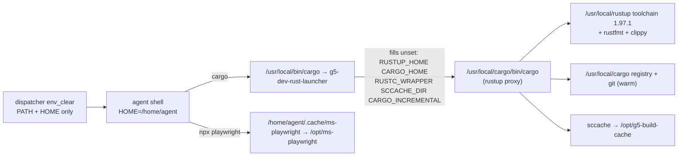

# A warm Rust toolchain and browser surface in the g5dev guest, without environment

## Ontology changes and governance

Comparison base: `795d1ab6` (main, clean tree, 2026-10-08).

One new block, `g5.scope.deployment.images.g5dev-toolchain`, in
[`concepts/deployment.g5.md`](../../ontology/concepts/deployment.g5.md), next to the other
image decisions. No existing block is amended: `g5.runtime.workspace-cli` and
`g5.runtime.bundle.tools` govern the command path and keep holding (the launchers live
in the image's own `/usr/local/bin`, which already precedes the bundle), and the
runtime's cleared environment is recorded as the reason, not changed here. The
Dockerfile's prose citations of pre-Lean blocks (I31, I32, D18, D19) stay as historical
references; new text cites the new block.

```diff
+## Make the development image's toolchain work in the cleared guest environment
+
+[D · g5.scope.deployment.images.g5dev-toolchain]
+
+The G5 development worker image bakes a pinned Rust toolchain, a compile cache and
+Playwright browsers whose use depends on environment the image declares, but the
+workspace runtime starts agent turns, terminals and previews with only the command
+path, home and Git identity, so that declared environment never reaches them. The
+image therefore supplies its toolchain identity without relying on environment: every
+Rust entry point on the standard command path is a launcher that fills the unset
+toolchain keys before running the real proxy, and the agent home carries the baked
+browsers at Playwright's default lookup path. An explicit caller value always wins,
+and an unwritable compile cache degrades to plain compilation. The image build proves
+the toolchain under the runtime's exact environment and agent identity.
+Reason: QA failures 2026-09-29 to 10-08; runtime passthrough is the follow-up.
```

Metadata: `human-verified`, lineage to the
[chat intent](../../chat_intent/g5dev-warm-toolchain/warm-toolchain.md) and the QA
evidence; coverage "implemented in the recipe, unexecuted in a built image" with the
live-VM gaps named (see the page).

### Relevant and governing ontology

| Block | Why relevant | What implementation must enforce or consider |
|---|---|---|
| [`g5.scope.deployment.images.g5dev-toolchain`](../../ontology/concepts/deployment.g5.md#make-the-development-images-toolchain-work-in-the-cleared-guest-environment) | New owner | Launchers on the standard path, caller values win, cache degrades instead of failing, gate runs as uid 1000 under `env -i` |
| [`g5.runtime.workspace-cli`](../../ontology/software_architecture/runtime.g5.md#make-the-workspace-cli-available-to-people-and-agents) | Owns the command path and image-tool preservation | The launchers replace the image's own symlinks in `/usr/local/bin`; `g5d` and the launcher directory are untouched |
| [`g5.runtime.bundle.tools`](../../ontology/software_architecture/runtime.g5.md#the-bundles-tools-are-reachable-without-displacing-the-image) | Bundle appended after image dirs (PR #335) | The image's `cargo` keeps winning, which is why it must work; `cargo nextest` resolves the bundle's `cargo-nextest` through the launcher's cargo |
| [`g5.security.credentials.reserved-env`](../../ontology/concepts/security.g5.md#protect-platform-owned-environment-keys) | Runtime owns reserved keys | The launcher sets only toolchain keys, never PATH, HOME or loader paths |
| [`g5.scope.deployment.images`](../../ontology/concepts/deployment.g5.md#share-platform-packaging-across-customers) | Customer image content stays separate from platform runtime | Everything here is image content; no runtime or bundle change |
| [`g5.design.minimal-mechanism`](../../ontology/concepts/system_design_principles.g5.md) | Justify new mechanisms | One launcher script and one symlink per entry point; no per-user copies, no new state |

## Requested outcome and design

An agent turn, terminal or preview in a fresh Base-org VM runs `cargo`, `cargo fmt`,
`cargo clippy` and `rustc` at the pinned 1.97.1 with the baked registry and sccache cache,
and `npx playwright test` finds the baked Chromium, with no exported variables and no
downloads.



The image already bakes everything; only its environment contract is broken by the
runtime's clearing. The smallest fix that does not wait on a runtime release is to move
the identity from `ENV` into the entry points themselves. One script,
`g5-dev-rust-launcher`, is installed once and symlinked as the seven Rust names the image
already exposed in `/usr/local/bin` (cargo, rustc, rustup, cargo-fmt, rustfmt,
cargo-clippy, clippy-driver); it reads its own name, fills each toolchain key only when
unset, and execs the rustup proxy of the same name. Setting `RUSTC_WRAPPER` and
`CARGO_INCREMENTAL=0` together preserves the sccache invariant the image already states.
Because a cleared environment also removes `HOME=/home/ubuntu` in favour of the runtime's
`/home/agent`, the image pre-creates `/home/agent` for uid 1000 with
`.cache/ms-playwright` linked to the baked browsers, which is Playwright's default lookup
path when `PLAYWRIGHT_BROWSERS_PATH` is absent; the dispatcher's `ensure_directory` and
`chown_tree` accept an existing physical directory and do not follow the link. The
image's `ENV` block stays for the root boot path and documentation.

The build gate is the part that would have caught this: a new `RUN` executes, as uid 1000
under `env -i` with exactly the runtime's PATH shape and `HOME=/home/agent`, the
version checks, `cargo fmt`, `cargo clippy`, a `cargo new` smoke crate compiled through
the launcher with sccache requests recorded, and the browser lookup through the home
link. The existing root and `runuser` gates stay.

### Acceptance outcomes

- In a fresh VM agent turn: `cargo --version`, `rustc --version`, `cargo fmt --version`,
  `cargo clippy --version` report 1.97.1 with no exports; `rustup show` names the baked
  default; a second `cargo build` of an unchanged crate shows sccache hits.
- `RUSTUP_HOME=/x cargo --version` fails the way rustup does for `/x`, proving caller
  precedence; `RUSTC_WRAPPER= cargo build` compiles without sccache.
- `ls ~/.cache/ms-playwright` lists the baked Chromium directories.
- The image build fails if any of the above breaks under `env -i` as uid 1000.
- `scripts/test_g5dev_rust_launcher.py` passes on Linux and macOS and runs in the Rust
  lane's `image-build-script-contracts` step.

### Risks and accepted consequences

- **Two sources of the same identity.** The `ENV` block and the launcher defaults name
  the same paths; a future bump must change both, which the gate catches because the
  launcher's toolchain must report `RUST_VERSION`.
- **Playwright host-platform check.** The browsers were installed under the 24.04
  override; launch on 26.04 is documented as working (PNC #2242) but is not executed by
  the gate, which only proves the lookup path.
- **Registry write permission (#4).** One QA report of an unreadable baked crate file is
  not reproduced here; the launcher honours a caller's `CARGO_HOME`, and if the live VM
  reproduces it the next step is a per-agent cargo home seeded from the baked registry.
- **No local image build.** The image is amd64 and built only by the deploy pipeline, so
  the gate executes first on the merge to main; the launcher logic is covered by the
  contract test before that.

### Unresolved assumptions

- The runtime's PATH shape used by the gate (`/var/lib/g5d/bin` first, then the standard
  directories, bundle appended) stays as `process_environment` composes it today; a
  runtime change that stops including `/usr/local/bin` would bypass the launchers.

## Phase 3 follow-up (branch `kaihui/guest-warm-tests`)

Same workspace line and the same governing block; no new ontology block, since the
outcome ("warm for toolchains and deps" in the guest) is the one the block already
owns. The decision-free, low-risk items of the doc's Phase 3 land here; the two
size-heavy ones (a baked frontend node_modules tarball, pre-staged Docker images for
the dev-up preview) wait for the human's size decision.

- **Prime the test surface, not only the preview build.** The discarded prime stage
  additionally cooks every crate the test runner names with `--all-targets`
  (dev-dependencies) and `g5d` under `--no-default-features --features test-helpers`,
  the exact shapes `just test`, `just lint` and `just check` compile. Named packages,
  not `--workspace`, because a workspace cook would enable g5d's libkrun default whose
  build script needs a library the image lacks. Validated locally against the real
  recipe in `--check` mode; cost is one longer dependency cook on recipe changes.
- **`just check` works without libkrun**: it mirrors `lint` and the test runner
  (`--workspace --exclude g5d`, then g5d with test-helpers). Fixes the QA
  `cargo check --workspace` failures (#10) without baking the libkrun closure.
- **The baked test DB starts itself**: the integration phase of
  `scripts/test-parallel.sh` runs `g5-dev-testdb-start` when the helper exists and
  nothing answers on the Postgres port, then uses the URLs it exports (#11). A laptop
  without the helper, or a compose stack already listening, is untouched.

## Review summary

Independent review of `294f8fd3` plus self-review; findings, repairs and the commitment
table are in [review.md](review.md). Four findings, none build-breaking, all repaired on
the branch: the gate's smoke crate now pulls a baked dependency offline so the warm
registry and its lock are exercised as uid 1000 (and cargo's `.global-cache` tracker is
made writable); the launcher creates a caller's missing `SCCACHE_DIR`; a root-proof
degrade test covers CI; and a caller's `RUSTC_WRAPPER=sccache` receives its companions.
Still open until a built image runs the gate: the smoke compile under uid 1000 with
sccache (server start, cache writes), the `find -L` browser lookup, and Chromium launch on
the 26.04 glibc. Reuse assumption verified during coding: rustup proxies take
`RUSTUP_HOME`/`CARGO_HOME` from the exec'd process environment, and the proxy prepends
`$CARGO_HOME/bin` so nested `rustc`/`cargo-fmt` hops bypass the launcher correctly.
The Phase 1 gate then executed in QA deploy build 66c052c2 (build-g5d-g5dev SUCCESS).

Phase 3 follow-up: five Codex rounds (review.md), the first four each with confirmed
findings about what makes a prime-cooked object match an agent's compile (per-set
feature unification, `CARGO_*` environment entering sccache keys, cargo config discovery
from the working directory, the workspace `[profile.dev]`), all repaired; the gate now
requires a prime-to-guest cache hit on the smoke crate's first build, which turns that
whole class into a build-time check. Round 5 found nothing. Open until the first main
merge: the deploy build itself, the guest hit rate on real `just test` runs, and the
cache size growth from the wider prime.
