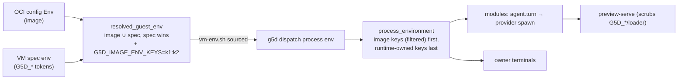

# Image-declared environment reaches agents, terminals and previews

## Ontology changes and governance

Comparison base: `af8e6867` (main after PR #386, clean tree, 2026-10-08).

One new block, `g5.runtime.image-env`, in
[`software_architecture/runtime.g5.md`](../../ontology/software_architecture/runtime.g5.md)
after `g5.runtime.bundle.tools`, and one sentence amended in
`g5.scope.deployment.images.g5dev-toolchain` (the Phase 1 block) so it names this block
as its complement instead of "the durable follow-up". `g5.runtime.workspace-cli`,
`g5.runtime.bundle.tools` and `g5.security.credentials.reserved-env` are unchanged and
govern: the command path, the launcher precedence and loader scoping stay as they are,
and the reserved-key policy is reused, not redefined.

```diff
+## Image-declared environment reaches agents, terminals and previews
+
+[D · g5.runtime.image-env]
+
+The runtime forwards the customer image's declared environment (its OCI config `Env`
+as merged with the VM spec at boot) to agent turns, owner terminals and preview
+commands, filtered by the same reserved-key policy that governs user settings:
+platform identity, runtime, provider-home and native loader keys stay runtime-owned,
+and a runtime-owned key wins on collision. The host names the surviving image keys
+to the guest in one reserved variable, so the dispatcher never guesses which of its
+inherited variables came from the image and never forwards spec-only keys.
+Reason: the dispatcher's cleared environment silently cancelled every
+environment-dependent tool the g5dev image baked (Rust via rustup, sccache,
+Playwright); the image-side launchers close that for one image, this closes the class.
```

Amendment to `g5.scope.deployment.images.g5dev-toolchain` (last sentence): "a runtime
passthrough of image environment is the durable follow-up and this decision stands on
its own until it lands" becomes "the [runtime passthrough](...#image-declared-environment-reaches-agents-terminals-and-previews)
closes the class; the launchers stay so the image also works on hosts whose runtime
predates it".

### Relevant and governing ontology

| Block | Why relevant | What implementation must enforce or consider |
|---|---|---|
| [`g5.runtime.image-env`](../../ontology/software_architecture/runtime.g5.md#image-declared-environment-reaches-agents-terminals-and-previews) | New owner | Forward only keys the host names; filter with the reserved policy and loader keys; runtime-owned keys win; all three surfaces |
| [`g5.security.credentials.reserved-env`](../../ontology/concepts/security.g5.md#protect-platform-owned-environment-keys) | Reserved-key policy | Reuse `is_exportable_task_env_key` (PATH, HOME, `G5_*`, `G5D_*`, DB and provider keys rejected); image keys cannot replace dispatcher-owned entries |
| [`g5.runtime.workspace-cli`](../../ontology/software_architecture/runtime.g5.md#make-the-workspace-cli-available-to-people-and-agents) | Loader scoping, launcher precedence | Image `LD_LIBRARY_PATH`/`DYLD_LIBRARY_PATH` are not forwarded; PATH stays `command_path`'s |
| [`g5.runtime.bundle.tools`](../../ontology/software_architecture/runtime.g5.md#the-bundles-tools-are-reachable-without-displacing-the-image) | Command path shape | Unchanged |
| [`g5.preview.service`](../../ontology/features/preview_terminal.g5.md#preview-is-a-visible-service-with-explicit-lifetime) | Preview inherits the module env | preview-serve's scrub of `G5D_*`/loader keys still applies after the passthrough; a customer `preview.env` still wins |
| [`g5.scope.deployment.images.g5dev-toolchain`](../../ontology/concepts/deployment.g5.md#make-the-development-images-toolchain-work-in-the-cleared-guest-environment) | Phase 1 complement | Launchers honour caller values, so a forwarded `RUSTUP_HOME` and the launcher agree |
| [`g5.design.minimal-mechanism`](../../ontology/concepts/system_design_principles.g5.md) | Justify the mechanism | One variable, one filter in the single assembly point, no new file, mount or allowlist |

## Requested outcome and design

An agent turn, terminal or preview in a VM whose image declares `ENV FOO=bar` sees
`FOO=bar` without any image-side launcher, while `PATH`, `HOME`, `G5D_*`, loader paths
and the dispatcher's Git identity remain exactly what the runtime sets.



The merge point that knows the image's keys is `resolved_guest_env` in the libkrun
backend (`g5d-isolation/src/isolation/microvm.rs`); it appends one entry,
`G5D_IMAGE_ENV_KEYS`, listing the image keys that survived the spec merge, colon-joined
(a key containing `:` or `=` is not shell-exportable and is skipped). The entry rides the
existing env file into the dispatcher's process. `GitRuntime::install` reads that variable
once and resolves each named key against its own environment through
`is_exportable_task_env_key` and the native loader exclusion; `process_environment`
emits those entries first and the runtime-owned entries after them, so every consumer
that applies the vector in order (module runner, terminal manager, Git transport) sees the
runtime win on a collision. The agent-turn provider spawn seeds from the module's
environment and preview-serve scrubs `G5D_*` and loader keys from the customer command,
so both inherit the forwarded keys with no further change. Away from a real guest the
variable is absent and nothing changes.

### Acceptance outcomes

- `resolved_guest_env` with image `JAVA_HOME`, `MAVEN_HOME`, `PATH` and spec `PATH`,
  `G5D_TASK_ID` yields `G5D_IMAGE_ENV_KEYS=JAVA_HOME:MAVEN_HOME` (spec-overridden `PATH`
  excluded); an image with no env yields no entry.
- `process_environment` with `G5D_IMAGE_ENV_KEYS=RUSTUP_HOME:PATH:HOME:G5D_X:LD_LIBRARY_PATH:MISSING`
  forwards only `RUSTUP_HOME`; `PATH` and `HOME` stay the runtime's; the loader key and
  the reserved prefix are dropped; a listed key absent from the environment is dropped.
- Dispatch integration: a terminal opened on a dispatcher launched with
  `G5D_IMAGE_ENV_KEYS` and a sample image variable prints that variable, while the
  existing assertions (no `G5D_DISPATCH_TOKEN`, no loader path, image `git`, shim `g5d`)
  stay green; a listed `HOME` does not move the agent home.
- On a rotated QA host: an agent turn prints the image's `RUSTUP_HOME` and
  `PLAYWRIGHT_BROWSERS_PATH` with no exports.

### Risks and accepted consequences

- **Image env becomes agent-visible by default.** Any `ENV` a customer image declares
  now reaches agents and terminals. That is the OCI contract users expect from
  `docker run`; secrets do not belong in image config, and the reserved policy still
  withholds platform keys.
- **Ships through the worker bundle.** Needs the Packer bake plus host rotation; VMs on
  older hosts keep the launcher behaviour only.
- **Preview double exposure.** Preview commands already received the module env; they now
  also receive image keys, scrubbed by the same preview-serve filter.

### Unresolved assumptions

- None blocking. The `G5D_IMAGE_ENV_KEYS` name is reserved by prefix, so no user setting
  can inject it, and the host drops an image-declared entry of that name before naming.

### Review amendments

- The key list is bounded at 32 KiB (`IMAGE_ENV_KEYS_MAX_LEN`), stopping at a key
  boundary in image order with a warning: it rides as one `vm-exec` argument and Linux
  caps a single argv string at 128 KiB. Image keys past the bound are not forwarded;
  the ontology block states the exception.
- The carrier is treated as metadata by the guest console secret collector, so the
  named variables stay readable in diagnostics.

## Review summary

Self-review plus three Codex (gpt-6-astra) rounds, all APPROVE; four confirmed findings
(padded key identity, carrier in secret redaction, unbounded carrier, image-declared
carrier) repaired with regression tests. See [review.md](review.md). Open until a rotated
QA host boots a VM: the end-to-end forwarding into a live agent turn.
