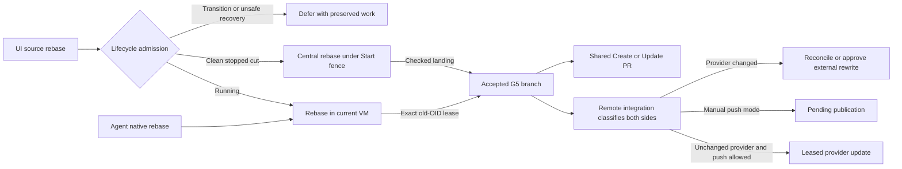

## Ontology changes and governance

Design: **Workspace rebase consistency**. Branch: `codex/improve-workspace-rebase`, created from fetched `origin/main` at `d1e75d6398d9a84a672564bbb0292afe6639b4b9` (comparison base). This is a design, not an implementation or approval record. [Human instructions, QA evidence and interpretation](../../chat_intent/improve-workspace-rebase/request.md).

| Change | Block |
| --- | --- |
| Add the user's governing outcome | [g5.story.rebase-consistency](../../ontology/features/workspaces.g5.md#rebase-without-system-divergence) |
| Assign the complete rebase operation to its execution owner | [g5.architecture.workspace_rebase](../../ontology/software_architecture/workspace.g5.md#execute-workspace-rebases-in-the-running-vm) |
| Distinguish workspace and provider rewrites | [g5.governance.remote.workspace-rewrite](../../ontology/features/governance.g5.md#distinguish-workspace-rewrites-from-provider-rewrites) |
| Scope the existing publication ancestry rule | [g5.governance.remote.destination](../../ontology/features/governance.g5.md#refuse-to-recreate-a-missing-provider-branch) |
| Metadata only: Ship to Base recapture evidence | [g5.governance.merge.effects](../../ontology/features/governance.g5.md#reconcile-the-durable-merge-effect) |

The retained [provider integration policy](../../../docs/data-model-cleanup-plan.md#provider-transport-and-publication) is amended in place. Its blanket exclusion of internal rewrites from provider publication would otherwise contradict this design. Actual ontology diff against `origin/main`, including metadata. It was updated after implementation review; the original handoff diff is preserved in the [review](review.md#original-handoff-ontology-diff).

<!-- ONTOLOGY_DIFF_START -->

```diff
diff --git a/.g5/ontology/features/governance.g5.md b/.g5/ontology/features/governance.g5.md
index 76ecb6b2..263fb0a6 100644
--- a/.g5/ontology/features/governance.g5.md
+++ b/.g5/ontology/features/governance.g5.md
@@ -482,7 +482,15 @@ Accepted branch updates schedule forwarding in auto mode, the default for new wo
 
 [D · g5.governance.remote.destination]
 
-Synchronization updates an existing destination only after ancestry checks and an exact destination lease. A moved or removed branch is not silently recreated. Initial branch creation is a separate explicit operation under the [publication proof rule](#prove-initial-external-publication).
+Synchronization updates an existing destination only after [history classification](#distinguish-workspace-rewrites-from-provider-rewrites) and an exact destination lease. A moved or removed branch is not silently recreated. Initial branch creation is a separate explicit operation under the [publication proof rule](#prove-initial-external-publication).
+
+### Distinguish workspace rewrites from provider rewrites
+
+[D · g5.governance.remote.workspace-rewrite]
+
+Remote integration classifies which side moved since the Git synchronization watermark. An accepted G5 rewrite while the provider still equals the watermark is a workspace rewrite, including a rewind the provider contains: it publishes under the existing binding, push mode and authority with that provider OID as its lease, and needs no rewrite approval. Manual mode leaves it pending without moving the watermark or importing the provider back over it. A G5 rewrite against a provider that advanced normally is divergence; a provider rewrite keeps its [approval checkpoint](#resolve-divergence-through-an-explicit-owner-action). Equal tips settle synchronization. Create/Update PR applies the same classification to a tracked source; without a watermark, nothing proves a rewrite and it publishes only a fast-forward.
+
+Checkpoints opened for workspace rewrites under the earlier rule are rechecked against fresh Git inputs by retry, push and the background sweep; only those now proven a workspace rewrite or converged close, keeping their audit history. Git refs and the watermark are the evidence; no rewrite flag or head registry is added.
 
 ### Keep queued publication consent with its requester
 
@@ -773,7 +781,7 @@ Automatic divergence pauses synchronization without launching resolution. An exp
 
 - agent
 - From [C142–C143](../../uplift/g5-lean/candidates/contracts.md).
-- ~50% · legacy merge service; redesigned schema/crash recovery unassessed.
+- ~50% · legacy merge service; redesigned schema/crash recovery unassessed. Ship to Base recaptures its provider import once when the target's own auto-pull landed the accepted commit between capture and preparation (`routes/workspaces.rs::merge_workspace_pull_request`, `job_merge_service.rs::is_provider_import_cut_changed`); `api_workspace_pull_requests.rs::provider_first_merge_completes_when_target_auto_pull_lands_it_first` reproduces the race found on the dev stack.
 
 ### g5.governance.merge.target
 
@@ -802,8 +810,14 @@ Automatic divergence pauses synchronization without launching resolution. An exp
 ### g5.governance.remote.destination
 
 - agent
-- [Retained integration design](../../../docs/data-model-cleanup-plan.md#provider-transport-and-publication).
-- Source-inspected · worker uses `push_existing_commit`; deletion-between-fetch-and-push and complete publication recovery were not executed.
+- [Retained integration design](../../../docs/data-model-cleanup-plan.md#provider-transport-and-publication); [workspace rebase amendment](../../chat_intent/improve-workspace-rebase/request.md) delegates non-fast-forward publication to history classification.
+- Source-inspected · worker uses `push_existing_commit`, whose ancestry check is lifted only for a classified workspace rewrite; deletion-between-fetch-and-push and complete publication recovery were not executed.
+
+### g5.governance.remote.workspace-rewrite
+
+- agent
+- [Workspace rebase request and interpretation](../../chat_intent/improve-workspace-rebase/request.md); narrows the previous blanket provider-rewrite approval rule without changing provider-change protection, Base's no-push rule or publication credentials.
+- ~85% · `remote_integrations.rs::classify_history` yields `WorkspaceRewritten` before tip ancestry; `branch_integration_service.rs::classify_and_act` publishes it by push policy; `worker.rs::push_workspace_tip` passes `replace` to `GitRepo::push_existing_commit`; `worker.rs::obsolete_false_rewrite_checkpoint` closes rechecked checkpoints reached through `policy.rs::retry`, explicit push and `enqueue_background_inbound_rows`; `workspace_service.rs::require_publishable_tracked_source` guards Create/Update PR. Real Postgres/Git worker tests in `remote_tracking_background_loop.rs` cover automatic publication of a native leased rewrite and rewind under a mocked organization App (`helpers/github_app.rs::MockedGithubApp`), manual-mode pending rewrites, a provider advance, a genuine provider rewrite under sweep recheck and a false checkpoint closed by the sweep; unit tests cover the classifier and decision table. `api_workspace_pull_requests.rs::update_pr_publishes_tracked_sources_only_over_unchanged_provider_history` covers Create/Update PR refusing a provider advance (with and without a watermark) and a provider rewrite, and publishing a workspace rewrite. `branch_sync_runs_service.rs` reports `rewrite_pending`, asserted through the status route, and the UI names it. Gaps: no live GitHub provider; retry and explicit-push recheck entry points are inspection only; untracked PR source branches keep observed-tip leases without a watermark. [Review](../../pr_ontology_diff_design/improve-workspace-rebase/review.md).
 
 ### g5.governance.remote.consent
 
diff --git a/.g5/ontology/features/ontology_and_harness.g5.md b/.g5/ontology/features/ontology_and_harness.g5.md
index 17f4bb36..679f4ead 100644
--- a/.g5/ontology/features/ontology_and_harness.g5.md
+++ b/.g5/ontology/features/ontology_and_harness.g5.md
@@ -214,7 +214,7 @@ keep valid intent and the original delivery reviewable when the design changes.
 
 [I · g5.harness.provided]
 
-G5 packages `.agents/AGENTS.md` and the four [maintained skills](#maintain-one-source-for-workflow-skills) for workspace agents. Both providers receive the same packaged instruction bytes: `$HOME/.codex/AGENTS.md` for Codex and `$HOME/.claude/CLAUDE.md` for Claude Code, with skills in each provider's native home and no G5 hooks. Repository development instructions remain separate. For now its only MCP tools are the two with which the owner's agent reads and decides a [review round](governance.g5.md#review-in-a-workspace-you-own).
+G5 packages `asserts/AGENTS.md` and the four [maintained skills](#maintain-one-source-for-workflow-skills) for workspace agents. Both providers receive the same packaged instruction bytes: `$HOME/.codex/AGENTS.md` for Codex and `$HOME/.claude/CLAUDE.md` for Claude Code, with skills in each provider's native home and no G5 hooks. Repository development instructions remain separate. For now its only MCP tools are the two with which the owner's agent reads and decides a [review round](governance.g5.md#review-in-a-workspace-you-own).
 
 ### Bound changes by top-level module
 
@@ -426,7 +426,7 @@ Maintain the four ordinary skills in `.agents/skills`. Generate client and harne
 
 - human-provided, human-verified
 - [Issue 248 and the user's chosen option](../../chat_intent/issue-248/request.md#human-instructions); retaining the review-round tools is a [later decision](../../chat_intent/issue-248/request.md#clarifications). The [native-home request](../../chat_intent/agent-harness/request.md) changes the instruction source and Claude destination.
-- Implemented locally · `backend/g5d-agent-turn/src/harness.rs` installs the packaged instructions and skills into native provider homes; `runtime.rs` enables Claude's user/project sources. Docker, Packer and local staging package `.agents/AGENTS.md` and `.agents/skills`; Codex alone retains the review-round MCP tools. Fake-provider turns skip installation. Terminal clients can discover instructions after a platform turn installs them. Each turn replaces the provider instruction file; edits to that installed file do not persist across refresh. Owner user settings now apply to Claude turns, and provided skill names replace colliding owner skills. Gaps: the dedicated instruction file supplies no `g5d pr` guidance; no Claude review-round tools; host readiness does not check harness completeness; instruction links are not rewritten for provider homes. Verification: 78 agent-turn tests, targeted dispatcher fixtures, staging regressions and strict crate Clippy passed; pinned Claude 2.1.285 loaded instructions and four skills on initial, refreshed and terminal launches against a local scripted API, and incompatible user memory settings were rejected before provider launch. Cloud CI, full worker-image builds and deployed VMs are unverified.
+- Implemented locally · `backend/g5d-agent-turn/src/harness.rs` installs the packaged instructions and skills into native provider homes; `runtime.rs` enables Claude's user/project sources. Docker, Packer and local staging package `asserts/AGENTS.md` and `.agents/skills`; Codex alone retains the review-round MCP tools. Fake-provider turns skip installation. Terminal clients can discover instructions after a platform turn installs them. Each turn replaces the provider instruction file; edits to that installed file do not persist across refresh. Owner user settings now apply to Claude turns, and provided skill names replace colliding owner skills. Gaps: the dedicated instruction file supplies no `g5d pr` guidance; no Claude review-round tools; host readiness does not check harness completeness; instruction links are not rewritten for provider homes. Verification: 78 agent-turn tests, targeted dispatcher fixtures, staging regressions and strict crate Clippy passed; pinned Claude 2.1.285 loaded instructions and four skills on initial, refreshed and terminal launches against a local scripted API, and incompatible user memory settings were rejected before provider launch. Cloud CI, full worker-image builds and deployed VMs are unverified.
 
 ### g5.harness.module-boundary
 
diff --git a/.g5/ontology/features/workspaces.g5.md b/.g5/ontology/features/workspaces.g5.md
index 86042c45..80be7c42 100644
--- a/.g5/ontology/features/workspaces.g5.md
+++ b/.g5/ontology/features/workspaces.g5.md
@@ -150,6 +150,14 @@ Governing concepts: Owner pushes use [current-owner authority](../concepts/secur
 
 Governing contracts: [complete a proven divergence resolution](#complete-a-proven-divergence-resolution), [publish a resolved divergence by push mode](#publish-a-resolved-divergence-by-push-mode).
 
+### Rebase without system divergence
+
+[I · g5.story.rebase-consistency]
+
+Rebasing a workspace branch via the UI or in a workspace VM by the agent should not result in system divergence. If a VM is running, any workspace rebase executes there, even when central Git could perform it cleanly. Accepted force-pushes from the VM remain intelligible to remote integration and follow the workspace's publication policy.
+
+Governing contracts: [workspace rebase ownership](../software_architecture/workspace.g5.md#execute-workspace-rebases-in-the-running-vm), [workspace rewrite publication](governance.g5.md#distinguish-workspace-rewrites-from-provider-rewrites).
+
 ### Follow the provider in Base
 
 [I · g5.story.base-follows-provider]
@@ -592,6 +600,12 @@ This is the only reconciliation Base offers, because Base has no VM. It replaces
 - [Automatic divergence resolution](../../chat_intent/issue-240/auto-resolve-divergence.md) asks G5 to discover a resolved force-push instead of requiring a click.
 - Implemented · `remote_integrations/worker.rs::auto_complete_proven_divergence` completes a proven run before the cycle claim; the activity list labels the `resolved` audit row. Real Postgres/Git worker tests cover an agent rebase pushed through the production Git receiver, externally resolved runs in auto and manual push modes, unproven and merge-commit heads, and provider-rewrite checkpoints. Not exercised in a browser or against a live provider.
 
+### g5.story.rebase-consistency
+
+- human-provided
+- [Workspace rebase request](../../chat_intent/improve-workspace-rebase/request.md#human-instructions).
+- ~75% · [Plan](../../pr_ontology_diff_design/improve-workspace-rebase/ontology-plan.md#implementation-status). QA exposed central/live-checkout divergence and a workspace rewrite classified as a provider-rewrite checkpoint; both owners are implemented with the evidence and gaps recorded on [rebase execution](../software_architecture/workspace.g5.md) and [rewrite publication](governance.g5.md) metadata. Not exercised end to end in a booted VM, browser or against a live provider.
+
 ### g5.story.base-follows-provider
 
 - human-verified
diff --git a/.g5/ontology/software_architecture/workspace.g5.md b/.g5/ontology/software_architecture/workspace.g5.md
index 3298cf5f..2aafaa6d 100644
--- a/.g5/ontology/software_architecture/workspace.g5.md
+++ b/.g5/ontology/software_architecture/workspace.g5.md
@@ -17,6 +17,7 @@ and [preview/terminal](../features/preview_terminal.g5.md).
 | WorkspaceService | List/manifest/update/member/delete | [Registry](#workspace-identity-and-membership) |
 | Workspace lifecycle | `view`, `resume`, `stop`, `transfer` | [Attachment and release](#lifecycle-coordinates-attachment-and-release) |
 | WorkspaceRuntime | `RuntimeRequest`; `file_*`, `workspace_changes*`, `modules_*`, `open_owner_stream` | [Authorized live access](#one-live-runtime-facade) |
+| Workspace rebase owner | Prepare, execute and publish source rebase through runtime or stopped landing | [Rebase execution](#execute-workspace-rebases-in-the-running-vm) |
 | Workspace reader | File/tree/diff/history over bound read views | [Durable reading](#durable-repository-reads) |
 | WorkspaceForkService | `fork_workspace` | [Complete fork](#checked-fork) |
 | Workspace flush | `workspace.flush(shutdown|fork)`; `start/complete/fail` callbacks | [Snapshot coordination](#flush-owns-the-durable-snapshot) |
@@ -59,6 +60,14 @@ operations with an authorized actor, exact incarnation, deadline and request ide
 
 [Lifecycle](lifecycle.g5.md#explicit-consent-owns-each-start) alone owns Start.
 
+### Execute workspace rebases in the running VM
+
+[D · g5.architecture.workspace_rebase]
+
+A running workspace executes every source rebase in its current owner VM through WorkspaceRuntime, including clean replay, fast-forward and no-op, and never lands a central result behind that VM. A start, stop or transition refuses rather than falling back; a VM without the operation asks for a restart. A stopped workspace rebases centrally only when its whole recovery receipt is clean, fully published, on mapped branches and free of sequencers, rechecked under the commit fence Start takes, so [restore](durability.g5.md#advance-a-wholly-clean-stopped-workspace-after-landing) adopts the new heads.
+
+In the VM, each member takes G5 work it lacks, replaying its own unpublished commits onto the G5 head without duplicating patches G5 already holds, and publishes with [old-OID CAS](durability.g5.md#update-mapped-branches-through-exact-old-oid-cas) on the captured G5 head; it never widens the lease. Dirty files, local commits that conflict with newer G5 commits, moved inputs or Git state needing the owner leave that member unchanged and are reported with the members already accepted. A replay conflict hands off to the existing resolution task in the same VM. Completion means G5 accepted the VM result; [provider publication](../features/governance.g5.md#distinguish-workspace-rewrites-from-provider-rewrites) is a separate outcome.
+
 ### Durable repository reads
 
 [D · g5.architecture.content_reader]
@@ -141,6 +150,12 @@ execution evidence under the [event contract](runtime.g5.md#event-facts-survive-
 - [VM API §2](../../../docs/workspace-vm-api-v9.md#2-workspace-runtime-api).
 - ~75% · `backend/g5-api-core/src/services/workspace_runtime.rs`; fresh private health is not checked at admission and editor Save lacks the observed VM precondition. `call`, lifecycle requests and raw VM streams are crate-private (`backend/g5-api/tests/crate_private_fences.rs`), so code outside `g5-api-core` builds only owner requests; the 7 `call` consumers outside the facade are the fork and stop lifecycle owners. Owner streams are terminal streams; a preview stream opens through `open_preview_stream`, only on the incarnation its preview task runs on. The percentage was not reassessed.
 
+### g5.architecture.workspace_rebase
+
+- agent
+- [Workspace rebase request and interpretation](../../chat_intent/improve-workspace-rebase/request.md); implements [rebase consistency](../features/workspaces.g5.md#rebase-without-system-divergence).
+- ~75% · `routes/workspaces.rs::start_workspace_merge` selects execution with `workspace_vm_service.rs::source_rebase_execution` and rechecks it under the commit fence before a central landing; `job_merge_service.rs::rebase_source_in_vm` drives `WorkspaceRuntime::workspace_changes_rebase`, the guest `workspace.changes` `rebase` operation (`g5d-dispatch/src/modules/builtin.rs`) and `g5-scm/src/native/member/rebase.rs::MemberGit::rebase_onto`. The guest operation is executed against a real authenticated origin through the transport relay in `g5d/tests/dispatch_modules.rs` (replay, no-op, moved inputs, dirty tree, catch-up to G5, unpublished local commits, reconciled divergence including the split an earlier central rebase left, conflicting divergence and target conflict, each restoring the checkout). API tests in `api_workspace_pull_requests.rs` use a scripted runtime peer that replays with real Git and cover VM routing, multi-member no-op, replay-conflict handoff and stopped/starting admission. On the dev stack, a booted VM (catalog `2026.10.06-workspace-changes-rebase`) completed one in-VM rebase through the route, apparently a validated no-op. Gaps: no recorded guest push through the production Git receiver, Create PR immediately after a publishing VM rebase, stop/transfer races during replay, or `stopping` and older-guest refusals at runtime; partial multi-member failure is reported but not retried automatically. [Review](../../pr_ontology_diff_design/improve-workspace-rebase/review.md).
+
 ### g5.architecture.content_reader
 
 - agent
```

<!-- ONTOLOGY_DIFF_END -->

### Relevant and governing ontology

| Block | Relevance | Obligation |
| --- | --- | --- |
| [g5.story.rebase-consistency](../../ontology/features/workspaces.g5.md#rebase-without-system-divergence) | Requested outcome | UI and agent rebases must not strand the checkout or misclassify accepted rewrites. |
| [g5.architecture.workspace_rebase](../../ontology/software_architecture/workspace.g5.md#execute-workspace-rebases-in-the-running-vm) | Execution owner | Route every live workspace rebase through its current VM; prove stopped eligibility. |
| [g5.governance.remote.workspace-rewrite](../../ontology/features/governance.g5.md#distinguish-workspace-rewrites-from-provider-rewrites) | Publication policy | Propagate accepted local rewrites only under the defined provider evidence. |
| [g5.git.network.cas](../../ontology/software_architecture/durability.g5.md#update-mapped-branches-through-exact-old-oid-cas) | Internal publication | Keep exact old-OID CAS, including non-fast-forward updates. |
| [g5.git.clean-advance](../../ontology/software_architecture/durability.g5.md#advance-a-wholly-clean-stopped-workspace-after-landing) | Restart safety | A dirty or unpublished member prevents replacing the complete recovery cut. |
| [g5.governance.remote.push](../../ontology/features/governance.g5.md#apply-the-selected-push-policy) | Publication consent | Auto/manual policy and the existing repair sweep still govern forwarding. |
| [g5.governance.remote.consent](../../ontology/features/governance.g5.md#keep-queued-publication-consent-with-its-requester) | Transfer and queued work | Revalidate the requester and lifecycle authority; do not inherit consent. |
| [g5.governance.remote.pull](../../ontology/features/governance.g5.md#publish-incoming-refs-without-changing-live-files) | Important exception | Ordinary provider imports still leave the live checkout and recovery snapshot alone. |
| [g5.workspace.remote.divergence-auto-complete](../../ontology/features/workspaces.g5.md#complete-a-proven-divergence-resolution) | Existing reconciliation | Retain the captured provider-tip and linear-replay proof for actual divergence runs. |
| [g5.workspace.remote.base-parity](../../ontology/features/workspaces.g5.md#track-base-like-any-other-workspace) | Protected Base | Never route Base to VM rebase or outbound rewrite publication. |
| [g5.architecture.pr_flow](../../ontology/software_architecture/git_governance.g5.md#one-create-or-update-pr-flow) | Create/Update PR | Consume the accepted result through the shared flow, not a second repair path. |
| [g5.architecture.git_outcomes](../../ontology/software_architecture/git_governance.g5.md#report-what-a-git-or-provider-operation-established) | Partial and uncertain effects | Name the failed boundary and preserve confirmed effects on retry. |
| [g5.governance.merge.effects](../../ontology/features/governance.g5.md#reconcile-the-durable-merge-effect) | Found in dev-stack testing | Ship to Base must not report an import that the target's auto-pull already applied as a failure. |
| [Require organization credentials for automatic publication](../../ontology/concepts/security.g5.md#require-organization-credentials-for-automatic-publication) | Test strategy | Auto-mode coverage uses a mocked organization App, never a relaxed credential rule. |

## Requested outcome and observed failures

“Rebasing a workspace branch via the UI or in a workspace VM by the agent should not result in system divergence.” At successful rebase completion, the selected VM result is accepted by G5; a later user edit may legitimately move the checkout again. Provider convergence follows publication policy and may be pending or blocked for a real external reason. The invariant does not require dirty files, saved snapshots and published branches to be identical at every moment.

The QA examples exposed two boundaries. In Ben's local-only workspace, the UI advanced G5's branch while the VM stayed on an older base; Create PR saved locally and then failed its ancestry preflight. In `preview-test`, a G5 workspace rewrite caused the remote integration's shared watermark check to open the approval state used for provider rewrites. A later completed provider PR caused a separate refresh error; changing completed-PR lifecycle handling is outside this design.

Current source supports these mechanisms: `JobMergeService::prepare_source_workspace_merge_with_mode` chooses direct central replay from Git mergeability; `WorkspaceRuntime::prepare_pull_request_source` performs commit then push; `MemberGit::push_commit` refuses non-descendants before its leased push. Separately, `remote_integrations::classify_history` and `branch_integration_service::classify_and_act` collapse local divergence below the watermark and provider loss of watermark ancestry into `WatermarkViolation`. The internal receive-pack route already accepts authorized mapped-branch rewrites with old-OID CAS. The fix must join these existing owners rather than add a competing Git authority.

## High-level design



The workspace rebase owner composes capture, runtime execution and accepted publication as one operation, using WorkspaceRuntime for live effects and the existing checked landing only for a safely stopped source. Native Git joins at the same accepted-push boundary. Remote integration alone classifies provider state and applies publication policy; the shared PR owner consumes its outcome. Exact Git inputs, current authority and distinct completion evidence prevent a successful central change from concealing an unfinished VM or provider step.

### 1. A running VM owns the rebase

Choose the execution path before preparing a publishable central result. Capture the owner, lifecycle generation/incarnation, repository membership, selected target cut, each current G5 source OID and the VM's actual local branch/HEAD. Previews remain read-only and their inputs must be revalidated. A running but unreachable/busy VM cannot be treated as stopped. Starting, stopping, replacement and ownership-transfer races defer or refuse; they never authorize fallback to central Git.

Clean replay and fast-forward execute as a declared runtime Git operation; a no-op still validates the actual checkout. Conflicting replay remains in the same VM for the existing resolution task and native sequencer. Use the selected target's exact inputs, not a fresh implicit fetch halfway through replay. The central source-rebase owner must cover all callers, including published-source variants and any other path that would rebase an actively checked-out workspace branch. Provider-side PR merge execution remains owned by the provider.

Admit a mapped branch with no pre-existing sequencer. Preserve uncommitted work by refusing destructive replay with an actionable save/resolve outcome; do not silently reset, clean or stash. Include local committed work in the selected replay. If the VM lacks newer G5 work, reconcile that difference in the VM before replaying the target; do not simply force the stale local branch over it. Already divergent VM/G5 histories need the same explicit resolution path with both exact inputs, including recovery of workspaces affected by the old central behavior.

Publish the resulting exact VM commit with a lease on the G5 source OID captured before reconciliation/rebase. Accepting a rewrite does not require the old OID to remain an ancestor. A stale lease preserves the result locally and reports the competing head; never refresh the tracking ref and widen the lease to make the push succeed. Validate that the selected local branch/result is still current before reporting completion. Report subsequent user edits as newer work, rather than resetting them to match the completed operation.

The existing member push's ancestry-only policy is **not** a compatible rebase publisher. Give the rebase operation an explicit leased-rewrite policy backed by its captured inputs; keep ordinary save/push protection against silently discarding unseen G5 commits. Native agents continue using ordinary Git with an explicit `--force-with-lease=<workspace-ref>:<captured-g5-oid>`, so no custom rebase command or rewrite token is required.

### 2. Stopped execution must compose with restore

Central execution remains available only for a stably stopped workspace whose entire recovery vector is fully published, clean, on mapped branches and free of sequencers. Revalidate this eligibility and the captured source vector under the same lifecycle/commit admission that excludes Start and captures boot inputs. This allows the existing clean-advance restore rule to select the new complete cut without altering historical receipts. Any dirty/unpushed/foreign member requires the owner to start the workspace and resolve there; the rebase request does not implicitly grant Start consent. Base is never a source workspace for rebase.

### 3. Classify which side changed before selecting publication

Use existing Git evidence: `W` is the accepted G5 tip, `P` the freshly fetched provider tip, and `B` the synchronization watermark. The table is evaluated for the exact current binding, under existing policy/authority. No SQL head cache, local-rewrite flag or durable force-push ticket is needed: the mapped G5 ref already passed its write boundary, and `B` retains the expected external synchronization point.

| Evidence | Meaning and action |
| --- | --- |
| `W == P` | Already converged. Settle observation/watermark through the fenced integration owner, including a lost response after successful publication. No provider overwrite or new approval is needed. |
| `P == B`, `W != P`, and `B` is not an ancestor of `W` | Accepted workspace rewrite against an unchanged provider. Auto mode publishes with lease `P`; manual mode shows a pending rewrite until explicit Push/Create PR/Update PR. Do not import `P` back over `W`, even if `W` is an ancestor of `P`. |
| `P != B`, `B` is not an ancestor of `P`, and `W != P` | Actual provider rewrite, possibly with a local rewrite too. Preserve the existing explicit approval boundary and exact reviewed candidate. |
| Provider advanced normally and is already contained in `W` | Ordinary fast-forward publication is possible under push policy. |
| Provider advanced normally and is not contained in `W` | Preserve existing fast-forward import only when no local rewrite is pending and its normal conditions hold. Otherwise preserve both sides and reconcile in the VM; a concurrent provider advance cannot be discarded by extending the lease. |
| Missing binding, provider ref or watermark | Use existing explicit publication/binding recovery. No inferred permission to overwrite an existing branch, and no silent recreation of a deleted one. |

The local-rewrite case must precede ordinary tip ancestry: after a reset/rebase, `W` may be an ancestor of the unchanged provider and must not be misread as an inbound update. Keep `B` unchanged while a rewrite is pending or provider publication is refused. Following confirmed push, advance provider observation and watermark to the exact published commit through existing convergence machinery. If G5 moves again during transport, retain the confirmed external outcome and reclassify the newer head; never stamp a newer, unpushed head as synchronized. A provider race after fetch fails the exact destination lease. An unknown result is inspected before any further push.

Apply this policy once in remote integration, consumed by background workers, explicit Push, coordinated PR publication, resolution completion and tracking status. Retain auto/manual settings, current requester authority, App-only implicit publication, provider protection and Base's no-push rule. Native pushes are queue signals, not explicit overrides of manual mode. Existing queue generations, leases and repair sweeps provide progress; the SCM layer adds neither a new retry worker nor operation journal.

### 4. Complete the user flow and recover old checkpoints

Create PR immediately after a completed UI rebase consumes the already accepted VM/G5 result. Local-only members use the existing initial publication proof, then provider PR creation. Existing tracked members use the same rewrite classification as automatic forwarding. UI and `g5d pr create/update` retain one flow and separate saved-to-G5, provider-publication and PR-creation outcomes. A raw native rebase without its leased push is not enough evidence to infer an old destination OID: if no managed rebase input exists, show the VM/G5 difference and direct the owner/agent to reconcile and publish with a valid explicit lease. Do not turn every non-fast-forward Create PR failure into an automatic force-push.

Existing `watermark_violation` checkpoints need recovery, not just better creation logic. Extend their existing retry/pickup path to fetch and reclassify fresh inputs even though the old pause ordinarily suppresses fetches. Auto mode's existing maintenance sweep must also discover these candidates; manual mode may clear a false approval gate but still must not publish implicitly. Under the run/workspace fences, obsolete only checkpoints now proven to be a local rewrite or already converged; preserve their audit history and any genuinely unresolved provider rewrite. An active resolution task is not silently cancelled or overwritten. Revalidation may invalidate stale task input and report that explicitly. Do not mass-clear pause flags or edit baselines to manufacture proof.

Use distinct status and error details for VM reconciliation, rebase conflicts, stale internal lease, pending manual rewrite publication, provider lease conflict, external rewrite approval, provider authorization and closed/merged PR state. “Waiting for human” must identify the actual decision required; a successfully accepted local rewrite alone is not such a decision. Keep the original failure cause through automatic PR refresh rather than replacing it with a generic access/status/synchronization suggestion.

## Failure boundaries and recovery

| Boundary | Required outcome |
| --- | --- |
| VM rebase conflicts or a member is dirty | Keep edits and native conflict state; G5/provider remain unchanged for that member. Resume or abort in that VM. |
| VM result exists but G5 refuses or response is lost | Keep the local result and original expected OID in existing operation inputs. Inspect the G5 ref; acknowledge an exact accepted result, otherwise report/reconcile the new head. Do not rerun completed replay blindly. |
| Some repositories have completed | Record/report each exact member result. Resume unfinished members; do not roll back already accepted branches or claim workspace-wide completion. |
| Stop/replacement interrupts live work | Existing flush and restore retain recoverable local work. Old incarnation authority cannot publish through its replacement. A new owner operation revalidates the recovered state. |
| Provider rejects, is unavailable or outcome is unknown | G5 acceptance remains durable. Keep publication pending/blocked separately; inspect the destination before retry and retain the original external lease. |
| Accepted Git update outlives a failed enqueue or DB finalization | Existing integration discovery and Git-authoritative convergence repair current state. Queue delivery is not rewrite proof and a lost event cannot turn a local rewrite into an external one. |

Multi-repository VM execution and provider transport are not one transaction. The existing central cut may remain atomic where its owner already guarantees that, but live replay and publication must expose partial results honestly. No attempt may compensate by resetting completed VM/G5/provider effects.

## Acceptance and verification

Implementation must add and **run real E2E coverage** through UI/CLI, a running guest, the production Git receiver, real repositories and integration workers; a mocked dispatcher alone cannot reproduce the Ben failure. Use a disposable Git provider fixture for deterministic races and a disposable connected GitHub branch/PR for actual provider authentication, protection and publication behavior. Record any unavailable live-provider or VM coverage explicitly rather than substituting passing unit tests.

| Scenario | Required evidence |
| --- | --- |
| UI fast-forward, clean replay and no-op with a running VM | Rebase executes in that VM; before reporting completion its selected result is accepted by G5. Target branch is unchanged. Immediate Create PR succeeds for local-only and tracked members. |
| Agent native rebase and exact leased force-push | Internal receiver accepts the intended rewrite; auto mode converges `W/P/B` without an approval checkpoint; manual mode retains `B` and offers explicit publication. Include a rewind where `W` is an ancestor of `P`. |
| Dirty files, unpushed commits, detached/wrong branch and active sequencer | No local intent disappears. Eligible local commits participate; unsafe states give specific recoverable outcomes. |
| Old central-rebase divergence and old false rewrite checkpoint | VM reconciliation retains both sets of work; fresh checkpoint classification removes only a false gate and allows subsequent PR creation/update. |
| True external rewrite, both-side rewrite, normal provider advance and deletion | No unapproved overwrite; exact lease rejects movement after fetch; true rewrite approval and deletion rules still apply. |
| Background ref refresh during rebase; simultaneous G5 push | Captured rebase lease remains fixed; unseen work cannot be overwritten by using a refreshed tracking ref. |
| Start/stop, VM replacement or ownership transfer during capture/replay/push | Stale authority cannot complete effects; no central fallback; recovery retains work and reports the correct partial outcome. |
| Stopped clean vector versus one dirty/unpushed member | Clean central rebase restores the new cut on both warm and cold start. Any unsafe member blocks the central path for the whole recovery vector. |
| Process/response loss after internal push, provider push or finalization; missed enqueue | Inspect before retry, settle exact confirmed effects, reclassify newer heads and converge without duplicate destructive replay or synthetic approval. |
| Multiple repositories with a conflict or publication failure in one | Accurate member outcomes and resumable progress, with no false all-member success or rollback of accepted work. |
| Scope regressions | Provider pulls still leave live files alone; Base never pushes; ordinary save/push cannot force stale local history; divergent-resolution linearity, authority and PR evidence checks remain enforced. |

Classifier and policy tests should cover the full `W/P/B` table, including absent watermark and equality after a rewrite. API/runtime tests should cover admission and precise errors. Browser tests should verify completion versus task-started messaging and the actual action offered. The E2E assertions must inspect real OIDs/ancestry and retained file content, not merely toast text or HTTP success.

## Review summary

Implementation self-review (not independent), recorded in [review.md](review.md):
- Covered: the branch diff, the governing blocks above, the reused guards (`push_existing_commit`, member push, scheduler and retry pause filters, the Create/Update PR publication path) and the catalog rollout.
- Repairs: added a discriminating test for the Create/Update PR history check; added a `rewritePending` status and label for manual-mode rewrites; made the tracking-ref update after a confirmed guest push best-effort; refreshed this diff.
- External review (CodeRabbit) then found three defects, fixed and recorded in the review: a missing Base check on the VM path, a too-short in-VM rebase deadline, and Create/Update PR overwriting provider history when no watermark exists.
- Remaining gaps: a publishing rebase in a booted VM, lifecycle races, two refusals checked by inspection only, and a live provider.

Design review:

Reviewed the design against owning contracts and exceptions after tracing the current operations. Four material corrections are included: preserve ordinary provider-import behavior; fence stopped rebases against complete recovery and Start; retain the immutable pre-rebase lease despite periodic tracking refresh; classify a local rewind before ordinary inbound ancestry. The retained policy and ontology were amended together, including the new scope of provider non-fast-forward publication. No new permanent state, independent queue, approval token or current-head cache is proposed.

Consequential reuse checks for implementation: the current member push rejects precisely the rewrites it would need to publish; `workspace.changes update` is a parent-merge operation, not a substitute for exact source rebase; existing divergence completion proves incorporation of provider input and must not be weakened to accept arbitrary rewrites; current paused checkpoints suppress refresh and cannot repair themselves without the scoped reclassification path. The existing lifecycle locks, merge-run evidence and guest operation interface must be verified to compose capture, Start exclusion and recovery as specified before adding dependent code. If their actual effects cannot satisfy this design, amend this same document and ontology first.

Remaining uncertainty is implementation-level: exact reuse of per-member merge-run outcomes across interrupted runtime calls, and deployed guest capability/version handling need confirmation. An older guest without the required operation must report that limitation rather than trigger central fallback. No unresolved product choice blocks this design. This change only writes the design and governing documents; behavioral coverage above remains unexecuted until implementation.

## Implementation status

Implemented on this branch after design review. Ontology blocks were tightened to remove restatements of existing rules (provider-rewrite approval, concurrent advances, missing destinations) and now carry their implementation evidence and gaps in metadata.

Decisions and resolved assumptions:

- **Completion evidence.** A VM rebase records no central `job_merge_runs` row. `POST /rebase-merge` returns a new `rebase` variant with each member's previous head, accepted head and whether it published; G5's acceptance of the leased push is the completion proof.
- **Guest operation.** `workspace.changes` gains `rebase` (catalog `2026.10.06-workspace-changes-rebase`). It requires one member, exact source and target OIDs and the target branch, and runs `MemberGit::rebase_onto`. A guest that predates it reports `OPERATION_NOT_FOUND`; the API asks for a restart and never falls back to central Git.
- **Divergent checkout.** When both the checkout and G5 moved, the checkout's own commits are replayed onto the G5 head before the target replay; Git skips patches G5 already holds. This repairs the split the earlier central rebase left (Ben's case) without forcing the stale branch. Conflicting local and G5 commits refuse.
- **Conflicts.** A replay conflict is aborted and the checkout restored; the existing resolution task is then enqueued in the same VM from a fresh cut. This replaces leaving the native sequencer open for the task, because the task's instructions already run the replay from pinned inputs. Every refusal restores the original checkout; only an unconfirmed G5 publication leaves the local result, which is reported.
- **Partial members.** Members are rebased in order. A refusal stops the operation and names the members already accepted; a retry treats them as validated no-ops.
- **Stopped admission.** `source_rebase_execution` permits the central path only for a stopped (or never started) workspace with no live start intent and a published-clean recovery receipt for every member. The route rechecks it under the workspace commit fence that Start also takes.
- **Classification.** `TipRelation::WorkspaceRewritten` is evaluated after tip equality and before ancestry. A provider that lost the watermark is still `WatermarkViolation`; a G5 rewrite against an advanced provider is `Diverged`. `push_existing_commit` takes `replace` only for `WorkspaceRewritten`; its lease is the fetched provider tip, which equals the watermark.
- **Checkpoint recovery.** Retry enqueues a manual cycle without clearing the pause. Explicit push is no longer blocked by a `watermark_violation` pause. The background scheduler includes such rows. The worker reclassifies only an unapproved `waiting_for_human` checkpoint with no other active run or queued approved publication. A genuine provider rewrite stays paused, and background rechecks write no audit row.
- **Create/Update PR.** A tracked source with a watermark uses the same classification. It refuses a provider rewrite or provider commits the head lacks. Untracked PR source branches keep their observed-tip lease.

Executed verification:

- Unit tests: classifier, decision table, SCM leased replacement, worker source guards.
- Guest: `g5d/tests/dispatch_modules.rs::workspace_changes_rebase_replays_in_the_checkout_under_the_captured_lease` runs against a real authenticated origin through the transport relay.
- Worker: real Postgres and Git in `remote_tracking_background_loop.rs`. Automatic publication runs the production App credential path through `helpers/github_app.rs::MockedGithubApp`: mocked installation tokens and binding rows, with Git transport for the canonical GitHub URL redirected to a local bare repository. Auto mode is not relaxed in tests.
- API: `api_workspace_pull_requests.rs` routing and admission tests, using a runtime peer that replays with real Git.
- Frontend: Vitest coverage for the new response and the pause wording.
- Regression suites: existing remote-tracking, PR, push-policy and guard suites pass.

Not executed:

- A booted workspace VM performing a publishing rebase. One dev-stack in-VM rebase completed as a no-op.
- A guest push through the production receiver.
- Create PR immediately after a VM rebase.
- Stop, transfer or replacement races during replay.
- A live GitHub provider.
- A browser run.
