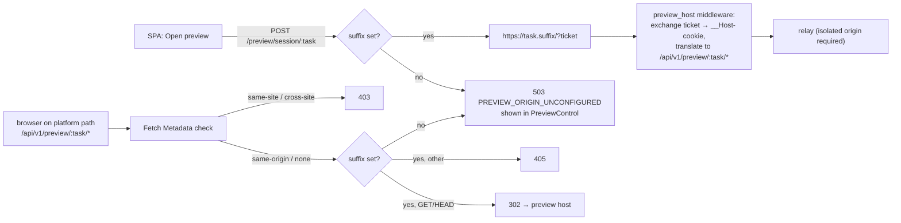

# Issue 488: remove legacy (platform-origin path) preview mode

## Ontology changes and governance

Comparison base: `668de5b7` (branch `issue-454-legacy-preview`, after PR #497).
Human intent: [chat intent](../../chat_intent/issue-488-remove-legacy-preview/request.md)
(the owner's go-ahead on the four decisions in
[G5Labs/G5-Lean#488](https://github.com/G5Labs/G5-Lean/issues/488)).

One amended commitment, `g5.security.mvp-exposure.preview` (ID kept, heading and body
restated): preview content is served only from isolated preview hosts, no platform-origin
preview cookie exists, and a missing preview origin makes previews unavailable instead of
falling back. The shared registrable domain stays the accepted exposure and the separate
preview origin stays later work, so `g5.scope.security-hardening.preview-origin` keeps its
contract and only its metadata records what moved out of P8.13. The three preview
transport blocks keep their contracts; their link to the boundary follows the new heading.
Row 10 of `docs/v9-mvp-scope-amendment.md` carries the same amendment note.

```diff
diff --git a/.g5/ontology/concepts/security.g5.md b/.g5/ontology/concepts/security.g5.md
index 7152be67..213cb9c7 100644
--- a/.g5/ontology/concepts/security.g5.md
+++ b/.g5/ontology/concepts/security.g5.md
@@ -173,11 +173,13 @@ UID 1000 with passwordless sudo is an MVP compatibility choice, not guest-root i
 
 The repository is the unit of Git read access. Anyone who may read any workspace attached to a repository may fetch the whole repository: every workspace branch and flush snapshot, by ref or by object id. Invite-only visibility hides a workspace from lists, chat, files, comments and compute views; it does not hide its Git contents, since forks share their source repository. Write authority stays per branch ([ref scope](../software_architecture/durability.g5.md#restrict-network-ref-effects)). This is the intended model, not an MVP concession: principal-scoped object views are not planned.
 
-## Retain the MVP preview relay
+## Serve previews only on isolated preview hosts
 
 [D · g5.security.mvp-exposure.preview]
 
-MVP owner-only preview retains its existing subdomain/path relay.
+Owner-only preview content is served only from a per-preview host under the configured preview suffix, never from the platform origin: no platform-origin preview cookie exists, and a request for a preview on the platform path is redirected to its preview host or refused. Without a configured preview origin the platform still runs, and opening a preview is refused with a clear reason instead of falling back. That the preview hosts share the platform's registrable domain remains the accepted exposure; a [separate preview origin](../scope.g5.md#separate-preview-origin-in-later-work) stays later work.
+
+Amended 2026-10-13 from the owner's decision on [issue 488](https://github.com/G5Labs/G5-Lean/issues/488) ([chat intent](../../chat_intent/issue-488-remove-legacy-preview/request.md)): since 2026-09-29 the path relay showed only a sandboxed, script-less page, and it is not expected to be used again.
 
 ## Keep platform login distinct from repository integration
 
@@ -409,8 +411,9 @@ Exchanging the ambient `g5_refresh` cookie for tokens is CSRF-sensitive. A refre
 ### g5.security.mvp-exposure.preview
 
 - human-verified
-- From [M013–M016](../../uplift/g5-lean/candidates/scope-resolutions.md).
-- ~100% of inspected scope · preview relay; separate-origin hardening is deferred.
+- From [M013–M016](../../uplift/g5-lean/candidates/scope-resolutions.md). Amended 2026-10-13 on the owner's go-ahead for [G5Labs/G5-Lean#488](https://github.com/G5Labs/G5-Lean/issues/488) ([chat intent](../../chat_intent/issue-488-remove-legacy-preview/request.md)), which followed the evaluation of [#454](https://github.com/G5Labs/G5-Lean/issues/454); design in [issue-488 plan](../../pr_ontology_diff_design/issue-488-remove-legacy-preview/ontology-plan.md).
+- Status: active, partially-implemented. The isolated-host transport exists (subdomain branches of `routes/preview.rs` and `routes/auth.rs`, `middleware/preview_host.rs`), but the platform-origin fallback is still served: suffix-unset branches of the session endpoint and re-auth route, the platform-origin `g5_preview` cookie and its acceptance in `middleware/auth_middleware.rs`, the legacy relay branches and `middleware/preview_security.rs`. No `PREVIEW_ORIGIN_UNCONFIGURED` refusal exists. Every environment except QA runs the fallback today (cloud E2E, docker-ci, local dev, self-hosted, Helm default).
+- Tests: the isolated path is covered by `api_task_lifecycle.rs` preview-host tests and the subdomain branch of `frontend/e2e/flows/workspace-preview.spec.ts` (run in legacy mode in cloud E2E). Unimplemented: no-suffix refusal, "no platform cookie set or accepted", legacy path refused for every method including WebSocket.
 
 ### g5.security.login
 
@@ -492,7 +495,7 @@ Exchanging the ambient `g5_refresh` cookie for tokens is CSRF-sensitive. A refre
 ### g5.security.login.refresh-exchange
 
 - agent
-- From [G5Labs/G5-Lean#454](https://github.com/G5Labs/G5-Lean/issues/454), the evaluator's defense-in-depth recommendation. The scan's script-execution step was already closed by PR #221 (an enforcing `Content-Security-Policy: sandbox` on every legacy preview response), which the scan did not see. Removing legacy preview mode, or failing closed without an isolated preview origin, is an owner decision left open in that issue and not made here; [retain the MVP preview relay](#retain-the-mvp-preview-relay) stands.
+- From [G5Labs/G5-Lean#454](https://github.com/G5Labs/G5-Lean/issues/454), the evaluator's defense-in-depth recommendation. The scan's script-execution step was already closed by PR #221 (an enforcing `Content-Security-Policy: sandbox` on every legacy preview response), which the scan did not see. Removing legacy preview mode was left open in that issue and has since been decided: see [serve previews only on isolated preview hosts](#serve-previews-only-on-isolated-preview-hosts). This check stays useful either way, because preview hosts remain same-site with the platform.
 - Implemented: `routes/auth.rs::is_trusted_browser_request` gates the cookie path of `refresh_token` (403 before the cookie is read); `AppState.trusted_browser_origins` holds the canonical platform origin plus the CORS allow-list (`services/mod.rs::trusted_browser_origins`); `AuthTokensDTO.refresh_token` is optional and omitted for cookie exchanges; the SPA schema accepts the omission (the SPA, the E2E helpers and the preview re-auth read only the JWT).
 - Tests: `api_auth.rs::test_refresh_cookie_exchange_requires_trusted_browser_origin` (foreign, `null`, sibling-preview and `cross-site` callers are refused with no cookie renewal; the platform origin, a CORS-allowed origin and a header-less client succeed without a refresh credential in the body; a body-token exchange from any origin still returns it); unit test `routes/auth.rs::trusted_browser_request_admits_only_trusted_origins`.
 - Gaps: a body-token exchange is not origin-gated because the caller already holds the credential. Preview re-auth consumes the cookie on a navigation without a Fetch Metadata check; it answers with a redirect, not tokens. An origin check cannot constrain script already running on the platform origin; the legacy preview sandbox is the control for that, and pre-2026-09-29 browser state still needs the documented reset.
diff --git a/.g5/ontology/features/preview_terminal.g5.md b/.g5/ontology/features/preview_terminal.g5.md
index 8bd8b6e7..98242344 100644
--- a/.g5/ontology/features/preview_terminal.g5.md
+++ b/.g5/ontology/features/preview_terminal.g5.md
@@ -86,15 +86,15 @@ Governing: [one preview at a time](#close-the-running-preview-before-starting-an
 
 Bind every preview stream to task/incarnation and close it on Stop or transfer under the live-access policy.
 
-Exposure follows the [accepted MVP security boundary](../concepts/security.g5.md#retain-the-mvp-preview-relay).
+Exposure follows the [accepted preview security boundary](../concepts/security.g5.md#serve-previews-only-on-isolated-preview-hosts).
 
 ### Strip platform credentials from preview transport
 
 [D · g5.preview.transport.credentials]
 
-Strip platform credentials at the accepted MVP preview relay boundary.
+Strip platform credentials at the accepted preview relay boundary.
 
-Exposure follows the [accepted MVP security boundary](../concepts/security.g5.md#retain-the-mvp-preview-relay).
+Exposure follows the [accepted preview security boundary](../concepts/security.g5.md#serve-previews-only-on-isolated-preview-hosts).
 
 ### Keep preview write expectations honest
 
@@ -102,7 +102,7 @@ Exposure follows the [accepted MVP security boundary](../concepts/security.g5.md
 
 Preview profiles promise no tracked writes, but MVP has no read-only mount and any writes remain visible and flushable.
 
-Exposure follows the [accepted MVP security boundary](../concepts/security.g5.md#retain-the-mvp-preview-relay).
+Exposure follows the [accepted preview security boundary](../concepts/security.g5.md#serve-previews-only-on-isolated-preview-hosts).
 
 <a id="g5.story.use-a-browser-terminal"></a>
 ### Terminal is the owner escape hatch
diff --git a/.g5/ontology/scope.g5.md b/.g5/ontology/scope.g5.md
index 76b24ad7..4fd50948 100644
--- a/.g5/ontology/scope.g5.md
+++ b/.g5/ontology/scope.g5.md
@@ -334,7 +334,7 @@ Current deferral follows the [erasure gate](#decide-erasure-policy-before-enabli
 
 - agent
 - [Amendment §6](../../docs/v9-mvp-scope-amendment.md#6-where-the-dropped-scope-goes), human [H019/H083–H086](../uplift/g5-lean/candidates/human-decisions.md); scoped credential direction [HC03/HC05](../uplift/g5-lean/refinement/human-coverage.md). Historical phase: P8.13.
-- Unassessed · later work; current accepted exposures remain deliberate.
+- Unassessed · later work; current accepted exposures remain deliberate. Of P8.13's content, removing the platform-origin fallback and adding `PREVIEW_ORIGIN_UNCONFIGURED` moved into [serve previews only on isolated preview hosts](concepts/security.g5.md#serve-previews-only-on-isolated-preview-hosts) on 2026-10-13 ([issue-488 plan](../pr_ontology_diff_design/issue-488-remove-legacy-preview/ontology-plan.md)); the separate registrable domain, QA DNS and certificate work stay here.
 
 ### g5.scope.security-hardening.revocation
 
```

### Relevant and governing ontology

| Block | Why relevant | What implementation must enforce or consider |
|---|---|---|
| [`g5.security.mvp-exposure.preview`](../../ontology/software_architecture/workspace_vm.g5.md#g5.workspace.preview-origin-security) | Amended owner of the boundary | No platform-origin preview content, cookie or relay for any method or WebSocket; unavailable, not fallback, without a suffix |
| [`g5.preview.transport`](../../ontology/software_architecture/workspace_vm.g5.md#g5.runtime.preview.admission), [`.credentials`](../../ontology/software_architecture/workspace_vm.g5.md#g5.workspace.preview-origin-security) | Stream binding, revocation and credential stripping are unchanged obligations | Every ported test must still prove incarnation and lease checks and credential stripping through preview-host requests |
| [`g5.preview.service`](../../ontology/software_architecture/workspace_vm.g5.md#g5.preview.service) | A preview task is a visible service | Unavailability of the browser entry must be visible with its reason; the task lifecycle is not the place to refuse |
| [`g5.security.login.refresh-exchange`](../../ontology/features/users.g5.md#g5.security.login.refresh-exchange) | Preview hosts stay same-site with the platform | The origin check on the cookie exchange stays; it is the control a sibling preview host meets |
| [`g5.scope.security-hardening.preview-origin`](../../ontology/software_architecture/workspace_vm.g5.md#g5.workspace.preview-origin-security) | Separate registrable domain remains deferred | Do not require a second registrable domain; the same-site startup check stays |
| [`g5.security.login.oauth-attempt`](../../ontology/concepts/security.g5.md) (SEC-M43 residual) | Preview page script can still plant a `Domain` cookie on the shared site | Unchanged by this design; stays an open residual |
| [`system_design_principles`](../../ontology/concepts/system_design_principles.g5.md#g5.design.minimal-mechanism) | No new mechanism | Removal only; the one addition is an error code on existing routes |

## Requested outcome and design

No code path serves preview content on the platform origin. One preview transport
remains: the per-preview host under `G5_PREVIEW_HOST_SUFFIX`, with the single-use handoff
ticket and the `__Host-g5_preview` cookie. Without a suffix the platform boots and the
owner is told previews are not configured.



**Owners and responsibilities.**

| Owner | After this design |
|---|---|
| `routes/preview.rs` session endpoint and `routes/auth.rs` re-auth | Subdomain branch only. Without a suffix both answer 503 `PREVIEW_ORIGIN_UNCONFIGURED` (new `G5Error` code, same shape as `PREVIEW_NOT_READY`). No `Set-Cookie` on the platform origin. |
| `routes/preview.rs` relay | `RelayPolicy.subdomain_origin` becomes required. The legacy-only branches go: strip-every-`Set-Cookie`, same-origin-only anti-framing, unchecked WebSocket `Origin`, forwarded original `Host`. A platform-path request that reaches the handler without a suffix gets the same 503; with a suffix the existing redirect/405 stays. |
| `middleware/preview_host.rs` | Unchanged: it still rewrites `<task>.<suffix>` onto the `/api/v1/preview/<task>/` route, which is why the route survives. |
| `middleware/auth_middleware.rs` | The `g5_preview` platform cookie carve-out and `preview_cookie_tickets` go; `__Host-g5_preview` on preview hosts is the only ticket cookie. The re-auth redirect for unauthenticated HTML navigations stays (it heals isolated previews too). |
| `middleware/preview_security.rs` | Keeps the Fetch Metadata refusal for non-isolated requests under `/api/v1/preview` (a sibling preview must not drive the redirect or re-auth with the owner's cookies) and `Cache-Control: private, no-store` on those responses. The response-containment and rollout-cleanup parts are retired (decision note 1). |
| `PreviewControl.tsx` | Shows the 503 reason as the open error; no mode detection. Optionally the instance endpoint exposes `previewOriginConfigured` so the control can say so before the click. |
| Cloud E2E (`infra/ci/cloudbuild-ci-e2e.yaml`, edge image) | Subdomain mode under HTTPS (decision note 2). |
| Self-hosted bundle | `G5_PREVIEW_HOST_SUFFIX` passed through compose; the TLS Caddyfile routes `*.<suffix>` to the API; README and `env.template` state wildcard DNS and a certificate covering the platform host and `*.<suffix>`. |
| Docs | `docs/preview-isolation.md` rewritten for one mode; the rollout-reset procedure moves to a dated historical note. |

**Consequential choices.**

- *Unavailable, not refuse-to-start.* The session endpoint is the single authority for
  "is there a preview origin", because it is the only place the browser enters. The
  preview task itself still starts and shows in the task list; refusing at task start
  would entangle every preview lifecycle test (all run without a suffix) with origin
  configuration for no security gain, since an unopened preview serves nothing.
- *Keep the route, drop the mode.* Host translation depends on the legacy route shape, so
  the route and its owner/incarnation checks stay; only the platform-origin entry points
  and the policy branches that existed for them are removed.
- *The same-site startup check stays.* `validate_preview_suffix_same_site` rejects
  `localhost` and IP literals (no registrable domain) and plain HTTP. This is what makes
  local dev previews unavailable for now (decision 3) and what the CI domain must satisfy.
  Verified with the pinned `psl` crate: `app.g5-e2e.test` and `preview.g5-e2e.test` share
  registrable domain `g5-e2e.test`; `localhost` has none.

### Decision notes

1. **Retire the post-#221 browser cleanup with the mode (agent choice, flagged).** The
   service-worker 410 with `Clear-Site-Data`, the NEL reset on all API traffic, the
   legacy header stripping and `preview-rollout.spec.ts` exist to contain legacy documents
   and to help browsers that opened legacy previews before 2026-09-29. After this change
   no legacy document is ever served, so containment has nothing to contain. The cleanup
   only helps a browser profile that still holds a pre-#221 root-scoped worker; no
   environment with persistent real users served legacy previews after #221 except
   possibly a self-hosted install, and the documented manual reset covers that. Keeping the
   NEL reset alone would be cheap but leaves a header on every API response whose reason
   nobody will remember. Reverse this note if the owner knows of an exposed install.
2. **CI mechanism (implemented).** Every CI stack moves to HTTPS rather than adding a
   second edge, because the API has one `G5_EXTERNAL_URL` and the refresh-exchange origin
   check (PR #497) trusts that origin plus the CORS list. Shape: the edge image gains an
   entrypoint that, when `G5_EDGE_TLS_APEX` and `G5_EDGE_PREVIEW_SUFFIX` are set, activates
   `infra/docker/caddy-ci-tls.caddyfile`, an HTTPS site with `tls internal` (Caddy's own
   CA issues the apex and wildcard certificates; verified locally) that routes
   `*.<suffix>` to the API for every path and reuses the production route snippet. The
   edge container carries a Docker network alias for the apex, so Node-side `request`
   calls resolve it through Docker DNS; Chromium resolves the wildcard through
   `--host-resolver-rules=MAP *.<suffix> <edge-container>` (hostname replacement verified
   with the pinned Playwright Chromium), passed as the static `E2E_PREVIEW_HOST_RESOLVER`
   env. `ignoreHTTPSErrors` is on when the base URL is HTTPS; the connection stays HTTPS,
   so `__Host-`/`Secure` cookies behave as in production. The APIs run with
   `G5_EXTERNAL_URL=https://app.g5-e2e.test` (`app-pa.` for the provider-agent lane),
   a lane-specific suffix and `G5_COOKIE_SECURE=true`. The Rust e2e lane reaches the API
   directly and presents the preview host in `Host`, which host translation keys on.
   `test_cloudbuild_waitfor_order.py`, `test_ci_docker_contract.py`,
   `test_edge_prebuilt_dockerignore.py` and `ci_e2e_lane_isolation.rs` pin the new env.
3. **One PR after all.** The workspace is bound to one branch, so the CI alignment and
   the removal landed together; the CI contract scripts and local Caddy/Chromium probes
   stand in for the staged CI-first proof, and the PR's own cloud E2E run is the
   acceptance evidence.
4. **Test porting rule.** Every removed test is classified in the removal PR as removed
   behaviour (platform cookie, legacy relay branches, rollout spec), covered elsewhere
   (relay, incarnation and lease checks re-run through preview-host requests following
   `preview_http_relay_rewrites_isolated_app_cookies_and_renews_g5_ticket`), or lost.
   `subdomain_preview_mint_and_legacy_routes_cannot_serve_platform_origin_html` becomes the
   anchor for "legacy path refused for every method including WebSocket".
5. **Local dev residual.** Developers lose the sandboxed first-page view they have today.
   A later `*.localhost` plain-HTTP mode needs the startup check relaxed under an explicit
   dev flag and a browser probe of `__Host-` cookies on `http://*.localhost`; it is not part
   of this design.

### Implementation status (2026-10-13)

Implemented on the workspace branch per the [chat intent](../../chat_intent/issue-488-remove-legacy-preview/request.md):
backend removal and the `PREVIEW_ORIGIN_UNCONFIGURED` refusal, cloud E2E and docker-ci in
subdomain mode over HTTPS, self-hosted suffix pass-through and routing, Helm comment,
docs rewrite, tests ported or removed with their classification recorded in the
ontology metadata. Local dev runs without previews. Cloud E2E execution of the ported
browser spec is the remaining acceptance evidence.

### Acceptance outcomes

- No code path serves preview content on the platform origin for any method or
  WebSocket; a platform-path request redirects to the preview host or fails.
- No platform-origin `g5_preview` cookie is set anywhere, and a forged one on the platform
  path authenticates nothing.
- Without a suffix: the API boots; `POST /api/v1/preview/session/:task` and the re-auth
  route answer 503 `PREVIEW_ORIGIN_UNCONFIGURED`; the SPA shows that reason; preview
  tasks still start, stop and record outcomes as today.
- Cloud E2E runs `workspace-preview.spec.ts` in subdomain mode and its isolated-branch
  assertions pass (script runs, storage separate, app cookie scoped to the preview host).
- Ported API tests cover relay header rewriting, incarnation and lease checks through
  preview-host requests; the removal PR lists every removed test with its classification.
- `docs/preview-isolation.md`, the ontology and amendment row 10 describe one mode.
- The self-hosted bundle documents the suffix, wildcard DNS and certificate coverage, and
  boots without a suffix with previews unavailable.

## Review summary

Self-review against the request and governing blocks:

- The amended block keeps every obligation the three transport blocks relied on
  (stream binding, credential stripping, write honesty) and removes only the path
  relay they were allowed to use. No contract outside security and scope metadata changed.
- `g5.preview.service` is preserved: the design refuses at the browser entry, not the
  task, so the visible-service lifecycle and all its tests stand.
- The refresh-exchange control from PR #497 is not weakened; it is listed as a governing
  consideration because preview hosts remain same-site.
- The CI decision was checked against the actual stack: one external URL per API, three
  API containers, the preview spec runs in both broad shards and the provider-only lane,
  and the runner's Node-side requests need DNS that Chromium flags do not provide.
- Open items retained as decision notes: cleanup retirement (1) and the local-dev residual
  (5). Neither blocks implementation.
