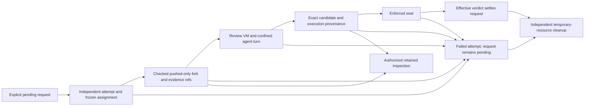

# Formal agent approvals — issue #640

## Ontology changes and governance

[Issue #640](https://github.com/G5Labs/G5-Lean/issues/640) and the [implementation request](../../chat_intent/issue-640/request.md) authorize implementation. The [October 19 owner decisions](../../chat_intent/issue-640/review-decisions.md), recorded in [review part 1](https://github.com/G5Labs/G5-Lean/pull/642#issuecomment-6261547790) and [part 2](https://github.com/G5Labs/G5-Lean/pull/642#issuecomment-6261548231), amend the issue. This remains the single design for PR 642. Prior design and verification history remain recoverable in Git.

The governing [formal approval contracts](../../ontology/features/agent_approvals.g5.md) compose with the [tenant boundary](../../ontology/concepts/system_invariants.g5.md#g5.security.tenant), [current authority](../../ontology/concepts/security.g5.md#g5.security.current-authority), [owning operations](../../ontology/concepts/system_invariants.g5.md#g5.architecture.commands), [checked fork](../../ontology/features/workspaces.g5.md#g5.workspace.fork-state.formal), [human authority](../../ontology/features/workspaces.g5.md#g5.workspace.approval-human-authority), [forward migrations](../../ontology/concepts/system_invariants.g5.md#g5.invariant.migrations) and [minimal mechanism](../../ontology/concepts/system_design_principles.g5.md#g5.design.minimal-mechanism) commitments.

The previously trimmed plan lacked a named changed-ID inventory. This reconstruction uses the saved owner decisions and actual ontology diff in commit `3b9e530`, which preceded dependent implementation; it does not replace that recorded diff.

| Changed IDs | Actual governing change |
|---|---|
| `g5.agent-approval.human-read-only` | New retained-data inspection exception; no human mutation or live guest view. |
| `g5.agent-approval.evidence-refs` | New approved private-ref retention mechanism, outside temporary cleanup. |
| `g5.agent-approval.request-state`, `g5.agent-approval.attempts` | Pending requests outlive failed attempts; distinguish independent attempt identities and overlap kinds. |
| `g5.agent-approval.write-authority` | Database context enforcement plus route binding proof. |
| `g5.agent-approval.execution`, `g5.agent-approval.effectiveness`, `g5.agent-approval.recovery` | Reconcile the inspection exception, permanent evidence lifetime, first-claim budget and independent reconciliation. |
| `g5.workspace.audience`, `g5.workspace.approval-cut-eligibility`, `g5.security.guest-authority` | Retained formal inspection stays under source/target authority; remove obsolete Job-era approval eligibility wording and retarget the human guest-access exception. |
| Paired metadata in the three affected ontology files | Current implementation/evidence and explicit remaining limits; human decisions and agent integration choices retain distinct provenance. |

The unchanged tenant/current-authority, command ownership, fork cut, human approval authority, migration immutability and minimal-mechanism commitments linked above govern the same inventory. Changed code extends its coverage to the shared fork/VM commit mapping and optional bounded query scopes, Git protocol filters, existing runtime/host ingestion, transcript retention, dispatch env and guest dependency boundaries.

## Run 8 diagnostics after access renewal

Cloud log access is restored. The actual XFS lane summaries show 3532 unit tests, 230 CLI tests and the isolation lanes passing; the integration lane ran 1557 tests with one failure: `fake-provider-cli::cli::fake_claude_reports_the_pin_and_the_runner_flag_surface`. All 27 formal API cases passed, including the long lost-COMMIT case. The failure is the new flag gate's two-space help indentation assumption: the fake advertises the correct `none` choice without that indentation. Accept the real two-space and fake zero-space option layouts while keeping wrapped description text and unrelated `none` values insufficient. Prove the focused failure before repair and run the actual pinned client gate afterward.

Rust E2E failed only `formal_agent_approvals::explicit_formal_reviews_keep_verdict_and_evidence_after_isolated_resources_disappear`: after the first Claude/approved VM verdict, exact report and independent resource cleanup succeeded, the retained commits API returned HTTP success with a valid assigned commit and empty path listing. The assertion incorrectly equated an empty repository tree with unavailable evidence. Preserve the endpoint/status checks and verify returned repo/commit against the frozen vector, accepting an empty string as a valid path listing. Add a real retained-inspection API case with an empty Git tree, then rerun the failing Cloud selector rather than expanding local Docker coverage. The remaining three provider/verdict VM cases did not run after this first-case assertion; do not claim them green.

The staged native-client lane and browser suites passed. These two supported fixes, the verified main rebase and the owner's source-deletion clarification will be one self-verified batch. Self-verification before additional Claude round 1 passes with Rust 1.97.1 / `SQLX_OFFLINE=true` / macOS `--no-default-features`: the exact fake CLI selector (negative before repair, positive after), real retained empty-tree API (1), Python gate matrix (both help layouts with valid/invalid choices), actual pinned Claude gate, all fake CLI integration tests (46), formal API (28), authoritative-reader guards (40), fake/native process matrices (2, including ignored pinned clients), E2E compilation and lane inventory (4), immutable contracts and generated limits. One final workspace check, strict Clippy, formatting and diff checks pass. Commands and exact logs are saved in `/private/tmp/issue640-run8-fix-validate.py` and `/private/tmp/issue640-run8-fix-*.log`. The rebase migration/scope checks and frontend verification above remain applicable; those implementations did not change. The first additional Claude review is requested only after these passes. Refresh main immediately before publication and use the exact remote E6 lease if unchanged.

## Main integration — 2026-10-19

Fresh main `d7c3ad00a8af1242c1790892bb073f047fd783f7` adds issue #621 outbound email, including owner email from ordinary live workspace incarnations. Its [owner-email authority](../../ontology/features/workspaces.g5.md#g5.workspace.owner-email) and [system-only delivery store](../../ontology/software_architecture/email.g5.md#g5.email.data) are compatible with formal approval: preserve that feature and worker without adding email, shell, project instructions or other tools to the formal harness. The sole frozen-object reader/report writer remains the complete formal tool surface. No governing I/D change is needed.

Main's `093_email_deliveries.sql` must remain byte-for-byte unchanged. Neither approval migration is present on main; their disposable-test use allows branch-local resequencing under the governing migration exception. Keep the artifact SQL and frozen v2 contracts byte-for-byte, moving the approval migrations to 094/095 and synchronizing their consumers. Do not regenerate historical main migrations or repair an existing ledger in place.

The new owner-email route uses a system-pool scoped transaction because delivery requests and login email are system data. Its service proves the token's exact live workspace, owner, VM and epoch under a shared lock before queuing; the path must equal the token workspace. It does not mutate a private workspace or its child resources. Extend the system-scope inventory to recognize the `_with` entry point and verify this narrow route/service proof rather than adding platform wildcard or review write scope. Preserve ordinary-owner email tests and add a discriminating guard negative for the new entry point.

The local rebase onto `d7c3ad00a8` is complete; a fresh fetch confirms that main and remote PR head `e6e829578` are unchanged. Before resequencing, the catalog scan found both 093 versions. Afterward `migration_version_uniqueness` passes, and `migration_094_approval_artifacts` proves fresh/populated upgrades and replay under a restricted role (2). Both approval SQL bodies remain byte-identical to published E6; all main checksum rows, frozen assets and generated-limit checks pass. The 13 ontology IDs retain paired metadata.

With Rust 1.97.1, `SQLX_OFFLINE=true` and macOS `--no-default-features`, `cargo test -p g5-api --test integration` passes the affected selectors: `workspace_owner_email` (7), `api_formal_agent_approvals` (27), `email_delivery` (26), `system_scope_binding_guard` (1, including missing `_with` and removed path-binding negatives), `formal_review_policy_inventory` (2), `authoritative_workspace_reader_guard` (40), `service_context_layering` (7), `route_auth_static` (11) and `maintenance_integration` (12). The first migration attempt could not connect because the owned Postgres restart omitted `-p 55486`; correcting only that instance and rerunning the failed selector passed. No schema or product change was made for that setup error.

The g5d library run passes 249 tests, including all 20 email-owner/process/stable-context cases, but seven unchanged-main fixtures fail on this Mac: six assume Linux microVM block isolation and one invokes unavailable `setsid`. Exact focused reruns of `cli::host::tests::host_does_not_connect_when_image_preparation_times_out` and `cli::preview_serve::tests::a_daemon_started_under_setsid_outlives_the_app_stop_for_cleanup` reproduce those assumptions; both complete source files are byte-identical to main. Do not broaden local testing or change those unrelated fixtures. These proven local platform limits are separate from the diagnosed Cloud run 8 causes above. The formal fake/native process target passes both tests with `--features test-helpers --test dispatch_modules formal_review:: -- --include-ignored`; the E2E lane inventory passes (4). The approval UI tests pass (81), and TypeScript checking passes.

Final workspace `cargo check --workspace --all-targets --no-default-features`, strict `cargo clippy --workspace --all-targets --no-default-features -- -D warnings`, `cargo fmt --all --check` and diff validation pass. The rebase checks were completed before the later access renewal. Published head `e6e829578` still has failed Cloud run 8; detailed diagnostics and the verified fix batch are recorded above. The original six Claude rounds are complete; the owner has now authorized up to six additional rounds for this PR follow-up.

## Outcome and owners

| Owner | Facts and obligations |
|---|---|
| Approval request | A person requested a verdict for a definition/version/phase slot. Pending until effective settlement or human cancellation; earlier verdicts remain eligible independently. |
| Review attempt | Unique attempt id, frozen assignment, first claim, stage/deadline, task/artifact identity, terminal timestamp and cleanup coordination. At most one active attempt per request. |
| Fork/ref owner | Checked manifest, original source identities, target base, temporary proof/pins and permanent private source/base evidence refs. |
| Task/provider owner | Shared provider-account authority, accepted input, one fresh execution and receipt; no automatic formal reruns. |
| Workspace/VM owners | Typed review-bound Start, enforced seal, stop/reap/delete and incarnation custody. |
| Inspection service/routes | Recheck source-history audience and target access, then read bounded retained data under a review-bound read-only context. No human live guest access. |

The coordinator composes these owners; it does not duplicate their scheduling, VM or task state. Store identities before effects and reconcile ambiguous acknowledgements under the same identity and deadline. Fork publication atomically marks the workspace private; a late capture cannot publish after terminalization. Sealing precedes effective settlement in the same protected transaction. Cleanup affects only recorded temporary resources and never delays or invalidates a sealed verdict.

## Amendments after review (2026-10-19)

The actual ontology diff precedes dependent code. The decision record retains the owner's exact words; this table records their consequences.

| Decision | Reason, affected commitments and observable consequence |
|---|---|
| DEC-1 | Human inspection was overly broad in the original prohibition. `human-read-only` permits retained inspection while forbidding changes and live workspace access. |
| DEC-2 | Reuse the approval-history audience; raw target content additionally requires current target read authority. Applies to inspection and transcript redaction on every page. |
| DEC-3 | Git object ids alone do not survive pruning. `evidence-refs` retains hidden source/base refs with the assignment/evidence, independent of temporary cleanup. |
| DEC-4 | Transcript is ordinary task history, not evidence. Use bounded pagination and ordinary retention; keep it out of the exact report and artifact limits. |
| DEC-5 | Operational failure must leave an unaddressed request visible. `request-state` keeps it pending while the failed attempt remains immutable. |
| DEC-6 | Frozen retry and current-input review have different meaning. `attempts` reuses only a matching active attempt; a different kind conflicts without aborting it. |
| DEC-7 | Route convention alone does not enforce write authority. `write-authority` adds database context checks and a route binding inventory guard. |
| DEC-8 | A lost COMMIT acknowledgement is not a known rollback. Preserve the ordinary fork/VM 503 change, share classification and prove retry convergence for both outcomes. |
| DEC-9 | A failed rerun writes no new verdict. Earlier effective decisions continue to govern; later effective attempts replace them normally. |
| DEC-10 | Apply the approved ontology reconciliation and record explicit implementation gaps until verified. |

### Integration choices

- Separate attempt ids from request ids. The existing active-request partial index enforces one active attempt. Same-slot retries and current-input attempts share the pending parent. Per FIX-1's explicit version-change exclusion, current-input admission still selects the current definition version; a version change is another slot and does not silently supersede an older pending request. Frozen retries retain their exact prior version. Admission remains under the existing request-key advisory fence, and cancellation remains request-scoped. Temporary resources derive from the attempt id; frozen retries reuse the original resolution and its evidence refs.
- Replace the production batch-await loop with tracked per-review work. Each tick discovers due work fairly without a fixed per-org head-of-line limit and never awaits an owner operation. Bound simultaneous owner operations using the existing pool-aware limit (at most four), retaining per-review advisory fencing. Start capture's durable five-minute budget at first claim after capacity is available. Cleanup is a separate due pass, not an inline wait after terminalization. The real seal-lock timeout regression exposed that dropping a SQLx future can leave a server query waiting while it holds the request lock. Stage and cleanup database contexts, including fresh contexts opened by reused fork/VM owners, also apply a server statement timeout from their remaining budget so cancelled work releases locks and cannot indefinitely consume pool capacity or block failure recording. The coordinator passes an ephemeral deadline to those owners; ordinary callers retain their existing behavior. Waiting new attempts spend no capture budget.
- Keep stage budgets: capture 5 minutes, readiness including capacity 15, execution 45 from input acceptance, harvest 2, seal 2 and each cleanup attempt 5. Preserve cancellation and ambiguous-effect recovery. Record immutable `ended_at` once at effectiveness/failure/cancellation using transition-time `clock_timestamp()`, not the seal transaction's earlier start (`now()`); cleanup timestamps cannot rewrite review duration. Derive overdue cleanup from terminal time plus 24 hours and a pending cleanup error.
- Enforce separate SELECT/INSERT/UPDATE/DELETE restrictive policies for `g5_tenant`. Only system actor plus platform `*` or exact `formal-review:<workspace>` may write review rows; exact `formal-review-read:<workspace>` may only read. Resolve indirect task/session/fork ownership in definer lookups; nullable links and independent policies still compose safely. A workspace policy checks its proposed review marker directly against a context-only helper: looking up the old row would incorrectly treat a newly inserted or newly marked review workspace as ordinary. Only child-resource checks may derive whether the referenced workspace is a review. Preserve `g5_app` infrastructure authority. Runtime scope strings bind only the authenticated incarnation workspace id; the final context still proves current incarnation before any write. Adding that bound tag for ordinary incarnations too avoids a privileged marker-discovery context, and ordinary-workspace policies ignore it. Reopening an admitted review-operation context preserves that exact scope rather than minting an unbound replacement. Host-control ingestion remains the existing trusted platform maintenance context, with its per-event host/incarnation proofs. Human inspection uses a read-only transaction after source authorization, never platform `*`; PostgreSQL permits enabling read-only mode after scoped-context initialization, and rollback needs no context-clearing write.
- Preserve migration SQL from main and the frozen contract assets. Main now owns 093 for outbound email; the two approval migrations exist only on this feature branch and their known applications are disposable local/Cloud tests. Under the current-feature-branch exception in `g5.invariant.migrations`, resequence artifact storage to 094 and formal coordination to 095, preserving both SQL bodies and updating snapshot paths, test cutoffs and checksum filenames. A known persistent feature-branch application would require a separately planned upgrade rather than rewriting its ledger. Retain the restricted-migrator membership snapshot/restore and FORCE RLS checks.
- At capture, verify/create deterministic source/base evidence refs per repository and frozen resolution under repo ownership locks. Existing unequal refs fail closed. A focused prune/ref-deletion test exposed that frozen retry still sampled the current source branch before replacing its cut; move frozen assignment selection before that sampling. Retry continues to require a live, authorized source and unchanged repository membership, but materializes its assigned objects without requiring the obsolete source ref to exist. Keep temporary bootstrap pins/proofs until ordinary cleanup; their actual bootstrap contract is already verified. Permanently hide the evidence prefix from every user/VM transport; only authorized commit inspection reads the assigned objects. Ref retirement belongs with evidence at organization offboarding.
- Transcript pages combine the frozen input, messages and safe task-event content under a versioned opaque continuation, bounded item and response sizes, with progress even for large content. Match target/diff tool calls to results independently of page boundaries and replace only unauthorized raw results. Leave agent-authored report/free text and ordinary retention unchanged. Commit browsing reuses the bounded native review-snapshot reader; base/diff requires target read access.
- Keep policy/identity/commit classification in shared owners and constants. Move coordinator SQL into a typed store so transitions remain readable. Persist the bounded validated candidate summary with the attempt at harvest and consume it at seal, preserving exact artifact bytes as evidence. Put API-only template rendering behind a non-default feature; keep guest binaries free of its normal dependency.
- Add the pinned native-client confinement process test to Cloud CI using the actual staged runtime binaries and verify that staging/flags match the production clients. Preserve deterministic scripted model responses and no external model credentials.

### Clarification and assumptions

The owner answered the source-deletion question on October 19: "Retain evidence; keep ordinary access rules (Recommended)" ([decision](../../chat_intent/issue-640/review-decisions.md#source-deletion-clarification)). Retain objects under the ordinary source-history audience; source deletion grants neither new inspection access nor frozen-retry authority. The existing implementation follows this answer; no broader grant or code change is needed.

The read-only inspection exception concerns retained data, never a live temporary-workspace view. The review's raw target-content gate does not expand the existing report/free-text redaction contract. Ordinary human approvals, ordinary provider settings, root guest authority and task/VM custody remain unchanged.

## Verification and completion

The owner's FIX-1 through FIX-7 and N2/N3/N4/N6/N7/N9/N10/N12 define this follow-up; implementation/self-verification and remaining review, Cloud and human-decision limits are recorded below. Independently verify proposed fixes and reuse sufficient tests; do not treat the review's experiments as tests executed in this checkout. Coverage must include request/attempt overlap and cancellation; real-loop liveness under a blocked capture and saturated capacity; per-context SQL refusal, full-schema policy inventory and restricted migrations; retained inspection pagination/redaction/retention and evidence-ref pruning/transport denial; ordinary and coordinator lost-ack outcomes; merge-gate cuts, target movement/access loss, dirty/unpushed source, two repositories, stage/provider/seal failures and no reruns. Add actual API-to-VM post-cleanup inspection to the existing E2E.

Run the smallest changed-boundary regression first, then affected API/process/frontend tests and architecture/inventory guards. Run pinned Rust 1.97.1 portable all-target workspace check and strict Clippy, formatting and diff checks once on the final local candidate. Only then request the sixth and final Claude CLI review with exact commands/results and its gh/gcloud access reminder. Judge findings independently; raise any significant unresolved disagreement at the limit. After review fixes, rerun affected tests and one final workspace validation. Refresh main immediately before one verified batched push, then use one bounded watcher until both exact-head Cloud checks pass. Reuse compatible stacks; diagnose only failing phases/selectors. No merge or unauthorized public comments.

### Owner follow-up verified locally

The 27 formal API cases pass on the amended local candidate. They cover both pending-request/attempt overlap directions; earlier verdict retention and supersession after a source move; production-loop liveness and first claim after saturated capacity; all SQL contexts; source/target repository-set mismatch and two-repository settlement; inaccessible target admission and capture-time access loss; pushed-only capture with a real dirty/unpushed checkout and an API guest peer; immutable target assignment and the actual host-start upstream; execute/harvest/seal deadlines with host stop; provider/auth/output failures; real active-writer seal refusal and a blocked seal timeout; dispatch credential confinement and refusal of attempt two; retained inspection, ordinary timeline trimming and target redaction across pages; and retained refs after source-ref retirement/GC with human/VM advertisement and push refusal.

The actual PostgreSQL wire proxy forwards COMMIT CommandComplete then loses ReadyForQuery. Ordinary fork and VM resume return 503 and retry one durable identity for both committed-lost-ACK and deferred-trigger/backend-termination rollback outcomes. Coordinator task binding, artifact insertion, sealing and deletion admission converge after lost ACKs with exactly one applicable task, artifact, status and tombstone. The server-timeout regression first reproduced indefinite request-lock blocking; with bounded stage/owner scopes it passes without releasing the test's holder early. A separate held-seal test exposed transaction-start `now()` as an incorrect end timestamp; terminal transitions now use `clock_timestamp()`. The provider-account and session-bundle cross-org fixtures' old 42501 priority assumptions changed with definer ownership lookup: the focused failure names the same composite 23503 FK expected on main. Restore those exact main-compatible tenant assertions while retaining the infrastructure checks; no account policy change or scope expansion is needed.

The source-VM dirty-cut API fixture uses a real independent checkout plus a scripted guest peer, rather than a Linux VM. Native confinement separately exercises real pinned clients with physical dirty checkouts and a scripted model endpoint; the exact ignored native selector passes locally and is now required in Cloud CI against the staged runtime closure, including the Linux Codex wrapper's node/npm companions. Actual API-to-VM post-cleanup transcript/commit inspection is added to the four-provider/verdict E2E but has only compiled locally; execution awaits the next required Cloud run. The final local workspace check, strict Clippy, formatting and diff checks pass with Rust 1.97.1 and macOS --no-default-features. The 81 affected frontend tests, full TypeScript check, production build, lint and formatting pass. All selected affected API, migration, security/architecture, contract, crate and fake/native process checks pass; a guest normal-dependency tree contains no tera. The final identity compatibility/capture checks and immutable asset/limit/checksum/layout guards pass. Clippy's four needless-borrow findings and an extra migration EOF blank were corrected; the checksum and failing diff phase were rechecked. The sixth/final Claude review is complete; its findings and independent adjudication are recorded below. After the redaction repair, the focused boundary, all 27 formal API cases and all 40 authoritative-reader guards pass; the final workspace check, strict Clippy, formatting and diff checks pass again. The new progress fixture failed on the previous production gate and passes with the repaired gate. These self-checks preceded the published `e6e829578` owner follow-up; the later Cloud run is recorded below.

### Cloud run 8 after the owner follow-up

Published code head `e6e829578f42181d4462bafb2f9b7e90b2c22d02` contains main `81c47e7325dddf59d8249084f02b62d39c4bfa26`, freshly fetched immediately before the verified batch. The final fetch after CI confirms both unchanged. Both required checks completed with failure on that exact head:

- Rust build `e95912ea-3f8c-4bdf-8654-00da9d37ebd8`: `rust-xfs-orchestrator` failed. Image preparation, Linux Clippy, SQLx, migration checks, release artifacts, guest self-containment and boot smoke passed. The ordinary Rust test steps are placeholders when this orchestrator owns execution, so their SUCCESS status does not establish that all tests passed. The integration lane's only failure was the fake Claude help-layout flag gate; its actual lane summaries and focused repair are recorded above.
- E2E build `b7a8aaf0-ad5b-4622-9277-a759700c81c0`: `rust-e2e` failed and the final status assertion correctly failed. The required `formal-review-native-clients` step passed in 52.515 seconds against the staged Linux runtime; both browser shards and provider-agent browser tests passed. The formal four-case VM result cannot yet be separated from other Rust E2E results.

Evidence includes exact-head GitHub check-run summaries (IDs `117988380192` / `117988376378`) and both detailed Cloud logs retrieved after the owner renewed access. Credentials expired during the run; access is restored and failure selectors are now established above. The single bounded watcher finished. Publish the supported fixes and verified rebase in one batch after refreshing main, then use one bounded exact-head watcher. The owner authorized up to six additional Claude rounds after the original six. CodeRabbit changed only pause/status metadata and its description assessment; no new actionable finding appeared, and no public resume/reply is authorized.

### Verified baseline and limits

The original ten implementation patches are unchanged after rebasing onto main `81c47e7325dddf59d8249084f02b62d39c4bfa26`; the design comparison is the only extra patch at published head `19257e19578feab6d5662cb66781df2ecd8c5d30`. Main's late-handshake ordering and bounded closed-stream resends preserve request keys, deadlines, repeated admission and caller-owned lifecycle retries; module replay returns the existing execution rather than starting another turn.

On that baseline, local RPC resend (2), handshake (1), lifecycle retry exclusion (1), reconnect/deadline replay (2), formal API (9), fake/native process matrices (2), agent library (143), consumer integration guards (9), route authorization guards (11), E2E compilation and contract/limit/migration/layout/inventory guards pass. Initial name/library filters matching zero tests are excluded and replaced by the actual integration targets. Workspace check, strict Clippy, formatting and diff checks pass with Rust 1.97.1 and macOS `--no-default-features`.

Required Cloud Rust `c9a97a83-94d7-4f8f-b2fe-bc98301acbdf` passed in 14m36s; full Linux/KVM E2E `3b93d5a9-5543-42b6-b629-acc746f1af1a` passed in 26m08s on exact head `19257e195`. All four formal provider/verdict cases, retained evidence, independent cleanup inventory, browser shards and value-loop groups passed. These results precede the owner-review amendments and do not close their gaps. Five Claude CLI rounds preceded that owner review; the sixth and final round now covers this follow-up as recorded below. CodeRabbit is auto-paused after its last completed production review; no resume message or public reply is authorized.

Local-only native-client coverage currently uses Claude 2.1.285/Codex 0.159.3 and a scripted model endpoint; it proves transport/confinement, not model judgment. The SQL cleanup negative controls were ad-hoc probes, not committed tests. This Mac has no KVM; full Linux/VM validation comes from required Cloud CI. Prior unchanged Mac native-watcher/LibreSSL/setsid fixture qualifications remain in Git history; do not expand their scope without a newly affected failure.

### Sixth/final Claude findings and adjudication

The independent reviewer examined unchanged candidate `5914c24e3` after the recorded self-checks passed. Its 70 read-tool turns ended before a report; the same context then completed its report without more tools or implementation edits. This is round six, not another review round. The complete initial report is retained locally in `/private/tmp/issue640-claude-r6-report.json`; the initial findings precede repair below.

| Initial finding | Independent judgment and action |
|---|---|
| P2-1: the attempt-control row has ordinary tenant UPDATE authority rather than the private-resource command policies | The owner's FIX-3 explicitly covers the private workspace and its child rows; part 2 §8 preserves human admission, and cleanup retry remains an authorized control action. The reviewer offered an explicit-scope clarification as an alternative. Adopt it: `write-authority` names the private workspace and child resources; attempt coordination records retain ordinary scoped owner controls and immutable-history guards. Reject the suggested table-wide UPDATE revocation because platform scopes also use `g5_tenant`, so it would disable coordinator transitions. No product path admits arbitrary human attempt transitions. No authority is broadened. |
| P2-2: accepted `tool.progress` becomes a checkpoint and bypasses result-only redaction | Supported by the actual ingest mapper even though no current emitter uses it. Gate all tool-kind content by matched source-only call, rather than allowing every non-result entry. Extend the retained-inspection regression with target and source progress content, including cross-page call matching. The pre-fix negative control failed; the repaired boundary and all 27 formal cases pass. |
| P1-3: required native lane assets might not be staged | This was an explicitly unverified pre-push risk, not a defect. Read the actual staging guard and asset list: CI does not set `--only-g5d`, so node, Claude, Codex and `_npm` are staged unconditionally; the host-side asset/closure guards require them. Keep the fail-closed lane; actual staged Linux execution still awaits Cloud. |

The reviewer found no redesign or significant blocking defect beyond these narrow items. Cancelled-attempt frozen retry remains unavailable after the person closes its request, consistent with the recorded request closure and UI; a new explicit current-input request remains available. The later owner clarification confirms ordinary deleted-source access rules. The original six rounds are complete; the owner subsequently authorized up to six additional rounds for this PR follow-up. Continue independent adjudication and raise significant unresolved disagreement at that limit.

## Review summary

Self-review follows the amended contracts and the actual changed consumers. Five earlier Claude CLI rounds reviewed the original implementation; a fresh sixth/final reviewer examined this follow-up after self-verification. Its findings are addressed or adjudicated above, with no significant unresolved disagreement. The owner comments and negative controls were supplied known-gap hints. The reviewer relied on self-verification for the test harness, frontend, VM-owner and E2E deltas rather than re-deriving every test; it executed no checks itself.

The full current owner review is [part 1](https://github.com/G5Labs/G5-Lean/pull/642#issuecomment-6261547790) and [part 2](https://github.com/G5Labs/G5-Lean/pull/642#issuecomment-6261548231); their saved bodies match GitHub exactly. It lists seven required fixes and eight nonblocking items (the omitted N numbers are not additional requests). The owner asked for explicit coverage of both. This audit found two incomplete editorial/refactor subitems, N7 and N9, and finishes them in the same batch. Implementation coverage and Cloud completion are separate.

| Review item | Implementation / disposition | Verification and remaining limit |
|---|---|---|
| FIX-1 | Independent request/attempt IDs, common admission, same-kind replay/opposite-kind409, failed-pending parent, earlier verdict, request cancellation and UI actions/history | Formal API overlap, cancel, moved-cut/retry and later-verdict cases; UI page/hook/history tests. Linux formal API passed. Definition-version supersession remains explicitly out of scope. |
| FIX-2 | Independent tracked owner operations, pool-aware slots, first-claim budget, no fixed discovery limit, separate cleanup, per-review fencing and server query deadlines | Real-loop blocked-owner/capacity and actual blocked-seal tests pass locally and in Linux formal API; no duplicate scheduler. |
| FIX-3 | Command-specific restrictive workspace/child policies, exact runtime/read scopes, definer ownership lookups and complete route binding inventory, including main's new `_with` email entry | Exact-context SQL matrix, restricted fresh/populated/replay migrations, FORCE RLS, final-schema and synthetic-route guards pass. Attempt-control scope was explicitly adjudicated in sixth-review findings above. |
| FIX-4 | Permanent hidden source/base refs, source/target-authorized retained commit/transcript APIs, bounded pagination/redaction/ordinary retention and inspection UI; frozen retry before current-ref sampling | API pruning/GC/retry/transport/target/pagination tests pass. New real empty-tree retained read passes. Owner confirmed ordinary deleted-source access. First VM case reached cleanup/transcript; remaining three cases await repaired Cloud run. |
| FIX-5 | One commit-outcome mapper; ordinary fork/VM503 on uncertainty; real deferred-trigger/backend-kill rollback and committed-lost-ACK proxy tests; coordinator convergence | Ordinary HTTP cases prove one durable fork/start identity; task/artifact/seal/delete convergence passes, including Linux's long proxy case. No production fault hook. |
| FIX-6 | Production-boundary tests for two repos, membership mismatch, invalid/inaccessible/moved targets, physical dirty/unpushed source cut, provider/deadline/seal refusal, lost ACK and no attempt2 | Formal acceptance/API cases pass locally and on Linux. Actual four-provider/verdict VM matrix is required Cloud evidence, not substituted by the local guest-peer fixture. |
| FIX-7 / E1–E9 | Approved ontology/DEC1–10 recorded before dependent code, same amended design/changed-ID inventory and scoped metadata; latest source-deletion answer recorded | 13 ID/footer pairs valid. PR description will be refreshed before publication with actual coverage/ordinary503 and no premature closing claim. |
| N2 | Final-schema policy inventory checks every applicable ownership link and command with independent nullable links | Two-link synthetic probe fails until both policy families exist; real final schema passes. |
| N3 | Required staged-native-client Cloud step plus precise permission-prompts choice gate | Staged Linux native lane passed52.515s. Exact fake-help regression failed before repair and passes after; real pin and zero/two-space positive/negative cases pass. |
| N4 | Restore INSERT and UPDATE task-link failures with23514 and exact source/assigned-workspace message | `api_agent_execution` exercises both through the real database trigger. |
| N6 | Immutable transition-time `ended_at`, first-claim `startedAt`, failed history from `ended_at`, shared overdue predicate; terminalization does not reset stage start | Held-seal timestamp, cleanup immutability and overdue truth table pass. `clock_timestamp()` avoids transaction-start time. |
| N7 | Correct both admission and eligibility comments, remove unused messenger argument/callers and fix the requested indentation | Full audit caught the remaining stale `status_head_eligible` comment and now replaces it with the owner's wording. Additional round2 also caught the remaining cancellation predicate indentation; it is now aligned. No behavior change. |
| N9 | Typed coordinator store; multiline raw SQL and one bind per line, including frozen retry and new dispatch receipt/binding helpers; reindent async admission | Full audit caught the remaining compact helper SQL. Normalized SQL tokens and quoted values are unchanged across92 statements in the four affected files. Existing formal/dispatch tests verify execution. |
| N10 | Shared credential keys, review identity/names, durable-commit helper and overdue expression; harvest persists parsed summary and seal consumes it | Identity compatibility/unit and actual upstream/capture tests, dispatch credential test, shared commit tests and candidate/seal cases pass. Writer and harvest validation remain. |
| N12 | API-only non-default contracts `render` feature; guest graph excludes tera | Exact `cargo tree -p g5d -i tera -e normal` reports nothing to print; render fixtures use dev features and immutable contract tests pass. |

The two unrelated-hunk notes are also covered: main-relative route manifest diff has only the necessary formal-route entries, without the em-dash churn; the unused `reviewForRequest` decision argument is removed from its signature and caller rather than preserving a cosmetic rename.

### Earlier inline feedback

| Comment | Disposition / evidence |
|---|---|
|4309037320 — late fork publication | Fixed at fork owner; detached capture cannot publish after terminalization, with a discriminating API regression. |
|4309037332 — organization offboarding | Documented required review/status/artifact/task purge order and private-ref retirement in `docs/lean-backend-design-v9.md`; no direct cascade added. |
|4309037335 — RLS overhead | Measured current fully migrated095 schema under `g5_tenant`, with/without restrictive formal policies:64 workspaces,6400 sessions/tasks and128000 messages; six samples, first discarded. Warm median ms: workspaces .015→.016, workspace tasks .029→.473, session messages .034→.291; max shared hits5→5,71→271,55→157. Plans in `/private/tmp/issue640-current-rls-probe-plans.json`. Bounded local measurement, not a production latency guarantee; no tuning is justified by these sub-ms results alone. |
|4309037336 — SCM doc attachment | Separate private-ref, protocol-filter and deadline docs restored. |
|4309037337 — unreachable overflow guidance | Check successful truncated output before generic `require_success`; real >1MiB native-read regression proves actionable guidance. |
|4309037339 — generic catalog contract metadata | Declined with reason: the version/hash-pinned1.0.6 formal runtime is an intentionally closed contract, and an incompatible future version must be explicitly requalified at API producer and guard. A missed upgrade fails closed and is caught by the existing catalog/formal process matrix. Adding a second manifest state for a hypothetical version change is not needed for the current contract. No default-module behavior is changed. |
|4309037344 — replay assertion | Exact `disposition == already_finished`; no substring search in nested provider/artifact text. |
|4309037345 — cleanup error/pending scope | Per-card `CleanupRetryButton` owns its mutation state; multi-card UI tests cover isolation. |
|4309037348 — active polling priority | Active2.5s tier precedes terminal-cleanup15s fallback; hook tests cover both. |
|4309187161 /4309481442 — stale chronology | Same plan now states current implementation/evidence and distinguishes the original review budget from the newly authorized additional rounds; no claim that an existing Claude selector was newly changed. |
|4309331971 — cleanup proof | Privileged read-only inventory independently asserts the exact review workspace tombstone and absence of its VM; owner access denial is an additional check. |

### Additional review round 1

Claude reviewed unchanged9c499 after self-verification; its45-read-turn cap was followed by a report-only completion in the same context with tools disabled, so this is one additional round. No significant defect remained in the scoped migration/scope/flag/empty-tree delta. It independently accepted the branch migration exception, `_with` binding exception, exact help-layout diagnosis and availability proof for empty trees. Initial result and final report are preserved in `/private/tmp/issue640-additional-r1-{report,final-report}.json`.

Optional notes were independently judged: add a comment explaining the fake's zero-space help layout (adopted); the owner-operation-before-commit guard is redundant with stronger path/scope/sink checks but safe (retain); no additional VM fixture seeding is needed to establish object availability, since exact frozen IDs plus successful native Git read distinguish empty trees from missing objects, and nonempty retained-content/native cases are separately covered (no change). This scoped review did not audit the whole original implementation. The owner's full-review question prompted the N7/N9 closure audit above. After those corrections, the frozen-retry boundary (1), formal API (28), task-link/execution (5), reader (40), binding (1), final-policy (2), layering (7), dispatch units (16) and flag matrix pass. Frontend81, TypeScript, changed-file lint and formatting pass after unused-argument removal. One final workspace check, strict Clippy, formatting and diff checks pass. Exact commands/logs: `/private/tmp/issue640-closure-validate.py`, `/private/tmp/issue640-closure-*.log`. A normalized comparison confirms unchanged SQL tokens and quoted values across92 statements in the four affected files; the real API/dispatch tests additionally execute them. Only after these passes is additional round2 requested to audit the entire owner-review closure and the inline-comment adjudications.

### Additional Claude round2 — full review closure

After self-verification, Claude audited candidate `9fe1b8bf` against all seven FIX items, all eight listed nonblocking items and the twelve earlier inline dispositions. Its read-only report (`/private/tmp/issue640-additional-r2-report.json`) found no blocking omission. It caught one remaining N7 cancellation-SQL indentation defect and two inconsistently indented N9 raw strings; all three are corrected without changing SQL tokens or quoted values. Three short, readable single-line SELECTs remain deliberately, consistent with main's store style. It independently accepted the catalog-metadata decline as a maintainability preference, not a current defect, and accepted round1's dispositions. This is additional round2 (eight total); four additional rounds remain available, but no further review is justified by these cosmetic fixes.

The reviewer did not execute tests and spot-checked the broad behavior matrix; its report does not substitute for the recorded self-verification or required Cloud run. After the corrections, the real cancellation boundary (1), formal API (28), workspace check, strict Clippy, formatting and diff checks all pass on Rust1.97.1 with `--no-default-features`. Exact commands/logs: `/private/tmp/issue640-final-review-validate.py` and `/private/tmp/issue640-final-review-*.log`. SQL tokens and quoted values are unchanged. The PR-description refresh and repaired exact-head Cloud matrix remain external completion steps.

| Governing ontology | Remaining gap | Proposed action | Uncertainty / blocker |
|---|---|---|---|
| `g5.agent-approval.human-read-only`, current authority | Resolved by the owner | Retain evidence and ordinary access rules | No new deleted-source inspection/retry authority; existing implementation conforms. |
| Execution, effectiveness, recovery | Two diagnosed harness assertions failed; native-client lane and all formal API cases passed | Publish the self-verified flag-layout and empty-tree fixes, then require exact-head Cloud CI | This Mac has no KVM; three remaining provider/verdict VM cases await the repaired run. Earlier full green covers the baseline only. |
| All scoped commitments | Two of six additional rounds used after the original six | No significant review finding remains after the narrow cosmetic corrections; complete final validation and publication | Stop reviewing when no significant finding remains; escalate significant unresolved disagreement at the additional-round limit. |
