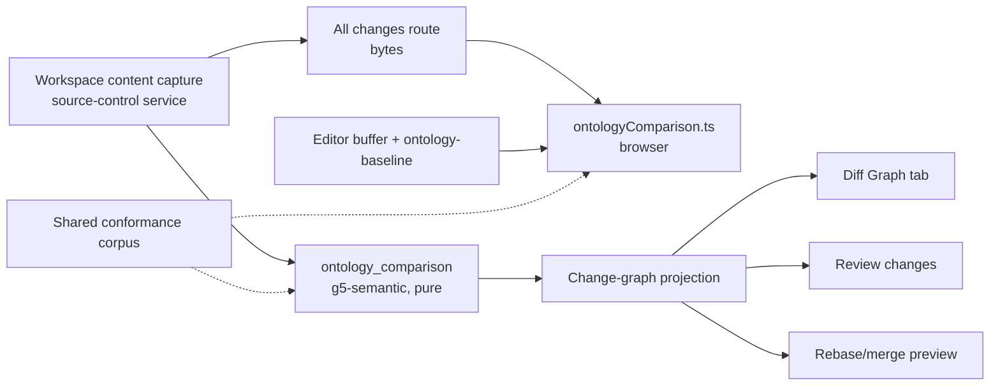

# Diff Graph support for the current ontology (issue #666)

Status: design for review, 2026-10-20. Nothing is implemented. The owner settled every
product question; [owner decisions](../../chat_intent/issue-666-fix-diff-graph-to-support-current-ontology/decisions.md)
summarises them and links the question sets in Project Docs. Later owner decisions in
the same record:

- saved uncommitted edits in All changes cover every file;
- statements pair within one file, and move tracking is deferred;
- the editor keeps its browser comparison
  ([move tracking and comparison owner](../../chat_intent/issue-666-fix-diff-graph-to-support-current-ontology/decisions.md#human-decisions--move-tracking-and-comparison-owner-2026-10-20)).

## Outcome and governing contracts

Diff Graph, the Review changes dialog and the rebase/merge preview show changes to
current-format ontology (`.g5/ontology/**/*.g5.md`) correctly: the right column,
accurate statement changes, typed links between artifacts, explicit missing targets,
correct navigation, and no legacy `.semlift`, `@ref` or ledger assumptions. All
changes also covers saved uncommitted edits for every file. The ontology editor uses
the same discovery and statement rule. Issue #666's move criterion is narrowed by the
owner to "navigation still works after a move"; move tracking is a follow-up.

New owner: [Diff Graph](../../ontology/features/diff_graph.g5.md):
[story](../../ontology/features/diff_graph.g5.md#g5.diff-graph.story),
[columns](../../ontology/features/diff_graph.g5.md#g5.diff-graph.columns),
[modes](../../ontology/features/diff_graph.g5.md#g5.diff-graph.modes),
[ontology nodes](../../ontology/features/diff_graph.g5.md#g5.diff-graph.ontology-nodes),
[relationships](../../ontology/features/diff_graph.g5.md#g5.diff-graph.relationships),
[missing targets](../../ontology/features/diff_graph.g5.md#g5.diff-graph.missing-targets),
[Human lens](../../ontology/features/diff_graph.g5.md#g5.diff-graph.human-lens),
[navigation](../../ontology/features/diff_graph.g5.md#g5.diff-graph.navigation),
[rebase conflicts](../../ontology/features/diff_graph.g5.md#g5.diff-graph.rebase-conflicts),
[limits](../../ontology/features/diff_graph.g5.md#g5.diff-graph.limits).

Amended in [Documents](../../ontology/features/documents.g5.md):
[current-format](../../ontology/features/documents.g5.md#g5.documents.ontology.current-format)
(`*.g5.md` only, any repository),
[graphs](../../ontology/features/documents.g5.md#g5.documents.ontology.graphs)
(deferral lifted for Diff Graph only),
[statement-changes](../../ontology/features/documents.g5.md#g5.documents.ontology.statement-changes)
(deleted-statement target),
[all-changes](../../ontology/features/documents.g5.md#g5.documents.ontology.all-changes)
(open at a file). Added there:
[comparison-owner](../../ontology/features/documents.g5.md#g5.documents.ontology.comparison-owner) and
[human-statements](../../ontology/features/documents.g5.md#g5.documents.ontology.human-statements).
Still governing, unchanged:
[comparison-matching](../../ontology/features/documents.g5.md#g5.documents.ontology.comparison-matching)
(same-file pairing),
[moves](../../ontology/features/documents.g5.md#g5.documents.ontology.moves),
[comparison-baseline](../../ontology/features/documents.g5.md#g5.documents.ontology.comparison-baseline),
[captured references](../../ontology/features/documents.g5.md#g5.documents.captured-references),
[bounded reads](../../ontology/features/documents.g5.md#g5.documents.read.bounds),
[owner read](../../ontology/features/workspaces.g5.md#g5.workspace.owner-read) /
[durable read](../../ontology/features/workspaces.g5.md#g5.workspace.durable-read),
[minimal mechanism](../../ontology/concepts/system_design_principles.g5.md#g5.design.minimal-mechanism).

## Current state (relied-on facts)

- The change graph (`backend/g5-api-core/src/services/git/source_control_change_graph_service.rs`)
  reads committed heads only and diffs each repository against its parent merge base.
  Git's diff runs without rename detection, so a moved file shows as deleted plus added.
- The classifier recognises ontology only as `.semlift/specs` or `*.semlift.md`. Any
  `.g5` path lands in Intents → Other, so current ontology gets a file diff and no links.
  Ontology is split into two columns: Concepts and Architecture.
- Statement blocks come from `MarkdownAnchorExtractor`, which already calls the Rust
  current-format parser `current_ontology_records`
  (`backend/g5-contracts/src/types/ontology_markup.rs`). It pairs within one file, reads
  no provenance and extracts no Markdown links. Record kind is taken from the first
  character of the ID, which is wrong for current IDs.
- Edges come only from `@ref` text and `intent_grounding` ledgers. Chats and Human
  attribution come from `intent_record` ledgers.
- "Uncommitted only" builds no snapshots, so it is always empty. Before the Lean
  cutover (`09f11e34`), `DraftService` supplied server-side CRDT drafts that were layered
  over committed heads for every file, in both modes and on the rebase target. The
  cutover kept that overlay path (`WorkspaceFinalContentSource::Overlay`, `ChangeOrigin`)
  but passes it an empty list, so it is dead code.
- Saved edits now live as files in the workspace VM. The VM's Changes report
  (`workspace_runtime.workspace_changes_report`, shared among concurrent readers and
  deadline-bounded) gives each repository's HEAD OID and `git status` entries, including
  untracked files and renames. It does not list paths changed by unpublished local
  commits. `read_workspace_file_for_actor_bounded` reads one file live for the owner
  with a running VM, and committed content otherwise.
- The editor compares in the browser with `compareOntologyStatements`
  (`frontend/src/lib/ontologyComparison.ts`): same-file pairing by ID, body-only
  comparison, refusal on any parser diagnostic, 10 MiB and 5,000-statement limits.
  - Compare runs it on the editor buffer, with the baseline from `ontology-baseline`.
  - All changes runs it per file on the bytes from `ontology-changes`. That route does
    bounded, revalidated live reads of every ontology file.
- Discovery accepts any `.md` under `.g5/ontology` in the frontend predicate, the
  sidebar, `ontology_files.rs`, `ontology_changes.rs` and `ontology_baseline`.
- The frontend never derives columns from paths. It groups by `node.column` and
  `intentGroup`. The rebase preview maps columns to layers in `graphLayer()` and has four
  fixed ontology lanes. Edges have no kind on canvas. The `Bridge` connection state is
  never rendered. There is no e2e coverage of these surfaces.

## Design decisions

### D1. One statement rule, two implementations held equal by a shared corpus

Under same-file pairing, the comparison needs only one file's two versions.

- **Editor:** Compare must reflect unsaved edits instantly, so it stays in the browser.
- **Diff Graph and the rebase/merge preview:** the server computes their links, lens
  and conflicts, so it needs the statement changes itself.

| Option | What it takes | Verdict |
| --- | --- | --- |
| A. One Rust implementation; Compare sends its buffer | A new endpoint; one server round trip, upload and parse per edit pause, per editor | Rejected by the owner: server work scales with typing |
| B. Compile the Rust parser to WASM for the browser | A new build toolchain in Vite, CI and images | Rejected: a large new mechanism |
| **C. Keep the TypeScript comparison; add a matching Rust one; shared conformance corpus** | One small pure Rust module, plus fixtures run by both test suites | **Selected** |

**Rust comparison.** A new pure module `g5-semantic::ontology_comparison`, built on
`current_ontology_records`. It takes one file's baseline and current bytes. It
returns:

- Added, Modified and Deleted statements, paired by ID within the file;
- a refusal diagnostic for a malformed version;
- whether other text changed (statement bodies and paired metadata removed), with its
  residual;
- each statement's Type, Human flag (D6) and extracted links (D5).

It applies the same normalization and limits as `ontologyComparison.ts`.

**Shared conformance corpus.** Before/after file pairs, each with the expected
statement boundaries, diagnostics and per-statement Added, Modified or Deleted
result. One fixture directory is read by both `cargo test` and Vitest. It covers the
known `nested`-detection difference between the two parsers. Either implementation
changing the rule fails the other's tests.

**Editor.** `ontologyComparison.ts`, Compare and All changes keep their logic. They
change only for the `.g5.md` predicate and the new navigation targets (D7).

### D2. One capture of current workspace content

**Placement (implementation discovery).** The actor-aware live readers
(`read_workspace_file_for_actor_bounded`, `current_ontology_files`, the VM Changes
report) live in `g5-api-routes`; the projection service in `g5-api-core` reads only
Git. The capture is therefore `routes/change_graph_live.rs`. It hands the service a
`WorkspaceLiveContent` overlay through the service's existing overlay input. The All
changes route keeps its own assembly over the same primitives rather than being
extracted; an integration parity test holds the two views to the same changed files
and statement results.

**Ontology files.** The capture covers:

- the authorized parent and merge base per repository, through the existing
  `ontology_comparison_repositories` / `select_comparison_bases`;
- baseline listing and bounded blob reads;
- actor-aware current discovery and reads (live for the owner with a running VM,
  committed otherwise);
- budget checks;
- final revalidation of refs, discovery and runtime identity.

The All changes response and frontend are unchanged. For the Diff Graph, every live
ontology page is read and a page at the published head that is absent live is a
deletion, so both views see the same changed set.
Ontology files are read in full, so they stay complete even with unpublished local
commits (A9).

**Live overlay for every other file.** For an owner with a running VM, the Diff Graph
capture also takes the Changes report and reads each `git status` path with the
bounded live reader. A deleted path becomes absent content. The overlays go into the
existing `build_workspace_snapshots` input, so final content is the overlay over the
committed head, diffed against the merge base. This restores the pre-cutover meaning of
`ChangeOrigin` (Committed, Uncommitted, Both), now sourced from VM files instead of CRDT
drafts. No new VM operation is added.

- **Coherence.** Per repository, the overlay is used only when the report's HEAD OID
  equals the branch head captured for the comparison and the status is available. After
  the reads, the capture rechecks the runtime identity (VM ID, epoch) and the branch
  heads. If either changed, it refuses with the existing retryable unavailable result,
  as All changes does today.
- **Fallback, stated in the response.** Each repository reports whether it includes
  live content and, if not, why.
  - A non-owner reader, or a stopped VM, sees committed content as an ordinary state
    ([durable read](../../ontology/features/workspaces.g5.md#g5.workspace.durable-read)).
  - Unpublished local commits, unavailable status or a failed report make that
    repository committed-only for non-ontology files, with a visible notice.
- **Limits.** Overlay paths count toward the 500 changed files and 100 MiB before any
  read, preflighted from the status count. Each file keeps the 10 MiB bound. Overflow
  refuses the graph as too large, without partial results.
- **Revision.** The graph revision hashes captured content, so detail requests detect
  staleness through the existing `STALE_GRAPH_REVISION`.
- **Scope.** All changes, and the Review changes dialog that shares its projection, use
  the overlay. The rebase/merge preview does not (A4).

No durable state is added. The capture is a per-request derived read, as today.

### D3. Change-graph projection

- **Classification** follows [columns](../../ontology/features/diff_graph.g5.md#g5.diff-graph.columns).
  - Replace `OntologyConcepts`/`SoftwareArchitecture` with one `Ontology` column, and add
    an `ontologyGroup` (the first folder below `.g5/ontology`, or `root`) for grouping.
  - Remove the `.semlift`, `intent_record` and `intent_grounding` path classes, and
    `is_architecture_path`.
  - Add the chat-intent, design-plan and question-set rules.
  - One Rust predicate `is_ontology_path` in `g5-contracts::g5_paths` serves the graph,
    `ontology_files.rs` and the capture. One TypeScript predicate serves the editor and
    the sidebar.
- **Ontology files** come from the D2 capture and the D1 Rust comparison. Other files use
  the committed diff with the D2 live overlay.
  - `ChangeOrigin` is truthful for every node.
  - The graph range gains per-repository live-content status. The header shows it as
    "Includes saved uncommitted edits", or as committed-only with its reason.
- **Nodes and details** follow [ontology nodes](../../ontology/features/diff_graph.g5.md#g5.diff-graph.ontology-nodes).
  - `ChangedRecord` gains `kind` (I/D/Q, from the marker).
  - The node gains a `comparisonWarning`.
  - The existing `other_file_changes` residual carries the Other changes note, with its
    label widened to cover metadata, headings and prose.
- **Titles** are ontology-relative without `.g5.md` (`concepts/data_model`), matching
  All changes.
- **Legacy removal:** `scan_refs`/`@ref` targets, grounding and intent ledger loading,
  ledger-based chats and their diagnostics. Shared crates (`block_extraction`,
  `local_grounding`) stay for the Intent Log, which is out of scope.
- **Uncommitted only:** the API returns `DiffGraphUnavailable` with reason
  `uncommitted_unsupported` for `comparison=uncommitted`, and the default becomes
  `workspace`.

### D4. Moves are not tracked

Statements pair by ID within one file, everywhere, under the unchanged
[matching rule](../../ontology/features/documents.g5.md#g5.documents.ontology.comparison-matching):

- a renamed file is a deleted file plus an added file;
- a statement moved between files is Deleted in one and Added in the other;
- a link that still names the old location points at the deleted original
  (D5, [missing targets](../../ontology/features/diff_graph.g5.md#g5.diff-graph.missing-targets)).

No rename detection is added, and `g5-scm` is unchanged. If move tracking is adopted
later, cross-file pairing needs repository-wide inputs and revisits D1 (see
[comparison-owner](../../ontology/features/documents.g5.md#g5.documents.ontology.comparison-owner)).

### D5. Links and relationships

The Rust comparison extracts every inline Markdown link per statement, from body and
footer, with its source version. It marks each link added, removed or unchanged by
(statement, href).

Resolution follows [relationships](../../ontology/features/diff_graph.g5.md#g5.diff-graph.relationships)
and [missing targets](../../ontology/features/diff_graph.g5.md#g5.diff-graph.missing-targets).
It mirrors the editor's `resolveOntologyLink` rules: relative to the source file, a
leading `/` means the repository root, and the link may not escape the repository.
`g5://file/...?repo=` links resolve against workspace repositories.

- Targets resolve against the captured views and the graph's changed-file set. An
  unchanged target is checked with a bounded read and becomes a context node.
- A target statement or file deleted in this comparison, including a moved one,
  resolves to its deleted node.
- Edges summarise links per file-node pair, with evidence rows. `relationship` is one of
  `expands`, `reference`, `provenance`, `implementation` or `project_document`.
- Missing targets are not edges to fabricated nodes. They are a `missingTargets` list
  on the source node, which the UI draws as a dangling marker.
- Existing budgets apply: 256 context nodes, 1,024 edges and 4,096 evidence rows, with
  visible truncation diagnostics.

### D6. Human intent lens

The Rust comparison marks Human statements per
[human-statements](../../ontology/features/documents.g5.md#g5.documents.ontology.human-statements):

- a footer bullet that is all provenance flags and includes `human-provided` or
  `human-verified`;
- a Q statement whose `g5-question` fence was answered by a user.

This matches the editor's existing filter. The conformance corpus includes Human
expectations, so the two stay aligned. The lens filter in `select_graph` and in
details uses that flag. The git-blame Author/When fallback stays; it reads Git, not
ledgers.

### D7. Frontend surfaces

- **Diff Graph:**
  - one Ontology column with folder subgroups;
  - a distinct stroke per relationship kind, plus a legend, with kinds named in evidence
    rows;
  - dangling missing-target markers and context nodes marked unchanged;
  - details labelled "Changed statements", covering I/D/Q;
  - "Uncommitted only" hidden, and the lens no longer falls back to it;
  - the header shows whether saved uncommitted edits are included, and names any
    repository shown committed-only with its reason; nodes show their origin;
  - grounding wording, `^([DIQ])(\d+)$` handling, the I/D-only filter and
    `.semlift` fixtures removed.
- **Navigation:**
  - Ontology Open document uses `workspaceOntologyFileTab(path, repoId)` with Compare on
    (default), instead of a Project Docs path match. There is no Open diff for ontology.
  - Every changed-statement row opens the editor with Compare on at that statement,
    reusing `setScrollToIntentRecord`.
  - The editor resolves a deleted-statement target to its Before row when Compare is on.
    That row gets a scroll target, but no duplicate DOM anchor ID.
  - A deleted file opens `?view=ontology-changes` with an in-app file target.
  - No URL changes.
- **Review changes:** new column labels. A refused `uncommitted` request shows the
  existing unavailable text instead of "No changed nodes".
- **Rebase preview:**
  - `graphLayer()` maps `ontology` to the always-visible layer.
  - The four lanes become Source Ontology and Target Ontology.
  - Details only, with no navigation on either side.
  - Backend `classify_rebase_conflicts` uses the same file plus the same statement ID
    for `SameBlock`, and the same file for `SameNode`.
- **Editor:** the `.g5.md` predicate covers the sidebar, Compare and All changes. Its
  comparison logic, endpoints and refresh behavior are unchanged.

## Owners and interactions

| Part | Owns |
| --- | --- |
| Capture | Authorization, baseline selection, bounded live and committed reads, revalidation |
| The two comparisons | One file's statement changes, under one rule enforced by the corpus |
| The projection | Classification, nodes, edges, budgets and conflicts |
| Consumers | Presentation and navigation only |

## Phases and acceptance outcomes

1. **Discovery and corpus.**
   - One `.g5.md` predicate in Rust and in TypeScript, applied to the editor sidebar,
     Compare, All changes, `ontology_files.rs` and the capture.
   - The shared conformance corpus, with expected boundaries, diagnostics, Human flags
     and per-statement results. The existing TypeScript comparison must pass it.
   - The structural checker (`.agents/skills/ontology-uplift/scripts/check_ontology.py`)
     reports a plain `.md` file under a `.g5/ontology` directory as not an ontology file,
     telling the author to rename it to `.g5.md`, and still checks its structure.
   - *Accept:* a plain `.md` under `.g5/ontology` is an ordinary file everywhere, and the
     checker reports it; the TypeScript comparison passes every corpus case.
2. **Rust comparison and capture.**
   - The `ontology_comparison` module, which must pass the same corpus.
   - Extract the capture from the All changes route, with the response unchanged.
   - *Accept:* the corpus passes in both suites; existing All changes and Compare tests
     pass unchanged.
3. **Change-graph projection.**
   - Classification, the Ontology column, ontology file nodes from the Rust comparison,
     and the live overlay for every file, with per-repository fallback and notices.
   - Links, relationships and missing targets; the Human lens; the Uncommitted refusal;
     same-file rebase conflicts; legacy removal.
   - *Accept:* every rule in the new Diff Graph blocks holds over the representative
     corpus below. For the same inputs, Diff Graph's statement changes equal All changes'.
4. **Frontend surfaces and navigation.** The three surfaces as in D7.
   - *Accept:* nodes and statement rows open the exact repository/path/statement,
     including Before rows and deleted files. Kinds are visually distinct. Uncommitted
     only is not offered.
5. **Regression and evidence.**
   - Run the affected suites after the final changes.
   - Record scoped evidence in the governing metadata and close the listed gaps.

Issue acceptance criteria → phases:

| Criterion | Phases |
| --- | --- |
| Discovery | 1 |
| Statement accuracy, metadata-only and malformed handling | 1, 2, 3 |
| References and missing targets | 3, 4 |
| Moves (narrowed to navigation still working) | 3, 4 |
| Navigation | 4 |
| Empty state unchanged, with Uncommitted no longer false | 3, 4 |
| Regression coverage | all |

## Verification

Owner decision: automated regression checks with representative current-format files
are enough. The representative fixtures are committed with the tests. They need:

- nested folders, and two repositories (code plus the docs repository, both with
  `.g5/ontology`);
- added, modified and deleted statements, and a deleted file;
- metadata-only and prose/heading-only edits;
- a renamed file, and a statement moved between files: both shown as deleted plus
  added, with a link to the old location pointing at the deleted original;
- a malformed file (mismatched anchor, broken footer, duplicate ID within the file);
- every link kind: Expands, footer provenance to `.g5/chat_intent` and to a design plan,
  source code, Project Docs, and a `g5://file` link into the other repository;
- a GitHub permalink, a link to a statement deleted in this comparison, and edited and
  unedited broken links;
- human-provided, human-verified, agent, and user-answered Q statements;
- legacy `.semlift` files and ledgers as ordinary files;
- chat-intent Markdown, a non-Markdown chat-intent file, and a question set.

The suites:

- The shared conformance corpus in both `cargo test` and Vitest.
- Rust unit tests for links, classification and the projection.
- `g5-api` integration tests in a new module in the single `integration` target. They
  cover:
  - the change graph and rebase preview over real Git fixtures, with the runtime peer
    for live files;
  - committed versus live origin, and stale revision;
  - parent denial and limits;
  - `uncommitted` refusal;
  - live overlay for every file:
    - an uncommitted code edit, an untracked file, a file deleted in the working tree,
      and Both origin;
    - a non-owner and a stopped VM: committed, with no notice;
    - unpublished local commits and unavailable status: committed, with a notice;
    - a runtime or head change during reads: refused;
    - overlay paths counted in the limits;
  - All changes unchanged after the capture extraction;
  - parity between All changes and Diff Graph statement changes for the same inputs.
- The checker's own `test_check_ontology.py`, with a case for a plain `.md` page.
- Vitest for the three surfaces, navigation targets and the Before-row target.
- Production frontend build, lint, `cargo clippy`, and the existing change-graph,
  ontology and rebase-preview suites.

No QA demo, TLA+/TLC or deep review is requested.

## Risks

- **Two implementations of one rule.** A change to one could silently diverge. The
  conformance corpus, run by both suites, plus the All changes / Diff Graph parity test,
  make divergence fail CI.
- **Noisy reorganization.** Renaming or splitting a page shows every statement as
  deleted and re-added. This is accepted by the owner until move tracking is designed.
- **Revision churn.** Live content in the graph revision makes details 409 more often
  while the owner edits. This is the existing stale-revision behavior, now reachable.
- **VM load.** Every All changes request now runs one Changes report and reads each dirty
  path. The report is shared among concurrent readers and deadline-bounded, and the VM
  admits only a couple of concurrent runs. A slow report degrades to committed content
  with a notice; it never blocks the graph. Measure on a workspace with many dirty files.
- **Unpublished local commits.** Files changed only by local commits that are not yet
  published are not visible to the server. That repository falls back to committed
  content with a notice (A9). Escalation, only if this is common: extend the VM Changes
  report to list paths changed since the tracking tip.
- **Lost signals.** Ledger removal drops Human attribution for chats and documents, and
  drops ledger grounding edges. This is intended (owner decision 18); the Intent Log
  keeps its readers.
- **Narrower editor discovery.** A plain `.md` page under `.g5/ontology` leaves the editor
  sidebar. None exist today. The structural checker reports such a page, so the
  mistake is visible where agents author ontology (A6).

## Open assumptions

- A1. Resolved by the owner: saved uncommitted edits are included for every file in All
  changes ([modes](../../ontology/features/diff_graph.g5.md#g5.diff-graph.modes)).
- A2. Resolved by the owner: every changed-statement row in the details panel opens the
  editor with Compare on at that statement
  ([navigation and scope decisions](../../chat_intent/issue-666-fix-diff-graph-to-support-current-ontology/decisions.md#human-decisions--navigation-and-scope-2026-10-20)).
- A3. Confirmed by the owner: statement identity never pairs across repositories. Under
  same-file pairing, it also never pairs across files.
- A4. Confirmed by the owner: the rebase/merge preview stays on committed heads and
  offers no navigation on either side.
- A5. One Other changes note, with one residual diff, covers metadata, headings and prose.
- A6. Resolved by the owner: `.agents/skills/ontology-uplift/scripts/check_ontology.py`
  flags a plain `.md` file under `.g5/ontology` and still checks its structure (phase 1,
  [decision](../../chat_intent/issue-666-fix-diff-graph-to-support-current-ontology/decisions.md#human-decisions--navigation-and-scope-2026-10-20)).
- A7. Withdrawn: no rename detection is used
  ([move tracking deferral](../../chat_intent/issue-666-fix-diff-graph-to-support-current-ontology/decisions.md#human-decisions--move-tracking-and-comparison-owner-2026-10-20)).
- A8. Resolved by the owner (option A): links are drawn only from changed statements
  (added, modified or deleted), plus links added to or removed from an unchanged
  statement. An unchanged link of an unchanged statement, such as a footer citation of
  an old chat record, no longer adds a context node
  ([decision](../../chat_intent/issue-666-fix-diff-graph-to-support-current-ontology/decisions.md#human-decision--link-scope-2026-10-21)).
- A9. Confirmed by the owner: a repository whose VM HEAD differs from its published
  branch head shows committed content for non-ontology files, with a notice, rather than
  a partial live overlay. Extending the VM Changes report stays the escalation path
  ([decision](../../chat_intent/issue-666-fix-diff-graph-to-support-current-ontology/decisions.md#human-decisions--navigation-and-scope-2026-10-20)).

## Out of scope

- Move tracking: cross-file statement identity and file rename detection. This is a
  follow-up; whether to file an issue is the owner's call.
- Automatic redirects and following stale links.
- Statement-level nodes.
- Deep links for graph selection.
- A working Uncommitted only mode. It stays hidden, as the owner decided, though the
  overlay now makes it cheap to restore later.
- Intent Log ledger readers.
- Prose comparison inside the editor.
- QA workspace demonstration.

## Design self-review

- **Mechanisms.**
  - New: one small pure Rust comparison module, a shared conformance corpus, a capture
    extraction, and the live overlay fed by the existing Changes report and bounded live
    reader.
  - Removed: `@ref`, ledgers, `.semlift` classes and two ontology columns.
  - Reused: the dead overlay path.
  - No new endpoint, VM operation, durable state, worker or projection, and the editor's
    comparison is untouched.
- **Contract consistency.**
  - The matching and moves rules are unchanged and now govern Diff Graph too.
  - Diff Graph deliberately reports fewer broken links than the editor (owner decision
    13). [Captured references](../../ontology/features/documents.g5.md#g5.documents.captured-references)
    still govern document reads, where every unresolved reference stays visible.
- **Superseded intent.**
  - For Diff Graph only, the 2026-10-13 decisions to retain grounding-record tracing and
    to defer relationship display are superseded.
  - Owner decision 15 and the "Git rename detection" and "one parser" notes are
    superseded or relaxed by the later decision record.
- **Unproven guarantees.** The VM load of a Changes report per All changes request is
  not yet measured. It has a bounded fallback, listed above.

Design-stage document validation, 2026-10-20, after the same-file revision: the
ontology checker found 0 issues in 23 files and 525 blocks. Every relative link and
anchor in the changed ontology, this plan and the decision record resolves. The
matching and moves blocks match their pre-issue text, and `git diff --check` passed.
No application code was changed.

## Implementation and verification — 2026-10-20

Implemented on the workspace branch, phases 1–5, in commits `fea90d9a` through the
review fixes. Not deployed.

### Design discoveries (amended before dependent work)

- **Capture placement (D2).** Live readers are route-level, so the capture is
  `routes/change_graph_live.rs`; the All changes route keeps its assembly, and a
  parity test binds the two views (amendment above).
- **Parser.** `current_ontology_records` rescanned the document per statement
  (168 s for the 5,000-statement limit case in a debug build); it now indexes once
  (under 1 s). To match the editor, its `nested` rule, fence rule (tildes; a fence
  closes only at the same character at least as long) and anchor ambiguity
  (generated heading IDs, numbered duplicates) changed; one shared anchor index
  (`current_ontology_anchor_counts`) serves statement parsing and link resolution.
- **Human lens.** A changed artifact that a kept file links to stays as context
  with its own change state ([human-lens](../../ontology/features/diff_graph.g5.md#g5.diff-graph.human-lens)).
- **Live capture degradation.** Ontology stays live without the Changes report. A
  dirty path that vanished before its read is a deletion; an unreadable one makes
  its repository committed-only with a reason; a VM behind the published head is
  `workspace_synchronizing`, ahead or diverged is `unpublished_commits`; an
  unreadable ontology page refuses the graph, as All changes does.
- **Limits.** 500 live ontology pages and 500 changed paths are checked from the
  listings before reads; at most 1,024 distinct unchanged link targets are looked up,
  with a `link_target_budget_reached` diagnostic beyond that
  ([limits](../../ontology/features/diff_graph.g5.md#g5.diff-graph.limits)).

### Evidence executed

- **Shared conformance corpus:** 24 cases, passing in both `cargo test -p g5-semantic`
  and Vitest. Mutation controls in the Rust rule (metadata compared, Human from any
  `human-` bullet, nested refusal removed, deletions placed at the end) are each
  killed; the nested case was added after its mutant first survived.
- **Rust unit tests:** `g5-semantic` 231, `g5-contracts` 384, `g5-api-core` 1,018
  (12 change-graph), `g5-api-routes` live-capture budgets and head reasons.
- **HTTP integration (real router, database authority and Git; runtime double for
  the VM):** 9 change-graph tests covering columns, statements, links, deleted and
  missing targets, lens, Uncommitted refusal, All changes parity, owner and reader
  overlays, unpublished commits, unavailable status, failed report, vanished and
  unreadable paths, VM behind, refused ontology reads and rebase conflicts; with the
  existing ontology, workspace, pull-request, remote-tracking and Git-ref modules,
  217 integration tests passed. Route-auth, reader-contract and layering guards
  (62) passed.
- **Frontend:** Diff Graph view (75), rebase preview, Review changes, sidebar and
  the wider editor/workspace suites (about 1,600 tests) passed; production build
  type-check, ESLint (no new warnings) and Prettier on changed files.
- **Real stack browser journeys** (dev stack with a process-isolation worker host,
  Chromium): the new Diff Graph journey (`e2e/flows/diff-graph-ontology.spec.ts`:
  live-content line, Ontology column and folder group, legend and typed edge,
  missing-target notice, deleted-target evidence, opening a deleted statement at its
  Before row with Compare on, Human intent lens) and the existing current-ontology
  and ontology-comparison journeys passed: 4 of 4, first on a stack built before the
  review fixes and again after rebuilding the API and frontend from the final code.
  The committed-ontology journey needs the browser-ontology fixture seeded; the VM
  journeys need the single process-host slot free.
- **Checker:** `test_check_ontology.py` 30 tests; the ontology checks 0 issues.

### Remaining gaps

- No Verus setup exists in this repository, so no production-code proofs were run.
- VM load of one Changes report per Diff Graph or details request is not measured;
  details requests recompute the capture and projection.
- A file changed only by an unpublished local commit is labelled uncommitted.
- The recheck covers the VM incarnation and published heads, not the VM's own HEAD
  or dirty list; files are read one at a time, so a multi-file save can appear
  half-applied until the next refresh.
- Editor callouts (`:::note`) are not in the corpus; the Rust parser treats them as
  paragraphs.
- The Review changes dialog shows no committed-only notice.
