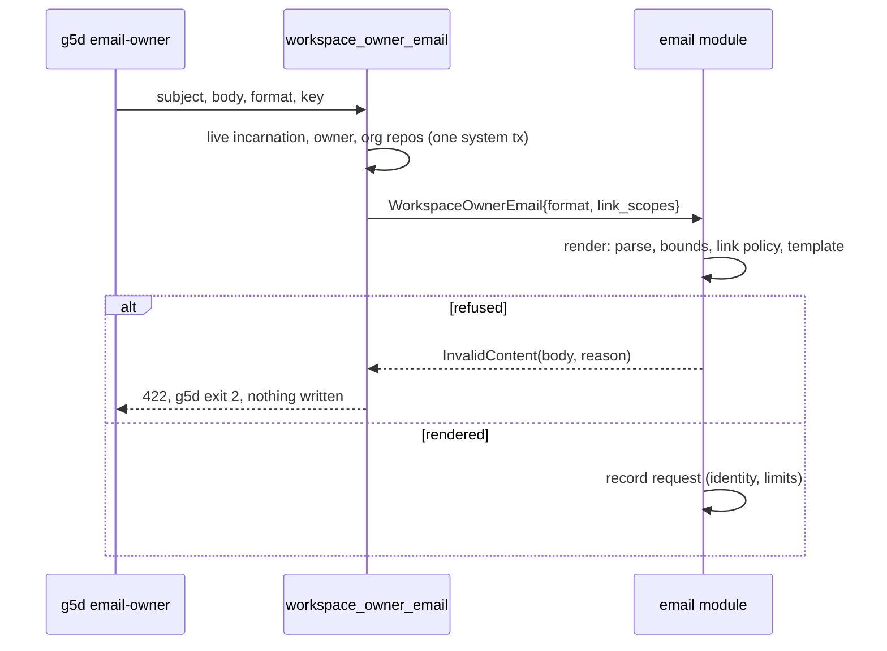

# Agent email to the owner: a sanitized Markdown subset

Design for [issue #834](https://github.com/G5Labs/G5-Lean/issues/834). The issue holds
the owner's request and the proposal this design follows. The authorized branch is
`issue-834-agent-email-to-the-owner-render-a-sanitized`, and the design starts from
`243598eb5` (main).

## Ontology changes

| Block | Change | Summary |
|---|---|---|
| [`g5.email.authored-content`](../../ontology/software_architecture/email.g5.md#g5.email.authored-content) | New | Text G5 did not write is untrusted. It is plain text or the Markdown subset, the author notice comes before it in both parts, and the text part is the source. |
| [`g5.email.markdown`](../../ontology/software_architecture/email.g5.md#g5.email.markdown) | New | The shared subset, escaped source for anything outside it, and bounds that refuse the whole request. |
| [`g5.email.link-policy`](../../ontology/software_architecture/email.g5.md#g5.email.link-policy) | New | When a link is clickable, and how any other link is shown. |
| [`g5.email.boundary`](../../ontology/software_architecture/email.g5.md#g5.email.boundary) | Amended | Rendering, which the module already owned, now includes the subset and the link policy. |
| [`g5.workspace.owner-email`](../../ontology/features/workspaces.g5.md#g5.workspace.owner-email) | Amended | Removes "never rendered as HTML" and places the authorship notice before the text. |
| [`g5.workspace.owner-email-format`](../../ontology/features/workspaces.g5.md#g5.workspace.owner-email-format) | New | `--format markdown`, the owner email's repository scopes, the limit on the source, and exit 2. |

The subset and the policy live in the email module, not in the owner-email consumer.
The owner said "basic, safe formatting will be a common need", so later kinds that
carry authored text, such as approval comments or digests, reuse them unchanged. The
module still depends on no consumer. A consumer supplies only data: the authored text,
its format and its repository scopes.

## Owners and interactions

- **Consumer (`workspace_owner_email`)** decides who may send, to whom, and which
  repositories count as the organization's. It reads them in the transaction that already
  checks the incarnation and the owner, so the scopes match that moment.
- **Email module** owns parsing, bounds, the link decision, escaping, the template and
  the notice placement. Rendering happens once, when the request is recorded
  ([identity](../../ontology/software_architecture/email.g5.md#g5.email.identity)). A
  refusal therefore happens before anything is written, and every retry resends the
  same bytes.
- **g5d** adds `--format text|markdown`. It sends `format` only for `markdown`, so a
  plain-text request from a newer g5d still works against an API that predates this
  change. A refusal is a `ValidationError`, which g5d already maps to exit 2.

No new state, table, migration or lifecycle is needed. The format is an input to the one
render step that already exists.

## Markdown rendering

The renderer is `pulldown-cmark`, already a dependency of `g5-api-core`, with only
`ENABLE_TABLES` set. The module walks its event stream and writes its own HTML: there
is no `push_html` and no HTML sanitizer, so markup comes only from the renderer's own
templates. Every text, code and attribute value goes through the existing
`escape_html`.

| Input | Output |
|---|---|
| Heading 1–3, paragraph, emphasis, strong, list, block quote, code span, fenced or indented code, rule, table | Fixed tags with inline styles. Code blocks ignore the info string. |
| Soft line break | ` `, as GitHub comments do. Agents write "Status: …\nTests: …" and expect two lines; joining them would make the HTML read worse than the text part. |
| Raw HTML (block or inline), image, heading 4–6 | Escaped source span. |
| Reference-style link definition | Refused, naming its line. The parser consumes definitions, and its map keeps only the first one per label, so a definition cannot be reliably shown in place. Without definitions, reference, collapsed and shortcut links cannot occur. If one ever did, it would be shown as escaped source. |
| Footnotes, task lists, strikethrough, math | Their extensions stay off, so they are already ordinary text. |
| Entities | Decoded to text, then escaped, so `&lt;b&gt;` shows as `<b>`. |

Bounds give the reason and the line: lists nest at most 2 levels, block quotes at most
2, tables at most 10 columns and 200 rows, and the rendered HTML at most 256 KiB. The
size bound keeps what G5 sends within what mail clients accept. Ordinary reports stay
far below it. A source within the 20,000-character limit can still be refused when its
markup expands: a body that is all short code spans grows about 17-fold, to roughly
340,000 bytes. The table and nesting bounds are generous for reports and keep the
layout readable.

The issue proposes "refused … a reason naming the offending construct" for input that
fails parsing. CommonMark has no parse failure: every input has a meaning. Constructs
outside the subset therefore follow the issue's other rule and appear as escaped text,
while the bounds refuse the request. Reference definitions are refused like a bound,
because showing them as source would mean reconstructing text the parser removed.

The owner chose GitHub-style line breaks and the organization-wide repository scope on
2026-10-26, when approving implementation.

## Link policy

Parse the target with `url::Url`. It is clickable only when the scheme is `https`,
there is no user information, and either:

- the public base URL is `https` and the host and port equal its own (a local `http`
  stack therefore has no clickable G5 links), or
- the host and port equal a scope's, and the path equals the scope's path or continues
  it after `/`, compared ASCII-case-insensitively (GitHub and GitLab paths are
  case-insensitive).

The check runs on the normalized URL (`..` and `\` resolved), and that same string is
the `href`, so a raw spelling cannot pass the check and lead somewhere else.

Visible text is URL-like when it contains `://`, a word starting with `www.`, or a
`host.tld/` token. A file name such as `render.rs` is not URL-like, so
`[render.rs](https://github.com/acme/api/blob/main/render.rs)` stays clickable. Text
equal to the target, as in an autolink, is always allowed.

A link that fails the policy renders as its visible content followed by a space
and the full URL in parentheses, or just the URL when the two are equal. The link title is dropped,
because hover text could mislead. Bare `https://` URLs in ordinary text, outside code,
are detected and handled the same way. Trailing `.,;:!?` and unbalanced `)` are left
out of the URL. `http://` and other schemes are left as text.

Limit: Gmail and other clients turn visible URLs into links on their own. G5 cannot
prevent that without breaking copy and paste. The guarantee is that every link G5 makes
points at an allowed target, and every other target is shown in full. Today's
plain-text body already has the same exposure.

## Repository scopes

The owner email supplies the `https` web root of every repository in the organization
that has a provider (`repos.provider IS NOT NULL`). The web root is `git_url` with any
trailing `/` and `.git` removed. Provider repositories enter only through the provider
origin policy (`ScmOriginPolicy`), so their `git_url` is an HTTPS URL on the provider's
host, including GitHub instances with a path prefix. Local repositories have no web
page and are skipped. The issue says "attached to the workspace's organization", not to
the workspace, so the scope is the organization's repositories. A digest agent in a
personal workspace links to every repository in the organization, while that workspace
itself holds only the personal repository.

## Authorship notice

The HTML starts with a shaded notice: "Message from the agent in your G5 workspace
*ws* (*org*). G5 did not write it." The text part starts with the same line. The
footer is unchanged and keeps the workspace link. The notice applies to plain-text
bodies too, so one template serves both formats. The cost is that inbox previews show
the notice before the agent's first line. The issue accepts this so that formatting
cannot make a message look like G5's.

## Testing

- Unit tests (`email/markdown.rs`, `email/render.rs`): every subset element; every
  disallowed construct shown as source (raw block and inline HTML, image, heading 4–6,
  reference link and definition, footnote, task list, strikethrough, entity markup);
  every link branch (public host, repository scope, case and prefix boundary
  `acme/api` vs `acme/apix`, foreign host, URL-shaped text, `http`, `mailto`,
  `javascript`, `data`, relative, user information, `..` normalization, bare-URL
  linking and trailing punctuation); each bound's refusal message and line; notice
  placement in both parts; the text part equals the normalized source.
- Service and integration (`backend/g5-api/tests/workspace_owner_email.rs`): a markdown
  request through the internal route, with the organization's provider repository
  clickable and a foreign link not, in the captured HTML; a refused body returns 422
  and records nothing; plain-text bodies keep today's escaping.
- g5d: `--format` parsing, and `format` sent only for `markdown`.

## Self-review

- Consistent with
  [`g5.email.identity`](../../ontology/software_architecture/email.g5.md#g5.email.identity):
  rendering is still once, at request time, and a repeated key with the same body
  returns the earlier request. A repeated key with a body that is now refused is
  refused before the lookup, as an invalid link path already was.
- [`g5.email.data`](../../ontology/software_architecture/email.g5.md#g5.email.data) is
  unchanged: the rendered HTML is stored and cleared like today's.
- [`g5.workspace.owner-email-limit`](../../ontology/features/workspaces.g5.md#g5.workspace.owner-email-limit)
  is unchanged, and a refused body does not count, because nothing is written.
- The invitation template is unchanged.
