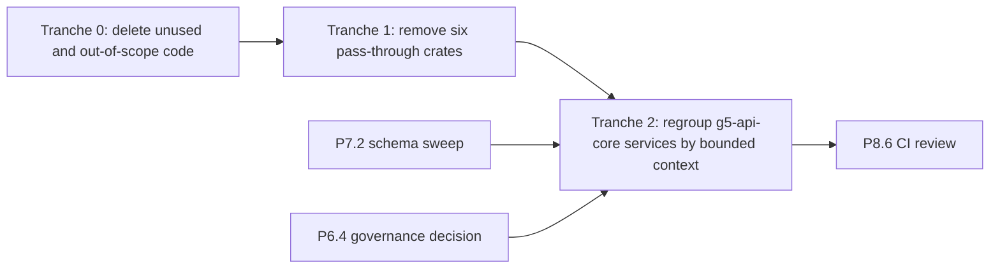

# P8.5 — delete unused code, then consolidate crates

## Ontology changes and governance

**Comparison base:** `origin/main` at `77687360`, branch `kaihui/p8.5-dead-code-runtime`
(slice 1). Request and context: [chat intent](../../chat_intent/p8.5-crate-consolidation/request.md).
Lineage: [issue 342](https://github.com/G5Labs/G5-Lean/issues/342), plan v9 P8.5 and
design v9 §3.2, §8.8, §10.5, §11.3.

**Ontology changes:** one metadata line on `g5.scope.internal-issues` (slice 2) and, in
slice 3b, the `OntologyService` row of the Git/governance owner table drops
`get_node_dependencies`, whose route and implementation are deleted. Otherwise none for the deletion tranche. The ontology names no removed
command, module or crate, and every deleted item either has no caller or is listed as
removed by design v9 §11.3. One amendment is reserved for the crate tranche:
`g5.architecture.dependencies` names `g5-workspace-ops` as a shared owner; the PR that
folds it into `g5-scm` rewrites that owner list in the same change.
The crate tranche's ontology edits are location-only or owner renames: the
`g5.architecture.dependencies` owner list and its metadata, the Git/governance owner
table, the architecture concept module map and the design-principles note name
`g5_scm::workspace` (PR 2); the governance, preview-terminal, runtime and boundaries
blocks that cited `g5d-cli` paths cite `g5d/src/cli` (PR 3); the agents, conversations,
provider-accounts and ontology-and-harness features, the agents architecture block and
the module map cite `g5d-agent` (tranche 2). No commitment changed.

### Relevant and governing ontology

| Block | Why relevant | Implementation must enforce or consider |
|---|---|---|
| [Direct dependencies toward shared capabilities](../../ontology/software_architecture/boundaries.g5.md#direct-dependencies-toward-shared-capabilities) | Names the shared crate owners | Deleting code must not add an edge; removing an orphaned dependency keeps the one-way order. The architecture test in `backend/g5d/tests/architecture/source_contracts.rs` stays green. |
| [Keep complete operations with their state owner](../../ontology/software_architecture/boundaries.g5.md#keep-complete-operations-with-their-state-owner) | Removed CLI commands are entry paths | Deleting an entry path removes a caller; no owner policy moves into a caller. |
| [Make the workspace CLI available](../../ontology/software_architecture/runtime.g5.md#make-the-workspace-cli-available-to-people-and-agents), [supply the workspace context](../../ontology/software_architecture/runtime.g5.md#supply-the-current-workspace-context-to-the-cli) | Agents and terminals call `g5d` in the VM | `g5d workspace refresh` and `g5d pr` keep working; no shipped profile, skill or frontend prompt invokes a removed command. |
| [Create or update a PR from a workspace agent](../../ontology/features/governance.g5.md#create-or-update-a-pr-from-a-workspace-agent) | The retained agent publication path | Untouched by the deletions. |
| [Justify each new mechanism](../../ontology/concepts/system_design_principles.g5.md#justify-each-new-mechanism) | Minimal design | No deprecation shim, alias or feature flag for a removed command: G5-Lean has no external users. |
| [Test real boundaries](../../ontology/concepts/system_design_principles.g5.md#test-real-boundaries-and-report-exact-evidence) | Evidence | Run the real CLI binary tests, the architecture source contracts and the layout check; report what was not executed. |

## Requested outcome

Fewer crates with clear ownership by capability and no behavior change, reached in
the order that costs least: delete what nothing uses, merge the pass-through crates,
then regroup the API core by bounded context.

## Design

**Tranche 0, deletion.** Code is deleted when a repository-wide search finds no
production caller, or when design v9 lists its subsystem as removed. Slices by area,
each an independent PR:

1. Runtime CLI and orphan runtime modules (this branch): the `g5d remote`, `job`, `aql`,
   `view`, `sync`, `spec sync`, `workspace list` and `workspace switch` commands, the AQL
   compiler in `g5-internal-api`, and `docs_write_policy`, `ontology_inventory`,
   `task_git_config` and `provider_support`. `g5d workspace refresh` stays: it is the
   in-VM wrapper for the dispatcher's `workspace.git` module and is exercised by the
   dispatcher tests. `g5d push` stays until the seed scripts, Justfile and CI use
   native `git push`.
2. API dead services, routes, helpers and models, in two parts.
   Part a (branch `kaihui/p8.5-dead-code-api`): the runtime-artifact, worker-token and
   waitlist services with their routes, tests and the frontend worker-token manager; the
   three ontology-format handlers nobody calls (the service keeps `read_ontology`, which
   the read-ontology route uses); the `org_guard` middleware; the checkpoint, escalation
   and worker-token scoped-db helpers and twelve unreferenced resolver helpers; the dead
   data models (`JobSubmissionReceipt`, `TimelineEntry`, `TaskCheckpoint`, `CommentIndex`,
   `DocNodeLink`, `OrgMembership`, `UserScmConnection`, `WorkspaceMember`,
   `CheckpointDTO`, `check_health`); and migration 063, which drops `waitlist_signups`,
   `task_checkpoints`, `task_completion_constraints`, `job_merge_artifacts`,
   `job_submission_receipts` with its trigger function, `repo_mirror_refs`,
   `ontology_grounding` and `intent_record`. The CI seed script's SQL projection of
   intent records goes with the tables; its JSONL fixtures are what the API reads.
   Corrections found while cutting it: the three workspace-service helpers the sweep
   called dead are called through `self` and stay; `merge_evaluations` is written by a
   governance-legacy test and waits for P6.4; `worker_tokens` stays until the P8.4 infra
   cleanup retires the bare-host token provisioning in `seed-prod-org.sh` and
   `reset-dev-environment.sh`; `workspace_dependencies` is part of the
   workspace wire contract the frontend validates and moves to part b with the
   dependencies routes; the escalation tables move to the frontend slice with their home
   page readers; the blob cluster is a crate removal and moves to tranche 1.
   Part b (branch `kaihui/p8.5-dead-code-api-b`, stacked on part a): thirteen mounted
   routes with no caller across auth, chat, comments, docs, internal, ontology and
   workspaces, with their static route contracts, tests, helper clusters and frontend
   registry entries; and the workspace dependencies feature end to end, including the
   always-empty `dependencies` wire field and migration 064 dropping its table together
   with `doc_folders` and `node_dependencies`, whose last readers were the removed routes.
   The e2e-only `POST /docs/views/e2e-seed` route goes too: the CI seed script inserts
   views directly, so nothing called it.
   Kept after audit: `GET /tasks/:id/attempts` (two e2e suites read it), `PUT /docs/:docId/links` (three
   demo seed scripts call it; retire with them), the internal review publish-findings and
   comments routes (the review workflow's agent path, pending P6.4), `GET
   /scm/:provider/orgs` (a GitLab behavior test exercises it), and `GET
   /auth/preview/reauth/:taskId` (the auth middleware sends expired preview cookies to it;
   the sweep missed that builder).
3. Shared crates and e2e (branch `kaihui/p8.5-dead-code-shared`, stacked on slice 1):
   the intent-store query engine `fs_query_engine.rs` and `merge_resolver.rs` with the
   thirteen e2e scenarios and the helper that only exercised the engine; the retired
   persona-view types `types/view.rs` with the always-`None` view-context fields in
   `TaskContext`, the job task page and the jobs route DTO; `g5-contracts/config.rs`,
   `g5-scm/worktree.rs`, `types/task_observation.rs`; thirteen enums nothing names;
   the sticky-runtime attribution and task-trigger DTO block in `g5-internal-api`;
   the unreferenced helpers in `task_context`, `grounding`, `spec_context`,
   `agent_launch` and `block_extraction`; `tools/validation-checks` with its
   preflight entry and lockfile contract. `workspace-ops/clone.rs` stays: the audit
   missed its `ops::init` callers in doc, org and CLI init paths.
4. The human-escalation path (branch `kaihui/p8.5-dead-code-frontend`, stacked on part
   b). Design v9 removed the human-escalation subsystem; human questions are the
   `g5-question` blocks in Project Docs (the live path: `questionBlock.ts`,
   `QuestionCard`, `StructuredQuestionEditor`, the Project Doc open-question sources and
   the home page's `open_question` kind). The persisted tables' routes, service and
   WebSocket emitters were already gone, and the first Codex round showed the
   "escalation questions doc" replacement was never wired either: its capture has
   returned an empty list since the lean reorganization and nothing writes those docs.
   So the whole kind goes: the `human_escalations` / `human_escalation_questions` SQL
   and the escalation-doc capture, summarizer and materializers in the open-question
   metrics and Home candidate paths, the `human_escalation` attention kind and its
   `humanInputTarget`, the `humanEscalationOpenQuestions`, `humanEscalationSources` and
   `escalationDocSources` wire fields (`openQuestionsTotal` is now the Project Doc
   count), the unused `human_escalation` data model, the never-emitted `escalation.*`,
   `job.paused` and `job.resumed` WebSocket events, the stale route-contract entries
   (including the answer-write contract for a handler that no longer exists), the reader
   contract test for the escalation-doc seam, and the home API tests that seeded
   escalation rows. Migration 065 drops both tables and their two trigger functions.
   Frontend: `useEscalations`, `HilEscalationPanel` and `HilResponseComposer` (which
   only the panel used) with their tests, the bottom drawer's escalation tab and props
   nothing passed, the `authoritative_cut_advanced` and `escalation.*` client event
   handlers nothing emits, the mock handlers for the absent routes, the Home "Human
   Input" filter, badge and link branch and its `attention=human_escalation` deep link,
   `nextActiveEscalationId`, and the escalation types; `OptionCard` moves to a shared
   module because the live question cards import it.
   Decision: the status band's open-question modal becomes one list of Project Doc
   sources (the "All" and "Questions in Docs" tabs were identical once the Human
   Escalations tab had nothing to show), and Home attention has two kinds, `approval`
   and `open_question`; a `kind=human_escalation` filter is now rejected like any
   unknown kind. Remaining unexecuted coverage: the Home human-escalation scenarios had
   no document-backed replacement to migrate to, so Home pagination is covered by the
   approval and Project Doc tests only.

**Tranche 1, crates.** 27 to 21 (the count after the deletion tranche): delete `g5-common`; fold `g5-blob` into
`g5-api-data`, `g5-workspace-ops` into `g5-scm`, `g5-api-contracts` into
`g5-api-foundation`, `g5d-runtime-core` into `g5d-foundation`, `g5d-cli` into `g5d`.
Each merge keeps the one-way dependency order and updates the four Dockerfiles, the
`-p` lists in the Justfile, `scripts/test-parallel.sh` and the Cloud Build lanes, and
the architecture test.
Decisions while cutting it: `g5-workspace-ops` becomes `g5_scm::workspace` with branch,
clone and commit gated on `libgit2` and paths building without it, and the reader guard
scans `g5-scm/workspace/` as policy, exactly as it scanned the old crate, while the rest
of `g5-scm` keeps its mechanics exemption; the worker-image trigger now watches the shared crates the
`g5d` binary links, and the seed scripts' binary freshness inventories add `g5-scm`, since
the workspace workflows moved into it. `g5-common` had only dev consumers;
`g5d-runtime-core`'s API-dependency restriction moved into the foundation validator;
the historical `g5_api_contracts` tracing targets map to the foundation's `contracts`
module.

**Gate override (2026-10-08).** The user asked for tranche 2 and the `g5d push`
conversion now, before P7.2 and the P6.4 decision. Consequence accepted: the service
regroup moves files that P7.2 and the governance cleanup will later delete, so those
later changes delete from the new context modules instead; the regroup is cut per
context so each PR stays reviewable, and `g5d push` is retired once the seed scripts
push with native git and reproduce the server-side effects the command drove.

**Tranche 2, bounded contexts.** `g5-api-core/src/services` becomes `identity`, `git`,
`hosts`, `workspace` and `agents` modules, each depending only on earlier ones, with
maintenance jobs moved into the context they serve. `g5d-worker` and `g5d-agent-turn`
merge into `g5d-agent` (done on this branch: one flat crate at `backend/g5d-agent` keeping
the worker's public runtime seams and the private `agent.turn` modules; `g5d-host` drops
its unused worker edge and the worker's unused `g5-auth`, `walkdir`, `hex` and `serde_yaml`
edges go; legacy `g5d::worker::*` and `g5d::agent::*` log filters now map to `g5d_agent::*`).
End state: 17 backend crates. It was to wait for P7.2 and the P6.4
decision because both delete whole services in that directory; the user's gate override
(above) started it early, cut as the edge-breaking PR and the move PR, so those later
deletions remove files from the context modules instead.

**Tranche 2 layout decisions (2026-10-08, the move PR).** Each context is a directory
`services/<context>/` with its own `mod.rs`; the maintenance jobs live in the context they
serve as plain modules beside the services (`services/git/repo_gc.rs`), and `maintenance/mod.rs`
stays the runner's composition root. Both composition roots keep every old path
(`crate::services::<name>`, `crate::maintenance::<job>`) as re-exports with the previous
visibility, so callers outside core change nothing; the crate-private and private
modules (`github_app_auth`, `session_file_sha256`) keep their old paths with their old
reach as well (the private one is declared `pub(in crate::services)` at its context root and
re-exported privately by `services`), even though every caller names the context path
today. Inside moved
files, `super::` chains that reached the old parent name the explicit context path;
`pub(super)` items of files whose parent was a composition root became `pub(crate)`
(their old reach was every service), while files whose parent moved with them keep
`pub(super)`. The layering ratchet assigns contexts by directory and resolves the
compatibility re-exports, so the old paths cannot smuggle a backward dependency; `AppState`
field access remains outside its reach and is the next edge to make structural. Historical
docs and review records keep their old paths; live docs, ontology metadata and guards were
updated. Tracing: Rust re-exports do not carry tracing targets, so the API crate's legacy
target table maps every moved module's historical `g5_api::services::<name>` or
`g5_api::maintenance::<job>` target to its physical context path, translated directives keep
the specificity of the directive they came from, and the two composition roots emit their own
events under the logical targets `g5_api::services` and `g5_api::maintenance` (a broad
`g5_api::services` directive therefore reaches the services and not the jobs that now share
their directories).

**Open decisions (tier 2, live but outside v9 scope).** Governance legacy, about
25K lines in API core plus routes, contracts and hooks, assigned to another teammate.
The review workflow sits on it. External issue links (`g5d issue`, the GitHub issues
client) are the retained external-link feature, not the deleted tracker; the
recommendation is to keep them and say so in the ontology. The intent-store query
engine (4.6K lines, e2e-only) and `types/view.rs` are recommended for deletion;
`tools/validation-checks` only serves a local preflight recipe.

**Acceptance.** Workspace builds; all tests pass; `python3 scripts/check-layout.py`,
`just commands-check` and `docker-ci` pass; no behavior change for retained commands.

**Risks.** A pub item with a same-file caller looks orphaned to a symbol search; every
deletion is confirmed by a clean compile and the architecture test rather than by the
search alone. Removed commands with external callers (`g5d push`) are deferred rather
than broken.

## Review summary

Slice 1 removed 8.3K lines and three orphaned manifest dependencies. The signal test
that spawned `g5d job create` as a native family now covers `push`, `spec` and
`doctor`. Remaining uncertainty: the dependency scan is textual, so dependencies and
public helpers that were already unused before this slice are left for their own
slice; the local toolchain reports a pre-existing `unused_assignments` lint in
`g5d-dispatch` that CI's pinned toolchain does not, and it is untouched here.
