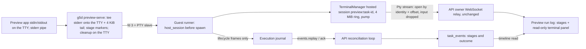

# Preview output over the terminal path; bounded journal reconciliation

Design for the [owner's finding and request](../../chat_intent/preview-status-observation/request.md)
(2026-10-20). Status: the **output stream half is decided by the owner
(2026-10-20 chat) and implemented in this PR** as the PTY-hosted design below;
the reconciliation half stays proposed and is a separate change. The ontology
amendments in the last section are applied with the implementation.

## What went wrong

The preview service framed every stdout line as a module `output` frame
since `d832235b` (2026-10-14, when the app's stdout was taken off the protocol
channel), and every stderr line since the run log shipped (#655,
`g5.preview.run-log`).
The guest runner journals each frame as an execution event; the API's
reconciliation loop (`agent_tasks.rs`) replays each running attempt's journal,
applies each event in its own transaction (one `task_events` row), then sends
one `events.ack` RPC per event, and only after every claimed attempt is drained
does it reach `dispatch_ready_tasks`. There is no bound on events per attempt
per pass. The loop is one task for all organizations.

Live QA: one preview build produced over 8,600 events; a 2,558-event stretch
held the loop 264 s (≈100 ms per event, dominated by the ack round trip through
the host tunnel plus a commit); queued chats in every organization waited.

Two independent defects:

| Defect | Owner | Why it is wrong |
|---|---|---|
| Application output is journaled as task events | preview service, guest runner, `TaskService::apply` | The journal and `task_events` carry **lifecycle facts** with acknowledged-prefix durability ([g5.workspace.module-execution](../../ontology/software_architecture/workspace_vm.g5.md#g5.workspace.module-execution)). A build log is a bounded live stream: it needs no durable row per line, no sequence contract, and is owner-only and incarnation-bound like every other live VM stream ([VM live access, line 88](../../ontology/software_architecture/workspace_vm.g5.md)). Each line also counted against the preview's 8 MiB `max_output_bytes`, so a verbose build can fail its own preview. |
| Reconciliation is unbounded per attempt and dispatch waits behind it | `agent_tasks::run_once` | Nothing in the ontology lets one attempt's backlog delay other workspaces' queued work. This is a scheduler property that no transport change provides: an agent turn journals one event per delta and can backlog the same way. |

## Interim revert (2026-10-20)

At the owner's request the per-line output events were removed first, for
both streams, ahead of this design, and the dialog's run log with them (#677):
the preview service discards the app's stdout, reads its stderr only for the
4 KiB failure tail and mirrors nothing to the guest log (the line splitter
and `output` framing are deleted, not disabled); the dialog shows only the
failure notices it showed before #655; `g5.preview.service.exit-diagnostics`
says so. The baseline this design builds on is therefore *no* application
output producer and *no* log UI. The reconciliation defect is untouched by the
revert and remains part of this design.

## Decision

1. **Preview application output leaves the journal and lives on a hosted
   terminal session in the VM (owner decision, 2026-10-20).** The dispatcher
   opens a PTY pair per preview start and keeps its master as a *hosted
   terminal session* named `preview:<task id>`: the same reader thread, byte
   ring buffer and `replay_from` offset semantics as a browser shell, but no
   shell. The slave is handed to `preview-serve`, which runs the application
   on it as its stdin and stdout and tees the application's stderr onto it;
   the profile's cleanup command and dim stage markers go to the same TTY. The owner views the session live through the
   unchanged terminal path (`/api/v1/workspaces/:id/terminal?terminal_id=preview:<task id>`):
   same WebSocket adapter, same host `Pty` mux stream, same `open`/`opened`
   control lines, same stream admission slot and Stop/transfer cancellation,
   same activity guard. The journal keeps only lifecycle events
   (`invocation.started`, `module.preview.ready`, `invocation.outcome` with the
   4 KiB stderr tail). Nothing of the output is persisted anywhere: it is
   VM-local evidence that dies with the VM.
2. **Journal reconciliation is bounded and dispatch is independent (still
   proposed, not in this PR).** At most `EVENT_BATCH` events per attempt per
   pass, one acknowledgement per batch, and queued-task dispatch on its own
   cadence. Kept below as the second half; do not implement without an
   explicit request.

Both are minimal within existing owners: no new durable lifecycle, no new
table, no new mux channel, no new RPC method, no API or route change. The
one new guest identity is a hosted terminal session kind, and the one wire
addition is a `closed` control line with reason `session_ended`.

## Principle

The journal and `task_events` carry lifecycle facts only. The application's
output is the scrollback of a dispatcher-hosted terminal session: bounded per
session (4 MiB for preview), retained in dispatcher memory until the next
preview replaces it, the VM stops or ownership transfers, and read through
the terminal attachment rules with input dropped and close detaching. Only
the exit diagnostics (status and 4 KiB stderr tail in the outcome) outlive
the VM.

## Owners and interactions

| Owner | Facts | Transitions and obligations |
|---|---|---|
| Terminal manager (`g5d-foundation/terminal`) | Hosted sessions by name, each with its PTY master, ring buffer (capacity per session), attachment generation, *alive/ended* state | `host_session(name, capacity)` opens a PTY pair, starts the reader thread and a pump that drains it into the ring whether or not a viewer is attached (an unwatched app must never block on its log), discards a same-named previous session first, and returns the slave to the caller. Alive while any slave holder exists; the master's EOF marks it *ended but retained*. Hosted sessions live in their own registry: they do not count toward `max_sessions`, never become `last_active_id`, and are absent from `list_sessions`/`get_session_info` (the agent's run-in-terminal enumeration). `attach_hosted(name, offset)` snapshots `replay_from` at the ring boundary exactly as a shell does and supersedes the previous viewer generation. Manager shutdown (workspace stop, fork interrupt) and ownership transfer discard hosted sessions. |
| Guest runner (`modules/runner.rs`) | Which module gets a TTY | For a catalog module whose requested capabilities include `preview.service`, call `host_session("preview:<task id>", 4 MiB)` before spawning, pass the slave as fd 3 with `G5_APP_TTY_FD=3`, close the runner's copy after spawn. Without a terminal manager wired (unit fixtures) or if the PTY cannot be opened, spawn as today: the degraded mode is today's behavior, never a lost preview. Application bytes on the TTY count against no module limit. |
| Preview service (`g5d preview-serve`) | The app's streams, the stderr tail, exit diagnostics, stage markers | With `G5_APP_TTY_FD`: app stdin/stdout = the TTY, in its own process group as today and deliberately not as the controlling terminal (see the amendment below). stderr stays a pipe teed onto the TTY and into `StderrTail`, so the failure outcome is unchanged. Dim markers written only to the TTY: `── waiting for port N ──`, `── port N listening ──`, `── close requested, stopping application ──`, `── running cleanup: <command> ──`, `── closed ──`, `── application exited with status N ──`. The cleanup command runs on the same TTY. The descriptor stays open until exit so Close streams into the same session. No `output` frame is ever emitted. Without the env var, today's behavior (stdout null, stderr tail only). Module stdout stays the protocol channel and module stderr the module's bounded log; the application touches neither. |
| Dispatcher PTY server (`serve_pty`, `open_pty`, `relay_pty`) | Session kind of the attachment | An `open` whose `terminal_id` is in the `preview:` namespace attaches only to an existing hosted session; otherwise the existing `rejected`. An interactive `open` can never create one (shell identities are UUIDs; the namespace is checked first). Rules keyed on the kind, never the client: hosted drops `input`, applies `resize`, treats `close` as detach. Attaching to an ended session answers `opened` with the retained tail, then sends one `closed` control line with reason `session_ended` and closes the stream; a live session that ends under a viewer does the same after the last bytes. A viewer that falls more than the ring behind is closed; it reconnects with its offset and gets the normal `reset`. Attachment generations as for a shell: a second viewer supersedes the first. |
| Wire protocol (`g5-contracts/terminal.rs`) | Control lines | New guest control line `{"type":"closed","reason":"session_ended"}`, sent as its own mux frame after output; the adapter forwards one mux frame as one WebSocket message, so the browser recognizes a whole message that parses as this line. Shell streams never send it (they close as today). |
| Transport, API, host | — | Unchanged. `terminal_ws_adapter`, `open_owner_stream(Pty)`, the host `Pty` channel and the relay loop carry a `preview:` id as any other. The adapter still sends the owner's terminal secrets; a hosted session ignores them. The adapter's activity guard applies unchanged: only nonempty input renews owner activity and a hosted session drops input, so watching the log by itself never renews activity (settled assumption, amended 2026-10-27 below). |
| Run log dialog (`PreviewRunLog`, `PreviewControl`) | Stages, outcome, the live view | Stage strip (Queued, Starting, Building, Serving, Closing, Closed/Failed) from the preview view and the task's lifecycle timeline entries; below it the embedded read-only terminal panel attached to `preview:<task id>`. Live states follow the output; a clean close shows the launcher only with **no link to the last run's log** (owner decision); a failure while the VM runs shows Failed, the ended session's retained output, then the notice with exit status and the stderr tail; a refused attach or a stopped VM shows stages and the one-line notice ("Output is not retained after the VM stops." once the VM is gone) with no terminal; only an ended run with a failure outcome also shows that outcome's stderr tail. On a live run a refusal is retried on a 2.5 s cadence (bounded, 24 attempts): the log can open while the task is still queued, before the guest has hosted the session (found by the first E2E run). |
| Terminal panel (`WorkspaceTerminalPanel`, `useWorkspaceTerminalSocket`) | Attachment state, offset | Props `terminalId` (attach by name instead of opening a shell) and `readOnly` (no stdin; close detaches). `reset: true` clears, redraws the retained tail and shows a faint "earlier output is beyond the retained window" line; `closed`/`session_ended` stops reconnecting and shows "session ended · retained". Follow-scroll until the user scrolls up; a button restores it. Header: session name, read-only badge, attachment state, "X of 4 MiB retained". A fresh mount attaches without an offset and receives the whole retained tail (as a shell on reload); within a mount reconnects resume at the in-memory offset. |

### Capacity and limits

| Limit | Value | Consequence beyond it |
|---|---|---|
| Hosted session capacity | 4 MiB per preview session (`G5D_PREVIEW_OUTPUT_RETAIN_BYTES`, bounded 64 KiB–64 MiB); shells keep their defaults | A viewer attaching late, or reconnecting after more than 4 MiB passed, gets `reset` and the retained tail with the "earlier output" marker. |
| Hosted sessions per VM | 1 (the current or last preview; the next start replaces it) | Preview exclusivity ([g5.vm.preview-exclusive](../../ontology/software_architecture/workspace_vm.g5.md#g5.vm.preview-exclusive)) makes this a derived bound. |
| Live streams per VM | `MAX_LIVE_STREAMS` (256, unchanged) | Shared with terminals and preview HTTP. |
| Viewer lag | the ring capacity | The stream is closed; the browser reconnects at its offset and receives `reset`. |

### Settled assumptions (owner, 2026-10-20; not to be re-asked)

- Watching the run log is governed by the same activity guard as an open
  terminal (same data stream and adapter). Amended 2026-10-27 (agent): the
  earlier wording "counts as owner activity for idle stop" assumed a heartbeat
  renewal the adapter does not perform; `g5.lifecycle.idle` renews terminal
  activity only on nonempty input, never on presence, output or ping/pong, and a
  hosted session drops input. A quiet viewer therefore does not keep the VM
  running; making it do so would be an idle-rule change for the owner to decide.
- A failed run's output is viewable only while the VM that ran it is running;
  after Stop, stages plus the 4 KiB stderr tail only.
- The application now runs on a real TTY; tools that behave differently on a
  TTY do so (colour, progress redraws, interactive prompts waiting on a stdin
  that never answers).
- One viewer at a time; a second attachment supersedes the first.
- Deploy order degrades to today, never to a lost preview: an older dispatcher
  refuses the attach as not found and the browser falls back to the
  diagnostics view; an older `preview-serve` without `G5_APP_TTY_FD` keeps
  today's behavior; a newer `preview-serve` under an older dispatcher sees no
  env var and does the same.

### Implementation decisions beyond the owner's prompt

- **Session-end signal on the wire.** The design asked for a `session_ended`
  close reason in `g5-contracts`. The terminal stream carries raw bytes after
  `opened`, so the reason is one in-band `closed` control line sent as its own
  mux frame; the browser's hosted-mode viewer recognizes a whole WebSocket
  message that parses as it. Shell streams are untouched. A forged line can
  come only from the owner's own application and only stops the owner's own
  viewer from reconnecting.
- **Unwatched output never blocks the application.** The hosted session pumps
  the PTY reader into the ring continuously; viewers read from the ring by
  cursor and are woken by a watch on the write offset. (A shell's reader is
  consumed only by its attachment, which is fine for a shell that is closed
  after its reattach grace, but would stall an unwatched build.)
- **Runner access to the terminal manager.** `ModuleRuntime` gets a
  `terminal_host` (`set_terminal_host`) the server installs beside the
  existing observer; unit fixtures without it spawn as today.
- **No controlling terminal (amendment, 2026-10-21).** The owner's prompt
  asked for `setsid` and the PTY as the controlling terminal. Implemented that
  way, the first CI runs showed the Close path losing the application's
  shutdown output every time: the customer's shell is the session leader,
  Close SIGTERMs the group, the shell exits first, and the kernel then
  SIGHUPs the foreground group of its controlling terminal, killing the
  server before its SIGTERM handler could run. That would silently change
  Close semantics (graceful shutdown hooks, `docker compose down` in traps)
  for every preview. The application therefore receives the PTY as stdin and
  stdout only, keeps its own process group as before, and `isatty(1)` still
  holds; only `/dev/tty` is unavailable to it, which a server has no use for.
- **Retained-bytes header.** The browser counts the bytes it received since
  the last `opened`/`reset`; from a fresh attach that equals the retained
  window, so "X of 4 MiB retained" reads from the viewer's own count.
- **Dialog width.** The dialog widens while the log is open so the terminal
  panel has usable columns; the launcher and state block are unchanged.

## Alternatives compared

| Candidate | Why not |
|---|---|
| **No-PTY output session** (the earlier variant of this plan): `preview-serve` keeps the app on pipes, restores the tagged line splitter and `output` frames, the runner routes those frames into a read-only in-memory session instead of the journal | Rejected by the owner (2026-10-20) in favour of a real TTY: it restores the whole per-line producer and a runner routing rule to re-create what a PTY gives for free (ordering, backpressure, resize, the cleanup command's output), keeps stderr and stdout as separate tagged pieces that the terminal view then re-merges, and still charges each piece through the module stdout reader. The PTY merges the streams in order as a terminal would and lets the application behave as it does in a developer's terminal. Kept here as the recorded rejected alternative. |
| Scheduler fix only; keep output in the journal | Still one durable row and one apply per line. At 128 events per 2 s pass, an 8,600-line build is shown 135 s behind reality and the log never catches up while the build keeps printing; the output budget can still fail the preview. |
| Push the guest's live `module.event` notifications to the API | The API consumes none today; adding it still lands one row per line under the same watermark authority, so it moves the cost rather than removing it. |
| Serve output through `modules.logs` (existing cursor RPC) | A diagnostics surface readable under support grants, 256 KiB retention, poll-only through the facade. It duplicates what the terminal stream already does for the owner. |
| Run the app inside a regular interactive shell session | Exposes input and shell authority, counts against `max_sessions`, and would be enumerated by the agent's terminal tool; the hosted kind is read-only and separate ([g5.terminal.separation](../../ontology/features/terminal.g5.md#g5.terminal.separation)). |
| Persist the retained tail (file or `task_events`) when the preview settles | Rejected by the owner: nothing of the output is persisted; the 4 KiB stderr tail in the outcome is the only durable diagnostic. |

## Acceptance conditions (output stream half)

- A preview whose app prints thousands of lines starts, reaches ready, and its
  journal holds only lifecycle events; `task_events` for the task has no
  `module.output` rows.
- `preview:<task>` attaches live and receives bytes written after it opened; a
  stale offset gets `reset`; a late attach after exit gets the retained tail
  and `closed`/`session_ended`; a second preview start replaces the session;
  an interactive `open` cannot create a `preview:` session.
- Input is dropped, resize is applied, close detaches without ending the
  session; hosted sessions are excluded from `max_sessions`, `last_active_id`
  and enumeration.
- With `G5_APP_TTY_FD` the app's stdin/stdout are the TTY, stderr is teed and
  the tail unchanged, the cleanup command runs on the same TTY, the stage
  markers appear in order on the TTY and never on the protocol channel, no
  `output` frame is emitted; without the env var today's behavior holds.
- The existing terminal route carries a `preview:` id unchanged.
- Frontend: panel `terminalId`/`readOnly`, `reset` and `session_ended`
  handling; `PreviewRunLog` stages plus embedded panel; the diagnostics-only
  fallback; `PreviewControl` log toggle and View log.
- E2E in the real stack: start a preview whose command prints a large log;
  open the run log while it builds and see lines arrive live; reload and see
  the tail resume; close the preview and see the shutdown and cleanup output;
  the journal reconciliation for that task applied only lifecycle events;
  during the build a chat in another workspace dispatches within the normal
  tick.
- Existing terminal tests (`TerminalOwnership`, `TerminalReplay` cases,
  `dispatch.rs` PTY cases) and dispatcher-journal tests pass unchanged.

## Second half (proposed, separate change): bounded reconciliation

| Owner | Facts | Transitions and obligations |
|---|---|---|
| API reconciliation (`agent_tasks.rs`) | Per-attempt watermark | Request `events.replay` with `limit = EVENT_BATCH` (new optional parameter; old dispatchers ignore it and the loop truncates). Apply events in their own transactions as today (deterministic projection errors still consume their sequence; a poison event still fails only itself), acknowledge **once per batch** with the last committed sequence and once more at the terminal event. An attempt with more backlog is left for the next pass; `last_reconciled_at` ordering puts it behind the others. |
| API dispatch | Reservations | `dispatch_ready_tasks` and `reconcile_native_requests` move to their own interval task with the same 2 s cadence; they never wait for reconciliation. Both sides already serialize through row locks (`FOR UPDATE SKIP LOCKED`, `lock_attempt`), so concurrent passes are safe. |

Why the acknowledgement can be batched: the API watermark
(`task_attempts.acked_event_seq`) is the authority; the guest's `events.ack` is
a prune hint clamped to existing events, and replay always starts from the API
watermark with duplicates skipped by sequence. An acknowledgement that arrives
later, or never, costs retained journal bytes, never correctness.

Limits: `EVENT_BATCH = 128` events per attempt per pass (≈64 events/s at the
2 s cadence; that attempt's transcript lags, nobody else does);
`RECONCILE_BATCH = 32` attempts per pass with organization fair share
(unchanged). Acceptance: an attempt with 10,000 journaled events is applied at
`EVENT_BATCH` per pass with one `events.ack` per pass; a crash after a commit
and before the ack replays without duplicate timeline rows; while a chatty
attempt backlogs, a chat queued in another organization starts within one
dispatch cadence. Ontology: new `g5.chat.journal.reconciliation` [D] in
`chat.g5.md` after [g5.chat.journal](../../ontology/features/chat.g5.md#g5.chat.journal).
Rejected there: batching all events of a pass in one transaction (a poison
event would hide the committed-today events before it).

## Ontology amendments (applied with this PR)

| Block | Change |
|---|---|
| New [g5.preview.output.live-tail](../../ontology/software_architecture/workspace_vm.g5.md#g5.preview.output.live-tail) [D], under "Preview diagnostics" | Output is VM-local evidence on a dispatcher-hosted terminal session; bounded per session; retained until the next preview or VM end; read through the unchanged terminal transport and attachment rules with input dropped and close detaching; the API persists none of it; only the exit diagnostics outlive the VM. |
| [g5.preview.service.exit-diagnostics](../../ontology/software_architecture/workspace_vm.g5.md#g5.preview.service.exit-diagnostics) | Application streams go to the hosted session, never to events; the tail stays outcome-only (no guest-log mirror). |
| Re-added [g5.preview.run-log](../../ontology/features/ui.g5.md#g5.preview.run-log) [D] in `ui.g5.md`, with [g5.preview.run-log.attach](../../ontology/features/ui.g5.md#g5.preview.run-log.attach) and [g5.preview.run-log.ended](../../ontology/features/ui.g5.md#g5.preview.run-log.ended) | The stages-plus-terminal dialog above; the bounded attach retry and the diagnostics-only fallback (session-unavailable vs stopped-VM notice); the ended-run rules including the no-last-run-link decision. |
| [g5.terminal.separation](../../ontology/features/terminal.g5.md#g5.terminal.separation) metadata | The hosted session reuses attachment and replay without granting shell or process-control authority. |
| `g5.chat.journal.reconciliation` | Deferred with the second half. |

Metadata for each: provenance (owner chat 2026-10-20), source links,
implementation and test pointers.

## Self-review

- Request: the owner's design is implemented as written; terminal mechanisms
  are reused at the transport, protocol, authority and reattachment levels;
  the no-PTY variant is recorded as rejected; the reconciliation half is kept
  separate and unimplemented.
- Guarantees relied on: `replay_from` offset/reset semantics (shared ring
  buffer code, checked by `TerminalReplay` and the ring tests); attachment
  generations (`TerminalOwnership`); `open_owner_stream` owner and running-VM
  checks and the adapter's activity renewal (unchanged); the mux delivering
  one `send` as whole frames in order (`MAX_FRAME_PAYLOAD` chunking only
  splits payloads larger than 16 KiB, never the small `closed` line); the
  `preview.service` capability being requested only by `workspace.preview`
  in the pinned catalog.
- Unmodeled obligations: the hosted session is memory in the guest; a guest
  restart within the incarnation loses it (the preview is settled as
  `interrupted` then, and the log shows the outcome). A viewer slower than
  the ring is closed rather than stalling the pump. A `closed` line forged by
  the application affects only the owner's own viewer.
- Mixed versions: an old dispatcher rejects a `preview:` open as not found
  (the browser shows the diagnostics-only view); an old API against a new
  guest changes nothing on its side; an old or new `preview-serve` without
  the env var keeps today's behavior.
- Scope not taken: live `module.event` push to the API, batching commits,
  non-owner access to live output, retention of build output after the VM
  stops, a link to a cleanly closed run's retained log.

## Codex review of the interim revert (PR #677, 2026-10-20)

Independent review (gpt-6-astra, xhigh) of the consolidated revert: #675's guest
change plus the frontend run-log removal that keeps the lit trigger.

- **Round 1, REQUEST_CHANGES, no code findings.** P2: the exit-diagnostics block
  still promised the stderr tail "in both the task outcome and guest diagnostic"
  while the revert and its dispatcher test assert nothing of the app reaches
  `modules.logs`; the first paragraph now says the outcome is the only place the
  tail exists during the revert. P3: this plan called the splitter, `output`
  framing and stderr mirror "unchanged"/"stays" although the revert deletes
  them; the "Interim revert" section, the preview-service owner row and the
  exit-diagnostics amendment row now state the reverted baseline and that the
  producer, dialog and block must be restored, with the mirror a separate
  decision. Codex confirmed no per-line journaling path for preview tasks
  remains and no runtime regression in `preview_serve.rs`.
- **Round 2, APPROVE.** Both repairs verified against the code; no findings.
  Codex ran `tsc`, affected-file ESLint and ontology link/metadata checks; the
  Rust and Vitest suites were run by the author (see the PR description).

## Deep review of the PTY-hosted implementation (PR #693, 2026-10-21)

Native deep review (ontology-review skill) of the implementation against the
request, this plan and the governing blocks, with the affected boundaries
exercised rather than reasoned about.

- **Conformance.** Every owner decision in the request is implemented as
  written: hosted session kind, runner fd 3 + `G5_APP_TTY_FD`, preview-serve
  TTY mode with the six stage markers and cleanup on the same TTY, relay rules
  keyed on the session kind, `session_ended` on the wire, no transport or API
  change, the run log with the no-last-run-link rule, the diagnostics-only
  fallback, and the ontology blocks. The reconciliation half is untouched.
- **Guarantees checked in code.** `replay_from` and the ring are the shell's
  own code (shared `ByteRingBuffer`); the hosted reader drains the master
  continuously, so an unwatched application never blocks on its log (a shell's
  reader is consumed only by its attachment, which is why the hosted kind
  cannot reuse `TerminalSession` wholesale); `end()`/drop wake the reader so a
  discarded session closes its PTY promptly; the slave is opened by device
  name before portable-pty's handle is dropped, so the master never sees a
  hangup between holders; the application keeps its process group and no
  controlling terminal, so Close's SIGTERM semantics are unchanged; fd 3 is dup2'd without close-on-exec in the
  child and re-marked close-on-exec in preview-serve so the application sees
  the terminal only as its standard streams; the `closed` line is one mux
  frame (far under `MAX_FRAME_PAYLOAD`), which the adapter forwards as one
  WebSocket message.
- **Findings fixed during review.** (1) The viewer's "X of 4 MiB retained"
  reset to zero on every reattach, including a resume at its own offset that
  keeps the screen; it now resets only on a redraw. (2) The Playwright case
  selected the noisy profile by a label regex Playwright does not accept; it
  selects by option value and waits for the workspace to load after the
  reload. (3) A `react-hooks` rule flagged `setState` in an effect and a ref
  read in a callback in the new frontend code; both were restructured.
- **Evidence.** `g5d-foundation` terminal unit tests (50, incl. 6 hosted),
  `preview_serve` unit tests (26, incl. 3 TTY-mode), `dispatch_modules`
  86/87 (the one failure, `formal_review::…`, asserts prebuilt fake-provider
  binaries that this VM lacks; unrelated), `dispatch.rs` 34/34, `terminal_pty`
  19/19, library suites of `g5-contracts`, `g5d-foundation`, `g5d-dispatch`
  all green; `cargo fmt` and `cargo clippy -D warnings` clean on the changed
  crates. Vitest 68/68 across the preview and execution suites; `tsc`, ESLint
  and Prettier clean. The API relay test
  (`api_workspace_vms::owner_terminal_relays_a_hosted_preview_identity_unchanged`)
  exercises the real WebSocket → facade → host mux boundary against Postgres
  and passes, as do the pre-existing API terminal cases. The Playwright
  run-log case cannot run in this VM (no browser stack); it runs in
  `g5-ci-e2e`.
- **Not applicable / gaps.** No Verus setup exists in the repository, so no
  production-code proof was attempted. The retained output is dispatcher
  memory and is lost with a dispatcher restart inside the incarnation
  (recorded on the block). A `closed` line forged by the application only
  stops the owner's own viewer from reconnecting.

## Codex review of the PTY-hosted implementation (PR #693)

The requested independent Codex loop (`codex exec -m gpt-6-astra -c
model_reasoning_effort="xhigh" -s read-only --skip-git-repo-check -o report.md
- < prompt.md`, helper and prompt in the job tmp dir `/tmp/g5-review/`) could
not run in this VM: the workspace exports no OpenAI credential (only
`CLAUDE_CODE_OAUTH_TOKEN` and the Cloud Build reader key), `CODEX_HOME` has no
`auth.json`, and the CLI answers `401 Unauthorized` from
`api.openai.com`. Rounds are recorded here once a credentialed run is possible.
