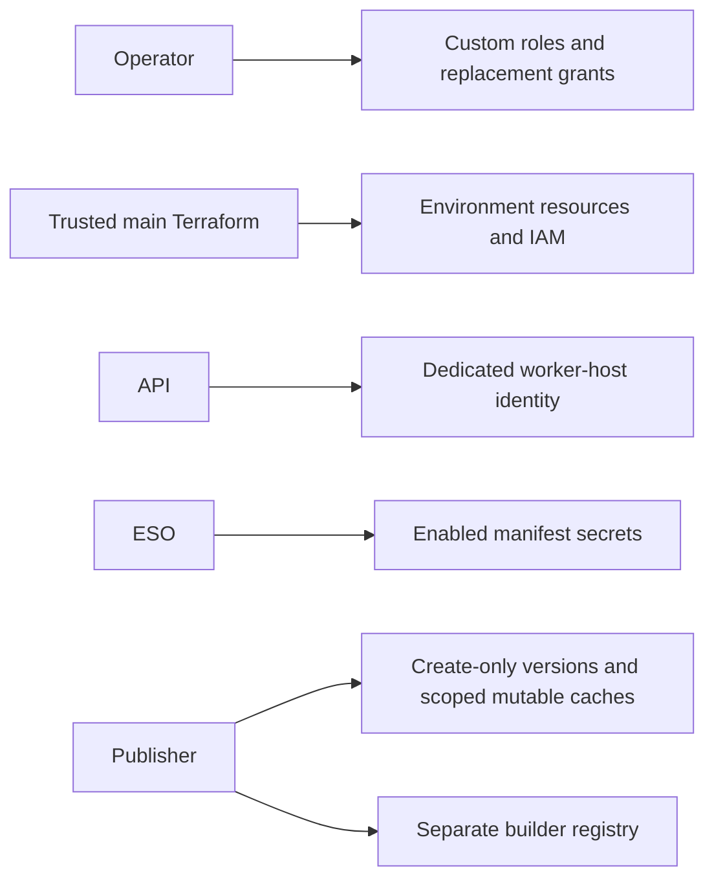
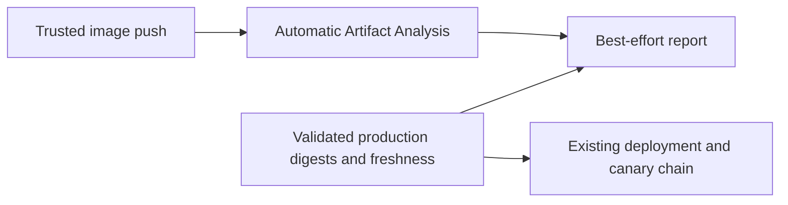
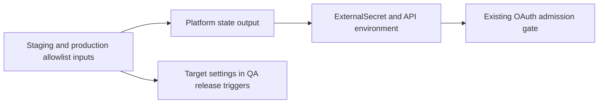
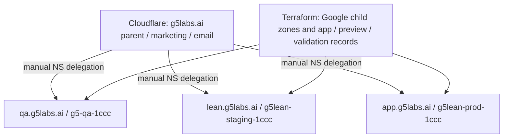
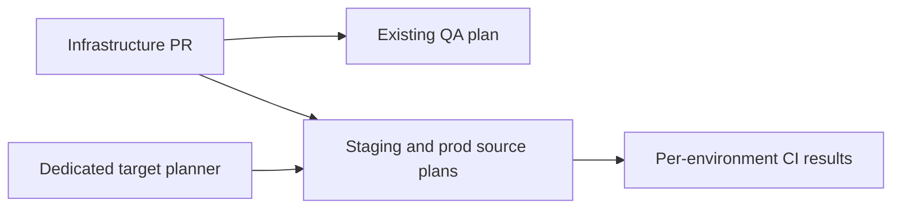
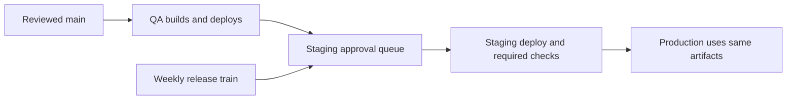

# Production pipeline implementation

This is the implementation record for the English Production Pipeline
Implementation Plan reviewed in this conversation. Continue this record for code
discoveries and evidence; do not create a competing release design.

**Option B is implemented across the stack:** #703 preserves QA and restores
shared child-zone record management; #707 adds target zones, permissions and
delegation outputs. #706 retains the release pipeline and inherits #703. Local
checks do not establish live delegation or environment acceptance. No merge,
cloud apply or live DNS change is authorized here.

## Ontology changes and governance

### Consolidated IAM audit — 2026-10-26

Comparison base: current main `4edb068a56baa2f3ed970b0dab056382bf925968`;
the prior two #735 commits are rebased while preserving main's admission,
bootstrap compatibility and Terraform freshness decisions. The owner authorizes
implementation of audited #739–#745 fixes in #735, without merge or cloud apply.
Earlier audit/live status paragraphs below are dated historical evidence.

Actual ontology delta in `features/operations.g5.md`: extend `sensitive-storage`
with explicit public-access prevention; add `runtime-iam`, `secret-authority`
and `terraform-authority`; extend `artifact-authority` for named host consumers,
create-only versioned artifacts and separate builder publication. Each paired
metadata entry distinguishes code design from unexecuted live acceptance.

| Governing commitment | Outcome and limit |
| --- | --- |
| [Runtime IAM](../../ontology/features/operations.g5.md#g5.quality.delivery.runtime-iam) | Dedicated host SA, exact provisioning permissions and supported resource prefixes; preserve node pulls; project-level network authority remains explicit |
| [Secrets](../../ontology/features/operations.g5.md#g5.quality.delivery.secret-authority) | ESO enabled-manifest allowlist, no direct API GSM reads, obsolete PAT retirement |
| [Terraform](../../ontology/features/operations.g5.md#g5.quality.delivery.terraform-authority) | Payload-free management role, four DB refresh reads and named attachment grants; trusted IAM administrator remains privileged |
| [Artifacts](../../ontology/features/operations.g5.md#g5.quality.delivery.artifact-authority) | Version creation only; explicit pointer/ISO exceptions; dedicated builder repository and exact environment readers |
| [Storage](../../ontology/features/operations.g5.md#g5.quality.delivery.sensitive-storage) | Preserve explicit workload/state reads; enforce PAP and uniform bucket access |
| Existing production/freshness/impact/DNS commitments below | Retain pipeline order, destructive-plan guard and PR separation; prominent QA rollout warning; no DNS changes |

Minimal implementation: two bootstrap-owned runtime Compute roles separate typed
instance/disk/firewall conditions from project-only supporting permissions; explicit
host-SA configuration connects Terraform, Helm and both backend VM insertion paths.
Retain GKE node image readers and API cross-project image access. Use bucket-scoped
objectAdmin/bucketViewer instead of runtime storage.admin for compatibility.
Derive ESO grants from plan-known native manifest-reference locals. Remove the
unused PAT from desired inventory, preserving the deletion guard. Split QA image
bucket writes into version creation/read and latest/ISO mutation; move only the
bootstrap-builder publication to `g5-builders`.

Upload-client compatibility amendment: the existing `gcloud storage cp` and
`gsutil cp` discover destination folders through bucket-level `storage.objects.list`.
Object-prefix conditions cannot authorize that request. Define a dedicated
list-only custom role in operator-owned QA bootstrap and admin artifacts, then
bind it only to the QA worker publisher on its worker bucket and the admin worker
and application publishers on their respective artifact buckets. This intentionally
reveals object names and listing metadata across each destination bucket; it adds
no payload reads, writes, deletion or bucket administration. Retain the existing
prefix grants, upload commands, resumable behavior and create-only retry checks.
Install the QA role before foundation. See Google's [gcloud permissions](https://docs.cloud.google.com/storage/docs/access-control/iam-gcloud),
[gsutil permissions](https://docs.cloud.google.com/storage/docs/access-control/iam-gsutil)
and [bucket-level listing rules](https://docs.cloud.google.com/storage/docs/access-control/iam#conditions).

For #745, replace both broad Secret Manager roles, preserve exact DB refresh reads,
and grant actAs only on attached accounts. Do not add a cosmetic per-root split:
an orchestrator able to assume every runner and a delivery writer able to run the
privileged release account would retain escalation. A meaningful root/deny-policy
boundary requires a different authority architecture; it remains an explicit
unresolved portion of #745 rather than a claimed fix. Likewise #740 cannot be
fully closed as network isolation while networks.updatePolicy/subnetworks.use
remain project-scoped. No unsupported network-name conditions are added.

Acceptance: exact provider-mocked grants and negative identity cases; backend
request and Helm configuration checks; ESO sync combinations; storage publication
retries; existing release/planner/freshness regressions; actual Claude Code review.
Live permission checks, image publication, secret sync, first host Start/cache/
telemetry/deletion and forbidden-resource operations require later authorized
application. Current read-only policies distinguish deployed exposure from code.

Before merge, pause QA main deploy/image/infra-apply triggers in a maintenance
window, leaving PR checks active. Merging otherwise deploys the selecting API
while Terraform can stop at its deletion guard. Delivery applies re-enable these
triggers: defer that apply until prerequisites exist, or preserve a separate
verified merge/build-submission freeze across it and restore the pause afterward.
Rollout must install named actAs and four DB reads before removing broad QA
runner grants. Provision host identity/readers before deploying the selecting API,
then remove default-host actAs after verifying new hosts. Existing hosts keep
their old identity until rotation. Keep the existing QA default-Compute cache
reader at its original Terraform address and add the dedicated host reader
separately; retire the old cache grant only in a later post-rotation change.
Install replacement API object/metadata grants before removing its storage-admin
grant and verify IAM propagation.
A normal uncoordinated infrastructure-first
apply can interrupt provisioning; use reviewed staged plans or a maintenance
window, retaining the destructive-plan guard. Do not change DNS resources or IAM.

Runtime review evidence: the image resolver supports family refs, so its support
role includes `compute.images.getFromFamily`, the permission required by Google's
[family lookup API](https://docs.cloud.google.com/compute/docs/reference/rest/v1/images/getFromFamily).
Normal instance deletion uses `autoDelete` disks; the
[instance delete API](https://docs.cloud.google.com/compute/docs/reference/rest/v1/instances/delete)
requires `compute.instances.delete`. Google's [deletion guide](https://docs.cloud.google.com/compute/docs/instances/deleting-instance)
requires `compute.disks.delete` specifically for forced deletion of preserved
attached disks, which this runtime does not request. Do not add that authority
without a corresponding runtime operation. These are documentation and source
checks, not deployed permission acceptance.

Review challenge: prefix conditions do not select the network of a newly created
VM/firewall; builtin secretmanager.admin includes payload access; database version
refresh consumes payloads; `iso/` as well as latest.json is mutable; the default
Compute identity remains a GKE consumer. These exceptions are part of the design.

CI/review follow-up: constrain the standalone ESO module to the same Helm v2
range as its existing callers, because unconstrained test initialization selected
incompatible v3. Preserve the QA supersession predicate and check it before every
root, each changed apply and immediately before downstream release submission.
Any newer same-trigger build still supersedes stale work, even if it failed or was
cancelled; a successful skip does not establish successful takeover. An in-flight
apply is not interrupted, and recovery proceeds by fixing/rerunning current main.
These corrections enforce existing compatibility/freshness intent; they add no
IAM permission, retry queue, DNS change or live operation.

E2E follow-up (2026-10-27): repair preview Close within the existing
[`g5.preview.output.live-tail`](../../ontology/software_architecture/workspace_vm.g5.md#g5previewoutputlive-tail)
contract. Reaping the command shell must not cut short its descendants' SIGTERM
handlers. Preserve the remaining original process-group grace, return promptly
when no live members remain, and keep lifecycle stops at zero grace. Retain the
existing final kill, cleanup bounds, hosted PTY and strict single-pass E2E receipt.
This is a runtime bug exposed by CI, independent of the IAM reductions. It changes
preview shutdown when the resulting binary is deployed; no live QA or DNS change
is part of this repair.

Release comparison base: PR #703; implementation began at Lean main
`4059d1596`. The DNS module and its tests are inherited from that separate PR.
The actual diff in `features/operations.g5.md` adds production promotion,
environment isolation/activation, per-environment PR plans and DNS review commitments. Existing workload
template and QA forward-only deployment contracts continue to govern.

| Governing block | Implementation obligation |
| --- | --- |
| [Release flow](../../ontology/features/operations.g5.md#g5.quality.delivery.production) | QA builds once, staging approval/checks, prod automatically follows; infrastructure before application |
| [PR plans](../../ontology/features/operations.g5.md#g5.quality.delivery.pr-plans) | Separate target PR checks, dedicated planner with state reads/lock-only writes, no apply or promotion; state secrets and non-refresh behavior remain explicit |
| [Isolation and activation](../../ontology/features/operations.g5.md#g5.quality.delivery.environments) | Independent data/secrets/state; scoped artifact access; PR CI cannot deploy or approve; promotion requires setup, weekly preference enabled |
| [Admin artifact authority](../../ontology/features/operations.g5.md#g5.quality.delivery.artifact-authority) | Trusted publishers write; central release/runtime consumers read; a separate infrastructure identity manages admin; deployment state/locks stay target-local |
| [DNS ownership](../../ontology/features/operations.g5.md#g5.quality.delivery.dns) | Cloudflare parent, delegated Google QA/staging/prod child zones; no Cloudflare API integration |
| [DNS review/cutover](../../ontology/features/operations.g5.md#g5.quality.delivery.dns-review) | Two human reviews for DNS changes; no implicit customer URL switch |
| [DNS resources](../../ontology/features/operations.g5.md#g5.quality.delivery.external-dns) | Preserve QA zone/records/permissions/IP/TLS; target platform owns new zones and shared networking records |
| [QA/DNS impact notices](../../ontology/features/operations.g5.md#g5.quality.delivery.impact-notice) | Prominent advance notice of affected behavior, risk and activation point, including indirect effects; distinguish drafts from live changes |
| [Forward recovery](../../ontology/features/operations.g5.md#g5.quality.delivery.qa-forward-only) | Preserve readiness waits and forward recovery rather than restoring old images against changed schemas |
| [QA Terraform freshness](../../ontology/features/operations.g5.md#g5.quality.delivery.qa-terraform-freshness) | Confirmed supersession skips remaining root work and release publication successfully; errors still fail |
| [Backup recovery](../../ontology/features/operations.g5.md#g5.quality.delivery.backups) | Reuse existing G5 Cloud SQL backups/PITR; no additional backup or monitoring automation |
| [Workload templates](../../ontology/features/operations.g5.md#g5.scope.deployment.workload_templates) | Reuse the current Cloud Hypervisor packaging and immutable runtime templates |

DNS amendment comparison: #703 `7634c906`, #706 `be16c332`, #707 `ae92915b`.
The actual ontology diff changes `dns` from manual parent A/CNAME ownership to
delegated children; `external-dns` from QA retirement to preserved QA and
target-platform ownership; and splits unchanged review/hostname/cutover rules
into `dns-review`. Paired metadata records the owner's selection, historical
cleanup lineage, implementation coverage and unexecuted live acceptance. Other
release, PR-plan and isolation commitments remain unchanged.

### Container image CVE reporting amendment — 2026-10-27

Comparison base: Lean main `5dd487838379c2299bddbdba12e0d2fff25d4984`.
Rebased on `fc0522ae63b111c7ba192563cee3bc52d7d6b71f`: its independent browser
CI capacity amendment is preserved; it does not change the report-only contract.
The [approved request](../../chat_intent/production-pipeline/request.md#container-image-cve-reporting--2026-10-27)
adds one intent block, `g5.quality.delivery.image-cve-reporting`, with paired
provenance and implementation evidence. The existing artifact-authority,
production release-flow and QA impact-notice blocks remain governing; no existing
gate is removed and no DNS contract changes.

Enable Container Scanning and Container Analysis APIs in QA/admin bootstrap.
Automatic scanning covers new Docker pushes in both artifact-owner projects;
it does not backfill all existing digests. This deliberately includes shared QA
CI/cache images and adds scanning cost. Keep existing repository settings and
provider version; operators must verify each relevant repository is enabled
before activation. Grant the central release account only
`roles/containeranalysis.occurrences.viewer` in QA delivery/admin artifacts,
alongside its existing repository reads. The role is project-wide metadata read,
not per-image access; no scanning administration or occurrence writes are added.

Rollout reconciliation with pending #735: retain its ordered additive-before-removal
IAM transition, maintenance pause, in-flight-build exclusion and delivery-trigger
freeze. A full bootstrap-first activation is safe only without that transition in
source/live state or after it is verified complete. Scan APIs and occurrence reads
fit the existing additive/coordinated phases; no new release flag or IAM framework
is needed. Use current reviewed source preserving both changes and fresh candidates
with the transitioned consumers, never an older checkout/bundle. If target IAM
transitions are pending, qualify reporting within #735's ordered staging-to-prod
rollout or after completion; a standalone promotion must not bypass that transition.
The production runbook links the reviewed #735 procedure even when #890 lands first.

After `check-main-freshness`, a production-only report step reads the existing
`image-refs.env` and honors `SKIP_DEPLOY`. It queries each supplied API, edge and
g5d runtime digest once, with bounded timeouts; no polling or new scan jobs.
It runs alongside the deployment, with `allowFailure: true` and no dependency
from Helm or promotion. Counts and HIGH/CRITICAL findings, exact digest and console
link appear in build logs. Missing, pending, unsupported, stale/inactive, malformed
or failed reports remain visibly incomplete; findings never produce a CVE gate.
The existing release candidate pins the pipeline, so old candidates do not gain
this step until a candidate containing this change is built and promoted.

Acceptance: provider-mocked plans verify API scope and read-only grants; run the
actual YAML report shell with fake CLI responses for production, nonproduction,
supersession, severe findings, pending/missing/error results and immutable refs.
Assert no gate is introduced into the deployment DAG. Test discovery parsing
against the installed Google SDK response structure. Live acceptance follows
reviewed Terraform applies: inspect repository scan enablement, push a new image,
confirm discovery and findings, then verify a promoted candidate logs the report
without changing release/canary behavior. These live operations are not authorized
by this code task. Scans do not cover the GCE worker boot disk or replace existing
Rust/npm dependency checks. Reports are observations, not a security certification.

### QA Terraform supersession amendment — 2026-10-23

Comparison base: `4fce7b8d3`. The [owner's request](../../chat_intent/production-pipeline/request.md#superseded-qa-terraform-builds--2026-10-23)
adds `g5.quality.delivery.qa-terraform-freshness`; this is the only ontology
contract change. Retain the QA same-trigger/newer-build predicate and its checks
before root processing and immediately before apply. Reuse the deploy pipeline's
shared control-file pattern: confirmed supersession writes a skip decision and
ends `tf-roots` successfully; `publish-terraform-release` reads that decision and
skips before publication. Missing or invalid required control data fails closed.
No retry, queue or new freshness protocol is added.

The observable change is QA Terraform build status: expected supersession becomes
success rather than failure. Roots already applied before a later check detects
supersession remain applied; remaining roots and the release handoff stop. The
newer build owns subsequent state. Real lookup, plan, destructive-plan and apply
failures retain failure status. Bundle work preceding the existing guard is
unchanged. Activation requires a future merge/build; this PR changes no live QA
resources, DNS or trigger settings and authorizes no merge or cloud apply.

Verify the actual YAML shell steps with the existing local process fixtures:
supersession at entry and between roots, no apply or release after a skip, current
build completion, lookup/plan/apply failure, and missing/invalid publisher control
data. Existing release tests and an actual sanitized Claude Code review cover
the bounded integration; no live cloud execution is part of this verification.

### Release login admission amendment — 2026-10-23

Comparison base: `82a2ef448`. Added block
[`g5.quality.delivery.production-admission`](../../ontology/features/operations.g5.md#g5.quality.delivery.production-admission)
requires the legacy production allowlist and consistent platform/addons/release
inputs; it retains existing invitation/membership exceptions and makes no session
revocation promise. Its metadata cites the owner's request and the agent's legacy
configuration lookup. Updated `g5.quality.delivery.staging-admission` to use the same configured
allowlist after the owner added staging. QA admission remains unchanged.

Reuse `settings.auth_allowed_emails = "jcmmars@gmail.com,@g5labs.ai"`, matching
legacy G5's checked-in prod values. Change no authentication code or shared
module defaults. Apply each target platform, then addons; update only staging/production
settings carried by QA delivery triggers. Confirm the ExternalSecret and running
API consume the same value, preserving the approved live rate limit and image.
Existing login-proof and invitation authority remain governing dependencies.

Acceptance: refreshed plans have no infrastructure/DNS/IAM changes; the only
addons replacement is the manifest-tracking null resource; target trigger
inputs agree. Allowed login continues; an unlisted identity with neither a valid
invitation nor existing membership is denied. QA application settings remain unchanged. Existing sessions are not
revoked. Back up state and inputs before applying; retain restricted evidence.
The existing backend admission behavior has tests; a new provider-account login
cannot be claimed without an actual browser verification by its owner.

### Staging hostname amendment

The owner renamed the staging application/child to `lean.g5labs.ai`, with previews
under `*.preview.lean.g5labs.ai`. This updates the `delivery.dns` and
`delivery.dns-review` commitments and their source metadata. Update target-zone
composition, all hostname consumers, callback guards and operator examples
consistently; retain GCP project/resource identifiers and QA/prod names. The prior
handoff is retained at #703 `9059c1237`, #706 `5544a6735`, #707 `8ba27df50`.

This is a pre-provisioning configuration change. If an old staging child has since
been applied, its `prevent_destroy` guard must stop replacement for a separately
reviewed migration; do not bypass it. Recheck the new name's live DNS/provider
configuration during setup. No alias, new mechanism or live change is introduced.

### Release canary route compatibility — 2026-10-27

Live staging qualification reached a running disposable workspace, then preview
startup failed: `/preview/` returned 404 while `/preview` returned 200 for the
same synthetic fixture's status request. Use the canonical path for preview
start and polling. Keep exact request paths in the local HTTP double; its prior
trailing-slash normalization hid this mismatch. The strict fixture reproduces
the failure before the two-call-site correction. This preserves the existing
release gate and cleanup contract; no new API, permission or activation policy.

### Release canary chat compatibility — 2026-10-27

Live staging chat qualification reached a running disposable workspace, but
session start returned `missing_agent_permission_mode`. Lean requires a selected
mode when no scope configures one; the canary supplied neither. Select
`bypassPermissions` explicitly for the canary's unattended disposable session,
without writing organization defaults or changing customer sessions. Keep the
fixed capability prompt and existing clone/host cleanup. Model credentials and
image readiness alone do not establish chat readiness: verify launch resolution
and real execution. The HTTP fixture must reject omitted permission mode and
verify cleanup on start rejection. Promotion remains off until a candidate with
this correction passes the required staging checks.

### Release canary preview-origin compatibility — 2026-11-05

For [issue #1120](https://github.com/G5Labs/G5-Lean/issues/1120), use the
deployment's configured preview hostname to fetch nonces directly from the
task's HTTPS preview origin with the canary's existing API key. Reject missing
or malformed hostnames before provisioning; retain bounded requests, stable
nonce checks, cleanup and bounded error details. Preserve the browser-handoff
issuance boundary in
[`g5.workspace.preview-origin-security`](../../ontology/software_architecture/workspace_vm.g5.md#g5.workspace.preview-origin-security);
the canary uses no redirects or cookies.

This gate no longer exercises browser handoff tickets, exchange or the
`__Host-g5_preview` cookie. Keep that coverage in `api_task_lifecycle` positive
controls, e2e and manual sign-off before activation.

## Design

### IAM audit follow-up (2026-10-22)

The owner requested a separate PR fixing the account audit and documenting the
findings and remedies. This follow-up is stacked on #707; no merge or cloud apply
is authorized. The live audit found QA API-wide token creation, unrestricted
planner state writes, image-builder Compute/actAs authority and project-Viewer
reads of state/customer objects. The API/planner reductions already exist in
#706 but remain unapplied. Organization IAM was inaccessible, so the audit does
not establish all inherited effective permissions.

Keep the accepted central release/train model. Remove the image builder's VM,
service-account attachment and Kubernetes administration; the existing QEMU
publisher only needs image create/get/list/setLabels and operation reads. Define
that custom role in operator-applied QA bootstrap, then bind it in foundation;
the automated Terraform runner does not need new custom-role administration.
Keep existing registry, storage and signing access required by publication.

Own only the legacy object-reader role on QA/target state and application buckets
(and admin state), with the bucket project's existing Project Owners as its sole
member. Owners already retain object-owner/admin access; this removes implicit
Project Viewer payload reads while preserving explicit modern-role readers/writers,
Owner/Editor grants and unrelated IAM. Use per-role bindings, not a replacement
bucket policy or a cleanup script. Keep this scoped to the Lean roots, not
unrelated GCS consumers. The first reviewed apply must verify removal of the
Project Viewer convenience grant.

Readiness-review refinement: the original empty-member implementation at
`83a1bc40` relied on undocumented Cloud Storage normalization. A real provider
5.45.2 loopback test confirmed it sends a binding without members, but did not
establish live acceptance or rejection. Retaining the existing owner principal
avoids that ambiguity without a new identity or expanded effective access.

Exclude the CI-only GitHub PAT from API secret access and constrain QA fallback
artifact readers to the configured target's API/default Compute identities.
Use the immutable project numbers confirmed by the live audit alongside the
fixed project IDs. A cross-project lookup from QA delivery would require target
metadata permissions that neither the QA planner nor runner has; do not add those
grants or accept a caller-supplied number that can name an unrelated account.
ESO's project-local secret access, the base worker's bucket scope, trusted human
administrators and the central/train authority remain explicit scope decisions;
this task does not add per-tenant identities or redesign the existing G5 line.

QA impact: apply bootstrap before foundation/platform; review intended IAM
removals under the existing deletion guard. Do not weaken that guard. Verify
effective grants and successful worker publication/runtime access before
enabling release authority. Local provider/mock plans and publisher regression
tests are required; live allow/deny checks require a later authorized apply.
This follow-up changes no DNS resources, records, DNS permissions or delegation.
Validation and Claude Code findings/fixes are recorded in the existing
[implementation review](review.md#iam-audit-follow-up-2026-10-22); live acceptance
remains separate from these offline checks.

### Option B: delegated DNS

**Selected and implemented as code.** This amendment supersedes #703's QA
Cloud DNS retirement and manual Cloudflare A/CNAME publication. Shared DNS and
QA preservation belong to #703; target composition belongs to #707. Operator
review and live delegation/acceptance remain separate from implementation.

Cloudflare keeps the parent domain and company email/marketing. A reviewed NS
delegation gives each environment's Google zone authority over its entire child,
including `*.preview.<app-hostname>` and certificate-validation names. No
Cloudflare provider, API token, new service account or additional release gate is
needed. Existing customer routing and old G5 environments remain unchanged until
their separately reviewed cutover.

| Environment | Zone/state ownership | Required implementation |
| --- | --- | --- |
| QA | Existing `google_dns_managed_zone.qa` in foundation; existing networking records in platform | Preserve zone and four record resource addresses/keys, DNS API/runner authority, IP and TLS identities; reverse the unmerged cleanup |
| Staging | New `lean.g5labs.ai` zone in the existing target platform state | Reuse shared networking records; bootstrap enables DNS API and grants the existing central release account target DNS management |
| Production | New `app.g5labs.ai` zone in the existing target platform state | Same staging composition, scoped to the production project/state |

Restore only shared networking DNS inputs/resources required by these callers;
do not revive obsolete DNS modes or duplicate record logic. Output actual child
nameservers for parent setup. Validate all app/preview/authorization names belong
to the intended child. Keep zone lifecycle independent of public-ingress settings
and protect destruction; retained certificates keep their validation CNAMEs.
For new private targets, provision the zone before delegation. Configured
hostnames prepare the required records and certificates independently of ingress;
a later ingress-off change retains the zone and configured DNS/TLS resources.

Keep the accepted central `g5-lean-release` and dedicated `g5-lean-release-plan`
identities. The central account remains privileged in both targets; separate
zones are not an IAM boundary against it. The planner's existing Viewer/Security Reviewer metadata grants cover Cloud DNS
reads, verified against Google role metadata; no new planner grant is needed.
Never grant it DNS writes.
QA keeps its existing runner/planner boundary. IAM changes in the DNS scope also
receive two-human DNS review; none are applied by this amendment.

### Implementation refinement: retain DNS when ingress is disabled

The owner requested implementation of Option B after the design review. Inspection
of the reused networking operation shows that clearing its hostname inputs deletes
its DNS authorizations, certificates and validation records. Therefore target
platform passes configured hostnames independently of `external_access_enabled`;
that existing flag continues to control application ingress and previews. No
additional activation flag, state store or controller is introduced. An empty
hostname configuration creates only the protected environment child zone;
configured private targets may prepare DNS/certificates before public validation.
Turning ingress off retains configured DNS/TLS resources. Explicit hostname
removal or replacement remains a separately reviewed DNS/TLS change.

Application and preview names must stay inside the environment's fixed delegated
child. Names can change within that child through reviewed configuration; moving
outside it requires a separate zone/delegation amendment. Prepare child records,
review/publish parent NS, wait for ACTIVE certificates, deploy the reviewed public
configuration and attach the map, then verify external acceptance before promotion.
The previously reviewed design-only handoff is retained in Git at #703 `2e0291f55`,
#706 `bdf7cf570` and #707 `a9a836dec`. No merge or live execution is authorized.

### DNS rollout, recovery and acceptance

1. **Review the implementation before execution.** #703 preserves shared
   networking/QA; #707 adds target bootstrap DNS API/IAM, protected platform zones,
   delegation outputs and hostname validation. #706 inherits #703 without changing
   release/train/PR-plan behavior for this DNS amendment. Each PR receives Claude
   Code review; DNS changes require two human reviewers. Earlier Option A review
   evidence applies only to its historical revisions.
2. **Pilot QA, then staging, then production.** Back up state and the full DNS
   inventory to restricted operator storage; state may contain credentials.
   Prepopulate every required child record and query every assigned Google NS.
   Check CAA, DS/DNSSEC, TTLs and unknown records before switching authority.
   Preserve apex DNSSEC. Query child DS at both parent nameservers: unsigned
   children require no DS; an unexpected existing DS stops the change. Publish
   DS only for a verified signed child using its live key.
3. **Switch parent authority deliberately.** Cloudflare can reject same-name
   A/AAAA/CNAME and NS records, so coordinate conflicting parent-record removal
   with NS publication using reviewed inventory and a prepared rollback. Do not
   assume records can coexist. Agree a switch window for possible negative-cache
   interruption; batch publication does not guarantee atomic public propagation.
   Remove superseded below-child parent copies after validating delegation,
   keeping their export for recovery. Preview needs no separate delegation. Keep QA's
   IP, ACTIVE certificate and proxy attachment throughout the switch.
4. **Verify public behavior.** Check both Cloudflare parents' referrals, independent
   recursive answers/traces, app and wildcard A records, both validation CNAMEs,
   ACTIVE certificates and actual HTTPS-proxy map attachment. Run QA login and
   a real preview, then target login/workspace save/restart/agent/preview tests.
   Recheck after observed delegation/negative-cache TTLs. Stop on unexpected
   plan deletions/replacements, missing records, SERVFAIL or HTTPS failures.
5. **Recover authority without deleting resources.** Remove the new delegation
   and restore exported parent records as a coordinated change; keep Google child
   records and TLS resources available while cached referrals expire. Recovery
   must account for parent delegation NS, child apex NS and negative-cache TTLs;
   it is not instantaneous. Do not delete the child zone, detach its map or push old
   Terraform state as a DNS rollback.

Automatic record management does not establish certificate issuance or working
HTTPS. Keep G5's existing manual certificate-map attachment and controller TLS
annotations; verify after proxy recreation. Keep promotion off until external
acceptance passes. Customer migration, apex redirects and marketing changes
remain separate. Detailed steps live in the [networking runbook](../../../infra/terraform/modules/networking/README.md).

### DNS evidence and implementation limits

Read-only inspection on 2026-10-22 found QA still authoritative in Cloudflare, no
child delegation, and a dormant Google zone mirroring the four app/preview/TLS
records. QA IP `8.232.88.191`, ACTIVE certificate and attached map were verified.
The Google zone describe response did not report a `dnssecConfig`; do not infer
the parent's DS status from that absence. Verify effective signing/DS before
execution. Staging/prod delegation and end-to-end acceptance remain unexecuted.

Local implementation checks cover provider validation, DNS/record scope, stable
QA addresses, fresh target-zone planning and configured DNS/TLS retention with
ingress disabled. Remaining operational checks are refreshed plans showing no
unexpected QA DNS/IP/TLS removal or replacement, effective planner reads and
denied writes, and live DNS/TLS/application acceptance. Preserve QA's normal
destroy guard and root order. Non-refreshing PR plans do not replace refreshed
operator checks. Detailed evidence and limits are recorded in [review.md](review.md).

### Staging and production PR plans

Amendment to the direct port: original G5 defines separate PR plans for staging
and prod; the prior implementation omitted them even though its release jobs
plan before apply. Add both checks using the existing source/plan runner and
target settings. Their lifecycle is independent of release approval/scheduling: after
trusted target bootstrap initializes platform/addons state, configuring targets
enables the PR checks while promotion can remain off.

Create one dedicated target planner during QA identity setup, before target
bootstrap grants it project reads and target-bucket state reads/lock-only writes.
Keep existing QA planner and release privileges unchanged. Reuse G5's
non-refreshing plan behavior; grant no secret payload, deployment, artifact-write,
impersonation or approval IAM. State reads still expose generated DB credentials
to PR-controlled code: this is an explicit setup/review trust requirement, not a
claim that role separation hides state secrets. Initial platform/addons state belongs to trusted setup. The pinned Helm 2.17.0
provider does not read release history during the existing non-refreshing plan
without upgrade-install or the manifest experiment; grant no target Helm-secret
RBAC. A changed provider/Helm mode must revisit that assumption.

Acceptance: target triggers use PR source and correct isolated state/config; both
platform and addons plan; no apply, artifact publication or downstream trigger;
plan failure fails the check. Verify target/bucket scoping, lock-only writes and
unchanged QA/release behavior with provider-mocked plans and actual pipeline-step
regressions. Real planner IAM, cluster reachability and cloud plans remain live
setup checks. No new schedule, release gate, DNS change or cloud apply is added.

### Reconciliation with main’s QA deploy ordering

Preserve main’s per-step QA queue and companion publication outside the Helm
path. Move the existing pending-approval exclusion into the extracted queue
helper. QA ends its deploy turn at `smoke-test`; staging/prod retain theirs
through `promote-release`, including acceptance against the selected deployment.
Keep publication confirmation and the existing build tail ahead of promotion so
a queued child cannot outlive the producer-success wait. This reconciles the
existing release/provenance guarantees with main’s shorter QA deploy phase;
it adds no live resources or approval gates.

### Direct G5 port amendment

The user's latest instruction replaces the custom Terraform release protocol and
extra app-SHA gating with G5's existing release behavior at `8458df8190f51a710e6d7c6ee3a199ff6193991d`.
Reuse its train selection, cutoff, queue hygiene and Terraform-first staging/prod
chain; app and infrastructure candidates are selected independently. Port its OCI
Terraform source bundle, digest-based promotion, plan/apply sequence and native
state locking. Remove the new GCS Terraform bundle protocol, cross-root lock,
release-only destructive-plan/freshness policies and exact-app-SHA prerequisite.
The existing Lean QA apply protections remain; this amendment concerns the newly
introduced downstream release path. Preserve the agreed independent environment
roots and current provider requirements through a small, explicit path/root/version
adapter, rather than transplanting G5's obsolete runtime/resources or shared state.
The app consumer no longer imposes a separate infrastructure-history gate.

Enable the existing weekly schedule preference (Thursday 23:00 New York, Tuesday
Los Angeles cutoff). Effective scheduling still requires the configured and enabled
release targets, as G5 requires targets before creating its train. Current QA has
no such triggers and Cloud Scheduler is disabled, so the code can be enabled now
but live operation cannot precede deployment of the unmerged release line. No merge
or DNS operation is authorized. Exercise the actual bundle/plan/apply/chain paths
with stub external commands, upstream train regressions, Helm/policy consumers and
Terraform plan/schema checks; do not present those as cloud acceptance.

The owner approved the QA Terraform runner's missing `roles/cloudscheduler.admin`
binding as code only, matching G5 and allowing the existing delivery root to
provision its weekly job. Install it through the existing administrator-run QA
bootstrap before that delivery apply. PR planner permissions are unchanged;
live IAM application, scheduler activation and merging remain unauthorized.

### Separate DNS configuration follow-up

Keep the existing default-off `external_access_enabled` setting for application
ingress and previews. Configured app/preview names independently prepare and
retain Terraform-managed child records and DNS-authorized certificates/maps.
Cloudflare receives only each child's NS delegation. Addons must agree with
applied platform settings. Hostnames can change within the fixed environment
child through reviewed configuration; a different child requires a DNS amendment.

Derive Terraform/platform/addon settings and the application trigger from the
same reviewed environment object. Bind application hostname/access settings to
the actual promotion trigger and its build. Follow the direct G5 port amendment:
there is no separate app-SHA, both-target history or replacement configuration
gate. The target reserved-IP and certificate-map
names remain environment-derived. Reuse G5's GCE Ingress, ManagedCertificate and
previewWildcard settings, retaining them on subsequent deployments. A scalar
Helm host fallback preserves the existing path list; setting an array element
would replace that list and lose API/edge routing. Private
bootstrap defaults and QA remain unchanged.

Use the existing G5 manual TLS activation sequence: two DNS reviewers, prepare
the child records and publish its parent NS delegation, wait for the certificate
to become ACTIVE, deploy the target in bootstrap mode, then manually attach its
map to the GKE-created HTTPS proxy.
Keep the controller certificate annotations. Verify app and wildcard TLS and
external acceptance before enabling full promotion; existing release checks
continue to cover agent and preview behavior. No new TLS-preparation flag, proxy
reconciler or runtime helper is added. #707 enables the DNS API and grants DNS
management to the existing central release account in each target project.

Cloud Build in QA owns build execution and release coordination. The shared
`g5lean-admin-1ccc` project owns application/workspace images, worker VM images
and disk artifacts, and release records. One central trusted release identity,
`g5-lean-release@g5-qa-1ccc.iam.gserviceaccount.com`, owns direct infrastructure
and application authority in the two configured targets, following the original
G5 release-line pattern. The train approver and PR CI/planner remain separate.
Environment roots own isolated runtime/data resources and
Terraform state. Reuse QA builders and checked-in release mechanisms from G5;
moving build execution or GitHub connections is outside this artifact-ownership
change. Promote immutable application
references. Terraform promotes the same digest-pinned OCI source bundle through
distinct state roots. The release train follows G5's infrastructure-first sequence;
it does not require the app candidate to have the same source revision as the
selected infrastructure candidate. Retain no extra release database or cross-root lock.

The user approved the admin project on 2026-10-21 to separate shared artifact
ownership from QA's lifecycle. Trusted QA publishers receive scoped writes and
environment consumers receive required reads; PR CI caches remain separate. This
does not remove trust in QA publishers or inherently reduce storage/build usage.
The user also confirmed the admin permission split: the central release account
reads admin artifacts but has no admin infrastructure management, artifact writes
or impersonation of the separate infrastructure manager. That manager owns the
repositories, buckets and their IAM. This decision does not select a new privileged
account or grant it cloud access. Mutable Terraform state and its native locks remain
in target projects; immutable bundles/manifests belong in admin. The existing
release code already separates these writes from producer-owned release records.
The transition must distinguish build, artifact and worker-image project identities
in publishing, provenance and validation. Current application and worker pipelines
require same-project artifacts, and the worker build also derives disk storage,
OCI metadata and signing locations from its build project. Change and test these
together; a project-ID substitution alone is insufficient. Keep existing QA
artifacts usable until all active consumers have transitioned. Verify publication,
QA deployment, workspace cold start and the identical-artifact staging/prod path
before switching production to the admin-owned artifacts.

The permission audit found no central artifact writes or publisher impersonation
in the release configuration. Keep QA worker baking/testing/cache and
runtime rollout in QA when moving publication to admin; do not copy the worker
builder's broad QA Compute administration and service-account attachment roles
into admin. Its current `latest.json` overwrite and raw-disk uploads also need
reconciliation with immutable publication before selecting storage writer roles.
Resolve these in the same artifact transition. Admin IAM is now implemented as
code below; effective cloud permissions remain unverified.

The artifact transition uses one reviewed destination selection, defaulting to
the current QA project and allowing only the approved admin project as the
alternative. Derive registry, worker-image and immutable release-bucket locations
from that selection and reject mixed destinations. Cloud Build provenance,
GitHub connections, signing keys, worker bake/test VMs, caches, logs and the mutable
latest-summary pointer remain in QA. Uploaded disk/archive/metadata objects use
create-only writes; a retry must prove identical content before reusing an
existing object. Preserve deployed QA references and resource ownership during
the opt-in transition; initial admin publication and real consumer checks precede
any live destination switch.

Admin bootstrap and artifact roots are run by a separate existing infrastructure
operator, with protected admin state outside the release account's artifact
access. Bootstrap owns APIs/state; artifacts owns three registries, protected
versioned worker/release buckets and scoped producer/reader grants. App and
Terraform release records have distinct producer prefixes. The image publisher
gets only required GCE image-publication operations, never QA's VM/network or
service-account attachment authority. Runtime readers are explicit environment
service-account inputs; PR CI has no publishing/management grants. No new
privileged machine identity is necessary merely to run these operator roots.

Target addons reuse External Secrets with target platform outputs and explicit
target login admission, without copying QA's PR planner cluster grants. Staging
and production use the configured legacy G5 allowlist above. Organization/workspace access remains separate.
Private bootstrap remains closed to public ingress/previews; public DNS/TLS
configuration stays in its separate reviewed change. Configure application/provider
callbacks as environment values and preserve same-origin frontend behavior. These
code integrations do not authorize cloud apply or merge.

Follow existing G5 operations rather than adding infrastructure: reuse Cloud SQL
backups/PITR and the existing Cloud Build failure notifier. G5's root explicitly
enables database backups; its SQL module schedules 03:00 UTC backups, retains 30,
and retains seven days of transaction logs. The proposed Filestore Scheduler/
Workflows automation, new monitoring channels/metrics and workspace-failure log
additions are removed under the owner's latest scope clarification. The associated
extra IAM request is withdrawn, not approved. Live old-prod inspection was denied
to the current account; repository configuration is the evidence for this baseline.

The [login-policy amendment](../../chat_intent/production-pipeline/request.md#staging-login-policy-amendment)
removes the previously selected employee-only staging restriction. Under
[g5.quality.delivery.staging-admission](../../ontology/features/operations.g5.md#g5.quality.delivery.staging-admission),
reuse the existing AuthService policy and remove this PR's strict-login option,
its staging Helm switch and exact-domain Terraform checks. Keep the normal
allowlist input configurable and require addons to match applied platform settings.
The later release login amendment configures both staging and production; QA's
configured list remains unchanged.
Existing provider identity proof, invitation/membership exceptions and tenant
permissions continue to govern login/access. Release overlays keep E2E token
issuance disabled. Deployment approvals and acceptance checks are unaffected.
Verify omitted/empty/custom staging settings, stale platform/addons rejection,
rendered overlays, and that backend auth matches the PR base exactly; existing
callback tests cover the reused behavior. No new auth mechanism is needed.

Staging and prod use required project inputs and independent remote-state buckets.
Missing target inputs are an actionable setup requirement, never guessed IDs.
The [Option B amendment](#option-b-delegated-dns) governs DNS: preserve the QA
zone and records; target platform manages delegated Google child zones and
records; parent Cloudflare changes are reviewed NS delegations only.
Activation is managed configuration defaulting off; internal bootstrap validation
cannot mark external acceptance complete or trigger downstream promotion.

Use explicit **QA impact** and/or **DNS impact** notices before work that may
affect either area, including changes in shared infrastructure modules. State
what changes, what could fail and whether the effect begins at code merge,
Terraform apply, deployment or DNS publication. No new confirmation gate is
implied. Current local changes already include QA planner/API IAM reductions and
delivery/promotion changes; these must be highlighted before their live execution.
The admin artifact transition will also change QA publishing/consumption paths
when activated. The DNS amendment preserves QA's existing zone, record addresses,
IP and TLS identities; parent authority changes only during the later reviewed
NS publication. No live DNS records have been changed.

The approved application origins are `https://lean.g5labs.ai` and
`https://app.g5labs.ai`, with preview wildcard names
`*.preview.lean.g5labs.ai` and `*.preview.app.g5labs.ai`. Names are environment
configuration and do not change GCP project IDs or activate public access.
Earlier DNS checks predate the staging rename. They do not verify the new
`lean.g5labs.ai` child; recheck its records and authority before provisioning
or delegation. No authority to publish records is implied.
Read-only authority checks confirmed `adam.ns.cloudflare.com` and
`paislee.ns.cloudflare.com`, with no separate QA or application delegation. The
user initially accepted Cloudflare for app DNS, superseding the Namecheap assumption
as recorded in the [authority correction](../../chat_intent/production-pipeline/request.md#dns-authority-correction).
The later Option B decision retains Cloudflare as parent and adds child delegations.
Do not bake a QA hostname into promoted client images. Audit effective public URL,
login/provider callbacks, generated links, cookie scope and wildcard preview TLS
before enabling public access. App A/validation records alone do not cover preview
wildcards; validate the complete child record set and delegation after two-person review.

Keep the existing apex app path routing until the migration cutover has passed.
Then redirect browser app GET/HEAD routes to the matching path/query on the new
origin and remove the old app passthrough only after remaining clients/integrations
are accounted for. Do not blanket-301 API writes, webhooks, OAuth callbacks or
WebSockets: update their configured endpoints or retain a reviewed compatibility
route during transition. Marketing owns its routing changes, which are separate
from this app DNS/GCP setup. Preserve apex/marketing/customer routing; QA
authority changes only through the reviewed Option B delegation procedure.
Revisit apex cookies, certificates and Cloudflare
settings after dependencies are removed rather than enabling every feature blindly.

The hostname audit found that Lean's backend already derives public links and
login callbacks from `G5_EXTERNAL_URL`; refresh cookies omit `Domain`. Set the
production value to `https://app.g5labs.ai` and configure independent provider
callback registrations/secrets. The frontend's REST, login and WebSocket paths
work on the current origin; keep `VITE_API_URL` unset in shared promoted images.
Worker startup, `/git/*`, CLI browser approval and preview routing must also use
the correct environment origin. Reauthentication on the new host is expected.

The dedicated app root now waits for session recovery and enters the existing
login/authenticated-home flow; `/landing` and explicit deep links are preserved.
Operator credential helpers now bind release project/cluster/region, require
explicit HTTPS origins and retain QA defaults. Addons wires the platform's URL
and admission settings. Provider registrations and DNS/TLS remain setup work.

Implementation review added two prerequisites before creating release identities:
disable obsolete project-wide API identity administration (the existing scoped QA
registry-puller grant remains), and replace the PR planner's unrestricted state
writes with state reads plus `.tflock` writes only. Apply and verify these in QA
before populating promotion targets. An explicit setup mode permits reviewed
initial deployments without automatic application promotion; full release mode
requires external checks. The requested weekly preference is enabled and becomes
effective with the configured release line.

## Current baseline compatibility

Lean main has removed Redis, libkrun/firmware inputs, old customer canaries and
automatic Helm rollback. Do not restore those removed paths merely to imitate old
G5. Preserve its release/approval semantics using current Lean operations. Required
external acceptance checks must fail when unconfigured; static pipeline tests do
not establish a working environment.

## Acceptance and review summary

### Staging canary verification

The [requested chain check](../../chat_intent/production-pipeline/request.md#staging-canary-and-release-chain-verification)
implements the existing `g5.quality.delivery.production` commitment. The staging
application runs smoke checks, then required agent and preview canaries; only a
successful check step can invoke production with the unchanged manifest. Production
also validates its successful staging parent and runs its own canaries. The weekly
train's staging/production Terraform sequence still precedes application approval.

Repair the reused standalone helper against current Lean workspace lifecycle and
repository preview-profile APIs, require positive agent assertions, and document
the target-local fixture secret and API-key scopes. Exercise the actual shell
against HTTP command doubles and the real release step bodies at their Cloud Build
success dependency, including agent, preview and missing-secret failures. These
checks do not establish live model, quota or preview readiness. The shared helper
repair affects standalone QA canary use; it does not alter QA deployment or DNS.

### Environment acceptance

Exercise Terraform validation/plans, Helm rendering, target guards, immutable
promotion, retry/freshness/concurrency and train failure ordering. Then prove login,
workspace Start/save/restart, agent, preview and tenant isolation in real staging
and production at `app.g5labs.ai`; rehearse database/file recovery. Cloud execution waits for
remaining environment/credential inputs and target review. DNS application additionally
requires two human reviewers. No code will be merged by the agent.

Confirmed targets: `g5lean-staging-1ccc` and `g5lean-prod-1ccc`, both in
`us-central1`. Read-only checks on 2026-10-21 verified `billingEnabled=true` and
`billingAccounts/01A302-C6B3E7-EB2BBD` for staging, prod and `g5lean-admin-1ccc`.
[G5-Lean #702](https://github.com/G5Labs/G5-Lean/issues/702) is CLOSED and assigned
to `lumost`; its [2026-10-21 20:53:45 UTC confirmation](https://github.com/G5Labs/G5-Lean/issues/702#issuecomment-6326320890)
records all three links and no provisioned application infrastructure. Hostnames
are confirmed above; deployment failures reuse QA's existing notification
destination, following G5. Additional
availability/backup automation is outside the clarified scope. Remaining
setup needs are DNS reviewers/provider-account access and environment credentials.
Assigning owner names does not block code work. Review resource sizing and the
concrete execution plan before provisioning.
Existing customer hostname remains routed to old G5 throughout this build.

Both empty GCP projects were created on 2026-10-21 under the existing QA
organization `231256058827`. Staging project number is `237625147788`; production
is `177811684595`. Creation-time reads confirmed ACTIVE with no billing account
linked (`billingEnabled=false`); billing was subsequently enabled as recorded
above. QA `g5-qa-1ccc` continues to serve the dev role.

The shared admin project `g5lean-admin-1ccc` was subsequently created on the same
date under the same organization; project number `543950241992`. Creation-time
reads confirmed ACTIVE with billing disabled; billing was subsequently enabled.
Its planned regional artifact resources use `us-central1`.
It is currently empty: no repositories, image copies, storage resources or new IAM
bindings have been provisioned. The existing QA build/publish destinations remain
unchanged pending the artifact transition described above.

Automatic approval review rejected the broad target IAM configuration because
the persistent administrative and cross-project permissions lacked approval of
their exact scope. The [IAM proposal](../../../docs/production-pipeline-iam-review.md)
records the roles. The user subsequently approved their code-only implementation
as recorded below. No rejected grants were bypassed or applied in the cloud.

The user subsequently directed reuse of the existing G5 dev-to-production IAM
pattern. Its central `g5-cloudbuild` identity has direct target administration
for both Terraform and app releases; the earlier Lean draft's four release
identities and target-runner impersonation were additional agent design, not a
requirement of that flow. Replace them with the central identity above and direct
target grants for current Lean services. Target bootstrap owns those grants;
routine releases do not bootstrap their own authority. Keep PR isolation and
the independent train approver, omit Redis/Cloud DNS/unused service roles in the original baseline (Option B
adds target DNS management separately in #707), and
scope database-secret payload access to the four managed database secrets.
Implement against this newly specified baseline; no live grants or activation
are part of this code change. If automatic review rejects the implementation
again, report the exact remaining block rather than bypassing it.

The narrowed target-bootstrap patch was rejected again: automatic review stated
that matching the old flow did not clearly approve the persistent IAM/KMS/storage/
secrets/compute/database authority of the central QA account across both targets.
No code from that patch was written. A precise code-only authorization question
now names the central account, both projects, role categories and per-secret read
scope; it explicitly excludes live apply, deployment and merging. The agreement
on the admin read/write/management split settled only that boundary. On 2026-10-21
the user then answered “yes” to the separate exact-scope question linked to the
IAM proposal: implement the listed staging/prod permissions as code only, without
applying or merging. This new explicit authorization permits the normal code
patch and local validation; it does not permit cloud IAM or deployment changes.
Bootstrap must bind the fixed central identity to the exact environment/project
pair and region, reject other targets even when the module is called directly,
and wait for required API enablement. Per-secret access belongs with secret
creation and must precede managed secret-version access; do not add project-wide
secret payload access or admin authority to resolve first-apply ordering.
An implementation audit against [Google's role definition](https://docs.cloud.google.com/iam/docs/roles-permissions/secretmanager)
found that the listed `roles/secretmanager.admin` already includes payload access.
Replace it with a target-local secret-management custom role excluding
`secretmanager.versions.access`, retaining only the management operations used by
the modules and seeders. This narrows the authorized scope and makes the separate
direct payload grants meaningful. Project/secret IAM administration, Kubernetes
access and generated DB passwords in state still require a trusted release
identity; scoped direct reads do not sandbox that administrator. No QA role is
changed by this target bootstrap correction.
Reuse the existing secret-container owner with a default-off, exact-target release
access option; existing QA consumers retain their resource addresses and access.
The option grants only the fixed central account on the four managed DB secrets
and optional synthetic fixture. Keep the fixture outside application/worker secret
access, create no fixture payload, and order exported secret IDs after accessor
bindings so generated DB versions cannot precede their read authority. This is
Terraform graph ordering, not proof of GCP IAM propagation. Complete target-only
platform composition against those outputs; initialize service agents and explicit
fresh-project node roles instead of relying on default Compute Editor grants.
The synthetic release fixture stays optional and off until a named fixture is
configured; no customer credentials are synthesized. Reuse the runtime modules
but keep target durable buckets free of the shared GCS module's age-based deletion
rules, which would delete retained customer objects. Target networking reserves
its IP with external access off by default. The separate DNS configuration
follow-up currently prepares certificates and record output when enabled; the old Cloudflare DNS-only
publication and proxy attachment remain manual. Explicitly materialize service agents before their
CMEK grants, and wait for complete key bindings before SQL/GKE creation.

Billing is now linked for all three new projects. Continue the admin resource definitions, separate build
and artifact project identities throughout the pipelines, prepare environment
configuration and run local/provider-schema, mock, Helm and release tests. Do not
require a live backend for syntax/schema validation. Complete code and reviewable
changes before provisioning; no merge is authorized. New-project artifact uploads,
VM/cluster/database creation and real deployment/restore acceptance still require
the relevant setup inputs and reviews. Both billing and exact IAM code scope are
now resolved; cloud execution remains separate from this local implementation.

## Implementation evidence

**Historical DNS evidence:** checks below were executed against Option A or earlier
revisions. They do not establish Option B correctness. No new runtime code or
cloud change is part of the current design amendment; required DNS verification
is listed above. Unrelated release evidence retains its original scope.

Implementation was prepared in the isolated `codex/lean-production-pipeline`
worktree. The review branch is `codex/lean-production-line`, stacked on the
separate DNS module PR; the user's original checkout remains untouched. Empty project creation is complete as recorded above; no merge,
Terraform apply, application deployment, DNS change or release activation occurred.

- Release/provenance/train tests: 80 passed. Delivery topology/security contracts:
  6 passed. Existing pipeline, freshness and worker-image regressions passed in
  the application implementation lane.
- Real Helm rendering: 2 tests passed for both target overlays, including disabled
  public access and mandatory immutable worker selection.
- Terraform networking mock tests: 4 passed with Google provider 5.45.2, covering
  external DNS record output, no Cloud DNS writes, QA compatibility and inactive bootstrap.
- Environment mock tests: 6 target guards, 3 settings tests and 2 runtime IAM
  boundary tests passed. QA delivery provider validation passed.
- QA planner permissions: mock-provider validation and 3 permission-matrix tests
  passed. Real lock acquisition/release and denied state writes remain unverified;
  use a harmless acceptance sentinel, never an active root state, for that check.
- These are local/mock checks. No real GCP plan, permission evaluation, deployment,
  login/workspace acceptance or restore has run.
- The preceding release tests cover the QA-owned artifact implementation. They do
  not establish compatibility with the newly approved admin artifact project;
  separating project identities and rerunning the affected tests remains work.
- Central release-account adaptation: 13 Terraform release tests, 8 delivery
  contracts and 20 application release tests passed; 22 existing pipeline
  regression tests and QA delivery provider validation also passed. The scripts
  bind current/parent builds to trusted target trigger configuration and reject
  overridden targets or unchecked staging bootstrap as production acceptance.
  Terraform uses the direct central identity and rejects credential overrides.
  The existing hardening-review setting can create that identity with targets
  empty, avoiding a bootstrap dependency cycle; activation remains off. Target
  administrative grants were absent in that earlier validation; the subsequently
  authorized bootstrap implementation and its tests are recorded below.
  The standard approval workflow assumes trusted main producers: their ability
  to execute builds as the central account is broader than merely queueing a
  particular trigger. Live IAM/Cloud Build acceptance remains unexecuted.
- Hostname audit: backend public URL/cookie builders, frontend same-origin API/WS,
  CLI URL resolution, callback setup scripts and preview routing were inspected.
  No runtime hardcoded apex URL was found in those paths. The root route and
  environment-specific integration helpers are now implemented and tested. Production input examples now name `app.g5labs.ai`; activation stays off.

Target IAM implementation: the exact-target bootstrap now grants the fixed central
account 15 predefined administration roles and the narrower secret-management
custom role. API enablement precedes bindings/state bucket creation; bootstrap
rejects QA, admin, original G5 projects, mismatched environments and other regions.
Provider validation and all 14 bootstrap/module/root mock tests pass. Shared
secrets adds default-off scoped access for the four DB secrets and optional named
fixture, with IAM-before-version output dependencies: seven mocked plans and 12
existing seeder regressions pass. Existing QA resource addresses/access remain
unchanged by this opt-in. These checks do not verify effective IAM or propagation;
no cloud grant, infrastructure apply, deployment or merge has occurred.

**Not yet deployable:** target privileged IAM code is implemented locally.
Target platform composition is now implemented and both staging/prod roots pass
provider validation. Eleven mocked plan-only scenarios cover isolated target data,
explicit node authority, durable buckets without cache expiry, optional fixture,
invalid targets/regions. The login-policy amendment replaces staging-only
allowlist rejection cases with shared-policy acceptance cases. The DNS follow-up
replaces the initial public-activation refusal with reviewed hostname configuration.
GKE/Filestore module
outputs are fixtures in those plans; their real schemas validate, but no actual
cluster/file-service provisioning or first apply has been tested. Early harness
mistakes attempted metadata reads and secret-version listing, which failed before
any write; the final suite explicitly mocks all providers and uses plan only so
Terraform local-exec seeders cannot run. Provider mocks alone do not disable
provisioners.

Target addons now reuses External Secrets with the target cluster, database,
external URL and admission settings from platform state. Both roots validate and
eleven mocked plan-only cases cover both valid targets and rejection of cross-environment state,
QA clusters, stale settings and other regions. The login-policy amendment accepts
empty/custom staging allowlists under the same contract as prod. The DNS follow-up
replaces blanket public refusal with platform/settings agreement. The controller
retains the existing module's target-project secret read authority; no QA planner
cluster grants are copied. ESO reconciliation and first deployment remain live
acceptance checks, including first sync after IAM propagation. Private bootstrap
does not imply a private GKE control-plane endpoint; review authorized networks
for operator/build access before provisioning. Downstream Terraform now follows G5’s apply behavior; the earlier additional
replacement refusal was removed by the direct-port amendment.

Admin bootstrap/artifact roots validate and 12 plan-only mocked tests pass. They
define protected state, registries, versioned artifact storage, fixed publishers,
read-only central access and explicit runtime readers. No resources or grants
have been applied. Pipeline integration and live publication/consumer evidence
are tracked separately; these mocks do not prove effective cross-project IAM.

The shared artifact layout, application/Terraform guards and worker publishing
now implement the QA/admin split. A combined local regression run executed 220
tests with 219 passing and one real-ORAS roundtrip initially skipped. That check
subsequently passed using the checksum-verified official ORAS 1.2.0 binary: digest
publication, exact manifest fetch, repeated publication and byte-equal payload
pull all succeeded against a local OCI layout; all nine worker artifact tests
passed with that binary. Large-file publication explicitly disables parallel
composite uploads so scoped publishers do not need temporary-object deletion
and retry verification retains server MD5; the affected nine tests pass after
that correction. The combined suite covers release policy, provenance, promotion ordering,
immutable retries, worker resolution/waiting, train failure handling, QA identity
contracts and Helm overlays. Cloud operations are mocked in these tests; printed
queue/apply messages are fixture output, not live execution. Legacy QA triggers
may omit `_ARTIFACT_PROJECT` and `_RELEASE_BUCKET`: absence means only QA artifact
ownership and an empty release bucket. Resolved build substitutions and process
values must still match that trusted policy. Normal QA self-apply can install the
new keys; admin ownership or a nonempty release bucket requires explicit trusted
trigger settings before use. Caller overrides cannot switch artifact ownership.

The DNS configuration follow-up completes the local public hostname/TLS wiring.
Manual DNS/TLS activation and live release/workspace acceptance remain work
before customer readiness. Additional Filestore backup and monitoring automation
is excluded by the latest scope clarification. Local validation does not establish
cloud readiness or deployed acceptance.

Confirmed environment choices are reflected in target examples and delivery
bindings: Lean staging/production app and preview names and QA's notification
destination. Prior callback/unit evidence for the removed strict-login feature
is historical and does not describe the current design. The login-policy
amendment restores baseline AuthConfig/AuthService and their tests, while release
overlays retain disabled E2E token issuance. Current focused validation is recorded
in [the review](review.md). Real provider callback registration and deployed
staging acceptance remain unexecuted. No cloud resources, DNS records or customer
data changed.

The separate DNS configuration follow-up now wires the existing G5 networking
and Helm settings through the trusted release trigger, derived from the same
reviewed settings as Terraform. The initial DNS validation passed 26 provider-
mocked, plan-only platform/addon cases, 27 release-policy tests, 23 Cloud Build
contract tests, nine delivery tests and five actual Helm rendering tests. Rendering
executes the pipeline's argument assembly and checks preserved API/Git/edge paths,
configurable app/preview hosts and unchanged QA/private behavior. No cloud API,
DNS publication, proxy attachment or deployed acceptance was performed. The manual
G5 procedure remains required before full promotion.

The DNS compatibility update follows the direct G5 port: its settings still come
from the shared reviewed environment object and actual application trigger, but
it no longer compares them with Terraform build history. The existing train owns
infrastructure-first sequencing. All 61 affected app, Cloud Build, delivery and
Helm checks passed after the update; manual certificate setup and deployed
acceptance remain unexecuted.

Reference implementation: [G5 at 8458df8190f51a710e6d7c6ee3a199ff6193991d](https://github.com/G5Labs/G5/tree/8458df8190f51a710e6d7c6ee3a199ff6193991d/generation/infra/modules/cloudbuild).
Lean baseline: [4059d1596](https://github.com/G5Labs/G5-Lean/tree/4059d1596).
The train and Terraform promotion use G5's main-pinned pipeline configuration,
while the Terraform bundle remains pinned to the selected candidate digest.
Application promotion retains its existing invocation-revision configuration.
Verify actual resolved source metadata again during live setup.

Current compatibility evidence: 88 frontend component/auth tests and five actual
Chromium route tests pass (session APIs stubbed); TypeScript checks pass. Twenty-one
operator helper subprocess tests pass without cloud access, including target
mismatch and incomplete JWT-keypair rejection. Both Helm overlay checks pass.
The incremental core review repaired three consumer/ordering/history defects and
passed 139 focused release tests; see [review evidence](review.md). The proposed
operations automation and supporting backend log additions were removed under the
owner's instruction to follow existing G5. No extra Scheduler permission remains
pending. Public configuration is kept in a separate DNS-reviewed follow-up using
G5's manual certificate-map attachment procedure.

Claude Code reviewed the inherited DNS module PR #703 without actionable findings.
Terraform validation and all six mocked networking cases passed after its
Cloudflare wording update. Two human DNS reviews and live acceptance remain separate.

## Review summary

The QA Terraform supersession amendment passes 12 actual-step shell fixture tests
and 150 existing release regressions. Actual sanitized Claude Code review found
no actionable issues. Supersession now skips remaining roots and the release
handoff successfully; lookup and Terraform errors remain failures. Detailed
evidence is in [review.md](review.md#qa-terraform-supersession-review--2026-10-23).
Live Cloud Build execution remains untested; no merge or cloud apply occurred.

The staging rename was reviewed across configuration, callback guards, examples
and namespace tests. Claude Code found no blocking issues in any affected PR;
local checks pass as recorded in [review.md](review.md). Live DNS/provider setup
remains unexecuted, and existing zone-destruction protection is unchanged.

The implementation follows the Option B ownership and lifecycle amendment:
shared networking and QA identities in #703; target API/IAM, protected zones,
records and consumer namespace validation in #707; release behavior unchanged
in #706. Local checks cover first creation, private preparation, disabled ingress,
invalid names and existing release consumers. Actual Claude Code implementation
review and its focused follow-ups found no remaining blocking defects. Exact
Terraform plan evidence confirms fresh-zone lookups wait for creation; the
consumer syntax discrepancy is fixed. Evidence and operational limits are recorded
in [review.md](review.md).
Live delegation, target certificate issuance/attachment, effective IAM and
application acceptance remain unexecuted. No merge or cloud apply occurred.

The target PR-plan increment was reviewed against the production, environment,
PR-plan and impact-notice contracts. Claude Code found no actionable defects;
local verification passes 14 Terraform mock cases and 92 Python regressions.
The dedicated planner's sensitive state reads were explicitly authorized as code
only. Existing QA planner, release approval/sequence and DNS behavior are unchanged.
Real trigger execution, effective IAM/read/lock/denied-write checks and deployed
acceptance remain unexecuted setup work. No merge or cloud apply occurred.

### Bootstrap custom-role compatibility fix — 2026-10-23

The first staging bootstrap apply rejected `resourcemanager.projects.list` in
`g5LeanSecretManagement`: project-scoped custom roles cannot contain this
parent-scoped permission. Remove it from the shared staging/prod role and its
exact permission-set test. The remaining 16 permissions preserve the approved
secret-management intent without payload reads or new grants. Google's project
testable-permission query confirmed all 16 are supported and excludes the removed
permission. Provider-mocked tests check configuration, not live IAM permission
scope. All eight focused Terraform tests pass; actual Claude Code review found no
blockers. The corrected staging apply created its two remaining resources and a
post-apply plan reported no changes. Production validation is still pending.
QA, DNS declarations and release activation are unchanged. See Google's
[custom-role scope guidance](https://docs.cloud.google.com/iam/docs/creating-custom-roles)
and [projects.list authorization](https://docs.cloud.google.com/resource-manager/reference/rest/v3/projects/list).

### Private-services allocation ordering fix — 2026-10-23

Production's first apply reserved `10.65.0.0/16` for private services before
its system subnet existed; that blocked creation of the overlapping pod range
`10.64.0.0/14`. Allocate the private-services range only after both subnets and
their secondary ranges exist. Keep production's existing reservation and peering;
use the disjoint `10.72.0.0/14` pod range in its platform, addon and future delivery
settings. Service and node ranges remain unchanged. This recovers the missing
production subnet without deleting the existing reservation. The shared dependency
changes creation order, not QA/staging resource values; no live QA apply is part
of this fix. All 11 networking and 15 delivery mock tests pass; Terraform's actual
plan graph confirms both subnet dependencies without a cycle. Actual Claude Code
review found no blockers. Staging's refreshed plan is unchanged. The separately
authorized production recovery applied at 10:18:34 UTC with 68 additions, one
internal-firewall update and no deletions; its no-change follow-up plan and all
22 live infrastructure checks passed. Production was subsequently deployed and
passed login, workspace save/restart and HTTPS-preview acceptance. The configured
production delivery target preserves `pod_cidr = "10.72.0.0/14"` and the current
login allowlist; the pipeline passes these settings to both roots. Earlier rebase
validation confirmed all three Terraform plans passed before the prior documentation
correction; those results predate this rebase. Automatic application promotion, release canaries and the weekly
scheduler remain disabled. This rebase performs no cloud apply. Google documents
[unused-range auto allocation](https://docs.cloud.google.com/vpc/docs/configure-private-services-access)
and [primary/secondary subnet overlap restrictions](https://docs.cloud.google.com/vpc/docs/subnets).

## Login admission review summary — 2026-10-23

Independent review and Claude Code reviewed the configured staging/production
allowlists, shared exception behavior, persisted trigger inputs and rollout
procedure. No blocking source defect remains. The actual source diff changes
configuration examples and existing documentation only; live application is
tracked in the paired [review](review.md#release-login-allowlist-review--2026-10-23).
Fresh provider login checks remain distinct from running-configuration evidence.

The delivery-readiness follow-up replaces ambiguous empty bucket-reader bindings
with existing-project-owner-only membership and adds exact artifact-reader
assertions. The access boundary is unchanged. Actual Claude Code review and 58
affected mock plans pass; real-provider loopback evidence is distinguished from
live GCS acceptance. Read-only QA plans, verified local state/DNS backups and
remaining Pub/Sub permission and Cloudflare administrator dependencies are
recorded in the existing [review](review.md#delivery-readiness-follow-up-2026-10-22).
No merge, infrastructure apply or DNS publication occurred.

## Release Slack notifications — 2026-10-28

Comparison base: `823454a1c72c12d674c97075568ccda30be4e169`. The actual ontology
diff adds [approval alerts](../../ontology/features/operations.g5.md#g5.quality.delivery.approval-alerts)
and [cutoff summaries](../../ontology/features/operations.g5.md#g5.quality.delivery.cutoff-summary),
with paired provenance. Existing failure alerts, release flow and QA impact-notice
commitments govern; no approval policy or deployment sequence changes.

Extend the existing Pub/Sub → Cloud Run notifier with a WORKING predicate only
for the approval-gated staging app and Terraform triggers. Render the recorded
approver, then approval comment, then unknown. Keep terminal failures covered,
including the new cutoff trigger. One service/subscription remains sufficient;
no second notifier or deduplication store is needed. Match enum values, render
valid JSON for user-controlled attribution, and tolerate missing approval data.

Port G5's cutoff script and the shared helper functions it uses, retaining their
tests. Omit the unrelated post-deployment notifier entrypoint and its tests. Reuse the
release-train planner: advancing app candidate first, Terraform only for an
infrastructure-only week, against successful production app history ordered by
its QA source origins.
The Wednesday 00:00 Los Angeles notification announces the Thursday 23:00 New
York train. Share schedule inputs with that train to prevent drift. Retain empty,
still-forming, incomplete-history and failed-lookup distinctions and state that
selection is final at approval time. Notification failures do not gate releases.

The cutoff job runs under a dedicated read-only build identity: build viewer,
log writer, project-level read-token access matching G5, and accessor on the
existing webhook secret only. Source-token requests target the existing QA
connection, but IAM permits read tokens for all connections in QA; this is not
repository isolation. Connection-level IAM is supported, but the Terraform runner
lacks connection-policy write authority. Retain G5's grant rather than expand the
runner's administration permissions or add a manual bootstrap dependency. Reuse the scheduler
identity with actAs on this new reader only. The runner's narrowed attachment
map names the reader like every other managed identity, and the cutoff trigger
and schedule wait for that exact grant before attaching it. Keep the webhook version aligned
with the existing notifier. This avoids giving the release approver additional
secret access or source-read authority. No new credential or durable release
state is introduced.

QA impact: after merge and delivery apply, the shared notifier rolls a revision
and a cutoff trigger/scheduler/reader identity is created in QA. Application
runtime, DNS and approval gates are unaffected. This work does not merge or
apply cloud changes. Validate actual template rendering/filtering, planner and
message behavior, failure paths, Terraform/YAML wiring and IAM boundaries with
synthetic fixtures; run a sanitized Claude Code review. A real scheduled message
and human approval event remain post-apply acceptance checks.

Manual deployments and snapshot semantics: each message derives its diff base
from successful production builds at render time. Reuse the train's bounded
QA-origin lookup to order those successes, so a later successful skip of an older
artifact cannot move the baseline backward. Unknown origins that could be newer
than the selected origin, or distinct commits tied at that origin, make the PR
baseline unavailable with an explicit caveat. An old unknown build created before
the chosen origin cannot be newer, so it does not suppress every future summary.
This is build-history inference, not a new runtime-state or rollback guarantee.
Approval without production success does not advance that base. A later manual deployment does not rewrite
an earlier Slack message; use “expected” wording and an unconditional final
selection caveat. Test this against synthetic build history.
