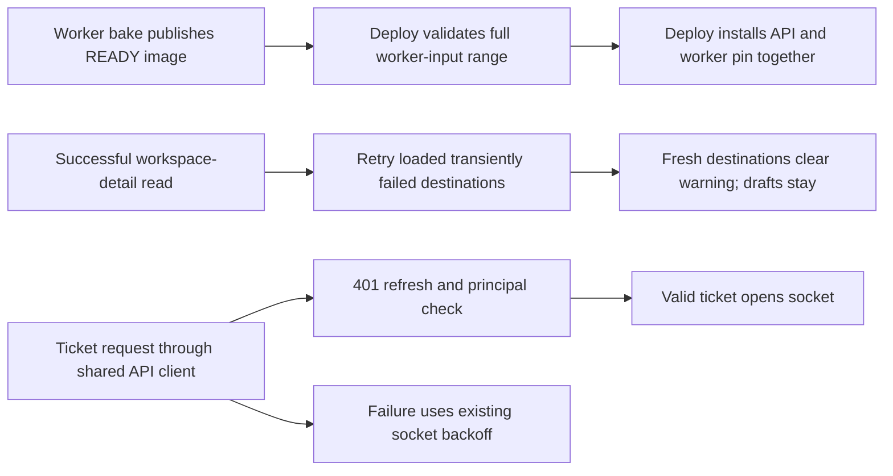

## Ontology changes and governance

Comparison base: `a094de28efa1a18734398a3a49c66469ee5d7e40`, the initial authorized branch `remove-redundant-api-restarts`. [Request](../../chat_intent/remove-redundant-api-restarts/request.md).

Changed blocks: `cloudbuild_pipelines.D35` in the current deployment owner (the legacy document is absent), and `g5.workspace.page.refresh`. Actual ontology diff, including metadata:

```diff
diff --git a/.g5/ontology/concepts/deployment.g5.md b/.g5/ontology/concepts/deployment.g5.md
index 2f2ab682..d4f7eadd 100644
--- a/.g5/ontology/concepts/deployment.g5.md
+++ b/.g5/ontology/concepts/deployment.g5.md
@@ -92,6 +92,12 @@ Refines [the lane overlap](#overlap-the-provider-agent-browser-lane-with-the-bro
 
 Promote the same immutable images and migrations, deploying a compatible control plane before workers.
 
+## Let the deploy own the API worker-image pin
+
+[D · cloudbuild_pipelines.D35]
+
+The worker-image bake publishes its image without changing the live API deployment. QA's deploy owns the provisioning pin: before deploying, its worker-image gate requires a READY image covering all worker inputs through the promoted commit, waiting for an in-range bake or failing closed. This replaces the post-bake re-pin backstop, whose separate API restart is redundant with the gated deploy. A standalone bake becomes the API's pin only through a later compatible deploy; a failed gate leaves the current API and pin untouched.
+
 ## Name incomplete checkpoints honestly
 
 [D · g5.quality.delivery.checkpoint]
@@ -184,6 +190,12 @@ Development or validation work does not itself authorize deployment.
 - From [C153](../../uplift/g5-lean/candidates/contracts.md), [checkpoint exception](../../../docs/mvp-milestone-split.md) and [local validation](../../../docs/local-validation.md).
 - ~75% · Cloud/Compose/Helm definitions; actual promotion/deployment not verified.
 
+### cloudbuild_pipelines.D35
+
+- agent
+- [Issue #403](https://github.com/G5Labs/G5-Lean/issues/403) identifies the legacy cloudbuild pipelines D35 backstop; that document is absent from this checkout. [Request and interpretation](../../chat_intent/remove-redundant-api-restarts/request.md); the existing [QA worker-image gate](../../../infra/qa/README.md#worker-image-gate-on-deploys) supplies the replacement guarantee.
+- ~100% of the inspected pipeline contract · `cloudbuild-packer-worker.yaml` only publishes; the QA deploy gates and installs the pin with Helm. The gate, resolver, pipeline ordering and reset suites pass (98 tests), including a new no-second-rollout contract. [Review](../../pr_ontology_diff_design/remove-redundant-api-restarts/review.md); live QA rollout count unverified.
+
 ### g5.quality.delivery.checkpoint
 
 - agent
diff --git a/.g5/ontology/features/workspaces.g5.md b/.g5/ontology/features/workspaces.g5.md
index 9bb3994f..d1c08977 100644
--- a/.g5/ontology/features/workspaces.g5.md
+++ b/.g5/ontology/features/workspaces.g5.md
@@ -239,6 +239,8 @@ The [ordinary fork](#fork-to-make-my-own-changes) remains governed by source acc
 
 When refreshing what a workspace page shows fails transiently (no answer, a timeout, rate limiting or a server error), the page keeps it as last loaded, with what is typed in it, and a status says so. This covers the workspace's name resolution, its detail, its VM state, its ontology tree, its open file and its approvals. A failed poll is not a stop, a token refresh that gets no answer keeps the session, and the open file keeps its identity while the tree cannot name it. Controls stay as last known, and the server decides each action. A refusal (access lost, the workspace, name or file gone) still shows the error in their place.
 
+Loaded pull request destinations follow the same retention rule, preserving open PR drafts and selections. After a transient destination refresh failure, each successful workspace-detail read retries those destinations until they recover. The destination warning remains truthful until that read succeeds, including inside an open PR dialog; this reuses the page's reads without a separate destination poll. Initial-load failures and refusals retain their explicit error and retry behavior.
+
 This serves [keeping a person's words](documents.g5.md#keep-a-persons-words-when-a-comment-action-fails). Approvals keep their own rule. Their actions wait for current workspace details and approvals, and a list of approvals that could not be refreshed is never shown as current.
 
 ### Compare against the immediate readable parent
@@ -727,7 +729,7 @@ The workspace switcher lists other review copies nowhere, but the copy currently
   - Gaps:
     - Leaving the page, or a refusal, still discards what was typed and not sent.
     - The finalize band's fail-closed reading was checked by inspection, with the band's own tests of unknown approvals.
-- PR destinations use the same retained-refresh state: temporary failures keep Prepare to Ship descriptions and explicit Create PR destinations; shared status/retry stays inside the active dialog. Mounted page/hook regressions cover retention, retry, refusals and a removed target; [rebase review](../../chat_intent/codex-pr-user-authorship/review.md#rebase-91bc4742-final-verification).
+- PR destinations use the same retained-refresh state: temporary failures keep Prepare to Ship descriptions and explicit Create PR destinations; shared status/retry stays inside the active dialog. Mounted page/hook regressions cover retention, retry, refusals and a removed target; [rebase review](../../chat_intent/codex-pr-user-authorship/review.md#rebase-91bc4742-final-verification). For [issue #403](https://github.com/G5Labs/G5-Lean/issues/403), successful workspace-detail reads automatically retry loaded, transiently failed destinations, including failures arriving after page recovery, without canceling in-flight reads. The API supplies a status-bearing fallback for non-JSON errors with empty status text; App ticket requests use shared token refresh and reject empty tickets through socket backoff. Mounted page, hook, API, auth and socket regressions pass (173 tests); [review and limits](../../pr_ontology_diff_design/remove-redundant-api-restarts/review.md). Full browser-stack recovery remains unverified locally because preflight is blocked.
 
 ### g5.workspace.comparison
 
```

### Relevant and governing ontology

| Block | Why relevant / implementation obligation |
|---|---|
| [cloudbuild_pipelines.D35](../../ontology/concepts/deployment.g5.md#let-the-deploy-own-the-api-worker-image-pin) | The gated deploy alone changes the API pin; standalone bakes wait for a later compatible deploy. |
| [g5.workspace.page.refresh](../../ontology/features/workspaces.g5.md#keep-the-workspace-page-through-a-failed-refresh) | Retain loaded destinations and drafts on transient failures; successful detail reads retry them; refusals remain errors. |
| [g5.security.login.principal](../../ontology/concepts/security.g5.md#act-for-one-principal-per-browser-tab) | Ticket requests reuse the shared refresh and principal-replay checks. |
| [g5.design.minimal-mechanism](../../ontology/concepts/system_design_principles.g5.md#justify-each-new-mechanism) | Reuse the deploy gate, query cache, API client and socket backoff without new persistent state or polling. |
| [g5.quality.delivery](../../ontology/concepts/deployment.g5.md#qualify-the-exact-release-candidate) | Run focused regressions and current-head CI; distinguish local tests from live deployment evidence. |
| [g5.quality.delivery.authorization](../../ontology/concepts/deployment.g5.md#authorize-deployment-separately) | This work does not deploy or restart QA. |

## Outcome and design



Remove the bake's API mutation and its unused QA trigger settings. Retain the legacy cluster grant: revoking that Terraform resource would make the automatic apply refuse the foundation plan before reaching delivery; explicit infrastructure cleanup can revoke it separately. Preserve publishing and any separately configured worker-host rollout. The reset runbook's explicit false re-pin override remains compatible with builds of older commits. Update obsolete deploy diagnostics. A successful workspace-detail network read triggers another destination read only for loaded transiently failed data and does not cancel an in-flight read; no new destination timer. Both API response modes provide a status-bearing fallback for empty HTTP status text. The App ticket callback uses `api.post`; failed or empty tickets must not create a socket.

## Acceptance and verification

- Pipeline wiring keeps the full-range gate before Helm and the bake has no API mutation; existing gate tests cover queued/running, intervening commits, failed/missing bakes and disabled triggers.
- Vitest regression for non-JSON 502s with empty status text, preserving structured errors and transient classification.
- Mounted page regressions retain Prepare to Ship drafts and Create PR selections while both reads fail, then clear both warnings after recovery without focus, WebSocket reconnect or clicking Retry. Hook regressions cover a destination failure finishing after detail recovery, unrelated workspaces, initial failures, refusals and in-flight reads.
- Ticket tests exercise a 401 refreshing the same principal and failed acquisition backing off without a handshake, then successful reconnect. Existing WorkspacePageBasePull tests pass.
- Run frontend type/build and focused suites, pipeline contracts, and browser coverage where the stack permits. Actual QA rollout count remains a post-merge observation.

## Review summary

Self-review of the design: the deploy gate reads the worker trigger's own path filters, covers the full intervening commit range, and fails closed. Removing re-pin deliberately means standalone bakes do not mutate the API. Query recovery must observe successful network reads, including unchanged data, rather than only a page-banner transition, to cover late destination failures. Shared API refresh already keeps sessions through transient outages and prevents replay across principals. The socket manager already backs off on rejected ticket acquisition; verify the App wiring and reject empty tickets too. No unresolved product choice blocks implementation; the issue request authorizes the fixes.

Review amendment: the dedicated IAM grant remains to preserve the non-destructive automatic Terraform apply. Its comment states that the bake no longer uses it. No API pin ownership or browser behavior changes. Original handoff: commit `330313f5`; evidence in [review](review.md#later-review-finding-automatic-terraform-apply).

Implementation self-review and executed evidence: [review](review.md). The original ontology handoff is retained in commit `330313f5`; this diff carries the final scoped metadata.
