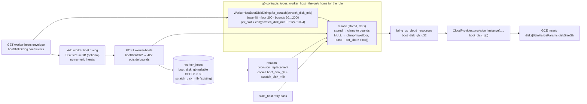

# Worker host boot disk scales with its VM slot count

## Ontology changes and governance

Comparison base: `77687360` (branch `scale-worker-host-disk-with-slots`, clean tree).

One new block, `g5.runtime.placement.host-disk`, in
[`software_architecture/runtime.g5.md`](../../ontology/software_architecture/runtime.g5.md),
placed with the other placement-sizing commitments. No existing block is amended:
`g5.runtime.placement.sizing` divides the host's measured **CPU and RAM** by the VM
budget and says nothing about disk; `g5.runtime.placement.sizing-publication` and
`-custody` govern the **per-VM** CPU/RAM/scratch contract the host measures and
publishes, which this rule consumes (as the start gate's scratch requirement) but does
not change. The 150 GB provider-wide constant lives only in code comments citing a
retired `[D49]`, not in a current commitment, so nothing is being overridden.

```diff
+## Size the host boot disk for its slot count
+
+[D · g5.runtime.placement.host-disk]
+
+Provision each host's boot disk from the same VM budget its [slot sizing](#derive-equal-slots-from-measured-host-resources)
+divides, because every VM on a host shares that one disk and the host refuses a start
+unless one VM's scratch requirement is free: a fixed 40 GB host allowance (OS, swap,
+image cache and assembled template, with room for a second image during an update) plus
+one start requirement per slot, under a 200 GB floor so small hosts stay generously sized
+and a 2000 GB cap. The per-slot allowance is read from the
+host's own configured scratch size rather than restated as its own number, so a scratch
+size the deployment raises raises the disk with it and the per-slot share keeps matching
+the gate. The allowance is a sizing rule, not a runtime guarantee: it makes every slot
+startable on a host whose VMs and overhead each stay within their share, and the gate
+tests FREE space, so a start still fails once running VMs have grown past their scratch
+requirement or the image cache has grown past the host allowance. Sizing cannot prevent
+that; only the operator surface reporting it can.
+
+The cap binds the derived size as well as a typed one: a VM budget large enough to want
+more disk than the cap is provisioned AT the cap and consequently cannot start all of its
+slots. Record that rather than requesting an unbounded disk, because the size the operator
+asked for by choosing the budget is not the size they get. Only the cap's own constant
+states it, so raising it stays a single edit and needs no second home in stored data.
+
+The operator surface computes its displayed default from the coefficients the server
+publishes with the host list, never from its own copy of them, so the size it shows cannot
+drift from the size the server applies.
+
+An operator may store an explicit size per host instead, between 30 GB (the source image
+floor GCE accepts) and the cap, including below the floor and below the one-slot size that
+can start a VM. A stored size is reused on provisioning, rotation and replacement; an unset
+one re-applies the current rule, so rule changes reach existing hosts through
+[replacement](#keep-sizing-stable-while-a-host-owns-vm-custody).
```

```diff
+### g5.runtime.placement.host-disk
+
+- human-provided
+- [Issue #344 request](../../chat_intent/scale-worker-host-disk-with-slots/host-disk-per-slot.md) states the problem (a 5-slot QA host refusing starts with `host_reason: disk` while 4 slots were free), the formula and its constants; the human then [rejected duplicating the per-slot number](../../chat_intent/scale-worker-host-disk-with-slots/host-disk-per-slot.md#correction-derive-the-per-slot-allowance) and asked for it to be derived. It is therefore read from the host's own start gate (`backend/g5d-host/src/workspace_vm.rs` requires `scratch_disk_mib + 512` MiB free), which the API already resolves and persists per host. The override follows the existing `concurrentJobs` pin ([`g5.runtime.placement.host-slots`](#let-the-host-own-final-compute-admission)).
+- Implemented · `g5-contracts/src/types/worker_host.rs` `WorkerHostBootDiskSizing` is the only home for the rule: `for_scratch` derives `per_slot_gb` as `ceil((scratch_disk_mib + 512) / 1024)` from the host's own start gate, and `default_gb`/`resolve`/`accepts` serve the route's 422, all three provisioning paths and the published coefficients. `cloud/bringup.rs::resolve_boot_disk_gb` is the shared entry point for POST (`routes/worker_hosts.rs`), idle rotation and the stale-host stockout retry; it warns on a clamped out-of-range stored value and on a capped derived size. `BringUpCloudResourcesParams.boot_disk_gb` and the new `CloudProvider::provision_instance` argument carry it per host, rendered by `cloud/gcp.rs::boot_disk_init` as the base-2 `diskSizeGb` string; the provider-wide field, `G5_WORKER_HOST_BOOT_DISK_GB` and its parser are gone. Migration 069 adds the nullable `worker_hosts.boot_disk_gb` with a lower-bound-only CHECK (the cap stays in Rust alone); `provision_host_record` persists only an explicit override and `rotation::provision_replacement` copies it. `AddWorkerHostDialog.tsx` derives placeholder, hint, bounds and the cannot-start warning from the envelope's `bootDiskSizing` and holds no constant of its own. Verified against real Postgres: `api_worker_hosts_cloud.rs` asserts 365/200/755 GB for 5/1/11 slots, a below-floor override and that derived sizes are never stored; `api_worker_hosts_stale.rs` asserts rotation reusing an override while re-deriving for NULL; `api_worker_hosts.rs` asserts the 422 bounds and that the published allowance covers one start; `migration_069_worker_host_boot_disk.rs` applies 069 to a populated FORCE-RLS table as a NOSUPERUSER/NOBYPASSRLS owner and replays it as a no-op; unit tests cover the derivation, the issue's table, the cap and `diskSizeGb` for two slot counts; 8 dialog tests cover the UI. Gaps: a stored override has no read-back surface (no API field or UI shows it); a capped budget's shortfall is only an audit warn; `base_gb` is a constant while part of what it absorbs scales with disk size. 069 adds the CHECK inline, so its `ADD CONSTRAINT` validates the whole heap under ACCESS EXCLUSIVE instead of the `NOT VALID`/`VALIDATE CONSTRAINT` split 061/062 uses (CodeRabbit on PR #354); it stands because 069 is merged and applied on QA, and an applied migration is immutable — a forward-only redo cannot un-take a scan 069 still performs wherever it has yet to run. `worker_hosts` is small enough that the one-time scan is cheap; a future constraint on this table should take the split.
```

### Relevant and governing ontology

| Block | Why relevant | What implementation must enforce or consider |
|---|---|---|
| [`g5.runtime.placement.host-disk`](../../ontology/software_architecture/runtime.g5.md#size-the-host-boot-disk-for-its-slot-count) | New owner of host boot-disk sizing | One home for base/floor/bounds and for deriving per-slot from the configured scratch size; no second statement of it in the client; stored override wins; NULL re-applies the rule on every provisioning path |
| [`g5.runtime.placement.host-slots`](../../ontology/software_architecture/runtime.g5.md#let-the-host-own-final-compute-admission) | Owns the operator-configured equal-slot budget the disk is sized from | Reuse the budget the provisioning paths already resolve for `G5D_HOST_MAX_MICROVMS`; introduce no second notion of slot count |
| [`g5.runtime.placement.sizing`](../../ontology/software_architecture/runtime.g5.md#derive-equal-slots-from-measured-host-resources) | Owns per-slot CPU/RAM from measured hardware | Disk sizing stays an API provisioning input; it must not become a host-measured or host-published size |
| [`g5.runtime.placement.sizing-custody`](../../ontology/software_architecture/runtime.g5.md#keep-sizing-stable-while-a-host-owns-vm-custody) | Resource changes need a drained host or a replacement | A boot disk is fixed at instance creation; existing hosts may only pick up a new size through rotation/replacement, never a live resize |
| [`g5.runtime.placement.sizing-publication`](../../ontology/software_architecture/runtime.g5.md#publish-one-resolved-slot-contract-before-placement) | Rotation/retries "resolve the replacement host's actual resources rather than copying a previous automatic size" | Copy only the operator's stored override; never persist or copy a resolved default |
| [`g5.architecture.placement`](../../ontology/software_architecture/worker_host.g5.md#capacity-and-runtime-placement) | WorkerHostService owns the host record and its provisioning writes | The new column is written through the existing scoped INSERT, not a new writer |
| [`g5.data.platform-authority`](../../ontology/concepts/data_model.g5.md#the-api-owns-durable-platform-records) / [`justify each new mechanism`](../../ontology/concepts/system_design_principles.g5.md#justify-each-new-mechanism) | A new column, a new request field and a new envelope field need justification | One nullable column on `worker_hosts` mirroring `concurrent_jobs`, and one read-only coefficient object on an envelope that already carries server configuration for this dialog — the alternative is restating the rule in TS. No new table, service, endpoint, provider state or env var, and one env var is removed |

## Requested outcome and design

Every API-provisioned worker host boots with a disk that can start all of its slots:
40 GB + one start requirement per slot, floored at 200 GB and capped at 2000 GB, or the
operator's stored per-host override. The same resolution runs on Add host, idle rotation
and stale-host replacement/retry, and the Add host dialog shows the same number because it
computes it from coefficients the server publishes rather than from its own copies.



**Owners and boundaries.** The rule gets exactly one home,
`g5-contracts::types::worker_host`: a `WorkerHostBootDiskSizing` value carrying `base_gb`
(40), `floor_gb` (200), `min_gb` (30), `max_gb` (2000) and the derived `per_slot_gb`,
built by `for_scratch(scratch_disk_mib)` as `ceil((scratch_disk_mib + 512) / 1024)` — the
host's own start gate, rounded up to whole base-2 GB, which is what GCE's `diskSizeGb`
means. Nothing anywhere else states a per-slot number. `default_gb(slots)` and
`resolve(stored, slots)` hang off the same value, and the route's 422 bound check uses its
`min_gb`/`max_gb`, so no caller can drift.

Deriving needs no new backend plumbing: all three provisioning paths already hold the
host's scratch size — the POST handler resolves it from `G5_WORKER_SCRATCH_DISK_MIB`
(`routes/worker_hosts.rs:638`), rotation copies `old.scratch_disk_mib` onto the
replacement row, and the stale-host retry pass already selects it. `slots` is likewise the
`max_microvms` each path already resolves for `G5D_HOST_MAX_MICROVMS` (operator
`concurrentJobs` when pinned, else `default_concurrent_jobs(vCPUs)`), so the disk, the VM
budget and the start gate cannot disagree.

The client holds no copy of the rule either: `ListWorkerHostsResponse` gains a
`bootDiskSizing` object with those five coefficients, resolved from the same env value the
POST handler reads, beside the `promotedImageTracks` and `orgDefaultBaseImageRef` the
envelope already carries from server configuration for this very dialog. The dialog
computes `max(floorGb, baseGb + perSlotGb × slots)` capped at `maxGb`, bounds its input by
`minGb`/`maxGb`, and warns below `baseGb + perSlotGb`. With the field absent (an older
API) it shows no placeholder and no derived hint, and leaves the bound check to the
server's 422, rather than inventing numbers.

The size becomes a per-host provisioning input rather than provider state:
`BringUpCloudResourcesParams` gains `boot_disk_gb: u32` and
`CloudProvider::provision_instance` gains a matching argument that `gcp.rs` renders as
`diskSizeGb`. `GcpCloudProvider::boot_disk_gb`, `ENV_BOOT_DISK_GB`
(`G5_WORKER_HOST_BOOT_DISK_GB`, unset in every environment), `DEFAULT_BOOT_DISK_GB`,
`parse_boot_disk_gb` and its test are removed, so the dialog's computed default and the
server's can no longer be separated by configuration. `MIN/MAX_BOOT_DISK_GB` move to
contracts as the request bounds. The boot-disk `initializeParams` construction becomes a
small pure function beside the existing unit-tested `boot_disk_type_for`/`requires_gvnic`
predicates, which is where the `diskSizeGb` assertion lands.

Storage mirrors `concurrent_jobs` exactly: migration `069_worker_host_boot_disk.sql` adds
a nullable `worker_hosts.boot_disk_gb integer` with
`CHECK (boot_disk_gb IS NULL OR boot_disk_gb >= 30)` — additive DDL only, no data section
under FORCE RLS — and appends its SHA384 to the checksum catalog. The CHECK is
**lower-bound only**, which is a change from this plan's first text (`BETWEEN 30 AND
2000`), decided while implementing: 30 GB is a provider constraint GCE enforces anyway and
is safe to fix in immutable SQL, but an immutable CHECK carrying the 2000 GB cost cap would
make the cap a second home — raising it would then need a migration, which is exactly the
duplication the derive-it correction rejected. The POST route's 422 and the rotation clamp
remain the enforcement of the upper bound, both reading the one constant.
The POST path persists only an **explicit** `bootDiskGb` through
`ProvisionHostRecordParams`; a resolved default is never stored, so an omitted value
tracks the current rule across future replacements. Rotation copies the column onto the
replacement row and resolves through the shared function; the stale-host retry pass
selects and resolves it the same way. An out-of-range persisted value is clamped with the
same loud audit warn rotation already uses for `concurrent_jobs`, so background hygiene
cannot wedge on repaired-by-hand data.

The dialog adds "Disk size in GB (optional)" below "Concurrent jobs (optional)", with the
same blank-means-default contract: placeholder and `Defaults to N GB.` hint recomputed
from the selected instance type and the typed-or-default concurrent jobs, a blank field
omitted from the request body, a typed value sent as `bootDiskGb`, out-of-range values
blocked client-side (the API is authoritative with 422), and a warning below one base plus
one slot because such a host may never start a VM. Every one of those numbers comes from
the envelope's `bootDiskSizing`, so unlike `defaultConcurrentJobs` — which does mirror
`default_concurrent_jobs` in TS — this rule exists once, in Rust.

**Acceptance outcomes.** Under QA's 64 GiB scratch size the derivation reproduces the
issue's table exactly: a c3-standard-22 host (5 slots) provisions 365 GB, c3-standard-4
and c3-standard-8 take the 200 GB floor, `concurrentJobs: 11` on a c3-standard-44 gives
755 GB and `concurrentJobs: 2` on a c3-standard-22 gives 200 GB. A stored override
survives rotation while a NULL re-applies the rule; `bootDiskGb: 29` and `2001` return
422. Rust tests cover the derivation for each allowlisted instance type at the configured
and the default scratch size, the `concurrentJobs` override, the bounds clamp, the GCE
`initializeParams` `diskSizeGb` for two slot counts, and `boot_disk_gb` reaching
`provision_instance` end-to-end from POST for two slot counts; API tests cover the 422,
the envelope's coefficients and rotation's override-vs-NULL behavior; dialog tests cover
placeholder tracking from served coefficients, blank omission, a typed value, blocked
out-of-range input and the absent-coefficients fallback.

**Rollout.** Additive migration plus an API image; no Helm value changes (the removed
`G5_WORKER_HOST_BOOT_DISK_GB` is set nowhere, and `G5_WORKER_SCRATCH_DISK_MIB: "65536"` on
QA, staging and prod is now an input to the rule rather than a number it assumes).
A deployment that leaves the scratch size at its 10 GiB default derives an 11 GB per-slot
allowance and lands on the 200 GB floor for every allowlisted shape, which still leaves
every slot startable at that scratch size. Existing hosts keep their
150 GB disk — GCE cannot grow a boot disk in place under
`g5.runtime.placement.sizing-custody` — and pick up the new size only when idle rotation,
stale-host replacement or an operator delete/re-provision replaces them. The owner will
remove and re-provision the two QA hosts by hand once this ships, so no in-place resize or
staged replacement is needed. Cost is the visible trade: a 5-slot host goes from 150 GB to
365 GB pd-balanced.

**Risks and assumptions.**

- The 2000 GB cap can bind the derived default: `concurrentJobs: 44` on a c3-standard-44
  derives 40 + 65 × 44 = 2900 GB. The resolution clamps to the cap with an audit warn
  rather than asking GCE for a 2.9 TB disk, which means such a host cannot start all 44
  slots. That configuration is already degenerate (one vCPU per VM) and the issue set the
  cap for cost; raising it is a one-constant change if a real deployment needs it.
- The derived allowance tracks the scratch size at *provisioning* time. Raising
  `G5_WORKER_SCRATCH_DISK_MIB` does not resize existing hosts — their persisted
  `scratch_disk_mib` and their disk were fixed together at creation, so the pairing stays
  consistent and the new ratio arrives with the next replacement.
- The envelope's coefficients are read from the same process env as the POST handler's,
  so they agree by construction. A config change between the GET and the POST shows a
  stale placeholder for one dialog session; the server stays authoritative.
- The disk sizes a start **gate**, not actual usage. One workspace can still fill a
  365 GB host, as the issue's 118 GiB cargo `target/` did; per-VM disk quotas are out of
  scope here.
- `base = 40 GB` is the issue's estimate from `df` on a QA host (~20–30 GB observed).
  If a future worker image's cache and templates outgrow it, the floor absorbs small
  hosts but a large host's per-slot headroom shrinks.
- Adding a 9th argument to `provision_instance` keeps the existing
  `#[allow(clippy::too_many_arguments)]` surface; a params struct would be a wider
  refactor of an unrelated call surface and is deliberately not done here.

## Review summary

Revised after human review: the per-slot allowance is no longer a constant written in both
Rust and TS but a derivation from the host's configured scratch size, published to the
client as coefficients. That removed the first pass's main standing risk (a scratch-size
change silently re-wedging hosts) and replaced it with the bounded ones listed above.

Challenged against contracts not considered in the first pass:

- **`sizing-publication`'s "resolve actual resources, never copy a previous automatic
  size".** Satisfied by persisting only an explicit override, the same split
  `concurrent_jobs` already uses. Had the resolved default been stored, a replacement
  would freeze today's formula forever — the main thing to keep right in review.
- **`sizing-custody`.** No live resize path is added; the only route to a new size is
  replacement, which the rollout note states explicitly.
- **Start-gate ownership (`workspace_vm.rs`).** The host keeps owning final admission;
  this change only makes the shared disk big enough that the gate stops being the
  binding constraint. No gate logic changes.

Remaining uncertainty to verify while coding:

- `ProvisionHostRecordParams`/`provision_host_record` must bind the new column in the
  same scoped INSERT (no second writer, no system-pool definer function needed), and the
  `RETURNING` list stays as-is — `boot_disk_gb` is deliberately **not** added to the
  `WorkerHost` contract type or the wire envelope, since no surface reads it back today
  (the former host-details concurrency read-back no longer exists in Lean). Confirm that
  rotation's `RotationHostRow` and stale-host's `RetryRow` selects are the only readers
  needed; if a read-back is wanted later it is an additive change.
- Rotation's replacement row is inserted through `provision_replacement`, which
  stale-host replacement also calls — confirm both inherit the copied override from that
  single site rather than needing their own.
- Confirm no `sqlx::query!` macro touches `worker_hosts` (none appears in `.sqlx`), so
  the additive column needs no offline-metadata refresh.
- The derived per-slot allowance assumes GCE's `initializeParams.diskSizeGb` is base-2
  (65 ≥ the gate's 64.5 GiB); in decimal GB the same number would be 60.5 GiB and the
  guarantee would quietly fail. Google documents the field as "base-2 GB" — pin that in a
  comment beside the `ceil(… / 1024)` and assert the QA number in a test.
- The stale-host retry pass resolves from its own `RetryRow`; confirm it carries both
  `scratch_disk_mib` (it does today) and the new `boot_disk_gb`, so a retried stockout row
  provisions the same size its first attempt would have.
- Confirm the MSW handler in `frontend/src/test/msw/handlers.ts` mirrors the new 422 so
  dialog/hook tests exercise the real bound.

## Implementation record (2026-10-07)

Built on `a6511849` (the revert restored this plan and the ontology block to `e2159280`,
so that is the governing design; the intervening review commit is not part of it).

Every assumption above resolved as expected, except two decisions worth naming:

- **The migration's CHECK is lower-bound only**, not `BETWEEN 30 AND 2000`. Reason in the
  Storage paragraph: the cap keeps one home in Rust. The 422 and the rotation clamp enforce
  it, and `migration_069_worker_host_boot_disk.rs` asserts both that 29 GB is rejected and
  that a value above the cap is storable (so a future cap raise needs no migration).
- **The cap binds the derived size, not only a typed one.** `concurrentJobs: 44` on a
  c3-standard-44 derives 2900 GB at the 64 GiB scratch size. Such a host is provisioned at
  the cap and cannot start all its slots, which the restored block did not cover, so
  `g5.runtime.placement.host-disk` was amended to state it and to require recording it
  (`worker_host.boot_disk_capped` audit warn). Not reachable without a degenerate
  `concurrentJobs` pin (≥ 31 slots).

Confirmed while coding: three and only three bring-up paths reach the provider, all of
which already carried `scratch_disk_mib` and the VM budget, so deriving needed no new
plumbing; `rotation::provision_replacement` is the single copy site both rotation and
stale-host replacement use; no `sqlx::query!` touches `worker_hosts`; `diskSizeGb` stays a
JSON string. The MSW item was resolved by publishing `bootDiskSizing` from the GET handler
rather than mirroring the 422 — client-side bound blocking needs no server round-trip, and
mirroring only the new bound while `concurrentJobs` stays unmirrored would be inconsistent.

**Verification.** All against this checkout, real Postgres (`docker compose` dev
`postgres`/`redis`) for the integration lanes:

| Lane | Result |
|---|---|
| `g5-contracts` + `g5-api-core` unit tests | 1054 passed, 1 failed — `git_conflict_resolution::native_rebase_command_replays_related_and_unrelated_commit_series`, which also fails on the base commit `77687360` in a clean worktree (pre-existing, unrelated) |
| `api_worker_hosts` (52), `api_worker_hosts_cloud` (36), `api_worker_hosts_stale` (17) | all pass, including the four new cases |
| `migration_069_worker_host_boot_disk` | passes: populated FORCE-RLS upgrade as a NOSUPERUSER/NOBYPASSRLS table owner, replay no-op, CHECK live, RLS flags intact |
| `cargo clippy -D warnings` (the four changed crates, all targets) | clean |
| `cargo fmt --all`, `prettier` on the touched frontend files | applied |
| Frontend `vitest run` (full suite) | 276 files, 4437 tests, all pass — includes the 8 new `AddWorkerHostDialog` tests |
| Frontend `tsc --noEmit`, `eslint` | typecheck clean; 0 errors (580 pre-existing warnings) |

Not executed: no deployed QA host was provisioned, so the real GCE `diskSizeGb` and the
host-side free-space behavior at 365 GB remain unobserved; the base-2 unit assumption is
asserted against Google's documented field semantics and the issue's `required_mib`
numbers, not against a live disk.
