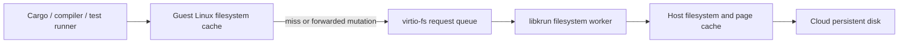

# Why small-file work is slow, and what to change

Raw experiment artifacts and the duplicated chat-intent request were removed from this branch at the user's request. Historical results and qualification limits below remain as summaries.

## 2026-10-14 configuration recheck

The user asks whether the roughly 60× result reflects a libkrun configuration mistake. **There is configuration-related headroom, but no demonstrated single wrong setting explains that ratio.** This follow-up rechecks G5 PR head `742c620a`, the local pinned libkrun `b7e43f04` source and retained experiment bytes. It does not execute a new performance test or settle the cost of each FUSE request.

- The retained identical-ELF creation samples reproduce **82,714.88 / 1,253.28 files/s = 65.999×**, five observations each, 4 KiB files and no explicit fsync. That means roughly **12.09 versus 797.91 microseconds per complete create/write/close sequence**, not per request and not 66× slower compilation. The separate original fs_mark control measured 56,898/s native, 1,216/s virtio-fs and 59,330/s guest ext4; the large gap is not exclusive to our custom harness. The matched host/guest Cargo pair was 3.112×, while pure integer computation in a later matched cohort was 1.018× single-threaded and 1.033× four-threaded. Do not pool the cohorts or call the VMM universally 60× slower.
- The actual upstream defaults are **Auto cache retention, 5-second entry/attribute TTLs, writeback off, xattrs on, one ordinary request queue and a serial worker per share**. G5's device construction inherits these. Auto is not Never/direct-I/O; metadata caching is active. Root-only Always already reduced two paired Cargo checks by about 32%, while `/work` Always did not improve unique creation. A serial worker is a concurrency limitation, but adding workers alone need not accelerate a single client's dependent requests. These internal settings are not exposed by the pinned public C API; external virtiofsd CLI flags do not configure this embedded server.
- No accidental per-write fsync is present in the inspected passthrough: FUSE `flush` performs dup/close; explicit `fsync` is a separate operation. Writes are write-through with writeback disabled, which requires userspace WRITE requests but does not itself mean durable-media sync. The [Linux FUSE I/O documentation](https://docs.kernel.org/filesystems/fuse/fuse-io.html) explains the distinction. Native/ext4 no-fsync runs can absorb writes locally; consequently the microbenchmark measures different completion paths, not durable disk throughput.
- The build script invokes the release Makefile target. Current G5 pins VMM logging off by default and ignores inherited `RUST_LOG`; the retained timed fs_mark Auto and Always consoles contain no DEBUG/TRACE lines. Instrumented request traces were separate. Neither a debug-build nor a tracing explanation is supported by this evidence; this is not a fresh audit of every currently deployed process.
- **One misleading wrapper comment was corrected:** `krun_add_virtiofs3(..., 0, ...)` maps to no DAX region, whereas the legacy root API specifies a 512 MiB window. Zero does not disable ordinary page caching. DAX eligibility/guest mount policy and its data-access benefit require measurement; it is not an established cure for create/stat/unlink. No runtime parameter was changed. The actual `xattr: true` also differs from an upstream field comment claiming false; privilege/xattr handling is another profiling candidate, not permission to drop customer filesystem semantics.

Before proposing VMM replacement, the remaining useful experiment is a per-opcode latency/count profile on a disposable Linux guest: distinguish guest wait/interrupt delivery, host worker scheduling and actual backing-file syscalls. Then isolate writeback, DAX for eligible data workloads, and worker concurrency in separate A/B runs, retaining root-only Always as the already-measured configuration candidate. Check complete build time as well as unique-create speed, permissions/xattrs, host aliases, Save/Fork/Stop/Start and flush behavior. Enabling all caching options together would not identify the cause.

The original benchmark host was absent from the current running-QA inventory. No unrelated live workspace was inspected or changed; runtime flags on a replacement host remain unverified. This recheck supports investigating/tuning libkrun before deleting it. The existing block-path improvement remains valid evidence, but does not prove configuration tuning cannot compete.

## Earlier full-workload result

Conclusion as of 2026-10-13: the QA A/B/B/A comparison with the complete working environment on an ext4 block disk is complete. Fresh Cargo runs took **485.6/493.4 s** on virtio-fs and **184.6/191.3 s** on full ext4; the medians were **489.5 → 187.9 s, a 61.6% reduction, saving about 5 minutes**. A separate FULL-flush follow-up took **190.0 s**, retaining the benefit. Prioritize opt-in integration of a complete ephemeral block workload root for new VMs, preserving existing Git capture/receipt recovery; retain the earlier rootfs-only Always result of about 32% as a separate alternative. Source, tools, artifacts, commands and every numeric cache counter were checked for equality across all five groups. The proposal and candidate ontology are in [ontology-plan.md](ontology-plan.md). Earlier investigation stages remain below as historical records.

Earlier authorized host/VM experiment: the same static executable on the same backing filesystem measured serial small-file creation at **82,715 versus 1,253 files/s** (five-run medians, 66.0×). One formal cache-enabled, offline `g5-api cargo check` pair completed in **153.200 s on the host versus 476.696 s in the VM** (3.112×). Both had identical 607 cache hits / 167 misses and 528 Cargo artifact records. This establishes an observed runtime gap with matched cache behavior, not an isolated virtio-fs effect or a measured optimization benefit. Host/guest kernels, resource budgets, cache warmness and temporary-storage layouts differ; notably host `/tmp` was tmpfs and guest `/tmp` was root virtio-fs. Earlier package/ext4 pilots below use different source/runtime snapshots and must not be pooled with this pair.

## Earlier same-VM comparison: time saved by layout changes

On the same QA VM, with identical source, internal paths, `-j2` and sccache configuration, run offline `cargo check -p g5-api` with an empty target directory:

| Layout | Fresh check | Relative to this cohort's baseline |
|---|---:|---:|
| A2 original layout | 464.7 s | Baseline |
| C1 only `/tmp` on ext4 | 461.8 s | 0.6% reduction |
| B1 source copy + outputs on ext4 | 407.4 s | 12.3% reduction |
| R1 only Cargo registry on ext4 | 433.4 s | 6.7% reduction |
| A3 original layout repeat | 462.4 s | 0.5% less than A2 |

Including the 6.15 s source copy, B1's one-time benefit is about 11.0%. Including the 29.54 s registry copy, R1 totals about 462.9 s, leaving almost no net benefit on the first run. Copying is not a cost paid on every build, but it must be included when assessing the startup workflow. The three layout effects cannot be added together; B moves both source and outputs and is not a target-only experiment.

A2/C1/B1/R1 have matching 528-record Cargo artifact graphs and 607 hits / 167 misses. All 10 commands from the 5 formal runs passed complete archive verification and independent review. The A3 baseline is only 0.49% faster than A2; each candidate still has only one observation, so these results cannot estimate candidate variability or guarantee release performance.

These results narrow the proposal: a large small-file microbenchmark gap cannot be directly converted into a whole-workflow speedup from moving one directory. Prioritize a switchable `CachePolicy::Auto → Always` prototype for the rootfs export, conditional on an audit of host writes, aliases across exports and read/write visibility. This primarily tests whether repeated opens of toolchain/dependency inputs can avoid requests. Preserve the current TTL, writeback setting and single worker to measure this change independently. **The 6.7% benefit from moving storage does not establish an Always benefit.** Evaluate a bounded worker pool separately if request-queue traces from the real workload support a concurrency bottleneck.

## What the conversation is about

The team first compared a laptop with a cloud workspace and saw slow compilation/validation. That mixes CPU speed, available cores/RAM, concurrent jobs, cache warmth, disk and virtualization. The more diagnostic follow-up ran the same small-file benchmark directly on the cloud host's filesystem and inside its microVM.

Inside the microVM, `/work` looks like a normal Linux filesystem, but it is actually a host directory exported through virtio-fs. A guest syscall that misses the guest cache becomes a FUSE request, crosses a virtio queue to the VMM's filesystem server, executes host filesystem operations, and returns a reply. One application's create/write/close sequence can generate several such requests.

With virtio-blk, the guest runs ext4 itself. Metadata lookups/updates can be handled and cached in the guest, and the virtualization boundary carries block I/O instead of forwarding individual filesystem operations. It still uses the backing disk; the benefit is a different request path.

Three distinct levers follow: caching avoids some requests; concurrency overlaps independent requests; relocating the working set to guest block storage avoids file-level forwarding altogether. Their effects differ by workload.

## What was reported, and what it proves

The original [issue #393](https://github.com/G5Labs/G5-Lean/issues/393), retrieved with no comments on 2026-10-13, reports `fs_mark -D 64 -n 5000 -s 4096 -t 1 -S 0 -L 3`:

| Reported environment | Small-file creation rate | Approximate time per file sequence |
|---|---:|---:|
| Cloud guest `/work` | 1,453/s | 688 µs |
| Same cloud host backing filesystem | 60,230/s | 16.6 µs |
| Same host, four threads | 74,350/s | Not a serial latency measurement |
| Same host, fsync each file | 842/s | 1.19 ms |

The supplied screenshot separately reports Mac APFS 21,433/s versus guest 1,511/s, a 14.2× gap. These are different reported runs; do not combine them into one benchmark. The earlier resource screenshot describes c3-standard-4, whereas the issue identifies the matched host experiment as c3-standard-22. Those descriptions must not be treated as the same hardware configuration. Also, `-D 64` configures subdirectories, while the screenshot describes a flat directory; retain the actual benchmark output to settle the layout rather than assuming these are identical runs.

The matched host/guest ratio is 41.5×. It strongly implicates the extra guest/filesystem path for this workload; buying a faster disk alone is not the best first hypothesis. It does **not** measure a 41.5× whole-build slowdown, one specific queue bottleneck, or a 672 µs single round trip.

`-S 0` means no explicit sync/fsync in this benchmark. It does not mean the disk cannot be involved: metadata, background writeback and dirty-page throttling can still matter. The issue's “nothing waits for the disk” is too categorical. Ordinary FUSE write-through still forwards writes to its server even when data is cached. See [fs_mark source README](https://github.com/josefbacik/fs_mark/blob/master/README), [Linux dirty-page controls](https://kernel.org/doc/html/latest/admin-guide/sysctl/vm.html), and [FUSE I/O modes](https://docs.kernel.org/filesystems/fuse/fuse-io.html).

Total build time also contains CPU work, linking, network and tests. As an illustration, if forwarding accounts for 50% of elapsed time and an optimization makes that part 10× faster, total speedup is `1 / (0.5 + 0.5/10) = 1.82×`, not 10×. The actual fraction has not been measured here.

## Latest code, rather than the older local branch

The local branch is `kaihui/preview-idle-stop` at `7dafa9d3`. Local `origin/main` is also stale. Shell Git network lookup failed DNS resolution, so the GitHub connector resolved current main to [`26605ef842a38d27221e1f9961a6b564be5784b6`](https://github.com/G5Labs/G5-Lean/commit/26605ef842a38d27221e1f9961a6b564be5784b6) and supplied the relevant files at that immutable ref. No branch switch, merge, deployment or production patch was performed.

- G5 still pins libkrun v1.18.1 / `b7e43f04`, with no cache-policy/writeback/concurrency patch. Current patches also protect egress, read-only exports, filename handling and network receive liveness; preserve these when experimenting. [Build pin](https://github.com/G5Labs/G5-Lean/blob/26605ef842a38d27221e1f9961a6b564be5784b6/scripts/build-libkrun.sh#L74), [patch application](https://github.com/G5Labs/G5-Lean/blob/26605ef842a38d27221e1f9961a6b564be5784b6/scripts/build-libkrun.sh#L2892).
- `/work` is still virtio-fs. A separate ephemeral ext4 virtio-blk disk exists only at `/var/lib/docker`. Its flush policy is `KRUN_SYNC_NONE`, suitable for disposable data, not a durable source-disk guarantee. The current helper accepts one mountpoint, so a generalized scratch layout requires code changes. [Mount wiring](https://github.com/G5Labs/G5-Lean/blob/26605ef842a38d27221e1f9961a6b564be5784b6/backend/g5d-host/src/workspace_vm.rs#L715), [scratch validation](https://github.com/G5Labs/G5-Lean/blob/26605ef842a38d27221e1f9961a6b564be5784b6/backend/g5d-isolation/src/isolation/libkrun.rs#L1947).
- Latest Start creates a fresh workspace root and release deletes it after exit proof. Keeping generated output across Stop is not today's contract. Latest Stop also records failed capture and still completes, unlike the old local ontology. [Current runtime](https://github.com/G5Labs/G5-Lean/blob/26605ef842a38d27221e1f9961a6b564be5784b6/.g5/ontology/software_architecture/runtime.g5.md#every-start-builds-a-fresh-workspace-root), [current durability](https://github.com/G5Labs/G5-Lean/blob/26605ef842a38d27221e1f9961a6b564be5784b6/.g5/ontology/software_architecture/durability.g5.md#a-failed-capture-aborts-a-fork-and-is-recorded-by-a-stop).
- Shared image/fleet compiler caches now exist. Guest-written compiler objects must stay private. More significantly, the g5dev image intentionally avoids `CARGO_TARGET_DIR` environment variables to preserve sccache identity; a naive global export risks trading filesystem gains for compiler cache misses. Use explicit Cargo flags and verify hits. [Image rationale](https://github.com/G5Labs/G5-Lean/blob/26605ef842a38d27221e1f9961a6b564be5784b6/infra/docker/Dockerfile.g5d-g5dev#L523), [cache trust](https://github.com/G5Labs/G5-Lean/blob/26605ef842a38d27221e1f9961a6b564be5784b6/.g5/ontology/software_architecture/runtime.g5.md#a-cache-is-never-evidence).

## Upstream research

Pinned Linux passthrough defaults are `CachePolicy::Auto`, five-second entry/attribute TTLs and `writeback: false`. Auto allows open-file data caching but invalidates contents on reopening; Always retains data across opens. These are separate from metadata TTLs. [Pinned passthrough](https://raw.githubusercontent.com/libkrun/libkrun/v1.18.1/src/devices/src/virtio/fs/linux/passthrough.rs).

The pinned worker spawns one thread per exported filesystem, popping and handling each request synchronously before the next. Upstream main inspected during this research still has the serial worker structure, so an upgrade alone is not a demonstrated remedy. [Pinned worker](https://raw.githubusercontent.com/libkrun/libkrun/v1.18.1/src/devices/src/virtio/fs/worker.rs), [moving upstream main](https://raw.githubusercontent.com/libkrun/libkrun/main/src/devices/src/virtio/fs/worker.rs).

The public C API exposes paths/tags, DAX memory size and read-only flags, not cache policy or worker count. External `virtiofsd --thread-pool-size` is not a switch for G5's embedded libkrun server. DAX concerns mapped data access; it is not an established fix for create/stat/unlink. [C API](https://raw.githubusercontent.com/libkrun/libkrun/v1.18.1/include/libkrun.h), [external virtiofsd](https://gitlab.com/virtio-fs/virtiofsd/tree/bbf82173682a3e48083771a0a23331e5c23b4924/), [kernel virtio-fs architecture](https://kernel.org/doc/html/v6.10/filesystems/virtiofs.html).

## Experiments executed here

A scratch-only libkrun launcher booted fresh Alpine guests on this Mac; it did not use the G5 application boot path. Native and guest executables were built from the same small-file workload source. There were 60 successful samples, three repetitions per condition, with shuffled execution order. No existing VM or production host was modified.

| Local 4 KiB create/write/close, no fsync | 1 process | 2 processes | 4 processes | 8 processes |
|---|---:|---:|---:|---:|
| Native APFS | 21,848/s | 26,611/s | 29,063/s | 20,339/s |
| Guest virtio-fs | 3,307/s | 5,262/s | 5,437/s | 5,695/s |
| Guest tmpfs | 590,835/s | 832,957/s | 703,070/s | 802,742/s |

The local guest path was 6.6× slower serially and plateaued after two clients. This supports investigating forwarding and serialized service, but is not a cloud reproduction or proof of one exact bottleneck. Guest repeated `stat` rose from 20,834/s to 2,893,309/s; existing caching already works well for that short repeated-metadata workload. Repeated open/read/close stayed around 7,815/s serially, showing why operations must be separated.

Important limits: arm64 macOS/HVF rather than x86 nested KVM; APFS rather than XFS; 4 vCPU/1 GiB guest; host disk 93% occupied; 2,000-file synthetic workload rather than original fs_mark; no cache dropping; short phases, and fork/wait overhead in parallel phases. The installed library's hash identifies tested bytes but does not independently establish every compiled G5 patch. These numbers cannot predict the cloud gain. Tmpfs proves neither ext4 performance nor safe memory capacity for builds. No block-ext4 run was possible with the available mkfs tooling, and no real Cargo/Vitest performance A/B was executed.

Two small compatibility probes changed the design:

1. An actual local `cargo clean --offline` on a disposable project whose `target` was a symlink removed the link while retaining the referenced scratch files. It returned success. Therefore a naive symlink can leak outputs and send the next build back to virtio-fs.
2. In a fresh Linux guest, `rm -rf` on a target bind mount removed its contents but returned `Resource busy` and left the mountpoint. Unmount then removal worked. This is generic directory cleanup evidence, not an executed Cargo-on-bind test.

Those findings are why the first proposed build profile explicitly names a normal directory within scratch and updates its own output consumers, rather than silently replacing every `target/` with a symlink or mount.

## Proposed next decision

The matched host/VM and same-guest layout screens are now available above. The next performance prototype is one opt-in rootfs data-retention change after its coherency audit, followed by a matched real-workflow A/B with unchanged compiler-cache policy. This is a proposed new per-export capability in G5’s embedded libkrun, not an existing virtiofsd command-line switch. Keep `/work`, metadata TTL, writeback and concurrency unchanged in that first comparison. Evaluate a worker pool separately only when queue/service traces support it.

The block-output profile remains conditional on output-only evidence, consumer/clean compatibility and capacity validation. Do not attribute the combined source-plus-output result to targets alone, migrate durable source into disposable scratch, or enable registry copying from its compile-only timing. Preserve source durability, isolation patches and trusted shared-cache policy. No production change or cache-policy speedup is established by these diagnostic ratios.

## Cache system follow-up 2026-10-13

The user asks whether the existing cache system can help. This review covers image prewarming, the host cache door and fleet sccache on main `26605ef8`. **They can reduce the work required for a build, and existing QA records show benefits; they do not directly reduce the overhead of each virtio-fs request.** This section cites historical QA records saved in the repository; new cloud measurements from this investigation appear at the start of this document and in the experiment sections below.

### What is already implemented

| Component | Implemented behavior | Benefits and limits for this problem |
|---|---|---|
| g5dev image prewarming | Includes the toolchain, Cargo registry/git sources and precompiled sccache objects; does not retain a complete target tree | Reduces downloads and repeated compilation in new VMs; target files and Cargo metadata still need to be created |
| OCI image cache and prebuilt base layers | The cache door serves manifests/blobs; published base layers take priority; dependency layers support fallback with the same parent | Avoids rebuilding the complete dependency layer in the guest, reducing network and build work; pulled content still needs extraction and disk writes |
| sccache facade | The guest reads through HTTP: host-local objects → trusted image seed → same-organization fleet GCS | Reads cached objects on the host, avoiding guest reads of cache archives through rootfs virtio-fs; input checks and artifact writes remain in the guest |
| Newly compiled guest objects | The cache door rejects guest writes to the shared cache | Prevents contamination of shared compiler artifacts; the current remote mode is not an automatic writable local L1 + remote L2 |

The actual router only provides OCI, sccache and stats; mentioning Cargo/npm registry proxies in a design does not make them implemented. An npm facade and node_modules prewarming remain future work. When the door is unavailable, the launcher can fall back to local sccache inside the image; an already-running server keeps the backend selected at startup, so the current shell environment alone does not identify its actual backend.

Code references: [cache routes](https://github.com/G5Labs/G5-Lean/blob/26605ef842a38d27221e1f9961a6b564be5784b6/backend/g5d-host/src/cache_door/mod.rs#L359), [sccache reads and rejected writes](https://github.com/G5Labs/G5-Lean/blob/26605ef842a38d27221e1f9961a6b564be5784b6/backend/g5d-host/src/cache_door/sccache.rs#L51), [guest launcher](https://github.com/G5Labs/G5-Lean/blob/26605ef842a38d27221e1f9961a6b564be5784b6/infra/docker/g5-dev-rust-launcher.sh#L54).

### Interpreting the existing QA numbers

The repository's [October 12 QA record](https://github.com/G5Labs/G5-Lean/blob/26605ef842a38d27221e1f9961a6b564be5784b6/.g5/pr_ontology_diff_design/cross-vm-cache-sharing/ontology-plan.md#qa-evidence-2026-10-12-edit-loop-and-dev-up-breakdown) compares two complete configurations:

| Scenario | sccache on, incremental off | sccache off, incremental on |
|---|---:|---:|
| First `cargo test -p g5-api --no-run` | 20 min 55 s | 27 min 01 s |
| Build g5-api binary after an edit | 3 min 31 s | 33 s |
| First `cargo check -p g5-api` | 8 min 15 s | 6 min 37 s |

The first case reduces elapsed time by about 23%, showing that the existing configuration can improve cold test builds. The other two show that one cache policy is not optimal for every workflow. These comparisons change both sccache and incremental compilation and were not repeated in this investigation; the entire difference cannot be attributed to the cache door. The repository's pinned sccache 0.10 does not provide this compilation cache for Rust `check` metadata-only output and cannot simply be enabled alongside incremental compilation; do not just turn on both environment switches. [Pinned-version limitations](https://raw.githubusercontent.com/mozilla/sccache/v0.10.0/docs/Rust.md).

The October 10 record also reports 752 hits and 0 misses for a test build matching the producer exactly, yet it still took 15 min 14 s. Those counts cover the measured cacheable compilation requests; they do not make linking, build scripts, file checks, test execution or cache restoration free. The door's 4 misses and sccache's 0 misses are different counters and cannot be combined into one hit rate.

The same record attributes about 14 minutes of one preview to cooking its base layer, making publish-first behavior and dependency-layer fallback with the same parent high priorities. The entire preview delay cannot be attributed to `/work`. Service Docker builds already use a data-root on guest ext4 scratch; moving direct Cargo target output is a separate execution path. Release compilation there does not imply coverage by the guest test-profile fleet cache; actual execution paths after source changes still need separate measurements.

### Why cache hits can still be slow

A cache hit still has to deliver objects to subsequent tools. sccache 0.10 creates temporary files in the output directory, decompresses the contents and atomically renames them to their final paths. If output is under `/work/target`, these writes still traverse virtio-fs. Cargo file checks, input hashing and uncacheable steps also remain. One cache hit can involve both fetching an object from the host over HTTP and writing target output through virtio-fs. [Cache-hit branch](https://raw.githubusercontent.com/mozilla/sccache/v0.10.0/src/compiler/compiler.rs), [artifact restoration](https://raw.githubusercontent.com/mozilla/sccache/v0.10.0/src/cache/cache.rs).

The current remote sccache backend does not automatically store newly compiled guest cache-miss results in a separate private local sccache backend; the shared door rejects those writes. A running VM still has Cargo's own target files and fingerprints, so an unchanged ordinary rerun can skip compilation. That is a different layer from compiler-object caching across VMs. After deleting target or restarting the VM, modified code absent from the trusted seed/fleet may need recompilation. A private writable L1 plus a shared read-only L2 is a possible future proposal, but is not implemented and cannot be counted as an existing benefit.

### Adjustment to the original proposal

First confirm that the cache is actually connected and that prewarmed artifacts cover the actual command. Then compare virtio-fs and block target directories with **the cache enabled and matching hit behavior**. Record cache lookup/restoration, compilation, linking and total elapsed time separately. This measures the added value of storage optimization without counting cold-start work already eliminated by the cache a second time.

When comparing cache on/off independently, hold incremental compilation fixed first, then measure its effect separately. Evaluate `check`, binary recompilation, full test compilation and Docker previews separately. Existing caching and filesystem optimization can provide complementary benefits; the value of a storage change depends on the remaining elapsed time with this cache enabled.

## User-authorized QA experiment: 2026-10-13

Started the previously stopped VM in the user-specified `preview-test` workspace and confirmed that `/work` is `g5v0` virtio-fs and `/var/lib/docker` is `/dev/vda` ext4. Created only isolated temporary directories and temporarily bind-mounted a newly created ext4 subdirectory onto a newly created `/tmp` path for ordinary-user access; Docker directory permissions and data were unchanged. Both arms used the same VM with 4 vCPUs, 14,106 MiB RAM and Linux 6.12.87, running as uid/gid 1000. Workspace code was `7035c9bdf3410e45e90f63e68474c0cd3c661695`, different from the latest main reviewed for this design.

The normal Cargo launcher was connected to the cache door at `http://g5-host:7111`; the actual sccache backend was WebDAV, version 0.10.0, with `CARGO_INCREMENTAL=0`. Before a daemon existed, the local-backend display from `sccache --show-stats` contained synthetic zero statistics; this must not be mistaken for an actual build bypassing the cache door. The real backend was confirmed again after running the normal launcher.

Each run used 768 files of 4 KiB, no fsync and 1/2/4 independent processes, alternating AB/BA over five rounds. The table shows medians of five single-process observations, all in files/s:

| Operation | `/work` virtio-fs | Guest ext4 scratch |
|---|---:|---:|
| Create, write, close | 1,508 | 74,963 |
| First stat pass | 9,048 | 618,899 |
| Immediately repeated stat | 622,300 | 719,705 |
| First open, read, close pass | 3,014 | 302,339 |
| Repeated open, read, close | 2,871 | 392,979 |
| Delete | 3,593 | 97,856 |

Creation throughput differs by about 49.7×. With 1/2/4 processes, virtio-fs creation rates are 1,508/2,104/1,817 files/s, so throughput does not scale linearly with concurrency. Repeated stat is already fast while reopening and reading remain slow, illustrating the need to distinguish metadata hits, file opens and content reads. This behavior is consistent with the cache policy and serial service path in the code, but this experiment has no opcode/worker trace and cannot attribute every difference to a particular lock or one VM round trip.

This custom Python syscall experiment includes Python and interprocess-communication overhead and is not equivalent to fs_mark. Caches were not cleared, so even the first read is not a cold-disk read. The ext4 dataset is small enough for the guest page cache to absorb it; this is not a persistent-disk bandwidth or durability test, and the 49.7× ratio is not a compilation speedup. All 180 phase timings across 30 raw samples were retained; normalized remote and local samples have matching SHA256 hashes.

### Real Cargo comparison and proposal revision

With identical code and cache, `CARGO_INCREMENTAL=0` and `-j2`, explicit `--target-dir` arguments selected fresh virtio-fs/ext4 subdirectories. Ran `cargo test -p g5-contracts --lib --no-run --locked -j2 --message-format=json` in three pairs ordered AB/BA/AB, immediately following each fresh build with a no-op. All 12 commands succeeded, test binaries were verified to exist and Cargo.lock was unchanged. Prewarming was performed separately and excluded from the comparison.

| Metric | virtio-fs target | ext4 target |
|---|---:|---:|
| Fresh runs, three times in seconds | 52.85 / 51.70 / 54.71 | 49.33 / 48.35 / 47.60 |
| Fresh median | 52.85 s | 48.35 s |
| No-op median | 1.25 s | 1.10 s |
| sccache counter increase per fresh run | 39 hits / 25 misses | 39 hits / 25 misses |

The medians differ by **8.5%**; paired reductions are 6.6%, 6.5% and 13.0%. Three pairs are a small sample, not proof of statistical significance or a whole-project speedup. Every run had one index update, zero crate downloads and one permission warning, so this is a real-workflow comparison including a network index lookup, not completely offline storage-only timing. Matching hit/miss counts reduce interference from changes in cache coverage, but compilation, linking, input reads and toolchain reads remain. Only target moved; source and toolchain did not. A small benefit does not establish that all virtio-fs read paths are irrelevant.

After the user clarified that performance is the goal, priorities changed: **use real build time as the measure, first evaluate reducing virtio-fs forwarding for repeated source, dependency and toolchain opens/reads, then consider parallel processing if request-queue evidence supports it; ext4 target is a complementary candidate. Track the permission defect separately rather than making it the first performance step.** This package's 8.5% improvement does not meet the design's proposed 20% workflow threshold. Profile the actual slow g5-api full test build, edit/rebuild and preview paths, separating input reads, cache restoration, compilation, linking and output writes. Placing an isolated temporary source snapshot and target together on ext4 can further separate source-path overhead. It does not replace the actual `/work`, retains the original registry/toolchain paths, and must report both path-induced cache-hit changes and copying costs. Whole-workflow benefits from read caching or a thread pool remain unverified at this stage.

### New finding: a possible cause of incorrectly merged image-layer directory permissions

Two offline builds failed because the workspace dependency index lacked `ed25519-dalek`, even after successful online prewarming. The normal online command explicitly warned that it could not write `/usr/local/cargo/registry/index/index.crates.io-1949cf8c6b5b557f/.cache/ed/25/ed25519-dalek`: Permission denied. Actual directories from Cargo home through `.cache` were all root:root 0755; `ed` did not exist.

This conflicts with the latest [Dockerfile requirement for a uid-1000-writable cache](https://github.com/G5Labs/G5-Lean/blob/26605ef842a38d27221e1f9961a6b564be5784b6/infra/docker/Dockerfile.g5d-g5dev#L603) and is separate from the cache door's intentional rejection of shared compiler-object writes. Static review found that the [OCI layer-merge function](https://github.com/G5Labs/G5-Lean/blob/26605ef842a38d27221e1f9961a6b564be5784b6/backend/g5d-foundation/src/oci/extract.rs#L936) applies mode only to newly created directories, ignoring upper-layer chmod for existing ones. A two-layer directory fixture using the exact verified current function body reproduced upper-layer 0777/1777 modes being ignored, leaving merged directories at 0755; new-directory and new-file controls passed.

This fixture establishes a defect in the layer-merge function, but does not yet establish that QA used this exact image/layer/template chain. Check the deployed digest and explicit directory headers in the layers before fixing it. The fix must distinguish explicit directory metadata from parent directories implicitly created during extraction; simply removing `if !exists` and applying chmod to every directory is insufficient. Existing templates must also be invalidated through the current mechanism. If layer-directory provenance records are added, old layer caches must be rebuilt or safely migrated. Acceptance includes matching permissions for the same image in standard Docker and G5, and offline reuse after dependency resolution online as an ordinary user. This investigation did not change guest cache permissions or product code.

## Issue #393 direct validation: 2026-10-13

On the same QA host with the existing sccache/WebDAV cache enabled, a private libkrun build controlled Auto/Always independently per export, holding TTL, writeback, worker/queue, source, toolchain, paths and resources fixed. Two fresh `cargo check -p g5-api` runs with rootfs-only Always took **329.472 / 329.920 s**, versus **482.233 / 485.561 s** for Auto. Paired reductions were **31.68% / 32.05%**, saving about 153–156 s each. Source, tools, artifacts and cache counts matched across all six groups; every fresh run had 607 hits and 167 misses. This is therefore an additional benefit with the existing compiler cache enabled.

A single `/work` Always run took 463.153 s; target-only ext4 took 424.865 s, reducing time relative to the baseline median by about 4.29% and 12.20%. Host/guest/ext4 controls using the same original fs_mark reproduced the file-operation gap, but Always did not improve unique creation. Repeated reads across opens and READ traces confirmed the cache-retention mechanism. The issue's main diagnosis is therefore credible, with rootfs retention taking priority; Always, longer TTLs, writeback and multiple threads cannot be presented together as a validated package.

The recommendation at this stage was a **rootfs-only cache switch, opt-in at new-VM startup**, retaining `/work` Auto, 5 s TTLs, disabled writeback and the existing worker count. These results come from two screening comparisons, not release qualification; full test compilation, frontend/preview, host/alias/lifecycle coherence and more alternating repetitions remain unexecuted. No production library was changed or deployed. This was an interim recommendation before the full-block experiment; current performance priorities follow the opening summary and complete-block comparison below. Earlier descriptions of untested work remain as investigation history.

## User-requested full-block comparison and final priorities

On the same QA c3-standard-4 host, held deployed libkrun 1.18.1, 4 vCPUs/8 GiB guest, normal balloon behavior, source/toolchain/registry, absolute paths and remote read-only sccache/WebDAV fixed. Ran offline `cargo check -p g5-api --locked --offline -j2`, starting with an empty target and immediately following with a no-op. A/B/B/A used fresh guests and private seed copies. A also used chroot, retaining separate root/work virtio-fs exports; B placed the complete workload root on ext4. FULL used a separately compiled private launcher after ABBA, changing only synchronization mode; the deployed library was unchanged.

Fresh medians were 489.478 → 187.918 s, a 61.61% reduction; no-op medians were 3.452 → 0.477 s, an 86.19% reduction. The single FULL run took 189.979/0.533 s and actually negotiated FLUSH; it cannot be pooled with the two B runs as three repetitions. All five groups matched on the 528-artifact graph, 586 timing units, 904 requests, 607 hits and 167 misses, and all 10 Cargo commands succeeded. The two baseline runs differed by 1.61% and the block runs by 3.62%. This is clear screening evidence; broader product release qualification remains incomplete.

A key native-dependency path returned close to host performance: libgit2-sys build-script time fell from 204.53/205.15 s to 24.38/25.56 s, with FULL at 24.60 s and a native reference of 22.10 s. This unit includes preprocessing, cache-key work, object restoration and other work; the whole improvement cannot be attributed to one syscall, and differences between parallel units cannot be added together. The pinned code confirms that C/C++ WebDAV cache hits still require preprocessing/header reads, so existing cache benefits and filesystem optimization can coexist.

Complete seed preparation took 83.505 s and was timed separately; clone, VM boot/preflight, build and export costs were retained separately for each group. This experiment did not measure direct block-root boot, full frontend/preview, production Start time or power-loss recovery. The minimal product path prepares a complete private workload root before guest takeover, enters it through bootstrap before launching the existing dispatcher/tools, and destroys it after exit is proven. Preserve fresh materialization and complete remote Git receipt recovery; do not retain guest-written images as a new authority. Real product E2E coverage is still required for the read-only runtime-bundle boundary, credentials, Save/Fork/Stop/Start and capacity failures.

Other diagnostics found that the guest was about 2–3% slower in static CPU tests and had substantial additional fork/exec cost. Unbinding the balloon improved some memory microbenchmarks but made real Cargo only 0.67% faster. The performance priority is therefore the complete block workload root; balloon, thread-pool and TTL changes are not bundled with it.
