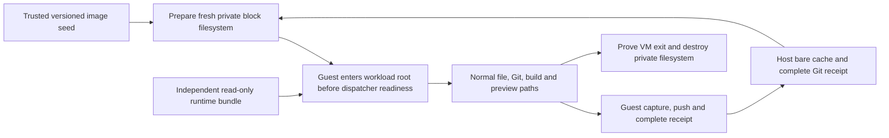

# Improve guest build filesystem performance

## Namespace-root regression repair — PR #608, 2026-10-16

Continue the approved runtime design and `g5.architecture.build_scratch` contract:
the workload root must also be the namespace-join root after trusted recovery.
Keep the PR's MS_MOVE/workload-bind/setns correction and preserve unsupported
platform compilation with a Linux-only syscall body. Local process mode remains
explicit; this does not introduce a VM fallback.

Qualification must use the candidate initramfs and g5d: the strict KVM CI and
worker-image gates boot a fixture containing packaged Docker/Compose and exercise
actual container exec, Compose exec and health checks. The existing mount replay
and its legacy negative control run inside that guest as supplementary diagnostics.
The full-environment guest acceptance shares the real Docker assertions. Fixture
dependencies and its 1-GiB disposable disk are test-only; production budgets and
runtime behavior are unchanged. Current review evidence and unexecuted coverage
are recorded in the [same review](review.md#pr-608-read-only-review--2026-10-16).

## Seeded checkout origin regression — 2026-10-16

The guest seed-hit path sanitized `.git/config` (or initialized an additional
member) and fetched exact Git facts by URL without recreating `origin`. Tracking
refs alone do not define a remote. This violates the existing `g5.vm.origin`
commitment and is a compatibility fix within the approved design. After sanitizing
each fresh checkout, install its admitted canonical member URL and normal fetch
refspec before recovery; never persist the bootstrap host-door rewrite or reuse
seed credentials/configuration. The generic host restore path remains unchanged.
Regression coverage must exercise ordinary `git fetch origin`, canonical identity,
dirty receipt preservation and both seeded and additional members. The reported
QA workspace's actual seed-hit path still needs correlation with its VM logs.

Local validation reproduced the missing remote before the fix. After the fix,
both targeted bootstrap tests pass, including six restore combinations across
seeded/additional members and file/HTTP transports through the complete preparation
entrypoint, using the actual dispatcher
remote-routing configuration for ordinary fetch and upstream resolution. The SCM
suite passes all 234 tests with bounded concurrency; an earlier concurrent run
timed out in one existing child-process timing test, which also passed in isolation.
`cargo check -p g5d --bin g5d --locked`, formatting and the updated qualification
script's Python syntax check pass. Linux/KVM qualification now checks canonical
origins and tracking refs for both code/docs members, but has not been rerun for
this fix. No live workspace was changed or repaired.
The composition regression uses a runner-local root override compiled only for
unit tests; production remains fixed to `/work`. A negative control removing
origin creation from preparation fails with the original empty-remote symptom.

## Merge reconciliation — 2026-10-15

Main now publishes the host module-catalog identity before placement and rejects stale-runtime capacity; it also renews stop-execution claims independently of the HTTP request. Both commitments compose with private workload disks: preserve identity publication and shared validation, source-preparation authority, and exit-proven disk custody. A live stop claim never substitutes for VMM/passt exit proof. Preserve both protocol test families and the runtime-mismatch diagnostic while merging `5fb27ecb4`. Remove obsolete libkrun testing instructions as well as the already-deleted runtime/build directory; legacy network decoding and the legacy registry remain only for rolling upgrades.

## Removal audit — 2026-10-15

Remove obsolete runtime-version DTO/frontend fields and query projections: no live
consumer uses them. Older JSON payloads remain readable through the existing
unknown-field tolerance, covered by compatibility regressions. Keep the applied
baseline migration unchanged, and retain the existing firmware registry/IAM during
the rollback window; removing its Terraform resource would destroy retained artifacts.
Keep build guards that reject the retired shared libraries and historical evidence
with its original runtime attribution. These are not executable backend dependencies.
Current setup instructions and build recipes must describe Cloud Hypervisor on
Linux/KVM or explicitly acknowledged local process mode on macOS.

## Final design for confirmation — 2026-10-14

The user confirmed this consolidated design with "implement it fully" after the
provisioning-time repo-seed summary. Implementation is now authorized.
This section is the proposed implementation scope for existing PR #516 and supersedes
the earlier libkrun opt-in and experiment-only choices below. The branch now contains the Cloud Hypervisor replacement; delivery and product
qualification remain incomplete, so prototype measurements are not release evidence.
Continue implementation against these commitments and amend this same document when
inspection reveals a consequential compatibility constraint.

1. **Runtime.** Use Cloud Hypervisor on Linux/KVM with a platform-built, pinned kernel
   and minimal trusted init. Remove libkrun, libkrunfw wrapping, TSI, the old virtio-fs
   workload path and their unused build/configuration/test plumbing. Preserve explicitly
   acknowledged local process mode for macOS development; there is no automatic fallback
   from a failed VM. Removing local macOS hardware-VM support is part of this scope.
2. **Storage.** Convert the selected OCI environment (for example `g5d-g5dev`) into a
   pristine raw disk image with an ext4 filesystem. It contains the OS, toolchains and
   baked dependencies, with an empty `/work`. Every VM uses a private sparse CoW clone
   containing the complete workload: source, home, temporary files, compiler caches,
   build outputs and Docker data. The complete platform runtime remains an independent
   read-only block device. Honor guest flushes; do not introduce retained guest roots,
   memory snapshots, erofs overlays or a second recovery authority. Local image-layout
   fixtures use the same verified OCI template pipeline; an arbitrary bare rootfs
   directory is no longer a complete production boot input.
3. **Delivery.** For G5-provided environments, the regular build-mode delivery pipeline
   publishes a compressed disk template and bounded identity manifest alongside the OCI
   image in the existing artifact registry; deploy-only mode reuses immutable artifacts.
   Bind artifacts to the resolved OCI digest, architecture, bootstrap/layout version and
   disk capacity. Hosts validate and prepare the artifact before registration, preserving
   sparse allocation. The separate GCE host image supplies the VMM/kernel/host software
   and the independent read-only runtime artifact, prepared once per runtime version;
   it need not be rebaked for every customer environment or source change. A missing or
   incompatible prebuild uses the same host preparation operation, not another backend.
4. **Customers and source.** A private customer environment unavailable during platform
   delivery is converted and cached by its authorized host, preferably during host
   preparation and otherwise before the first workspace can become Ready. Only trusted
   tooling assembles image contents; customer scripts are not executed on the host.
   Include repository seeding as requested in the [incremental-seed amendment](#incremental-repository-seed-amendment--2026-10-14).
   A matching pristine seed supplies checked-out baseline files and Git objects; trusted
   guest bootstrap fetches missing objects and restores the exact admitted member/receipt
   vector using the shared SCM operation. A seed hit skips full host checkout, archive
   import and rsync comparison. Keep generic host restoration for seed misses. Platform
   deploy does not need customer code; authorized hosts prepare repository seeds from
   committed sources independently. Start optional seed preparation when scoped source
   authorization becomes available; deliver the selected org repository vector during
   host bootstrap so a fixed-repository org need not wait for its first `VmStart`.
   Do not wait for VM Ready or delay a first Start for optional seed preparation.
   Replace the slower seed transport, not the seed feature.
   Guest restoration must include a detached seed baseline in Git negotiation
   while retaining other local negotiation tips. HTTP protocol v0 does not carry
   the fetch negotiation-tip option through its transport helper; use a fresh
   temporary local ref for the verified seed HEAD during fetch and remove it
   before successful restoration returns. It conveys object availability only,
   never receipt or branch authority. Aborted bootstrap remains disposable.
   Required ref fetches, receipt checks and the generic path remain unchanged.
5. **Network and custody.** Use the validated virtio-net + passt vhost-user path with
   static guest addressing and existing ingress, host-door and UID-scoped egress policy.
   Passt remains necessary in this design; TSI and its socketpair-specific workarounds do
   not. Keep API/dispatcher/lease/Git contracts and port ownership. The supervisor owns
   the VMM and network sidecar; cancellation, network failure and host death must stop
   both before releasing custody. Reuse the host-owned VM directory and reaper for disks
   and bootstrap files, including forced exits; never host-mount guest-written disks.
6. **Startup.** Prepare required environment artifacts before host admission; optional
   repository seeds never gate admission or first Start. Remove redundant full
   OCI-directory clones and per-start full-image hashing/formatting, and use a trimmed
   Docker-capable kernel and small init. Parallelize preparation only when image selection,
   source authority and lifecycle ownership allow it. Surface actual environment, source
   and VM startup phases without declaring Ready early. Report cold-host preparation,
   warm host Start-to-dispatcher-Ready and user-visible Start separately; compare with
   the approximately 11-second prototype and the deployed path. 500 ms remains an
   unverified aspiration, not a promised end-to-end result.
   Keep the live reservation and process owner when kill/reap is temporarily unconfirmed,
   including failed or cancelled microVM boots; retry under the existing teardown owner.
   A bounded individual wait is not exit proof. Host shutdown remains bounded by its
   existing service lifecycle, and the next host must settle abandoned process scopes
   before admission. Replacing a host checkout never releases private VM disk custody.
7. **Capacity and release.** Keep published per-slot CPU, memory and disk limits, full-slot
   headroom, bounded template staging/cache eviction and independent private writes.
   CoW saves initial allocation, not worst-case capacity. Qualify newly prepared hosts;
   replace hosts through existing drain/exit-proof mechanisms, never switch the VMM under
   a running workspace. Updating PR #516 is authorized; production deployment is separate.
8. **Completion evidence.** Run final-candidate Linux/KVM and browser journeys for chat,
   dispatcher/lease, terminal, Files, Git Save/Fork/Stop/Start and host-loss receipt restore,
   Docker/Preview and read-only runtime. Include multi-VM/private-image isolation,
   concurrent cold preparation, changed images, incompatible/corrupt templates, disk
   exhaustion, cancellation, passt/VMM/host failure and cleanup after forced termination.
   Re-run matched real build workloads and startup timing. Review the implementation and
   affected ontology, update the same PR and its CI, and explicitly report unexecuted
   coverage; prototype results do not qualify new code.

Design review: existing boot/receipt authority and typed SCM restore semantics govern
both host restoration and the proposed trusted guest bootstrap; neither reuses a prior
guest-written root. The existing template lock/publication and root reaper are
the cache and cleanup owners to preserve. The prototype establishes basic network and
platform feasibility, while forced-exit cleanup and cross-UID supervision still require
final-code qualification. Reusing these owners avoids a seed service, snapshot catalog,
new network control plane or retained-disk lifecycle. Ontology amendments below establish
the proposed target; their metadata explicitly distinguishes it from implemented behavior.

Implementation boundary: the platform-built initramfs performs initial mounts and invokes
the trusted bootstrap from the independent read-only runtime, with its own loader/library
closure. A small per-VM configuration/import disk transports admitted inputs without
editing the complete workload image on every Start. It lives under the same exit-proven
VM custody and cannot become a new recovery source. Customer image executables, hooks,
loaders and Git configuration are not used to establish that bootstrap boundary.
Independent-review corrections (2026-10-15): VMM and passt children receive an empty
host environment; their privilege boundary must not carry supervisor/provider or
workspace credentials in envp. Bootstrap claims a private, durably recorded one-shot
marker before importing or restoring source. A second boot of the same disk fails
and powers off instead of replaying restoration within the existing incarnation.
Legacy loopback host aliases resolve through the existing allowlisted host door;
ordinary guest loopback remains private. These repairs preserve the selected trust,
fresh-materialization and network contracts rather than introducing another authority.
Workspace image selection remains per workspace. A generic template miss prepares
the selected pristine environment on demand under the existing exclusive template
lock, then clones it before releasing that lock. Keep one generic/seed variant;
do not restrict placement to the host's initial image or add an unbounded image cache.
Admit this Start's slot and cold construction space before replacing cache. Existing VM reflinks stay
independent when the pristine cache changes; warm matching Starts still only clone.
Count bootstrap staging and import storage before allocating it. Source background
I/O limits target the whole block device when the cache filesystem is on a partition;
failure to establish required resource limits still skips optional preparation.
Review amendment: an absent source-preparation assignment still cancels optional work.
After a later live assignment, an exact matching pristine seed may be reused only
after fresh repository read authorization. This avoids re-export and reformat after
transient heartbeat failures without changing the rolling-upgrade wire contract.

Review refinement: cold mixed-image preparation must not evict a usable template
when its capacity preflight fails. Per-Start admission counts this slot, not the
already occupied fleet. Prepare and pin a generic private clone before returning
the runtime handle, outside the dispatcher-ready timer, using a bounded 600-second
helper in exit-proven cgroup custody. The pin lives only in the fresh owned launch
root and is consumed once by vm-exec; it is neither a cache nor recovery state.
A cancelled or expired Start still cannot become Ready, but a completed pristine
artifact can serve a later authorized Start. Activation retains full-slot admission.

Lock lifetime refinement: daemon cache reads and publication retain close-on-exec
locks, so unrelated VM children cannot prolong their ownership. Only dedicated
vm-exec builders enable lock inheritance for their supervised formatter/copy
children; parent-death cleanup cannot race a replacement writer.

Bootstrap isolation amendment (2026-10-15): an explicit loader and a masked preload
file do not exclude all image-supplied loader/crypto/NSS configuration. Trusted PID 1
therefore constructs an ephemeral bootstrap root in initramfs: platform runtime and
input disk are read-only, `/etc` is platform-written and only `/work` is shared with
the private workload. The workload tree is available under `/image` for the final
handoff, never on the bootstrap's default executable/library/config search paths.
After exact source recovery, child processes chroot into the workload tree for image
hooks and the dispatcher. Ownership handoff on the private filesystem fails
on any denied entry; the retired macOS virtio-fs permission exception is removed. There is no additional disk, persistent state or recovery
authority. Qualify preload and configuration fixtures plus ordinary image behavior.
Runtime packaging preserves native executable identity: the guest disk's `g5d`
pins its platform ELF interpreter/library closure and is executed directly after
recovery. Explicitly launching the loader breaks existing module supervision and
CLI self-reexec. Keep the host executable unchanged and qualify real chat, CLI
and Git operations in addition to bootstrap/Ready checks.
The existing VM custody now uses one delegated cgroup-v2 scope per VM. The child
enters it before exec; VMM, passt and preparation helpers inherit it. A leader
wait alone is insufficient: publish the existing reap receipt only after
`cgroup.events` proves the scope empty. Forced cleanup uses `cgroup.kill`; an
unconfirmed exit retains the existing root/slot custody. This replaces the
optional passt-only cgroup and introduces no independent lifecycle authority.
Source scope is the current authorized organization/member/root/endpoint vector,
not `WorkspaceRootSpec.cache_generation` (which inspection shows is a workspace
lifecycle counter). Each reuse refreshes the independently authorized bare cache
before proving baseline commits. The source grant additionally fingerprints its
selected Base membership, branches and environment; changing those invalidates
that grant. A new workspace incarnation alone does not invalidate clean objects.
Enable Cloud Hypervisor's strict Landlock file rules for its selected per-VM
artifacts, in addition to its seccomp filter and non-root UID. Preserve passt's
empty-root namespace sandbox, seccomp and AppArmor profile. The worker image may
add only owner-qualified rules for the three socket/PID files below each owned
VM's `net/` directory; this must not permit access to workload disks or source.
The package's socket/PID operations require write permission only; preserve that
narrow permission. The common passt UID is not a cross-VM isolation boundary;
qualification must verify the empty-root sandbox before guest packet handling.
Optional preparation keeps the existing bare-cache lock owner in the daemon; only
its Git children and disk-building helpers enter the bounded preparation cgroup.
Killing the lock owner would strand its cross-process cache lock. Foreground Start
cancels the job; the owner still reaps Git and releases its locks. Build the seed
in staging, refresh read authorization again, then publish under the existing
short publication lock. A failed refresh leaves the previous seed unchanged.
When Base membership is ambiguous, derive the fallback selection from the latest
already-admitted starting/running boot on that host with the same environment.
Revalidate host creator access, assignment and exact membership on every grant and
Git request; no workspace write token or host-control token is used for seeding.
Negotiate source preparation in the existing host hello, then request the optional
assignment in the first and periodic heartbeats. Resolve source authorization only
after registration; a bounded optional lookup cannot delay the hello or first Start.

Network integration: remove the TSI control-plane relay and its alias knobs. The
guest resolves cluster names through passt using the host resolver. Translate only
literal loopback HTTP(S) URLs to the existing host door in guest transport inputs;
keep paths, ports and the admitted repository vector. The host-owned API port
allowlist remains authoritative; guest environment never opens additional ports.
TLS verification remains enabled for the resulting URL. Local process mode keeps
its original URLs and host networking.
The dispatcher must apply the same mapping to its in-memory Git transport layout
before exact-route validation. Persisted member/receipt metadata remains unchanged;
process mode never maps its loopback endpoints. A mapped origin still requires the
exact admitted repository route, scheme and port.

Delivery implementation detail: publish a single-layer companion OCI artifact in the
same repository under an OCI-digest/architecture/bootstrap/capacity-derived tag. Its
bounded manifest binds the raw disk hash and existing template identity to the resolved
source OCI digest. Host preparation resolves that tag to immutable manifest bytes,
checks both compression layers and exact decompressed capacity, preserves zero ranges
as sparse holes, and validates ext4 before atomic publication under the existing cache
lock. There is no host mount. Missing or incompatible companions fall back to the same
host formatter. Customer registries without a companion keep that existing path.

Wire compatibility: accept the old control-plane `network: "tsi"` value as an
alias for `passt` during rolling upgrades; never emit it or execute a TSI backend.
The former value selected host-configured networking, so this preserves admission
without preserving the removed transport. Local process mode still rejects explicit
VM networking and never serves as fallback for a failed microVM launch.

Provider transport cleanup: the normal guest loopback now works. Codex therefore
connects directly to the turn-owned loopback LLM proxy, removing its TCP-to-Unix
bridge and extra task lifetime. Preserve credential stripping, provider auth mode,
upstream routing and teardown. Claude's private Unix socket remains useful native
IPC in both guest and explicit local process mode; it is not a VMM transport.

Implementation checkpoint (2026-10-15): the narrowed passt AppArmor addition is
owner-write only for `net.sock`, `net.sock.repair` and `pid`. Policy compilation and
idempotence pass. On the authorized QA host, the runtime check confirms non-root,
zero effective/permitted capabilities, seccomp, AppArmor enforcement and an empty
root in a separate mount namespace; an unrelated owner-writable file remains denied.
This is a bounded sandbox check, not final multi-VM security qualification. No
production service or policy was changed. Cloud authentication is restored. The
pinned PVH kernel and normal bootstrap now pass a real QA guest test after enabling
ACPI/PnP serial discovery. This verifies ext4 workload paths, independent read-only
runtime, two synthetic Git repositories, PTY, outbound HTTPS and Docker overlay2 with
an actual nested container. Its 4.4-second guest test duration is not platform Ready
latency.
Qualification now includes real two-VM network isolation with an unfiltered negative
control, cold/warm owned-root GC, exact clean/dirty seed recovery across two members,
and refusal to execute customer loader/NSS configuration during trusted recovery.
A real ext4 companion artifact passes registry-fixture export/import, digest and
filesystem checks; actual GAR publication and Cloud Build remain unexecuted.
Linux g5d tests pass (245), real-XFS host tests pass (94, one fixture-only ignored),
and provider tests pass (209), including direct Codex proxy credential isolation,
API-prefix routing and connection revocation. Earlier concurrent runs exposed
timing-sensitive tests; controlled-concurrency reruns pass. Raw failures and scoped
results are retained in local output, not copied into ontology.

The dedicated QA candidate connects to the control plane with the reduced service
capabilities and delegated cgroup. Generic 64-GiB template preparation took 66 seconds
on that host; subsequent host preparation hit the cache in 526 ms. Neither number is
Start-to-dispatcher-Ready. Current main is merged, preserving the runtime identity
guard. Product testing exposed loader-based self-reexec failure; direct native exec
now passes real chat command execution, terminal CLI and Git status. The strict
KVM gate also passes full toolchain closure and execution-owner reap receipts.
Product qualification now also passes live/stopped Files reads, browser file Save,
Git commit/push,
Fork with independent private writes, Stop/Start receipt restoration, Preview HTTP
serving and shutdown, and recovery after forced VMM termination. The VMM crash
removed its cgroup and private disk while another VM remained alive. Whole-host
loss and the remaining completion cases are still pending. Startup
observations remain screening data, not a controlled performance distribution.
Main's native Claude steering, input-delivery semantics, PR-target checks and workspace
tab restoration are compatible with this storage/runtime design and must be preserved.
Self-hosted compatibility amendment: run the supervisor as a systemd service with
the same narrow capability bound and delegated cgroup as GCE. Extract only the
immutable platform worker OCI into a read-only `RootDirectory`, preserving its
loader/library compatibility on customer hosts; customer OCI contents never become
that service root. Bind the independently read-only guest runtime and the existing
XFS data store, expose KVM, and retain passt's loaded AppArmor policy. Systemd owns
mount setup; the supervisor receives no `SYS_ADMIN` and no unconfined container.
Preserve licensed artifact acquisition, registration, restart/drain behavior and
operator logs. Qualify the actual service boundary, including passt attachment,
cgroup cleanup and restart, before considering this lane complete. The earlier
unconfined/SYS_ADMIN container change was rejected and was not applied.
Full platform/recovery, artifact delivery
and matched final-code performance qualification are not complete.
The image boot gate consumes the current JSON VMM report, verifying backend,
version and kernel digest; the retired plain-text firmware marker is no longer
a valid release check. Operational image documentation follows this final design.

Capacity amendment: the former disk-sizing formula covered VM slots but no seed
staging. At QA's 64-GiB budget its 200-GiB two-slot default could never pass the
optional preparation admission check. Add the existing three-disk source staging
budget to the shared, scratch-derived host overhead coefficient. Keep explicit
operator overrides and the 2,000-GiB cap; staging still checks actual free space
and yields to foreground work. This is provisioned headroom, not eagerly allocated
CoW data or a guarantee against an oversized environment/cache.

Main reconciliation at `cf56dcbd5`: preserve the new configured-domain issue reads,
owner membership and shared search budget, exact review replacement bytes, and
verified review placement/sidebar behavior. Those commitments are compatible with
private guest storage and the existing credential/dispatch boundary. Main's macOS
libkrun smoke-probe repairs target the retired backend; they do not reinstate those
scripts or their obsolete linker-stub guidance under the confirmed replacement.

## Review summary

PR #608 follow-up: default-feature macOS `cargo check -p g5d --tests` and both
bootstrap unit tests pass after the syscall guard. The actual Docker regression
is connected to candidate-guest CI and worker-image gates; their execution and the
full preview journey remain unverified until the updated candidate runs. See the
[repair record](review.md#authorized-repair-follow-up) for final checks and limits.

The implementing agent is reviewing the confirmed replacement against storage and
bootstrap trust, typed Git recovery, source authorization, process custody, network
isolation, delivery and self-hosted service integration. This is self-review, not an
independent assessment. Real platform journeys and component checks have passed at
the scoped candidate versions. The restricted service now passes real dual-VM
launch, private filesystems and whole-service-loss receipt restore, stale-token and
Preview fencing. The matched host/guest Cargo cohort, interleaved source/API startup and two-slot capacity/recovery checks are complete at the scope recorded below. Release-profile KVM/API/startup and fault recovery also pass; delivery CI and published-artifact first boot remain open. See the same [review](review.md#cloud-hypervisor-implementation-review--2026-10-15)
for findings and coverage. No earlier generic/libkrun result closes a replacement gap.

## Ontology changes and governance

PR #608 follow-up changes no additional governing behavior. It implements the
namespace-root addition already in `g5.architecture.build_scratch`, fixes default
macOS compilation, and connects real Docker regression coverage to existing gates.
Its metadata distinguishes implemented checks from qualification still pending.

Implementation base: fetched `origin/main` at `4eff3a2bcc43fb735c4216e12894a6cabe13c06a` on 2026-10-13, isolated branch `codex/guest-block-workload`. The user explicitly requested latest-code implementation with full component integration tests and re-enabled G5 skills. Historical issue suggestions remain evidence, not instructions.

The current branch implements the Cloud Hypervisor replacement, direct guest Git
restore for matching repository seeds, deployable generic companions and negotiated
host-background source preparation. Final qualification is in progress under the
confirmed design above; prior libkrun results below are historical, not qualification
of this replacement. The existing review records the current implementation paths,
repairs, executed checks and remaining gaps. No production rollout is authorized.

Raw experiment artifacts and the duplicated chat-intent request were removed from this branch at the user's request. Historical results and qualification limits below remain as summaries.

Owning ontology: `g5.architecture.microvm_backend`, `g5.architecture.workload_repo_seed`,
`g5.scope.deployment.workload_templates` and `g5.architecture.build_scratch`. The current
Git diff and paired metadata are authoritative; the saved `ontology.patch` is historical.
The final confirmation section above describes the replacement target; prior block and
configuration experiments below remain scoped evidence, not proof of that implementation.

### Relevant and governing ontology

The table below preserves the original fetched-base review. Main was subsequently
merged at `e90dd02c2`; its ontology consolidation moves current commitments to these
owners (stable IDs and user authority are retained):

| Current owner | Commitments enforced by this implementation |
|---|---|
| [Host execution](../../ontology/software_architecture/hosts.g5.md#g5.architecture.microvm_backend) | Cloud Hypervisor, supervised passt, no automatic backend fallback; retain slot, port and disk until exit proof |
| [Private workload](../../ontology/software_architecture/hosts.g5.md#g5.architecture.build_scratch) | Private CoW ext4, trusted recovery, read-only runtime, flush semantics and bounded capacity |
| [Repository seed](../../ontology/software_architecture/hosts.g5.md#g5.architecture.workload_repo_seed) | Current source authority, exact restore, optional bounded preparation and generic fallback |
| [Fresh source and disposal](../../ontology/software_architecture/hosts.g5.md#g5.runtime.materialization) | Complete Git receipts remain authoritative; no guest-written disk recovery or premature replacement |
| [Host capacity](../../ontology/software_architecture/host_control_plane.g5.md#g5.runtime.placement.host-disk) | Published slot budgets and template/staging headroom |
| [Artifact delivery](../../ontology/features/operations.g5.md#g5.scope.deployment.workload_templates) | Digest-bound generic companion at build time; validated host preparation before admission |
| [Network policy](../../ontology/concepts/security.g5.md#g5.security.guest-egress) | Metadata/host-local denial and narrowly allowed host doors before customer execution |
| [Receive liveness](../../ontology/software_architecture/hosts.g5.md#g5.runtime.boot.net-resume) | Packet progress after receive-buffer refill; prior libkrun evidence cannot qualify vhost-user |

Historical baseline review:

| Governing block | Why relevant | Implementation must preserve |
|---|---|---|
| [g5.design.minimal-mechanism](https://github.com/G5Labs/G5-Lean/blob/4eff3a2bcc43fb735c4216e12894a6cabe13c06a/.g5/ontology/concepts/system_design_principles.g5.md#justify-each-new-mechanism) | G5 already owns libkrun exports and an ephemeral block disk | A private disposable workload filesystem reuses block support and existing Git recovery; no new storage service, retained guest image or persistent cache catalog |
| [g5.runtime.materialization](https://github.com/G5Labs/G5-Lean/blob/4eff3a2bcc43fb735c4216e12894a6cabe13c06a/.g5/ontology/software_architecture/runtime.g5.md#every-start-builds-a-fresh-workspace-root) | Current Start discards prior roots | Restore exact Git content; do not introduce warm guest-root reuse |
| [g5.runtime.purge](https://github.com/G5Labs/G5-Lean/blob/4eff3a2bcc43fb735c4216e12894a6cabe13c06a/.g5/ontology/software_architecture/runtime.g5.md#delete-a-workspace-root-when-its-vm-is-released) | Workload-image lifetime and cleanup | Existing custody/exit proof and cleanup ownership; host never mounts a guest-written filesystem |
| [g5.git.flush.content](https://github.com/G5Labs/G5-Lean/blob/4eff3a2bcc43fb735c4216e12894a6cabe13c06a/.g5/ontology/software_architecture/durability.g5.md#capture-content-without-collapsing-its-ancestry) | The working copy moves to a different temporary medium | Keep guest capture of tracked and nonignored work and selected-file checkpoint semantics; storage placement does not change capture eligibility |
| [g5.git.flush-failure](https://github.com/G5Labs/G5-Lean/blob/4eff3a2bcc43fb735c4216e12894a6cabe13c06a/.g5/ontology/software_architecture/durability.g5.md#a-failed-capture-aborts-a-fork-and-is-recorded-by-a-stop) | Latest lifecycle differs from checkout | Fork aborts on failed capture; Stop completes and records unsaved work under current policy |
| [g5.git.receipt](https://github.com/G5Labs/G5-Lean/blob/4eff3a2bcc43fb735c4216e12894a6cabe13c06a/.g5/ontology/software_architecture/durability.g5.md#only-verified-complete-capture-advances-recovery) | Working disks are not recovery authority | Only verified complete membership and immutable leaves advance the receipt; partial capture never substitutes for it |
| [g5.runtime.bundle](https://github.com/G5Labs/G5-Lean/blob/4eff3a2bcc43fb735c4216e12894a6cabe13c06a/.g5/ontology/software_architecture/runtime.g5.md#the-platform-supplies-its-complete-runtime) | A new workload root must still reach platform tools safely | Complete independent read-only runtime; reject absent/incompatible components before readiness, with no guest-copy fallback |
| [g5.runtime.cache.trust](https://github.com/G5Labs/G5-Lean/blob/4eff3a2bcc43fb735c4216e12894a6cabe13c06a/.g5/ontology/software_architecture/runtime.g5.md#a-cache-is-never-evidence) | Build outputs can execute code | Guest-derived objects remain private; trusted image/fleet cache behavior remains intact |
| [g5.runtime.placement.host-disk](https://github.com/G5Labs/G5-Lean/blob/4eff3a2bcc43fb735c4216e12894a6cabe13c06a/.g5/ontology/software_architecture/runtime.g5.md#size-the-host-boot-disk-for-its-slot-count) | Complete runtime, source, Docker and builds share finite backing capacity | Existing published scratch budget, slot-based disk sizing, host cap and free-space gate |
| [g5.runtime.placement.sizing-publication / sizing-custody](https://github.com/G5Labs/G5-Lean/blob/4eff3a2bcc43fb735c4216e12894a6cabe13c06a/.g5/ontology/software_architecture/runtime.g5.md#keep-sizing-stable-while-a-host-owns-vm-custody) | Scratch size is part of immutable published VM sizing | Resize only on drained/replacement hosts, publish before placement, reject mismatched boot specs |

## Requested outcome and design

### Incremental repository seed amendment — 2026-10-14

The user explicitly requests implementing repo-seed with incremental updates instead
of removing the feature because the previous transport was slower. Continue the same
final design with the following replacement; this is the revised design for the user's
requested confirmation, not a new performance claim.

**Why the prior result is narrower.** `workload_seed.rs` still requires a fully restored
host workspace, computes an rsync checksum batch and additionally hashes source files.
That measured transport retains full materialization work. A seed containing a clean
checkout and reachable Git objects can avoid that work, but its incremental path still
has network, checkout and receipt-restore costs that require final-candidate measurement.

**Seed creation and lifetime.** The existing host template owner creates a repository
variant from its pristine environment and independently authorized, pinned committed
sources after repository access is available. No platform deploy needs customer code.
Never promote a running/stopped workspace disk, provider state, receipt snapshot or
credentials into a seed. Publish the immutable disk and baseline/member manifest under
the existing lock only when complete. Retain one generic and one scoped repository
variant with one bounded staging build and full-slot headroom; a scope mismatch uses
generic startup. Every seeded member must match the admitted organization/source membership,
repository ID, root and canonical Git endpoint; additional authorized members may be
restored afresh. Never attach a disk containing a nonmember, even to delete that member.
Identity includes environment/architecture/layout/capacity and the baseline object cuts.

**Early host preparation.** Start an optional host-owned seed job as soon as the selected
environment and a validated repository vector with live scoped authorization are available;
neither `VmStart` nor VM Ready is a prerequisite in the target design. The user requests
sending the source assignment when provisioning an organization-owned host. The existing
bring-up already binds `org_id`, host identity and environment, but `host.rs` only warms
the environment, `HostCtlConfig` has no source assignment, and `VmStart` currently supplies
repository information and its incarnation token. Extend that existing authenticated host
bootstrap/control flow with an optional bounded seed manifest, derived from the existing
organization and explicitly selected Base/workspace membership rather than a new catalog.
For an org with one fixed repository set, this selection is determined at provisioning;
resolve/revalidate it and pin current committed baseline refs when the host connects.
Include docs, exact member IDs/roots/endpoints, source generation and environment identity.
An org may have multiple code repositories and workspace member sets: never combine all
org repos implicitly or infer that org identity alone grants source access. Ambiguous or
unavailable selections skip proactive seeding and retain the admitted-Start trigger.

Deliver a short-lived, host-bound read-only source grant for the approved repository vector
over the authenticated control channel, enforcing current host liveness and source scope
on reads and publication. The existing host JWT only authenticates host control; do not
silently make it a general Git credential, invent a live workspace to mint its token, or
send customer provider credentials through GCE metadata, logs or the seed. Fetch committed
baselines from internal Git under this dedicated read authority; baseline choice never
changes the eventual workspace receipt/branch selection. This source authorization path
and bootstrap payload are new implementation work, not capabilities of today's protocol.
Reconcile deleted/rebound members and lost authorization before reuse; source preparation
is optional and must not prevent host registration or ordinary Start on failure.
First Start continues through the generic path if no eligible seed is complete; never
queue it behind seed publication. Proactive/rotation/retry hosts use the same preparation
owner, without a new seed service or durable repository snapshot catalog.
Reuse committed objects from the existing bare cache without copying a live workspace or
duplicating an in-flight fetch. Run at most one bounded seed build per host, limiting CPU,
memory, I/O and staging capacity and yielding to foreground startup; cancel/defer on
authorization loss or resource pressure. A trigger permits work before Ready but does not
promise simultaneous full-speed execution. Publish locally and atomically only on success;
other hosts retain generic fallback. This replaces the earlier conversational suggestion
to wait for the first workspace to become Ready; resource budgets and refresh thresholds
remain subject to measurement, and this background execution path is not yet implemented.

**Incremental Start.** Host admission binds the exact boot specification and verifies
seed eligibility before attachment. Clone the matching disk, establish guest networking
and run a platform-owned bootstrap operation before customer hooks or dispatcher Ready.
Use the same typed SCM restoration implementation as the host path, with an explicit
trusted-bootstrap execution context, fixed runtime Git binary, cleared environment,
disabled repository hooks/filters and bounded workspace authorization. Fetch the required
internal branch/receipt refs even when their objects are cached; missing remote proof
still fails. Reuse existing objects, restore the pinned branch or detached HEAD and
reapply the complete saved snapshot as unstaged changes. This is `fetch` plus exact
checkout/restore, never an automatic `pull` merge/rebase or an unrequested update to the
newest branch tip. Preserve docs aliases, roles, ownership, interrupted-sequencer markers
and multi-repository completeness. Any partial failure prevents workload execution and
Ready. Host Git never runs on the guest-written clone.

**Remove duplicated work without moving authority.** A seed hit does not create a full
host worktree, tar it or scan it with rsync. Control-plane boot selection and verified
receipt authority remain unchanged; only restoration execution moves into trusted guest
bootstrap. `NativeGit::restore_checkout` already fetches/validates receipt leaves and
distinguishes mapped, detached and dirty state, but its documented caller contract is a
fresh host-owned root: adapt that boundary deliberately and qualify it, rather than
calling the current host-only setup unchanged or adding raw bootstrap Git commands.
Generic misses retain the existing host bare cache and restore/import path. A first
Start must not wait for an optional seed build: a cold source still pays its actual
fetch/checkout cost. Build or refresh a pristine seed separately only while authorized
source access is valid; refreshes coalesce under the template lock, never mutate an
attached/template file in place and do not block reuse of an eligible older baseline.

**Required qualification.** Compare generic and seeded actual Start-to-Ready, including
all Git traffic/preparation, with equal source/receipt/image/resource identities; report
cold preparation separately. Cover no change, small/large deltas, changed branches,
detached/unpushed/dirty state, deleted files, interrupted Git operations, multiple members,
added/removed members, revoked scope, stale/corrupt seeds, missing authoritative refs,
network loss, cancellation and concurrent refresh/Start. Require the same restored Git
state and product workflows as the host path. Compare first-Start latency and existing-VM
build latency with early seed preparation enabled/disabled, including cold source/cache,
foreground resource pressure, revoked authorization and cancelled host jobs. An unassigned
host must not fetch repositories, and a missing/failed seed must not gate first Start.
Exercise creation/rotation/retry before any `VmStart`, manifest protocol compatibility,
multiple member sets, changed membership, expired/revoked grants, cross-org/host replay,
read-only enforcement and denied seed credentials on ordinary workspace/provider routes.
No seed performance guarantee precedes these checks. The earlier full-host-restore
measurements remain preserved below.

### Customer-independent template delivery — 2026-10-14

The user requires a design that works when G5 deployment cannot obtain customer
codebases. Apply this boundary to the authorized Cloud Hypervisor/block-disk replacement
and continue in this PR. Earlier diagnostic-only restrictions describe those experiments,
not a restriction on the later implementation request. The production replacement and
its regular-deploy template publication are not yet implemented.

**Environment and source have separate lifecycles.** Platform delivery may prepare
generic environment-only block templates from its pinned OCI images, with an empty
workspace. Keep the complete platform runtime independently read-only. Customer-selected
private OCI images use the same preparation operation and bounded cache on authorized
organization infrastructure; no customer source or registry credential must be supplied
to the G5 platform deploy. Prewarm a configured environment before host registration;
prepare an unknown selected environment on demand and expose that preparation before
workspace Ready. Do not execute customer build scripts on the host. An image that itself
contains customer material remains private even though it is called an environment image.
No new builder service, repository snapshot catalog or retained guest root is required.

**Start retains the existing source authority.** Use the [incremental seed path](#incremental-repository-seed-amendment--2026-10-14)
when eligible and the existing fresh host restore/import path otherwise, completing
the admitted repository vector and receipt before image hooks or workload readiness.
Preserve branch/member selection and recovery ownership. Source-only edits therefore
do not rebuild an environment template; a changed pinned environment, template format
or capacity selects a compatible artifact. Digest equality never grants access across
organizations. Repository seeds are an explicitly requested accelerator, not a condition
of customer onboarding, platform deploy or a successful first Start. The old slower
rsync transport is replaced; the new path remains unimplemented and unqualified.

**Performance and qualification.** Prebuilding moves environment assembly off cold-host
startup; it does not remove first-use download, source restore or guest import. Separate
cold-environment preparation from warm VM readiness; do not promise 500 ms full Start for
an unseen repository or image. Verify platform deploy without repository credentials,
private-image authorization and cache misses, source changes reusing the environment,
multi-member/dirty-receipt restoration, concurrent preparation and failure before Ready.
Generic deploy publication and these Cloud Hypervisor integration cases remain pending.
Owning contracts: `g5.scope.deployment.workload_templates`,
`g5.architecture.workload_repo_seed`, `g5.runtime.materialization`, `g5.runtime.bundle`
and `g5.runtime.cache.trust`.

### Configuration reassessment — 2026-10-14

The user asks to examine gVisor as an alternative, then prioritizes checking whether libkrun is misconfigured. The [configuration recheck](investigation.md#2026-10-14-configuration-recheck) reproduces the old 66× serial-file ratio from raw results, distinguishes it from the 3.11× host/guest Cargo pair, and verifies the pinned backend defaults and remaining gaps. Root-only cache retention has a measured benefit; writeback/concurrency/DAX candidates remain unmeasured. No runtime replacement or cache-policy amendment is selected. Existing ontology suffices for this diagnostic follow-up; only an inaccurate DAX code comment is corrected. Resolve per-request costs and isolated settings before using the file-creation ratio to justify deleting libkrun.

### Authorized libkrun configuration experiment — 2026-10-14

The user requests new host/VM experiments, authorizing a G5-created QA host and browser-terminal access. This is an isolated diagnostic continuation, not a production policy change. Keep new harnesses and raw results in local `output/`, outside ontology and chat-intent folders, as requested. Preserve the current block implementation and deployed libraries.

Use a dedicated one-slot QA host with pinned deployed firmware and libkrun source plus existing G5 isolation patches. Establish deployed host/guest controls, then build a private library with per-export experimental selectors. Screen Auto versus Always retention, writeback, longer metadata TTL and eligible DAX independently before combining useful settings. Preserve xattrs/permissions and egress/read-only semantics. Worker concurrency is a separate code experiment if queue profiling justifies it, not an existing configuration flag. No live backing-tree writers during cached/writeback trials; use fresh private copies for every guest, explicit flush/content checks, and record external-writer coherence limits.

Compare identical executables and source/toolchain/cache identities with matched CPU budgets and the same backing filesystem. Separate create/stat/reopen/read/write/delete and one/four-client behavior; record per-run values, no-fsync versus fsync, correctness and environment identity. Repeat controls and candidates in interleaved order. A candidate must improve cache-enabled complete Cargo work as well as its targeted operation. Profile FUSE opcode counts/service time and host scheduling separately from uninstrumented timing when needed. Do not turn a synthetic file ratio into a compilation ratio or claim host parity without repeated matched real-workflow evidence. Restore the browser workspace to its initial Stopped state and remove the owned host and temporary data after exporting results.

### Authorized VMM comparison — 2026-10-14

Compare Cloud Hypervisor independently with libkrun on one disposable G5-created QA host; libkrun is a control, not a dependency of Cloud Hypervisor. Use fresh clones of one trusted ext4 seed, FULL flush semantics, identical source/toolchain/cache contents and resource budgets. Prefer a common guest kernel; if boot compatibility requires different kernels, identify the difference and limit causal claims. Keep timed Cargo offline and collect each completed run locally before proceeding. Separate image preparation, clone, guest readiness and build timing; guest harness readiness is not G5 product readiness. Use interleaved repetitions and validate content, artifact graphs and compiler-cache work. A native-host control contextualizes the remaining gap. No production VMM, networking, disk-retention or recovery-policy change is authorized by this experiment. Raw evidence remains outside ontology; stop/remove only owned experiment resources after export.

### Authorized network feasibility diagnostic — 2026-10-14

Test the pinned passt with Cloud Hypervisor's vhost-user network on a disposable QA host. Use synthetic guest and host services, dedicated experiment identities and sockets, and the existing UID-scoped egress contract before connecting a guest. Verify DNS, outbound HTTPS, forwarded HTTP/WebSocket traffic, the explicit host-door allowance, denial of other local/metadata TCP destinations, and backend failure/cleanup. Keep guest addressing and per-VM forwarding isolated; measure network readiness separately from bare boot and full G5 readiness. No production network, global host route, runtime library, credential or workspace recovery change is selected. Store harnesses/results only under local `output/`; export evidence before removing owned resources. Existing ontology remains sufficient for this diagnostic.

### Authorized platform integration experiment — 2026-10-14

The user requests replacing VM launch on an isolated host and exercising a real platform chat. Preserve the deployed API, host control protocol, dispatcher binary/authentication, lease/custody ownership and provider transport. Add an explicitly experimental host-local launch adapter for the existing `vm-exec` argument contract, restricted to the disposable test workspace; this is not a fleet rollout or the production backend implementation. The host still restores the authoritative workspace. Cloud Hypervisor boots a fresh private ext4 workload with an independently read-only runtime device; passt preserves PID-derived host forwarding, DNS, host-door allowances and UID-scoped egress policy. A supervisor must kill/reap the VMM and sidecars before reporting exit, propagate cancellation/parent death, and refuse unsupported options rather than silently fall back. Boot capabilities remain in private files/environment, never diagnostic output or kernel arguments. Do not mount guest-written disks on the host. Because the experimental VMM and passt run under distinct non-root identities, the isolated supervisor service needs CAP_KILL to enforce its existing kill/reap commitment; preserve all other service sandbox restrictions and do not grant this capability to the guest or network process.

Use disposable `cloud-hypervisor-platform-20261014` and clean-lifecycle `cloud-hypervisor-e2e-20261014` workspaces and a G5-provisioned one-slot host, verifying placement before modifying a live host. Place each private workload disk inside the existing host-owned rootfs clone, whose waiter deletes it after confirmed child exit, including forced termination; this reuses the deployed cleanup owner instead of relying on a supervisor finally block that SIGKILL bypasses. The runtime never mounts a guest-written disk on the host. The user additionally authorizes temporary filler workspaces to occupy existing free slots for placement; stop those owned fillers after the lifecycle checks, without changing other users’ workspaces or scheduler policy. Exercise platform Start/Ready, browser terminal and Files, then an actual native-provider chat with a read-only diagnostic tool call and streamed response; also verify stop/restart and failed backend cleanup if feasible. Existing governing runtime/security/conversation ontology suffices for the bounded experiment. Keep code, sanitized logs and results under `output/`, outside ontology/chat-intent. Preserve the test workspace for user inspection if successful; remove failed/unused owned infrastructure after exporting evidence. No unrelated workspace, shared host, org-wide setting or provider credential is changed.

### Repository seed and delivery preparation amendment — 2026-10-14

The user now explicitly requests both previously deferred extensions. The generic-only decision below remains historical qualification, not a prohibition on this authorized amendment. Continue on `d86c2614`; current runtime evidence does not qualify the new implementation.

**Selected mechanism.** Keep complete fresh host materialization and `NativeGit::restore_checkout` unchanged. Prepare one optional repository-seeded ext4 artifact from a deployment-supplied vector of immutable commits in trusted build checkouts, alongside the generic artifact. Retain the matching pristine workspace tree to generate an rsync checksum batch from that baseline to the freshly restored authoritative workspace. Apply the batch only to its matching private disk clone in trusted bootstrap, before image hooks, dispatcher or Ready. This replaces full repository import without introducing guest Git recovery, remote guest credentials, a retained guest disk or a second receipt authority. The existing host-restored tree remains the exact target, including Git refs/index, dirty receipt contents, root aliases, metadata and removals. Rsync batch mode is a local data transport; never run its generated shell script, a seed hook, or repository executables on the host. The host and guest tools must support the fixed protocol and required metadata; failure prevents readiness. Measure the actual integrated mechanism rather than claiming the earlier guest-restore prototype's timing.

**Authority and bounds.** Seed eligibility requires the resolved OCI identity/capacity/layout and the host-validated organization and cache generation, and an exact match for every seeded member (ID, root and internal Git URL) within the authorized workspace vector. Additional members are freshly imported by the delta. Before attaching a seed, confirm each pinned baseline commit exists in the independently materialized authorized repository object store; a mislabeled build input must not expose unrelated code. Missing baseline objects are a generic miss. Branch and commit changes do not invalidate an otherwise eligible baseline: the delta restores the exact requested state. A missing or changed seeded member, generation, environment or organization uses the generic path; no nonmember seed disk is ever attached, even temporarily, since deletion would not erase raw blocks. Host-generated scope travels separately from guest environment/configuration and cannot be supplied by image/workspace contents. The template owner retains at most one generic and one repository seed, with one locked staging tree and explicit headroom for all slots plus the two artifacts and the pristine comparison tree. Bound build inputs by the published disk capacity; reclaim obsolete seed/staging data before admitting a changed template. No cache is populated from a live or stopped guest.

**Membership refinement.** Actual G5 workspaces also carry project-docs repositories; baking every possible full vector would require per-workspace variants. Seed a bounded subset, requiring every seeded member to match the authorized vector exactly. Extra authorized members are supplied entirely by the fresh restore/delta. This preserves nonmember exclusion and permits one code baseline to accelerate workspaces with different docs members.

**Delivery.** Add a standalone preparation operation to the existing `g5d oci` CLI, using the same content-addressed extractor and formatter as runtime. The existing Packer worker-image build optionally calls it after the runtime/layout exist and before cleanup, accepting a pinned environment image, capacity, and optional scoped seed manifest plus committed Git bundles. Prepared caches live on the same host XFS volume as clones, outside the independently read-only guest runtime. Shared platform code/packaging remains unchanged; the opt-in input changes rebuildable cache data, not customer runtime policy. Seed-containing images may be published only within the source-authorized infrastructure scope. No automatic repository discovery or baking of a CI working directory, secrets, user settings, dirty files or Git credentials. Each host still verifies identity, permissions, capacity and compatibility before registration; mismatches retain current generic rebuild/fallback behavior. Distribution and first-read costs are part of the cold-host measurement.

**Self-review and alternatives.** Reusing the authoritative host restore avoids moving authentication, multi-member receipts, interrupted sequencer handling and failure semantics into a second bootstrap Git implementation. Pure directory reflinks do not avoid ext4 import. A fresh guest-written snapshot violates the recovery and cache-trust contracts. A general artifact service/catalog or a separate customer platform image is unnecessary. Rsync's batch requires identical baseline destinations: the pristine workspace and disk must be created/published together and protected by the same lock; a corrupt/incomplete pair is refused or excluded, never silently applied. Keep digest/metadata checks and explicit failure probes.

**Git execution conformance.** Seed bundle materialization and authorized-object checks belong to complete typed `g5-scm` operations using its existing host environment, deadline and process supervisor. The existing branch-clone operation is unsuitable because it follows a branch/ref and may import unrelated refs; add a pinned local-bundle checkout operation with an empty destination, no credentials and detached HEAD. Use the existing typed object-kind observation for baseline eligibility. Keep the filesystem tool constructor limited to named non-Git tools; do not exempt arbitrary process construction from the architecture guard.

**Required qualification.** Verify build-time preparation and subsequent host cache hits without formatting; changed image/capacity/layout; no seed, scope/generation/member mismatch; repeated starts from old baselines with add/edit/delete/rename, symlink/file/directory changes, Git packed/loose objects and metadata, empty/binary files and paths containing spaces/newlines; complete multi-repository dirty/detached/interrupted receipts; denied cross-org/member exposure including raw disk; immutable baseline under simultaneous clones; crash/cancellation, malformed seed, disk/inode exhaustion, corrupt/mismatched batch, cleanup and full-slot headroom. Run actual KVM startup/build A/B plus existing real API/browser Files/Save/Fork/Stop/Start/host loss, Docker, PTY and Preview flows on the final runtime. Exercise the Packer preparation script and boot a published-image-equivalent host cache; actual cloud image build/boot remains a gap unless executed. Preserve all prior measured cohorts separately and leave rollout opt-in.

**Qualification decision — 2026-10-14.** The actual implementation passes its initial full-tree/Git checks but does not reproduce the earlier guest-Git prototype's extra startup saving. Three interleaved observations per path on the same N2 host give a 25.070 s seeded median versus 18.467 s generic (35.8% more elapsed). Including the separately measured fresh host clone gives 28.509 s versus 21.392 s (33.3% more). These timers cover a public Ubuntu image with the authorized source snapshot plus 20,000 synthetic 4 KiB files, not API Ready or a production Cargo build. Do not generalize that fixture to all repositories or substitute the prototype's 7.9 s result. The selected safe host-restore/delta implementation failed the plan's benefit criterion; repository seeding remains an explicitly configured experimental path and is not recommended for rollout. Delivery-built **generic** templates remain independently useful. Candidate follow-ups are removing redundant host workspace staging and reducing repeated comparison work while retaining the exact Git recovery and verification contracts; neither is implemented or measured here.

The release deployment test also caught a self-launch regression introduced while tightening the filesystem-tool owner. `51b816ee` separates the exact current-executable launch from the fixed filesystem utility constructors, retaining parent-death supervision. The new real CLI regression reproduces the prior failure and exercises the corrected binary; the same scoped architecture guard continues to reject arbitrary executable/Git bypasses. The retained first setup failure used an uncompressed public OCI layer unsupported by the existing extractor; repacking that fixture as gzip required no extractor change. Seeded API/browser/complete-receipt recovery, production-image build/Docker/PTY/Preview, cancellation/full-slot capacity and published-image first-boot qualification remain unexecuted. Generic-path results do not qualify these seeded paths.

### Startup optimization proposal — 2026-10-14

Historical proposal answering “how can we optimize startup?”, written before implementation; current implementation and evidence are recorded above and in the later amendment. The qualified candidate repopulates the complete ext4 image on every Start: median 49.508 seconds alone, about 76 seconds with two concurrent preparations. Those are population timings, not complete API Start-to-Ready measurements. Existing directory-template cloning is already about 1.6 seconds in the matched harness; the priority is removing repeated block population.

**Recommended path.** Build a pristine raw ext4 template once from the resolved OCI template, then create a private reflink clone for each VM on the same supporting host filesystem. Key the derived artifact by the existing resolved template identity, published filesystem capacity and block-format/bootstrap-layout version. Never include workspace content, credentials or per-VM network configuration, and never promote a guest-written disk into a template. Each Start still restores a fresh workspace from the authoritative Git receipt. Import that fresh workspace into the private disk during trusted bootstrap, before image hooks, dispatcher readiness or workload execution; deliver it as a one-shot archive/stream to avoid a new small-file virtio-fs walk. Preserve Git layout, UID/mode/link semantics and normal umask. Remove the import surface from the workload namespace, then use the same ext4 workload and independent read-only runtime bundle.

**Reuse inspected, with limits.** `oci/template.rs` already keys assembled roots by resolved config/layers, assembly version and privilege class, and publishes complete trees under a build lock. Its completion predicate specifically requires a directory `rootfs` plus `.complete`; it does not prove a new block artifact is ready. Extend the existing template owner with artifact-specific completion, atomic publication and cancellation/crash cleanup rather than treating that marker as sufficient or adding a separate service/catalog. Its directory clone helper can silently degrade to full copying with a warning and is not evidence of a fast block clone. Verify actual reflink support and record the preparation path; a host without it must use the existing measured population path explicitly or reject unsupported optimization, never report a fast clone that did not happen. The raw libkrun disk format and FULL flush policy need no new backing-chain support.

**Prewarm and capacity.** Extend the existing `cli/host.rs` image preparation before host registration to prepare the configured image/capacity block template. This moves cold formatting to host provisioning; an uncached/custom image still has cold preparation cost and must respect existing lease/deadline bounds. Worker & Host owns preparation and disposable clones; the OCI template owner owns only rebuildable pristine artifacts. Account for the additional base image and image-update overlap inside the host disk envelope, and bound obsolete variants. Reflinks save initial allocation, not worst-case capacity: retain per-slot sizing/free-space checks and test all slots dirtying their disks. No old VM root is reused for recovery.

**Proposed governing amendment, before implementation.** In `g5.architecture.build_scratch`, replace “Populate before guest ownership” with “Prepare a pristine image before guest ownership; complete fresh workspace import and per-VM configuration inside trusted bootstrap before workload execution or readiness.” Retain the prohibition on host mounts of guest-written filesystems. Add that only pristine content-addressed image templates may be shared and every guest writes a private clone. `g5.runtime.materialization`, receipt authority, purge, cache trust and published sizing remain governing; this draft does not amend them or claim the current implementation already follows the new sequence.

**Alternatives and review.** Parallel full formatting retains the measured disk contention and duplication. Retaining a previous guest disk violates fresh-root recovery and cache trust. A qcow2 backing chain introduces a new disk format/lifecycle despite existing host reflinks. Reusing the existing trusted template owner and raw disk format is the smaller change. Guest import avoids host mounting or modifying an ext4 filesystem after guest ownership, but its exact delivery/namespace removal, extraction semantics and error cleanup require implementation tests. A cache hit must be equivalent to fresh preparation; no template may be attached writable directly or contain another workspace's data.

**Qualification and target.** First measure cold and warm Start-to-Ready with phase timings for Git restore, template preparation, clone, import, boot and hooks; repeat one VM, two simultaneous VMs and the configured full slot count. Aim for warm block preparation below 5 seconds, explicitly an unmeasured target excluding workspace import/boot. Re-run matched builds to catch deferred CoW write costs, Files/Save/Fork/Stop/Start/host-loss recovery, Docker/PTY/Preview and runtime read-only checks. Exercise concurrent first builds, moved image tags, capacity changes, cancellation, corrupt/incomplete templates, disk/inode exhaustion and per-VM write isolation. Keep rollout opt-in until both startup and workflow results pass. No new runtime experiment was run for this design follow-up.

### Authorized startup comparison — 2026-10-14

The user now requests experiments and implementation if beneficial. Use a disposable QA C3 host, pinned candidate/image/firmware, four-vCPU/eight-GiB guests and 32-GiB private raw disks. Compare the current per-start formatter, a pristine base-image reflink plus fresh workspace archive import, and a repository-seeded reflink with branch restoration in the guest. Repository seeds in this experiment are built from the pinned test repository before any guest runs; never capture a previous VM. A repository-specific production cache would require bounded identity, access-scoped contents and invalidation in this same design, beyond the generic-image proposal above.

Record cold template construction separately, and include all per-Start repository preparation/import/restore, disk preparation and bootstrap work in the comparison. Use interleaved repeated single-VM and paired-start runs, preserving source hashes, Git state, ownership/link semantics, guest filesystem identity and helper failures. The primary screening target is at least 50% lower warm preparation-to-workload-ready median than the current block path, with no material matched-build regression (investigate differences above 10%). Repository seeding must show additional benefit beyond generic-image import before accepting its extra cache/restore complexity. These are selection criteria, not measured promises. Qualify actual API Ready, complete receipt restore, Files/Save/Fork, Stop/Start/host loss, Docker/PTY/Preview, full-slot capacity and cancellation/isolation failures on the chosen integrated implementation before updating the PR as complete. Keep failed and excluded trials with their reasons. No production rollout.

### Startup implementation amendment — 2026-10-14

The screening prototype passes all 20 interleaved single-start observations and all 12 paired-start observations, including Git content/HEAD/tree, UID/mode/link, private-write, ext4 and read-only-runtime checks. Single-start medians (five each) are 70.539 seconds for full population, 12.166 seconds for generic-image cloning/import, 7.909 seconds for repository seeding and 9.495 seconds for virtio-fs. Paired-start medians (four VMs each) are 110.596, 14.382 and 8.677 seconds respectively. Generic image reuse removes 82.8% of the single-start time; repository seeding saves another 4.3 seconds. Implement the generic path first to capture most of the benefit without moving receipt recovery or adding access-scoped repository caches. These are direct workload-ready measurements, not API Start-to-Ready. Screening matched-build medians were 137.853, 136.757 and 139.892 seconds for full, generic and repo-seeded paths, with all 18 phases passing strict input/artifact/cache equivalence. Final candidate direct and product results below confirm the generic path at the recorded scope. This is not a rollout decision.

**Smallest production mechanism.** Cache only the host's configured pristine OCI image as one derived block artifact under the existing template directory. Preserve the exact resolved template identity returned by the same extraction that produced each VM's root; never resolve a mutable tag twice to infer a match. A private reflink clone is eligible only when that identity, published capacity and format/layout version match. Custom images, changed tags and hosts without reflink support use the existing full-population block path, explicitly logged. Both paths retain the same private ext4 workload and FULL flush contract. Do not cache repositories or move complete receipt restoration into the guest: the generic prototype captures most of the observed saving while preserving the existing host Git recovery operation. The additional repository-seeding saving is recorded separately; this follow-up selects the generic path.

**Publication and bounded ownership.** Prewarm before host registration in a cancellable helper process; the host template owner retains one complete artifact, never per-workspace variants. A cross-process file lock excludes replacement while cloning. Reclaim incomplete staging and an ineligible prior variant under that lock before checking the new free-space budget, so abandoned bytes or a previous larger capacity cannot strand recovery. Retain an eligible warm artifact; check the full-slot headroom before activation. Publish each replacement's complete private-permission artifact atomically. Crash-released locks and one staging directory bound interrupted preparation without a new service/catalog. The image may contain only the resolved OCI image, empty `/work`, and validated bootstrap mount destinations; never credentials, generated per-VM network data or guest writes. The cache is never attached writable; loss or a key mismatch is a miss, and failed bootstrap cannot become Ready.

**Disk envelope.** Retain per-VM capacity and backing-filesystem free-space checks. Before activating a block host, reserve headroom for every configured slot at its full published capacity plus one full-capacity pristine artifact during cold preparation; after preparation check the full-slot headroom again. This is deliberately conservative: reflinks reduce observed allocation, not worst-case private writes. The existing slot-based provisioner and explicit boot-disk override remain authoritative. A host whose disk cannot fit this opt-in profile fails preparation with the required byte count rather than overcommitting; raise its existing boot-disk setting before enabling the profile. One cached variant and no replacement overlap bound the new storage. The full-slot admission check also applies without a configured base image; such hosts retain full per-start population and create no template. This checks available space rather than reserving it against other writers. No global provisioning increase for unchanged virtio-fs hosts.

**Import boundary.** Preserve the existing fresh host materialization and complete receipt restore. Package that prepared `/work` with numeric ownership, modes, symlinks and hardlinks; import into the clone during bootstrap before image hooks, dispatcher or readiness. Refresh network files from the per-VM seed, remove the one-shot archive, restore the incoming umask and enter the existing private namespace. The host never mounts the disk. Existing cleanup owns the private clone/archive, while only the template owner may replace the pristine cache. Image and workspace symlinks must not redirect host writes or import into another namespace.

**Qualification discovery: unsupported POSIX ACLs.** The pinned guest kernel rejects POSIX ACL operations on both the full-population and template paths. A deliberately added ACL fixture therefore cannot establish metadata equivalence; retain both failed diagnostics outside the timing matrix. GNU tar's optional `--acls` also warns for ordinary files on this kernel. Omit that option for fresh Git workspace import, whose contract preserves numeric ownership, Unix modes, links, supported user xattrs and whole-second mtimes. Git receipts do not restore POSIX ACLs, and this change does not add ACL support or claim it was qualified. Repeat normal workspace comparisons and product flows on the corrected binary.

**Required qualification.** In addition to the screening matrix, verify actual cache hit/miss paths, changed identity/capacity/version, concurrent first preparation, interrupted publication, cancellation, no-reflink behavior, corrupt/incomplete artifacts, import failure/space exhaustion and independent writes. Run all configured test slots, then real Files/Save/Fork/Stop/Start/host-loss, Docker/PTY/Preview and read-only-runtime cases on the final candidate. Existing old-binary evidence does not qualify this amendment. Keep rollout opt-in and report every remaining gap.

### Final startup candidate: direct qualification — 2026-10-14

Candidate `4a8e2f60` reduces preparation-through-workload/Docker-ready median from **72.060 to 11.961 seconds (83.4%)**, three observations per path. Cold prewarm takes 54.793 seconds, and a prepared-template check takes 0.032 seconds; neither is included in the warm per-VM timer. Four interleaved matched Cargo runs pass all 12 phase checks: fresh-check medians are 142.337 seconds full versus 143.832 seconds template (+1.05%). Two concurrent template VMs pass matching builds, then ordinary users fill both private disks to ENOSPC simultaneously, recover after deleting fillers, and leave 167.5 GB host headroom while both are full. This checks the configured two slots, not larger production slot counts or root-reserved guest blocks.

Final Linux checks pass 176 isolation, three selected real ext4/template, 19 OCI, 90 host and 16 actual host CLI tests, E2E compilation, release validation and Clippy. The 118-file checkpoint is downloaded, every indexed hash verified, and all three direct-result analyses reproduced byte-for-byte locally. The original C3 performance host could not restart due to zonal compute stockouts; its stopped owned disk was transferred within the QA project to an N2 16-vCPU/64-GiB host in `us-central1-a` for the remaining correctness checks. Keep its product/API cohort separate from the C3 performance results. Final startup-candidate product qualification passes all 13 stages: two-VM Files/PTY/private-write/runtime-isolation and receipt Stop/Start checks, Docker overlay2, API-restart/failure recovery, oversized Stop, terminal reconnect/ownership transfer, 24 core browser journeys, 21 provider-continuity journeys, and abrupt host-loss receipt restoration with stale access fencing. Browser suites use one worker, zero retries and zero skipped/flaky/unexpected results. Provider CLIs are deterministic CI doubles; API, host, KVM, Git, PTY, browser and Preview are real. The 173-file final evidence archive is hash-verified locally, all three direct analyses reproduce byte-for-byte, and the actual host/delivered runtime hashes match the candidate.

The separate N2 product fixture measured public API Resume-to-running medians of 54.004 seconds full population and 5.665 seconds template, two ABBA observations per path with the same two-member Git HEAD vector and preparation-path assertions. Its 250-ms polling timer is not comparable to the C3 direct timer. Runtime E2E CI passed; a separate test-only all-features initializer correction is `36f1cbd7`, with local compile verification and the current PR CI state recorded in the evidence. No deployment.

### Historical authorized issue-proposal experiment, 2026-10-13

This completed stage followed the user's authorization for a disposable prototype
test of issue #393, not production integration. Its protocol was to build one private
libkrun library from the pinned source
with the reviewed G5 patches, adding only explicit per-export Auto/Always selection.
Boot isolated test VMs from trusted template copies; never replace the installed
library or mutate a live export. Rootfs and work receive separate A/B controls;
metadata TTL, writeback and workers stay fixed. `Always` changes both `KEEP_CACHE`
and directory `CACHE_DIR`; call this retention-policy testing, not purely file-data
caching. Kernel AUTO_INVAL_DATA remains relevant in both policies.

The experiment's block backing file lives outside every exported root. Production
initially places scratch backing beneath rootfs, then unlinks it after mounting and
before the image hook or workload runs; that normal boot ordering already removes
this particular live alias. Do not misreport it as a demonstrated coherence defect.
Host reads test results
only after guest exit. Private cache/compiler preparation is frozen before timed
runs. Record any standalone boot/network/resource differences from normal G5.
Run exact-source fs_mark with validated file counts plus repeated-open diagnostics,
then matched cache-enabled builds and an output-only ext4 arm. Previous B's 12%
combined observation is not an upper bound on output-only D, so the prior optional
20% screening deferral does not prevent the newly requested direct test.

Retain source hashes, effective runtime policy, per-run resource/counter/artifact
records and failures. Performance success does not establish safe production host
or cross-export coherence. This experiment adds no applied ontology commitment.

### Current priority: disposable block workload root

Make real edit/build/test/preview workflows materially faster without changing what source files mean, what a successful save captures, or which VM may supply trusted compiler objects. The 40× small-file gap is a symptom to diagnose, not a promised build speedup.

**Primary performance proposal:** put the complete workload filesystem on a private ephemeral ext4 block image for new opt-in VMs, preserving ordinary guest paths and the existing fresh-materialization/Git-receipt recovery contract. Include the image toolchain, registry, libraries, home, `/tmp`, source and build outputs in that working filesystem; keep platform runtime delivery read-only and independently owned. Reuse virtio-fs early boot to enter the prepared workload root before normal dispatcher/tool startup. This is a proposed workload-root integration, not a claim that direct block-root boot is implemented.

The matched A/B/B/A whole-block series completed: fresh Cargo was 485.575/493.381 seconds on virtio-fs versus 184.573/191.262 seconds on ext4. The two-observation medians are 489.478 versus 187.918 seconds, a 61.61% reduction. All ten Cargo phases across ABBA and FULL succeeded and strict archived source/tool/command/cache/artifact/unit equivalence checks passed. The separate FULL-flush run took 189.979 seconds fresh and 0.533 seconds no-op, with actual FLUSH negotiation verified; it remains a single sensitivity observation, not an additional ABBA repeat. Measurements cover timed Cargo in a complete ext4 chroot after virtio-fs boot, not production Start latency, crash recovery or the full product workflow matrix. Include preparation and boot costs before claiming an end-to-end net gain.

Rootfs-only `CachePolicy::Always` is now a **separate compatibility alternative** for the existing virtio-fs layout. Its private selector and two paired Cargo observations measured about 32% less fresh-check time in their own cohort; product integration and host/alias coherence remain unqualified. Keep `/work` on Auto, metadata TTLs at 5 seconds, writeback off and workers fixed in that alternative. Do not combine the alternatives or add their gains.

The earlier partial placement experiments below did not establish a worthwhile standalone `/tmp` move, per-boot registry copy or output-only profile. Their limited results do not bound the later complete-workload comparison. Selected-export traces confirm retained data across reopen and fewer READ requests; same-guest write/rename/mmap checks passed. These diagnostics do not attribute every second of Cargo time, establish host/alias coherence, or prove frontend/preview improvements. Moving the current source working copy to disposable block storage preserves Git as the durable authority; retaining a guest-written image would be a different design.

**Separate defect, outside the performance critical path:** the deployed guest has root-owned `0755` Cargo registry ancestors and cannot persist a newly needed sparse-index entry, although current image construction explicitly makes those caches writable to uid 1000. Current OCI `apply_files` ignores an upper layer's changed permissions on an existing directory; an exact-function fixture proves this code defect but not the deployed image/template causal chain. A future correction must verify that chain, preserve explicit versus implicit directory semantics and privilege stripping, and invalidate affected templates/layer caches. Its acceptance is nonroot online resolution followed by offline reuse. It has no measured performance benefit in this investigation and is not the proposed solution to the 40× filesystem gap.

### Earlier partial-placement evidence

Three matched Cargo pairs showed a reduction from 52.85 s to 48.35 s in fresh-target median elapsed time (8.5%), despite the 49.7× small-file creation ratio. This limited package pilot does not meet the proposed 20% workflow threshold. The output-only design below is retained as historical screening context, not the selected primary route. Do not enable it by default or patch libkrun merely because the metadata benchmark is dramatic.

**Additional host/VM evidence, 2026-10-13:** a later QA source/runtime snapshot completed the same-backing identical-ELF diagnostic (five repeats per condition), with serial creation medians of 82,715 files/s on native XFS and 1,253 files/s through virtio-fs. One formal offline, cache-enabled `g5-api cargo check` pair took 153.200 s on the host and 476.696 s in the guest; both recorded 607 hits, 167 misses, and the same 528-artifact graph. The 2,496 tracked source paths and HEAD matched before and after. This is a whole-runtime diagnostic, not a 3.11× virtio-fs-only effect: host preparation, kernel/resource/network paths and temporary storage differ (host `/tmp` tmpfs versus guest root virtio-fs). The later same-guest matrix below holds temporary backing fixed for source/target relocation and evaluates `/tmp` separately. No runtime patch or rollout is justified by the ratio alone.

**Same-guest layout screening, 2026-10-13:** A2 is the corrected baseline, C1 changes only `/tmp`, B1 changes source and output together, and R1 changes only the prepared registry. The source/target internal paths, compiler environment and cache backend stay fixed; each arm starts a new sccache daemon after its private mounts and uses an empty target. Registry stays on the original root virtio-fs export except in R1. A1 put the registry on the work export and could add queue contention; it is an excluded pilot. No production storage policy changed.

| Arm | Changed placement versus A2 | Fresh check | Immediate no-op | Setup cost and interpretation |
|---|---|---:|---:|---|
| A2 | Baseline: source/output on work export; registry and `/tmp` on root export | 464.732 s | 3.426 s | One baseline observation |
| C1 | `/tmp` only to ext4 | 461.811 s | 3.314 s | 0.6% less fresh-check time; no case for prioritizing `/tmp` |
| B1 | Source and output together to ext4 | 407.362 s | 2.065 s | 12.3% less fresh-check time; plus 6.149 s source copy gives 413.511 s, about 11.0% less for that one-shot copy+check |
| R1 | Prepared Cargo registry only to ext4 | 433.386 s | 2.084 s | 6.7% less fresh-check time; plus 29.539 s copy gives 462.925 s, about 0.4% less than A2 before additional verification/setup overhead |
| A3 | Return to the A2 baseline | 462.447 s | 3.328 s | Fresh check 0.49% below A2; candidate repeat variance remains unmeasured |

All five formal runs and ten fresh/no-op phases passed the archived raw-data analyzer and independent review. Fresh checks have matching 528-artifact graphs and cache counts (607 hits, 167 misses); no-op phases issue no compiler requests. A3 took exactly 462.446703185 s fresh and 3.328457405 s no-op, with fresh time 0.4917897822% below A2. This small observed baseline drift does not establish candidate repeat variance or eliminate every order effect. The candidate arms are individual screening observations, not medians or release-qualified gains. The copy-inclusive figures add only the stated copy step, not all setup/verification cost, and do not estimate an amortized multi-build benefit. None of these earlier layout arms met the proposed 20% fresh-workflow screening threshold. D had not yet been run in this earlier series (the later direct experiment tests output-only placement): B1 does not identify an output-only benefit, nor authorize moving source into a new durability model. R1's placement observation does not measure `CachePolicy::Always`; its copy-inclusive 462.925 s is slightly slower than A3, so this experiment does not justify per-boot registry copying. Source/output and temporary-path changes cannot be added without a combined test.

Post-run verification matched all 2,496 tracked source paths and HEAD against preparation. Guest and host cleanup completed, and `preview-test` returned to its initial Stopped state. The source proof excludes untracked contents.

### Proposed runtime integration

Worker & Host owns the new-boot layout opt-in, image preparation, block handoff and cleanup. Reuse the existing trusted template and host bare repository cache; materialize/restore a fresh workspace at the pinned boot OIDs, then populate a fresh private filesystem before the guest owns it. Never run host Git or mount host-side tools against a guest-written image. Each subsequent Start begins from a clean seed and the permitted complete receipt, not the prior image. A trusted seed may be reused only while no guest can write it; each VM receives its own private copy.

The guest bootstrap mounts this filesystem and enters it before dispatcher, agents, terminals or Docker start. Preserve `/work` and tool paths, UID ownership, runtime-bundle read-only enforcement, credential injection/cleanup, network controls and cache identity. Keep the platform bundle a separate read-only delivery surface; the experiment's placement of system libraries does not authorize making `/opt/g5` writable. Integrating the existing bootstrap is the minimal direction; the experimental chroot runner is not a product launcher. Fail readiness if required mounts or runtime components are absent. Support for custom images and macOS remains on the existing layout until this boot path is qualified; do not silently claim the optimized mode is active.

Use one lifecycle for the private runtime disk and account for root contents, source, Docker, build output and temporary headroom in the existing published slot budget. Measure real allocation and full-slot pressure before selecting capacity. The current free-space gate is not a quota, a sparse logical size is not reserved host storage, and explicit host-size overrides plus the 2000-GB cap can prevent a larger budget from fitting. Change sizing only after custody is drained and before new placement. Do not introduce a second persistence service, disk recovery catalog or new source of truth.

Normal capture, push, receipt completion and Stop failure policy remain unchanged. Host process termination is not guest filesystem synchronization proof: the current code audit found no explicit block-root sync/unmount acknowledgement in that path. Require supported guest FLUSH semantics for this candidate and test them; FULL alone does not make dirty guest pages survive forced VM termination. Correctness relies on complete remote receipts and expected loss of unsaved work, followed by exit-proven destruction. Retaining or restoring a guest-written image would require a further amendment.

### Implementation amendment — 2026-10-13

**Selected boundary.** `G5D_WORKLOAD_ROOT=block` is an immutable host-startup opt-in; unset/`virtiofs` retains existing behavior, invalid values fail. Block mode requires Linux microVMs and positive published `scratch_disk_mib`, reused as the one total filesystem capacity. No database/VmSpec extension, second disk, persistent guest image, block-image cache catalog or cache-policy change. Existing 10 GiB defaults are not presumed adequate: operators must size a drained/replacement host for image + workspace + Docker + build headroom, then publish before placement. Unsupported images/platforms fail explicitly when block mode is requested.

**Preparation and handoff.** Reuse the existing private OCI root clone, safely incorporate the freshly materialized/restored `/work`, and populate ext4 with `mkfs.ext4 -d` without host mounting. For block mode, the existing owned root directory contains a `rootfs` seed child and the guarded temporary image as siblings. This keeps the backing outside `mkfs -d` input while keeping it inside exit-proven cleanup, including abrupt process death. Only after population move it into the seed's `/.g5` for boot-time unlink. Host preparation subprocesses also inherit Linux parent-death termination; normal cancellation already signals the VMM process group. Check the actual backing filesystem, since rootfs and workspace state directories may differ. Reject unsafe path aliases and symlink traversal, insufficient capacity and image preparation failure. Do not mutate a caller-owned bare rootfs; reject that unsupported combination or first create an owned clone. Population and inode failures must leave no partial disk reusable.

**Bootstrap.** Register that single block device with FULL flush support. Virtio-fs supplies initial bootstrap only; do not export `/work` in this mode. Enter the ext4 workload root before the image hook, dispatcher, terminal or Docker; mount `/opt/g5` independently with host-enforced read-only access. Carry DNS/hosts and final boot scripts/env into the new root, preserving the existing rule that runtime secrets are loaded after the image hook starts and removed before dispatch. Root entry must use an isolated mount/PID context with a fresh proc mount (or a true pivot with old-root detachment), so ordinary paths and `/proc/1/root` do not send workload I/O back to the bootstrap root. Preflight required guest tools; missing tools or mount failure cannot silently fall back. Docker uses `/var/lib/docker` on the same ext4 root, with no empty scratch mount hiding prepared content.

**Startup envelope.** Reuse the existing readiness deadline: default 120 seconds in block mode, 30 seconds in legacy mode, with the existing explicit override honored. The previous 83-second population observation fits this bounded pilot; larger images can fail startup and are not silently downgraded. The control-plane 120-second budget is admission-only, RPC timeout is ambiguous rather than cancellation, and the start reconciler defers to live host custody. The initial 300-second lease still bounds total materialization, OCI preparation and retry; the new readiness default must not be mistaken for a new lease or permission to accept expired authority.

**Docker compatibility discovery during qualification.** The existing image's `g5-dev-dockerd-start` uses an exact-mount `findmnt /var/lib/docker` query to choose overlay2. A real Linux probe returned nothing for that ordinary directory while `findmnt -T` correctly returned ext4. Preserve the existing mount-point interface by bind-mounting the prepared `/var/lib/docker` directory onto itself before the image hook. It remains on the same private ext4 device, preserves prepopulated contents and adds no second filesystem or disk. Check its ancestors before population, and require the actual boot probe to verify both the old exact-mount query and same-device identity. This avoids requiring a guest-image replacement merely to recognize the new layout; Docker overlay2 still requires real qualification.

Readiness checks the existing child-reap receipt on every poll. A proven exit fails promptly without a second launch and carries the already-redacted, bounded console tail through the existing boot-failure result and journal. A still-live child reaching the readiness deadline retains the existing bounded retry, which requires exit proof and fresh workspace/image preparation. This adds no timer or custody state. Tests distinguish proven exit from live timeout; Linux preparation and cancellation qualification remain required.

**Lease amendment from integration audit.** The previous Ready projection lacked a server-lease expiry predicate, and the first guest renewal waited half a fresh local TTL after potentially long preparation. Preserve `g5.runtime.lease` by fencing Ready with current database lease time and requesting the initial renewal immediately after the required first Ready frame; successful grants retain normal half-TTL renewal. No extra lease, new protocol frame or timeout authority is introduced. Test real Ready/renewal ordering and delayed/expired Ready against the API database. This is necessary startup integration, not permission to resurrect expired custody.

**Ownership and cost.** Existing root owner, launch attempt, child-reap waiter and cleanup remain the only disk lifetime. Every retry prepares a fresh image after prior exit proof. Retain only complete Git receipts for recovery. The current host-custody ontology documents a pre-existing unconfirmed-reap gap; this change must not claim it fixes that gap. Per-boot population adds transient allocation and startup time; measure both. Directory template reflinks may still help staging, but this first implementation does not claim shared/COW block images or fleet capacity gains.

**Contract review.** Reused materialization was checked through receipt restore and UID ownership; it occurs before guest ownership. Reused `add_disk` hardcoded NONE and therefore must expose explicit FULL for the new mode. Existing disk unlink happens after guest mount, and libkrun opens the backing only during `start_enter`, so early host unlink is invalid. A backing inside `mkfs -d` input would recurse; a temporary sibling outside the cleanup owner could leak on SIGKILL, so the managed-root wrapper is required. Existing free-space admission checks a potentially different disk, so it cannot establish image preparation capacity. FakeLauncher tests do not establish runtime behavior; Linux KVM acceptance is required.

**Verification.** Add focused preparation/bootstrap/config tests and a real API/PTY block-layout lane. Run existing Files/Changes, selected Save, dirty two-member Fork, Stop/Start receipt restore, terminal, preview and Docker flows on the actual candidate. Run capture/host-loss recovery only on an isolated owned stack; never restart shared QA services. Exercise bad mount/format/capacity, cancellation and cleanup. Record baseline/candidate filesystem identity, read-only runtime enforcement, flush negotiation, startup allocation/time and cache-enabled build timing. Local macOS checks supplement, but cannot replace, Linux KVM results. Current implementation/test status will be recorded in this same plan; unexecuted required coverage remains an incomplete milestone.

**Initial implementation and local verification.** The opt-in root preparation, FULL block handoff, namespace bootstrap, host wiring, lease fence and prompt boot-failure diagnostics are implemented on `codex/guest-block-workload`. The Git/cache audit found relative `core.worktree=..`, complete `.git` copies without host alternates, relative docs aliases, and guest-owned Files/watchers; trusted cache-door seeds remain separate from per-VM roots. Local checks passed: 169 isolation tests with libkrun, 85 host tests across the suite and one fixture-root rerun, 16 host CLI tests, eight lease tests, the real Ready-before-renewal dispatcher integration, all 52 worker-host API tests against a disposable PostgreSQL instance, 18 Docker configuration contracts, and compilation of all g5d/E2E targets. The initial API fixture omitted required start-intent fields and was corrected against the current schema; no database constraint was relaxed. One existing macOS ownership fixture inherited `/private/tmp`'s group and passed using the supported `G5_TEST_REFLINK_ROOT` in a normal user-owned directory.

Linux preparation verification subsequently passed on candidate `461163970bad415f0ee8c3db806d0dd191bbc0ad`: eight workload-root tests plus the explicitly selected real-ext4 fixture, including Git integrity, UID/mode/link preservation and helper parent-death termination. Release compilation and self-contained binary verification also passed. Standard-pool Cloud Build `e652a737-8573-419d-8a25-00d062128265` completed all three build/test/export steps successfully but its overall status is FAILURE because the temporary build-only configuration retained a browser-artifact upload declaration for files it did not produce. This is not a successful full-CI receipt.

The account cannot use the existing private KVM worker pool (`cloudbuild.workerpools.use` denied). Qualification therefore runs the saved CI Docker step graph, with block-specific preflight and layout/Files/PTY/restore tests, on the dedicated disposable nested-KVM machine `g5-block-test-46116397` in QA. This is a standalone test execution, not a private-pool Cloud Build result. The machine has a four-hour automatic deletion limit; shared QA services are not restarted. Test-only changes disable shared cache publishing and preserve exact candidate source identity. Historical Cargo timings remain experimental evidence; no new production-workflow speedup or complete qualification is claimed yet.

### Current Linux qualification — 2026-10-14 UTC

**Qualification discovery: inherited creation permissions.** The Project Doc Save journey exposed `PUSH_FAILED` because Git could not read a loose object. The new bootstrap set `umask 077` for secret staging and inherited it into the dispatcher and guest tools. That violates the existing ownership/tool compatibility commitment: privileged object creation can become unreadable to the ordinary Git publisher. Preserve the incoming guest mask, use the restrictive mask only during bootstrap, and restore it before entering the workload and running image hooks. Keep boot files' explicit private permissions. Verify the actual dispatcher/root entry mask and rerun Project Doc Save, selected Save, Fork and Stop/Start on the rebuilt candidate. This is a compatibility fix within the approved design, not a new permission policy.

Runtime candidate `f001fcbbabb2cabc742391bbe89b206aa8834547` uses Linux binary SHA-256 `c594fdba7ddc2d975f43609ba73d860d2bdfab339bee88bc6f23d0038f95d7a6`, statically linked libkrun 1.18.1 and firmware 5.4.0 (ABI 5; kernel SHA-256 `61fd34cf73229996e4bfb27ff24e32007c9797e5138c85fa3b57a77962044409`). The dedicated c3-standard-8 host runs the existing CI Docker graph with isolated databases, four separately owned worker lanes and shared-cache publication disabled. It is not a successful Cloud Build receipt or a deployed pilot.

The current Linux preflight passed 171 isolation tests, 90 host tests, eight lease tests, the explicit real-ext4 fixture, Ready-before-renewal integration and the real-PostgreSQL Ready-expiry/row-lock test. Two fresh KVM boots passed the read-only runtime attack probes, private-root/PID-1 checks and Docker exact-mount compatibility check, including preservation of seeded Docker content. The retained broad Rust E2E groups passed all 38 tests; the initial newly added layout test exposed a test assumption that Changes returns absolute paths. Changes actually returns workspace-relative member roots; the test now validates those components and resolves them under `/work`.

The pinned development image (`g5d-g5dev@sha256:3d3e5cda51452880d267a2041b071cd6ebe9aa244e1b1ff6bb1178be94dd3701`) passed the full two-VM layout/Files/terminal/Stop/receipt/Start/neighbor-isolation test in 212.63 seconds and the Docker overlay2/layer-write/bind-write test in 66.86 seconds. Both ran through the real host/API and passt with 4 CPUs, 8 GiB RAM and a 32 GiB total disk per VM. The neighbor assertion reconnects after long image preparation: the test previously left its socket unread past the existing API's 60-second heartbeat limit. This does not weaken the same-VM/same-data assertion; separate terminal reconnection tests also run. The test host loaded the pinned passt package's AppArmor profile rather than disabling Ubuntu's user-namespace restriction.

Population allocated approximately 9.10 GB for this image. Under simultaneous development-image starts and the wider browser suite, population reached 112.18 seconds and Start-to-ready reached 118.77 seconds. Both starts succeeded, but this leaves little headroom under the 120-second default. A quieter restored start took 56.08 seconds. These are startup observations, not matched performance measurements. Keep the opt-in off by default; do not infer production slot capacity or startup reliability from this loaded ad-hoc host.

The original full graph is not green: one unchanged frontend unit assertion fails reproducibly; the first browser shard has an association-banner failure and was interrupted by its reporter's 180-second watchdog despite a test declaring 360 seconds; other UI/provider failures are still being diagnosed. These were original failures, not passing runs. At that checkpoint, browser continuation and baseline controls, final failure probes, quiet performance comparisons and final evidence review were outstanding. Their subsequent outcomes are recorded below; later passes do not change the original failures.

Current-runtime failure probes also passed: undersized ext4 population fails with cleanup, missing `unshare` and injected mount failure refuse workload execution, and nonroot guest byte/inode exhaustion returns errors and permits recovery after deleting the filler. Each owner was removed only after process-group exit proof. A separate booted development-image check passed ordinary Cargo build/test/clippy/clean, execution of its output binary, a custom target directory and clean, Node `fs.watch` across write/rename, and a Docker container served through a published guest-local port. The Rust fixture is deliberately small; this establishes path/tool integration, not full G5 test-suite performance.

The first current-source Cargo smoke passed but had zero compiler-cache hits because the benchmark exported `CARGO_BUILD_JOBS` and `CARGO_TARGET_DIR`, which fork the image producer's sccache keys. It is excluded from cache-enabled comparison. Moving these settings to `-j4 --target-dir /work/perf-target` restored 277 Rust cache hits; the second smoke's fresh/no-op/edit phases all passed. The real cache service independently reported 277 trusted-template hits, no fleet tier, and no service errors. Both smokes overlapped integration tests and are setup evidence, not timed comparison arms. The formal matrix uses only the corrected environment and must wait for a quiet host.

The original second browser shard finished successfully with three retry-passed Project Docs cases. The provider Stop/resume case that failed in the loaded original run passed both the legacy-layout control (50.47 seconds) and the subsequent block-layout rerun (101.07 seconds); the original failure remains a qualification flake, not evidence of a resolved product defect. The interrupted review-edit/selected-commit journey also passed its continuation. Remaining browser cases and final performance measurements are still running; no full green CI receipt is claimed.

### Corrected candidate integration results — 2026-10-14 UTC

Runtime commit `2fd8cfce582b6013be2d1eab83ebf091f29e41ed`, Linux binary SHA-256 `21203d12571f58903daff64d34236a2c8f48053ba40ec14b2c4549bd3b42555f`, restores the incoming creation mask before image hooks and dispatch. The actual old binary fails the regression with `0077`; the corrected binary passes two fresh KVM boots with `0022` and ordinary-user reads of privileged-created files. The independent read-only runtime attacks still fail as required.

On that corrected runtime, the serial core browser lane passed **24/24** and the provider continuity lane passed **21/21**, with **zero retries or skips**. Core coverage includes Project Doc Save (the original failing journey), selected saves and JSONL, Changes/Push, Files editing, dirty/isolated/busy forks, terminal access, preview, ownership transfer, unpushed work through Stop/Start and Stop after failed save. Provider coverage includes API restart and native session continuity. The pinned development-image two-VM lifecycle test passed (216.02 s), including actual dispatcher mask, Files/terminal/receipt restore and neighbor isolation; Docker overlay2/layer/bind writes passed (76.19 s).

All five corrected-runtime failure probes passed: insufficient image capacity, absent `unshare`, injected mount failure, guest byte exhaustion and guest inode exhaustion. A separate bounded outer-host-filesystem exhaustion probe passed on the prior runtime (the subsequent correction changes only creation-mask inheritance). It used a private 6 GiB host filesystem, not the machine's shared root; guest write returned I/O error and cleanup followed process-group exit proof. This is not successful recovery of unpushed work after host ENOSPC.

The earlier candidate's serial continuation passed 101 cases with three declared opt-in/LLM skips and the one subsequently fixed Project Doc Save failure. The original second shard passed 96 cases, including three retry-passed Project Docs cases, with ten skips. These are historical coverage, not additional corrected-runtime runs. The unchanged frontend alignment assertion still reproduces; the original full CI receipt remains failed. Standalone continuations do not rewrite it into a green receipt. Local finalization stopped the owned API/worker/database stack and deliberately skipped GCS artifact publication.

The integration snapshot was verified before reporting, including the original failures, corrected results and immutable candidate identities. No source/rootfs/disk images/private environments were exported. The subsequent quiet performance matrix and concurrent development-build check are recorded below.

The quiet runtime comparison uses the same owned host after a controlled stop/restart. Two attempts to restart the original c3-standard-8 failed with GCE capacity exhaustion; c3-highmem-8 (same eight-vCPU C3 family, 64 GiB host RAM) succeeded. Every formal arm uses that one host, 4 guest vCPUs, 8 GiB guest RAM and 32 GiB total disk. Do not pool these results with the earlier c3-standard-8 integration/start observations or historical chroot measurements. A full untimed cache warmup preceded the interleaved five-per-layout series; host page caches were not dropped. The cache fixture serves the trusted image tier only, not the fleet tier.

### Matched runtime performance — completed 2026-10-14 UTC

All ten formal runs and 30 Cargo phases passed. Strict verification matched source commit `2fd8cfce`, UID, tool versions, environment, commands, 497-artifact graphs in each phase, every numeric/compiler cache counter and cache-service request deltas. Each fresh check recorded 277 Rust hits, 150 Rust misses and 297 C/C++ misses. Cache reads had no errors/timeouts; the 447 write errors match the existing read-only shared backend. Fleet cache was absent, so this is not a fleet-cache coverage claim.

| Median, five per layout | virtio-fs | Block + FULL | Less elapsed |
|---|---:|---:|---:|
| Fresh-target `cargo check --locked --offline -p g5-api -j4 --target-dir /work/perf-target` | 326.363 s | 138.821 s | 57.46% |
| Immediate no-op | 2.239 s | 0.360 s | 83.92% |
| Controlled comment edit and check | 3.103 s | 0.734 s | 76.35% |
| Disk population + boot + all three checks | 340.198 s | 194.249 s | 42.90% |
| Initial seed/source clone, separately measured | 1.579 s | 1.587 s | approximately equal |

Fresh ranges were 316.752–332.134 s versus 133.629–141.170 s. The combined timer excludes API Git materialization, the separately listed clone and final owner teardown. The result therefore establishes a net benefit for the measured preparation/build segment, not complete user-visible Start latency. Population allocated 9,218,031,616 host bytes per VM in the measured development image. This extra allocation and roughly 49-second population step remain rollout costs; short-lived/light workspaces need their own benefit check. The full verified summary retains per-run resources, preparation lines and cache/artifact proofs. The final-runtime recovery repeat passed all five cases; the subsequent concurrent-load result is below. Frontend controls are recorded in the final qualification note.

The subsequent two-VM load check also passed on the same corrected runtime: both independent VMs completed fresh/no-op/comment-edit checks, with fresh times 166.274/167.172 s and total `vm-exec` times 249.46/250.66 s. Both disk populations took approximately 76.03 s. These observations qualify the tested two-VM 4-vCPU/8-GiB/32-GiB configuration under this load; they are not extra timing-comparison repetitions or a production fleet/full-slot sizing guarantee. The separate real host/API two-VM lifecycle test already covers neighbor isolation and receipt restore. The final recovery results and frontend controls are recorded in the qualification note below.

### Final recovery and frontend qualification — 2026-10-14 UTC

All five final-runtime recovery journeys passed: failed live capture plus API restart and complete child Fork; oversized Stop and last-receipt restore; terminal reconnect/Stop fencing; owner transfer and identity fencing; abrupt host loss, verified receipt restore and stale credential/Preview rejection. The host-loss first attempt failed because the experiment runner omitted `G5_E2E_JWT_PRIVATE_KEY`. The retry sourced the existing fixture secret volume inside the test container, matching CI; no key was exported in evidence. The first failure remains recorded separately. The reusable `--full` qualification script now rejects a missing signer before Docker/Cargo or destructive recovery, verified by an early-failure preflight. The fixture stack was stopped after zero-VM proof.

The full frontend build hit Node's default approximately 2 GiB V8 heap limit on both legacy virtio-fs and block, with the same source, tools and 8 GiB guest memory. This is a reproduced environment constraint, not an observed block-specific regression. With explicit `NODE_OPTIONS=--max-old-space-size=4096`, the block build passed in 89.815 s, its compiled preview served correctly, and all 4,672 tests passed with zero skipped/pending/todo cases in 442.849 s. The earlier CI alignment failure and isolated repeat remain preserved; this later pass does not establish their cause or change the original failed receipt. No global Node memory policy was changed by the implementation.

Final evidence export verified all 356 regular files and hashes locally, archive SHA-256 `1549870b9d85ceb35d749513131a995b6bc8e3756b14e04022dde2b11ff2ce96`. Raw artifacts and generated harnesses are retained locally under `output/guest-block-qualification-20261014`. All owned guest processes and test containers stopped before export. The disposable GCE instance and auto-delete boot disk were deleted afterward; exact-name project-wide inventories are empty. No production rollout or G5 Local approval/baseline advance was performed.

### Qualification: complete-workload block candidate

The baseline is the **current enabled cache system**, not the October 8 pre-rollout behavior. Existing October 10/12 QA records already show material cold-build benefits and workload-specific incremental-compilation tradeoffs; see the [cache-system follow-up](investigation.md#cache-system-follow-up-2026-10-13). For the performance A/B, keep cache backend, producer coverage, compiler flags, incremental setting and job count identical. If separately testing cache on/off, hold incremental constant first; evaluate incremental on/off as another factor. Compare guest-direct Cargo and Docker service-image builds separately: the current layout already puts Docker data-root on block scratch, so the complete-root benefit cannot be assumed to equal its Cargo benefit.

The completed partial-placement and retention screenings are historical evidence, not a rollout. On a disposable QA workspace, record the exact worker image, libkrun build/patches, guest kernel, host/guest CPU and memory budgets, active slots, disk type/size, mountinfo, free bytes/inodes and cache-door state. For an actual prototype decision, use the same host and source commit and repeat the selected real-workflow A/B at least five times in alternating order. Do not drop shared-host caches.

**Primary block lane:** complete the frozen matched A/B/B/A chroot series and separate FULL-flush sensitivity run. Then qualify the actual proposed boot path on the same host/source and repeat representative cache-enabled workflows in alternating order. Keep image, toolchain, registry/source content, flags/jobs, CPU/RAM, balloon, network/cache transport, UID and absolute paths fixed; reset target in the same way. Compare fresh, no-op and edit/rebuild, followed by validation and preview, checking artifact graphs and cache hit/miss mixes. Record preparation, per-VM materialization, boot/readiness and build intervals separately. A timer beginning after chroot cannot establish user-visible Start-to-ready benefit.

Measure filesystem placement and resolved paths, source/tool/environment identity, capacity/inodes, CPU/pressure and major/minor faults. In separate instrumented companion runs, inspect process trees and filesystem syscalls for native dependencies; a C/C++ sccache hit may still preprocess and read inputs, and the current timings do not allocate every second to that work. Do not change the cache system, memory policy, TTL or worker count in the block comparison. Explicitly preserve cold-state and host-cache limitations without dropping shared-host caches.

**Secondary retention lane:** if the existing layout is needed, retain the independently measured rootfs Auto/Always design below with storage paths unchanged and `/work` Auto. Trace relevant FUSE opens/reads and server queue/completion latency separately from timing. Finish the actual host/alias/lifecycle visibility audit before activation; keep this as a separate candidate rather than enabling it together with block placement.

The issue's exact fs_mark and independent-client scaling results remain supporting mechanism evidence. Metadata/create/rename/fsync separation can guide further work, but a flat scaling curve cannot identify a lock or worker. Verify actual mounts and flush modes rather than equating ignored-flush scratch performance with durable fsync.

Earlier local and QA microbenchmarks remain mechanism evidence. On October 13 the user-authorized `preview-test` QA guest completed 30 small-file samples (five repetitions, fixed 768 × 4 KiB files, 1/2/4 clients, alternating surface order). Single-client creation medians were 1,508 files/s on `/work` virtio-fs and 74,963 files/s on the same guest's ext4 scratch. Repeated-stat medians were much closer (622,300 versus 719,705). This is a Python syscall workload without fsync, not the issue's fs_mark or a direct host benchmark. These observations motivated the placement tests; they do not establish a production build speedup. If block relocation does not improve representative workflows, do not roll it out on the strength of a metadata microbenchmark; inspect the profile and revise this same design.

### Historical narrower alternative: output-only build scratch

The following earlier output-only proposal is not selected for the complete-workload route; its restriction against moving source applies only to this narrower alternative. Only if a separate output-only comparison demonstrates material workflow benefit, generalize the existing ephemeral block disk into Docker and per-member build subdirectories. Mount it once at a runtime-owned path and bind Docker back to `/var/lib/docker`; an explicit G5dev profile supplies the build output path. It is not the primary candidate selected after the complete-workload diagnostic. `KRUN_SYNC_NONE` remains suitable only for disposable content, with no crash-persistence promise.

- Give the opted-in build profile one deterministic output directory per member under guest scratch. Pass it with Cargo's `--target-dir` flag; make that profile's binary/test/preview consumers use the same path, including configured target triples and build profiles; build/test/clippy/clean and every selected output-consuming runner share this resolution. Preserve user-supplied target flags/configuration by opting out rather than silently overriding them. Ordinary commands and direct `target/debug/...` consumers outside this profile retain existing behavior. Do not globally export `CARGO_TARGET_DIR`, relocate `$HOME`/`CARGO_HOME`, or shadow primed registry/toolchain caches. Validate image/fleet hits, not merely equal env names.
- Scope the first profile to G5's own build/validation flow, where output consumers can be audited together. Selecting arbitrary custom repositories or changing the default Cargo experience is outside the first delivery. Do not infer disposable content from path names or `.gitignore`; the new profile writes its own rebuildable output directly into an empty scratch subtree and never hides or copies existing source.
- Namespace scratch directories by member identity and selected profile, with safe path construction and no symlink traversal outside the guest-private area. Complete the disk and Docker mounts before dispatcher/Docker/tool startup; a requested Linux profile must refuse readiness if scratch is unavailable. Keep the existing macOS optional-scratch fallback for profiles that do not require it, and report an unsupported optimized profile explicitly.
- Avoid target symlinks: an executed Cargo probe removed the link on `cargo clean` and left its referenced outputs behind. Avoid binding a block directory directly over `target/` by default: normal recursive deletion of a mountpoint can fail with `EBUSY`. Because the selected target is an ordinary subdirectory of the scratch mount, `cargo clean --target-dir ...` can remove/recreate it normally. Verify this and every selected consumer in real guest tests.
- Do not add a general mount-policy framework. First support the existing Docker path and one explicit build profile. Current `/tmp` and registry-copy screening does not justify a primary rollout for either. Frontend output/cache mounts remain separate measured additions. Defer `node_modules`: symlinks, realpath-based resolution, watchers, rename/hardlink behavior and package-manager deletion need separate checks.
- Size the **combined** Docker + target + temporary headroom budget. The issue reports a 116 GB target against 64 GiB scratch, so existing size cannot simply be reused. Measure peak allocated bytes/inodes and concurrent-slot demand, then set the existing scratch-size configuration and host-disk allowance on drained or replacement hosts. Inspect explicit host disk-size overrides (which survive replacement) and the 2000 GB cap: neither automatically grows with scratch. Publish the new slot contract before placement and reject a boot specification that differs from it. A sparse image's logical size is not reserved host capacity; the current start gate is not a quota. Require a bounded full-slot load test and explicit disk-full errors; defer enabling the profile on capacity the measured budget cannot support. A new per-VM quota would be a separate amendment, not an unexamined claim about the existing free-space check.
- Keep the backing-file guard, post-mount unlink, proof of exit and existing cleanup behavior. The host formats a new image and hands it to the guest; it never mounts the filesystem after guest use. No retained disk image, cache migration or new recovery state is introduced.

### Compatibility alternative: retain data on one audited rootfs export

**Coherence before production activation.** Inventory all accesses to the rootfs export across materialization, boot, live execution, diagnostics, maintenance, cache-door reads, shutdown and deletion. Include direct host writes and reads, hardlink/symlink aliases and overlapping host paths exposed through other exports: a write through another guest mount may bypass this mount's cached pages just as an external host writer can. Rootfs writability inside one guest kernel is not itself a reason to reject caching. Prove required visibility for every actual writer and reader, or leave this export on `Auto`; do not assume that no host access exists because the usual UI reads through the guest. `/work` and read-only `/opt/g5` have separate ownership audits and stay unchanged in the first production canary.

**One control per comparison.** Add an explicit opt-in for this named export in the pinned G5 libkrun integration, applying `Auto` versus `Always` only at new VM boot. Keep metadata TTLs, writeback (currently off), queue/worker topology and all other exports fixed; preserve G5's read-only, path-safety, egress and network-liveness patches. Inspect the actual open/create behavior and verify data retention across closes. Do not change the global passthrough default or imply an existing configuration flag already exposes this. Record library hash, selected export and effective policy so the two arms are distinguishable without exposing secrets. Roll back by selecting `Auto` for subsequent boots; no live remount or cache invalidation experiment on a user's active VM.

**Performance and correctness together.** Run the cache-enabled `g5-api` workflow with identical source, features, compiler flags/jobs, fresh target, registry/toolchain paths and sccache backend; compare complete artifact graphs and hit/miss mixes. Add no-op and edit/rebuild, then validation and preview paths before broadening the pilot. Trace repeated opens/read requests and server queue time separately from timing runs. Check concurrent guest readers/writers, truncate, mmap, append, rename-over-open, hardlinks, host/alias visibility required by the audit, and save/fork/stop/restart behavior. Reject stale data or visibility regressions even if timing improves. Registry-on-ext4 evidence does not predict the size or existence of a retention gain; CPU/compiler work can remain dominant.

**Separate concurrency follow-up.** Only if traces show independent requests waiting behind serialized server work, evaluate a bounded worker pool with its own A/B and fixed per-VM resource budget. Review inode/handle lifetimes, descriptor ownership, locks, used-ring completion/interrupt publication, ordering, high-priority FORGET handling, cancellation and shutdown. Do not combine worker concurrency with the first cache-retention patch, change queue counts as a proxy for workers, or replace the backend with external virtiofsd merely for its CLI flags. TTL tuning and writeback also remain separate future decisions.

### Alternatives and their costs

| Alternative | Benefit | Scope and cost |
|---|---|---|
| Complete disposable workload root on block | Matched ABBA Cargo gain with cache enabled; separate FULL sensitivity passed | Primary proposed route; qualify actual startup, runtime isolation, capture/restore, capacity and FLUSH; discard each guest-written image |
| Named-export data retention | Selected-export traces and private Cargo comparisons measure about 32% less fresh-check time in their own cohort | Secondary compatibility alternative; production coherence and broader qualification remain open; unique creates did not accelerate |
| More server threads only | Better aggregate throughput for independent operations | Follow only queued-work traces; separate correctness and A/B surface |
| Only `/work` on virtio-blk | Accelerates source, Git and outputs together | Earlier partial-placement screening did not remove rootfs toolchain/registry I/O; host may still prepare a fresh filesystem before guest ownership, without a new recovery authority |
| tmpfs for all build output | Removes disk and file-server path | Competes with compiler/DB RAM; reported targets exceed guest memory |
| Larger host/local SSD | More CPU or faster backing I/O | Does not directly remove per-file forwarding; still useful if profiles show host service/storage bottlenecks |

## Acceptance, failures and rollout

Proposed prototype decision thresholds (not measured results or service guarantees): at least a 20% median improvement in one materially slow real workflow, with no unexplained regression beyond 5% in other tested core workflows. Report ranges and extend repetitions where variance makes those comparisons inconclusive. Use request-count/latency diagnostics to explain the gain; an unchanged unique-create microbenchmark does not reject a data-retention improvement on repeated reads. Correctness is mandatory regardless of speed.

For the selected block candidate, real E2E coverage must boot the proposed runtime, verify hot paths use the intended block filesystem and `/opt/g5` remains read-only, and compare complete cache-enabled workflows against the existing layout. Cover two repository members; ordinary and custom Cargo paths/configuration, build/test/clippy/clean and output consumers; terminal and agent commands; preview and frontend tests; Docker overlay2/data-root; file editing/read/watchers; git status/add/commit; explicit Save and selected-file checkpoints; dirty fork, Stop/Start, transfer and exact receipt restore. Preserve unrelated staging, ignored-file rules and tool/cache identity. Do not treat relocation of the disposable source working copy as permission to change what capture includes.

Inject failure around capture, push and receipt completion, including partial membership and lost replies, then force VM/host exit. Only the permitted complete receipt may restore; failed fork still aborts and Stop still records unsaved work under current policy. Exercise format/mount/bootstrap failure, disk/inode exhaustion, sparse host-disk exhaustion, simultaneous slots and Docker/build load, boot cancellation and cleanup after exit proof. A failed mount must not expose an empty substitute workspace or claim readiness. Prove no old process can access a reused disk, no source is silently hidden and no guest-written filesystem is mounted by the host. Record unexecuted coverage explicitly; a fast Cargo check does not satisfy these lifecycle tests.

Canary only after the chosen integration's correctness, workflow and capacity checks pass, using an explicit new-VM opt-in that defaults to the current layout. If a larger published budget is required, drain or replace hosts and clear all starting/running/stopping and reported non-exited custody before publishing it and admitting new VMs. Do not reconfigure a running VM. Roll back by using the previous layout on subsequent fresh Starts with the existing Git restore flow; no conversion or retention of active guest-written images. Keep the existing layout for unqualified platforms/images. If separately choosing retention instead, use its coherence audit and named-export Auto/Always tests, and revert subsequent boots to Auto. Publish exact versions, timings and failures before broadening either route.

## Historical investigation review

The investigation distinguishes unique file operations, retained file data across reopen, complete workload placement and whole-runtime differences with the existing cache enabled. The newer full-workload chroot comparison supports making private disposable block storage the primary proposed runtime direction. Its first pair is screening evidence; final repetition/FULL results, exclusions and scope are summarized above. This is not proof of direct block-root boot, crash persistence or release-qualified end-to-end performance.

The private Auto/Always selector remains useful experimental evidence for an independent compatibility alternative. It is not a shipped API and its gains cannot be combined numerically with block results from another cohort. At the end of the historical investigation neither candidate was product-integrated; the current implementation amendment above owns subsequent code and verification status. Preparation/startup accounting, receipt-based failure/recovery, broader workloads and capacity qualification remain required. The separate retention route still needs complete host/alias/lifecycle coherence. The historical output-only design and Cargo-clean observations remain scoped to that narrower alternative.

Historical independent review and local experimental evidence are recorded in [review.md](review.md) and [the investigation report](investigation.md). Those measurements do not establish a release-qualified speedup. The scoped QA measurements are documented separately from current implementation evidence.

### Completed direct issue-proposal experiment — 2026-10-13

The authorized disposable prototype used one private library with separate root/work Auto/Always selectors; no deployed library or product default changed. Formal diagnostics confirmed selected-export READ retention, roughly 30–34% lower repeated-read elapsed time, no fs_mark unique-create gain from Always, and roughly 49× higher same-guest small-file creation throughput on ext4. Cache-enabled Cargo fresh checks were Auto 482.233/485.561 seconds versus root-only Always 329.472/329.920 seconds: the two ordered pairs saved 31.68% and 32.05%. Baseline drift was +0.69%; candidate drift was +0.14%. Work-only Always and output-only ext4 single observations were 463.153 and 424.865 seconds (4.29% and 12.20% below the baseline midpoint). All six arms matched source/tool/profile/edit hashes, 528-artifact graphs and numeric cache counters; all 24 Cargo phases succeeded. A1's distinct post-timing launcher/ELF identity-check failure was preserved and narrowly completed by an untimed supplement; A2/R2 passed normal completion.

At this stage, the screening supported prioritizing rootfs-only opt-in retention; the later complete-workload block comparison changed the current priority without invalidating these retention measurements. It does not qualify a release: the A1,R1,W1,D1,A2,R2 order is not fully counterbalanced, only A/R have two observations, and the workload is one fixed QA Cargo-check snapshot on standalone 4-vCPU/8-GiB guests. A2/R2 have the same reported average cache-hit read latency and still differ by about 32%, but cache/CPU averages do not decompose wall time. Full host/alias/lifecycle coherence, at least five alternating repetitions and broader test/preview workflows remain open. TTL/writeback/worker-pool and combined optimization benefits remain unmeasured. Prototype patch, raw evidence, independent review and restoration records are retained locally; production implementation requires the separate authorization described above.

The first block four-client pilot was rejected for a retained-file count mismatch; all 30 cases in the formal fs_mark matrix validated. Host and guest use the same original static fs_mark ELF. The per-policy five fixtures are within one VM boot, not independent cross-boot A/B repetitions.

### Follow-up diagnosis: whole host/VM runtime gap

The user explicitly broadened the diagnosis beyond virtio-fs. Historical host/VM and later cache-policy cohorts differ in host, VM memory and launcher, so their elapsed times cannot allocate a residual by subtraction. The follow-up used same-host, same-ELF compute, memory, syscall/process and direct rustc workloads in owned template copies, recording topology, resource and kernel observations. It also completed Cargo timing/identity comparisons with the production library unchanged. These results motivated the complete-workload experiment; its outcome and limits are summarized in the [investigation](investigation.md). The historical 32% retention screening benefit remains specific to that cohort, not proof of the whole slowdown's cause. The QA workspace was returned to its initial Stopped state after cleanup.

The runtime follow-up tested guest free-page reporting as an independent hypothesis. The pinned backend uses host MADV_DONTNEED for guest-reported free pages. Whole-balloon unbind improved some memory/direct-rustc diagnostics but did not produce a material improvement in the completed real Cargo pair; do not prioritize it over the measured complete-workload route. Unbind removes the whole balloon driver and its reset is not supported by this backend, so this was a disposable diagnostic, not a production rollback technique or proof that reporting alone caused the effect. A narrower REPORTING-only private patch/bundle was prepared but remains unbuilt and unexecuted. It is not part of the block proposal.

## Full block-data-path experiment amendment (user request, 2026-10-13)

After reviewing partial target/source/registry placement, the user explicitly requested testing the whole environment on block storage. This diagnostic uses the existing installed libkrun and firmware, fixed 4-vCPU/8-GiB disposable guests, root/work Auto, normal balloon control, same frozen source/registry/toolchain/cache profile, and the existing offline Cargo fresh/no-op workflow. No deployed runtime library or production storage policy changes.

Both arms boot the same outer virtio-fs root, then re-exec the measured workload inside a fresh complete chroot with private PID/mount namespaces. A places the inner root on the root virtio-fs export and binds the original distinct work export at inner `/work`; B mounts a private ext4 disk as the complete inner root, including `/work`, `/tmp`, `/usr` (toolchain and registry), libraries, and home. Only kernel pseudo-filesystems and device access are mounted from the guest. The remote read-only WebDAV compiler cache remains remote in both. This tests the complete workload data path, not booting Linux from a block root or a production persistence/recovery design.

Before measurements, verify actual mount types and resolved hot paths, chroot process/daemon identity, source/tool/profile/artifact/cache equivalence, free capacity, guest budgets, and normal balloon negotiation. Keep the current single-disk launcher; its `/dev/vda` is dedicated to this diagnostic inner root, not Docker scratch. Use one common populated seed and fresh copies, first a bounded block preflight smoke, then A/B/B/A. Existing non-chroot Cargo measurements are reference evidence rather than substitutes for the matched new baseline. Do not overlap matrix runs or image preparation with the previous balloon Cargo run.

Record image preparation once, per-run copy/clone time, boot/preflight time, measured fresh/no-op Cargo, and post-run evidence export separately. Sparse image capacity must accommodate the complete root/source plus the runner's >15-GiB-free requirement; check actual host free space before construction. Do not clear shared-host caches. A lifecycle-owned supervisor exports only experiment logs/results to the existing private evidence share after timing; source, toolchains, root filesystems and images remain on the host and are deleted after verified evidence export. Full-root copy success plus selected identity hashes and mounts are evidence at their stated scope; do not imply an unperformed bytewise audit of the entire tree.

The experiment itself changes no product behavior. The primary proposal above now uses its evidence to choose a disposable workload-root integration with the existing Git recovery authority. It does not introduce durable guest images or change receipt selection. Startup integration, block semantics and lifecycle/correctness coverage remain to be implemented and verified; experimental success is not authorization to retain a guest-written filesystem.

### Full-flush sensitivity check

The reused experimental block launcher uses `KRUN_SYNC_NONE`, matching existing ephemeral scratch rather than durable-disk flush behavior. After the frozen A/B/B/A sequence completes, add one bounded all-block sensitivity run using a separately compiled private launcher whose only source change is `KRUN_SYNC_NONE` → `KRUN_SYNC_FULL`. Keep the same installed libkrun, firmware, seed, CPU/RAM, normal balloon, cache, paths and workload. Record launcher hashes and require the actual block device to negotiate FLUSH (feature bit 9). Preserve the original matrix unchanged. This single follow-up screens whether the observed speed depends on disabled block flushing; it does not qualify crash recovery, establish a persistent-image contract, or change production sync policy.
