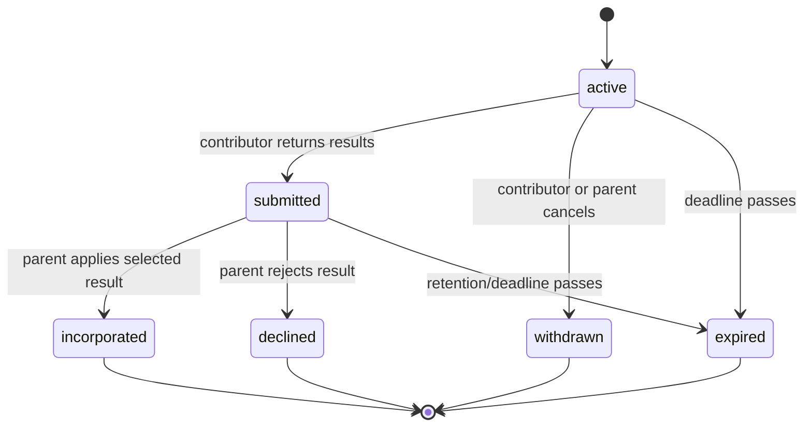

# Document Contribution Sessions

> Design proposal · September 18, 2026

## The short version

A **Document Contribution Session** is a temporary, bounded child workspace for a person to contribute a specific document result without creating a long-lived branch of work or a human-managed merge. The parent starts the session with a brief, one contributor, and named Project Docs or question cards. The contributor can use chat, research, and write documents in the child. When they are ready, they return a sealed result; the parent reviews and explicitly pulls the useful parts into its own draft.

This is the recommended V1 name for what we had been calling a “doc collaboration sub-workspace.” It says what a user can do, signals that the scope is documents, and makes the temporary nature visible. If the same primitive later supports code or other work, its broader name can simply be **Contribution Session**.

## Why a distinct session instead of an ordinary fork?

An ordinary fork remains the right tool for independent, open-ended work. A Document Contribution Session is for the much more common bounded handoff: “review these docs,” “answer these questions,” “research this decision,” or “propose a small edit.”

The difference is not merely UI language. The session has a declared purpose, a small eligible write area, a return action, and a lifetime that ends when the parent disposes of the result. That makes it practical under a single-writer workspace model without asking every reviewer or delegate to learn branch and merge mechanics.

[I1. A bounded child space enables delegated document work]

The parent owns the canonical workspace and remains the only place where accepted work is published. A contributor receives a temporary child space based on an exact committed parent snapshot, rather than the parent’s uncommitted live draft. This gives the contributor a stable context and makes the eventual result auditable.

## The experience

### Parent: start a contribution

The parent chooses a template such as **Review**, **Answer questions**, **Research**, or **Small document edit**, then supplies:

- a short brief and a single named contributor;
- the relevant Project Docs or question cards as read-only inputs;
- the expected output slots, such as `Q14 answer`, `Q15 answer`, and `research note`;
- the deadline or expiry policy.

The product shows this as “Ask for contribution,” not “fork workspace.” The parent sees an item in a **Contribution Inbox**, alongside the active session’s state.

### Contributor: do the work, then return it

The contributor can use normal chat, investigation, and document-writing tools needed to complete the brief. A persistent session header shows the purpose, allowed document area, expected slots, parent snapshot, and **Return results** action. The contributor does not need to prepare a merge or decide how to reconcile the work with changing parent drafts.

### Parent: pull selected results into the draft

When the contributor returns work, the inbox shows a concise summary, the supplied answers or documents, the exact scope of the change, and any excluded unexpected changes. The parent can:

- view the result and provenance;
- ask for a new round or follow-up;
- apply selected answers or document patches to its draft;
- decline or discard the result.

Applying is explicit. The resulting edits appear in the parent draft and follow the normal parent commit/publish flow. There is no user-facing “merge the workspace” step.

## A delegated-requirements example

Suppose a product owner is gathering requirements and asks an operations lead to answer two open questions. The parent creates an **Answer questions** session, points to the relevant Project Doc, and names `Q14` and `Q15` as expected slots.

The operations lead uses chat and source material to answer the questions and adds a short note describing assumptions. On return, the parent sees each answer separately, can accept `Q14`, request clarification on `Q15`, and retain the research note. The parent’s agent may help synthesize the returned evidence into a proposed update, but the parent still chooses exactly what is applied.

## The result is a receipt, not an unbounded child branch

[D1. A sealed receipt bounds what the parent may consume]

The child’s return is represented by a sealed **contribution receipt**. It is intentionally a thin, generic record rather than a rigid per-template data model. At minimum it contains:

- the exact parent base snapshot and child candidate snapshot;
- the contribution brief, expected slots, and declared eligible paths;
- submitted artifacts identified by repository identity and repository-relative path;
- a digest and size for each artifact;
- a complete calculated diff, including unexpected paths;
- submitter, submission time, and terminal disposition.

The receipt is the authority for incorporation. A git commit can carry convenient trailers such as `G5-Contribution-Receipt`, `G5-Contribution-Session`, and `G5-Contribution-Slots`, but commit messages and filesystem scanning are never the authoritative source of a child result.

## What the parent-side agent may do

[D2. Parent-side agents synthesize; they do not silently incorporate]

A parent-side agent can read the sealed brief and receipt, the eligible returned artifacts, and the current parent snapshot. It can summarize, compare, answer a question from cited evidence, or propose a tightly scoped patch for the parent draft.

It cannot choose unsealed child content, widen the session’s scope, mutate the parent workspace, or accept a result on the parent’s behalf. The human parent explicitly selects the suggested answer or patch, and the normal parent write/commit controls do the rest. This retains the flexibility of agents without giving a rogue or confused child an implicit merge path.

## Guardrails for a rogue or over-broad child

[D3. V1 is Project-Docs-only and excludes unexpected writes]

For V1, a Document Contribution Session permits materialized writes only within its declared Project Docs area or named document paths. Code, ontology, configuration, credentials, and remote-side changes are outside the eligible scope. They should be read-only or unavailable in the child session.

If the child nevertheless modifies source files or any other unexpected path, the system records those changes in the child audit and excludes them from the incorporation receipt. The parent cannot pull them accidentally. To consider broader work, the parent starts a new session with an explicitly expanded purpose and eligible area—or uses an ordinary fork.

This intentionally makes documents the first shipping surface. It is the smallest useful scope with clear semantics, and it avoids making an under-specified general merge mechanism part of the first release.

## How parent agents find returned documents

The parent/child relationship need not be encoded as paths visible in the parent filesystem. Instead, the parent workspace maintains a parent-scoped contribution index that resolves session state to a receipt-verified artifact manifest.

When a parent agent is asked to use a returned result, the product injects that manifest into the agent’s task context. An artifact capability such as `open_contribution_artifact(receipt_id, slot_id)` resolves only permission-checked, receipt-verified material. The agent does not search for child workspaces or infer a result from “well-labeled” commits.

When a document is incorporated, its selected content becomes an ordinary file in the parent workspace. The receipt remains the provenance link behind it; commit trailers are helpful navigation, not a discovery protocol.

## Lifetime: clean up live work, retain the audit trail

[D4. Terminal disposition reclaims live child resources]

Each session follows a small lifecycle:

Partial incorporation is not terminal: the remaining slots must be explicitly declined, discarded, or allowed to expire. Once a session reaches a terminal disposition, cleanup idempotently reclaims its live materialization—workspace state, CRDT drafts, worktree/cache, and active sessions—while retaining a compact immutable receipt and audit record under the normal retention policy.

A parent archive or soft-delete suspends and hides its contribution sessions so that the parent can still be restored. An irreversible parent deletion or retention expiry first writes a terminal `parent_deleted` disposition and then reclaims live resources. The delete UI should disclose the affected sessions and returned results before the user confirms.

## V1 boundary and path to a broader primitive

| V1: Document Contribution Session | Later: Contribution Session |
| --- | --- |
| Project Docs-only eligible writes | More resource types only after each has explicit eligibility and incorporation rules |
| Templates for review, questions, research, small doc edits | Additional templates without changing parent-pull authority |
| Explicit parent application into the draft | Same human approval and normal publish controls |
| Automatic terminal cleanup of live child state | Same receipt/audit split and lifecycle guarantees |

The proof point for V1 is simple: can a parent delegate a useful document task, receive a trustworthy bounded result, selectively pull it into a draft, and leave no forgotten workspace behind? If so, the same contribution contract can grow deliberately; it should not be generalized before that experience is proven.

## Open Questions

No open questions.

---

| Provenance | Value |
| --- | --- |
| Generated | 2026-09-18 |
| Subject | Parent-pulled, bounded document collaboration |
| Style | Balanced design explainer |
| Scope | Conversation-derived proposal; no implementation or ontology change |
| Format | Markdown |
