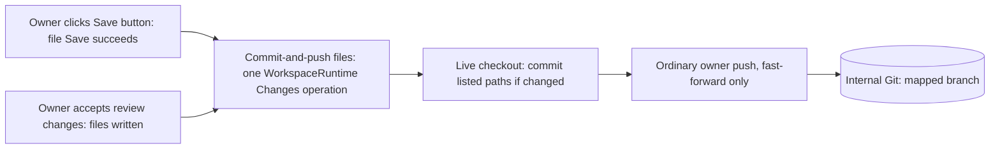

# Auto commit and push on review acceptance and editor Save

## Ontology changes and governance

**Ontology changes** — against base `35ee43a` (`design-y05`), from the [chat request](../experiments/runs/2026-09-30-claude-no-harness/y05/delivery/.g5/chat_intent/design-y05/auto-commit-push.md).

| Change | Block | Meaning |
|---|---|---|
| Modified | [`g5.git.durability.no-implicit`](../experiments/runs/2026-09-30-claude-no-harness/y05/delivery/.g5/ontology/software_architecture/durability.g5.md#keep-file-saving-separate-from-git-durability) | “No commit on Save” gains one owner-triggered exception. |
| Added | [`g5.git.commit-push`](../experiments/runs/2026-09-30-claude-no-harness/y05/delivery/.g5/ontology/software_architecture/durability.g5.md#commit-and-push-named-files-through-one-operation) | The shared operation both flows use. |
| Added | [`g5.git.commit-push.failure`](../experiments/runs/2026-09-30-claude-no-harness/y05/delivery/.g5/ontology/software_architecture/durability.g5.md#keep-partial-progress-when-commit-or-push-fails) | What a failed commit or push leaves behind, and retry. |
| Added | [`g5.documents.save.commit-push`](../experiments/runs/2026-09-30-claude-no-harness/y05/delivery/.g5/ontology/features/documents.g5.md#commit-and-push-on-the-save-button) | Save-button trigger. |
| Added | [`g5.governance.accept.commit-push`](../experiments/runs/2026-09-30-claude-no-harness/y05/delivery/.g5/ontology/features/governance.g5.md#commit-and-push-accepted-review-changes) | Review-acceptance trigger. |

Two navigation links were also added without changing any block's meaning: the `g5.story.accept-review-changes` governing-contracts line and one story-index entry. Nothing was removed.

```diff
--- a/.g5/ontology/concepts/core_user_stories.g5.md
+++ b/.g5/ontology/concepts/core_user_stories.g5.md
@@ -51,2 +51,3 @@ ## Files, documents and comments
 - [Save an edit safely](../features/documents.g5.md#require-a-file-version-before-mutation).
+- [Commit and push a saved edit](../features/documents.g5.md#commit-and-push-on-the-save-button).
 - [Upload a file](../features/documents.g5.md#upload-a-file).
--- a/.g5/ontology/features/documents.g5.md
+++ b/.g5/ontology/features/documents.g5.md
@@ -126,2 +126,8 @@ ### Keep Save explicit

+### Commit and push on the Save button
+
+[I · g5.documents.save.commit-push]
+
+When the owner clicks the editor’s Save button, save the file and then [commit and push](../software_architecture/durability.g5.md#commit-and-push-named-files-through-one-operation) it, whether or not the file has review suggestions. Ctrl-S and autosave on blur save the file only.
+
 ### Reload before editing a new attachment
@@ -515,2 +521,8 @@ ### g5.documents.save.explicit

+### g5.documents.save.commit-push
+
+- human-verified
+- [Auto commit and push](../../chat_intent/design-y05/auto-commit-push.md), requirement 2; excluding Ctrl-S and autosave is the agent's literal reading of “Save button”.
+- Unassessed · new design; source not inspected during planning.
+
 ### g5.documents.save.reload
--- a/.g5/ontology/features/governance.g5.md
+++ b/.g5/ontology/features/governance.g5.md
@@ -80,3 +80,3 @@ ### Choose whether to integrate review work

-Governing contracts: [review in a workspace you own](governance.g5.md#review-in-a-workspace-you-own), [merge is a recoverable application of pinned intent](governance.g5.md#merge-is-a-recoverable-application-of-pinned-intent).
+Governing contracts: [review in a workspace you own](governance.g5.md#review-in-a-workspace-you-own), [merge is a recoverable application of pinned intent](governance.g5.md#merge-is-a-recoverable-application-of-pinned-intent), [commit and push accepted review changes](governance.g5.md#commit-and-push-accepted-review-changes).

@@ -108,2 +108,8 @@ ### Finish review without discarding child work

+### Commit and push accepted review changes
+
+[I · g5.governance.accept.commit-push]
+
+When the source owner accepts reviewer-proposed changes, [commit and push](../software_architecture/durability.g5.md#commit-and-push-named-files-through-one-operation) the affected files, including reviewer-created files the owner accepts.
+
 ### Approval is a human authority
@@ -232,2 +238,8 @@ ### g5.governance.review-workspace.finish

+### g5.governance.accept.commit-push
+
+- human-provided
+- [Auto commit and push](../../chat_intent/design-y05/auto-commit-push.md), requirement 1.
+- Unassessed · new design; source not inspected during planning.
+
 ### g5.governance.approval
--- a/.g5/ontology/software_architecture/durability.g5.md
+++ b/.g5/ontology/software_architecture/durability.g5.md
@@ -14,3 +14,19 @@ ## Keep file saving separate from Git durability

-Do not create periodic platform commits, a manual Flush-now control or a commit on Save.
+Do not create periodic platform commits, a manual Flush-now control or a commit on Save, except through the owner-triggered [commit-and-push operation](#commit-and-push-named-files-through-one-operation).
+
+## Commit and push named files through one operation
+
+[I · g5.git.commit-push]
+
+One shared operation takes a list of files, commits only their changes, including new files, and pushes each affected member’s mapped branch. Unchanged files create no commit. [Review acceptance](../features/governance.g5.md#commit-and-push-accepted-review-changes) and the [editor’s Save button](../features/documents.g5.md#commit-and-push-on-the-save-button) both use it.
+
+Governing: it is a [live-runtime](workspace.g5.md#one-live-runtime-facade) Changes operation, so [branch association](../features/documents.g5.md#check-branch-association-before-ui-mutations) and the ordinary [owner push rules](#git-network-writes-are-bounded-by-ownership-and-cas) apply.
+
+## Keep partial progress when commit or push fails
+
+[D · g5.git.commit-push.failure]
+
+A failed step keeps what already succeeded: written files stay written and a created commit stays local. Nothing is rolled back or force-pushed, so a rejected push never overwrites remote work and the owner resolves it with ordinary Git. Repeating the operation creates no second commit and pushes what remains.
+
+Saved, committed and pushed are separate [outcomes](../concepts/data_model.g5.md#report-outcomes-from-their-authoritative-owners); this is the operation’s [retry contract](../concepts/system_design_principles.g5.md#make-failures-and-retries-explicit).

@@ -191,4 +207,16 @@ ### g5.git.durability.no-implicit
 - human-verified
-- From [C009/C051/C054](../../uplift/g5-lean/candidates/contracts.md), [H066/H077](../../uplift/g5-lean/candidates/human-decisions.md).
-- ~90% · file Save and lifecycle flush routes; complete legacy hidden-commit audit outstanding.
+- From [C009/C051/C054](../../uplift/g5-lean/candidates/contracts.md), [H066/H077](../../uplift/g5-lean/candidates/human-decisions.md); the owner-triggered exception is from [auto commit and push](../../chat_intent/design-y05/auto-commit-push.md).
+- ~90% · prior estimate, not reassessed for the exception. File Save and lifecycle flush routes; complete legacy hidden-commit audit outstanding.
+
+### g5.git.commit-push
+
+- human-provided
+- [Auto commit and push](../../chat_intent/design-y05/auto-commit-push.md), requirement 3 and its no-empty-commit rule; the governing line is the agent's application of existing owners.
+- Unassessed · new design; source not inspected during planning.
+
+### g5.git.commit-push.failure
+
+- agent
+- Design decision for [auto commit and push](../../chat_intent/design-y05/auto-commit-push.md); never forcing protects work landed by a [workspace-target merge](../features/governance.g5.md#respect-live-target-ownership-during-merge).
+- Unassessed · new design; source not inspected during planning.

```

**Relevant and governing ontology**

| Ontology block | Why relevant | Enforce or consider for this feature |
|---|---|---|
| [g5.security.admission](../experiments/runs/2026-09-30-claude-no-harness/y05/delivery/.g5/ontology/concepts/security.g5.md#admit-actions-against-current-authority) | Both flows mutate a live workspace. | Recheck current authority, stop/transfer gates and healthy incarnation. |
| [g5.architecture.runtime_facade](../experiments/runs/2026-09-30-claude-no-harness/y05/delivery/.g5/ontology/software_architecture/workspace.g5.md#one-live-runtime-facade) | Both callers need authorized runtime access. | Use WorkspaceRuntime with actor, exact incarnation, deadline and request identity. |
| [g5.architecture.commands](../experiments/runs/2026-09-30-claude-no-harness/y05/delivery/.g5/ontology/software_architecture/boundaries.g5.md#keep-complete-operations-with-their-state-owner) | Two flows share commit/push policy. | Call one owner operation; keep Git policy out of callers. |
| [g5.git.network](../experiments/runs/2026-09-30-claude-no-harness/y05/delivery/.g5/ontology/software_architecture/durability.g5.md#git-network-writes-are-bounded-by-ownership-and-cas) | The operation pushes as the user. | Require current-owner authority, open live admission and the stop barrier. |
| [g5.git.network.cas](../experiments/runs/2026-09-30-claude-no-harness/y05/delivery/.g5/ontology/software_architecture/durability.g5.md#update-mapped-branches-through-exact-old-oid-cas) | The remote can advance before push. | Update the mapped branch with exact old-OID CAS. |
| [g5.documents.association](../experiments/runs/2026-09-30-claude-no-harness/y05/delivery/.g5/ontology/features/documents.g5.md#check-branch-association-before-ui-mutations) | The user may switch checkout branches. | Refuse mutations when HEAD differs from the mapped branch. |
| [g5.documents.save](../experiments/runs/2026-09-30-claude-no-harness/y05/delivery/.g5/ontology/features/documents.g5.md#save-binds-bytes-and-the-attachment-they-came-from) | Save may outlive its VM attachment. | Apply mutation preconditions to the editor’s observed incarnation. |
| [g5.documents.save.acknowledgment](../experiments/runs/2026-09-30-claude-no-harness/y05/delivery/.g5/ontology/features/documents.g5.md#acknowledge-only-the-submitted-edits) | Git can fail after Save succeeds. | Retain the submitted-content acknowledgment; preserve later unsaved edits. |
| [g5.git.exclusions](../experiments/runs/2026-09-30-claude-no-harness/y05/delivery/.g5/ontology/software_architecture/durability.g5.md#keep-platform-artifacts-outside-native-git) | Selected files can include platform artifacts. | Exclude runtime/session artifacts and credentials; retain eligible product configuration. |
| [g5.governance.publish](../experiments/runs/2026-09-30-claude-no-harness/y05/delivery/.g5/ontology/features/governance.g5.md#publish-existing-work-under-the-actors-provider-authority) | PR publication consumes pushed work. | Keep publication on existing pushed OIDs; do not add implicit commit-all. |

## Outcome and scope

The owner's Save-button click and the owner's acceptance of review changes each end with the affected files committed and pushed to the workspace branch, through one shared operation.

Unchanged: Ctrl-S, autosave, upload, rename, delete, agent writes and pull-request publication.

## High-level design



Both triggers finish by calling one new `WorkspaceRuntime` Changes operation with their list of files. The Workspace runtime owns it and runs it in the live checkout. For each affected member repository it checks the mapped branch, commits only the listed paths if they differ from HEAD (adding new files), then pushes through the existing owner push path, where Git policy still decides. Each trigger owns only its own write and its file list: the Save button passes the saved file once the existing file Save succeeds; review acceptance passes the accepted files, created ones included. Running it as the owner's native Git keeps checkout, branch and remote consistent and reuses existing admission and push rules.

Expect three touch points: the Changes operation behind `WorkspaceRuntime`, the editor's Save-button handler and the review-acceptance handler.

| Step | If it fails | Recovery, by the owner |
|---|---|---|
| 1. Trigger writes the files | Nothing is committed | Existing Save conflict handling |
| 2. Commit the listed paths | Files stay written and uncommitted | Repeat the trigger, or commit with Git |
| 3. Push the mapped branch | Commit stays local and shows as unpushed; never forced | Next commit-and-push, the retained Push or `git push`; a diverged branch is reconciled with Git first |

A lost reply is safe to retry: the repeat finds unchanged files, creates no commit and pushes what is left. Git state is the only record.

Rejected alternatives:

- **Control-plane commit to the internal ref.** It leaves the live checkout behind its own branch and needs new ref-write authority.
- **Durable operation record with background push retry.** It adds a mechanism for state Git already holds ([`g5.design.minimal-mechanism`](../experiments/runs/2026-09-30-claude-no-harness/y05/delivery/.g5/ontology/concepts/system_design_principles.g5.md#justify-each-new-mechanism)).
- **Browser chaining the existing Save, commit and Push calls.** That is not one reusable function, and callers would assemble the policy.

## Acceptance outcomes

Each is also an end-to-end test case for implementation.

1. Save button on an edited file: the file is saved, one new commit contains only that file, and the remote branch is at that commit. The same holds when the file has review suggestions.
2. Ctrl-S or autosave: the file is saved and no commit is created.
3. Save button when the content equals HEAD, or on an ignored file: no commit.
4. Accepting review changes that modify files and add a reviewer-created file: one pushed commit per member repository, holding exactly the accepted files including the new one.
5. Other dirty or staged files are untouched by either flow.
6. Push rejected because the remote is ahead: the commit stays local, the result says saved and committed but not pushed, and the remote is unchanged.
7. HEAD off the mapped branch, a nonowner, or a stopped workspace: no commit and no push.
8. Repeating the same request creates no second commit.

## Risks and assumptions

- Every Save-button click now advances the remote branch. Small commits accumulate, and approvals of the earlier SHA go stale ([`g5.governance.approval.version`](../experiments/runs/2026-09-30-claude-no-harness/y05/delivery/.g5/ontology/features/governance.g5.md#bind-human-approval-to-the-version-reviewed)).
- The push also delivers earlier unpushed local commits. A commit is per file, so uncommitted edits already in a listed file go with it, including an agent's under the [shared checkout](../experiments/runs/2026-09-30-claude-no-harness/y05/delivery/.g5/ontology/features/documents.g5.md#disclose-concurrent-work-in-the-shared-checkout).
- Assumptions to check in source before relying on them:
  - Acceptance writes the accepted content, created files included, into the owner's live checkout and knows the affected paths.
  - The retained Changes Push can serve the push step without forcing.
  - The editor can tell the Save button apart from Ctrl-S and autosave.

## Open questions

1. **Should Ctrl-S behave like the Save button?** The design says no. It reads “Save button” literally, as the only exception to the standing “no commit on Save” decision. If Ctrl-S should commit too, one sentence in `g5.documents.save.commit-push` changes. Autosave stays excluded either way.

## Review summary

Self-review in this session against the design guide: outcomes and refusals, the operation's owner and callers, actor authority, and the save, commit and push failure and retry path.

A second pass from the lifecycle, governance and runtime pages added the never-force rule, the bounded-slot row and the approval-staleness risk. Stop needs no change: the operation drains as a mutation, and the shutdown flush captures a commit left local.

Only ontology was read; no application source.
