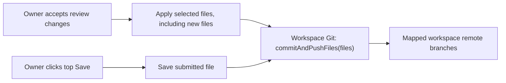

# Commit and push on owner acceptance and Save

## Ontology changes and governance

**Ontology changes:** compared with `f44a4b7` (initial HEAD):

- Modified [g5.story.accept-review-changes](../experiments/runs/2026-09-30-astra-no-harness/w03/delivery/.g5/ontology/features/governance.g5.md#choose-whether-to-integrate-review-work) and [g5.git.durability.no-implicit](../experiments/runs/2026-09-30-astra-no-harness/w03/delivery/.g5/ontology/software_architecture/durability.g5.md#limit-automatic-commits-to-explicit-actions).
- Added [g5.documents.save.publish](../experiments/runs/2026-09-30-astra-no-harness/w03/delivery/.g5/ontology/features/documents.g5.md#commit-and-push-from-the-top-save-button) and [g5.architecture.git.commit-files](../experiments/runs/2026-09-30-astra-no-harness/w03/delivery/.g5/ontology/software_architecture/git_governance.g5.md#commit-and-push-selected-files), with API navigation. No removed blocks.

<details>
<summary>Exact ontology diff, including metadata</summary>

```diff
diff --git a/.g5/ontology/features/documents.g5.md b/.g5/ontology/features/documents.g5.md
index 2b4c663..f87673a 100644
--- a/.g5/ontology/features/documents.g5.md
+++ b/.g5/ontology/features/documents.g5.md
@@ -126,2 +126,8 @@ Save obeys [durability boundaries](../software_architecture/durability.g5.md) an

+### Commit and push from the top Save button
+
+[I · g5.documents.save.publish]
+
+When the workspace owner clicks the Save button at the top of the editor, save that file and pass it to [shared commit-and-push](../software_architecture/git_governance.g5.md#commit-and-push-selected-files), whether or not it has review suggestions.
+
 ### Reload before editing a new attachment
@@ -515,2 +521,8 @@ Partial incorporation does not terminalize a future contribution session.

+### g5.documents.save.publish
+
+- human-provided
+- [Automatic commit and push](../../chat_intent/design-w03/save-and-accept-push.md), requirement 2.
+- Unassessed · new Save-button Git behavior; source and tests not inspected during planning.
+
 ### g5.documents.save.reload
diff --git a/.g5/ontology/features/governance.g5.md b/.g5/ontology/features/governance.g5.md
index 1ab3040..f565ab2 100644
--- a/.g5/ontology/features/governance.g5.md
+++ b/.g5/ontology/features/governance.g5.md
@@ -76,3 +76,3 @@ Governing contracts: [review in a workspace you own](governance.g5.md#review-in-

-As a source owner, I can choose whether to integrate a reviewer's proposed changes.
+As a source owner, I can choose whether to integrate a reviewer's proposed changes; acceptance applies the selected changes and passes affected files, including reviewer-created new files, to [shared commit-and-push](../software_architecture/git_governance.g5.md#commit-and-push-selected-files).

@@ -210,5 +210,5 @@ Apply the [failure and retry principle](../concepts/system_design_principles.g5.

-- agent
-- From [review-workspace lineage](../../uplift/g5-lean/investigations/product-operations.md#p04--review-workspaces-are-a-consequential-later-addition); [v9](../../../docs/lean-backend-design-v9.md) target-owner rule.
-- ~75% of retained composition · workspace_review_service.rs, workspace PR services; handback proposals exist; complete target-owner merge authorization and recovery remain unassessed.
+- human-provided
+- [Automatic commit and push](../../chat_intent/design-w03/save-and-accept-push.md), requirement 1; [review-workspace lineage](../../uplift/g5-lean/investigations/product-operations.md#p04--review-workspaces-are-a-consequential-later-addition) and [v9](../../../docs/lean-backend-design-v9.md) target-owner rule.
+- ~75% prior retained-composition baseline, not reassessed · workspace_review_service.rs, workspace PR services; handback proposals exist; automatic commit/push including new files, complete target-owner merge authorization and recovery remain unassessed.

diff --git a/.g5/ontology/software_architecture/durability.g5.md b/.g5/ontology/software_architecture/durability.g5.md
index e24d3cb..70d404b 100644
--- a/.g5/ontology/software_architecture/durability.g5.md
+++ b/.g5/ontology/software_architecture/durability.g5.md
@@ -10,3 +10,3 @@ Native push and a complete verified shutdown/fork flush are repository durabilit

-## Keep file saving separate from Git durability
+## Limit automatic commits to explicit actions

@@ -14,3 +14,3 @@ Native push and a complete verified shutdown/fork flush are repository durabilit

-Do not create periodic platform commits, a manual Flush-now control or a commit on Save.
+Do not create periodic platform commits or a manual Flush-now control. Only the [top Save-button flow](../features/documents.g5.md#commit-and-push-from-the-top-save-button) adds commit-and-push to file saving.

@@ -191,4 +191,4 @@ Native Git must exclude runtime/cache/session/layout and staging artifacts, whil
 - human-verified
-- From [C009/C051/C054](../../uplift/g5-lean/candidates/contracts.md), [H066/H077](../../uplift/g5-lean/candidates/human-decisions.md).
-- ~90% · file Save and lifecycle flush routes; complete legacy hidden-commit audit outstanding.
+- From [C009/C051/C054](../../uplift/g5-lean/candidates/contracts.md), [H066/H077](../../uplift/g5-lean/candidates/human-decisions.md); explicit Save-button exception from [Automatic commit and push](../../chat_intent/design-w03/save-and-accept-push.md).
+- ~90% prior whole-block baseline, not reassessed · file Save and lifecycle flush routes; the Save-button exception is unassessed; complete legacy hidden-commit audit remains outstanding.

diff --git a/.g5/ontology/software_architecture/git_governance.g5.md b/.g5/ontology/software_architecture/git_governance.g5.md
index 90c8b79..cc9fa86 100644
--- a/.g5/ontology/software_architecture/git_governance.g5.md
+++ b/.g5/ontology/software_architecture/git_governance.g5.md
@@ -18,2 +18,3 @@ and [governance](../features/governance.g5.md); post-MVP governance retains its
 | Git policy / storage adapters | Checked `/git/:repo_id` receive-pack, protected-ref import, publication and merge | [Ref effects](#git-policy-owns-authoritative-ref-effects) |
+| Workspace Git | File-list commit-and-push | [Selected files](#commit-and-push-selected-files) |
 | CoordinatedRepoPublicationService / PreparedBranchCommit / ApprovalReviewService | Prepare/apply; `land*`; approval `admit`, `settle_terminal` | [Governance coordination](#publication-and-approval-coordination) |
@@ -33,2 +34,10 @@ operations over reusable `RepoStorage`, `GitRepo` and workspace Git mechanisms.

+### Commit and push selected files
+
+[D · g5.architecture.git.commit-files]
+
+Workspace Git owns one reusable function accepting a list of repository-qualified files, so callers share file scoping and no-op handling. Commit only changes to those files, then push each affected member's mapped workspace branch to its configured remote; no file changes means no new commit.
+
+Use [authorized live operations](workspace.g5.md#one-live-runtime-facade), preserving [file boundaries](../features/documents.g5.md#file-mutation-is-confined-and-race-aware), [branch association](../features/documents.g5.md#check-branch-association-before-ui-mutations), [network authority](durability.g5.md#git-network-writes-are-bounded-by-ownership-and-cas), [Git exclusions](durability.g5.md#keep-platform-artifacts-outside-native-git) and [stable recovery identity](../concepts/system_design_principles.g5.md#make-failures-and-retries-explicit).
+
 ### Publication and approval coordination
@@ -78,2 +87,8 @@ synchronization to API maintenance through shared typed Git readers.

+### g5.architecture.git.commit-files
+
+- human-verified
+- [Automatic commit and push](../../chat_intent/design-w03/save-and-accept-push.md), requirement 3 and no-empty-commit constraint; shared Git ownership and repository-qualified scope inferred from the workspace model.
+- Unassessed · new shared operation; existing Git operations must be inspected for compatible file scope and push effects during implementation.
+
 ### g5.architecture.governance_owner
```

</details>

**Relevant and governing ontology**

| Ontology block | Why relevant | Enforce or consider for this feature |
|---|---|---|
| [g5.security.admission](../experiments/runs/2026-09-30-astra-no-harness/w03/delivery/.g5/ontology/concepts/security.g5.md#admit-actions-against-current-authority) | Both flows mutate a live workspace. | Recheck current authority, stop/transfer gates and healthy incarnation. |
| [g5.architecture.runtime_facade](../experiments/runs/2026-09-30-astra-no-harness/w03/delivery/.g5/ontology/software_architecture/workspace.g5.md#one-live-runtime-facade) | Both callers need authorized runtime access. | Use WorkspaceRuntime with actor, exact incarnation, deadline and request identity. |
| [g5.documents.save](../experiments/runs/2026-09-30-astra-no-harness/w03/delivery/.g5/ontology/features/documents.g5.md#save-binds-bytes-and-the-attachment-they-came-from) | Save may outlive its VM attachment. | Bind writes to the editor’s observed incarnation. |
| [g5.documents.files.version](../experiments/runs/2026-09-30-astra-no-harness/w03/delivery/.g5/ontology/features/documents.g5.md#require-a-file-version-before-mutation) | Saved or accepted content can be stale. | Require expected file version or create-if-absent before writing. |
| [g5.documents.save.acknowledgment](../experiments/runs/2026-09-30-astra-no-harness/w03/delivery/.g5/ontology/features/documents.g5.md#acknowledge-only-the-submitted-edits) | Editing can continue during Save. | Acknowledge submitted content only; preserve later unsaved edits. |
| [g5.documents.association](../experiments/runs/2026-09-30-astra-no-harness/w03/delivery/.g5/ontology/features/documents.g5.md#check-branch-association-before-ui-mutations) | The user may switch checkout branches. | Require symbolic HEAD to match the member’s mapped branch. |
| [g5.git.network.cas](../experiments/runs/2026-09-30-astra-no-harness/w03/delivery/.g5/ontology/software_architecture/durability.g5.md#update-mapped-branches-through-exact-old-oid-cas) | Push changes the mapped remote ref. | Use exact old-OID CAS; an absent ref grants no create permission. |
| [g5.governance.publish](../experiments/runs/2026-09-30-astra-no-harness/w03/delivery/.g5/ontology/features/governance.g5.md#publish-existing-work-under-the-actors-provider-authority) | PR publication consumes pushed work. | Keep publication on existing pushed OIDs; do not add implicit commit-all. |
| [g5.architecture.recovery](../experiments/runs/2026-09-30-astra-no-harness/w03/delivery/.g5/ontology/concepts/system_design_principles.g5.md#make-failures-and-retries-explicit) | Write, commit and push can partially succeed. | Bind retries to accepted intent; name commit points and recovery ownership. |
| [g5.data.outcome-evidence](../experiments/runs/2026-09-30-astra-no-harness/w03/delivery/.g5/ontology/concepts/data_model.g5.md#report-outcomes-from-their-authoritative-owners) | One successful step does not prove completion. | Report saved, committed and pushed states from their owners’ evidence. |

## Outcome and high-level design



Existing owner-authorized actions persist their submitted edits, then call one Workspace Git function with repository-qualified files. It commits only selected differences from HEAD and pushes the mapped remote branches, sharing scope/no-op handling without changing shortcuts, autosave or PR publication. Keep the action identity bound to its submitted file versions through write/apply and Git outcomes. A write failure stops before Git; after commit, the Git owner retains the resulting OID and reconciles/retries a failed or ambiguous push without another commit. Callers show the actual outcome and preserve later edits. Multiple repositories retain separate commit/push outcomes, not an invented cross-repository transaction.

## Acceptance and implementation risks

Real E2E coverage during implementation must verify:

- Acceptance publishes selected existing and reviewer-created files; top Save works with and without suggestions.
- Only affected files enter commits; unrelated staged/unstaged work remains untouched. No-op actions create no commit.
- Nonowners, stale versions/attachments and branch mismatches cannot mutate; edits made during Save remain unsaved.
- Write/commit failures do not push; push failure preserves the local commit and retry publishes it without duplication or false success.

**Source-inspection handoff:** verify reused Save/apply and Git operations support selected paths, untracked files, unrelated index preservation and replay/outcome evidence before reuse. No application source or tests were inspected in planning. No unresolved product questions.

## Review summary

Reviewed the request, ontology diff and design against authority, file-version, branch and recovery contracts, cross-checking the invariant index and publication/scope exceptions. Resolved the no-commit-on-Save conflict narrowly; triggers reference one shared operation. Implementation compatibility remains unassessed.
