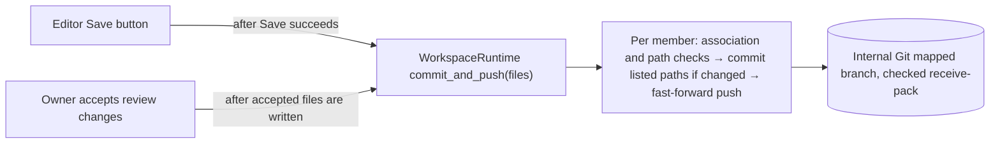

# Commit and push on review acceptance and editor Save

Intent: [chat request](../experiments/runs/2026-09-30-claude-no-harness/y06/delivery/.g5/chat_intent/design-y06/commit-and-push-on-accept-and-save.md).

## Ontology changes and governance

**Ontology changes.** Base `35ee43a` (branch `design-y06`).

- Modified `g5.git.durability.no-implicit` in [durability](../experiments/runs/2026-09-30-claude-no-harness/y06/delivery/.g5/ontology/software_architecture/durability.g5.md#add-no-periodic-commits-or-manual-flush): removes the human-verified ban on committing on Save, which this request reverses. The renamed heading had no inbound links.
- Added in [durability](../experiments/runs/2026-09-30-claude-no-harness/y06/delivery/.g5/ontology/software_architecture/durability.g5.md#commit-and-push-listed-files):
  - `g5.git.owner-commit` (I): the shared operation.
  - `g5.git.owner-commit.scope` (D): bounded effects.
  - `g5.git.owner-commit.outcome` (D): failure semantics.
- Added in [documents](../experiments/runs/2026-09-30-claude-no-harness/y06/delivery/.g5/ontology/features/documents.g5.md#commit-and-push-from-the-save-button):
  - `g5.documents.save.commit` (I): the Save button.
  - `g5.documents.save.commit-trigger` (D): Ctrl-S and autosave only save.
- Added `g5.governance.accept-commit` (I) in [governance](../experiments/runs/2026-09-30-claude-no-harness/y06/delivery/.g5/ontology/features/governance.g5.md#commit-and-push-accepted-review-changes). Modified `g5.story.accept-review-changes` to link it; its footer is unchanged.
- Navigation only: a line in the story index, and the WorkspaceRuntime API row now links the operation.

```diff
--- a/.g5/ontology/software_architecture/durability.g5.md
+++ b/.g5/ontology/software_architecture/durability.g5.md
@@ -10,3 +10,3 @@
-## Keep file saving separate from Git durability
+## Add no periodic commits or manual flush
@@ -14,3 +14,21 @@
-Do not create periodic platform commits, a manual Flush-now control or a commit on Save.
+Do not create periodic platform commits or a manual Flush-now control.
+
+## Commit and push listed files
+
+[I · g5.git.owner-commit]
+
+One shared owner operation accepts a list of files, commits their changes and pushes to the workspace’s remote branch: each affected member’s [mapped branch](../features/workspaces.g5.md#bind-member-branches-to-one-workspace-name). It creates a commit only when those files have uncommitted changes.
+
+## Keep owner commit effects bounded
+
+[D · g5.git.owner-commit.scope]
+
+Commit only the listed paths, leaving other staged or dirty work uncommitted, and push fast-forward only through the ordinary [owner push path](#git-network-writes-are-bounded-by-ownership-and-cas). Agents share the [checkout](../features/documents.g5.md#disclose-concurrent-work-in-the-shared-checkout), and a forced push could overwrite a landed merge.
+
+## Keep file changes when commit or push fails
+
+[D · g5.git.owner-commit.outcome]
+
+A failed commit or push never reverts the saved or accepted content; report each step’s [own outcome](../concepts/data_model.g5.md#report-outcomes-from-their-authoritative-owners) to the owner. An unpushed commit stays local until a later push.
@@ -191,4 +209,22 @@ (Metadata)
 ### g5.git.durability.no-implicit
 - human-verified
-- From [C009/C051/C054](../../uplift/g5-lean/candidates/contracts.md), [H066/H077](../../uplift/g5-lean/candidates/human-decisions.md).
-- ~90% · file Save and lifecycle flush routes; complete legacy hidden-commit audit outstanding.
+- From [C009/C051/C054](../../uplift/g5-lean/candidates/contracts.md), [H066/H077](../../uplift/g5-lean/candidates/human-decisions.md); Save-button commits follow the [commit-and-push request](../../chat_intent/design-y06/commit-and-push-on-accept-and-save.md).
+- ~90% · prior estimate retained, not reassessed after narrowing · lifecycle flush routes; complete legacy hidden-commit audit outstanding.
+
+### g5.git.owner-commit
+- human-provided
+- [Commit-and-push request](../../chat_intent/design-y06/commit-and-push-on-accept-and-save.md): shared function and commit-only-on-change rule.
+- Unassessed · new design; implementation not inspected.
+
+### g5.git.owner-commit.scope
+- agent
+- Design for the [commit-and-push request](../../chat_intent/design-y06/commit-and-push-on-accept-and-save.md), protecting shared-checkout work and landed merges.
+- Unassessed · new design; implementation not inspected.
+
+### g5.git.owner-commit.outcome
+- agent
+- Design for the [commit-and-push request](../../chat_intent/design-y06/commit-and-push-on-accept-and-save.md), so Git failure never loses the owner's file change.
+- Unassessed · new design; implementation not inspected.
--- a/.g5/ontology/features/documents.g5.md
+++ b/.g5/ontology/features/documents.g5.md
@@ -126,2 +126,14 @@ (after "Keep Save explicit")
+### Commit and push from the Save button
+
+[I · g5.documents.save.commit]
+
+When the owner clicks the Save button at the top of the editor, save the file, then commit and push its changes through [owner commit-and-push](../software_architecture/durability.g5.md#commit-and-push-listed-files), whether or not the file has review suggestions.
+
+### Keep keyboard and automatic saves uncommitted
+
+[D · g5.documents.save.commit-trigger]
+
+Ctrl-S and autosave on blur only save, so frequent habitual or blur-triggered saves do not create commits and pushes.
@@ -515,2 +527,14 @@ (Metadata)
+### g5.documents.save.commit
+- human-provided
+- [Commit-and-push request](../../chat_intent/design-y06/commit-and-push-on-accept-and-save.md), requirement 2.
+- Unassessed · new design; implementation not inspected.
+
+### g5.documents.save.commit-trigger
+- agent
+- Interprets the named Save button in the [commit-and-push request](../../chat_intent/design-y06/commit-and-push-on-accept-and-save.md).
+- Unassessed · new design; implementation not inspected.
--- a/.g5/ontology/features/governance.g5.md
+++ b/.g5/ontology/features/governance.g5.md
@@ -80,3 +80,3 @@ (story g5.story.accept-review-changes)
-Governing contracts: [review in a workspace you own](governance.g5.md#review-in-a-workspace-you-own), [merge is a recoverable application of pinned intent](governance.g5.md#merge-is-a-recoverable-application-of-pinned-intent).
+Governing contracts: [review in a workspace you own](governance.g5.md#review-in-a-workspace-you-own), [merge is a recoverable application of pinned intent](governance.g5.md#merge-is-a-recoverable-application-of-pinned-intent), [commit and push accepted review changes](governance.g5.md#commit-and-push-accepted-review-changes).
@@ -108,2 +108,8 @@ (after "Finish review without discarding child work")
+### Commit and push accepted review changes
+
+[I · g5.governance.accept-commit]
+
+When the owner accepts reviewer-proposed changes, commit and push the affected files, including reviewer-created new files the owner accepts, through [owner commit-and-push](../software_architecture/durability.g5.md#commit-and-push-listed-files).
@@ -232,2 +238,8 @@ (Metadata)
+### g5.governance.accept-commit
+- human-provided
+- [Commit-and-push request](../../chat_intent/design-y06/commit-and-push-on-accept-and-save.md), requirement 1.
+- Unassessed · new design; implementation not inspected.
--- a/.g5/ontology/concepts/core_user_stories.g5.md
+++ b/.g5/ontology/concepts/core_user_stories.g5.md
@@ -51,2 +51,3 @@
 - [Save an edit safely](../features/documents.g5.md#require-a-file-version-before-mutation).
+- [Commit and push a saved file](../features/documents.g5.md#commit-and-push-from-the-save-button).
--- a/.g5/ontology/software_architecture/workspace.g5.md
+++ b/.g5/ontology/software_architecture/workspace.g5.md
@@ -19 +19 @@
-| WorkspaceRuntime | `RuntimeRequest`; `file_*`, `workspace_changes*`, `modules_*`, `open_owner_stream` | [Authorized live access](#one-live-runtime-facade) |
+| WorkspaceRuntime | `RuntimeRequest`; `file_*`, `workspace_changes*`, `modules_*`, `open_owner_stream` | [Authorized live access](#one-live-runtime-facade), [owner commit-and-push](durability.g5.md#commit-and-push-listed-files) |
```

(The metadata hunks omit blank lines between bullets for brevity. `git diff 35ee43a -- .g5/ontology` shows the exact diff.)

**Relevant and governing ontology**

| Ontology block | Why relevant | Enforce or consider for this feature |
|---|---|---|
| [g5.workspace.identity.branch](../experiments/runs/2026-09-30-claude-no-harness/y06/delivery/.g5/ontology/features/workspaces.g5.md#bind-member-branches-to-one-workspace-name) | Acceptance can span member repositories. | Resolve each member’s target from its mapped workspace branch. |
| [g5.git.network](../experiments/runs/2026-09-30-claude-no-harness/y06/delivery/.g5/ontology/software_architecture/durability.g5.md#git-network-writes-are-bounded-by-ownership-and-cas) | The operation pushes as the user. | Require current-owner authority, open live admission and the stop barrier. |
| [g5.git.network.cas](../experiments/runs/2026-09-30-claude-no-harness/y06/delivery/.g5/ontology/software_architecture/durability.g5.md#update-mapped-branches-through-exact-old-oid-cas) | The remote can advance before push. | Update the mapped branch with exact old-OID CAS. |
| [g5.governance.publish](../experiments/runs/2026-09-30-claude-no-harness/y06/delivery/.g5/ontology/features/governance.g5.md#publish-existing-work-under-the-actors-provider-authority) | PR publication consumes pushed work. | Keep publication on existing pushed OIDs; do not add implicit commit-all. |
| [g5.documents.association](../experiments/runs/2026-09-30-claude-no-harness/y06/delivery/.g5/ontology/features/documents.g5.md#check-branch-association-before-ui-mutations) | The user may switch checkout branches. | Refuse mutations when HEAD differs from the mapped branch. |
| [g5.documents.files](../experiments/runs/2026-09-30-claude-no-harness/y06/delivery/.g5/ontology/features/documents.g5.md#file-mutation-is-confined-and-race-aware) | Both flows mutate selected paths. | Use root-relative no-follow access; reject escapes, symlinks and protected paths. |
| [g5.documents.save](../experiments/runs/2026-09-30-claude-no-harness/y06/delivery/.g5/ontology/features/documents.g5.md#save-binds-bytes-and-the-attachment-they-came-from) | Save may outlive its VM attachment. | Apply mutation preconditions to the editor’s observed incarnation. |
| [g5.architecture.runtime_facade](../experiments/runs/2026-09-30-claude-no-harness/y06/delivery/.g5/ontology/software_architecture/workspace.g5.md#one-live-runtime-facade) | Both callers need authorized runtime access. | Use WorkspaceRuntime with actor, exact incarnation, deadline and request identity. |
| [g5.runtime.operations-identity](../experiments/runs/2026-09-30-claude-no-harness/y06/delivery/.g5/ontology/software_architecture/runtime.g5.md#taskless-operations-still-have-execution-identity) | Commit/push is a taskless Changes operation. | Use facade-issued replay/cancel identity and bounded slots; create no synthetic task. |
| [g5.documents.read.live-cache](../experiments/runs/2026-09-30-claude-no-harness/y06/delivery/.g5/ontology/features/documents.g5.md#invalidate-live-content-when-authority-changes) | Results may arrive after attachment changes. | Discard obsolete results; never restore invalidated editor or proposal state. |

## Scope

In scope: the Save-button flow, the review-acceptance flow and the one operation they share. Out of scope: commits from Ctrl-S or autosave, provider publication, and merge-based integration (`g5.governance.merge*`, unchanged).

## Design



The Workspace module owns one taskless `WorkspaceRuntime` Changes operation, `commit_and_push(files)`. Each file is a (member repository, path) pair, and the operation runs under the caller's actor, observed incarnation and request identity.

For each affected member, the operation:

1. Checks branch association and path confinement.
2. Commits the listed paths if they differ from HEAD. It stages new and deleted listed files and leaves the rest of the index and working tree untouched.
3. Pushes the mapped branch fast-forward only, as the owner, through the checked receive-pack.

It returns separate commit and push results for each member.

The Save button calls the operation with the saved file only after Save succeeds. Review acceptance calls it with exactly the files the owner accepted, including accepted new files, after writing them.

Why this shape:

- **One owner** keeps commit and push policy in one place for both flows.
- **Committing in the live checkout** keeps the owner's local branch equal to its remote. A server-side commit would leave the checkout behind its remote.
- **Pushing through the owner's ordinary path** keeps Git policy as the single gate for ref writes.
- **No rollback:** Git failure is reported as a failed step and never undoes saved or accepted content. A local commit is sent by the owner's next push and is still captured by shutdown flush.

## Acceptance outcomes

- Save button on an edited file: the file is saved, and one new commit containing only that file is pushed to the member's mapped branch.
- Save button when the file already matches HEAD: no commit is created. Any earlier unpushed commit is pushed.
- Save button on a file with review suggestions: same result as an edited file. The suggestions are untouched.
- Ctrl-S or autosave: the file is saved, with no commit or push.
- Accepting modified files and reviewer-created files: one commit per affected member contains exactly the accepted files, and each member is pushed. Unaccepted proposals and other dirty or staged work stay uncommitted. If acceptance changes no content, no commit is created.
- Push rejected or remote unreachable: content and the local commit are kept, and the push is never forced. The owner sees "committed, not pushed".
- Commit refused (branch mismatch, stale or stopping VM, protected path, Git lock): content is kept, and the owner sees the failure.
- Retry with the same request identity: no second commit.

## Risks and assumptions for coding

- **Risk:** if an agent writes a listed file between Save and commit, that write is included in the commit. The shared-checkout rule already accepts last-writer-wins.
- **Risk:** the push also sends earlier unpushed local commits, including agents' commits.
- **Risk:** acceptance across several members is not atomic, so results are reported per member.
- **Inspect in code:** does acceptance write accepted content, including new files, into the owner's live checkout without already committing? If it instead lands a server-side handback merge, that path already creates commits.
- **Inspect in code:** is the top Save button distinct from Ctrl-S and autosave in the source, spec and question editors?
- **Inspect in code:** is the retained Changes Push a fast-forward-only owner push? If so, reuse it.

## Open questions

- Should Ctrl-S behave exactly like the Save button? `g5.documents.save.commit-trigger` currently says no: only the button the request names commits, so that frequent keyboard saves do not create commits. Edit that block if Ctrl-S should match.

## Review summary

Source-free review against the design guide, with these results:

- **Requirement fit:** all three human requirements and the commit-only-on-change rule map to `human-provided` I blocks.
- **Ownership and API:** one Workspace operation; consumers link to it rather than restating it.
- **Authority:** the owner push path, admission, association and path confinement all apply.
- **Retry and failure:** replay identity, per-step outcomes, fast-forward-only push and no rollback.
- **Consistency:** the conflicting commit-on-Save ban is removed, and no rule is duplicated.
- **Mechanical checks:** block and footer pairing, ID uniqueness and all new links pass.

A second retrieval pass through scope exclusions and agent Git rules added `g5.scope.review-product` and found no other conflict.
