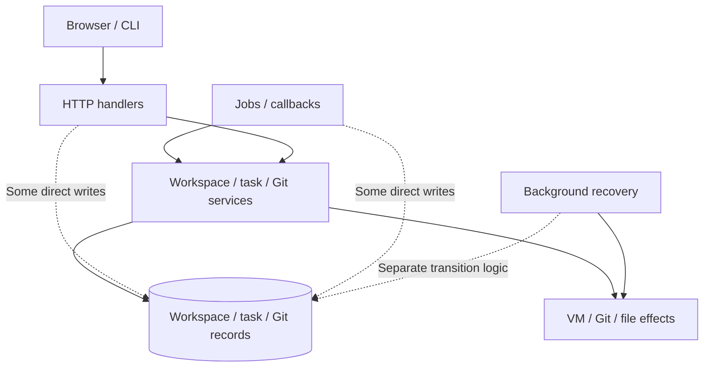
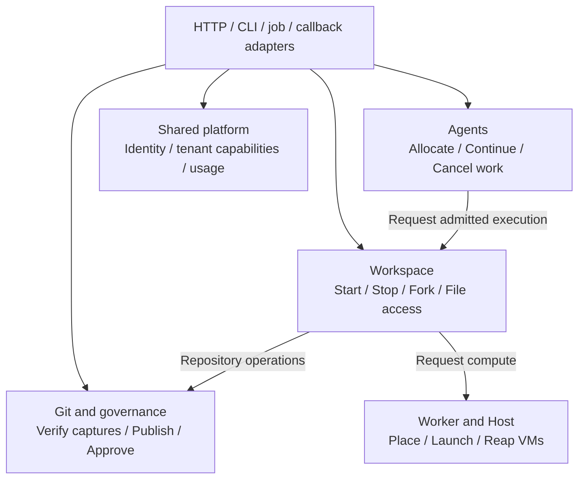

# G5 refactor at a glance

**The goal: give each important operation one responsible owner, so a feature can
reuse it without rebuilding its rules.**

This is a short explanation of the proposed refactor, not a completed implementation.
The diagrams simplify the audit's findings and show selected relationships.

## Before: callers need to know too much

G5 already has services and useful boundaries. The gaps appear where routes, jobs
and recovery code independently assemble workflows or change another owner's state.

**Consequence:** adding a caller can mean rediscovering permissions, write order,
identity checks and retry rules. Different paths can implement different answers.

## After: callers use complete operations

Each capability box below exposes operations and keeps its state-changing rules,
private writes and recovery behind that interface. Arrows mean calls through those
interfaces.

These are responsibility boundaries across existing code. They can share a process
and database. Collaborating owners can participate in one transaction so an operation
still succeeds or fails as a whole.

| Design question | Before: gaps identified in the audit | After: intended contract |
|---|---|---|
| What does a caller request? | Several low-level steps in the right order | A meaningful operation, such as allocating a task |
| Who may change state? | Multiple paths can bypass the responsible service | Its owner validates and performs private writes |
| Who handles a retry or crash? | Callers and background loops reconstruct progress | The operation's owner defines recovery and safe retries |
| What must a developer understand? | Hidden rules across several paths | Public contracts and the internals of the owners being changed |

## Example: add a new kind of job

**Before:** JobService directly creates task, initial-input and session records.
A new job path can copy that sequence and miss a rule enforced elsewhere.

**After:** JobService calls TaskService's complete allocation operation. TaskService
creates the task and input, composing ChatService's session operation in the same
transaction. Job-specific code supplies inputs; the existing owners maintain their
rules. Execution still goes through Workspace admission.

The frontend follows the same principle: both editors use one Save contract that
tracks the submitted content and rejects stale replies. Saving retains its existing
behavior without implicitly committing or pushing Git changes.

## What keeps the boundaries intact?

- **Ontology:** names each owner, its operations, promises and allowed collaborators.
- **Agent skills:** guide agents to those contracts and existing operations before editing.
- **Code checks:** private interfaces and dependency checks reject bypasses; behavior
  tests exercise valid calls, failures and retries. Selected formal models investigate
  difficult protocols, with their assumptions stated.

The expected benefit is less duplicated reasoning and fewer places to repair when a
rule changes. Features spanning several capabilities still require coordinated work.
The experiment will measure whether incremental changes actually become faster and
more reliable.

Details: [gap closure plan](gap_closure_plan.md#9-gap-closure-plan) ·
[PR scope and comparison protocol](ontology-plan.md) ·
[existing architecture](../../../.g5/ontology/concepts/software_architecture.md).
