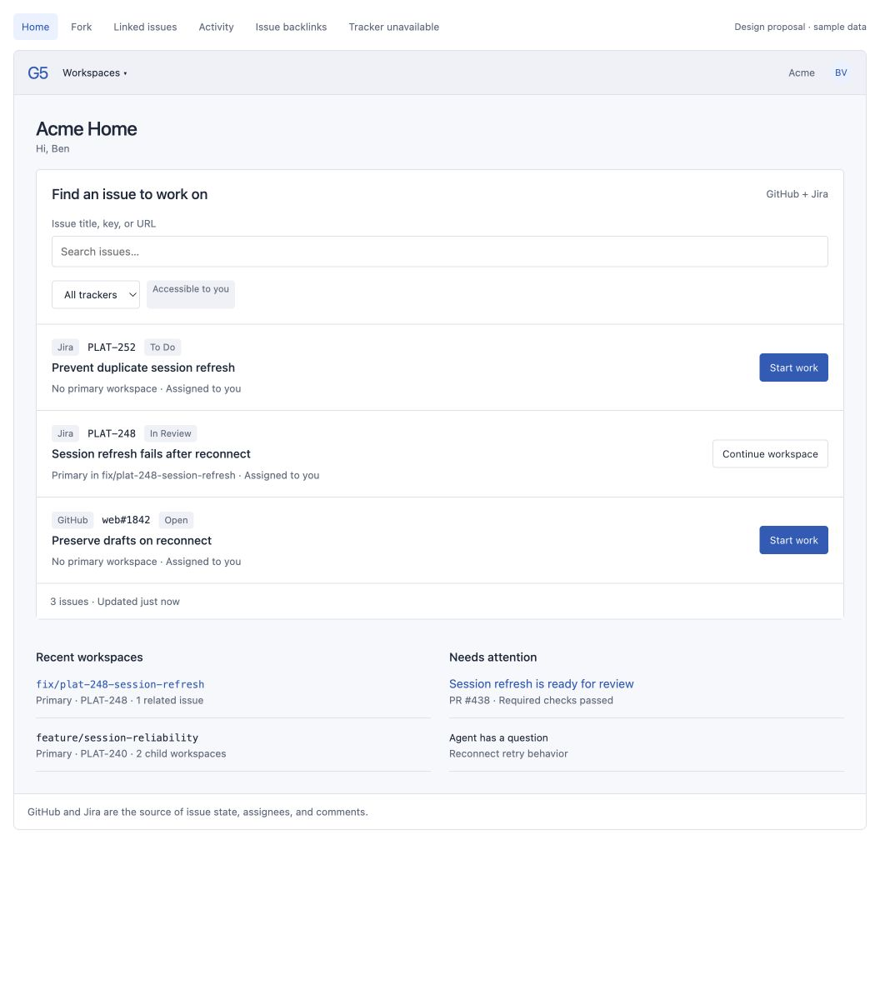
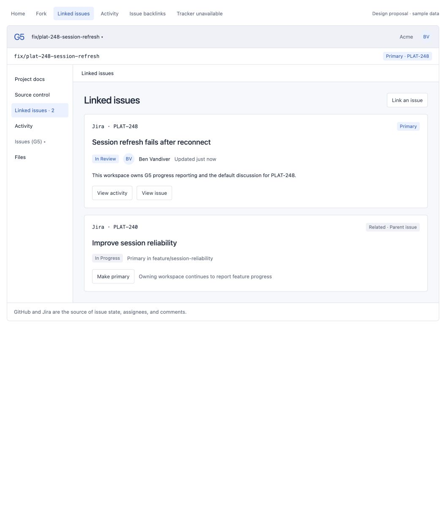
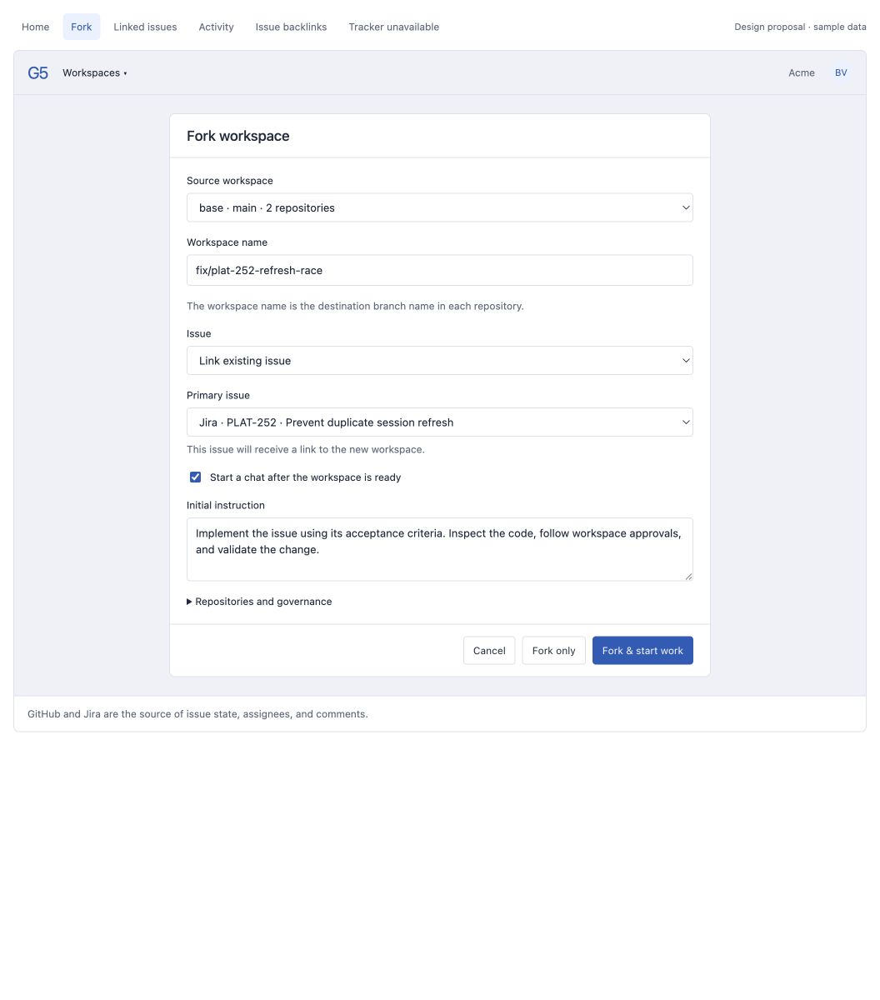
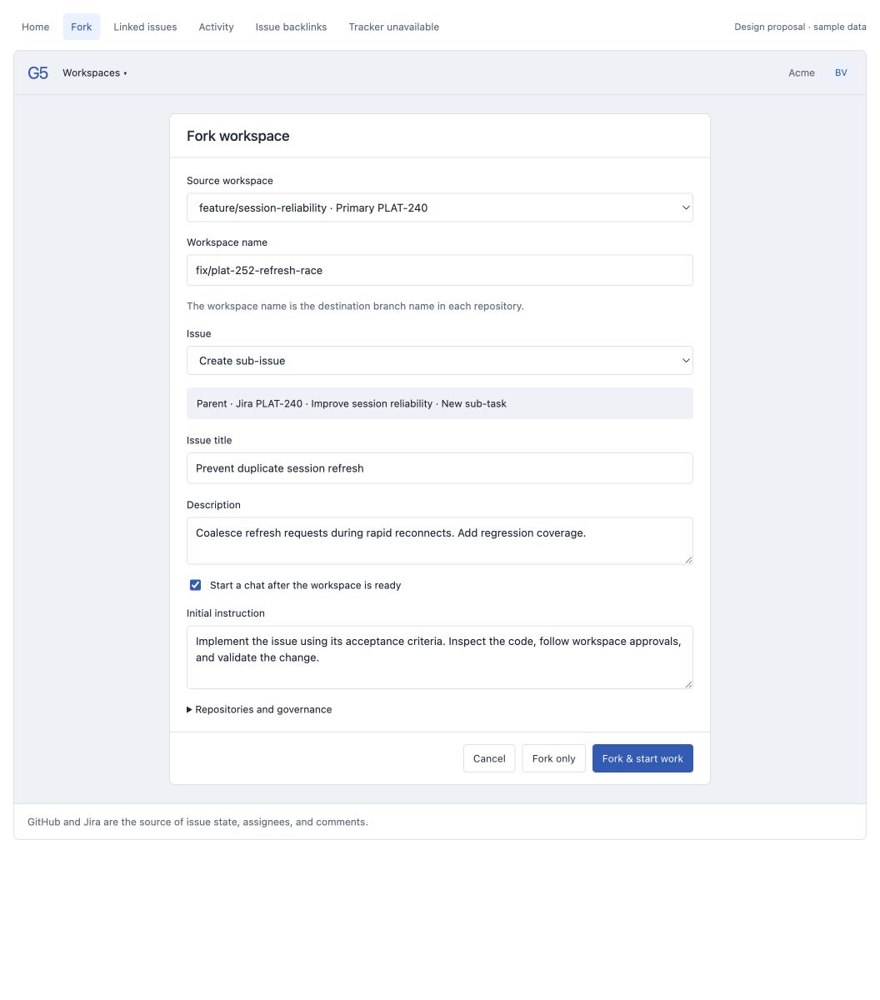
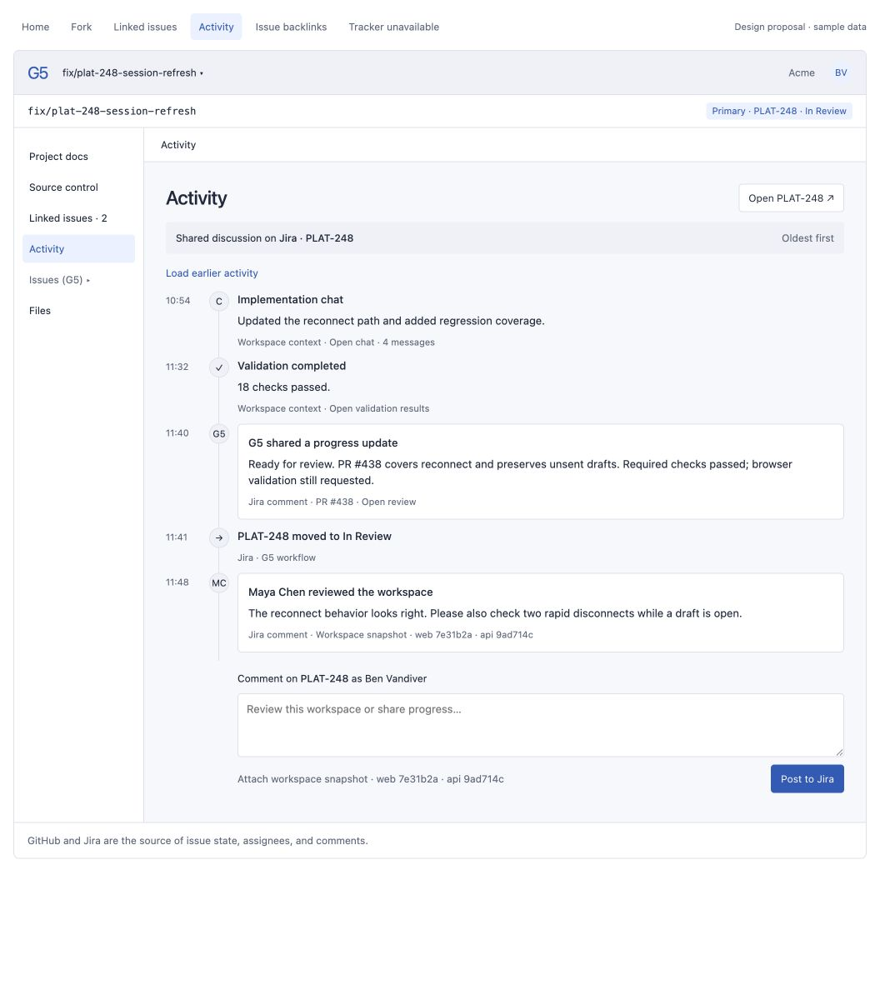
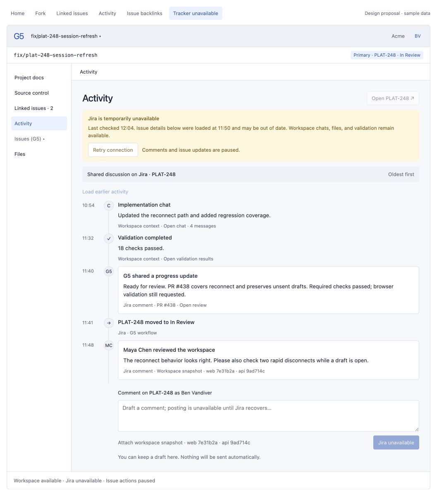
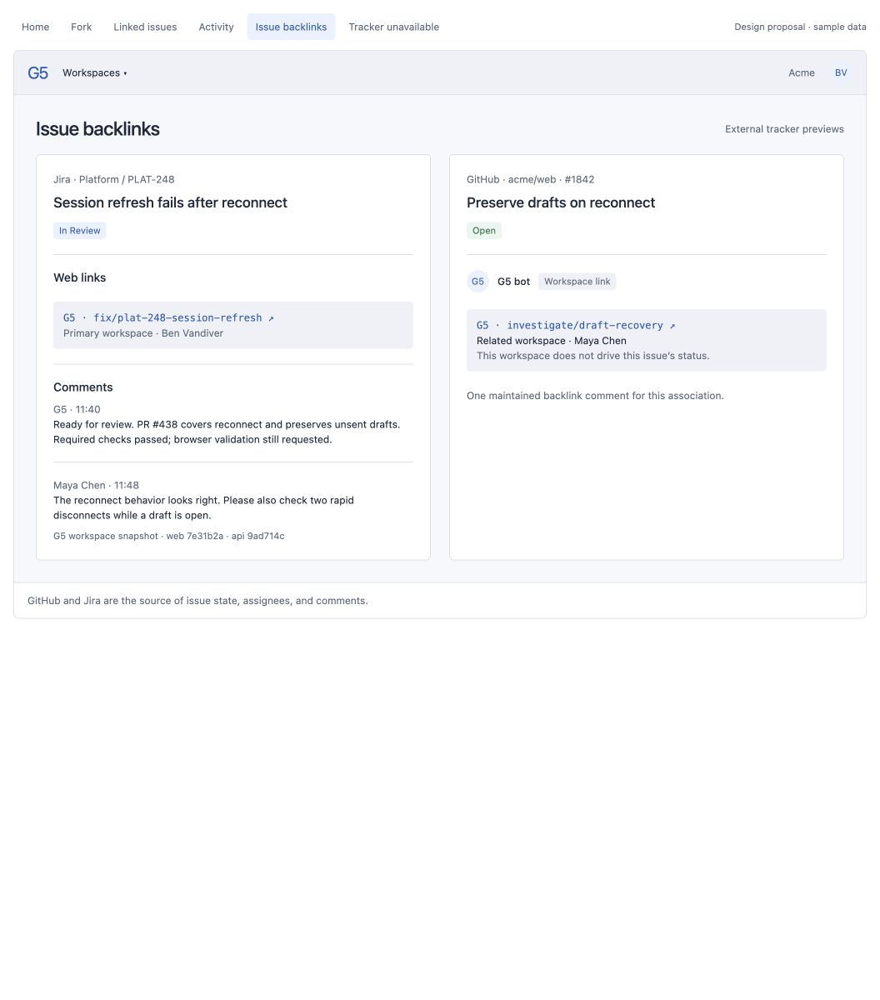

# G5 external issue integration design

Design proposal · 22 September 2026 · Product and engineering

G5 should let people start from an external issue, work in a linked workspace, and report progress through the issue tracker their organization already uses. GitHub Issues is required from the first release; Jira Cloud is the second initial integration. Jira Data Center is outside the initial scope. The primary issue is the shared discussion and progress destination; G5 presents that discussion alongside links to its existing execution records.

This document consolidates the discussion and its later simplifications. It proposes the replacement for the existing local G5 issue feature, which is removed rather than migrated (see [Retiring local issues](#retiring-local-issues)); it is not an implementation. Product decisions below reflect the conversation; API shapes, operational records, and rollout details are implementation recommendations for review.

The [interactive mocks](mocks/external-issues/index.html) use sample data and perform no real tracker or workspace actions. Screenshots are included below. This Markdown document is the authoritative design.

## Decisions and scope

1. A workspace can have zero or more external issue links and at most one primary issue.
2. An external issue can be primary for at most one workspace in a G5 organization. Other workspaces can link it as related.
3. A feature workspace normally owns the feature issue; child workspaces own sub-issues. Workspace and issue hierarchies remain separate structures.
4. Shared workspace discussion and review comments live on the primary issue. G5 does not introduce another authoritative activity journal or issue-comment database.
5. Activity is chronological: oldest at the top, newest and the composer at the bottom.
6. Store external issue identity directly on `workspace_issue_links`. Do not add `external_issue_refs` in the first version.
7. Issue association is optional when forking. Users can link an existing issue or create an issue, including a sub-issue of the source workspace’s primary issue.
8. The fork primitive accepts an `after_fork` argument, including starting a chat without an issue. The API admits this intent durably, while a separate record keyed by fork ID owns issue setup and follow-on execution after workspace creation.
9. GitHub Issues support is mandatory from the first release. Target Jira Cloud for Jira support. Use a GitHub App and, as the recommended Jira authentication architecture, a Forge app connected to G5 through Forge Remote.
10. G5's formal approval and merge operations define the default completion boundary. Current final approval marks readiness; successful merge into the intended target marks Done. An individual working agent cannot declare either milestone through chat or an issue update.
11. Deleting a workspace removes all its issue associations and releases its primary claim. Another workspace can then claim that issue; deletion does not delete or change the state of the external issue.
12. In the first release, G5 writes only to administrator-approved non-public repositories/projects. Public issues remain usable for reading, local association, and starting work. Automated publications use constrained templates; agent-written prose requires human review. Backlinks default to minimal disclosure.
13. An organization administrator configures the organization's **issue domain**: where G5 searches for issues and, later, where it creates them. For GitHub the domain is a repository; for Jira Cloud it is a project. The domain is configuration: it need not correspond to a G5 code repository. The tracker's app installation must reach the domain with issue access. Configuring the domain is the administrator's grant for organization members to read that domain's issues through G5.
14. External issues replace the local G5 issue feature. Local issues, their comments, attachments, relations, hotlists, agent issue tools and ontology issue discovery are removed without data migration. Platform bug reporting (`platform_issue`) is a separate feature and is retained. *Superseded in part (2026-10-22, [issue #681](https://github.com/G5Labs/G5-Lean/issues/681)): an organization may use G5's native tracker, which stores the common issue envelope in G5 as one more provider behind this integration. The retired local-issue features and data stay retired. See `g5.issue.native` in the [issues ontology](../.g5/ontology/features/issues.g5.md#g5.issue.native).*

The integration must display the tracker’s assignee, native state, description, and comments; search accessible issues from Home; create reciprocal issue-side links; and support enterprise progress reporting. It does not migrate the retired local issues, replace PR review, infer issue completion from agent completion, or require every workspace to have an issue.

## Fit with the current G5 UI and backend

Home retains Recent workspaces and Needs attention, followed by issue search. The current fork dialog already collects source, name, repository mappings, merge target, and governance. Extend that dialog with issue and follow-on choices. The workspace name remains the destination branch name across its repositories.

The workspace shell has a tree, content tabs, source control, and chat. Add **Linked issues**, a primary issue chip in the workspace header, and **Activity**. An issue detail view presents external data and provider actions. The retired local issue views (the workspace **Issues** tree section, issue list and issue detail tabs, and ontology issue badges) are removed before these views are added, so **Issues** refers only to external issues.

The backend already has durable workspace fork operations, request digests, and retry handling. Preserve `workspace_forks` as the workspace-creation lifecycle, idempotency record, and active name/member reservation. Its `completed` state means the target workspace has been published. Put issue setup and follow-on launch in a separate `workspace_fork_follow_ons` record keyed by fork ID; neither changes what fork completion means nor prolongs the active reservation. The existing `chat_session_ids` fork option carries selected sessions as part of creating the child; creating a new chat with an initial instruction is a follow-on action. The same fork API admits both records, rather than relying on a browser-only sequence of fork, link, and start-chat requests. Linking an existing issue needs no follow-on record: it is database-local, so the fork's own completion transaction creates the association.

Relevant implementation entry points are listed at the end. All schema and API additions in this document are proposed, not existing functionality.

## Authority and ownership

| Information | Authoritative owner | G5 responsibility |
| --- | --- | --- |
| Issue title, description, assignees, state, comments and hierarchy | External tracker | Read, render and perform authorized provider operations |
| Workspace membership, parentage, primary and related links | G5 | Enforce organization boundaries and ownership invariants |
| Chats, jobs, validation evidence and workspace snapshots | Existing G5 records | Provide context and stable links from Activity |
| Required workspace approvals, eligible decisions and committed workspace merge | Existing G5 governance and merge services | Derive readiness and completion from their authoritative results |
| PR diffs, review threads, review decisions and merge state | PR provider and existing G5 PR integration | Surface evidence without duplicating code discussion |
| Pending publications, receipts and retry state | G5 operations | Deliver intended changes and make failures visible |

**Primary means ownership of G5’s contribution to an issue.** The owning workspace is the default source of G5 progress/status updates and shared workspace discussion. Humans and external automation can still edit the issue. The issue’s assignee is not necessarily the workspace owner, and linking does not silently reassign it.

The uniqueness boundary is the G5 organization and logical tracker instance. Two organizations connected independently to the same tracker are not coordinated by this design. Deployments needing global ownership require a shared registry or a stronger administrative boundary.

A child fork does not inherit the parent’s primary claim. For example, `feature/session-reliability` owns PLAT-240; `fix/plat-248-session-refresh` owns its sub-issue PLAT-248 and may link PLAT-240 as related. Finishing the child contributes evidence to the feature; it does not close PLAT-240.

If an issue already has a primary workspace, offer **Continue workspace**, **Link as related**, or an explicit ownership transfer. A transfer requires permission on the affected workspaces and is atomic within G5. Neither a fork nor a retry silently steals ownership. Explicit unlink releases that association's primary claim; committed workspace deletion removes all its associations and releases any primary claim. Another workspace can then claim the issue through the normal association flow. Existing related links remain related unless explicitly promoted. Detailed authorization and recovery defaults appear under Decisions and recommended defaults.

## Home and linked issue experience

### Find an issue and start work

Home accepts a title search, key, or pasted issue URL. Queries run against the organization's configured issue domain (for GitHub, `repo:<owner>/<name> is:issue` in the domain repository). Results retain provider and instance identity, native status, assignee, and primary workspace ownership. Optional filters include tracker, project or repository, assignee, and state. "Assigned to me" limits a GitHub search to issues assigned to the person's connected GitHub account (`assignee=me`, matched by account id, not only login); without a connection Home offers Connect GitHub. "Unassigned" (`assignee=none`) finds issues nobody has picked up. The search bar also accepts GitHub qualifiers such as `label:`, `author:`, `assignee:`, `milestone:`, `no:` and `in:`, and `-` to exclude; qualifiers that could leave the domain repository or contradict the filters (`repo:`, `org:`, `user:`, `owner:`, `is:`, `type:`, `state:`) are dropped. Provider failures are shown separately so a partial result is not mistaken for a complete search. Home runs a provider search only after the user enters terms or picks an assignee filter; typing searches after a 1.5-second pause, skipped while the text ends in an unfinished qualifier (`author:`, a trailing operator or an open quote), and Enter searches at once, so visiting Home does not spend the installation's shared search quota; results are the most recently updated matches, and the page says when more matched than it shows.

An unowned issue offers **Start work**, opening the fork dialog with the issue selected. The user chooses a source workspace and can edit the proposed name and initial instruction. An already owned issue offers **Continue workspace** first. A distinct child task can instead be created as a sub-issue.

Issue details show the description, acceptance criteria, assignees, state, chronological comments, and linked workspaces. Provider-specific fields remain identifiable; G5 does not pretend that every tracker shares one workflow vocabulary.



*Mock 1. Home retains recent workspaces and attention items. Search results distinguish starting a new workspace from continuing the issue’s existing primary workspace.*

### Manage associations in a workspace

The primary chip opens the linked issue. The Linked issues view identifies primary versus related associations, their native states, and where a related issue is primary. Adding an association defaults to related unless the user explicitly chooses primary. Removing a primary requires an explicit decision to clear or replace it. Removing a link never deletes the external issue.

Local association and external backlink publication have separate states. “Linked in G5; publishing backlink” and “Linked in G5; backlink failed” are valid states with a retry action. “Linked in G5; external publishing disabled” is a policy state, not a transient failure to retry. A successful workspace should not disappear because the tracker rejected or policy suppressed a backlink.



*Mock 2. PLAT-248 is primary for this workspace. PLAT-240 is a related parent issue owned by the feature workspace. Making it primary requires an explicit transfer.*

## Forking and starting work

The fork dialog has two independent choices: **which issue, if any, to associate**, and **what to do after forking**.

| Issue choice | Result |
| --- | --- |
| No issue | Create the workspace without an external issue association |
| Link existing issue | Resolve a stable external identity and claim primary, or explicitly use related |
| Create issue | Create an issue in the selected tracker/project and make it primary |
| Create sub-issue | Create beneath the source workspace’s primary issue and make the new issue primary |

“No issue” is the normal default from a generic fork entry point. An issue-originated fork preselects that issue. If the source has a primary issue, the creation option can offer a sub-issue with its parent clearly shown. Provider-required project, issue type, and custom fields must be supplied; a title alone cannot be assumed sufficient. Cross-tracker parentage is not implied. If the provider or hierarchy does not support the requested child type, explain the available choices before submission.

The external provider owns the issue hierarchy; G5 owns workspace parentage. Later reparenting in one system does not silently restructure the other. Merely linking an existing issue does not rewrite its parent.



*Mock 3. The initial instruction is editable. Fork only and Fork & start work are two invocations of the same primitive with different `after_fork` values.*



*Mock 4. Selecting a feature workspace exposes Create sub-issue and shows the external parent. The newly created issue becomes the child workspace’s primary.*

### Proposed fork contract

Names below describe the proposed service contract, not a finalized wire-format migration. Existing fork inputs remain supported. Omitted `issue_action` and `after_fork` mean `none`; opening the workspace is client navigation, not a backend follow-on action.

```typescript
type IssueRef = {
  tracker_id: string;
  external_issue_id: string;
};

type IssueAction =
  | { type: "none" }
  | { type: "link_existing"; issue: IssueRef;
      role: "primary" | "related" }
  | { type: "create"; tracker_id: string;
      parent_issue?: IssueRef;
      title: string; description?: string;
      provider_fields: Record<string, unknown> };

type AfterFork =
  | { type: "none" }
  | { type: "start_chat"; instruction: string;
      context: Array<
        { type: "issue"; issue: IssueRef } |
        { type: "issue_from_fork" }
      > };
```

`issue_from_fork` resolves the issue created or selected by this request after setup; it is not a live alias to whatever becomes primary later. An issue-less chat uses an empty context list. Future actions can extend the discriminated union, but v1 should avoid arbitrary callback code or a general workflow language.

```json
{
  "source_workspace_id": "ws-base",
  "name": "fix/plat-252-refresh-race",
  "idempotency_key": "fork-request-7c2e",
  "issue_action": {
    "type": "link_existing",
    "issue": {
      "tracker_id": "tracker-jira-acme",
      "external_issue_id": "10486"
    },
    "role": "primary"
  },
  "after_fork": {
    "type": "start_chat",
    "instruction": "Implement the issue using its acceptance criteria. Inspect the code, follow workspace approvals, and validate the change.",
    "context": [{ "type": "issue_from_fork" }]
  }
}
```

Persist the original `issue_action` and `after_fork` payloads in `workspace_fork_follow_ons`, in the same admission transaction that creates `workspace_forks`. Cover both in the request digest on the fork record and in the client's saved retry fingerprint: idempotency covers the accepted fork and follow-on intent even though execution has two lifecycles. Reusing the same key with changed intent is an error. Recovery of accepted setup uses its own command and idempotency key; a deliberate new fork request receives a new fork key. Explicit ownership transfer is a separate operation, not a hidden effect of `link_existing`. In the first release, `link_existing` is carried on `workspace_forks` itself rather than in a follow-on record (see [Fork follow-on record](#fork-follow-on-record)).

### Request digest

Bump the canonical digest payload from `"version": 1` to `"version": 2`. Serialize the normalized `ForkWorkspaceRequest` with fields included by default, then remove only the documented exclusions below. Include `source_workspace_id` in the versioned digest envelope because it is a separate service argument. Avoid a second hand-maintained list of included fields: adding an accepted request field should automatically include it in the digest, including `issue_action` and `after_fork`.

- Exclude `idempotency_key`: it identifies the operation rather than its requested outcome. Keeping it outside the digest also supports rediscovery of an identical pending operation after a client loses its key.
- Exclude `interrupt`: it is retry-time permission to interrupt live source work. A retry may change it from false to true while continuing the same pending fork before source capture; it must not change request identity.

Normalize before serialization: omitted `stages` becomes `1`, and each omitted action becomes `{ "type": "none" }`. Preserve the existing effective defaults for the other inputs. Use deterministic JSON serialization, including nested provider-field objects, and hash the original accepted inputs rather than fetched issue content, generated IDs, or later recovery revisions. The digest serializer must not inherit unrelated wire-format omissions that silently exclude accepted fields. New execution-only controls require an explicit, justified exclusion; new default values and changes to canonical serialization still require review for retry compatibility once the system is in use.

The current system has no users, so preserving retries against stored v1 digests is not a rollout requirement. Do not add a legacy comparison path or rewrite existing digests. Use the same v2 calculation for admission, keyed retries, and active-operation rediscovery, retaining exact digest equality. A retry that adds or changes issue setup or chat-launch intent must conflict, even if its workspace-creation inputs are unchanged. This digest version is independent of the integration's first-release designation.

### Execution and recovery

1. Validate source access, fork inputs, provider capabilities, required fields, current ownership, and publication policy for any requested external writes. Show the complete issue-creation payload for human submission, including agent-drafted fields. Linking an existing public issue is allowed; creating an issue in a public destination is not supported in v1. This bounded preflight reduces failures but does not replace constraints at commit time; it does not create an external issue.
2. Atomically admit the existing fork record and, when either optional action is requested, its one-to-one follow-on record with execution waiting for the fork. A retry loads the same pair and checks the full request digest. If both actions are `none`, no follow-on row is needed.
3. Run the existing fork lifecycle. When the child is published, commit `workspace_forks.status = completed`, `target_workspace_id`, and `completed_at` at the existing completion boundary. Make the companion record runnable in that transaction, without making provider calls. The active fork reservation ends at the normal boundary; the created workspace then owns its ordinary name/member constraints. A durable worker discovers runnable follow-ons, so a crash before a notification cannot lose the requested work.
4. In the follow-on worker, verify that the fork completed and its target workspace remains live. Resolve or create the issue. For creation, checkpoint the returned external ID on the companion record immediately, then attach native parentage if it is a separate provider operation.
5. Persist the link and primary claim in G5. Queue its backlink independently when publication policy permits; otherwise mark backlink publication disabled without blocking launch. A requested parent relation must succeed before the companion's issue-setup step is complete.
6. When the workspace and requested issue setup are ready, create the initial chat and initial message once under the follow-on action identity. Pin resolved issue identity and observed context. Launch through the normal agent/governance path and checkpoint delivery on the companion record. Its launch step succeeds when the initial message is durably accepted by the chat system; the chat's subsequent execution and approvals belong to the existing chat lifecycle.
7. Return or expose the fork ID, workspace ID, optional chat ID, and separate fork, issue-setup, backlink, and follow-on states. `fork.status = completed` with `issue_setup = waiting` or `after_fork = failed` is valid and should read as “Workspace ready; setup needs attention.” Do not reopen the fork record or keep it pending to represent these outcomes.

Backlink delivery need not block chat launch after the issue is correctly associated. A failed issue creation, parent attachment, or primary claim does block an issue-dependent launch until repaired or explicitly changed. A ready workspace remains usable. Resume the companion record for issue/setup/launch failures, without rerunning the fork or reacquiring its reservation. A failed chat launch can be retried without recreating the workspace, issue, chat, or initial message. If the fork aborts, cancel its unstarted follow-ons; if the target workspace is deleted, cancel remaining setup and reconcile any external write already in flight. Those changes never rewrite a completed fork's creation outcome.

The companion record should reference a unique chat/message identity before dispatch so a retry after an ambiguous launch can rediscover the existing work. Use a worker lease or equivalent claim plus idempotent step identities to prevent concurrent retries from launching twice. External issue creation is not generally exactly-once: reconcile a timed-out request using a provider-supported operation marker or available lookup before creating again. If identity cannot be established, stop that step for recovery rather than blindly duplicating it.

Starting a chat does not bypass required planning or approvals. The initial issue snapshot is context, not authority to run arbitrary instructions in external comments. Refresh relevant issue data before consequential later actions. Distinguish queued, starting, running, waiting for approval, and failed; accepting a fork request is not proof that implementation began.

## Activity and workspace review

Activity is a contextual view of the primary issue’s discussion, enriched by references to existing G5 chats, validation runs, snapshots, and PRs. The shared comments remain external. G5 does not persist a new comprehensive workspace event stream solely to power this view.

Display the provider’s issue events and comments in chronological order, with source labels on contextual G5 entries. Load earlier events above; append new ones below. Preserve the reader’s scroll position unless they are already following the bottom. Use provider occurrence time and a deterministic tie-breaker; do not reorder old entries by the latest synchronization time. If a provider cannot expose a kind of historical event, do not imply that the view is a complete audit log.

Persisted chats/jobs remain their own source records. Read-time composition can show pointers such as “Implementation chat” or “Validation completed.” Formal milestones should include “Required final approvals satisfied” and “Workspace merged,” linked to the applicable approval decisions and committed merge result. When the same milestone also has an external publication, correlate by publication receipt so it is not displayed twice as two business updates. A UI filter may hide workspace context without removing shared discussion.



*Mock 5. Shared Jira comments and status events are interleaved with explicitly labeled workspace context. This sample assumes an approved non-public destination; the composer posts to PLAT-248 with a link to the reviewed snapshot, not its contents. Public destinations retain drafting but disable publication.*

### Comments from a workspace reviewer

A G5 reviewer can comment on the workspace, a preview, a plan, or the overall result. The default destination is the primary issue, shown beside the composer and submit action. A published comment includes human attribution and, when permitted by publication policy, an opaque link to the reviewed snapshot. Keep the commit vector and file/document/view anchors behind G5 authorization rather than automatically embedding them in the external comment. Show all text and metadata that will leave G5 before submission. Use the reviewer's delegated provider identity for human comments; use the app identity for templated automated milestones. If delegated access is missing, retain the draft and offer account connection. Do not silently fall back to publishing a human comment as the bot.

A multi-repository snapshot is a repository-to-commit vector, plus durable identifiers for any non-code artifacts being reviewed. A mutable branch name or “current workspace” link is insufficient to explain what the reviewer saw. Access-controlled links remain access-controlled; adding a backlink does not grant tracker readers workspace access.

Code-line feedback on an existing PR belongs in the PR’s review thread, with a reference in Activity. An issue comment saying “looks good” is not a formal PR or G5 approval. Existing approval gates remain authoritative for those decisions.

If a workspace has no primary issue, recommend **Link an issue** or **Create an issue** and make it primary before publishing shared workspace review. Keep local drafting available. If the primary becomes inaccessible, preserve the association and draft, show reconnect/request-access actions, and allow an authorized owner to explicitly replace or clear it. Do not redirect the comment automatically or create a G5-only shared timeline. PR-specific review and existing formal G5 approvals remain available through their own workflows.

### Publishing and destination changes

The composer identifies the destination, its audience classification, and effective author before submission. On submit, freeze the issue identity, reviewed snapshot, and exact rendered payload, including added metadata. A payload change requires another human submission. Public or unverified destinations show disabled posting and allow private drafting. Show pending publication separately from confirmed provider content; preserve the draft or retryable operation on failure. An ambiguous response requires reconciliation, not an immediate duplicate post. Refresh after success and use the external comment ID to correlate the result.

Changing primary affects future default discussion and reporting. Existing comments stay on their original issue; they are not moved or copied. A submitted comment remains addressed to its captured destination. Before an unsent draft is posted after a primary change, show the changed destination and require a deliberate choice. A handoff note linking the old and new issues is a useful optional policy.

Unsubmitted drafts are local to the signed-in user's current device and browser/app profile. Preserving a draft across tracker access loss, outages, or destination changes means preserving it there, subject to the retention rules below. Drafts do not synchronize or follow the user to another device; signing out, clearing local storage, or expiry removes them. Once submitted, a durable publication operation follows the separate delivery/recovery rules.

Queued status transitions differ from authored comments: recheck the current primary owner and policy before sending. Cancel or recompute stale transitions after a transfer. Similarly, an old pending backlink update must not resurrect an association that has since been unlinked. Workspace deletion cancels publications that have not been dispatched; reconcile any already in flight and preserve comments already published. Cleanup for the removed association must never modify a new workspace's association or backlink.

### Comparison with a GitHub PR

| Dimension | G5 Activity with a primary issue | GitHub PR |
| --- | --- | --- |
| Unit of work | Workspace and business issue, potentially spanning repositories and PRs | Proposed merge between branches in one repository |
| Lifetime | Starts before code and may continue through deployment or acceptance | Centers on preparing, reviewing and merging a change |
| Discussion | Requirements, progress, blockers and workspace review on the issue | Code discussion and inline review on the PR |
| Evidence | Links to chats, snapshots, validation, formal G5 approvals, workspace merges and PRs | Diff, commits, checks, review decisions and merge state |
| Completion | G5 final approval and committed outgoing workspace merge by default; optional later delivery gate | Merge or closure of that PR |
| Canonical storage | External issue plus existing source records | PR provider |

This accepts some loss of expressiveness: native G5 event types, rich anchors, uniform history, and offline availability are constrained by the tracker. In return, people following the issue see the same progress and discussion as G5 reviewers, with fewer notification streams and fewer disagreements about which conversation matters. PRs remain the right location for code-specific review.

## Enterprise progress reporting

Organizations that watch issue status need predictable transitions and useful evidence. Giving agents tracker credentials and asking them to remember updates is insufficient as the sole mechanism: runs stop unexpectedly, retries can duplicate updates, and “agent finished” is not a business completion criterion.

Use G5's existing approval and merge lifecycle as the source of completion facts. The default definition of Done is that the owning workspace satisfies its required final approvals for the work being merged, and its outgoing merge into the intended target has successfully committed. Approval alone means ready to merge. Planning approval means permission to proceed with implementation. Neither is completion.

G5's workflow integration maps these authoritative results to issue updates under configured policy. Agents propose concise summaries, blockers, and review requests through controlled issue tools. A designated approval agent may participate in the existing governance process, but its output counts only after G5 validates and records the decision under the configured requirements. The implementing agent's own claim that it is finished never substitutes for that process. Existing enterprise tracker automation can own particular transitions using the same G5 evidence. Select one automation owner per transition to avoid G5 and tracker rules fighting each other.

| Policy | Behavior |
| --- | --- |
| Manual | G5 shows suggested updates; a user publishes or changes state |
| G5 managed | Configured G5 lifecycle events request provider transitions |
| Tracker managed | G5 publishes evidence and links; existing tracker rules own configured transitions |

Recommend **G5 managed** once an organization administrator or delegated integration administrator enables and maps a repository/project workflow, with approved-and-merged as the default Done rule. All modes remain subject to the destination publication policy below. Use Tracker managed for transitions already owned by enterprise rules. Until mappings are enabled, keep status changes Manual; this is a connection setup state, not an invitation for an agent to invent a completion rule. Backlinks and explicitly enabled evidence publication can operate independently. Deployment or business acceptance can be configured as an additional gate after G5 merge.

Suggested starting rules are conservative and configurable:

| Trigger | Issue contribution |
| --- | --- |
| Fork or association created | Publish the configured backlink if permitted; no automatic In Progress |
| Implementation explicitly begins | Request mapped In Progress if G5 owns that transition |
| Substantive blocker or decision needed | Draft a concise note for human publication; optionally suggest waiting or blocked |
| Final review requested through G5's approval workflow | Request In Review and link the review request and reviewed workspace revision |
| G5 confirms all required final approvals are current | Publish Approved / Ready to Merge evidence; use a corresponding native state if mapped, otherwise remain In Review |
| G5 commits the approved workspace's outgoing merge into its intended target | Request Done by default; request Ready for Release if a later deployment/acceptance gate is configured |
| Required deployment or acceptance succeeds after the G5 merge | Request Done when this additional gate is configured |

A paused/crashed agent is not automatically a business blocker. One completed chat, one passing local test run, or one merged repository PR is not the workspace's governed completion result. A workspace-to-workspace merge can establish completion without an external PR. Automatic milestone text uses fixed templates and allowed fields. Richer summaries identifying what changed, supporting evidence, remaining work, and requests for a human are drafts for human review and publication. Avoid posting every message, tool call, retry, or token.

### Deriving completion from G5 operations

Consume G5's evaluated approval state, including the required actors, finalizing stage, definition version, and eligible reviewed repository heads. Do not count approval comments, a generated review document, a completed review-agent job, planning approval, or approval of an earlier revision. If work changes or an approval is withdrawn before merge, readiness must be reevaluated by G5's existing rules.

Publish completion only after the merge's authoritative target update and lifecycle settlement have committed. A click on Merge, successful preflight, merge-job completion, source rebase, or partial repository publication does not qualify. Capture the source workspace, intended target, merged revision/commit vector, approval evidence and merge/settlement identity. In a multi-repository workspace, use the completed workspace operation covering its required repositories rather than counting individual provider PR events. Wire the integration to the same authoritative boundary for each supported merge path, including direct workspace merges and provider-backed merges.

Queue the issue update durably from that committed result and deduplicate by the completion operation and destination. The issue tracker can be unavailable while approval and merge succeed: show “Merged in G5; issue update pending” and deliver later. Before delivery, revalidate primary ownership and suppress stale completion if a newer work cycle or explicit human issue change has superseded it. An external publication failure must not undo a successful G5 merge.

Completion belongs to the source workspace's primary issue. Merging a child into its parent can complete the child's sub-issue; it does not complete the parent's feature issue. The parent reaches its own completion boundary through its own applicable final approval and outgoing merge. A root or non-mergeable workspace needs an explicit administrator-configured completion operation, such as formal final acceptance; the agent cannot use an empty approval list or missing merge target as proof of Done.

The controlled agent tools may request review and propose progress drafts. G5 publishes qualifying templated milestones from its recorded operations; agents cannot supply arbitrary text for an automatic post, emit a governed Approved/Merged milestone, or request a terminal issue transition without the qualifying recorded operation. Human changes made directly in the tracker remain governed by tracker permissions; G5 neither impersonates that authority nor tries to overwrite it.

Native workflow state is preserved. Jira transitions may require fields and validation; GitHub issue open/closed state is distinct from a GitHub Projects Status field. Project-based reporting therefore needs explicit project/item/field context. State mapping is configured per relevant project/repository/workflow, not guessed from English names. See the provider references below.

Before an automated write, re-read the current state, confirm ownership, evaluate preconditions, and use provider concurrency facilities where available. Serialize G5 writes for the same issue. Reconcile out-of-order events and human edits; a late “started” event must not reopen completed work. Where the provider lacks atomic conditional updates, document the residual race and refresh instead of promising conflict-free writes.

## Integration architecture

An issue integration service resolves identities, authorizes operations, enforces outbound publication policy, exposes provider capabilities, and dispatches through adapters. The UI and agents use this service. Credentials remain in a credential store or existing grant subsystem, separate from issue identity. A CLI is a client of the same broker; the integration must not give agents provider write credentials or an alternate direct-write path that bypasses policy. This boundary governs integration writes; it does not claim to control independently supplied credentials or arbitrary agent network access.

Adapters normalize only the common envelope: identity, locator, title, description, native state, assignees, timestamps, comments/events, capabilities, and pagination. Preserve native IDs and provider-specific fields. Search is federated over supported adapters; adapters can report unsupported filters or partial failures rather than fabricating equivalent semantics.

Proposed operations include `resolve`, `search`, `get_issue`, `list_activity`, `create_issue`, `attach_parent`, `list_transitions`, `transition`, `comment`, and `upsert_backlink`. Expose capabilities per instance and issue context. Provider differences are explicit:

| Capability | GitHub Issues | Jira Cloud |
| --- | --- | --- |
| Stable identity | Numeric REST issue `id`, stored as a decimal string; repository/number and GraphQL `node_id` are routing metadata | Issue ID; key/project are routing metadata |
| Shared comments | Issue comments | Issue comments with native rich-text conversion |
| Progress state | Issue state; optional separate Projects field | Native workflow transitions and required fields |
| Parent relation | Native sub-issue relationship where supported | Supported project/type hierarchy and parent fields |
| Backlink | Maintained comment for each workspace association | Remote issue link with a stable G5 association identity |

Normalize provider rich text safely while retaining links, author, and edit times. Resolve pasted URLs only against configured tracker instances and, in the first release, only to issues inside the configured issue domain. Read authorization for domain issues is organization membership: the administrator's domain configuration is the grant, and reads use the app installation identity narrowed to the domain container and issue read access (for GitHub, a token limited to the domain repository and Issues read). An association alone is never a grant to read an issue outside the domain. Human-authored writes still use delegated user identity (see Human and automation identities). Background publishers may use a scoped organization identity, but its broader access must not leak issue data into another user’s UI.

Use provider webhooks to invalidate or refresh relevant views where supported, with authenticated delivery and deduplication. Poll or refresh on demand as a fallback, respecting rate limits and pagination. Keep caches bounded, permission-aware, and explicitly non-authoritative. An expired credential or unavailable provider produces a visible state, not a misleading empty comment list or “no issues found.”

### Outbound publication and audience policy

**First-release boundary:** Allow G5 writes only to explicitly approved non-public repositories/projects. Apply the decision to the destination, not to an entire GitHub host or Jira site, which may contain destinations with different audiences. Public issues may still be searched, read, linked locally as primary or related, and used to fork/start work. G5 sends no comments, backlinks, issue creation, hierarchy changes, or status transitions to public destinations in v1, including human-initiated writes through G5. Show “Read-only integration: public destination” and preserve drafts. This leaves public issue progress reporting and shared review publication outside G5's initial integration.

An organization administrator or delegated integration administrator approves destinations for the relevant workspace data. Provider write permission alone is insufficient. A private or internal repository/project can still include customers, contractors, or a broader enterprise audience than the workspace, so non-public visibility is a necessary condition, not proof of audience equivalence. Unapproved or unknown destinations permit reads subject to normal authorization but no writes. More restrictive workspace policy takes precedence.

For GitHub, classify the repository using its provider identity and current `visibility`; the [repository API](https://docs.github.com/en/rest/repos/repos#get-a-repository) exposes that metadata. For Jira Cloud, use supported project access/permission configuration and applicable issue restrictions, rather than assuming authenticated access means private. Jira supports [anonymous access under its permission model](https://developer.atlassian.com/cloud/jira/platform/rest/v2/intro/#anonymous-access); an anonymous API error alone is not proof that the UI is private. If the adapter cannot establish the destination audience, classify it as unknown and disable writes.

The broker checks destination policy, current visibility, source workspace, effective author, and the complete rendered payload at admission and before dispatch or retry. All write paths, including fork setup, backlink maintenance, and app-authored updates, use this boundary. Re-resolve moved issues and recheck their new destination. A known policy denial enters a visible blocked state, not an endless retry loop. If visibility cannot be refreshed during an outage, defer delivery. Visibility or policy changes invalidate queued authorization; resuming requires revalidation, and changed human-approved payloads require resubmission. G5 work continues independently.

Provider visibility changes and a write are not generally one atomic operation. A final check reduces but cannot eliminate that race, and a later decision to make a repository public can expose previously published material. This is a publication policy, not a guarantee that provider-held data will remain private forever. G5 should stop further writes when it detects widening access and surface affected links; it cannot retract notifications or copies already delivered.

The content boundary is enforced in the broker, not only in agent instructions:

| Publication | First-release content rule |
| --- | --- |
| Automatic lifecycle update | Server-rendered template from recorded G5 facts: milestone, timestamp, mapped native state, and a policy-permitted opaque evidence link. No agent-supplied prose, workspace/branch name, customer text, code, diffs, logs, or chat excerpts. |
| Agent summary, blocker, or proposed issue | Draft for a person to inspect and submit under their delegated identity. The agent cannot approve its own disclosure. No autonomous free-form issue creation in v1. |
| Human comment or issue creation | Preview the exact title, body, custom fields, links, and appended metadata. Bind submission to that payload and destination; no generated additions afterward. |
| Backlink or evidence metadata | Apply the configured minimal/detailed/off disclosure policy described below, including labels, URLs, provider link metadata, and hidden markers. |

Do not automatically attach workspace files, artifacts, transcripts, or provider link previews containing their content. Keep supporting code, logs, and snapshot details behind G5 access control. Screen the final outbound fields for known secret patterns and configured organization restrictions; block detected violations or an unavailable required check, and keep matched secrets out of error messages and logs. Offer removal/redaction in the draft and show the resulting payload before human submission. Scanning is an additional check, not evidence that arbitrary agent prose is safe: customer context and many secrets are not reliably recognizable. This is why unrestricted automatic prose is excluded even for non-public destinations.

A later public-write feature could require administrator opt-in plus human approval of each exact payload, destination, and publicly disclosed metadata, with a clear public-audience indicator. That is a reasonable extension, but does not enable unattended agent posts and is deferred from v1.

### App installation and authentication

Recommend an installed app for background work and delegated access for human actions. G5 reuses one G5-owned GitHub App binding per organization: an organization administrator installs the app, G5 verifies the administrator's access to that installation through GitHub App OAuth, and the organization records an append-only binding snapshot with its covered GitHub repositories (by numeric repository ID) and granted permissions. Covered repositories need not be G5 code repositories. Issue integration adds an Issues capability to that binding model. Installation tokens are requested with an explicit `repository_ids` and `permissions` body so each token is narrowed to the domain repository and the operation's issue permission, rather than inheriting everything the installation grants. A [GitHub App](https://docs.github.com/en/apps/creating-github-apps/authenticating-with-a-github-app/about-authentication-with-a-github-app) supports both installation tokens for automation and user access tokens for actions attributed to a person. Start with selected repositories and the issue permissions needed by enabled capabilities; request additional Projects permissions only when that optional adapter capability is configured.

For Jira Cloud, recommend a **Forge app with Forge Remote** as the closest architectural equivalent to a GitHub App. Forge Remote connects an installed Forge app to G5's existing backend; its app system token authorizes Jira API calls as the app's bot user. This keeps automated backlinks and milestones independent of an employee's personal credential. It adds a small Atlassian app deployment and installation lifecycle alongside G5. See [Forge Remote](https://developer.atlassian.com/platform/forge/remote/) and [calling Jira APIs from a remote](https://developer.atlassian.com/platform/forge/remote/calling-product-apis/).

For human searches, reads, issue creation, comments, and manual transitions initiated in G5, recommend a G5-owned distributable [OAuth 2.0 authorization-code integration](https://developer.atlassian.com/cloud/jira/platform/oauth-2-3lo-apps/) (3LO). Each person connects their Atlassian account, and calls remain constrained by that person's permissions. This is separate from the site's Forge installation: installing the bot does not authorize every G5 user to read its issues. Forge also supports offline user impersonation subject to restrictions, but defer that alternative in v1 to keep consent and human authorship explicit. See [Forge impersonation restrictions](https://developer.atlassian.com/platform/forge/security/).

For Jira onboarding, an administrator installs the Forge app and explicitly binds the verified Jira site to a G5 organization; each user then connects their account when they first need issue access. Validate the site/cloud ID across both grants. Never infer this binding from a matching email address or a caller-supplied installation ID. Store app installation grants and user grants separately from `issue_trackers`, and label their health separately in integration settings. Use one distributable G5 OAuth integration, rather than requiring each customer to create an OAuth application or supply API tokens. Forge Remote requires an endpoint reachable from Atlassian; private G5 deployments need an approved ingress or relay before enabling this automation path.

Forge's token lifecycle differs from GitHub's: G5 cannot mint a new Forge app system token whenever it chooses. Recommend installation/upgrade delivery plus an hourly scheduled trigger that directly invokes the remote endpoint, validates the Forge Invocation Token, and replaces the cached token before expiry. Atlassian documents a minimum two-hour token lifetime for that scheduled delivery. If delivery stops and the token expires, pause affected automation and show integration health; never hold a workspace request waiting for another delivery. See [scheduled remote triggers](https://developer.atlassian.com/platform/forge/remote/scheduled-triggers/).

Keep tokens encrypted in the credential subsystem and out of workspace files, chat context, and logs. Record effective provider actor and grant references on accepted operations, recheck their authorization before delivery, and never change a human operation to app identity on retry. Before Jira release, verify the required endpoints and scopes under both credential types, expired/revoked grants, site binding, scheduled token delivery, and app installation removal. Prefer Forge for the new app rather than adopting the retiring Connect platform; Atlassian's [Connect roadmap](https://community.developer.atlassian.com/t/announcing-connect-end-of-support-timeline-and-next-steps/90381) explains that direction.

## Tracker unavailability and degraded operation

**G5 must remain responsive when an issue tracker is slow or down. Complete issue functionality is not required during an outage.** Tracker availability is a separate state from workspace readiness. A failure in Jira must not block workspace navigation, files, chats, local validation, or independently available GitHub operations.

Show a compact provider-specific banner: “Jira is temporarily unavailable. Last checked 12:04.” When safe to display previously loaded data for the same authorized viewer, label it with its last successful load time and “may be out of date.” Otherwise show an unavailable placeholder. Distinguish unavailable, access denied, loading, and an empty successful result. A retry affordance must itself finish promptly and report failure without locking the workspace.



*Mock 6. Workspace context remains visible. Jira content is explicitly stale, issue writes are paused, and the reviewer can keep a draft on this device. Recovery does not automatically post that draft.*

| Operation during a tracker outage | Degraded behavior |
| --- | --- |
| Open an existing workspace | Render the workspace immediately; issue panels resolve independently |
| Read issue data or activity | Show authorized previously loaded data with freshness labels, or an unavailable state; retain available G5 context |
| Search Home | Return available provider results and identify the failed provider; never show a failure as zero matches |
| Fork without an issue | Continue normally, including issue-less chat launch |
| Resolve/link a new issue or create a sub-issue | Disable or fail promptly while its required provider is unavailable; offer an explicit issue-less fork |
| Completed fork with external setup unfinished | Keep the fork completed and the companion setup record waiting; show “Workspace ready; issue setup waiting” and block the issue-dependent launch |
| Submit a new human comment or status change | Disable submission while unavailability is known; retain an editable draft and require the user to post after recovery |
| Deliver a previously accepted publication | Retain the operation and retry with backoff/reconciliation; show pending or failed, never published prematurely |

Use bounded connection and request timeouts, cancellation, per-provider circuit breakers, and limited exponential retries with jitter. A reasonable initial interactive request budget is five seconds, configurable and measured in production; a background operation can outlive an HTTP request because its progress is durable. Do not synchronously retry until the tracker returns, hold a database transaction across provider calls, or keep a global page-loading state waiting for issue data. Search fan-out and issue panels each settle independently.

The async fork result must expose the target workspace and the companion record's pending step as soon as available. A tracker outage never keeps a published workspace's fork in `pending`. If fresh issue context or requested issue creation is required for `after_fork`, leave the launch waiting instead of silently dropping the issue instruction. The user can deliberately choose to continue without that setup; record a recovery revision of the companion's effective intent and cancel or supersede obsolete pending work, preserving the original fork request digest. Resuming must respect any external issue already created and any chat already launched.

On recovery, refresh visible issue data and capabilities, reconcile ambiguous writes, and resume only previously accepted operations whose ownership and policy preconditions still hold. Unsubmitted drafts are not accepted operations. A backlog must not replay stale status transitions or flood the issue with repeated milestone comments. Monitor provider latency/failures and queued-operation age separately from workspace health. Permission revocation is not treated as a transient outage to retry forever.

## Data model

### Logical tracker identity

`issue_trackers` identifies a provider namespace within an organization. It survives reconnecting and rotating credentials. Two credential grants to the same configured provider instance must not create two logical identities for the same issue.

| Field | Type | Meaning |
| --- | --- | --- |
| `id` | UUID | Globally unique primary key; belongs to exactly one G5 organization |
| `org_id` | UUID | G5 organization |
| `provider` | text | Initial adapter discriminators `github` and `jira_cloud` |
| `instance_key` | text | Canonical provider namespace independent of credentials |
| `display_name` | text | User-facing connection name |
| `web_base_url` | text | Browser destination |
| `api_base_url` | text | API endpoint |
| `provider_config` | JSONB | Typed non-secret configuration and capabilities |
| `created_at`, `updated_at` | timestamp | Configuration lifecycle |

A GitHub namespace uses `github.com` for the initial release; the model can distinguish other hosts if later supported. A Jira Cloud namespace uses its stable cloud ID. Jira Data Center would require a separate adapter and is deferred. Namespace discovery and administrative rename rules require adapter validation. A repository name, Jira key, access token, or installation grant is not the tracker identity. Reinstalling a Forge app changes the grant binding, not the logical issue namespace.

Use unique `(org_id, provider, instance_key)`. Credential references live in a separate grant relation or an extension of the existing credential subsystem. It must distinguish an installation grant from a user grant and retain the provider installation/account identity, G5 actor when applicable, granted scopes, encrypted secret references, expiry, and revocation state. These grants attach to the logical tracker without becoming part of issue equality. The existing SCM grant model is a reuse candidate, not proof that Jira authentication is already implemented.

### Issue domain

`issue_domains` records where an organization's issues live. A domain names a provider container by the provider's stable identifier: a GitHub repository by its numeric repository ID, or a Jira Cloud project by its project ID. It is configuration only and does not reference G5 code repositories.

| Field | Type | Meaning |
| --- | --- | --- |
| `id` | UUID | Domain identity |
| `org_id` | UUID | G5 organization |
| `tracker_id` | UUID | Logical tracker instance |
| `provider` | text | Copied from the tracker and enforced by a composite FK `(org_id, tracker_id, provider)` to `issue_trackers (org_id, id, provider)` |
| `container_kind` | text | `github_repository` or `jira_project`; constrained to match `provider` |
| `external_container_id` | text | GitHub numeric repository ID as a canonical decimal string, or Jira project ID. Not the owner/name or project key. |
| `display_key` | text | Display value such as `acme/web` or `PLAT` |
| `locator` | JSONB | Routing metadata such as owner/name or project key; refreshed after renames |
| `is_default_create_target` | boolean | Destination for future issue creation; at most one per organization |
| `configured_by`, `created_at`, `updated_at` | | Administration audit |

Domain identity is `(tracker_id, external_container_id)`, unique, so renaming a repository or changing a Jira project key does not create another domain. A check constraint pairs `provider = 'github'` with `github_repository` and `provider = 'jira_cloud'` with `jira_project`; `issue_trackers` gains a unique `(org_id, id, provider)` key to support the composite FK. A partial unique index on `org_id` where `is_default_create_target` enforces one default. Adding a provider adds a container kind and an adapter, not columns.

Configuring a domain requires the tracker's app installation to reach the container with issue read access, and issue write access when it is the default create target. Each adapter implements this check and reports available or the reason it is not:

- GitHub: the org's latest GitHub App binding is active, covers the repository ID, and grants Issues permission.
- Jira Cloud: the site's Forge installation is bound to the org and can browse the project; creation additionally requires create-issue permission.

The schema permits several domains; the first release configures one. Losing coverage or permission leaves the domain configured but unavailable, with an integration-health state rather than silent empty results.

### Workspace associations

`workspace_issue_links` combines the external reference with the workspace association. Most issues are expected to have one workspace, so duplicating small display/routing fields across the occasional related links is acceptable.

| Field | Type | Meaning |
| --- | --- | --- |
| `id` | UUID | Association identity, also usable in backlink identity |
| `org_id` | UUID | Owning G5 organization |
| `workspace_id` | UUID | Associated workspace |
| `tracker_id` | UUID | Logical tracker instance |
| `external_issue_id` | text | GitHub: REST issue `id` as a canonical decimal string. Jira Cloud: issue `id` string. Neither uses the display number/key. |
| `display_key` | text | Display value such as PLAT-248 or web#1842 |
| `canonical_url` | text | Current provider URL |
| `locator` | JSONB | Routing metadata such as repository ID/name/number or project/key |
| `is_primary` | boolean | This association claims primary ownership |
| `linked_by` | UUID | G5 actor who created the association |
| `linked_at` | timestamp | Association creation time |
| `unlinked_at` | nullable timestamp | Logical removal time, including removal caused by workspace deletion |
| `last_resolved_at` | nullable timestamp | Optional freshness marker for display/routing metadata |

External identity is the tuple `(tracker_id, external_issue_id)`. Link identity is `id`. The opaque provider ID, rather than a mutable key or URL, is used for equality. Adapters update locators after moves/renames and handle any provider identity migration explicitly. Never silently merge two identities merely because titles or URLs look similar.

For GitHub, choose the numeric `id` returned by the [REST issue API](https://docs.github.com/en/rest/issues/issues#get-an-issue), normalized losslessly to a base-10 string without leading zeros. Do not use the repository-local issue `number` or GraphQL `node_id` as `external_issue_id`. Keep IDs as strings at G5 API/client boundaries to avoid numeric precision loss. When GraphQL operations need a node ID, resolve or cache the provider-returned `node_id` as routing metadata; refresh it without changing the association identity. Never derive a node ID by decoding or constructing its format. Issue searches must exclude pull requests returned by GitHub's Issues endpoints.

Illustrative PostgreSQL constraints and indexes express the organization boundary and three ownership invariants:

```sql
-- issue_trackers.id is a globally unique primary key. Each tracker row
-- belongs to one organization; it is not shared across G5 organizations.
ALTER TABLE issue_trackers
  ADD CONSTRAINT issue_trackers_org_id_id_key UNIQUE (org_id, id);

-- workspaces already has a matching (org_id, id) unique key.
ALTER TABLE workspace_issue_links
  ADD CONSTRAINT workspace_issue_links_tracker_fk
    FOREIGN KEY (org_id, tracker_id) REFERENCES issue_trackers (org_id, id),
  ADD CONSTRAINT workspace_issue_links_workspace_fk
    FOREIGN KEY (org_id, workspace_id) REFERENCES workspaces (org_id, id);

CREATE UNIQUE INDEX workspace_issue_links_active_pair
ON workspace_issue_links
  (workspace_id, tracker_id, external_issue_id)
WHERE unlinked_at IS NULL;

CREATE UNIQUE INDEX workspace_issue_links_one_primary_per_workspace
ON workspace_issue_links (workspace_id)
WHERE is_primary AND unlinked_at IS NULL;

-- org_id is implied by the globally unique tracker_id and the composite
-- tracker FK above. Preserve both guarantees if tracker scoping changes.
CREATE UNIQUE INDEX workspace_issue_links_one_primary_per_issue
ON workspace_issue_links (tracker_id, external_issue_id)
WHERE is_primary AND unlinked_at IS NULL;

CREATE INDEX workspace_issue_links_external_lookup
ON workspace_issue_links (tracker_id, external_issue_id)
WHERE unlinked_at IS NULL;
```

These are design examples, not a complete migration. Require non-null organization/reference columns, nonempty identity fields, appropriate defaults, and the row-level security policies below. A relationship's `org_id` must match both ends through the composite foreign keys; a cross-table `CHECK` is not the mechanism for this invariant. Tracker UUIDs identify exactly one organization, so the primary-issue index enforces the stated organization boundary even without a separate `org_id` column in that index. Do not reassign an existing tracker row to another organization.

A transfer transaction checks the expected old owner, locks affected rows in deterministic order, demotes or removes the old primary association, and promotes the new one. Unique indexes arbitrate concurrent claims even when no row existed at preflight. Report the actual owner on conflict only when the user may see it; otherwise return a non-disclosing ownership conflict.

Deleting a workspace logically deletes all its issue links in the same database transaction that commits workspace deletion. With the proposed schema, set `unlinked_at` on every active association; those rows immediately leave the partial unique indexes and no longer reserve the issue. Retained association rows are tombstones for audit and delivery reconciliation, not active links or ownership claims. They can be purged under retention policy once operational references permit it.

The current workspace deletion path sets `workspaces.deleted_at`, so an `ON DELETE CASCADE` foreign key alone would not release these claims. Explicitly remove the links in that deletion transaction. Link creation, primary promotion and fork setup must coordinate with the workspace deletion lock and recheck that the workspace is live before committing; a delayed request must not create a new active link to a deleted workspace. If deletion is blocked or fails before commit, the existing associations remain in effect.

Re-linking creates a new association identity; it must not reuse an old backlink operation without reconciliation. Track a link version or equivalent mutation token for pending work so a delayed write cannot override a newer role/removal decision. Keep the external artifact IDs needed for cleanup in operational receipts, so physical purging of a removed association need not erase that information.

There is no `external_issue_refs` table in v1 and no authoritative title/body/state/comment copy on these rows. If shared subscriptions, per-issue configuration, or cache volume later justify normalization, group links by the existing identity tuple and extract an issue-reference table without changing the product model.

### Row-level security and database context

Every new organization-owned table, including `issue_trackers`, `issue_domains`, `workspace_issue_links`, `workspace_fork_follow_ons`, GitHub App binding tables, and any new grant, publication, receipt, or policy table, must enable and force PostgreSQL row-level security in its introducing migration. Follow the existing `authz.set_ctx(session_id)` mechanism: tenant requests use the established database transaction helpers to activate the validated session on the same connection inside `BEGIN`/`COMMIT`, and policies read `authz.current_org_ids()`. Do not substitute a caller-supplied organization ID or connection setting for that session context.

For example, the association table needs:

```sql
ALTER TABLE workspace_issue_links ENABLE ROW LEVEL SECURITY;
ALTER TABLE workspace_issue_links FORCE ROW LEVEL SECURITY;

CREATE POLICY tenant_isolation ON workspace_issue_links
  TO g5_tenant
  USING (org_id = ANY (authz.current_org_ids()))
  WITH CHECK (org_id = ANY (authz.current_org_ids()));
```

Apply the same tenant boundary to the other new tables, with appropriate role grants. Trusted background execution uses the existing `g5_app` system-pool pattern and explicit system-access policies on only the tables it needs, as `workspace_forks` does; keep organization-scoped job selection, immutable operation ownership, and provider authorization checks in those workers. Never route a tenant request through system access to work around RLS. Organization RLS supplements workspace permissions, user-grant ownership, and outbound publication policy; it does not replace them. Add these policies and constraints through new append-only migrations without editing the baseline.

### Fork follow-on record

Linking an existing issue does not use this record. The fork resolves the issue when it is admitted (refusing a primary claim another workspace already holds), freezes the issue identity and requested role on `workspace_forks`, covers the reference and role in the request digest, and creates the association in the transaction that publishes the workspace. If another workspace claims the primary while the fork runs, the issue is linked as related and the fork response reports the requested and resulting roles. The follow-on record arrives with `start_chat` and issue creation, the first actions that need provider writes or agent dispatch after the fork completes.

Add `workspace_fork_follow_ons` as an optional one-to-one companion to `workspace_forks`. Admit it before executing the fork so accepted follow-on intent survives a crash, but execute its steps only after the fork commits its target workspace. This is a concrete separate state owner, not extra statuses or setup columns on `workspace_forks`.

| Field or group | Required information |
| --- | --- |
| `fork_id` | Primary key and foreign key to the existing fork; at most one companion per fork |
| `org_id` | Organization boundary, constrained to match the referenced fork |
| Original intent | Immutable accepted `issue_action` and `after_fork` payloads, covered by the fork request digest |
| Recovery revision | Current effective intent, revision/fencing token, and references to separately idempotent recovery commands; preserve original intent |
| Step state | Issue setup and launch states/checkpoints, including waiting for fork, runnable, retry waiting, needs attention, succeeded, skipped, and cancelled as appropriate |
| External setup results | Resolved tracker/issue identity, completed creation/parentage steps, and workspace issue link ID |
| Chat launch results | Stable action identity, chat session ID, initial message ID, and dispatch receipt |
| Worker coordination | Lease/claim, attempts, next retry time, last error, and lifecycle timestamps |

Derive the target workspace from the completed fork rather than establishing a second target authority. Enforce the organization relationship with a composite foreign key and matching referenced unique key. Keep backlink publication in the shared outbox: its failure should not reopen either a completed fork or a successfully launched follow-on. A launch receipt is not a claim that the agent has finished work.

Replaying the original fork API request returns the original workspace plus current companion state, even if setup previously failed or was cancelled; it must not create a new companion, overwrite a recovery revision, or launch again. Absence of a companion means no follow-on was requested. The recovery API operates on the existing companion and increments its revision without changing `workspace_forks.status` or its immutable request digest. Keep this record specific to issue setup and the supported `after_fork` actions; a general workflow engine is unnecessary for v1.

### Other operational records

Beyond the explicit companion table, reliable side effects need the following operational responsibilities. Reuse existing infrastructure where it fits; these do not each require a new table.

| Record | Required information |
| --- | --- |
| Existing `workspace_forks` | Workspace creation/idempotency and active reservation only; the full accepted request digest includes optional setup intent, but its execution state lives in the companion table |
| Publication/outbox entry | Operation ID, organization, workspace/link, frozen tracker and issue identity, kind, initiating actor, effective provider actor and grant, source record/snapshot, exact payload digest, template version or human submission receipt, publication-policy version and audience-check evidence, delivery/blocked state, attempts and next retry |
| Provider receipt | External comment/link ID or transition result, canonical URL, provider timestamps, reconciliation metadata and last error |
| Workflow configuration | Scope, transition owner, trigger mappings, approved-and-merged completion rule, optional later gate, provider transition/project-field context and credential policy |
| Publication policy | Organization, tracker and stable repository/project ID; approved workspace scope, enabled write kinds, disclosure mode and detailed-field allowlist, administrator and revision. Keep last visibility observation/evidence and check time separate from administrator approval; credentials do not imply either. |

Use a uniqueness key such as `(org_id, source_operation_id, publication_kind, destination)` to deduplicate intended publications. For approval/merge milestones, `source_operation_id` identifies the recorded governance or committed merge result; retain references to the applicable decisions, revision, target and settlement evidence. Do not derive it from a chat message or an agent's assertion. A request payload may be retained while delivery/reconciliation requires it, with an explicit retention policy. It is not a second permanent canonical comment thread. Store receipts and audit facts necessary to explain G5’s actions; load the current comment body from the provider.

Review context can use a versioned internal payload containing workspace ID, snapshot ID, repository commit vector, artifact IDs, and optional anchors. External comments receive only the approved text and policy-permitted opaque deep link; internal context is not serialized into comment bodies, hidden markers, or provider link metadata by default.

## Issue side linkage

For Jira, use a remote issue link with a stable opaque global identity for the association; do not encode organization or workspace names. For GitHub Issues, maintain one backlink comment per association and retain its external comment ID. This keeps publication ownership aligned with the combined link table. Only publish where the destination policy allows it.

Administrators configure disclosure per approved repository/project; workspace policy may further restrict it:

| Mode | What leaves G5 |
| --- | --- |
| Minimal — default | A generic label such as “Open in G5” and an opaque, non-capability URL. No workspace/branch name, primary/related role, repository paths, customer identifiers, assignee, or commit vector. |
| Detailed — explicit opt-in | Minimal plus specifically enabled workspace name and/or association role. Preview these fields during configuration and linking; treat the workspace name as branch data. No descriptions, chat text, or artifacts are implied. |
| Off | No backlink or G5 evidence URL. Local association and policy-permitted status updates can still operate; review snapshot context remains in G5. |

Opaque URLs must contain no readable organization/workspace/branch slug, credential, or signed access token. Their targets enforce G5 authorization before revealing names, redirects, page titles, or preview metadata. Even a minimal backlink reveals that this issue has a G5 association and the G5 service origin; use Off when that disclosure is unacceptable. Apply the same link policy to review comments and milestone evidence so disabling a backlink cannot be bypassed by another automatic post.

The earlier idea of a single GitHub comment aggregating all workspaces is possible, but adds shared publication ownership and concurrency. It is not the v1 recommendation. An association backlink and meaningful milestone comments serve different purposes; avoid turning the backlink into an append-only stream.

On rename or role change, update only fields enabled in Detailed mode; Minimal needs no such update. On unlink or workspace deletion, mark a permitted backlink inactive with “G5 link inactive” in Minimal mode; Detailed may say “Workspace deleted; no longer primary” if those fields were enabled. The local link and ownership claim are removed immediately on commit; external cleanup is asynchronous and may lag while the tracker is unavailable. A new workspace receives its own association and, if permitted, backlink. Cleanup targets only the old external artifact ID, never whichever workspace now owns the issue. Preserve the issue, its state, and ordinary human discussion. A switch to Minimal or Off requests reduction or removal of the managed backlink where writes remain permitted; if the destination becomes public or access is lost, stop writes and surface manual cleanup instead. Editing or deleting a backlink cannot erase provider notifications or historical copies.



*Mock 7. This sample shows the opt-in Detailed mode on approved non-public destinations. The default Minimal mode instead displays only “Open in G5” and an opaque URL; public destinations receive no backlink. Workspace access remains governed by G5.*

## Consistency and failure behavior

| Situation | Expected behavior |
| --- | --- |
| Two workspaces simultaneously claim primary | One database transaction wins; the other receives an ownership conflict |
| Fork succeeds and issue creation fails | Keep the fork completed and workspace usable; expose failure on the companion record and retry only setup |
| Process crashes after fork completion but before follow-on dispatch | A durable worker discovers the admitted runnable companion and resumes it without another fork |
| Original fork request is retried after follow-on failure or recovery | Return the same workspace and current companion state; do not replace revised intent or launch a second chat |
| Issue creation succeeds and parent attachment fails | Retain the external ID; retry attachment without creating another issue |
| Provider write times out after possible success | Reconcile by receipt/operation marker; do not blindly duplicate |
| Link saves and backlink fails | Show the association and publication failure separately |
| Public, unapproved, or unknown destination | Allow authorized reads, local association, and issue-based work; show publishing disabled and make no external writes |
| Destination visibility or policy changes before delivery | Recheck and block disallowed queued writes, including creation and backlinks; preserve G5 work and drafts |
| Outbound content fails required screening | Block publication without echoing sensitive content; require correction and a new human submission for changed prose |
| Chat exists and dispatch response is lost | Resume using the persisted chat/message/action identity |
| Primary changes during queued work | Preserve submitted comment destination; revalidate status and backlink operations |
| Workspace deletion commits | Remove all its active issue links and release its primary claim; a new workspace can claim the issue without waiting for tracker cleanup |
| Link or publication races with workspace deletion | Reject linking to the deleted workspace, cancel undispatched publications, and reconcile in-flight results without restoring the old claim |
| Human advances the issue before a late event arrives | Re-read state and suppress stale/regressive automation |
| G5 approval and merge succeed while the tracker is down | Preserve the successful G5 result; show issue update pending and retry its publication |
| Approval becomes stale or merge only rebases/publishes part of the work | Do not publish a completion milestone or close the primary issue |
| Tracker access is revoked | Stop unauthorized reads/writes and show an access state without leaking cached content |
| Issue is moved, deleted or no longer visible | Refresh locator or show unresolved/inaccessible state; retain association history |

There is no distributed transaction spanning G5 and a tracker. Prefer forward recovery with recorded external identities. Do not automatically delete a newly created issue to compensate for a later failure: someone may already have edited it. Cancellation must state which local and external artifacts already exist.

## Delivery plan and validation

Implement behind a separate external-issue capability after removing the local issue feature. GitHub Issues must be supported from the first release; validate the common design against Jira Cloud as the second initial adapter. A sensible sequence is: tracker identity and app/user authentication; read-only resolution/search; associations and ownership constraints; backlinks and external discussion; fork issue actions and durable chat launch; then configured progress automation. Ship each capability only when its required provider permissions, failure states, and recovery path are usable.

### Retiring local issues

Remove the local issue feature in its own change before any external issue UI lands. Remove its agent tools and skill, the `g5d issue` local subcommands, API routes, `IssueService` and maintenance loops, websocket events, frontend views, the `issue_tracking` feature flag, and hotlists. A new append-only migration drops the local issue and hotlist tables and the issue ontology discovery policies on shared tables; the baseline is not edited. Keep `g5d issue report`, the internal actor resolution used by platform issue intake, and all `platform_issue` tables and services. Files already written into customer repositories by the old feature (issue intent records and grounding edges) are left in place.

### First-release slice

The minimum useful slice is GitHub-only. Its only tracker writes are a person's own comments and comment edits from Activity, made under their GitHub identity; the outbox, backlinks, app-identity publication and status automation are deferred. It lands as seven changes:

1. **Retire local issues** as described above.
2. **GitHub App foundation.** Port the organization binding flow (connection attempt, installation verification, append-only binding snapshots with repository coverage, disconnect), the app client with narrowed installation tokens, configuration and the organization settings page. Add the Issues capability. Defer webhooks.
3. **Issue domain, links and reads.** Add `issue_trackers`, `issue_domains` and `workspace_issue_links` with RLS; `resolve`, `search`, `get_issue` and `list_activity` against the domain; Home search; workspace linked issues, primary chip and read-only issue view; and release of links at workspace deletion.
4. **Fork with an existing issue.** The fork request accepts an optional issue reference and role, resolved at admission and linked in the fork's completion transaction as described under [Fork follow-on record](#fork-follow-on-record); Home offers "Start workspace" for issues no workspace owns. The fork request can also carry a first message (`startChat`): it is part of the request digest, frozen on the fork, and queued in the same completion transaction through the shared workspace messenger (a new chat for the owner's agent), since queuing a chat is database-local. A chat that cannot start is rolled back to a savepoint and recorded on the fork (`start_chat_error`) without undoing the completed fork. Queued work runs only on a running VM, so the route then starts the new workspace as a review fork does. The messenger also backs `POST /sessions/start`, whose optional `requestKey` makes a retry return the first chat. No `workspace_fork_follow_ons` record is needed for this; it remains the plan for issue creation, sub-issues and recovery revisions once G5 creates issues.

5. **Comments from Activity.** A person comments on the workspace's primary issue from Activity under their own GitHub identity: they connect GitHub once through the G5 GitHub App's user authorization, and G5 keeps the user access token (and refresh token) encrypted. An organization admin enables comments per issue domain; GitHub must also report the repository as `private` or `internal` when the comment is sent, so public or unknown-visibility repositories are refused. For domains not marked trusted, the composer shows the exact text before posting, including a hidden `<!-- g5-comment <id> -->` reference line (GitHub does not render it); trusted domains post straight from the text box with a note about that line. Bodies are screened for known secret patterns. Each submission is recorded with its frozen destination and payload before it is sent; a timeout, network failure or 5xx leaves it `outcome_unknown`, resolved by finding its reference on the issue rather than by posting again. A changed primary issue refuses the submission until the author reviews the new destination. A person can also edit their own comments on the primary issue (written from G5 or on GitHub) under the same destination rules; an edit is recorded like a post, keeps G5's reference line on comments G5 posted, and is refused when the comment changed on GitHub since the editor opened. Ownership is checked by GitHub account id, not login. Replacing a comment's text is safe to repeat, so an unclear answer asks the author to save again rather than leaving an unknown outcome; a retry that finds GitHub already holds the edit's exact text records it as saved without resending. GitHub's comment update has no conditional form, so G5 re-reads the comment and compares its `updated_at` before recording and sending the edit: an edit made on GitHub between that read and G5's update can still be overwritten. This residual race is accepted for a person editing their own comment. Drafts stay in the person's browser. Backlinks, app-identity milestones and status transitions remain later work.
6. **Agent read access.** A workspace's agent reads issues as its owner (issue #558). `g5d issue view` reads any issue in the organization's configured issue domains (the primary issue by default; a bare number names a linked issue first, then the creation target): description, state, labels, assignees, the workspaces linking it as the owner sees them and, with `-c`, the first 100 comments. `g5d issue search` runs the person's federated search, refusing qualifiers G5 would drop, within a per-workspace and per-organization agent budget kept in `rate_limit_windows`. `g5d issue list` lists the workspace's links and `g5d issue unlink` ends one of them from G5's records alone, so it works while the switch is off. The commands call worker-authenticated internal routes (`GET /api/internal/workspaces/:id/issue-links`, `.../issues/view`, `.../issues/search` and `POST .../issue-links/unlink`) fenced by the workspace incarnation token, which rechecks the workspace's current owner; the database keeps a live workspace's owner an organization member. GitHub is read with the installation token inside configured issue domains; the agent never receives tracker credentials. Output labels issue text as context, not instructions, and notes when the domain is not marked trusted; the packaged agent instructions (`.agents/AGENTS.md`) describe the commands. `g5d issue comment` posts to the primary issue under the workspace owner's connected GitHub identity through the same path as a person's comment (`POST /api/internal/workspaces/:id/issue-comments`): the domain must allow G5 comments, the repository must be non-public, the body passes the secret screen, and the payload is recorded before sending. The record's `origin` is `agent`. Agents cannot edit comments or change issue state. Since issue #681, `g5d issue comment [REF]` can name any issue `view` can read, and G5's own tracker serves organizations without an external one (`g5.issue.native`). Since issue #1013, `g5d issue attachments [REF]` lists an issue's attachments (`GET .../issues/attachments`) and saves each one as a file (`.../issues/attachments/content?handle=`), read through the adapter of the issue's domain (`g5.attachments`): GitHub's images, videos and uploaded files are found in its rendering and fetched from GitHub's own hosts without a credential, within GitHub's upload limits; G5 issues carry their own uploaded images (`g5.issue.native.attachments`).

7. **Organization switch.** External issues are off for an organization until an owner or admin turns them on (the organization's own Runtime Config setting `external_issues_enabled`, a boolean accepted only at organization scope and read only from it, so a workspace or user setting cannot turn it on). The deployment still has to offer the feature (the G5 GitHub App is configured), but the App's credentials no longer decide whether an organization uses it. While it is off, domain configuration, issue search and reads, new links, posting and editing comments, the agent's `g5d issue` routes and forking with an issue are refused (`external_issues_disabled`), and Activity shows only the workspace's own context. Cleanup stays available: unlinking, removing a domain, and resolving unsent comments. For it, a workspace's links and the organization's domains are still listed, from G5's own records without any GitHub request or issue content. A fork admitted before the switch turned off completes without its issue link, since a retry resumes it without resolving the issue again. The switch sits at the top of the organization's GitHub App settings, whatever the state of its binding.

8. **Issue creation (issue #478).** People create issues from Home's Issues and tasks tile and the workspace rail's quick-add, and the agent with `g5d issue create`. Issues go to the organization's default creation target, under the creator's own GitHub account (the agent uses the owner's), through the comment guards. Uncertain outcomes are settled statelessly by a marker derived from the idempotency key. The agent links issues with `g5d issue link`. This supersedes the drafts-only recommendation for agent-proposed issues below; the owning contracts are `g5.external-issues.creation*` and `g5.external-issues.cli` in the ontology.

Before broad release, validate these production boundaries:

- Identity remains stable through credential reconnect, display-key changes, and supported repository/project moves; cross-organization access is rejected.
- GitHub identity uses the REST numeric issue `id` losslessly as a string; changing a cached GraphQL node ID does not create another link or primary claim. Issues endpoint results representing pull requests are excluded.
- New tables enforce enabled/forced RLS using `authz.set_ctx` and `authz.current_org_ids()`: absent/expired sessions cannot authorize tenant access, cross-organization reads/writes fail, and composite foreign keys reject mismatched tracker/workspace/fork organizations. Exercise these under `g5_tenant`, and verify explicitly authorized background work separately under `g5_app`.
- Concurrent primary claims and transfers cannot produce two owners or two primary issues in one workspace.
- Fork retries after each partial failure reuse the workspace, created issue, parent attachment, chat, and initial message as appropriate.
- Digest v2 includes accepted request fields by default, excluding only `idempotency_key` and `interrupt`, and includes the separate source workspace ID. It treats omitted actions and explicit `none` identically, is stable across object-key ordering, and detects changed issue or chat-launch intent. Keyed retries and active-operation rediscovery use the same calculation; replay after recovery still compares original intent. Existing stage defaults and `interrupt` retry behavior remain intact.
- Fork and follow-on intent are admitted atomically; fork completion releases the active reservation on schedule while setup can remain pending or fail independently. A crash after fork completion cannot lose follow-on work, and concurrent workers/replayed requests cannot duplicate it.
- No-issue forks and issue-less `start_chat` work; source primary is never implicitly inherited.
- Both providers show correct assignees, native state, paginated comments, access failures, and supported hierarchy choices.
- A hung or unavailable tracker settles within the interactive timeout, leaves workspace navigation and issue-less work usable, shows partial search results accurately, and recovers without automatically publishing drafts or replaying stale transitions.
- A permitted G5 review comment appears once in the external issue and once in the composed view, with the same identity and an immutable snapshot association. The external snapshot link appears only when disclosure policy allows it.
- Activity ordering, loading earlier entries, preserving scroll, and pending-versus-published states are correct.
- Unsubmitted drafts survive tracker access loss and destination changes only on the same signed-in device/profile, never appear on a second device, and clear on sign-out, local storage removal, or retention expiry.
- Related workspaces do not drive status; only the source workspace's primary issue receives its completion transition. Merging a child does not close the parent's feature issue.
- Current required final approvals plus a committed outgoing workspace merge produce one Done update by default, including a workspace merge without an external PR. An optional deployment/acceptance gate delays Done as configured.
- Agent completion, planning approval, stale/withdrawn approval, merge preflight, source rebase and partial publication cannot close an issue. Verify each supported merge path and that agent-facing transition tools cannot bypass the completion rule.
- Tracker outages do not block or undo G5 approval/merge; publication resumes once without closing a newer work cycle or overwriting a superseding human change.
- Backlinks and comments survive refresh/retry without duplication, and unlinked or transferred associations do not get resurrected by stale work.
- Public, unapproved, and unknown destinations reject every write path, including delegated human writes, app milestones, fork creation/parentage, backlinks, and retries, while existing-issue linking and chat launch remain usable. Recheck visibility after issue moves and immediately before delayed writes.
- Automatic payloads contain only template-approved fields; agent prose cannot enter them through titles, custom fields, URLs, errors, or hidden metadata. Human submission binds to the exact payload and destination. Required screening failures block publication and do not leak matched content into logs.
- Minimal backlinks omit workspace/branch names and roles in every provider field and URL; unauthenticated page/preview access reveals no workspace details. Off suppresses G5 URLs across backlinks, milestones, and review metadata. Detailed requires explicit administrator configuration; later policy restrictions block stale queued payloads.
- GitHub App installation/user grants and Jira Forge/3LO grants produce the intended author and permissions. Jira automation runs without an interactive user session, and expired tokens or removal of app access produce a prompt degraded state.
- Committed workspace deletion removes every active issue association and releases its primary claim even while the tracker is down. A new workspace can claim the issue; failed/blocked deletion leaves ownership intact. Deletion neither closes nor reopens the external issue.
- Link creation, promotion and fork setup racing with deletion cannot leave active links to a deleted workspace. Cleanup for the old association cannot remove or alter the new owner's backlink, and transfer invalidates stale queued status writes.
- Retention expiry and cancellation preserve deduplication and never create new external work implicitly.

This document and its mocks do not establish that these behaviors are implemented, tested against live providers, or deployed.

## Decisions and recommended defaults

The provider choice is settled: GitHub Issues is required from the first release and Jira support targets Cloud. The remaining recommendations below provide an implementable default for every previously open decision; they remain proposals for product review. Deployment-specific workflow mappings and retention settings are configuration, rather than unresolved architecture.

### Initial providers and issue hierarchy

**Recommendation:** Launch on github.com, including organizations using GitHub Enterprise Cloud there, and Jira Cloud. Defer GitHub Enterprise Server, additional GitHub hosting domains, and Jira Data Center until a customer requirement justifies their compatibility and installation work. GitHub Issues must not become a follow-up to a Jira-only release. Keep GitHub Projects status optional so basic Issues integration has no Projects prerequisite.

Support GitHub native sub-issues and Jira Cloud's standard Epic-to-issue and issue-to-subtask relationships when the selected project's metadata and permissions allow them. Discover valid parent/child types and required fields rather than hard-coding names such as Story. Defer arbitrary custom hierarchy levels and cross-project child creation in Jira v1. If creation under a parent is unavailable, offer an ordinary issue or no issue explicitly; do not substitute an ordinary issue link while calling it a sub-issue. This covers the feature/child-workspace model without promising identical hierarchy semantics. See [GitHub sub-issues](https://docs.github.com/en/issues/tracking-your-work-with-issues/using-issues/adding-sub-issues) and [Jira creation metadata and parent fields](https://developer.atlassian.com/cloud/jira/platform/rest/v3/api-group-issues/).

### Status defaults and the definition of Done

**Recommendation:** Use G5 managed transitions by default when an organization administrator or delegated integration administrator enables the tracker project/repository mapping. The standard Done rule is **required final G5 approvals satisfied for the merged work, followed by a successfully committed outgoing workspace merge**. Final approval alone marks Ready to Merge. These facts come from G5's governance and merge operations, not an individual agent's judgement or a newly invented issue-specific checklist. Existing governance can require human and designated agent reviewers; G5 evaluates the configured requirements.

Keep status changes Manual until the mapping is enabled, and use Tracker managed where an enterprise rule already owns the transition. Administrators choose native destination states and can add a deployment or business-acceptance gate; workspace members and agents cannot change this policy for themselves. With a later gate, approved-and-merged maps to Ready for Release and Done follows that gate. Work without an external PR still uses the G5 workspace merge boundary; work without a merge operation requires an explicitly configured formal acceptance path. Preview mappings during setup and retain their policy version on accepted operations.

In GitHub Issues alone, publish approval evidence while the issue remains open and close it as completed after the qualifying G5 merge, unless a later gate is configured. A GitHub Projects field is optional for intermediate states. In Jira Cloud, map approval and merge to available native transitions and supply their required fields. Approval and merge continue during tracker outages; the external status update can remain pending. This gives the issue tracker the same completion facts as G5 without assigning the working agent authority to declare Done.

### Workspace deletion and ownership transfer

**Recommendation:** Use G5's existing delete operation. On successful deletion, remove all workspace issue associations and release the primary claim in the same G5 transaction. The proposed `unlinked_at` tombstone implements logical deletion without keeping the claim alive. The external issue then has no primary G5 workspace until another workspace explicitly claims it; related workspaces are not automatically promoted. Follow the existing deletion permissions and preconditions, and retain associations if deletion does not commit.

Deletion is not a Done signal and does not close, reopen, or delete the tracker issue. Cancel undispatched publications and issue setup for the deleted workspace, retain receipts needed to reconcile in-flight writes, and clean up its external backlink asynchronously. Tracker downtime must not delay release of the claim. A new claim uses a new association ID, so old cleanup cannot affect the new workspace. Previously published discussion stays on the issue.

Keep explicit transfer for moving ownership between two live workspaces without deleting either. Put it in Linked issues and the ownership-conflict dialog. Require permission to manage issue associations on both workspaces, or an authorized organization administrator. Show the current and proposed owner and any primary issue being displaced before the user submits. Demote the old owner's association to related, claim the new owner atomically, update both backlinks, and cancel or recompute queued status updates. Submitted human comments keep their captured destination.

### Human and automation identities

**Recommendation:** Publish human comments, manually requested transitions, and user-requested issue creation as that person's connected provider account, subject to destination and content policy. Use the GitHub App installation or Jira Forge bot for maintained backlinks, configured lifecycle transitions, and server-rendered milestone templates. Agents use the G5 broker under workspace policy; they do not receive raw tracker credentials. Agent-written summaries and proposed issues remain drafts for human submission. Defer autonomous free-form issue creation.

Use GitHub App user authorization for human access and Jira 3LO for human access, alongside the Jira Forge installation described above. Show **Posting as … to …** in the composer. Missing or revoked human access requires connection or reconnection, not a silent bot fallback; missing app access pauses background publications independently. Record both initiating G5 actor and effective external author for audit. This adds a personal connection step but preserves recognizable authorship and the user's actual issue permissions.

### Public destinations and disclosure defaults

**Recommendation:** Support public issues for reading, linking, and starting work, but restrict every G5-originated tracker write to explicitly approved non-public repositories/projects in v1. Do not build a public-publication approval workflow for the first release. Non-public destinations still need administrator approval for the workspace's data and the broker's content checks. Automatically publish only constrained lifecycle facts; require human submission of agent-written prose. Default backlink/evidence disclosure to Minimal, offer Off, and require explicit opt-in for named Detailed fields. The same policy applies to every provider and both human and app identities.

This preserves enterprise status automation on approved destinations without trusting an agent to redact arbitrary private context. A later public-write capability can use exact-payload human approval with an explicit public audience, while retaining the same broker and metadata controls.

### Reviews without an accessible primary issue

**Recommendation:** Allow a private draft immediately, but require linking or creating a primary external issue before publishing shared workspace review. Present **Link an issue** and **Create an issue** beside the composer. Keep PR code review and formal G5 approval in their existing surfaces. Do not add a second shared discussion store to handle the exceptional issue-less case.

If a primary issue becomes inaccessible, retain its link and stop provider reads/writes for that viewer. Show reconnect or request-access guidance without revealing cached restricted content; an authorized workspace owner can deliberately replace or remove the primary. Preserve the draft and require the author to confirm its destination before later publication. During a temporary outage, follow the stale-data and disabled-posting behavior already specified. This keeps the discussion's home explicit and avoids losing work merely because access changed.

A readable primary issue may still be ineligible for publication because it is public, unapproved, or its audience cannot be established. Explain the policy restriction, preserve private drafts, and keep G5 review/approval usable; reconnecting credentials does not override policy. The owner may choose an approved primary destination, but G5 must not silently redirect a comment or create a second shared timeline.

### Retention and cache defaults

**Recommendation:** Use the following initial limits, configurable by organization policy. Retain operational facts needed for recovery without accumulating a second issue history.

| Data | Recommended default |
| --- | --- |
| Provider response cache | Five-minute freshness window; evict within 24 hours. Partition by organization, tracker, user grant and access context. Serve stale data only to the same authorized viewer during an outage, with its load time. Purge on known revocation. |
| Unsubmitted review draft | Local to the signed-in user/workspace on this device and browser/app profile; no cross-device synchronization or recovery. Expire after 30 days of inactivity; clear on sign-out, local storage removal, or explicit discard. Never publish automatically. |
| Delivery payload | Retain while delivery or reconciliation is active; purge seven days after a terminal outcome. After 30 days unresolved, stop automatic processing, purge the content, and require a newly confirmed payload to proceed. |
| Receipt and operation metadata | Retain for one year after completion, including external IDs, destination, actor, fingerprint and outcome, without a canonical comment body. Keep active association backlink IDs for the association's lifetime. |
| Published review snapshot | Retain the immutable commit vector/artifact manifest and required retained artifacts for the workspace's lifetime and at least one year after publication, whichever is longer. Use existing snapshot storage where possible. |

Provider deletions, permission changes, and explicit organization data-erasure policy take precedence over cache convenience. After snapshot retention expires, a deep link should say the snapshot expired and still identify the reviewed commits when retained metadata allows it. References alone do not guarantee that a deleted external repository remains inspectable. Retain the minimal deduplication fence while an operation can be retried, and reject expired operation references rather than treating a purged operation as new. These defaults should be configurable before enterprise rollout, but do not require a permanent local discussion copy.

### Cancellation and ambiguous external creation

**Recommendation:** Expose cancellation and recovery against the companion setup record, separately from the fork's creation lifecycle. **Cancel remaining setup** preserves the completed fork, its workspace, and any external issue, prevents undispatched steps, and reports artifacts that already exist. Stop/cancel a launched chat through its normal control; cancelling setup must not pretend it never ran. **Continue without an issue** explicitly revises the companion's remaining intent and any issue-dependent chat context. Apply such changes through a separate recovery command with its own idempotency key, preserving the original fork request and digest. Fence the old companion revision so it cannot later attach an issue or launch the obsolete instruction.

Treat a provider timeout after submission as **Outcome unknown**, not as a failed creation safe to repeat. Reconcile using a receipt, provider operation marker, or verified candidate identity. Recommend bounded retries for transient failures for up to 24 hours, honoring provider rate limits, then move to **Needs attention**. Authorization/validation failures go there immediately; ambiguity only permits reconciliation, never automatic re-creation. Cancellation during an in-flight write still requires recording and reconciling its eventual result.

Give an authorized operator three recovery actions: **Use this existing issue** after validating the exact tracker/ID and ownership, **Continue without an issue**, or **Create a replacement issue** after an explicit warning that the original may exist. Record the decision and supersede the old creation attempt; show any later-discovered original for manual cleanup. Never delete it automatically. This preserves forward progress while making the unavoidable duplicate risk visible at the only point where a human deliberately accepts it.

## References and implementation entry points

Current repository evidence:

- [HomePage](../frontend/src/pages/HomePage.tsx) and [OrganizationHomeTopBar](../frontend/src/components/home/OrganizationHomeTopBar.tsx) own the Home entry points.
- [CloneDialog](../frontend/src/components/workspace/CloneDialog.tsx) owns current fork inputs and the client retry draft.
- [WorkspaceForkService](../backend/g5-api-core/src/services/workspace_fork_service.rs) owns request digests, durable admission, active name/member claims and fork retries; [runtime models](../backend/g5-api-data/src/models/runtime.rs) include `WorkspaceFork`. The [runtime schema](../backend/g5-api/src/db/migrations/003_p4_1_runtime_schema.sql) constrains `completed` to a published target with a completion timestamp. Preserve that lifecycle and add a separate companion table through a new migration.
- [WorkspacePage](../frontend/src/pages/WorkspacePage.tsx) and [TreeNode](../frontend/src/components/tree/TreeNode.tsx) show the existing shell; their local issue sections are removed when local issues are retired.
- [Baseline schema](../backend/g5-api/src/db/migrations/001_lean_baseline.sql) contains the local `issues`, `issue_links` and hotlist tables that a later migration drops when local issues are retired. It also defines `authz.set_ctx` and `authz.current_org_ids()`; the runtime schema's `workspace_forks` policies show the tenant/system RLS pattern for new operational tables.
- The GitHub App organization binding implementation on the G5 branch `g5/feat/ben_ci_approvals-3ff46228` (`github_app.rs`, `github_app_installation_resolver.rs`, `github_app_connections.rs` and migrations 279–281) is the porting source, without its external CI, approval and webhook-wake coupling. [platform_issue_github.rs](../backend/g5-api-core/src/services/platform_issue_github.rs) duplicates its app JWT and installation token logic for platform bug reports and can later share the ported client.
- [User credential models](../backend/g5-api-data/src/models/user.rs) and [workspace PR models](../backend/g5-api-data/src/models/workspace_pull_request.rs) provide existing authentication and provider-lifecycle patterns to evaluate for reuse.
- [ApprovalConfigService](../backend/g5-api-core/src/services/approval_config_service.rs) evaluates stage-specific requirements and decision eligibility against repository heads; [ApprovalReviewService](../backend/g5-api-core/src/services/approval_review_service.rs) owns formal agent review processing. These are the integration points for approval evidence rather than review-agent chat output.
- [JobMergeService](../backend/g5-api-core/src/services/job_merge_service.rs) distinguishes target merges from source rebases and records merge identities/head vectors. [Coordinated repository publication](../backend/g5-api-core/src/services/coordinated_repo_publication.rs) shows the landed target and lifecycle-settlement boundary for workspace PR merges. Connect issue completion to the committed result, and validate equivalent boundaries on every supported merge path.
- [WorkspaceService](../backend/g5-api-core/src/services/workspace_service.rs) owns deletion preconditions and the `deleted_at` tombstone; the [workspace delete route](../backend/g5-api-routes/src/routes/workspaces.rs) commits the operation. Remove issue links and release the primary claim at that same transactional boundary, rather than relying on a physical-row deletion cascade.

Provider documentation supporting the adapter boundaries:

- GitHub exposes issue identity and issue comments through its [Issues REST API](https://docs.github.com/en/rest/issues/issues) and [comments API](https://docs.github.com/en/rest/issues/comments). [Projects API guidance](https://docs.github.com/en/issues/planning-and-tracking-with-projects/automating-your-project/using-the-api-to-manage-projects) describes separate project fields and status updates.
- GitHub documents [native sub-issues](https://docs.github.com/en/issues/tracking-your-work-with-issues/using-issues/adding-sub-issues) and [installation authentication](https://docs.github.com/en/enterprise-cloud%40latest/apps/creating-github-apps/authenticating-with-a-github-app/authenticating-as-a-github-app-installation). Its [node ID migration guidance](https://docs.github.com/en/graphql/guides/migrating-graphql-global-node-ids) applies to cached GraphQL routing IDs; this design uses the REST numeric issue `id` for persistent issue identity.
- Jira’s [issues API](https://developer.atlassian.com/cloud/jira/platform/rest/v3/api-group-issues/) defines creation and workflow transitions. Its [remote links API](https://developer.atlassian.com/cloud/jira/platform/rest/v3/api-group-issue-remote-links/) supports issue-side workspace links, and [OAuth documentation](https://developer.atlassian.com/cloud/jira/platform/oauth-2-3lo-apps/) describes delegated Cloud access.

The mocks simplify provider-specific field pickers and advanced repository/governance controls. They illustrate the proposed flows and ownership rules; they are not production components or promises that all provider capabilities are interchangeable.
