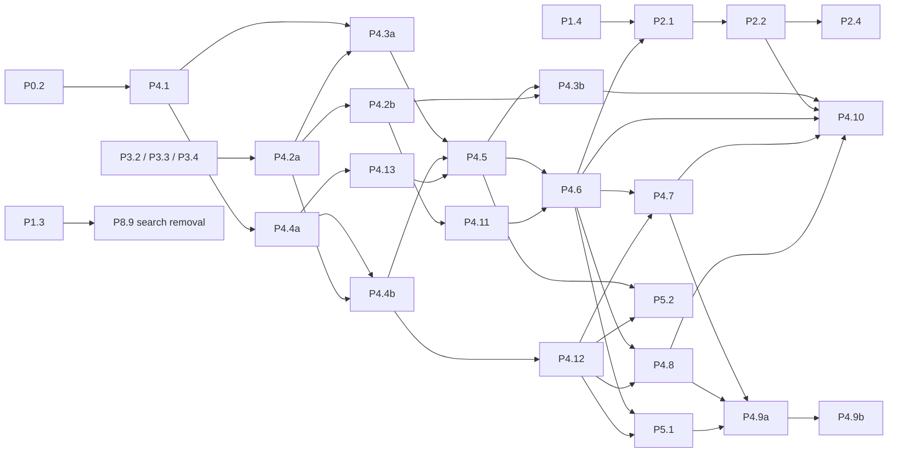

# G5-Lean implementation plan (v8)

Status: plan for executing [lean-backend-design-v8.md](lean-backend-design-v8.md), written 2026-09-17. It succeeds [lean-implementation-plan-v7.md](lean-implementation-plan-v7.md), preserves every existing PR identifier, and retains all older versions. Version 8 restores preview as a visible, cancellable task of kind `preview` and applies the single-owner sharing and ownership-transfer contract supplied in [workspace-sharing-v8.md](workspace-sharing-v8.md). The versioned [implementation tracker](lean-implementation-status-v8.md) carries the v8 dependency map; historical completion rows are preserved, and only a merged row on `origin/main` establishes that its dependency is available. V8 also incorporates the subsequent clarification that each workspace uses its exact Git-valid name as the same branch name in every member repository and that only a workspace fork creates those branches. It also removes workspace search and user Commit/Flush-now controls, unifies agent work on shared sessions with dependency-preserving attempts, and replaces custom questions with provider-native protocol handling. This document is a plan, not evidence that v8 behavior has been implemented or deployed.

The design is authoritative; when a prompt and the design disagree, the design wins and the prompt is corrected. The three companion notes ([workspace-vm-api-v8.md](workspace-vm-api-v8.md), [worker-host-api-v8.md](worker-host-api-v8.md), [agent-api-surface-v8.md](agent-api-surface-v8.md)) are normative for field-level detail where the design adopts them.

---

## 1. How to use this plan

**For the person running the program.** For the MVP, follow the three-person schedule in §5.3; afterwards land PRs wave by wave (§5.4). A PR may start only when everything it depends on has merged to `main` on https://github.com/G5Labs/G5-Lean; nothing is started against a stand-in. Each PR names the capability that owns it (§4); the owner of that capability reviews it, and the program owner merges on convergence. Before starting a PR, confirm in the v8 status file on `origin/main` that its dependencies are merged (§2, item 1).

**For an agent starting a PR.** Copy the PR's prompt from §6 into a fresh session in this repository. The prompt says what to read first, what to build or delete, what not to touch, how to prove it works, and how to finish. The conventions in §2 apply to every PR and are part of the prompt by reference.

**Sizing.** S under 1K changed lines, M 1K to 4K, L 4K to 10K, XL over 10K. Deletion-heavy PRs are XL by line count but mechanical; the reviewer's job there is checking that nothing retained still references the deleted code, which the compiler and tests do for us.

---

## 2. Conventions for every PR

1. **Start from the latest `main`, and only when your dependencies are in.** Your PR's dependencies must already be merged. Read the v8 status file from `origin/main`, not from a local checkout: `git -C /Users/zliu/Workspace/G5-Lean fetch origin main && git -C /Users/zliu/Workspace/G5-Lean show origin/main:docs/lean-implementation-status-v8.md`. Your row's Depends on cell lists the dependencies, and each is merged when its own row has a non-empty Branch cell; an empty Branch means not merged, whatever GitHub shows in flight. To read one row, pipe the file through `grep -E '^\| P4\.2a \|'` with that row's id in place of `P4.2a`. If a dependency is not merged, stop and report instead of starting; never start against a stand-in. Then fetch and branch from `origin/main`, never from a local `main` that may be stale: `git -C /Users/zliu/Workspace/G5-Lean fetch origin main && git -C /Users/zliu/Workspace/G5-Lean worktree add ../G5-Lean-wt-<pr-id> -b lean/<pr-id>-<slug> origin/main`, where `<pr-id>` is the exact id from §5.1, suffix included (for example `P4.2a`). Work in that worktree, never in the primary checkout. Run `git branch --unset-upstream` after creating the branch so a bare `git push` can never target `main`. Do not touch other worktrees. Before your first build, run the validation ladder once on `origin/main`; a failure that predates your branch is pre-existing and must be recorded. If it leaves either required PR lane red, repair the shared failure within authorized scope or keep the PR open; a pre-existing failure is not a waiver.
2. **Keep your branch current.** Before you open the PR, and after every round of review changes, run `git fetch origin && git rebase origin/main` (rebase, never merge `main` into your branch). Resolve conflicts yourself; the usual hotspots are migration numbering, your row in `docs/lean-implementation-status-v8.md`, and `Cargo.lock`. If the rebase brought in changes to a crate you touched, re-run the validation ladder for that crate before pushing. Push with `git push --force-with-lease` after a rebase. Never rebase or amend after the PR is approved unless the reviewer asks.
3. **Read first.** Every prompt lists design sections, companion notes and research notes. Read them before opening code. Line numbers drift; symbol names are stable.
4. **Scope discipline.** Do exactly what the PR says. If the PR cannot be completed without a change listed under "Do not", stop and report it in the PR description under "Blocked"; do not widen the PR. Unrelated cleanups go into a note in the v8 status file, not into the diff.
5. **Buildable at every merge.** The workspace must compile and the retained tests must pass at the end of the PR. A `// LEAN-TODO(P<x.y>)` marker may document deferred implementation but never substitutes for a passing retained test or CI lane. Update retained workflows and fixtures in the same PR that retires their API or command. Grep for markers with your PR id before you finish.
6. **Schema edits are forward migrations.** `001_lean_baseline.sql` and every applied migration are immutable, checksum-guarded files; never edit one, never repair the SQLx ledger. Add `NNN_<description>.sql` with the next unused number (coordinate numbering at rebase), append its SHA384 to `backend/g5-api/src/db/migrations/checksums.sha384`, and follow [database-migrations.md](database-migrations.md): validate a fresh install and an upgrade from the previous schema on a copy of real rows, and re-run to prove the no-op path. Every prompt of the draft 6 plan that said "edit the baseline" now means "add a migration". Regenerate the SQLx offline cache when queries change (`just db-prepare`, with `just dev-up`).
7. **Tests.** Add the acceptance tests named in the prompt. Retarget or delete tests only for behavior the PR removes; never delete a test to make a retained behavior pass. Classify every removed test in the PR description (deleted protocol / covered elsewhere / rehomed). Fake providers: tests point `G5_CLAUDE_PATH` / `G5_CODEX_PATH` at the fake binaries.
8. **Validation ladder** (run what applies; the prompt says which are required): `SQLX_OFFLINE=true cargo check --workspace --all-targets --offline`; `just fmt-check` and `just lint` plus `cargo clippy --workspace --all-targets -- -D warnings` (Cloud Build lints test targets); `SQLX_OFFLINE=true cargo test -p <crate> --lib` for touched crates; `just test-integration` (needs `just dev-up`) when routes or services change; `npm --prefix frontend run build && npm --prefix frontend test` when the frontend changes; `just docker-ci` for PRs that touch worker, host, isolation, dispatcher or CI configuration; `python3 scripts/check-layout.py` and `just commands-check` when files move or recipes change; the migration checks of item 6 when a migration is added.
9. **Commits and PR description.** Conventional subject line `<area>: <what>`. End every commit message with `Co-Authored-By: Claude Fable 5.1 <noreply@anthropic.com>`. The PR description uses the template in §2.1 and ends with `🤖 Generated with [Claude Code](https://claude.com/claude-code)`. Only after the user explicitly authorizes publishing a PR, push the branch and open it with `gh pr create --repo G5Labs/G5-Lean --base main --head lean/<pr-id>-<slug> --title "P<id> <title>" --body-file <file>`. The title starts with the exact PR id from §5.1, suffix included, followed by a space (for example `P4.2a g5d dispatch: listener, private protocol, files, ports, status`); the status row and the PR are matched by it, so never abbreviate the id, never drop the suffix, never reuse an id. Record the branch and the PR URL in your status row (item 10). Do not merge your own PR. Both `g5-ci-rust` and `g5-ci-e2e` must pass on the exact current head before merge. Record the local validation and the current-head CI result; neither review completion nor CI alone proves user-visible acceptance.
10. **Status file.** In the same PR, fill your row in `docs/lean-implementation-status-v8.md`: the Branch column with the branch name and the PR link, the Notes column with one line on what landed and the `LEAN-TODO` markers left. Never mark a row as in progress: a row stays empty until its PR merges, because other agents read a non-empty Branch on `origin/main` as "merged". Never edit another PR's Branch or Notes. The Depends on column is a copy of §5.1: leave it as it is; only a PR that changes the dependencies in §5.1 edits it, in every row it changes. The PR description (§2.1) holds the full record and stays true after every review round.
11. **No deployment.** Nothing in this plan deploys anything. Cloud Build stays the CI system; changes to the CI lanes are P8.6 and P8.7 only, except where a prompt names a lane it must adjust.
12. **Ownership.** Every PR carries the capability that owns it (§4). Ask that owner's questions in the PR, not another owner's. A change that crosses into another capability's code is a deviation to record, not a reason to widen the PR.
13. **Publication requires an explicit ask.** Preparing or implementing this plan does not authorize a PR, GitHub issue or other public artifact. Keep the result in the requested worktree until the user explicitly asks to publish; findings stay in local review notes and the v8 status file.

### 2.1 PR description template

```
## P<id> <title>

Owner: <Workspace | Agents | Worker & Host | Git and governance | Platform>
Design: lean-backend-design-v8.md §<sections>
Depends on: P<..> (merged)

### What changed
- ...

### Deleted
- ...

### Tests
- added: ...
- retargeted: ...
- removed (behavior removed by this PR, classified): ...

### Migrations
- <NNN_name.sql>: fresh install and upgrade validated | none

### Validation run
- cargo check / lint / fmt: pass
- <crate> tests: pass (N tests)
- integration / docker-ci: pass | not run (why)

### LEAN-TODO markers left
- ...

### Blocked / deviations
- none
```

---

## 3. Historical baseline and the v8 delta

### 3.1 Landed from the draft 6 plan (snapshot carried from v7)

| PR | Merged as | Note |
|---|---|---|
| P0.1, P0.2 | #1, #3 | baseline tag; one baseline migration (now frozen) |
| P1.1, P1.2, P1.3, P1.4 | #24, #18, #31, #35 | refs authoritative for reads; receive-pack policy; projection convergence; head-operation registry deleted |
| P2.3, P2.5 | #29, #33 | worker native writes and push; native-git profiles |
| P3.1, P3.2, P3.3, P3.4, P3.5 | #12, #34, #46, #47, #44 | CLI pin and fakes; Rust provider runner; `task_questions`; `chat_session_files`; `naive_react` gone |
| P8.2, P8.3 | #11, #21 | IDE mockup, hidden settings, takeover remnants; GitHub-only login |
| out of plan | #5, #7, #8, #10, CI2 #22, CI3 #32 | dev-stack and CI fixes, recorded in their PRs |

### 3.2 CI/CD in the QA GCP project (historical v7 snapshot)

Landed by the CI/CD owner: #2 QA infrastructure, #4 CI write isolation, #6 QA data-service labels, #9 firmware boot probe, #13 and #36 to #39 worker image publishing and artifact IAM, #15 CI repository-specific inputs, #41 rustls advisory, #42 worker image repin, #43 greenfield database bootstrap, #45 QA bootstrap key and RLS contracts, #50 migration checksum guard and deployment pauses (with `docs/database-migrations.md` and `docs/qa-database-reset.md`). Recorded as open in v7 (recheck the tracker and GitHub before implementation): #51 (QA worker image defaults), #53 (seeder authority scope), #66 (E2E workflow repairs). Design notes landed as #48 (worker host API), #72 (agent API surface) and the workspace VM API note.

### 3.3 Draft 7's effect on the remaining draft 6 PRs (historical delta)

This table records the prior plan, not current instructions. In particular, the interim P2.1 server-side Save commit is superseded by §3.7 and the rewritten P2.1 prompt: public Save waits for the real VM/module facade and never commits.

| PR | Change |
|---|---|
| P2.1, P2.2, P2.4 | unchanged in substance; P2.1 stays an interim server-side Save so the CRDT deletion can proceed in parallel with the VM runtime; P4.5 replaces the write path |
| P4.1 | a forward migration instead of a baseline edit; adds `workspace_flushes`, `epoch`, inbox and host columns; no longer depends on P2.4 |
| P4.2 | the dispatcher exposes the Workspace Runtime API and a module runtime; no `proc.*`, `git.*`, `agent.run_turn`; dispositions table; `agent.turn` moves to P4.11; split into P4.2a (listener, private protocol, files, ports, status) and P4.2b (module runtime, journal, dispositions, built-in modules) |
| P4.3 | "Checkpoint task and restore" becomes "Flush, receipts and restore": no cron; immutable per-flush refs; receipt verified by the API; quiescence rule; split into P4.3a (shutdown flush, receipts, restore, stopped reads) and P4.3b (live flush and fork) |
| P4.4 | the worker-host-api protocol: `ctl` stream, versioning, `VmSpec`, journaled `vm.event`, renewable host credential, lease bound; proxies move to P4.12; split into P4.4a (the `ctl` protocol on both ends, no VM boot) and P4.4b (`VmSpec`, boot and stop, lease, relay) |
| P4.5 | five actions (restart added), teardown reasons and deadlines, the stop sequence with the flush, Save ordering, the Workspace Runtime facade; placement moves to P4.13 |
| P4.6 | invocation through the facade; G1 to G4 of the draft 6 review and the cancellation retention rule; runner wait and `suspended`; inbox reservations |
| P4.7 | inbox columns and the queued strip; base workspaces without a VM |
| P4.8, P4.9, P4.10, P5.1, P5.2 | as before, on the new surfaces; one preview per workspace; restart button; `source: flush`; P4.9 is split into P4.9a (host and worker) and P4.9b (API and frontend) |
| P6.2 | G5: one ref transaction with a receipt ref |
| P7.2 | "Rewrite the baseline" becomes "Schema cleanup migrations and after-metrics" |
| P8.4 | the renewable host credential moves to P4.4a; the rest unchanged |
| P1.5, P1.6, P6.1, P6.3, P6.4, P7.1, P8.1, P8.5, P8.6 | unchanged apart from design references and the migration rule |

### 3.4 Outstanding markers (historical v7 snapshot)

`LEAN-TODO(P4.8)` 55, `LEAN-TODO(P1.5)` 51, `LEAN-TODO(P6.4)` 16, `LEAN-TODO(P2.4)` 13, `LEAN-TODO(P8.6)` 5, `LEAN-TODO(P4.6)` 3, `LEAN-TODO(P6.1)` 2, `LEAN-TODO(P5.1)`, `LEAN-TODO(P4.7)`, `LEAN-TODO(P4.5)`, `LEAN-TODO(P4.1)` one each. Each owning PR resolves its markers; `grep -rn LEAN-TODO` is the ledger.


### 3.5 What v8 changes, including sibling paths

| PRs | Required v8 revision |
|---|---|
| P4.1 | Add exactly one `owner_user_id`, durable fork operations/reservations, a transfer operation/audit record and preview task fields; migrate membership to read access; retain prior audit identity without introducing per-message writer UI. |
| P2.1, P2.2, P4.3a, P4.3b | Owner-only Save across files, docs and ontology; identical read access while live/stopped without waking; a reader may fork into their own workspace but cannot interrupt the source owner's work. |
| P4.2a, P4.2b, P4.4a, P4.4b | Carry workspace owner identity to git configuration and owner-only credential references; module capability checks keep reader preview narrow; service lifecycle permits no wall-clock deadline. |
| P4.5 | Six workspace actions, with create routed through the sole fork service and recorded transfer through stop with reason `transfer`; enforce owner at every mutation boundary, including receive-pack; serialize transfer with admission, host release and owner update. |
| P4.6 | Add service task lifecycle and normal dispatch/wake for preview, exempt it from bounded execution slots and wall-clock expiry, and suppress service auto-retry/successors; reauthorize all owner work at dispatch after transfer. |
| P4.7, P4.8, P4.11 | One owner's account and one shared session lifecycle across typed and templated agent inputs; preserve queued work/history and native-request audit through transfer while invalidating requests from stopped processes. Reader cannot send, answer, edit queued input or create/cancel arbitrary tasks. Keep command and preview distinct. |
| P4.10, P5.2 | Owner-aware controls and transfer UX; readers retain all reads plus Fork/Preview; terminal is owner-only, including stream admission and transfer closure. |
| P4.12 | One workspace-scoped owner provider account; session path is metering only; no session-scoped grants or cross-user credential selection. |
| P5.1 | Preserve the `preview` product/task kind; task list visibility, launch audit, cancellation, replacement, read-access authorization, normal wake/idle, workspace identity and no automatic restart. Remove only the obsolete transport/session implementation. |
| P4.9a, P4.9b, P7.1, P7.2 | Retire old preview infrastructure only after P5.1; retain service tasks, queue views, audit rows, owner fields and transfer state through cleanup. |
| P1.5, P1.6, P6.1–P6.4 | Owner-only Publish, PR creation and workspace approval writes, while governance constraints still apply; removing legacy RBAC must not restore member/admin write bypasses. |
| P3.6, P3.7, P8.7, P8.8, P9.1–P9.4 | Provider continuations, rollout, audits and self-hosted scenarios preserve owner authority, transfer fencing and non-restarting preview tasks. |

Current-code grounding: `backend/g5-api-core/src/services/workspace_service.rs` has `is_workspace_admin`, `can_manage_workspace_members` and `add_workspace_member`, which currently combine org roles, creator identity and `admin|editor|viewer` membership. These are separate authority paths to replace, not proof that v8 ownership already exists. HTTP boundaries live in `backend/g5-api-routes/src/routes/` (including `workspaces.rs`, `git.rs`, `tasks.rs`, `task_questions.rs`, `preview.rs` and `preview_profiles.rs`); trace their service calls, `git_policy.rs`, task state owners and RLS before editing. Earlier prompts' shorthand `routes/...` refers to that route crate. Also trace `frontend/src/components/preview/PreviewControl.tsx` → create/cancel-job routes and `frontend/src/components/execution/BottomDrawer.tsx` → `onAbortTask`: both must converge on preview task cancellation. `ProviderAccountService::resolve_frozen_for_dispatch` and its `config_service.rs` caller currently resolve a saved account id; v8 must not treat a prior owner’s saved id as current authority. Existing implementation status is inherited history, not a fresh deployment observation.


### 3.6 Shared branch name and fork-only creation

A working workspace remains multi-repository: `[(repo1, sameName), (repo2, sameName), ...]`, including every member repository such as the docs repository. Store its common destination in `workspaces.branch_name`; per-repository destination overrides are forbidden. Base views are read-only views of existing protected/default refs and may use different source names such as `main` and `master`; those refs are not newly allocated working-workspace branches. Equality of the fork-created destination branch name across members is required, not a naming convention. Keep `workspace_repos.base_branch` as the per-repository upstream/update target inherited from the source mapping; it is distinct from both the common destination and the fork manifest’s pinned `source_branch/source_oid`. A fork of a working workspace snapshots that workspace’s working branch without changing each member’s inherited upstream target. The proposed workspace name is the exact Git-valid branch name: no slugification, generated `feat/` prefix, UUID suffix, automatic rename or per-repository override. Forking a workspace, including a fork from base, is the only way to create a new workspace branch in member repositories. Any retained Create, clone/carry or “Fork and…” entry point must invoke that same fork service.

Before creating any branch, validate the name and check actual internal Git branch refs and connected providers’ current refs in every member repository, including branches absent from database projections. Provider checks are read-only; an unavailable/unverifiable provider makes the request retryable, never evidence that the name is free. Any existing name or Git ref namespace conflict rejects the whole fork, even when the existing branch has the desired source OID; the UI asks for a different name. Reserve the exact `(repo_id, branch_name)` keys for the whole member set, including overlap between concurrent forks, and use Git create-if-absent. Persist the operation, pinned source vector, internal/provider checks, intended refs and per-repo progress before external effects. In each internal member repository, create the destination branch and `refs/g5/forks/<fork_id>` receipt in one Git ref transaction; the operation-owned receipt proves a successful create after a lost response. Pending operations keep their logical reservations across process restarts; recovery may finish or safely roll back only that operation’s own refs. A partially created workspace is never runnable, and cleanup cannot delete an unrelated or subsequently changed ref.

| Boundary | Existing PR scope |
|---|---|
| Same-name mapping and durable operation schema | P4.1: `workspace_forks`, its member/source/ref manifest and logical reservations; migration preflight catches old divergent mappings without silently renaming refs. |
| Core create/fork API, naming and recoverable Git writes | P4.5: exact name validation, all-repo preflight/reservation, stopped/base fork, create alias, completion/recovery and pending-workspace admission. |
| Live-source fork | P4.3b: compose source flush/quiescence with the P4.5 fork operation; pin its complete receipt, keep the same reservation across retries, and never create a runnable partial fork. |
| All other branch producers and consumers | P2.1, P4.2b, P4.3a, P4.4b, P4.6–P4.8, P1.5 and P6.1–P6.2: Save, Changes, restore/native push, dispatch, chat/job carry, receive-pack, Publish and PR/merge preserve the exact shared name; none creates or repairs an absent workspace ref outside the fork service. |
| UX and end-to-end verification | P4.5 lands the minimal shared fork dialog; P4.3b and P5 reuse it, and P4.10 integrates it with the full workspace shell: one exact-name field; invalid/colliding names return actionable errors and keep the dialog open; no hidden suffix or per-repo override; no navigation to runnable partial workspaces. |
| Cleanup, audits and recovery tooling | P7.2, P8.8, P9.3: retain pending manifests/reservations and check crash, cleanup, backup/restore and concurrent overlapping-repository cases. |

Current producers to replace include `WorkspaceService::create_workspace`, `workspace_branch_name_slug`, `generate_branch_name`, `mint_canonical_branch_name` and the fallback that mints a branch when no durable mapping is found in `backend/g5-api-core/src/services/workspace_service.rs`. Today the generated name is `feat/<slug>-<uuid fragment>` with a full-UUID collision fallback, and the collision query reads `workspace_branches`; neither satisfies the new exact-name/actual-Git contract. Trace their clone, add-member and route callers as well as `backend/g5-api-routes/src/routes/git.rs`. Base registration/onboarding binds existing protected/default refs per repository, preserving their possibly different names; initial protected-ref repository bootstrap stays outside working-workspace branch allocation. None of these paths may mint a new working workspace branch or silently normalize customer defaults. Existing workspace-name rename/member-edit routes must preserve the shared mapping or reject an unsupported change; they are not a second branch-creation mechanism. The branch/fork revisions preserve the earlier PR identifiers. The subsequent scope below adds P8.9 for complete workspace-search removal; all other changes revise existing unmerged prompts.

### 3.7 Search removal, agent sessions and native provider requests

Workspace search is removed end to end by P8.9: its box/results, API/status/reindex endpoints, background queue/indexing/embeddings, settings, schema and feature-specific tests/tooling. Preserve chat-history search, editor Find, agent-local code search and document/ontology projections. P8.9 is an MVP exit gate and an input to cleanup/audits; no surviving screen or seed tool may resurrect it.

User Commit and “Flush now” controls, their API/module actions and the flush reason `explicit` are removed. Save only writes files through the real VM facade after P4.6; the old plan for an interim P2.1 server-side commit is superseded and must not be implemented. Agent native git cadence and lifecycle `workspace.flush` materialization own commit creation. Push remains available for existing commits and cannot stage, commit or turn a snapshot into a branch commit. PR creation never performs an automatic commit or convenience flush; when dirty, ask the agent to checkpoint, and when merely ahead offer Push. Owner terminal/laptop native Git remains an existing escape hatch, not a second platform Commit action.

The target `tasks.kind` is exactly `agent | command | preview`. Every agent workflow has a `chat_sessions` row, transcript in `chat_messages` and provider artifacts in `chat_session_files`; these physical names stay. Human initiation supplies typed input and workflow initiation supplies a templated initial prompt, then both use the same task/session/inbox/continuation/request/harvest machinery. A resolved, explicitly configured permission policy is persisted independently of origin; no implicit non-chat bypass is allowed. Jobs remain optional orchestration.

A logical agent task keeps its task id, session, `job_id` and dependency edges through interrupted/suspended/retry attempts. `task_attempts` records execution outcomes; dependencies and job completion consult only final logical task success/failure/cancellation. Drain/rollout retry may queue the same task by explicit policy; user Stop, transfer and native-request timeout hold it for owner Continue/Resume. A follow-up after final settlement is a new agent task in the same session, never a replacement for unfinished dependency work.

Native provider requests are live-process requests, not durable custom questions. `provider_requests` projects a native `(exec_id, provider_request_id)` onto the timeline/reply path; process exit, request cancellation, suspension or incarnation loss invalidates every unanswered request. Historical custom question rows stay read-only. Claude direct CLI keeps stdin open for native AskUserQuestion/permission responses; Codex MVP remains noninteractive `exec --json` with no custom fallback. P3.7 later adds `codex app-server` over stdin/stdout for native questions and approvals. Continuing a suspended task starts a new attempt; the provider must ask again if it still needs input, and no old answer is replayed to a new process.

| PRs | Required changes |
|---|---|
| P4.1, P4.6 | Shared session/task/request schema and service; same-task continuation and dependency/job invariants; explicit permission resolution; active native requests are execution-bound. |
| P4.7, P4.8, P4.11 | Typed and templated inputs converge on the same service/module; Claude native control replies; Codex noninteractive; consistent timeline and artifact restore/harvest. |
| P3.6, P3.7, P4.9a, P4.9b, P7.1, P7.2 | Resident/later Codex adapters preserve native lifetime; delete custom ask/permission polling and compatibility producers after cutover; preserve historical audit and physical session tables. |
| P2.2, P4.2b, P4.3a, P4.3b, P4.5, P4.10, P6.1, P6.3 | Remove every product Commit/Flush-now action and explicit flush reason without restoring them through Changes, PR, shortcut or legacy API paths; retain Push of existing commits. |
| P8.9, P8.8, P9.1 | Search removal with retained-feature regressions, audit and packaging checks; historical migration replay still works. |

---

## 4. Capability tracks, owners and milestones

Ownership follows the capability, not the process a component runs in (design §4.1). The owners in the table are the reviewers of record for their track; the Git and governance track is assigned by the team. Ownership names who reviews, not who executes: for the MVP the executor of each PR is the person the schedule in §5.3 puts on it, and carrying another track's PR is expected.

| Track | Owner | PRs |
|---|---|---|
| Workspace | @zcl-g5 | P2.1, P2.2, P2.4, P4.1, P4.2a, P4.2b, P4.3a, P4.3b, P4.5, P4.10, P5.1, P5.2, P7.2 |
| Agents | @rahul-g5 | P4.6, P4.7, P4.8, P4.11, P7.1, P8.1, P3.6, P3.7 |
| Worker & Host | @kaihuiz-g5 | P4.4a, P4.4b, P4.9a, P4.9b, P4.12, P4.13, P8.4, P8.7 |
| Git and governance | to be assigned | P1.5, P1.6, P6.1, P6.2, P6.3, P6.4, the receive-pack half of P4.3a |
| Platform (program owner, CI/CD owner) | | P8.5, P8.6, P8.8, P8.9, P9.1 to P9.4 |

**MVP milestone.** Design §13: the nine proposals on the QA environment. In PR terms: P2.1, P2.2, P2.4, P4.1, P4.2a, P4.2b, P4.3a, P4.3b, P4.4a, P4.4b, P4.5, P4.6, P4.7, P4.8, P4.9a, P4.9b, P4.10, P4.11, P4.12, P4.13, P5.1, P5.2, P8.9 merged. P8.1 is idle-time work, not an MVP gate. Exit criteria are in §7.

**After the MVP, in priority order.** Governance and publish (P1.5, P1.6, P6.1 to P6.4); the pre-launch audits (P8.8); lifecycle and schema cleanup (P7.1, P7.2); rollout gates (P8.7) and infra cleanup (P8.4); the self-hosted phase (P9.1 to P9.4); the later provider track (Claude process reuse P3.6 and Codex stdio app-server P3.7); crate consolidation and the CI review (P8.5, P8.6).

---

## 5. PR map, dependencies and waves

### 5.1 PR table

| PR | Title | Owner | Size | Depends on | State |
|---|---|---|---|---|---|
| P1.5 | Remove remote tracking; add protected-branch mirroring and Publish | Git | XL | P1.4, P4.5 | not started |
| P1.6 | Frontend: remove remote-tracking UI, add Publish | Git | M | P1.5 | not started |
| P2.1 | VM Save API and live/flush/branch reads | Workspace | M | P1.4, P4.6 | not started |
| P2.2 | Frontend explicit Save; remove CRDT from editors | Workspace | XL | P2.1 | not started |
| P2.4 | Delete the backend CRDT layer | Workspace | XL | P2.2 | not started |
| P3.6 | Session-resident Claude CLI process behind `agent.turn` | Agents | L | P4.11, P4.6, P4.7, P4.8 | post-MVP |
| P3.7 | Codex app-server stdio migration with native questions and approvals | Agents | L | P4.11, P4.6, P4.7, P4.8 | post-MVP |
| P4.1 | Migration: owner/fork state, unified agent sessions, native requests and VM runtime | Workspace | M | P0.2 | not started |
| P4.2a | `g5d dispatch`: listener, private protocol, files, ports, status | Workspace | L | P3.2, P3.3, P3.4 | not started |
| P4.2b | `g5d dispatch`: module runtime, journal, dispositions, built-in modules | Workspace | L | P4.2a | not started |
| P4.3a | Shutdown flush, receipts, restore, stopped reads | Workspace (+Git) | L | P4.1, P4.2a | not started |
| P4.3b | Live flush quiescence and fork | Workspace | M | P4.2b, P4.5 | not started |
| P4.4a | `g5d host`: the `ctl` protocol on both ends, host credential, event journal, drain | Worker & Host | L | P4.1 | not started |
| P4.4b | `g5d host`: `VmSpec`, boot and stop, lease, stream relay, retained roots | Worker & Host | L | P4.2a, P4.4a | not started |
| P4.5 | API: lifecycle service, six actions and transfer, owner authorization, Workspace Runtime facade | Workspace | XL | P4.1, P4.3a, P4.4b, P4.13 | not started |
| P4.6 | Dispatch, shared agent lifecycle, same-task continuations and native requests | Agents | L | P4.5, P4.11 | not started |
| P4.7 | Typed-input agent sessions and inbox; delete sticky runtimes | Agents | XL | P4.6, P4.12 | not started |
| P4.8 | Templated-input agent sessions and optional jobs; delete job/task branches and merge | Agents | XL | P4.6, P4.12 | not started |
| P4.9a | Delete per-task execution on the host and in the worker | Worker & Host | L | P4.7, P4.8, P5.1 | not started |
| P4.9b | Delete the workers table, per-task routes, loops and UI | Worker & Host | L | P4.9a | not started |
| P4.10 | Frontend: workspace VM status, owner controls, Transfer, reads and Changes | Workspace | L | P2.2, P4.3b, P4.6, P4.7, P4.8 | not started |
| P4.11 | The `agent.turn` module and the per-turn CLI adapters | Agents | L | P4.2b | not started |
| P4.12 | Host proxies: owner provider account, git and platform credential proxy, grant updates | Worker & Host | L | P4.4b | not started |
| P4.13 | Host registry, host states, placement, quotas, drain and the operator API | Worker & Host | M | P4.1, P4.4a | not started |
| P5.1 | Preview service tasks on the workspace VM (`workspace.preview`) | Workspace | L | P4.6, P4.12 | not started |
| P5.2 | Browser terminal | Workspace | M | P4.5, P4.12 | not started |
| P6.1 | `pull_requests`, `approval_rules`, `approval_decisions`, `g5d pr` | Git | L | P1.5, P4.6, P4.8 | not started |
| P6.2 | The merge operation | Git | L | P6.1 | not started |
| P6.3 | Governance frontend | Git | L | P6.2 | not started |
| P6.4 | Delete governance legacy | Git | XL | P6.2, P6.3 | not started |
| P7.1 | Lifecycle cleanup: one status enum, delete the kernel | Agents | L | P4.9b, P6.4 | not started |
| P7.2 | Schema cleanup migrations and after-metrics | Workspace | M | P7.1, P8.9 | not started |
| P8.1 | Remove internal issue tracking | Agents | XL | P3.2 | idle-time work |
| P8.4 | Infra cleanup: dormant MIG, customer images, disabled workflows | Worker & Host | M | P4.9a, P4.9b | not started |
| P8.5 | Crate consolidation | Platform | XL | P7.2 | not started |
| P8.6 | CI review | Platform | S | P8.5 | not started |
| P8.7 | Versioned rollout: protocol gates, feature flags, drain-and-recreate runbook | Worker & Host | M | P4.7, P4.8, P5.1, P4.13 | not started |
| P8.8 | Pre-launch audits: security, fault tolerance, scalability | Platform | S | P2.4, P4.3b, P4.9b, P4.10, P5.1, P5.2, P8.9 | not started |
| P8.9 | Remove workspace search end to end | Platform | L | P1.3 | not started |
| P9.1 | Self-hosted bundle on the workspace-VM model | Platform | L | P4.9a, P8.4, P8.9 | later phase |
| P9.2 | Microsoft Entra platform login for self-hosted installations | Platform | M | P9.1 | later phase |
| P9.3 | Backup barrier and restore of Postgres and the git store; upgrade drain | Platform | M | P4.3a, P9.1 | later phase |
| P9.4 | Azure canary on the workspace-VM host | Platform | M | P9.1, P9.2, P9.3 | later phase |

Merged PRs (P0.1, P0.2, P1.1 to P1.4, P2.3, P2.5, P3.1 to P3.5, P8.2, P8.3) keep their rows in the tracker.

### 5.2 Dependency graph



The graph focuses on the MVP; §5.1 is the complete dependency list. V8 adds real gates: P4.5 supplies lifecycle/files, P4.6 supplies real module/association checks, and only then P2.1 cuts over public Save/read routes without any interim commit behavior. P2.2 switches editors after those routes exist; P4.10 needs P2.2, live fork, Changes and both agent-session producers for its real UI flows; P5.1 needs normal task dispatch plus the workspace-identity proxy; P5.2 needs the facade and the same proxy; P4.9a may remove the old preview registry only after its task-backed replacement lands. P4.8 requires the same owner-account proxy as chat before real job dispatch; P1.5 uses P4.5’s owner/transfer admission checks. P6.1 depends on the Changes facade and migrated review tasks; P6.3 builds its Merge UI after P6.2; P8.7 tests continuation/dependencies for migrated chat/workflow work and preview teardown against their real implementations. The post-MVP provider adapters require P4.6/P4.7/P4.8 native-request and shared-session behavior; P9.1 packages the P8.9 search-free runtime. P4.5 still does not depend on P4.12: its shutdown flush uses the dispatcher's own workspace token, and it does not launch a provider. Agents stop hooks arrive with P4.6 before any migrated execution can run. Every dependent builds on merged code, never on a stand-in. P8.9 follows the landed projection-convergence producer (P1.3), runs independently of the VM chain, and gates the MVP, P7.2 schema cleanup and P8.8 audits. The v8 tracker must carry exactly these dependencies.

### 5.3 MVP schedule for three people

The MVP is executed by three people with coding agents. Ownership (§4) says who reviews; this schedule says who executes. Each row starts when the dependencies of its PRs are merged; someone who finishes early moves down their own column, or takes the highest-ranked available PR from another column. Rank is the length of the longest dependency path from the PR to P4.9b, so the critical chain always goes first. Nothing is started against a stand-in: no stub method, no placeholder type, no interface-first PR. Test harnesses that drive a real component from its tests are not stand-ins.

| zcl | kaihui | rahul |
|---|---|---|
| P4.2a | P4.4a | P4.1, then P4.13 |
| P4.3a | P4.4b | P4.2b |
| P4.5 | P4.12, then P5.2 | P4.11 |
| P4.3b | P8.9 | P4.6 |
| P4.8 | P2.1, then P2.2 | P4.7 |
| P4.10 | P5.1 | P2.4 |
| — | P4.9a | P4.9b |

The critical chain runs down the first column and then over to the third: P4.2a → P4.3a → P4.5 → P4.6 → P4.7 → P4.9a → P4.9b, with P5.1 also gating P4.9a. The editor branch is P4.6 → P2.1 → P2.2 → P2.4 and P4.10; it cannot start early by inventing a server-side Save commit. The MVP closes when P2.4, P4.3b, P4.9b, P4.10, P5.1, P5.2 and P8.9 are merged; every other MVP PR is a dependency of one of them (§7). P8.1 is idle-time work for whoever is waiting on a dependency.

### 5.4 Waves after the MVP

| Wave | PRs | Owners | Notes |
|---|---|---|---|
| 7 | P1.5, P1.6, P6.1, P8.4, P8.7, P8.8 | Git ×3, Host ×2, Platform | P1.6 and P6.1 follow P1.5 |
| 8 | P6.2, then P6.3; P3.6 | Git ×2, Agents | P6.3 uses the merged merge route |
| 9 | P6.4, P3.7 | Git, Agents | |
| 10 | P7.1, then P7.2 | Agents, Workspace | sequential |
| 11 | P9.1, then P9.2 and P9.3 | Platform | the self-hosted phase |
| 12 | P9.4 | Platform | |
| 13 | P8.5, then P8.6 | Platform | sequential |

---

## 6. PR prompts

Each prompt is self-contained apart from §2 of this document, which it references. Paths are relative to the repository root. Prompts for merged PRs are in the draft 6 plan.

### P1.5 — Remove remote tracking; add protected-branch mirroring and Publish

```
You are implementing P1.5 of docs/lean-implementation-plan-v8.md in /Users/zliu/Workspace/G5-Lean. Read plan §2, design v8 §5.6, §3.2 (remote tracking row), and docs/research/research-git-workspace.md §C.3 step 4, §C.4, §G. Depends on P1.4, P4.5 (P1.4 merged). Owner: Git and governance.

Goal: the only provider interactions are (a) inbound mirroring of protected branches and (b) explicit server-side publish of a workspace branch.

Do:
0. Resolve the acting user against the current `workspaces.owner_user_id` before Publish or provider binding; the workspace-scoped provider token belongs to that owner. Org admin read access is not a write bypass. Revalidate admission/owner under the same serialization boundary used by transfer before accepting a ref-changing request. Keep protected-branch mirroring a distinct server operation with its existing provider integration identity.
1. Inbound: backend/g5-api-core/src/maintenance/protected_branch_mirror.rs: every 5 minutes (configurable) and on the provider webhook if one exists (grep for webhook handling; `repo_secrets.webhook_secret_enc` suggests one), fetch `refs/heads/<protected>` from the provider into the mirror with the connecting user's stored token (`ScmTokenManager`), under a per-repo lock that P6.2 will share. Publish the branch hint on change.
2. Outbound: `POST /api/v1/workspaces/:id/publish` (scope workspaces:write): publish every member repo's workspace branch to the provider with the acting owner's token and the exact same name: create-if-absent for the first counterpart, then lease updates only for its owned publication. Refactor `push_branch_ff_or_lease` from workspace_pull_request_provider_lifecycle.rs to enforce those two phases (move it to a small `provider_push.rs`; the lifecycle file is deleted in P6.4). Reduce Make Remote to "bind repo to provider URL, then publish".
3. Delete: `branch_integration_service.rs`, `branch_sync_runs_service.rs`, `remote_tracking_merge.rs`, maintenance `branch_integration_worker.rs`, `branch_integration_scheduler`, `base_auto_pull_scheduler`, `remote_advisory_pinger`, `retained_publication_sweep`'s remote-tracking duties; routes `/push_to_remote`, `/push_mode`, `/base_auto_pull`, `/sync`, `/branches/:b/sync_runs*`, `/merge_runs*`, `/remote_tracking*`, `/approved_rebase_publish`, `/auto_pull`; CLI `g5d remote`; every `LEAN-TODO(P1.5)` site (51 on main; the landing's initial-tracking, convergence and merge-completion consumers, the baseline-ref and integration-queue follow-ups, fork and make-remote metadata).
4. Migration `NNN_remove_remote_tracking.sql`: drop `branch_integration_queue`, `branch_integration_remote_pair_leases`, `branch_sync_runs`; drop `workspaces.{push_mode, base_auto_pull_enabled, base_auto_pull_actor_user_id}` and `workspace_branch_repos.{remote_branch, baseline_commit, sync_paused_reason, last_sync_at, remote_tip_advisory_sha, remote_tip_advisory_observed_at, auto_pull_enabled, tracking_mode}`; the `job_merge_runs.source_kind='remote_tracking'` path; `refs/g5-tracking/*` pruned by a one-time maintenance pass.
5. Tests: retire remote_tracking_*.rs and job_merge_* remote-tracking tests; add protected_branch_mirror.rs (fetch updates the mirror, workspace branches are never fetched) and api_workspace_publish.rs (publish pushes the branch with lease; base workspace publish refused).

6. Publish uses the exact workspace branch name for every member and its provider counterpart. Require a completed fork and an existing internal member ref; publishing/binding cannot create a new internal workspace branch, manufacture a missing one, select a per-repo alias or append a collision suffix. First publication creates that already established workspace branch’s provider counterpart with create-if-absent, even though the fork previously verified its absence; if the remote name has appeared since preflight, return a collision without overwrite/adoption even when its OID matches. Persist publication ownership/outcome and apply subsequent lease updates only to that owned publication; a lost initial-publish reply must be reconciled with operation evidence rather than assuming matching OID proves ownership. Preserve protected-ref checks; do not mistake provider publication for authority to create another workspace branch.

Do not: touch PR creation or merge (P6), the frontend (P1.6).

V8 regression coverage: Multi-repo Publish forwards each member’s exact same name; pending fork/missing internal branch and attempted per-repo alias are rejected, with no fallback ref or suffix. A provider name appearing after fork preflight rejects initial publication without overwrite, including an equal-OID branch; only an owned publication can later use a lease update. Provider lease failure does not mutate the internal workspace mapping. A reader and a non-owning org admin cannot publish or bind; an owner can; an old-owner request racing transfer cannot publish after the owner commit; protected mirror behavior remains intact.

Acceptance: `grep -rn "tracking_mode\|push_mode\|branch_integration\|auto_pull\|LEAN-TODO(P1.5)" backend` is empty; mirror and publish tests pass; docker-ci passes after retiring only removed remote-tracking scenarios and preserving/retargeting retained publication coverage in the same change; a skipped retained test is not a passing result.
Validation: cargo check, lint, fmt, migration checks, `just test-integration`, `just docker-ci`.
```

### P1.6 — Frontend: remove remote-tracking UI, add Publish

```
You are implementing P1.6 of docs/lean-implementation-plan-v8.md in /Users/zliu/Workspace/G5-Lean. Read plan §2, design v8 §5.6, and docs/research/research-frontend-preview-infra.md §1.3 row 16 and §5.1. Depends on P1.5. Owner: Git and governance.

Goal: the workspace UI offers "Publish branch" and nothing about tracking modes, auto-pull, sync runs or merge runs.

Do:
1. Delete frontend/src/components/workspace/{RemoteTrackingActions, BranchTrackingIcon, BranchTrackingPopover, BranchAutoPullControl, CoordinatedRepoSyncModal}.tsx, the merge-routing parts of MakeRemoteDialog.tsx (keep "connect repo to provider"), and hooks/useRemoteTracking.ts; remove push-mode and auto-pull controls from settings; remove the WS handlers for `workspace.remote_tip_advisory_updated` and the dead `workspace.authoritative_cut_advanced` handler.
2. Add a Publish button (ReposBar) calling `POST /workspaces/:id/publish` with toasts; disabled on base workspaces and for readers; an org admin must first transfer ownership. Refresh capability state on ownership/access events and handle a server refusal for a stale open page.
3. Delete Playwright flows remote-tracking.spec.ts, remote-tracking-fork.spec.ts, coordinated-repo-sync.spec.ts, workspace-sync.spec.ts; add a publish flow to workspace.spec.ts.
4. Update frontend/src/lib/types.ts and api-schemas.ts.

Do not: touch editors, drafts, chat, PR/approval components.

Acceptance: `npm --prefix frontend run build`, `npm --prefix frontend test` and `just test-playwright` pass; grep for `remote_tracking|pushMode|autoPull` in frontend/src is empty.
Validation: frontend build and tests, Playwright lane of docker-ci.
```

### P2.1 — VM Save API and live/flush/branch reads

```
You are implementing P2.1 of docs/lean-implementation-plan-v8.md in /Users/zliu/Workspace/G5-Lean. Read plan §2 and §3.7, design v8 §5.4, §6.6, §9.1–§9.3, docs/workspace-vm-api-v8.md and the historical CRDT research. Depends on P1.4 (merged), P4.6. Owner: Workspace.

Goal: file, document and ontology Save routes use the real workspace VM filesystem and reads use live/complete-flush/committed fallback. Save creates no commit, index update or ref change. Do not implement the superseded interim server-side commit design. Lifecycle/file facade and Changes association queries already exist in P4.5/P4.6; this PR cuts over the public routes without stubs.

Do:
1. Authorize every Save/create/delete/rename/docs/ontology mutation using current owner_user_id and the shared lifecycle/transfer admission boundary. For a working workspace: reject stopping/pending fork/owner hold as specified, ensure/resume the VM (surface resuming or queued_for_capacity), query workspace.changes get on that expected incarnation, reject WORKSPACE_BRANCH_MISMATCH, then fs.write/delete/rename with expected_vm_id/epoch and expected_hash. Never query a stopped VM's module before ensure. Base views remain read-only. Shared exact member branch association is required; no operation creates/repairs a missing internal ref.
2. PUT /workspaces/:id/files/*path accepts content/expected_hash and returns conflict/current content+hash on a stale hash, without silently overwriting. Create/delete/rename follow the same runtime admission and association boundary. Route document and ontology edits through their actual file mapping and the identical service; do not leave a server commit helper or CRDT write fallback in one sibling path. The platform Save path does not stage, git add, commit-tree, commit, push or update-ref; only agent native Git and shutdown/fork flush perform their separately specified durability work.
3. Reads use get, never ensure: source:live through fs.read/list on a running VM, else the newest complete verified flush receipt, else committed branch content. Return content/hash/source consistently for file/docs/ontology views. Keep documents/ontology projections from pushed commits working; workspace search is removed by P8.9 and is not required for reading. Preserve read-only commit history/diff UI data. Refuse incomplete receipts and expose loss notices as designed.
4. Retire the CRDT overlay as the source for these migrated routes and RepoReadView. Keep remaining legacy CRDT code and routes compiled only for the P2.2 frontend transition, with explicit LEAN-TODO(P2.4) retirement; do not route the new Save request back to it. Retarget retained fixtures that invoked removed write behavior to this real Save service or native Git, and keep existing UI usable until P2.2 switches to local models.
5. Boundary tests with a real dispatcher/VM facade: cold Save resumes before association query and write; matching hash changes file contents while HEAD, real index and internal branch refs remain unchanged; stale hash, no owner, transfer, stopping and branch mismatch fail without writes. Cover code/docs/ontology create/delete/rename, missing member ref, concurrent stop/flush with an admitted write, and two repositories sharing the exact name. A native agent commit/push and lifecycle shutdown/fork flush still capture changed content on their own paths.
6. Read tests cover live versus verified flush versus branch fallback, no boot on GET, base read-only, rejected incomplete receipt, restored dirty files, and read-access revocation. Retained editor/docs/projection integration tests pass; no search/indexing/embedding dependency is added.

Do not: add a user Commit or Flush-now endpoint, an implicit Save/PR commit, a branch-creation fallback, a module/facade stand-in, or delete CRDT before its frontend cutover (P2.2/P2.4).

Acceptance: all file/docs/ontology Save paths write VM files without commit/index/ref side effects; reads use the correct live/flush/branch source without wake; stop/fork durability still captures those files. Public Save exists only after its real dependencies are merged.
Validation: cargo check/lint/fmt, API/docs/ontology integration tests, and just docker-ci with the actual workspace dispatcher and native Git side-effect assertions.
```

### P2.2 — Frontend explicit Save; remove CRDT from editors

```
You are implementing P2.2 of docs/lean-implementation-plan-v8.md in /Users/zliu/Workspace/G5-Lean. Read plan §2, design v8 §9.2, §9.3, and docs/research/research-crdt-docs.md §F and research-frontend-preview-infra.md §1.3 rows 4 to 8. Depends on P2.1. Owner: Workspace.

Goal: no Yjs in the frontend. Editors hold local state and save explicitly.

Do:
0. Render every editor read-only for a non-owner, preserving identical browsing. A stale owner page must handle an authorization refusal without issuing alternate write calls; ownership/access changes refresh controls and preserve unsaved local content for the user to copy or fork. No author-per-message UI or writer-role selector is introduced.
1. CodeEditor.tsx: Monaco with a local model; Save (Ctrl+S) calls the P2.1 PUT with `expected_hash`; on 409 show a reload-or-overwrite dialog; optional autosave-on-blur behind a user preference; dirty indicator per tab; the `source` marker from the read response shown in the tab (live | flush | committed).
2. SpecEditor.tsx (block editor), StructuredQuestionEditor, EditableInline, questionAnswerWrite.ts, htmlDocAnswerBridge.tsx, ExplainerOutputView.tsx, JobOutputView.tsx: replace the `Y.Text` binding with a local document model and the same Save path; JobQuestionDocView.tsx already renders without Yjs and is the template.
3. Comments: anchor by `(path, line, line hash)`; adjust useComments.ts and the comment components; if `comment_index` lacks the hash, add it with a migration.
4. Delete frontend/src/lib/crdt.ts, hooks/useDraft.tsx, components/draft/*, useAutoCommitBeforeAction.ts, CRDT tests and mocks (test/crdt*.test.tsx, test/__mocks__/y-websocket.ts, vitest.config.crdt.ts, e2e/crdt-*.test.ts), the `draft.*` handlers in lib/ws.ts, and the deps yjs, y-websocket, y-monaco. Remove the WorkspacePage `crdt.yDoc/provider` plumbing and the 2.5 s file-tree polling (refetch on `workspace.branch_updated`).
5. Remove user Commit buttons/dialogs, /commit product shortcuts, auto-commit-before-action hooks and request builders while retaining Save and Push of already-created commits. A native agent/owner-terminal Git operation is not a product Commit API. Retarget navigation/action tests so no action creates a commit as a side effect.
6. Playwright: delete crdt-*.spec.ts, drafts.spec.ts, manual-commit-crdt-rollover.spec.ts, ui-auto-commit-before-actions.spec.ts, workspace-overlay-collaboration.spec.ts, draft-session-scope-isolation.spec.ts, typing-latency.spec.ts; add explicit-save.spec.ts (save, conflict dialog, spec editor save, comment anchor survives a save).

Do not: touch chat, jobs or PR components; change backend code except the comment anchor column.

Acceptance: `grep -rn "yjs\|y-websocket\|y-monaco\|Y\.Doc" frontend/src` is empty; frontend build and tests pass; the Playwright explicit-save flow passes.
Validation: frontend build and tests, Playwright lane of docker-ci.
```

### P2.4 — Delete the backend CRDT layer

```
You are implementing P2.4 of docs/lean-implementation-plan-v8.md in /Users/zliu/Workspace/G5-Lean. Read plan §2, design v8 §3.2 (CRDT row), §9, and docs/research/research-crdt-docs.md §G. Depends on P2.2. Owner: Workspace.

Goal: nothing in the repository references Yjs, drafts or the task-commit protocol.

Do:
1. Delete user Commit/commit-all/pre-commit-check draft routes with their custom mutations as part of the draft route deletion; keep read-only commit history/diff views, native agent Git and lifecycle materialization. No replacement platform Commit API is added. Delete crates/modules: backend/g5-crdt (remove from Cargo.toml members), backend/g5-api-core/src/crdt/*, backend/g5d-foundation/src/crdt/* (including the relocated task_rebase_gate and connected_checkout), backend/g5-api-core/src/services/draft_service.rs, backend/g5-api-routes/src/routes/drafts.rs, backend/g5-workspace-ops/src/draft.rs (callers assume clean), backend/g5-api-data/src/models/draft.rs, the `/api/v1/yjs/:workspaceId/:branchId` route and `crdt_ws_adapter`, the internal routes `/tasks/:id/crdt/edit-file-replace` and `/tasks/:id/drafts/commit-all`, `draft.*` WsEvents and `Channel::Draft`, `CrdtConfig` env vars, `yrs` from workspace deps; the host supervisor's CRDT peer and fs→CRDT bridge (`LEAN-TODO(P2.4)` in backend/g5d-host/src/supervisor.rs); every other `LEAN-TODO(P2.4)` site (the landing's draft rollovers, dirty bookkeeping, task overlay watermark).
2. Migration `NNN_remove_crdt.sql`: drop `draft_sessions`, `draft_updates`, `draft_participants`, `task_commit_requests`, `task_commit_frontier_cuts`, `task_commit_frontier_receipts`; drop `task_crdt_head_commits` from the assignment DTO; set the sticky-runtime `teardown_repository_scopes` to empty (P4.7 deletes sticky entirely).
3. Remove `crdt` from the instance-info feature list and every mention in Helm, compose and env examples (`G5_CRDT_*`, `G5_TASK_CRDT_PERSISTENCE_ENABLED`, `G5_CRDT_PERSISTENCE_BARRIER_EXACT_V2_ENABLED`) and the single-replica CRDT comment in infra/helm/g5/values.yaml.
4. Delete exclusive tests (api_drafts.rs, workspace_overlay_drafts.rs, draft_session_scope_contract.rs, e2e crdt_collab.rs, crdt_draft_ops.rs, persistent_task_crdt_restart.rs, Playwright leftovers) and retarget any test that only used drafts as a way to create a commit to the P2.1 Save API or plain git; classify every removed test.

Do not: touch task lifecycle, sticky runtimes beyond that field, or governance.

Acceptance: `grep -rn "yrs\|crdt\|Crdt\|draft_session\|DocumentHandle" backend frontend/src --include='*.rs' --include='*.ts' --include='*.tsx'` returns nothing except historical comments; the workspace compiles; docker-ci passes.
Validation: cargo check, lint, fmt, migration checks, `just test-integration`, `just docker-ci`.
```

### P3.6 — Session-resident Claude CLI process behind `agent.turn` (post-MVP)

```
You are implementing P3.6 of docs/lean-implementation-plan-v8.md in /Users/zliu/Workspace/G5-Lean. Read plan §2, design v8 §8.1, §8.3, §8.7, §17.2, the historical docs/lean-provider-cli-contract.md §2.1 as baseline evidence only, and docs/agent-api-surface-v8.md §8 and §10 (the direct CLI/native protocol); separately probe every deferred steering/interrupt/model/permission control on the exact pin before designing process reuse. Depends on P4.11, P4.6, P4.7, P4.8. Owner: Agents.

P4.11 already keeps stdin open during a single attempt for native control responses; residency across turns is the separate optimization in this PR.

Goal: a second Claude adapter for the `agent.turn` module that keeps the CLI process resident across turns in the shared agent session so a queued message can steer or follow a running turn without a cold start, an interrupt can be sent in band, and a model or permission change can apply without a new process; behind the same module input, event and outcome schemas; selected per session by a feature flag with the per-turn adapter as the rollback lane. The Claude Agent SDK is not used; its published `sdk.d.ts` may be used to generate or check the Rust event types.

Do:
0. Provider process/session state is always bound to the workspace owner’s current VM incarnation. Ownership transfer interrupts and reaps the process before owner/account change; restoring a session retains conversation history only, and new-owner turns use their account. Readers cannot steer, grant permissions, answer questions or invoke these adapters through preview authority.
1. Probes first, recorded as fixtures with `tools/fake-provider-cli/record.sh` on the pinned CLI: a second user message written while a turn runs (folded into the turn or queued until the next one, and how `--replay-user-messages` echoes it); the in-band interrupt control message (does the turn end, does the process survive, which frames follow); `session_state_changed` under `CLAUDE_CODE_EMIT_SESSION_STATE_EVENTS=1` for turn-end settlement; memory of one process across many turns. Record each outcome in the versioned v8 provider companion before writing adapter code, preserving the earlier provider contract; a capability the probe does not confirm is not implemented.
2. The resident adapter: one process per shared agent session from its first turn until the session idles (a per-session idle timeout shorter than the VM's), the VM stops, or the user closes the chat; turn boundaries from the exact-pin residency probe (result frame plus verified idle evidence such as `session_state_changed idle`, with EOF/exit required at process teardown); record this deliberate later-phase refinement of the MVP settlement contract in design §8.3; `input.accepted` journaled per message on the replay echo; steering as a stdin write when the probe confirmed folding, otherwise queued delivery to the next turn on the same process; interrupt in band when confirmed, else SIGINT; the execution identity stays per turn (`exec_id` per attempt), so the journal, dispositions and outcomes are unchanged. A process is never left resident while a question is open past its runner wait (suspension reaps it, design §8.4) or while a background job it announced still runs.
3. Selection per session by a `configs` flag; the per-turn adapter stays the default until the gates pass in QA. Extend `fake-claude` to run several turns on one process.
4. Native requests remain bound to the active execution and provider request id even when the process survives a turn. Invalidate outstanding requests at the owning attempt boundary and before rebinding; no old reply may steer a later task. Continue a held task under its existing id/dependencies; a post-terminal follow-up is a new task in the same session. Typed and templated origins use identical explicit permission policy resolution.
5. Gates (design §8.7): exhaustiveness fixtures over the recorded frames, unknown discriminant and contradictory-evidence tests, the golden turns including steering, in-band interrupt and a session that outlives an idle stop, the durability test, the redaction tests, and a memory budget over 200 turns; a short amendment to the design recording the confirmed capabilities.

Do not: change the module schemas; remove the per-turn adapter (a later PR after rollout); introduce the Claude Agent SDK or a Node adapter; change Workspace or Worker & Host code.

Acceptance: both adapters pass the same golden turns; the flag switches a session between them; a queued message reaches a resident process without a cold start; docker-ci passes.
Validation: cargo check, lint, fmt, `cargo test -p <module crate>`, `just docker-ci`.
```

### P3.7 — Codex app-server stdio migration with native questions and approvals (post-MVP)

```
You are implementing P3.7 of docs/lean-implementation-plan-v8.md in /Users/zliu/Workspace/G5-Lean. Read plan §2, design v8 §8.3, §8.4, §17.2, and docs/agent-api-surface-v8.md for the pinned provider-native protocol contract. Depends on P4.11, P4.6, P4.7, P4.8. Owner: Agents.

Goal: later-phase migration from noninteractive `codex exec --json` to `codex app-server` over stdin/stdout, adding native questions and approvals to the same shared agent-session and logical-task lifecycle. No custom ask_user or MCP question fallback is introduced.

Do:
1. Probe the exact pinned Codex binary and record initialization/version negotiation, thread start/resume, turn start, native request_user_input/question and command/file-change approval requests, responses, cancellation, turn completion and process exit. Implement only verified fields/capabilities; extend fake-codex with those frames and negative cases. JSON-RPC is carried over the child process stdin/stdout, not a network service or SDK/Node adapter.
2. Map provider-native server request ids to `provider_requests(exec_id, provider_request_id)` and the existing timeline. Owner replies pass through the persisted single-winner reply path to that exact live process. Request cancellation/process exit invalidates pending rows; API retries cannot answer twice or replay a response into another attempt. Unsupported question/approval variants fail closed with a visible code.
3. Configure sandbox and approval policy explicitly per resolved session/workflow setting, independent of typed/templated origin; reject unsupported combinations before dispatch. Preserve current owner billing, workspace/session identity, same-task dependencies/job membership, request wait/Continue behavior and restore/harvest semantics. Do not restore obsolete credentials or request ids with session files.
4. Introduce the adapter behind a per-session capability flag with `exec --json` as the noninteractive rollback lane until exact-pin contract fixtures and QA gates pass. A rollback rejects interactive-policy launches; it does not fall back to a custom question mechanism. Record the confirmed process/turn lifetime and settlement rule using native turn completion plus the adapter's deliberate process cleanup, without treating an open long-lived server stdout as evidence a turn is unfinished.
5. Tests: typed and templated sessions both ask/answer native questions; allow/deny approvals; duplicate response and reconnect; timeout/cancel/transfer/VM loss invalidates the exact request; Continue retains logical task/dependencies and requires a newly emitted question; follow-up after terminal creates a new task in the same session; no stale reply reaches another process; both provider modes pass the shared session/history/artifact and owner policy suite.

Do not: use ask_user, g5d ask or custom request_permission polling; change Claude protocol; remove the exec rollback lane before verified rollout.

Acceptance: a pinned app-server native question and approval round trip completes over stdin/stdout and the fake boundary suite passes for both human and workflow starts. The product exposes native interactivity only when the selected adapter actually supports it.
Validation: cargo check, lint, fmt, module/API/frontend tests, `just test-integration`, `just docker-ci`.
```

### P4.1 — Migration: owner/fork state, unified agent sessions, native requests and VM runtime

```
You are implementing P4.1 of docs/lean-implementation-plan-v8.md in /Users/zliu/Workspace/G5-Lean. Read plan §2 (item 6), design v8 §5.1, §6.2 (host record), §7.1, §8.1, §12, and docs/database-migrations.md. Depends on P0.2 (merged).
Owner: Workspace; reviewed with Agents and Worker & Host.

Goal: forward migration(s), models and required query/DTO compatibility for one owner per workspace, read-only membership, durable ownership transfer and workspace fork operations, exact shared branch mappings, unified agent sessions and logical attempts, preview service tasks, native provider requests, VM/runtime state and the event contract. Route admission and the transfer orchestrator land in P4.5; do not invent a second ownership source.

Do (one file `002_workspace_vm_runtime.sql`, or the next unused number, plus backend/g5-api-data/src/models):
1. `workspace_vms(workspace_id PK, host_id NULL, vm_id text NULL, epoch bigint default 0, status stopped|starting|running|stopping|failed, image_ref, image_digest, module_catalog_version, lease_expires_at, started_at, last_activity_at, stop_reason NULL, stop_deadline_at NULL, last_flush_id NULL, unflushed_loss_at NULL, last_error)` with org RLS.
2. `workspace_flushes(flush_id uuid PK, workspace_id, vm_id, epoch, reason, materialization, repos jsonb, concurrent_writers jsonb, started_at, complete_at NULL, error NULL)` with org RLS and an index on `(workspace_id, complete_at desc)`.
3. Add non-null `workspaces.owner_user_id` with referential and same-org membership integrity. Backfill from `created_by` only where it resolves to an eligible org member; a missing, departed or ambiguous owner fails a preflight report and requires an explicit operator mapping before migration. Never pick an arbitrary admin or treat every former writer as owner. Migrate `workspace_members` to invite/read access only: remove `admin|editor|write` authority, adapt model/DTO/query compatibility, and keep `created_by` as historical provenance. The current owner must be able to read even if not on an invite list; the former owner gains no special access. Add `workspace_ownership_transfers` as the durable operation/audit record with workspace, actor, previous owner, new owner, idempotency key, status, start/completion time and error (design §5.1). Add `workspaces.owner_resume_required bool default false`; transfer completion sets it, and only explicit current-owner Resume clears it, even when a reader preview already started a VM. Pending transfers separately close admission. Keep owner work queued while either barrier is closed. Add workspace settings for idle timeout, native-request runner wait and retain hours if absent; idle timeout remains an org default with a workspace override.
4. Target `tasks.kind = agent|command|preview`; add the shared `chat_session_id` association for every agent task, optional `job_id`, a requested/default permission policy in tasks.spec plus an immutable resolved snapshot per attempt and continuation_pending/continuation_reason/hold_reason state. Human input and workflow prompt origin are provenance only. Backfill existing chat tasks and workflow session/transcript associations deterministically; inventory any historical continuation/successor references and retain their audit plus a documented mapping of unresolved job/dependency identity, never infer final success from a prior interrupted attempt; do not guess a bypass permission policy from job origin. Stage target constraints until P4.7/P4.8 cut over retained producers, with an explicit compatibility mapping and final tightening in P4.9b. Keep task/dependency/job identity through continuation; never copy edges to successor rows. `tasks`: add `attempt int default 1`, `vm_id text NULL`, `epoch bigint NULL`, `start_confirmed bool default false`, `wall_clock_limit_secs int NULL`; retain/add kind `preview` and its launcher audit identity, with service lifecycle, no bounded concurrency slot, no wall-clock limit and no auto-retry on VM loss. Preserve existing `preview` history and task-list identity when migrating legacy preview jobs; do not delete the product kind. Add a durable per-workspace replacement/admission record (or equivalent locked generation) so queued/starting/running preview start and cancel intents serialize. Keep existing status values for now. `task_attempts(task_id, attempt, vm_id, epoch, policy_snapshot_ref, started_at, ended_at, outcome jsonb, reason, acked_event_seq bigint default 0, PRIMARY KEY (task_id, attempt))`.
5. `task_events`: rename `timeline_entries` to `task_events` (a view named `timeline_entries` is acceptable for one release), add `attempt int`, `vm_id text`, `seq bigint`, `UNIQUE (task_id, attempt, vm_id, seq)` (nullable for rows written by the pre-dispatcher path; P7.2 tightens).
6. Add `provider_requests` as an execution-bound native-protocol projection with unique `(exec_id, provider_request_id)`, task/session/attempt/vm/epoch, provider, semantic kind `question|permission`, tool_name/payload_ref/display_ref with redacted display data, `pending|reply_pending|responded|invalidated`, response_deadline_at, response_ref/response_version/responded_by, idempotency metadata and invalidation reason/time. No row is answerable after its owning process ends. Preserve legacy `task_questions` as read-only history when each producer migrates; do not convert old custom answers into new native requests. Retained legacy code may use old rows only during its explicitly bounded P4.7/P4.8 migration, never for new dispatcher work.
7. Keep the physical tables `chat_sessions`, `chat_messages`, `chat_session_files` for every agent workflow; attach both typed and templated initial input, transcript/history and artifacts to them. `chat_sessions.permission_policy jsonb` and `session_manifest_generation int default 0`; `chat_messages.input_origin human|workflow|continuation`, template_ref/template_revision, task_id/attempt linkage and `revision int default 1`, `delivery text NULL` (queued|reserved|delivered|delivery_unknown|withdrawn), retain any existing historical author/audit field without adding it for a multi-writer UI; `chat_session_files.harvested_epoch bigint NULL`.
8. `worker_hosts`: add `status` value `unreachable`, `slots_total`, `slot_cpus`, `slot_mem_mib`, `scratch_disk_mib`, `runtime_identity jsonb`, `capabilities text[]`, `credential_expires_at`, `drain_requested_at`, `last_error` where absent; leave the per-task columns for P4.9b to drop.
9. `configs(scope, scope_id, key, value jsonb, PRIMARY KEY (scope, scope_id, key))` for feature flags and settings.
10. Add nullable `workspaces.branch_name` and the `workspace_repos` mapping (including `base_branch`) of design §5.1; these are target fields/tables, not present in today’s schema. Backfill from current `workspace_branches`, `workspace_branch_repos` and the docs member, preserving each member’s selected protected/default update target. Keep a documented compatibility adapter for retained producers/consumers until P4.5 switches them to the checked fork; new legacy writes during this interval must remain visible to the final reconciliation. This additive migration must not reject still-supported create/clone operations merely because their generated names differ from workspace display names. Report divergent member names and invalid mappings for explicit reconciliation; do not pretend they satisfy the target invariant or expose them to the new runtime. P4.5 performs the final backfill/reconciliation and activates strict common-name/name-equality admission and constraints as part of its producer cutover. Base views have existing per-repo protected/default sources and need not share a name; no working destination is allocated for them. Destination mapping constraints must not equate different source names/OIDs or the inherited per-repo base target with the new destination. Add `workspace_forks` as the durable fork operation/manifest: operation and idempotency identity, requester/owner, source workspace, proposed workspace id, exact proposed name, fixed full member repo set, pinned per-repo `source_branch/source_oid` and optional flush OIDs (separate from each member’s inherited `base_branch` update target), exact intended branch and `refs/g5/forks/<fork_id>` receipt refs/OIDs, connected provider target/preflight results, per-repo create/receipt-provenance/cleanup progress, status and error. Add durable unique logical reservations for `(repo_id, branch_name)` held by the pending operation, with consistent lock ordering over overlapping repo sets. A retry with the same key and payload resolves to the same operation; key reuse with different name/member/source input is rejected. Pending operations are distinct from completed runnable workspaces; completion records one mapping using the same exact name in every member repo. Target constraints/validation must forbid per-repo working-destination name divergence and duplicate member ids without rejecting base views with different protected/default source names; stage name-equality enforcement with P4.5 as above. Existing mismatched names/mappings require a migration preflight report and explicit reconciliation; do not silently rename Git branches, normalize names or manufacture missing refs.
11. Constrain new `workspace_flushes.reason` to shutdown/fork; preserve legacy explicit-reason history read-only if any exists, never accept it for new writes.
12. Append the SHA384 to the checksum catalog; regenerate the SQLx cache; adjust models and the few queries that name `timeline_entries`.

Do not: implement lifecycle orchestration or model proxies; no baseline edit. Do not grant authority through a compatibility membership role.

V8 regression coverage: Migrate old chat_turn and non-chat task/session fixtures without losing task ids, dependency edges, job membership or artifacts; unresolved permission settings block affected dispatch rather than infer elevated rights. Reject a live native request reused across attempts/incarnations; custom question history remains readable but cannot be answered by the new runtime. Schema/migration fixtures include a multi-repo workspace with matching names, a differing docs branch, an old slug/UUID-derived working branch, base sources named `main`/`master` and a working-source fork inheriting different base targets, duplicate repo members, branch/operation-receipt manifests, unverified provider preflight, conflicting reservations in overlapping sets and a pending fork retained across restart. Reject or report inconsistent existing mappings before cutover; preserve all applied migrations. Fresh/upgrade/no-op migration paths include old admin/editor/viewer memberships, historical preview tasks, org-visible/invite-only workspaces, an eligible creator and unresolved owner rows; unresolved ownership aborts atomically. Database constraints reject null owners or cross-org owner/transfer targets. Existing migrations and checksums remain unchanged.

Acceptance: fresh install and upgrade from the current schema both pass; the no-op re-run passes; `just test-integration` passes; `just docker-ci` bootstrap phase passes.
Validation: migration checks, `just db-prepare`, cargo check, `just test-integration`.
```

### P4.2a — `g5d dispatch`: listener, private protocol, files, ports, status

```
You are implementing P4.2a of docs/lean-implementation-plan-v8.md in /Users/zliu/Workspace/G5-Lean. Read plan §2, design v8 §6.6 (the runtime API and the private protocol), §4.2, docs/workspace-vm-api-v8.md §1, §2 (Files, Ports, Workspace status, Runtime inspection), §4, and docs/research/research-exec-isolation.md §E.6 (guest listener + mux + token pattern), §H. Depends on P3.2, P3.3, P3.4 (merged).
Owner: Workspace.

Goal: a new `g5d dispatch` subcommand that runs inside a workspace VM, accepts the host's authenticated connection, serves the file, port, status and inspection surfaces of the Workspace Runtime API and the private lifecycle protocol, and can be run locally against a directory. The module runtime is P4.2b, the flush is P4.3a, terminals are P5.2, the preview is P5.1; none of them is stubbed here, and the method set this PR serves is exactly the set below.

Do:
0. The dispatcher receives the workspace owner git identity as workspace runtime configuration; commits created in this VM, including platform flush materialization, use that owner. No session/preview launcher may override it. Public callers reach file methods only through the owner-aware facade; private admission close/open is reserved for platform lifecycle coordination.
1. New crate backend/g5d-dispatch (add to Cargo.toml members and to the `g5d` binary as `Command::Dispatch`). Config from env: `G5D_WORKSPACE_ID`, `G5D_VM_ID`, `G5D_EPOCH`, `G5D_WORKSPACE_TOKEN`, `G5D_API_URL`, `G5D_DISPATCH_PORT`, repo layout from `/work/.g5/layout.json`, `HOME=/home/agent`, state dir `/var/lib/g5d`.
2. Listener: accept one authenticated connection from the host on the guest port (32-byte token frame first, as backend/g5d-host/src/preview_attach_wire.rs does), then multiplex with `g5_internal_api::stream_mux`: channel `rpc` (JSON-RPC 2.0, newline-delimited). A new connection replaces the old.
3. Methods: `fs.list/read/stat/write(path, content, expected_hash)/delete/rename/watch` with the `file.changed` watcher; `ports.list` with `port.opened/closed` (reuse backend/g5d-worker/src/port_scan.rs); `workspace.status.get`; `runtime.inspect.summary`; the private protocol `runtime.ready` (sent to the peer on boot with `vm_id`, `epoch`, `dispatcher_contract_version`), `lease.renew` (a request to the peer at half the TTL; the returned token is installed only when its `vm_id` claim matches), `health`, `admission.close/open` (close returns when in-flight `fs` mutations finish and refuses new ones until open). A method outside this set answers `method_not_found`; nothing is stubbed.
4. Platform excludes and identity: write `/var/lib/g5d/excludes` (`.g5/cache/` and the other runtime subdirectories) and set `core.excludesFile` in a global gitconfig for the processes this VM runs (reuse task_git_config.rs); a git credential helper that serves the dispatcher's own token for the internal git service (used by P4.3a's flush; provider processes never receive it, P4.11).
5. Tests (crate unit plus an integration test that runs `g5d dispatch` against a temp directory with a test client on the mux): auth token rejected; every method above; a write with a stale hash returns 409; `file.changed` after a native write; `admission.close` waits for an in-flight write and refuses a new one; `lease.renew` installs a token only when the claim matches; `runtime.ready` carries the identity.

Do not: implement modules, the journal or dispositions (P4.2b), the flush (P4.3a), terminals (P5.2), the preview (P5.1); touch the host or the API.

Acceptance: the crate's tests pass; `g5d dispatch --help` works from the built binary; the served method set equals the list above.
Validation: cargo check, lint, fmt, `cargo test -p g5d-dispatch`.
```

### P4.2b — `g5d dispatch`: module runtime, journal, dispositions, built-in modules

```
You are implementing P4.2b of docs/lean-implementation-plan-v8.md in /Users/zliu/Workspace/G5-Lean. Read plan §2, design v8 §6.6, §6.7, §7.5 (journaled events, replay, durable cancellation), docs/workspace-vm-api-v8.md §2 (Modules, Module diagnostics, Diagnostic bundle), §3, §4. Depends on P4.2a. Owner: Workspace.

Goal: the declared-module runtime of the dispatcher: the catalog, invocation with dispositions, the event journal with replay and acknowledgement, the retained disposition table, module diagnostics, and the built-in `workspace.changes`, `workspace.bootstrap` and `workspace.diagnostics` modules. `agent.turn` (P4.11) and `workspace.preview` (P5.1) register their catalog entries in their own PRs.

Do:
0. Preserve the distinction between `bounded_run` and `service` lifecycle in catalog/runtime validation: a service may have no wall-clock limit. A preview capability is limited to the declared `workspace.preview` service operation and its read/port needs; it cannot authorize `workspace.changes`, arbitrary argv, another module or a file mutation RPC. Preview-only API authorization is enforced from persisted task kind by P4.6/P5.1, not from a caller-selected module label.
1. Catalog: `/opt/g5/modules/catalog.json` in the runtime image, hash-pinned, with the declaration fields of design §6.7; `modules.list/describe`; resolution, input validation, capability intersection with the `grant_id`; a private process runner with the limits (time, CPU, memory, output).
2. `modules.invoke/status/cancel` with dispositions `started | already_running | already_finished(outcome) | cancelled` idempotent on `exec_id`; the admission barrier of P4.2a extended to module invocations.
2a. Add the private per-execution native-reply delivery primitive `modules.input.respond` with workspace_id, expected_vm_id, expected_epoch, task_id, attempt, exec_id, provider_request_id, reply_version, validated_response_ref and idempotency_key (reply_version is the durable provider_requests.response_version). Resolve only the validated provider response supplied by the control plane; deliver through the owning module control channel and return delivered|already_delivered|request_gone|stale_execution. Journal the delivery disposition before acknowledgment, deduplicate identical retries, reject conflicting versions/stale executions, and retain the no-redelivery result for the attempt lifetime. This is not arbitrary stdin or a public steering API. The agent module handles the concrete provider frame in P4.11; exercise the runtime primitive with a real test module rather than a stub production handler.
3. Event journal: per `exec_id`, an append-only file under `/var/lib/g5d/journal/<exec_id>` with a per-execution `seq`; every event journaled before it is streamed on `rpc`; `events.replay(exec_id, from_seq)` streams from the journal then live; `events.ack` prunes; `outcomes.pending`; a disk budget with oldest-acknowledged-first pruning; the outcome is the last event. A separate small dispositions table under `/var/lib/g5d/dispositions` holds `cancelled` and `already_finished` (with the outcome digest) per `exec_id` for the life of the incarnation, never pruned with the journal; `modules.cancel` records a cancellation disposition even for an unknown `exec_id`, and a later `invoke` of that identity returns `cancelled` without spawning.
4. Built-in modules: `workspace.changes` (`get`, `push`, `update` refused when dirty, `switch_back`, thin wrappers over the git binary honoring the excludes file and the P4.2a credential helper), `workspace.bootstrap` (`run` = `g5d bootstrap`), `workspace.diagnostics` (`capture(profile)`, `probe(name)` with the four fixed probes); `modules.logs/events/history` and `diagnostics.capture/probe`.
5. Tests: invoke idempotency by `exec_id` returns the right disposition; cancel before invoke then invoke returns `cancelled` even after the journal was pruned; journal replay after a client disconnect mid-run yields a complete ordered list; ack prunes; a module over its limit is stopped with a definite outcome; native-response delivery/duplicate/conflict/ended-execution tests with the test module; catalog integrity probe; `workspace.changes get` reports the association, dirty set and ahead/behind; `update` refused when dirty.

6. `workspace.changes` uses the authoritative exact shared branch name in every member repository. Push/switch_back preserve that existing destination association; Update selects each member’s own `workspace_repos.base_branch` upstream target and updates the existing destination without renaming it. Neither target selection nor a differing base source may mint or recreate a missing working-workspace branch. Reject a member mapping that differs from the workspace name; show a missing branch/association error instead of hiding it through `git push` create semantics. Local restore/checkout may materialize a local tracking branch from an existing authorized internal ref, but cannot create a new internal workspace ref.

Do not: implement `agent.turn` (P4.11), the flush (P4.3a), the preview (P5.1); touch the host or the API.

V8 regression coverage: Two-repo Changes reports and push/switch-back preserve the exact destination name, while Update uses different member base targets such as `main`/`master`; missing internal ref, one divergent member mapping and native local checkout to another branch do not cause automatic internal branch creation.

Acceptance: the crate's tests pass; every module operation above is real; `workspace.changes commit` is absent/unknown and Push never stages or creates a commit, including a dirty tree.
Validation: cargo check, lint, fmt, `cargo test -p g5d-dispatch`.
```

### P4.3a — Shutdown flush, receipts, restore, stopped reads

```
You are implementing P4.3a of docs/lean-implementation-plan-v8.md in /Users/zliu/Workspace/G5-Lean. Read plan §2, design v8 §5.3 (flush-ref rows), §5.4 (all), §5.5, §9.1, §9.4, docs/workspace-vm-api-v8.md §5, and historical design v7 §0 (docs/lean-backend-design-v7.md) items 2 and 3 (why receipts and quiescence). Depends on P4.1, P4.2a. Owner: Workspace; the receive-pack rule with Git and governance.

Goal: the dispatcher's `workspace.flush` for reason `shutdown`, the receipt in the API, restore on attach, `source: flush` reads, and the receive-pack rule for flush refs. The only accepted reasons are `shutdown` and, after P4.3b, `fork`; reject `explicit` and unknown values without side effects. There is no periodic checkpoint. Live flushes (`fork`) and their quiescence are P4.3b; a `workspace.flush` with reason `fork` is refused with `unsupported_reason` until then.

Do:
0. Apply v8 read access identically to live files, complete flush snapshots and branch-head fallback across files, docs, ontology, Changes and internal git clone/fetch. Reads must use runtime `get`, never `ensure`, and never wake a stopped VM. In receive-pack, user pushes/rewrites are limited to the current workspace owner (from VM or laptop); read access alone, org-admin status, creator identity or stale membership roles cannot authorize them. Share serialization with ownership admission so a transfer cannot leave an in-flight former-owner ref update after ownership changes.
1. Dispatcher `workspace.flush({reason: shutdown})`: for each member repo run exactly the recipe in design §5.4 (ls-remote observation, seeded temporary index with `--really-refresh` tolerating exit 1, `add -A`, `write-tree`, `commit-tree -p HEAD` skipped when the tree equals HEAD's, push to `refs/g5/flush/<workspace id>/<flush id>` with the P4.2a credential helper), then report the vector to the API (`POST /api/internal/workspaces/:id/flushes/:flush_id/complete`). Flushes are serialized; the P4.2a admission barrier is closed by the caller (the stop sequence, P4.5) before a shutdown flush and the flush verifies it is closed.
2. API: `workspace_flushes` rows (P4.1): `start` inserts the row; `complete` verifies with `git for-each-ref` that every reported flush ref exists at the reported `snapshot_oid`, then sets `complete_at` and `workspace_vms.last_flush_id` in one transaction; a mismatch fails the flush. Pruning (maintenance): keep the two newest complete receipts per workspace, delete older flush refs with the server identity, delete refs of incomplete flushes 24 h after `started_at`.
3. Restore on boot (dispatcher, from the `restore` block of `/work/.g5/layout.json`, which P4.4b's host writes from `VmSpec.restore`): clone or reflink each member repo, fetch the branch and the flush ref, `git checkout -B <branch> <local_head_oid>` with upstream `origin/<branch>`, materialize the snapshot tree into the working tree without moving HEAD (including untracked files present in the snapshot and absent from HEAD), remove untracked, non-ignored paths absent from the snapshot, leave changes unstaged; no automatic merge when origin moved. A warm retained root is a cache of ignored files and objects only: run the same steps on it; never use `HEAD`, `git status` or a path list as proof that the tree equals the receipt.
4. Receive-pack (routes/git.rs): allow `create` of `refs/g5/flush/<workspace id>/<flush id>` for the workspace incarnation whose claims name that workspace (worker/task token now; the workspace token from P4.5), refuse update and delete for every network identity; the server identity may delete.
5. API reads: `source: flush` in files, docs and ontology reads when the VM is not running and a complete receipt exists (resolve the snapshot tree); the Changes panel data while stopped from the receipt's dirty set; `flush.completed` feeds the P1.3 convergence loop for the snapshot ref.
6. Tests (dispatcher integration with a local bare "origin", API tests): a two-repo flush whose second push fails, and separately whose completion fails verification, leaves the previous receipt as `last_flush_id` and a cold restore uses it; retained refs still resolve after two later flushes; a tracked-but-ignored file with a dirty edit is captured and restored, including a same-second same-size edit; after a flush `origin/<branch>` is unchanged and a `--force-with-lease` push that would discard an unseen commit is still rejected; committed-but-unpushed on a clean tree restores with the branch ahead of origin; local commits plus dirty edits restore both; untracked, deleted and ignored files handled as specified; a warm root whose file contents changed after the receipt with the same HEAD, dirty paths and sizes attaches with exactly the cold content; provider session files never appear in a flush; a flush with reason `fork` or `explicit` is refused; API test for `source: flush` and for pruning.

7. Restore/receive-pack branch invariant: every working-workspace destination member ref must already exist at the exact shared workspace name; a base read resolves its per-repo protected/default ref without creating or renaming it. Rehydrating a VM’s local checkout is not authority to create an absent internal branch. At receive-pack reject ordinary workspace branch create/recreate commands from every network identity, including owner laptop, current VM token and agent/native push; no database association, matching old OID or owner permission turns a zero-old-OID create into an update. Reject receive-pack creation/update/deletion of the server-only `refs/g5/forks/*` receipt namespace as well. Keep the separately scoped immutable flush-ref creation rule above. The authorized server-side fork service in P4.5 is the sole ordinary workspace-branch creator; internal git reads remain unchanged.

Do not: implement live flushes or fork (P4.3b), the stop sequence (P4.5) or host commands (P4.4b).

V8 regression coverage: An owner/VM/agent receive-pack create or recreation of an absent workspace ref is denied even with a correct workspace mapping; an authorized update of an existing owner branch and an immutable flush-ref creation still succeed, while forged fork receipt creation/update/delete is denied. Restore cannot repair a missing member ref by pushing it.  Reader/owner/admin reads return the same authorized content without a boot; invite removal revokes read/clone/fetch; laptop pushes by a reader or former owner fail while the new owner succeeds. Flush snapshots capture a preview profile’s tracked edits if present; preview read-only intent does not cause those edits to be discarded.

Acceptance: all listed tests pass; the recipe in code matches design §5.4 in effect; no periodic task exists.
Validation: cargo check, lint, fmt, `cargo test -p g5d-dispatch`, `just test-integration`.
```

### P4.3b — Live flush quiescence and fork

```
You are implementing P4.3b of docs/lean-implementation-plan-v8.md in /Users/zliu/Workspace/G5-Lean. Read plan §2, design v8 §5.4 (Quiescence, Failure policy), §5.8 (Forking a workspace), §6.7, and historical design v7 §0 (docs/lean-backend-design-v7.md) item 3. Depends on P4.2b, P4.5. Owner: Workspace.

Goal: `workspace.flush` for reason `fork` on a running VM with the quiescence rule and forking a running workspace. No public flush action or `explicit` reason is added.

Do:
0. Any reader may create a fork that they own. A reader may request only a non-interrupting source flush; active bounded work yields `WORKSPACE_BUSY` unless the source owner separately authorizes interruption. An open owner terminal cannot be closed by a reader fork. Keep “stop them and fork” owner-only. The source preview may be cancelled independently by any reader, but this exception does not authorize interrupting agents or terminals. Set the fork owner to its requester and use that owner’s account on the fork’s first attach; never copy the source owner’s credentials.
1. Dispatcher: for `fork`, close module admission and file-mutation admission (the P4.2a barrier), wait for admitted mutations to finish, wait up to `quiesce_secs` (default 30) for bounded-run executions, refuse with `WORKSPACE_BUSY {active_exec_ids}` unless `interrupt: true` (then interrupt them through `modules.cancel` as a stop would), hold the barrier through the capture of every member repository, record open terminals and a running preview as `concurrent_writers`, run the P4.3a recipe, and reopen both admissions on every completion, refusal and failure path. Remove the `unsupported_reason` refusal.
2. API: expose no standalone user flush endpoint. Extend P4.5’s existing fork service for a running source; do not open-code a second branch creator. Validate/reserve the exact requested name and preflight actual internal and connected-provider refs in every fixed member repo before any branch creation or user-authorized disruptive source work. Under source admission, flush with reason `fork` (only the source owner may authorize `interrupt`), pin the complete receipt vector on the same `workspace_forks` operation, and let its create-if-absent branch-plus-operation-receipt phase create that exact shared name at each repo’s `local_head_oid` and copy the flush refs/last receipt. Keep reservations while the operation is pending; a retry reuses its pinned receipt and never captures a newer cut for only some members. A failed flush creates no destination branch, safely aborts/releases the operation and leaves the source running; a later partial Git failure follows P4.5’s recovery/CAS cleanup rules, without making the fork runnable.
3. Frontend: route fork name/collision responses through the common exact-name UI landed by P4.5, never a generated-name fallback; the fork dialog shows active executions, terminals and the preview; only the source owner can choose "stop them and fork", while a reader can retry a non-interrupting fork or cancel the preview through its own action.
4. Tests: `explicit` and removed user-flush endpoints are rejected without a ref/write/wake, no Flush-now UI or shortcut exists, and a fork flush with an active execution is refused, then succeeds with `interrupt: true`; a facade fs.write admitted just before a fork flush and released while the capture runs is waited for and the cut is consistent (also delete and rename, and two repositories); both admissions reopen after a refused and after a failed live flush; a fork of a running workspace restores the dirty tree in the fork; a fork of a stopped workspace uses its last receipt; a failed fork flush leaves the source running.

Do not: change the shutdown flush or the receipt shape (P4.3a).

V8 regression coverage: A live three-member fork uses one pinned receipt and the same exact name; a collision in any member rejects before destination creation; source flush failure creates no destination refs; second-repo Git failure/retry does not recapture source changes or expose a partial fork. Race overlapping live forks and source transfer with the shared reservation and admission implementation. A reader forks an idle running or stopped source into a workspace they own; a busy source rejects their interrupt/terminal-close request without changing source work; owner-approved interruption succeeds; failed flush does not create a partial fork; concurrent transfer/fork authorization uses the current source owner.

Acceptance: listed tests pass; docker-ci passes.
Validation: cargo check, lint, fmt, `cargo test -p g5d-dispatch`, `just test-integration`, `just docker-ci`.
```

### P4.4a — `g5d host`: the `ctl` protocol on both ends, host credential, event journal, drain

```
You are implementing P4.4a of docs/lean-implementation-plan-v8.md in /Users/zliu/Workspace/G5-Lean. Read plan §2, design v8 §6.1 (host states), §6.2 (all), §6.10 (drain), docs/worker-host-api-v8.md §2, §3 (all; normative), §8, §12. Depends on P4.1. Owner: Worker & Host.

Goal: the versioned `ctl` stream between a host and the control plane, on both ends, with everything that does not need a VM: hello, accept and reject with version negotiation, heartbeat, the journaled `vm.event` channel with acknowledgement, the renewable host credential, `host.drain` and `host.drained`, command deadlines and idempotency keys with retained results, and the control-plane client. Booting VMs is P4.4b; nothing here pretends to.

Do:
0. Version `VmSpec`/grant payloads for workspace-scoped owner credentials. `vm.grants.update` cannot add a session owner or swap the human owner of a running VM; ownership transfer always uses stop/release followed by a future attach. Session identifiers remain routing/usage metadata only.
1. Protocol crate types in backend/g5-internal-api: `host.hello/accept/reject` with `protocol_version` and `runtime_identity`, `host.heartbeat`, `vm.event` with per-VM `seq` and `vm.event.ack`, `lease.renew`, `host.credential.renew`, `host.drain`, `host.drained`; the command envelope (deadline, idempotency key) and the result variants of design §6.2 for `vm.start`, `vm.stop`, `vm.status`, `vm.grants.update` (the types only; their handlers arrive with P4.4b and P4.12).
2. Host side (backend/g5d-host): the `ctl` stream on the existing tunnel; version negotiation with self-drain on `host.reject` (refuse `vm.start`, keep running VMs and lease timers, retry with backoff); a command received after its deadline refused as `expired`; results retained for `result_retention_secs`; `host.drain` (refuse `vm.start`, report `host.drained` when no VM remains); the `vm.event` journal (monotonic `seq` per VM, replay of unacknowledged events on reconnect before anything else); heartbeat every `heartbeat_secs` with the fields of design §6.2; the renewable host credential replacing the fixed 24 h host JWT (`host.credential.renew` from 2 h before expiry; the old credential valid until its expiry).
3. Control-plane side: `HostCommandClient` (commands with deadlines and idempotency keys, timeouts that are not negative results, retry with the same key); ingestion of `vm.event` on the unique key `(vm_id, seq)` with `vm.event.ack`; hello and heartbeat answered with the current-incarnation set read from `workspace_vms`; credential renewal refused while the host is `draining`, `terminated`, or its runtime identity changed; `lease.renew` handled by extending `lease_expires_at` from the handling time (the dispatcher and host halves of renewal arrive with P4.4b).
4. Tests: version reject leads to self-drain that keeps VMs and timers; a `vm.event` survives a tunnel drop and is replayed before other traffic; a command after its deadline is refused; a retried command gets the retained result; credential renewal refused while draining and the old credential still valid; `host.drain` reports `drained`.

Do not: boot or stop VMs, validate a `VmSpec`, run a lease timer (P4.4b); implement the proxies (P4.12), placement or the host registry columns (P4.13).

Acceptance: a host connects, negotiates, heartbeats, journals and replays events, and renews its credential against the control plane; the old host JWT path is gone.
Validation: cargo check, lint, fmt, `cargo test -p g5d-host -p g5-internal-api`, `just test-integration`.
```

### P4.4b — `g5d host`: `VmSpec`, boot and stop, lease, stream relay, retained roots

```
You are implementing P4.4b of docs/lean-implementation-plan-v8.md in /Users/zliu/Workspace/G5-Lean. Read plan §2, design v8 §6.2 (commands), §6.3, §6.4, §6.10 (limits), docs/worker-host-api-v8.md §3.2, §4, §5, §7, §7.1, §10, historical design v7 §0 (docs/lean-backend-design-v7.md) item 5 (the lease bound), and docs/research/research-exec-isolation.md §A, §D, §E. Depends on P4.2a, P4.4a. Owner: Worker & Host.

Goal: the host boots and stops workspace VMs from a `VmSpec`, connects to each VM's dispatcher, relays streams, enforces the per-VM lease with the bound of design §6.4, reports its inventory on reconnect and keeps retained roots. Per-task assignment stays in place until P4.7/P4.8 move work off it; this PR adds the new path beside it.

Do:
0. Build a VM with only the current owner’s provider-account references and the workspace’s repository/task secrets; the launcher of preview is never a credential source. A transfer requires host-confirmed exit before the owner commit; the next attach obtains the new owner identity and account afresh. Warm roots may cache ignored files/objects, never old provider credentials or an obsolete git author configuration.
1. `VmSpec` of design §6.3 with `spec_version`, validated in the documented order with the named refusals; `credential_grants` and `secrets_env` resolved through the control plane at boot with values kept in host memory (`boot_failed(grant_unresolved)` on failure; `secrets_env` goes into the dispatcher's environment; the grants are served by P4.12's proxies).
2. Boot with libkrun (backend/g5d-isolation) with entry `/opt/g5/bin/g5d dispatch`, mounts for `/work`, runtime bin, provider assets, scratch disk, the layout JSON in `/work/.g5/` including the `restore` block from `VmSpec.restore`, the env of design §6.3, and the guest `/etc/hosts` seeded from the configured `G5D_GUEST_HOST_ALIASES`; connect to the dispatcher listener with the per-VM token (reuse the preview-attach wiring) and relay `rpc`, `pty` and `http` streams (one `http` stream per TCP connection; `pty` and `http` acceptors in the guest arrive with P5.2 and P5.1, whose tests exercise those tags); `vm.status`; `vm.stop graceful` as SIGTERM to the guest init with SIGKILL at `grace_secs`, fenced by ownership only (any `vm_id` this host runs is stopped, current or not; `not_found` for one it does not run; never `stale`); `workspace_busy` when a previous incarnation of the same workspace has not exited; the limits of design §6.2 with definite refusals; `G5D_HOST_MAX_MICROVMS` shared by old per-task VMs and new workspace VMs during the transition.
3. Lease: a host-local timer per VM armed from `lease_ttl_secs` at receipt of `vm.start` (the control plane grants `lease_ttl_secs + start_deadline_secs`) and re-armed only by a `lease.renew` answer, measured from the monotonic time the request left the host; renewals carry a sequence number and obsolete replies are ignored; the dispatcher's `lease.renew` on `rpc` forwarded on `ctl` and the answer passed back as an opaque blob; expiry kills the VM and emits `lease_expired_killed`; a `stale` answer kills it and emits `stale_killed`.
4. Reconnect: `host.hello` carries the inventory; on `host.accept` kill every VM not in `current_incarnations`, then replay the unacknowledged `vm.event` journal.
5. Retained roots: keep the workspace root and scratch disk for `retain_hours` after `vm.stop`, evict oldest first under disk pressure, report `retained_roots` on hello and heartbeat.
6. Tests: backend/g5d/tests/host_up_smoke.rs extended; a test control plane driving start, stop, status and inventory over the tunnel; a workspace VM boots from a `VmSpec`, the dispatcher reports `ready`, an `fs.read` over the relayed `rpc` channel works, `vm.stop` stops it; a reconnect with an unknown `vm_id` kills that VM; a delayed renewal reply followed by a partition expires the host timer before the server grant; a lost `vm.start` result is resolved by the inventory; `vm.stop` for a superseded `vm_id` the host still runs stops it and frees the slot while `vm.start` and stream opens for it are refused; `workspace_busy`; the docker-ci isolation lane boots a workspace VM to `ready`.

7. Validate the `VmSpec` member layout against one exact shared destination branch name and a completed fork operation/mapping, carrying each member’s independent base/update target. Never boot an incomplete fork or silently substitute a generated per-repo branch. A retained root restores the same named member refs and cannot fill a missing internal branch by creating it.

Do not: implement the proxies or `vm.grants.update` (P4.12), placement or the host registry (P4.13), the API's `workspace_vms` logic (P4.5), or delete per-task paths (P4.9a).

Acceptance: the listed tests pass; a workspace VM boots to `ready`, serves `fs.read` through the relay, is stopped on command, and is killed when superseded.
Validation: cargo check, lint, fmt, `cargo test -p g5d-host -p g5d`, `just docker-ci`.
```

### P4.5 — API: lifecycle service, six actions and transfer, owner authorization, Workspace Runtime facade

```
You are implementing P4.5 of docs/lean-implementation-plan-v8.md in /Users/zliu/Workspace/G5-Lean. Read plan §2, design v8 §5.2, §5.5, §5.8 (all), §6.1, §6.4, §6.6 (the facade), §9.1, §9.2, docs/workspace-vm-api-v8.md §1, §2, §4, docs/agent-api-surface-v8.md §4.1, and historical design v7 §0 (docs/lean-backend-design-v7.md) item 9 (Save ordering). Depends on P4.1, P4.3a, P4.4b, P4.13. Owner: Workspace. Module executions and the Agents stop hooks do not exist yet; P4.6 adds their step to the stop sequence and the module surfaces to the facade.

Goal: the API owns `workspace_vms`, the six workspace actions, the teardown reasons and the stop sequence with the flush, the idle reconciler, the incarnation fence at every boundary, and the Workspace Runtime facade that every other platform system uses. Apply current-owner authorization to retained legacy task/job/chat routes now, before their dispatcher migration; do not leave an interim writer-role or creator bypass.

Do:
0. Make `owner_user_id` the sole workspace write authority, separate from org-admin read access and org-wide/invite visibility. Centralize and apply current-owner checks to lifecycle actions, retained file/docs/ontology mutation routes, push/update/switch-back, internal git receive-pack from VM or laptop, preview-profile/config edits, task/job/chat/question mutation, terminal admission and workspace PR/approval routes. A reader may start/cancel preview and fork into a workspace they own; these narrowly typed actions do not confer generic module or command authority. Membership/visibility administration must not mint a second writer. Reauthorize under the lifecycle/admission lock so an old-owner request accepted earlier cannot execute after transfer commits. Org admins must transfer first to write.
1. `WorkspaceVmService`: `resume` (CAS on the row: `starting`, new `vm_id`, `epoch + 1`, the host from P4.13's placement, the image resolved from the org default or `.g5/workspace.yaml`, a lease of `lease_ttl_secs + start_deadline_secs`; build the `VmSpec` with `restore` from `last_flush_id`, `credential_grants` and `secrets_env` (the host resolves them, P4.4b; the proxies that serve the grants are P4.12); send `vm.start`; `queued_for_capacity` when placement returns `no_capacity`), `ready` (`vm.event ready` → `running`, record `module_catalog_version`), `stop(reason, deadline)` (the stop sequence of design §5.8: decide → close admission (the facade refuses new work; `admission.close` on the dispatcher drains file mutations) → quiesce: close the terminals and the preview where P5.2 and P5.1 have landed → `workspace.flush shutdown`, retry with backoff, abort for `user`, `restart`, `transfer` and `idle` on failure, proceed at the deadline for `drain|rollout|credential|capacity` recording `unflushed_loss_at` → harvest the session files → `vm.stop graceful`, waiting for the host's `exited` event or `stopped(exit)` result while the row stays `stopping` → release: `stopped`, `vm_id` cleared, `last_flush_id`), `restart` (stop with reason `restart`, then resume), `delete` (stop or force, delete branch, flush refs and receipts, rows), `create` (an alias of the single workspace-fork service below: stopped/base source, exact name in all members, completed mapping before rows/carry are published and any optional resume; live-source flush is added by P4.3b). Base workspaces never get a VM. Idle reconciler: stop with reason `idle` when `last_activity_at + idle_timeout` passed and nothing counts as activity (bounded running executions, an open owner terminal, preview traffic, file RPC while already running, an open question within its runner wait; merely having a preview service process does not disable idle stop).
2. Teardown nudge: for deadline-bound reasons, a notification to the members and a `notice` appended to every running chat session before the stop sequence starts; the deadline default 30 minutes after the nudge.
3. Fence: reject a token whose `vm_id` is not the row's current one at receive-pack and upload-pack (git.rs), session-file routes (tag rows with `vm_id` and `epoch`; resolve `LEAN-TODO(P4.5)`), task event and outcome routes, question routes, flush routes and facade replies; accept `starting|running|stopping`. Reconciler: lease expiry or a host `exited|oom|lease_expired_killed|stale_killed` event in any status → `failed`, `vm_id` and `host_id` cleared, active executions settled (interim mapping onto today's failure path until P4.6); a `stopping` row whose VM a host still lists gets the idempotent `vm.stop` re-sent (a lifecycle crash after the stop command) and is released on the host's exit.
4. Workspace Runtime facade: `workspace.runtime.ensure(request)` and `get` returning the handle of docs/agent-api-surface-v8.md §4.1, `workspace.runtime.events`, and the files, ports, status and inspection surfaces of P4.2a, each bound to `workspace_id`, `expected_vm_id`, actor or grant, deadline and idempotency key; the only code that opens `rpc`, `pty` or `http` streams through P4.4a's client (the module and event surfaces are added by P4.6, the terminal by P5.2, the preview by P5.1).
5. Provide and test the real filesystem facade: authorize, reject WORKSPACE_STOPPING, ensure when an authorized mutation needs a VM, then fs.write/read/list bound to that expected incarnation. Do not switch public file/docs/ontology Save/read routes yet: P4.6 first adds the real Changes association query, then P2.1 cuts those routes over atomically to VM Save with no commit side effects. Existing CRDT compatibility remains until that cut and P2.2/P2.4; no new interim server-commit path is added. Test facade methods directly against the real dispatcher, not a stub association module.
6. Routes: `POST /workspaces/:id/{resume,stop,restart,delete,transfer}`, `GET /workspaces/:id/vm`; owner-authorized chat send and task create call `ensure` when needed (the full dispatch loop is P4.6; here inline). Reader preview dispatch is the only reader path permitted to call `ensure`; read/status/clone/fetch routes use `get` and never wake. `GET /workspaces/:id/changes` arrives with P4.6. Add no public Commit or standalone Flush endpoint; legacy draft Commit APIs retire with P2.2/P2.4 and are never reintroduced in the new runtime. The private lifecycle flush accepts only shutdown/fork.
7. Tests: api_workspace_vms.rs: six actions, including transfer; a base workspace has no VM; idle stop; the stop sequence refuses new filesystem-facade mutations, completes an in-flight write whose content is in the receipt, aborts on a failed flush for a user stop with admission reopened, proceeds at the deadline for a drain and records the loss; a reconciler tick right after admission closes does not mark loss; stale `vm_id` refused at git, session files, events, questions, flush routes and facade replies; reconnect inventory kills a stale VM; an authorized facade mutation with no VM reaches resume before fs.write; P4.6 adds the association module and P2.1 tests the complete public Save ordering; live read and write through a running dispatcher (docker-ci with a workspace VM); a restart picks up a changed `base_image`; release follows the host's exit and a restart right after a stop never sees `workspace_busy`; a lifecycle restart after `vm.stop` re-sends it and then releases.

8. Transfer cutover guard: inventory both new workspace-VM work and retained per-task/sticky legacy execution before admission. Until P4.7/P4.8 migrate the relevant producers and stop hooks, refuse transfer with a clear `WORKSPACE_LEGACY_EXECUTION_ACTIVE` blocker while any such execution is active, and show it in the UI. Do not complete a transfer by stopping only `workspace_vms` while an old task VM or sticky process can keep spending the former owner account. A safely stopped/drained workspace may transfer. Test the actual retained task/sticky state owners, races with their launch, and recheck under admission before owner commit. Remove this restriction only after no uncoordinated legacy producer remains.
9. Transfer: owner may transfer to any current org member; org admin may transfer to any current org member, including themselves. Persist an idempotent operation naming actor/from/to, take the workspace lifecycle/admission lock, close all owner-work admission, run stop with reason `transfer` (interrupt executions via P4.6 when present, close terminal/preview, flush, harvest, await host exit and release), then atomically compare-and-swap the owner and append the completed audit record. Hold admission through the owner commit; a stopped workspace transfers with no VM work. Failed flush aborts transfer, preserves old owner and reopens admission; already stopped preview is not restarted. Reject stale actor/owner/target membership on replay; repeated identical request returns the same result, competing transfers have one winner. Resume after a crash at flush/host-exit/owner-commit boundaries without a half-owned running VM or duplicate audit. Transfer preserves sessions, logical tasks, request history, PRs and dependency edges; stopped-process native requests are invalidated and cannot be answered after transfer. It leaves the VM stopped and owner work queued under `owner_resume_required=true` until the new owner explicitly resumes (clear it only on that action, even if a preview already woke the VM); a reader preview wake must not release that hold. Old owner retains only the read access conferred by visibility/invites. Owner-specific tokens/streams/grant updates from the released incarnation are fenced; membership removal/departure never silently assigns a new owner.

10. Sole fork service: all public Create/Fork, fork-from-base, clone/carry and “Fork and…” callers use one `workspace_forks` operation. Validate the supplied workspace name as the exact Git branch name without trimming/coercing invalid input into another value, slugification, a generated prefix, UUID suffix or per-member overrides. Freeze the complete member repo set (including docs), authorize source access, reserve all `(repo_id, name)` keys durably in canonical repo order, then inspect actual internal `refs/heads` and connected providers’ current refs in every member repo before creating any branch. Include refs missing from projections and Git file/directory namespace conflicts on both internal and connected-provider sides. A provider check is read-only; auth, availability or verification failure keeps the operation retryable and cannot be interpreted as an absent name. An existing ref conflicts even at the desired source OID; report the conflicting repo/provider and reject the whole fork without changing any ref or reusing a branch. Concurrent forks with overlapping repo sets must share these locks/reservations; disjoint sets still follow workspace-name uniqueness rules and cannot use a hidden suffix.
11. Pin the per-repo `source_branch/source_oid` or complete flush vector once under the source lifecycle/read barrier, inherit each member’s `workspace_repos.base_branch` update target independently of the pinned snapshot source, record the operation’s intended destination refs/OIDs and provenance before Git writes, and create each exact destination ref together with `refs/g5/forks/<fork_id>` in one per-repository Git ref transaction, both create-if-absent (never force/update). The receipt is server-only, records this operation’s planned OID and cannot be created or changed by network receive-pack. Copy the receipt/flush references when appropriate, using the same operation. The direct Create route may select a base source but cannot bypass fork validation. Base registration/onboarding binds existing per-repository protected/default refs; their names may differ, and initial protected-ref repository bootstrap remains outside this working-branch allocation. Preserve those customer defaults and do not create a working ref. Retire `workspace_branch_name_slug`, `generate_branch_name`, `mint_canonical_branch_name` and resolver fallback creation, plus sibling clone/add-member/rename/legacy branch endpoints that otherwise mint/reuse refs. Preserve base/read-only binding operations; a working-workspace member-set or branch-identity change must create a new fork through this service or reject as unsupported, never attach an existing matching writable branch or silently create refs. Receive-pack continues to permit owner-authorized updates only, never ordinary branch creation or recreation.
12. Completion/recovery: a durable manifest owns the fixed member set, source vector and per-repo outcome. No workspace VM, task, terminal, preview, Publish or user push can use the new workspace while the operation is pending or partially applied. Commit the completed workspace/mapping only after all member refs are verified; release reservations only after completion or proven safe cleanup. A lost reply or API restart resumes the same operation and pinned inputs, never rechecks into a new source version or invents a new name. Recognize a successful Git create whose acknowledgement was lost only through the matching per-repo operation receipt and durable manifest; an equal branch OID alone is not proof that a pre-existing ref belongs to this operation. A matching receipt with an absent/different branch is an explicit recovery conflict, not permission to overwrite it. On failure, either retry the pending operation or roll back only refs proven created by its receipt, with compare-and-swap against the exact OIDs it created; delete the operation’s branch/receipt consistently in a ref transaction. Preserve a ref changed by another authorized operation and keep unresolved recovery/reservations explicit; never blanket-delete the proposed name across repos. Hold reservations through ambiguous partial failure so another overlapping fork cannot adopt the partial result.
13. Fork boundary tests: two member repos and a docs member produce byte-for-byte the supplied branch name; fork from base and stopped receipt both preserve source refs; invalid names produce no ref; collision only in the final repo or a Git-only ref absent from database projection rejects the whole request before the first create; an existing identical-OID branch still conflicts. Include a provider-only collision, a prefix conflict, and provider verification unavailable; each refuses before any new branch. Base registration with defaults `main`/`master` remains valid, and forking it creates the same exact destination name in both repositories at their distinct pinned OIDs without renaming the defaults. A fork from a working workspace snapshots its working branch while retaining each member’s original base/update target. Race overlapping repo sets with the same name, reverse their member ordering, inject a create-if-absent race, duplicate requests, conflicting idempotency payloads, a lost response and process crashes before/after each atomic branch-plus-receipt create and before/after metadata completion. Inject second-repo creation failure and cleanup failure, a missing/mismatched receipt and a foreign equal-OID branch, and advance one operation-created ref before cleanup: no foreign/changed ref is deleted, reservations survive unresolved recovery, and no partial workspace admits a VM/task/preview/terminal/Publish. Retry returns the same completed workspace or recoverable operation, never a suffixed replacement. Exercise legacy Create/clone/add-member and receive-pack paths so no alternate creator remains.

14. Land the minimal shared Create/Fork dialog with this service: one exact-name field, member/source display including docs, invalid-name and per-repo/provider conflict errors asking for a different name, retryable verification errors, and pending/recovery state. Preserve the idempotency key on retries, wait for complete mapping before navigation/follow-on actions, and require resolved cleanup before submitting changed inputs. All currently retained creation entry points use it; no generated name, suffix or per-repo override survives. P4.3b adds live-source controls to this landed component, P5 entry points reuse it, and P4.10 integrates it with the new workspace shell. Add Playwright coverage for base/stopped creation, a collision only in another member/provider, choosing a different name, and reload/retry of a pending operation.

15. Complete P4.1’s staged mapping migration: reconcile legacy rows and writes since its backfill using the actual Git refs, switch every retained workspace creator/resolver to this fork service and its authoritative common mapping, then apply a forward migration enabling strict working-workspace name/branch equality and complete-member constraints. Base mappings preserve per-repo defaults. Any unresolved old mapping blocks its cutover explicitly; no silent branch rename or missing-ref creation. Compatibility needed by still-retained readers is a projection of this mapping, never an alternate branch creator. Test upgrade with a legacy workspace created between P4.1 and this PR.

Do not: switch public Save/read routes or add an interim Save commit (P2.1 follows P4.6); implement the dispatch loop, two-phase invocation, the six-state model or the module surfaces of the facade (P4.6); live-source flush/quiescence integration (P4.3b); placement (P4.13); the proxies (P4.12).

V8 regression coverage: Run the fork tests through real API/service boundaries backed by multiple bare Git repositories and the persisted manifest/reservation implementation. Add a fork racing source transfer/deletion and membership-set change; either the pinned authorized operation completes or fails explicitly without changing its destination name/member set. Owner and admin transfer paths, non-owner denial, invalid/cross-org target, stopped transfer without boot, successful running transfer with edits restored and new-owner git identity, flush failure leaving old owner, duplicate and competing transfers, crash/retry after flush/host exit/owner commit, concurrent stop/resume/facade-write/laptop receive-pack, stale streams/VM callbacks/grant updates, and loss of target membership before commit. Reader start/cancel preview is narrow; reader generic ensure/command/module/lifecycle/write requests fail. Transfer never auto-resumes; a later reader preview does not dispatch held owner work.

Acceptance: the listed tests pass; a workspace can be created, used for facade file writes and reads, stopped with a receipt, and resumed with its receipt restored.
Validation: cargo check, lint, fmt, frontend build/tests, `just test-integration`, and `just docker-ci` including the shared fork-dialog Playwright cases.
```

### P4.6 — Dispatch, shared agent lifecycle, same-task continuations and native requests

```
You are implementing P4.6 of docs/lean-implementation-plan-v8.md in /Users/zliu/Workspace/G5-Lean. Read plan §2, design v8 §7.1 to §7.5 (all), §8.1 (inbox), §8.4, docs/agent-api-surface-v8.md §3, §4.2, §4.3, §8, §12, the draft 6 review G1 to G4 (docs/lean-backend-design-v6-review.md) and historical design v7 §0 (docs/lean-backend-design-v7.md) item 7 (durable cancellation). Depends on P4.5, P4.11. Owner: Agents.

Goal: the six-state task model and the dispatch and event contract, with `TaskService::apply(event)` as the only writer of task state, invoking modules through the Workspace Runtime facade, whose module and event surfaces this PR adds. This PR provides the shared agent session/task/inbox/native-request service used by both typed-input and templated-workflow producers; their cutovers are P4.7/P4.8. Physical tables remain chat_sessions/chat_messages/chat_session_files; no separate workflow transcript or one-shot artifact store.

Do:
0a. Make task admission/cancellation kind-aware at every producer, generic task/job endpoint, facade and reconciler: only the owner creates/mutates bounded work, while a user with current read access may create/cancel only a persisted `preview` task. Never trust a client-supplied kind to cancel an unrelated task or invoke arbitrary modules. Record the preview launcher for audit and task list display, not provider identity. Replace current provider selection through `ProviderAccountService::resolve_frozen_for_dispatch`/`config_service.rs` where it trusts a saved submitter or prior-owner account id: resolve the current incarnation owner account at dispatch, and freeze only that authorized selection for the attempt. A task/session’s historical account id must never pick the billing principal after transfer. Reauthorize queued owner work at dispatch against the workspace owner and honor `owner_resume_required` and pending transfer admission; an owner resume releases the hold, a reader preview wake does not.
0. Facade: add `modules.describe/invoke/status/cancel`, `modules.input.respond`, `modules.events.replay/ack` and `modules.outcomes.pending` to the Workspace Runtime facade (P4.5), bound to `expected_vm_id`; add to the stop sequence the quiesce step that interrupts module executions through `modules.cancel` and the Agents stop coordination (`agents.workspace_stops.prepare` before the flush, `commit` after the harvest); add `GET /workspaces/:id/changes` over `workspace.changes get` and the real Changes association-check helper. Query the ensured incarnation and return WORKSPACE_BRANCH_MISMATCH on mismatch. Test the module/facade behavior here; P2.1 uses it for public Save after ensure and proves the full no-commit file/docs/ontology route ordering. No interim Save commit or stub is added.
1. Implement task_lifecycle.rs with logical states queued|running|waiting|succeeded|failed|cancelled and separate attempt outcomes. An interrupted/suspended/retryable-vm-lost attempt ends without completing its logical agent task: preserve its task id, session, job_id and dependency edges, then hold waiting or queue the next attempt according to explicit continuation policy. User Stop, transfer and native-request timeout require owner Continue/Resume; drain/rollout/eligible VM-loss retry may requeue the same task after the workspace barrier allows it. No successor_task_id algorithm remains for continuations. Dependency readiness and job rollup consult final logical outcomes only; no child or downstream task runs because an attempt was suspended/interrupted. True final success/failure/cancel settles once; Continue racing cancel cannot resurrect a terminal task. A follow-up after terminal settlement creates a new agent task in the same session with its own dependencies. Enforce one active logical agent task per session across queued/running/waiting, including a held task with no running process; extra inputs queue behind it and cannot silently clear a hold. The old kernel remains only for not-yet-migrated producers, deleted by P7.1.
1a. The shared creation service resolves provider/model/permission policy from explicit saved configuration, validates adapter capabilities before a task can run, and freezes that policy per attempt in immutable task_attempts.policy_snapshot_ref (or an equivalent immutable snapshot); tasks.spec records requested/default policy and cannot be the only historical policy record across continuations. Replace permission_mode_or_job_default, RunnerSpec implicit bypass defaults and related producer shortcuts; migrate existing concrete settings or require a choice when missing/unsupported. An explicitly selected elevated policy is possible, but typed versus templated origin never selects it. Policy changes are owner actions; a continuation re-resolves permitted current settings without reviving old account or request authority.
2. Dispatch loop (maintenance, 2 s + triggers): select dependency-ready `queued` tasks regardless of VM state; `workspace.runtime.ensure` with the persisted task kind and the corresponding reason (`agent_turn` or `preview`) for stopped or failed workspaces; first exclude all work behind pending transfer admission and exclude non-preview work while `owner_resume_required` is true; for running VMs with a free bounded-execution slot (or a preview service task, which uses no such slot) reserve any inbox input, record attempt, vm_id, epoch, the freshly resolved immutable policy_snapshot_ref, status=running and start_confirmed=false in one update and call `modules.invoke(exec_id, "agent.turn" | "workspace.bootstrap" | "workspace.preview" (preview catalog handler lands in P5.1), …)` with `expected_vm_id`; on a disposition set start_confirmed=true and apply already_finished or cancelled to the attempt according to its persisted stop/cancel intent: explicit logical cancellation is terminal, while lifecycle interruption may leave the same logical task held/queued; re-send unconfirmed starts every iteration and on reconnect only while their incarnation is current; never re-send for a terminal task; `modules.cancel` retried until acknowledged.
2a. Preview service tasks use the same durable queued/running/terminal task and event machinery but no bounded concurrency slot, no wall-clock deadline, no “process started means success”, no question successor and no auto-retry after VM stop/loss. Route cancellation through the task state owner and `modules.cancel`/service stop, with durable cancellation-before-invoke and idempotent replacement intents. A service process exit settles its task. Merely running a service does not keep the VM awake; preview traffic updates activity. The workspace may wake for a reader preview while owner work remains held after transfer. P5.1 adds the actual preview catalog entry, routes and frontend; until then do not expose a producer that invokes an absent module.
3. Loss: when an incarnation is no longer current, settle every active execution bound to it, confirmed or not, as `vm_lost` with its kind-specific retry policy; preview is terminal on loss and never auto-requeued.
4. Event ingestion: per-execution `seq`, unique `(task_id, attempt, vm_id, seq)` insert-ignore, `task_attempts.acked_event_seq` acknowledged to the dispatcher; the attempt outcome persisted with the agent assistant-message update (when kind=agent) and logical-task decision in one transaction before the ack; on (re)connect send watermarks and outstanding intents, replay, reconcile (confirmed-running unknown → `vm_lost`; processes for terminal tasks → cancel).
5. Reconciler (30 s): incarnation loss settles the attempt and invalidates all live native requests (draining is still live); request wait expiry interrupts/reaps the owning execution, invalidates its unanswered rows, and leaves the logical agent task waiting for explicit Continue. Apply bounded wall-clock and explicit retry policy separately; re-offer eligible queued and unconfirmed attempts only. Replace P3.3 question reaper hooks for migrated work; no custom answer expiry or late-answer successor logic survives in this path.
6. Native request projection/reply service: provider request events create provider_requests keyed to task/attempt/vm/epoch/exec_id/provider_request_id, with semantic question or permission kind and redacted timeline payload. Consume provider_request.opened/replied/invalidated events, keeping question versus permission semantics distinct. Only the current owner may reply to a pending request for the exact still-running execution; claim one reply idempotently, route it through modules.input.respond with workspace_id/expected_vm_id/expected_epoch/task_id/attempt/exec_id/provider_request_id/reply_version/validated_response_ref/idempotency_key, and record responded only on the defined adapter evidence. API reconnect rehydrates cards, not provider processes or custom polls. Persist invalidation before accepting any reply after cancellation/exit/suspension/loss; reject duplicate conflicting answers, stale attempts and provider request-id reuse across executions. A reply racing timeout/process exit has one authoritative winner and cannot wake or create a task. Continue creates a fresh attempt under the same logical task; only a new provider request is answerable. Keep legacy custom question history read-only for migrated producers, with no custom MCP/CLI fallback.
7. Inbox: a continuation resumes the recorded accepted-input cut and session history; it does not reinsert or blindly replay the original typed/template prompt as a new task. Persist continuation identity before scheduling. Reservation and delivery states on `chat_messages` (queued → reserved on dispatch → delivered on the journaled `input.accepted` event, never on the `started` disposition; a confirmed pre-handoff failure releases the reservation to queued; absence of the input.accepted event alone is not proof the provider received nothing; `delivery_unknown` on loss of the incarnation before an acknowledged `input.accepted`; reconcile the same-attempt journal/outcome and available provider session evidence before any retry, preserving an explicit uncertain result if handoff cannot be established rather than automatically replaying input); withdraw and edit of queued rows.
8. Tests: every logical/attempt transition; typed and templated tasks wake a stopped workspace and share the same service; crash between record/invoke retries the same exec_id once; acceptance reservation failures and loss/replay preserve transcript/reservation deduplication, while ambiguous handoff remains truthfully delivery_unknown without blind redelivery or a promise of exactly-once model side effects; journal duplicates/out-of-order events and old-attempt acknowledgements cannot mutate the new attempt. For a job with A→B and a jobless task, interrupt/suspend/retry A across multiple attempts and API/VM restart: A keeps its id/session/job/edges, B and job success remain blocked until A truly succeeds. Final failure/cancel follows explicit dependency failure policy; Continue racing cancel never revives it; a stop-induced modules.cancel disposition interrupts only the attempt while explicit task cancel terminalizes the logical task; terminal follow-up uses a new task id and same session. Native question and permission answer/timeout/process-exit/cancel/transfer races have one result, invalidate dead requests, and never replay old responses or create successors. A request answered while its process is live continues that attempt; timeout reaps it, leaves logical waiting and disables the old card; Continue can only answer a newly emitted request. Codex MVP produces no interactive request/fallback. Explicit policy tests cross human/workflow origins and reject unsupported/missing configuration without implicit bypass; changing owner/session policy before Continue creates a new immutable attempt snapshot without rewriting the prior one.

9. Dispatch must reject/hold tasks for a destination whose `workspace_forks` operation is not completed, including preview’s otherwise special wake path. It reads the fixed member mapping with one shared name; task dispatch never creates/repairs internal member refs to recover a missing branch.

Do not: delete sticky runtimes, worker pins or job branches (P4.7, P4.8); delete the old kernel (P7.1).

V8 regression coverage: Reader task creation/cancel cannot escape preview kind; preview runs alongside a full bounded slot and survives the bounded wall-clock sweep; cancel/replay never respawns it; stop/loss/restart yields no preview successor. Owner transfer racing dispatch/question answer/cancel leaves one settled attempt, retained request audit/history and no dispatch until new-owner resume. Test these at TaskService/facade production boundaries, not a parallel test state machine.

Acceptance: listed tests pass; `TaskService::apply` is the only writer for tasks that carry a `vm_id`.
Validation: cargo check, lint, fmt, `cargo test -p g5-api-core --lib`, `just test-integration`.
```

### P4.7 — Typed-input agent sessions and inbox; delete sticky runtimes

```
You are implementing P4.7 of docs/lean-implementation-plan-v8.md in /Users/zliu/Workspace/G5-Lean. Read plan §2, design v8 §5.2 (base workspaces), §8.1, §8.2, §8.6, §8.8, docs/agent-api-surface-v8.md §8, and docs/research/research-chat.md (all, especially B, D, G). Depends on P4.6, P4.12 (real providers in QA reach the model through the host proxies). Owner: Agents.

Goal: human typed input creates an `agent` task in the shared session lifecycle provided by P4.6, exactly like P4.8 templated workflow input. Messages during an active turn queue; no sticky runtime, worker pin, route classification or implicit workspace fork exists.

Do:
0. Keep sessions, task history, reservations and request audit attached to the workspace across transfer. Replace the P4.5 legacy-transfer blocker for chat only after every sticky/chat producer and credential-bearing execution is covered by the workspace stop protocol; retained non-chat legacy work continues to block until P4.8. Historical author/launcher data remains audit provenance, never authority. Transfer invalidates requests from the stopped process. The new owner manages queued input and explicitly continues the same held logical task; only newly emitted native requests can be answered, using the new owner account. Readers browse chat/task history identically but cannot send, answer or edit queued input. Transfer closes the old turn through the stop sequence; provider session/history restoration must not restore old credentials.
1. Chat send (routes/chat.rs, chat_service.rs): insert the user message as `queued` and, if no nonterminal logical agent task exists in the session, an `agent` task linked to the shared session with `spec` (provider, model, explicitly resolved permission policy, provider_session_id, the reservation); otherwise the row waits behind the existing queued/running/waiting task, including during suspension; typing cannot bypass Continue/Resume or create another task to evade dependencies; the P4.6 loop dispatches. Streaming: module events → `chat.chunk`, `chat.message_updated`, `chat.done`, `chat.error` with today's names; timeline into `task_events`. Only the current owner may send, edit/withdraw queued messages, cancel chat turns or answer questions; base workspaces refuse chat with a "fork first" answer. Chat-session fork/carry copies its rows only as part of the completed workspace fork service when a new workspace is requested; it cannot bypass exact-name validation, all-member branch creation or the pending-fork admission gate. A within-workspace session fork does not create a workspace branch. Interrupted/suspended continuations increment the attempt on the same logical task, preserving job/dependency edges and adding a continuation note without replaying stale native responses. After final settlement, a typed follow-up creates a new task in that same session.
2. Delete: `chat_sticky_runtimes` and every sticky column, the `sticky_runtime.rs` service, both runtime keepers, parked runtimes in the supervisor, `chat_worker_loss.rs`, `ChatWorkerRoute` classification, `required_worker_id`, `branch_mode`, `attach_preview_task_id`, `chat_sessions.status`, `session_type='task'` and continue-in-merged-workspace, chat context links (`chat_context_service.rs`, the two tables, 4 routes, `g5d chat context`, ChatContextLinks.tsx), `agent_approval_handoffs` (`LEAN-TODO(P4.7)`), heartbeat sticky riders in g5-internal-api DTOs, and the `authz.*sticky*` SQL functions and trigger, all through a migration.
3. Frontend: ChatPanel loses worker pins, sticky badges, context links, "continue in merged workspace", worker conflict logic (lib/chatWorkerConflict.ts, WorkspacePageChatWorkerPin); a queued strip with edit and withdraw; owner-aware controls with no multi-writer author label per message; a native question/permission timeline card with reply controls only while its exact process/request is live; invalidated cards remain readable without a VM and offer Continue for the held task, not a stale answer action.
4. Tests: api_chat.rs retargeted to the task-backed turn; e2e chat scenarios (chat_agent.rs, chat_wait_input.rs, timeline_streaming.rs) on the dispatcher with fake providers; Playwright chat.spec.ts and chat-timeline-recovery.spec.ts plus a queued-message flow; delete sticky and context-link tests; the durability test of design §8.7 (VM killed after transport acceptance and before harvest acknowledgment: preserve recorded transcript/reservation truth, reconcile available evidence, and expose ambiguous delivery without blindly resending or claiming exactly-once model effects).

5. Shared-session coverage: typed initiation and an equivalent templated initial message use the same transcript/event/artifact code; explicit permission policy never changes solely because origin differs. Preserve GET /sessions/search and its index/query/UI contract when P8.9 removes workspace search.

Do not: touch non-chat job kinds (P4.8) or the host's per-task code (P4.9a).

V8 regression coverage: Reader and non-owning admin chat/answer/queued-input mutations are refused; new owner can edit queued input and Continue the same held task after transfer; the new attempt uses new-owner billing and newly emitted native requests, old-owner request replay cannot write, history remains intact, and a reader preview wake does not drain the owner’s inbox.

Acceptance: two chat sessions run concurrently in one workspace VM with fake providers; a message to a stopped workspace resumes it; a message during a turn is queued and delivered next; stop mid-turn records an interrupted attempt and keeps the same logical task waiting; Continue starts one new attempt and any old question card is unanswerable; `grep -rn "sticky\|required_worker_id\|context_link" backend frontend/src` is empty.
Validation: cargo check, lint, fmt, migration checks, `just test-integration`, `just docker-ci`.
```

### P4.8 — Templated-input agent sessions and optional jobs; delete job/task branches and merge

```
You are implementing P4.8 of docs/lean-implementation-plan-v8.md in /Users/zliu/Workspace/G5-Lean. Read plan §2, design v8 §7.1, §7.3, §7.4, §6.7 (`workspace.bootstrap`), and docs/research/research-task-lifecycle.md §A.3, §A.4, §E; research-governance.md §C.3. Depends on P4.6, P4.12. Owner: Agents.

Goal: every retained agent workflow (uplift, downlift, sync, explainer, agent_review, custom) starts with a templated initial message in the same chat_sessions/chat_messages/chat_session_files model and agent-task lifecycle as typed chat. Jobs are optional orchestration; command and preview remain separate task kinds. There are no job/task branches or job merge.

Do:
0. Remove the P4.5 legacy-transfer blocker for migrated job/task paths only after every producer is under current-owner admission and the common stop sequence, with no legacy VM/process/account left behind. Retain a blocker for any remaining old preview execution until P5.1 completes its cutover. `preview` remains a separate service task kind and queue item, not an agent profile or a bounded command child. Preserve its existing producer/visibility until P5.1 migrates it. Owner-only admission and cancellation apply to other jobs/tasks; a reader’s preview exception cannot be used by supplying a profile, child task, bootstrap command or cancel cascade. Child executions and native git commits run as the current workspace owner, never the historical job launcher after transfer.
1. Job kinds become profiles: a `jobs.spec` carrying the profile name and parameters; child tasks are `agent` (`agent.turn` with the profile's templated initial message and explicitly resolved permission policy) or `command` (`workspace.bootstrap run` for uplift's deterministic DAG, which submits child tasks through the API with its execution identity). Remove `job/<id>` and `task/<id>` branch creation (job_service.rs, task_service.rs, the P1.1 task-branch initializer), the `branch_name`/`base_commit` task columns' git meaning (keep informational `base_sha`), and make agent tasks push to the workspace branch natively (the target is now always the workspace branch); resolve every `LEAN-TODO(P4.8)` (55 on main, including `workspace_branches` authority-scope columns and the consumer input/receipt tables keyed by advance id).
2. Delete `job_merge_service.rs`, `job_merge_runs`, `job_merge_artifacts` (migration), the `/jobs/:id/merge*` routes, `g5d job merge`, the `merge` job and task types, the job-merge Playwright and API tests, and the job-merge frontend (job-merge-workflow/*, useJobs merge hooks).
3. Job status derives from final logical child-task states; cancel cascades to each logical task and invalidates native requests. A child may have multiple attempts without changing its id/job/dependencies or completing the job early. Continue on a held child is supported through the common task/session action; remove separate job pause/resume and rollback machinery. A workflow may run jobless; do not manufacture a job just to create a session.
4. Map today's uplift/downlift/sync/explainer/approval_review and ad-hoc agent flows onto the shared session service: allocate or reuse a session (concurrent job children require distinct sessions; same-session work serializes), persist the templated initial message, reserve/deliver through the same inbox, stream the same timeline, restore/harvest chat_session_files, and allow owner follow-up in that session. No task-id-only provider URL or separate non-chat transcript/files shortcut remains. Resolve permission policy from explicit saved workflow/session configuration, never origin-derived bypassPermissions/approval_policy=never. Claude workflows can use the same native questions/permissions as typed input; Codex exec workflows stay noninteractive and reject unsupported policies. the ontology, docs and explainer projections keep working from pushed commits (they are outside the MVP acceptance but must not break).
5. Tests: shared-session equivalence for typed/templated input; jobless agent task; workflow transcript/files resume and human follow-up; A→B dependencies across interruption/suspension/transfer/retry and native waits with no premature child/job success; explicit permission policies across origins; historical custom-question migration and stale-answer rejection. Also e2e full_pipeline.rs, job_lifecycle.rs, task_dependencies.rs, sync_job_one_task.rs, explainer_creation.rs, bootstrap_ontology.rs on the dispatcher with fake providers; api_jobs.rs retargeted; Playwright jobs.spec.ts, workspace-generate.spec.ts, job-progress.spec.ts.

6. Native agent commits/pushes and bootstrap child tasks use the exact existing branch name shared by every workspace member; job/task branches remain removed. Do not let a task start in a pending fork or recreate an absent workspace ref through native `git push`; propagate the association/ref error and require the workspace fork/recovery service to resolve it.

Do not: touch approvals or PRs (P6); delete the host per-task code (P4.9a).

V8 regression coverage: A reader cannot create/cancel ordinary jobs, bootstrap children or agent tasks; preview remains visible and cancellable through its allowed path throughout cutover; owner-transfer Continue/Resume reauthorizes queued children and does not use a former launcher’s provider account.

Acceptance: an uplift job with two child tasks runs concurrently in one VM and both commits land on the workspace branch; `grep -rn "job/\|task/\|job_merge\|LEAN-TODO(P4.8)" backend` finds no branch naming or merge-run code.
Validation: cargo check, lint, fmt, migration checks, `just test-integration`, `just docker-ci`.
```

### P4.9a — Delete per-task execution on the host and in the worker

```
You are implementing P4.9a of docs/lean-implementation-plan-v8.md in /Users/zliu/Workspace/G5-Lean. Read plan §2, design v8 §3.2, §6.2 (removed list), and docs/research/research-exec-isolation.md §C, §D, §F. Depends on P4.7, P4.8, P5.1.
Owner: Worker & Host.

Goal: the host and the worker crates contain only the workspace-VM path.

Do:
0. P5.1 is a hard dependency before deleting `preview_vms`, preview boot/session transport or the per-task preview worker. Retain the `preview` task kind, launcher audit, current service task and task-queue cancellation path; grep-based deletion acceptance must not demand that these retained concepts disappear. Retarget worker/preview fixtures in this same PR.
1. Host: delete from backend/g5d-host the per-task assignment loop (poll/claim/ack/nack/ observation), `Materializer` per task, `WorkspaceMaterializer`, rootfs-per-task COW (keep template extraction and one COW per workspace VM), the handoff file, deferred and superseded bookkeeping, capacity backoff, saturated probe, the `preview_vms` registry (P5.1 replaced it), golden_builder.rs, golden_consumer.rs, golden_maintenance.rs, the discard fence, per-task attestation, the in-guest LLM proxy start path (P4.12 moved it to the host); the transition sharing of `G5D_HOST_MAX_MICROVMS` becomes plain slots. backend/g5d-foundation: delete golden/, workspace/materialize.rs; keep repo_cache.rs only if P4.3a's restore uses it.
2. Worker: after P4.7/P4.8 migrate all agent producers, delete the custom ask_user and request_permission MCP implementations/registration, g5d ask command and custom question polling adapters, their CLI parser/config/env switches and exclusive tests. Preserve every unrelated g5-tools/g5d MCP tool and native Claude protocol support. Scan embedded profiles, fake binaries, command manifests and retained workflows for old tool instructions; regenerate the command catalog in this PR. Worker: delete backend/g5d-worker/src/{poll.rs, inbox.rs, task_agent.rs per-task lifecycle parts, task_env.rs per-task credential injection, build_telemetry.rs, view_task_builder.rs task-branch parts}, `g5d worker`, `g5d task poll|claim|retry`, `g5d golden-build`, `g5d preview-attach-listener`; fold the surviving runner into the module crate of P4.11 if it still lives in g5d-worker.
3. Infra: remove golden knobs and per-task env from the host's startup_script.rs and the self-hosted host script's per-task paths (leave the bundle runnable with `LEAN-TODO(P9.1)` where the host container command changes).
4. Tests: retarget or delete the host and worker tests that drove the per-task path; classify every removed test.

Do not: touch the API, the frontend, Helm or compose (P4.9b); approvals/PRs; the Terraform MIG (P8.4).

Acceptance: no active producer/tool/CLI invokes the custom question mechanism; unrelated MCP smoke tests and native Claude/Codex capability tests pass; `grep -rn "materializ\|golden\|poll_for_task\|claim_task" backend/g5d-host backend/g5d-worker backend/g5d-foundation` is empty; docker-ci passes with the worker lanes replaced by dispatcher lanes.
Validation: cargo check, lint, fmt, `cargo test -p g5d-host -p g5d-worker -p g5d`, `just docker-ci`.
```

### P4.9b — Delete the workers table, per-task routes, loops and UI

```
You are implementing P4.9b of docs/lean-implementation-plan-v8.md in /Users/zliu/Workspace/G5-Lean. Read plan §2, design v8 §3.2, §7.5, §12, and docs/research/research-task-lifecycle.md §A.3, §A.4. Depends on P4.9a.
Owner: Worker & Host.

Goal: nothing in the API, the frontend or the deployment files serves per-task workers any more.

Do:
0. Remove legacy task_questions create/poll/answer/consumed/suspend routes, services/reapers, custom WsEvents/client hooks and mutable UI after the agent producer cutovers. Preserve read-only historical question audit, converting its presentation to history-only where necessary; provider_requests is the only active native request projection. Finalize tasks.kind=agent|command|preview and required agent-session association after a final backfill/reconciliation of rows created during compatibility. Scan generic task/job/chat/internal endpoints and schema validators for a remaining chat_turn producer or origin-derived permission bypass. Tests reject removed routes and stale custom answers without waking a VM, while native replies and unrelated MCP tools remain functional.
0. Preserve the shared task-list preview rows and cancel actions, kind-aware task authorization, transfer progress/audit and owner capabilities when deleting worker capacity/previewLinks UI. The workspace task queue is the user-visible task authority; no hidden service-only replacement is allowed.
1. API: a migration dropping `workers`, `worker_tokens`, `worker_session_generation`, `host_discard_fence_*`, `task_execution_attempts`, `builder_task_specs`, `session_build_telemetry`, `workspace_prebuild_state`, `runtime_attribution_events`, `cloud_orphan_sightings` if unused, and the per-task host columns; delete the `/api/v1/orgs/:id/workers*` and `/workspaces/:id/workers*` routes, the worker registration, heartbeat, poll, claim and ack internal routes, `WorkerTokenScope`, and the shared DTOs they used; maintenance loops `golden_builder_triggers`, `lease_reaper` (P4.6's reconciler replaced it), `build_telemetry_aggregation`, `attribution_retention`.
2. Frontend: delete WorkersDropdown, ConnectedWorkerPill, WorkspaceCapacityIndicator, capacity/previewLinks, worker pinning, `useWorkers.ts`, settings "concurrent tasks / cloud workers" (keep idle timeout as the VM idle setting).
3. Infra: remove the worker Deployment/HPA and per-task env from Helm and compose; keep `G5D_HOST_MAX_MICROVMS`.
4. Tests: retarget or delete the API and frontend tests that drove per-task workers; classify every removed test.

Do not: touch approvals/PRs or the Terraform MIG (P8.4).

Acceptance: `grep -rn "worker_session_generation\|claim_task\|poll_for_task" backend frontend/src` is empty; docker-ci passes.
Validation: cargo check, lint, fmt, migration checks, `just test-integration`, frontend build and tests, `just docker-ci`.
```

### P4.10 — Frontend: workspace VM status, owner controls, Transfer, reads and Changes

```
You are implementing P4.10 of docs/lean-implementation-plan-v8.md in /Users/zliu/Workspace/G5-Lean. Read plan §2, design v8 §5.7, §5.8, §6.6 (concurrency), §9.1, §9.2, and docs/research/research-frontend-preview-infra.md §1.1, §1.3. Depends on P2.2, P4.3b, P4.6, P4.7, P4.8. Owner: Workspace.

Goal: the workspace shell shows and controls the VM, reads live files, and exposes Changes, Push of existing commits, Update from origin, Restart and the association check. User Commit and Flush-now actions are absent.

Do:
0. Show the current owner and read access separately. Only owner controls expose Save, Push/Update/Switch back, Stop/Resume/Restart/Delete and agent-session/terminal mutations; readers retain browsing, Fork and Preview. Add Transfer for the owner or org admin, selecting a current org member, displaying stop/flush progress, the legacy-execution cutover blocker and failure, and showing the completed transfer audit. A non-owning admin must transfer before editing. Invalidate capability state on transfer/access events and handle server refusal from a stale browser; never infer write access from the creator or an invite role.
1. Status strip: VM state (stopped/starting/running/stopping/failed, `queued_for_capacity` with position) with Resume, Stop and Restart; "resuming workspace" when a Save wakes it; `WORKSPACE_STOPPING` handling; the last flush time as read-only status; the loss notice when `unflushed_loss_at` is set; the teardown nudge banner with its deadline.
2. Reads: use the `source` marker (live/flush/committed) in the file tree, editors, docs, ontology; refetch on `file.changed`; base workspaces render read-only with "Fork and…" on chat, preview and terminal.
3. Changes panel from `GET /workspaces/:id/changes` (the `workspace.changes get` projection), diff from the read routes, a Push button for existing commits, without a Commit button/dialog/API/module call, "Update from origin" with ahead/behind display; association mismatch banner with "Switch back"; the receipt's dirty set while stopped.
4. Multi-execution notice when more than one execution is running.
5. Remove `useFileTree` polling and all user Commit/Flush-now affordances, menu items, keyboard/slash shortcuts, request builders and tests for those actions; coordinate removed workspace search with P8.9 without reintroducing its header slot or results.
6. Agent task/session UI: typed and templated starts share one conversation timeline, queued-input controls and native question/approval cards. Invalidated cards are history-only; Continue resumes the same waiting logical task, while follow-up after success/failure/cancel creates a new task in the same session. Display the resolved explicit permission policy and Codex MVP noninteractive capability without synthesizing custom questions.
7. Playwright: workspace-vm.spec.ts (resume/stop/resume with restored edits using a fake provider that writes a file; restart), changes-and-push.spec.ts (Push never commits; agent/lifecycle changes remain visible), association-mismatch.spec.ts (a terminal `git checkout` then Save; needs P5.2 or a fake-provider checkout), absence tests for Commit/Flush-now and direct removed-action calls.

7. Extend the shared creation/fork dialog already landed in P4.5 and used by P4.3b; integrate it with this workspace shell. It uses one name field whose value is the exact proposed Git branch name across the displayed member repositories; retain multi-repo selection/display and include docs. Show one destination name with each member’s source/upstream target separately, so sources `main`/`master` can create the same destination without any default-branch rename. Fork from base and ordinary Create use the same backend fork service. Validate without silently normalizing user input; display invalid-name/all-repo/provider collision responses and ask for a different name, keeping the dialog open; for a retryable provider-verification failure, preserve the same name/operation and offer retry rather than falsely claiming a collision. Never append a generated prefix, slug, UUID or numeric suffix, reuse an existing branch or permit a per-repo branch-name override. Show pending/recovering/failed fork state without opening a runnable workspace until the operation completes. Preserve the operation idempotency key for retry of the same request; editing the name/member/source input creates a new request only after prior cleanup/reservation state is resolved. “Fork and chat/preview/terminal” carries the exact name and waits for completion before its follow-on action.

Do not: touch preview/terminal panels (P5), PR/approvals (P6), the chat panel (P4.7).

V8 regression coverage: Playwright multi-repo fork/base-fork shows identical exact name in every member, rejects invalid input and a collision found only in another repo or its provider, plus provider verification failure, then allows the user to choose a different name; assert no auto-suffix/normalization. Refresh/retry a pending partial fork without opening tasks or changing its operation; every “Fork and…” path shares these responses. Owner, reader, org admin and no-access views on org-visible and invite-only workspaces; old-owner open tabs after transfer; stopped reads without wake; transfer flush error and successful new-owner resume; fork controls cannot let a reader interrupt source work.

Acceptance: build and tests pass; Playwright flows pass against the docker-ci stack with a workspace VM.
Validation: frontend build and tests, Playwright lane of docker-ci.
```

### P4.11 — The `agent.turn` module and the per-turn CLI adapters

```
You are implementing P4.11 of docs/lean-implementation-plan-v8.md in /Users/zliu/Workspace/G5-Lean. Read plan §2, design v8 §6.7, §8, and docs/agent-api-surface-v8.md for the current provider-native schema/protocol. The older lean-provider-cli-contract.md remains historical evidence; record new pin/protocol results in agent-api-surface-v8.md, not by overwriting that earlier contract. Depends on P4.2b. Owner: Agents.

Goal: agent.turn runs one direct provider CLI process per attempt for all agent workflows, with shared session restore/harvest, native Claude question/permission protocol and noninteractive Codex exec. It emits provider-neutral events and exactly one attempt outcome; stdin lifetime is provider-specific.

Do:
1. Create the agent.turn module crate/manifest with AgentTurnInputV1, event/outcome types from the shared schema. Every input names a real shared session, frozen initial/continuation message reservation and explicit resolved permission policy; typed/workflow origin does not choose policy. Resolve prompt_ref through the proxied API, never inline credentials/argv/host paths. Restore chat_session_files before either provider and harvest afterward with the current vm_id/epoch; fallback history comes from delivered chat_messages for every agent workflow.
2. Move/delegate existing runner modules to the common implementation. Every provider uses the owner-account host proxy at /s/<session_id>; no task-id substitute, per-author account or provider secret. Retain owner Git identity, G5D_API_URL and plain execution/session routing ids. Session artifacts cannot restore old credentials or dead native request ids. P4.12 supplies real proxies; test the module against a controlled proxy boundary until then.
3. Exact-pin protocol probes are a required gate before advertising Claude native interactivity: record the direct CLI stream-json invocation with --permission-prompt-tool stdio, AskUserQuestion, permission allow/deny, control_cancel_request, result/EOF/exit, and unsupported frames. Anthropic SDK source is a protocol reference only; do not introduce the SDK or Node adapter. A local binary differing from the repository pin is not evidence the pin supports a field; fail/hold the feature until pinned fixtures validate it.
4. Claude: write the initial user frame and read control_request {request_id, request:{subtype:can_use_tool, tool_name, input,...}} frames from stdout while keeping stdin open for native replies. Classify AskUserQuestion as a question and other tool permission requests as permissions. Project native requests through provider_request.opened/replied/invalidated events into provider_requests; an authorized modules.input.respond delivery on the module control channel becomes the exact matching control_response envelope, preserving input and adding native answers for AskUserQuestion, or explicit allow/deny for permissions. Journal protocol/request events and prevent competing writes. control_cancel_request, attempt completion, timeout, cancel and process loss invalidate pending requests. Keeping stdin open does not enable arbitrary mid-turn steering. Once the result is received and pending requests are resolved/invalidated, close stdin, drain EOF and settle with exit evidence; enforce bounded cleanup if the provider fails to exit.
5. Codex MVP: retain codex exec --json with configured noninteractive policy. Write/close prompt stdin according to that CLI contract; classify JSON events and settle from turn.completed, EOF and exit. Do not install custom ask_user/request_permission MCP adapters, g5d ask or another fallback when Codex needs interaction. Reject unsupported interactive policies before spawn with a clear capability error. P3.7 later adds app-server over stdin/stdout.
6. Input delivery: journal input.accepted for the exact reservation/message revision only after successful transport handoff (Claude initial user-frame write while stdin remains open for control; Codex prompt write plus EOF); the pinned recordings must validate those boundaries, which are not proof of downstream model effects. A native control reply is never input.accepted for the initial prompt. Restore/spawn/write failures release an unaccepted reservation; loss/replay ambiguity uses delivery_unknown and the common reconciliation contract, never duplicate typed or templated input.
7. Native wait: publish the request with its execution-bound deadline; the supervisor coordinates timeout against an already-claimed live reply, then interrupts/reaps, invalidates all unanswered requests, harvests and emits suspended once. TaskService maps it to the same logical task waiting for Continue. A provider that ignores a timeout or later emits success cannot override the winning suspended outcome. There is no long-poll custom question API, consumed-answer version or late-answer successor. New attempts may prompt again only through fresh native requests.
8. Trace backend/g5d-worker/src/runner/{claude,codex,mod}.rs, backend/g5d-cli/src/{tool_surface_contract,mcp,tool,lib}.rs and their fakes/profiles/command manifests. Retire custom question registration/flags from this new module: no g5-tools ask_user/request_permission or g5d ask. Keep unrelated MCP tools. Legacy per-task adapters may remain solely until P4.7/P4.8 cut over all their producers; P4.9a removes the legacy command/tool implementations and P4.9b the old mutable API. New dispatcher code cannot call them or fall back to them.
9. Tests with exact-pin recordings plus fakes: typed and templated sessions new/resumed/fallback, explicit policy cross-origin, Claude multiple-choice/freeform question render payload and native response, allow/deny, request cancellation, duplicate/stale answer, API reconnect, result while pending, EOF/nonzero/unknown frame, timeout vs answer/cancel, old request id reused in a new attempt, transfer and artifact credential scrubbing. Verify no stale response reaches a replacement process, Codex emits no custom fallback, unrelated MCP tools still work, native replies do not consume inbox messages, and each run emits exactly one outcome. Extend fake_provider_chat_turn to modules.invoke and add the equivalent workflow scenario.

Do not: write task lifecycle state directly (P4.6 owns it), add host proxies (P4.12), add resident Claude process reuse (P3.6), or add Codex interactivity ahead of P3.7.

Acceptance: both direct CLI adapters run through g5d dispatch using the same session artifacts/events. Claude's pinned native question and permission round trips pass; Codex MVP is explicitly noninteractive. The module exposes no custom question tool.
Validation: cargo check, lint, fmt, module/dispatcher tests, `just docker-ci` with recorded fixtures and fake-provider boundary tests.
```

### P4.12 — Host proxies: owner provider account, git and platform credential proxy, grant updates

```
You are implementing P4.12 of docs/lean-implementation-plan-v8.md in /Users/zliu/Workspace/G5-Lean. Read plan §2, design v8 §6.5, §5.3 (identities), §11.1, docs/worker-host-api-v8.md §6 (all) and §13. Depends on P4.4b. Owner: Worker & Host.

Goal: one host-side listener per VM (`g5-llm`) that terminates the provider CLIs' HTTP, attaches the workspace owner’s provider credential, proxies git over HTTPS and the platform API with injected credentials, refuses non-current incarnations, meters usage per session, and rotates grants for the same owner live. Provider credentials never enter provider process environments; repository/task secrets remain workspace-scoped and available as designed.

Do:
1. Listener: a per-VM port on host loopback, reached from the guest through the passt door, seeded as `g5-llm` in the guest's `/etc/hosts` at boot; guarded by the per-VM proxy secret minted at boot and passed to the dispatcher only; closes with the VM. The `vm.grants.update` command handler (types from P4.4a): full replacement, atomic swap, `applied | stale | grant_unresolved`.
2. Model traffic: strip `/s/<session_id>` for usage/routing, select the workspace-scoped `llm_provider` grant bound to the current owner, attach the credential, re-originate over HTTPS to the provider or gateway; refusals `403 stale_incarnation`, `400 missing_session`, `403 no_grant`, `413 body_too_large`, `403 wrong_vm`; usage per session recorded to `usage_records` through the control plane; `GET /_g5/status` inside the VM and the `sessions` view on `vm.status`.
3. Git: `/git/<host>/…` paths re-originated to the real host with the `git_https` credential; the internal git service's grant from the workspace token (`source: workspace_token`); the gitconfig rewrite rules for the processes the dispatcher launches get the port. The dispatcher's own flush push may keep the direct token path of P4.2a; both keep the token out of provider processes.
4. Platform API: `/api/…` re-originated to `G5D_API_URL` with the workspace token injected (`g5_api` grant); the fence and the execution identity in the request stay the API's checks.
5. Grants: the values P4.4b resolved at boot, replaced on `vm.grants.update` (in-flight requests finish with the old credential); re-resolve once on an upstream 401. The control plane pushes updates only for account/secret rotations within the same workspace owner identity. Reject session-scoped provider grants and any owner-changing live grant update; transfer stops/releases the old VM and resolves the new owner account at the next boot. A session id or preview launcher cannot select another account. Reject delayed updates from the old owner/incarnation.
6. Remove the in-guest LLM proxy start path and the credential hand-in (`ANTHROPIC_UNIX_SOCKET`, `LEAN-TODO(P8.6)` in agent_runner.rs) for workspace VMs.
7. Tests: proxy unit tests for every refusal; a fake upstream proving credential injection and re-origination; no credential in the guest environment (the P3.2 carrier allowlist and a receipt test); a grant update taking effect on the next request; two sessions using the same owner grant despite different historical authors, and a preview launched by a reader using workspace identity rather than the reader account; the git push from a workspace VM to the internal service succeeding with no token in the VM; docker-ci isolation lane.

Do not: implement `gh` and the per-VM CA (later, §17.2); touch the API's grant persistence beyond the resolve and update routes.

V8 regression coverage: Owner transfer closes old streams/listener before account change; resumed VM uses only new-owner credentials, including restored historical sessions; stale grant update/retry and crafted session prefix cannot select former-owner/reader credentials. Same-owner rotation takes effect on the next request without a VM restart. No per-user task-secret isolation is introduced.

Acceptance: a fake-provider turn in a workspace VM reaches the fake upstream through the proxy with the credential attached on the host side; a stale incarnation is refused.
Validation: cargo check, lint, fmt, `cargo test -p g5d-host`, `just docker-ci`.
```

### P4.13 — Host registry, host states, placement, quotas, drain and the operator API

```
You are implementing P4.13 of docs/lean-implementation-plan-v8.md in /Users/zliu/Workspace/G5-Lean. Read plan §2, design v8 §6.1 (host states), §6.2 (operator API), §6.10, docs/worker-host-api-v8.md §2, §7, §8. Depends on P4.1, P4.4a. Owner: Worker & Host.

Goal: the control-plane side of the fleet: the host record of design §12, host states including `unreachable`, occupancy derived from `workspace_vms`, placement, org quotas, drain orchestration and the operator routes.

Do:
1. `WorkerHostService`: registration (GCE bring-up kept; self-hosted and macOS by registration token), the state machine `provisioning → ready → draining → terminated` with `unreachable` after three missed heartbeats and `terminated` after credential expiry; heartbeat ingestion (occupancy, boots in progress, load, memory and disk free, retained roots); placement thresholds on disk and memory.
2. Placement function `place(workspace, org)`: a host in the org's region with a free slot holding the workspace's retained root, else any host in the region with a free slot, else `no_capacity`; `max_running_vms` quota enforced before `vm.start`; `slot_unavailable` and `workspace_busy` re-placement rules. Occupancy is `count(workspace_vms where host_id = ? and status in (starting, running, stopping))`.
3. Drain: `POST …/:host/drain` records `drain_requested_at`, sends `host.drain` through P4.4a's client so the host admits no new VM, moves the host to `draining`, and returns a drain id. The per-VM stop sequences with reason `drain`, their retries until the deadline, `host.drained` handling and rotation are P8.7, which needs the stop sequence of P4.5.
4. Operator routes: `POST /orgs/:org/worker-hosts`, `GET /orgs/:org/worker-hosts` (with derived occupancy and heartbeat summary), `POST …/:host/drain`, `DELETE …/:host` (drain then terminate or forget; `force=true` records the loss per VM); retire `POST …/:host/runtime-labels/refresh` and the per-host image columns.
5. Tests: api_worker_hosts.rs: state transitions including `unreachable` and reconnect; placement preferring the retained root, then the region, then `no_capacity`; quota; occupancy derived; the drain route sends `host.drain` and marks the host draining; operator routes.

Do not: implement the stop sequence itself (P4.5), the drain orchestration (P8.7) or the host daemon (P4.4a, P4.4b).

Acceptance: listed tests pass; `worker_hosts` matches design §12.
Validation: cargo check, lint, fmt, `just test-integration`.
```

### P5.1 — Preview service tasks on the workspace VM (`workspace.preview`)

```
You are implementing P5.1 of docs/lean-implementation-plan-v8.md in /Users/zliu/Workspace/G5-Lean. Read plan §2, design v8 §5.1, §5.8, §6.5, §6.7, §6.8, §7 and §11, docs/workspace-vm-api-v8.md and docs/agent-api-surface-v8.md for service/task ownership, and docs/research/research-frontend-preview-infra.md §2 as historical implementation evidence. Depends on P4.6, P4.12. Owner: Workspace, reviewed with Agents for TaskService transitions and Worker & Host for identity/relay behavior.

Goal: a user’s Preview button creates a visible, cancellable task of kind `preview` with service lifecycle, launched by normal dispatch on the workspace VM. There is one active preview per workspace; every authorized reader or owner may replace or cancel it.

Do:
1. Keep/add `preview` in task kind schemas, creation/serialization, list/detail/timeline APIs, frontend types/filters and task queue. Persist launcher identity and profile with the task for audit. The task remains running while the service runs and becomes terminal on cancellation, replacement, service exit or VM stop/loss; starting the process is not task completion. Use TaskService as the only task state writer. Preview has no bounded concurrency slot, no wall-clock limit and no auto-restart/retry/successor after stop/resume.
2. Create through normal durable queued dispatch (`ensure` when stopped or failed), including `queued_for_capacity`. Current read access is sufficient for preview start and cancellation of any preview, independent of launcher. Check persisted kind and workspace on generic cancel/create paths; a reader cannot create arbitrary tasks, commands, modules, profile edits, terminals or owner work. The new preview uses workspace secrets and identity, never launcher provider credentials; launching it after transfer may wake the VM but must not clear the hold on owner work awaiting explicit new-owner resume.
3. Module `workspace.preview` (`start(profile)`, `stop`, `status`): resolve a repository profile from `.g5/preview_profiles/<name>.yaml` or `.g5/workspace.yaml preview:`, run it as a supervised service without a wall-clock deadline, record ports and publish `port.opened/closed`. The repository profile contract forbids tracked-file mutation, but G5 does not enforce that contract or claim filesystem isolation. Any tracked edits appear in Changes and a later flush; an overlay that discards preview writes is deferred hardening. A reader supplies a profile selector, not arbitrary command/argv/environment or a profile edit.
4. Serialize starts/replacement/cancel against the workspace preview admission record and the current task/exec/incarnation. A second distinct start records a new task and durably cancels/reaps the old task before the new service can serve; duplicate idempotency-key retries return the original task without replacing a later task. Concurrent starts have one winner; delayed stop/outcome events for an old task cannot cancel or mark the replacement terminal. Cancel-before-invoke, lost invoke replies and API/dispatcher reconnect use the common durable disposition/event protocol. Replacement respects workspace stop/transfer admission and cannot launch into an old incarnation.
5. Relay: retain HTTP/WebSocket forwarding at `/api/v1/workspaces/:id/preview/:port/*`, resolve current workspace→host→vm through the facade, with workspace-scoped ticket cookie and current read-access checks; subdomain mode is keyed by workspace id. Keep `POST /workspaces/:id/preview/start|stop`, `GET .../ports` as convenience routes over task admission/cancellation. Retarget both `PreviewControl` create/cancel-job callers and `BottomDrawer`/`onAbortTask` to this task identity; preserve API/CLI preview consumers too. Task queue Cancel and Preview Stop converge on the same persisted task identity. Preview traffic updates VM activity; mere service liveness does not disable idle stop. Org idle default/workspace override applies unchanged. Reads and port browsing alone never wake a VM.
6. Remove obsolete `job_preview_sessions` storage only after migrating its retained task/history information; remove boot generations, `preview_reaper`, chat-attach listener/token/host drive (`g5d preview-serve`, `preview_attach_wire.rs`, `agent_drive` preview parts, `LEAN-TODO(P5.1)` in `claude_code.rs`) and `attach_supported`. Retarget old preview job entry points to `preview` task creation. Do not delete the preview kind, user-facing task queue behavior or its regression tests merely because the old transport is removed. Retire the remaining legacy preview transfer blocker only after preview execution is owned by the common stop protocol. P4.9a consumes this completed replacement.
7. Frontend: PreviewControl starts by profile and returns/focuses its task; display launcher, queued/running/terminal state and Cancel in the common task queue. Any reader may stop/replace any preview, with server authorization still authoritative. PreviewBrowserView keeps workspace URL routing; Ports panel lists open ports. Base workspaces offer “Fork and preview”, with the requester owning the fork; they never attach a VM to base. Document accepted nuisance cancellation and the profile’s tracked-file contract without presenting them as isolation guarantees.
8. Tests at production task/route/dispatcher/relay boundaries: owner and reader starts/cancels; no-access denial; reader cannot exploit generic task APIs; queue visibility and launcher audit; one preview at full bounded capacity with no wall-clock expiry; wake through normal dispatch and capacity wait; concurrent replacement, duplicate start, cancel-before-delivery, lost reply, stale cancel/outcome and crash/reconnect; stop/idle/transfer followed by resume leaves preview terminal; reader preview after transfer cannot dispatch held owner work; workspace identity/secret use; unauthorized or revoked relay ticket; live tracked edit visible in Changes and captured by flush. Retarget API/Playwright preview tests and add task-queue cancellation from a different reader. Verify relay also reaches a port opened by a fake provider turn.

9. Any “Fork and preview/terminal” action delegates to the exact-name, all-member fork dialog/service landed by P4.5 (and later integrated into the workspace shell by P4.10) and waits for its completed mapping. A name collision asks for another name; a pending or partially failed fork never wakes or exposes a destination VM. Do not derive a profile-/session-/task-specific branch name.

Do not: implement terminal (P5.2), filesystem overlays or per-reader credentials.

Acceptance: the Preview button creates a visible `preview` task, any authorized reader can cancel it from the task queue, replacement yields at most one active service, preview does not consume bounded slots or inherit a timeout, and no preview restarts after stop/resume. All listed tests pass, legacy transport is gone, and retained preview history remains available.
Validation: cargo check, lint, fmt, migration checks, `just test-integration`, frontend build/tests and `just docker-ci` including the Playwright preview/task-queue flow.
```


### P5.2 — Browser terminal

```
You are implementing P5.2 of docs/lean-implementation-plan-v8.md in /Users/zliu/Workspace/G5-Lean. Read plan §2, design v8 §6.9, §6.6 (terminal row), and docs/research/research-exec-isolation.md §H. Depends on P4.5, P4.12. Owner: Workspace.

Goal: a browser terminal into the workspace VM, the user's escape hatch.

Do:
0. Authorize terminal open/write/resize/reattach against current ownership at the API stream boundary; reader and non-owning org admin cannot open a terminal. Close and reap terminal streams before transfer flush/owner change and refuse delayed packets from the old stream/incarnation. Shell git identity and secrets come from the workspace owner/configuration, never a historic session author.
1. Dispatcher: `terminal.open(cols, rows)`, `terminal.write`, `terminal.resize`, `terminal.close` over a dedicated `pty` stream using backend/g5d-foundation/src/terminal (TerminalManager); shell as uid 1000 in `/work` with the module environment (proxied egress, task secrets), bounded by `max_pty_streams_per_vm`.
2. API: `WS /api/v1/workspaces/:id/terminal` (current workspace owner only, wakes the VM through the facade) bridging the browser WebSocket to the `pty` stream through the host tunnel; terminal activity counts as VM activity; open terminals are reported to the flush as concurrent writers and closed by the stop sequence.
3. Frontend: xterm.js panel in the bottom drawer; resize handling; survives editor navigation within the page; base workspaces offer "Fork and open a terminal".
4. Tests: dispatcher pty test; API bridge test with a fake dispatcher; Playwright terminal.spec.ts (echo a command, resize).

5. Any “Fork and preview/terminal” action delegates to the exact-name, all-member fork dialog/service landed by P4.5 (and later integrated into the workspace shell by P4.10) and waits for its completed mapping. A name collision asks for another name; a pending or partially failed fork never wakes or exposes a destination VM. Do not derive a profile-/session-/task-specific branch name.

Do not: record terminal sessions or add auditing.

V8 regression coverage: Reader/admin terminal denial, owner command, transfer while terminal is active, stale write/reattach after transfer, and new-owner terminal identity. Browser navigation preserves only the valid owner session.

Acceptance: a command typed in the browser runs in the VM and its output appears; docker-ci passes.
Validation: cargo check, lint, fmt, frontend build and tests, `just docker-ci`.
```

### P6.1 — `pull_requests`, `approval_rules`, `approval_decisions`, `g5d pr`

```
You are implementing P6.1 of docs/lean-implementation-plan-v8.md in /Users/zliu/Workspace/G5-Lean. Read plan §2, design v8 §10.1 to §10.3, §11.1, and docs/research/research-governance.md §B, §D. Depends on P1.5, P4.6, P4.8. Owner: Git and governance.

Goal: the minimal governance data model and routes; agents open PRs and record reviews through `g5d pr`; provider PRs are mirrored at publish; a PR is created from what is on the branch.

Do:
0. All workspace PR/decision mutations require current workspace ownership in addition to approval/governance rules. Readers (including a non-owning org admin) browse PRs and decisions but cannot create/close a PR or record a workspace approval; they must transfer or fork to work with an agent. Attribute workspace agent decisions to the current owner, preserve prior decision/history attribution and OID binding across transfer, and fence old-incarnation requests. Org-admin approval-rule administration remains a separate org capability.
1. Migration: `pull_requests` (design §10.2 shape including the merge-operation columns), `approval_rules`, `approval_decisions` (design §10.3); drop the old `workspace_pull_requests`, `_events`, `_provider_repos` tables (their code is deleted in P6.4; here replace the routes' data source).
2. Routes: `POST /workspaces/:id/pull-requests` (reads the source OID from git, refuses with the `workspace.changes get` projection when dirty or ahead; the UI asks the agent to checkpoint dirty changes or offers Push of existing commits when only ahead, never commits/flushes/stages as part of PR creation, records `published_sha`, publishes via P1.5's provider push, opens a provider PR when the repo has a provider), `GET`, `POST .../close`, `POST .../decisions` (records the `source_sha` the approver saw; the only writer of decisions), org routes for `approval_rules` CRUD (org admin), provider branch-protection read at repo connect with a warning flag.
3. `head_sha` as a projection of the source branch under P1.3's convergence (`pr_head`).
4. CLI: `g5d pr create|status|review --approve|--request-changes --sha` through the proxied API; agent review tasks are launched with the OID to review (job kind `agent_review` from P4.8) and pass it to `g5d pr review`; resolve `LEAN-TODO(P6.1)` in the profiles (`/pr` uses `g5d pr create`).
5. Tests: api_pull_requests.rs (create publishes and mirrors; a dirty tree is refused with the projection; decisions bind to the reviewed sha; a new push makes them stale), api_approval_rules.rs, CLI tests for `g5d pr`.

6. PR creation/materialization requires the completed workspace fork mapping and exact existing member branch names. It may publish their provider counterparts through P1.5’s create-if-absent initial-publication and owned-publication lease rules but cannot create/repair an internal workspace branch or remap one member to avoid a collision. Retain the multi-repo source vector in PR/approval behavior.

Do not: implement merge (P6.2); touch the frontend (P6.3); delete the old approval services (P6.4).

V8 regression coverage: PR creation on a dirty/ahead tree never stages, commits or flushes-to-branch, including retries; a clean pushed branch works. Reader PR/decision mutation denial through browser and `g5d` routes; transfer preserves PR/history/OID-pinned decisions; an old-owner in-flight request cannot write after the owner commit; new-owner actions retain all required approval constraints.

Acceptance: tests pass; an agent can open a PR from a fake provider turn via `g5d pr create` after pushing.
Validation: cargo check, lint, fmt, migration checks, `just test-integration`.
```

### P6.2 — The merge operation

```
You are implementing P6.2 of docs/lean-implementation-plan-v8.md in /Users/zliu/Workspace/G5-Lean. Read plan §2, design v8 §10.6 (all), §5.3 (merge receipt ref row), §5.6 (per-repo lock), and the draft 6 review G5 (docs/lean-backend-design-v6-review.md). Depends on P6.1. Owner: Git and governance.

Goal: `POST /pull-requests/:id/merge` as the only path for user-requested protected-ref changes (repository bootstrap/provider imports remain API-only setup/sync paths), implemented as the persisted, resumable operation of design §10.6 with a receipt ref for local merges.

Do:
0. Keep owner authorization for workspace-initiated merge/publication alongside the existing approval and protected-ref policy. A local merge into another workspace branch requires that target workspace’s current owner, checked under the target’s transfer/admission barrier; source ownership or org-admin read access cannot authorize writing someone else’s target; org-admin read access does not bypass it. Serialize new mutation admission with transfer and persist authorization for an already-admitted merge operation so retry/recovery cannot silently become a new old-owner operation. Recovery of an applied operation still completes its durable receipt, rather than claiming ownership transfer undoes a provider-side merge.
1. Implement the six steps exactly: pin (or resume an unresolved operation by `merge_op_id`/`merge_state`), authorize against decisions at the pinned source OID, mergeability on the bare mirror, the provider path (republish if `published_sha` differs; provider merge API with the expected SHA on GitHub and GitLab; durable `provider_merged`; import under the per-repo lock shared with inbound mirroring; retry import without re-pinning; reconcile ambiguous replies by reading the provider PR and attribute only if the merged head equals the pinned source), the local-only path (write the merge commit, persist `merge_result_sha`, then one `git update-ref --stdin` transaction that compare-and-swaps the target and creates `refs/g5/merges/<merge_op_id>`; recovery reads the receipt ref), failure only before application; receipt refs pruned when the PR closes or 30 days after `applied`.
2. Receive-pack: the API server identity is the only writer of protected refs and of `refs/g5/merges/*`; no network path.
3. A retry loop for unresolved operations (maintenance, backoff).
4. Tests: api_merge_operation.rs: refused without decisions at head; an internal push after publication makes the merge republish and pass the expected SHA; a source push racing the merge is refused by the provider precondition (fake provider server); crash before and after the provider call, lost success reply, inbound target update during merge, provider success then import failure, local ref transaction success then crash before the metadata commit, and a local merge applied then the target fast-forwarded by its owner before recovery (recovery reports `applied` from the receipt); a rewritten target with no receipt is `failed`; a remotely merged PR at a different head is not attributed.

5. Local merge/import updates an existing authorized target ref; an absent workspace target is an error, not a request to create/recreate it. Respect pending fork reservations and the shared member-name mapping; only the fork service creates ordinary workspace refs. Preserve receipt-ref creation as the distinct internal operation already specified above.

Do not: touch the frontend (P6.3).

Acceptance: listed tests pass against a fake GitHub/GitLab HTTP server.
Validation: cargo check, lint, fmt, `just test-integration`.
```

### P6.3 — Governance frontend

```
You are implementing P6.3 of docs/lean-implementation-plan-v8.md in /Users/zliu/Workspace/G5-Lean. Read plan §2, design v8 §10, and docs/research/research-frontend-preview-infra.md §1.3 rows 13 to 15. Depends on P6.2.
Owner: Git and governance.

Goal: one PR panel and one approvals surface on the new tables, with explicit instructions on what an approval means.

Do:
0. Show PR/approval history to every reader, but gate create, close, workspace review/decision, publication and merge controls on current ownership plus their governance rules. A non-owning admin sees Transfer in the workspace shell before writing; after transfer, stale dialogs refresh owner state and handle server refusal. Do not restore per-message authors or multi-writer roles.
1. PullRequestPanel/List/CreatePullRequestDialog on `pull_requests`; the create dialog shows the `workspace.changes` projection and shows not-ready when dirty with an agent-checkpoint instruction, or offers Push for existing unpushed commits; it never offers Commit/Flush-now or automatically stages/commits/flushes; show the pinned source SHA, decisions at that SHA, provider PR link, merge state and error; a Merge button calling the P6.2 route (visible when the rule is satisfied, otherwise explains what is missing).
2. Approvals: replace WorkspaceApprovalsPageContent and OrgApprovalsPageContent with an org-level `approval_rules` editor and a per-PR decision UI (approve / request changes with note) that states what approving means; the review flow follows the UX team's definition.
3. Delete PrepareToShipModal, ReviewChangesModal, RebaseChangeGraphPreview, the change-graph views (SourceControlChangeGraphView*), workspace merge modals, `useWorkspaceApprovals`, `useOrgApprovals`, approvalStages, and the `stages` status band panels.
4. Playwright: pull-requests.spec.ts, approvals.spec.ts; delete org-approvals.spec.ts, the old workspace-pull-requests.spec.ts, source-control-change-graph.spec.ts.

Do not: touch backend code beyond DTO alignment.

Acceptance: build and tests pass; Playwright flows pass in docker-ci.
Validation: frontend build and tests, Playwright lane.
```

### P6.4 — Delete governance legacy

```
You are implementing P6.4 of docs/lean-implementation-plan-v8.md in /Users/zliu/Workspace/G5-Lean. Read plan §2, design v8 §10.4, §10.5, and docs/research/research-governance.md §G. Depends on P6.2, P6.3. Owner: Git and governance.

Goal: nothing remains of the approval ledger, coordinated publication, PR provider lifecycle, mutation policy or fine-grained scopes.

Do:
0. Removing governance/mutation-policy code must preserve every v8 owner check. Audit `is_workspace_admin`, `can_manage_workspace_members`, creator shortcuts, permission caches, API tokens, RLS, receive-pack, preview task cancellation and membership mutation; none may resurrect admin/editor/writer authority. An org admin gains workspace writes only after recorded transfer. Keep transfer operation/audit and post-transfer dispatch hold.
1. Delete services approval_config_service.rs, approval_definition_service.rs, approval_review_service.rs, coordinated_repo_publication.rs, workspace_pull_request_provider_lifecycle.rs (after moving any helper P6.2 still uses), workspace_mutation_policy.rs and every `ensure_workspace_mutable` call, routes org_approvals.rs, workspace_approvals.rs, the merge/rebase routes left in workspaces.rs, `source_control_change_graph_service.rs` and its route; every `LEAN-TODO(P6.4)` site.
2. Migration: drop approval_definitions, approval_configs, approval_requests, approval_statuses, approval_review_runs, merge_evaluations, `jobs.approval_context`, `workspaces.{mutation_policy*, stages, merge_target_workspace_id}`, `user_scope_grants`, `workspace_permission_overrides`, `org_default_scopes`, `oauth_scopes`, the validator functions and governance triggers; collapse permission_service.rs to the four org roles for org administration/read visibility, workspace visibility/read invites, the single `owner_user_id` write seat and the narrow reader preview/fork exceptions (delete routes/permissions.rs except `/auth/me/scopes`).
3. Delete tests: api_agent_approval_*.rs, api_workspace_approvals.rs, api_org_approvals.rs, approval_*_static.rs, approval_request_retention.rs, route_auth_static.rs entries for removed routes, e2e approval_review_live.rs, merge_source_publish.rs leftovers.
4. Maintenance: delete `approval_request_retention`.

Do not: touch login providers.

V8 regression coverage: The complete owner/reader/admin/no-access matrix still passes after legacy permission deletion, including direct API/CLI/git mutations, membership-role injection, generic task cancellation, stale credentials and post-transfer requests.

Acceptance: `grep -rn "approval_definition\|approval_request\|mutation_policy\|scope_grant\|LEAN-TODO(P6.4)" backend frontend/src` is empty; docker-ci passes.
Validation: cargo check, lint, fmt, migration checks, `just test-integration`, `just docker-ci`.
```

### P7.1 — Lifecycle cleanup: one status enum, delete the kernel

```
You are implementing P7.1 of docs/lean-implementation-plan-v8.md in /Users/zliu/Workspace/G5-Lean. Read plan §2, design v8 §7.1, §7.2, §12, and docs/research/research-task-lifecycle.md §B, §H. Depends on P4.9b, P6.4. Owner: Agents.

Goal: one task status vocabulary (`queued|running|waiting|succeeded|failed|cancelled`) and a separate attempt-outcome vocabulary in the database, Rust and the frontend; the old execution kernel is gone.

Do:
0. Preserve owner/transfer/audit state and the preview service task kind through cleanup. A preview may share the task status enum but retains no bounded concurrency slot, wall-clock limit or auto-successor; retain queue/history/launcher identity and task-specific cancellation authorization. Remove legacy membership write roles without reintroducing creator/admin write fallbacks.
1. Delete backend/g5-api-core/src/services/execution_lifecycle/*, the `LifecycleCommand`/`JobRollupKind` families, lock plans, `apply_lifecycle` call sites (all now go through P4.6's `TaskService::apply`), task status values `pending|claimed|paused|blocked|rolled_back|recovering|recovery_blocked` and `merged`, `task_question_windows`, `human_escalations`, `human_escalation_questions`, `task_completion_constraints`, `task_checkpoints`, review-checkpoint columns on jobs, `pruned`, `is_checkpoint`, `max_retries` semantics, the `scheduler` remnants, `TaskType` enum drift, through a migration.
2. Frontend: TaskDTO.status uses six logical values, kind is agent|command|preview, and attempt outcomes are a distinct typed field. Preserve the shared agent session and Continue action for a held task; remove only legacy job pause/resume/rollback controls. Job rollup/dependencies consult logical final outcomes, not an interrupted/suspended attempt. No successor-task or custom late-answer state machine remains.
3. Tests: dependency/job preservation across multiple attempts and native wait/cancel races, typed/templated common lifecycle and post-terminal follow-up; api_tasks.rs and api_jobs.rs retargeted to the six states; delete task_lifecycle_contract parts for removed states; e2e task_lifecycle_contract.rs updated.

Do not: rewrite schema beyond this PR's drops (P7.2).

Acceptance: `grep -rn "recovery_blocked\|rolled_back\|LifecycleCommand" backend frontend/src` is empty; the three status vocabularies are identical.
Validation: cargo check, lint, fmt, migration checks, `just test-integration`, frontend tests.
```

### P7.2 — Schema cleanup migrations and after-metrics

```
You are implementing P7.2 of docs/lean-implementation-plan-v8.md in /Users/zliu/Workspace/G5-Lean. Read plan §2 (item 6), design v8 §12, and docs/database-migrations.md. Depends on P7.1, P8.9. Owner: Workspace.

Goal: the live schema contains the design's table set, reached by forward migrations, clean of every table, column, function, trigger and policy whose last consumer is gone; the baseline file is untouched.

Do:
0. Preserve owner/transfer/audit state and the preview service task kind through cleanup. A preview may share the task status enum but retains no bounded concurrency slot, wall-clock limit or auto-successor; retain queue/history/launcher identity and task-specific cancellation authorization. Remove legacy membership write roles without reintroducing creator/admin write fallbacks.
1. Inventory the live schema against design §12 and the tables the code still queries (grep `sqlx::query` and the models); write one migration (or a few, in order) that drops what nothing uses, tightens what earlier PRs left loose (`task_events.attempt/ vm_id/seq` NOT NULL, `tasks.vm_id` semantics, drop `head_commit` columns replaced by `head_sha_cache`, provider enums, `chat_messages.delivery` NOT NULL for user rows), and moves org/user/workspace configuration into `configs` if the code was migrated (otherwise keep the three and note it).
2. Validate fresh install and upgrade on a copy of the QA database's rows; regenerate the SQLx offline cache; `just test-integration` and `just docker-ci`.
3. Record the "after" metrics in your status row's Notes and in the PR description, with the same commands P0.1 used (PR #1 holds the before-metrics) and the live table count.

4. Keep the physical shared session tables chat_sessions/chat_messages/chat_session_files, task_attempts and execution-bound provider_requests; preserve historical custom request audit read-only rather than re-enabling its API. P8.9 already removes live workspace-search tables/settings; do not recreate them when migrating config.
5. Preserve `workspace_forks`, pending member manifests and `refs/g5/forks/*` operation receipts, idempotency outcomes and per-(repo,name) reservations through schema cleanup. Old branch-name columns may be removed only after every producer/consumer reads the required single name and pending operations can still recover; do not discard partial-failure provenance or free reservations as an incidental cleanup.

Do not: change behavior; edit any applied migration.

Acceptance: table count matches the design within a few tables and every difference is explained in the PR; upgrade from the previous schema passes; docker-ci passes.
Validation: migration checks, `just db-prepare`, cargo check, `just test-integration`, `just docker-ci`.
```

### P8.1 — Remove internal issue tracking

```
You are implementing P8.1 of docs/lean-implementation-plan-v8.md in /Users/zliu/Workspace/G5-Lean. Read plan §2, design v8 §3.2 (issue tracking row), §11.3, and docs/deployment-gate-audit.md §1 (issue tracking row). Depends on P3.2 (merged). Owner: Agents.

Goal: the issue tracker module is gone; platform bug reporting, comments and notifications stay.

Do: delete backend/g5-api-routes/src/routes/issues.rs, the internal issue endpoints in routes/internal.rs, backend/g5-api-core/src/services/{issue_service, issue_attachment_store}.rs, maintenance `issue_inference` and `issue_attachment_scanner`, backend/g5d-runtime-core/src/issue_tracking.rs, backend/g5d-tooling/src/tools/{issue_ops, issue_context, search_issues, add_issue_comment, update_issue}.rs and their MCP registration, `g5d issue`, frontend IssuesPage and components/issues/*, hooks/useIssues.ts, the issue tab/URL/WS wiring, `issue.*` WS events, `G5_ISSUE_TRACKING_ENABLED`, and a migration dropping the thirteen issue and hotlist tables; the `g5-report-issue` skill. Keep `platform_issue_outbox` and the platform bug report button.

Do not: touch anything else.

Acceptance: `grep -rni "issue_tracking\|hotlist\|IssuesPage\|file_issue" backend frontend/src assets` is empty except platform-issue code; docker-ci passes.
Validation: cargo check, lint, fmt, migration checks, frontend build and tests, `just docker-ci`.
```

### P8.4 — Infra cleanup

```
You are implementing P8.4 of docs/lean-implementation-plan-v8.md in /Users/zliu/Workspace/G5-Lean. Read plan §2, design v8 §6.10, §16.1, and docs/research/research-frontend-preview-infra.md §3, §5.3. Depends on P4.9a, P4.9b. Owner: Worker & Host.

Goal: infrastructure matches the workspace-VM fleet and the deployment targets.

Do: remove the Terraform `worker_host` and `tungsten_worker_host` MIG modules and daily scheduler (target size is zero everywhere), the customer image Dockerfiles and their Cloud Build steps, the disabled GitHub workflows (ci.yml, e2e.yml, release.yml, base-image.yml), Helm worker Deployment/HPA templates and the Istio template, per-task env from startup_script.rs and compose; the `pr1884-authority-cutover` deploy step and its scripts and contract tests (`LEAN-TODO(P8.6)` in cloudbuild-deploy.yaml, done here because it blocks staging promotes); rebuild or retire the pre-Lean Local Setup binaries under infra/local-setup that still embed sidecar-era strings; keep the self-hosted bundle and the Azure canary lane runnable (P9.x rewrites them); update runbooks and README. The renewable host credential landed in P4.4a.

Do not: change CI lanes beyond the named step (P8.6).

Acceptance: `terraform validate` on each environment, `helm template` on each overlay, the self-hosted bundle contract tests and the Azure canary's local contract tests pass.
Validation: `just helm-lint`, `just infra-plan env=dev` (plan only), `python3 scripts/run-ci-script-tests.py`.
```

### P8.5 — Crate consolidation

```
You are implementing P8.5 of docs/lean-implementation-plan-v8.md in /Users/zliu/Workspace/G5-Lean. Read plan §2, design v8 §4.1, and docs/relocation-validation.md. Depends on P7.2. Owner: Platform.

Goal: fewer crates with clear ownership by capability, no behavior change.

Do: propose the target layout in the PR description first (for example: `g5-api` with one module per bounded context: workspace, agents, hosts, git; `g5d` = cli + dispatch + agent-turn + host + isolation + tooling + foundation; shared: `g5-scm`, `g5-storage`, `g5-auth`, `g5-authz`, `g5-semantic`, `g5-internal-api`), then move modules, fix paths, keep public APIs used by tests, update Cargo.toml, Dockerfiles, Justfile, scripts/check-layout.py and docs/architecture.md.

Do not: change behavior or delete code.

Acceptance: workspace builds; all tests pass; `just commands-check` and `python3 scripts/check-layout.py` pass; docker-ci passes.
Validation: full ladder and `just docker-ci`.
```

### P8.6 — CI review

```
You are implementing P8.6 of docs/lean-implementation-plan-v8.md in /Users/zliu/Workspace/G5-Lean. Read plan §2 and design v8 §16.1. Depends on P8.5.
Owner: Platform.

Goal: Cloud Build reflects the lean repository; nothing else changes.

Do: prune infra/ci/cloudbuild-*.yaml of retired lanes (worker per-task lanes, golden canaries, customer images, CRDT lanes), name the dispatcher and workspace-VM lanes, add `fake-provider-cli` and the new crates to every explicit crate list (the CI3 follow-up), make sure `just docker-ci` phases map to the new lanes, resolve the remaining `LEAN-TODO(P8.6)` markers (live-microVM e2e lanes rewritten on native git or pruned; the in-guest proxy socket path), update docs/just-commands.md, and run the CI contract tests (scripts/test_ci_docker_contract.py, scripts/test_cloudbuild_waitfor_order.py).

Do not: change application code.

Acceptance: contract tests pass; a full `just docker-ci` passes locally; both PR lanes run green on a docs-only PR.
Validation: `python3 scripts/run-ci-script-tests.py`, `just docker-ci`.
```

### P8.7 — Versioned rollout: protocol gates, feature flags, drain-and-recreate runbook

```
You are implementing P8.7 of docs/lean-implementation-plan-v8.md in /Users/zliu/Workspace/G5-Lean. Read plan §2, design v8 §6.2 (versioning), §6.10, §5.8 (teardown reasons), and docs/worker-host-api-v8.md §3.0. Depends on P4.7, P4.8, P5.1, P4.13.
Owner: Worker & Host, with the CI/CD owner.

Goal: a rollout can be executed and rehearsed: the control plane deploys first and accepts the current and previous host protocol version, hosts are replaced by drain, workspaces are moved to a new image by a rollout drain with a nudge, and feature flags gate behavior that must switch independently of a deploy.

Do:
0. Drain/rollout/upgrade does not revive a preview service task; only eligible bounded agent work queues a new attempt on the same logical task. Re-resolve the current owner/account on attach, honor any transfer admission/dispatch hold, and serialize transfer against automatic lifecycle operations. A delayed rollout resume cannot reopen an old owner incarnation or release the new-owner-resume hold.
1. A compatibility test in the Rust lane that decodes the previous protocol version's messages and specs against the current control plane (fixtures recorded per version).
2. `configs` feature flags read by the lifecycle service, the dispatcher (through `VmSpec.config`) and the adapters, with a documented list.
3. Drain and rollout orchestration in the operator API: the drain that P4.13 records now runs the stop sequence with reason `drain` for every VM on the host, retries failed flushes until the deadline, records the loss on force, sends `vm.stop`, and terminates on `host.drained`; rotation = provision the replacement, drain, terminate; `POST /orgs/:org/rollouts` naming the new image or dispatcher version: for each running workspace, the nudge, the deadline, the stop sequence with reason `rollout`, and an immediate resume when the workspace had running work; progress on `drains` and `rollouts` rows (migration).
4. A runbook `docs/rollout.md`: order of operations, the QA rehearsal (control-plane deploy with an old host connected; a host drain; a workspace rollout with a running fake-provider turn continuing after the resume), and rollback.
5. Tests: the compatibility test; api_rollouts.rs (nudge delivered, deadline interrupt, flush, resume with the new image, a new attempt on the same logical task with the continue note, retaining job/dependency edges; old native requests invalidated and never replayed).

Do not: change the host protocol itself.

V8 regression coverage: A live preview settles during drain/rollout and stays terminal after resume; a running owner turn may continue by the bounded-work rule; transfer racing rollout/drain has one owner, no stale account and no implicit release of the transfer hold.

Acceptance: the QA rehearsal in the runbook passes end to end once.
Validation: cargo check, lint, fmt, `just test-integration`, the QA rehearsal.
```

### P8.8 — Pre-launch audits

```
You are implementing P8.8 of docs/lean-implementation-plan-v8.md in /Users/zliu/Workspace/G5-Lean. Read plan §2, design v8 §4.3, §6.4, §6.5, §7.5, §12. Depends on P2.4, P4.3b, P4.9b, P4.10, P5.1, P5.2, P8.9 (the MVP milestone). Owner: Platform, with every capability owner.

Goal: written audits of the APIs and the data model before launch: security (the fence, the proxies, the module capability grants, RLS, the token surfaces), fault tolerance (every crash point in the stop sequence, the flush, the dispatch contract and the merge operation, each with its recovery and its test), and scalability (the single API replica, the tunnel registry, the event bus, the git store). The table list is written down after the APIs.

Do: produce `docs/audits/{security,fault-tolerance,scalability}.md` with findings ranked by severity, each with its evidence (a test, a probe, a trace) and its owner; open no issues yourself (plan §2.13): the program owner files them after the user approves.

V8 requirements: audit search removal versus retained functions, absence of user Commit/Flush-now routes and side effects, shared typed/templated policy/session behavior, dependency/job preservation across attempts, and native-request answer/exit/timeout/stale-reply races. The existing v8 security review remains a historical assessment, not an implementation claim.

0. Audit the v8 authority matrix at real HTTP/WS/internal-git/module boundaries: org-visible/invited/admin reads; one owner writer; reader preview/fork only; no reader arbitrary-command or kind-confusion escape; no admin/creator/member-role bypass; transfer flush/host-exit/audit atomicity and recovery; owner-only credential routing; revoked read/preview tickets. Treat profile tracked-write behavior and reader preview cancellation as accepted limits, not findings that the implemented contract promises to prevent. Also audit the exact-name/all-member fork boundary: internal/provider Git collision checks, provider verification failures, overlapping reservations, atomic branch-plus-fork-receipt create-if-absent, operation idempotency, partial cleanup provenance/CAS, pending workspace admission and every legacy/API/native/provider route that could recreate an absent branch. Verify all required regressions run on the exact candidate.

Acceptance: the three documents exist and every finding names an owner.
Validation: none beyond the probes the documents record.
```

### P8.9 — Remove workspace search end to end

```
You are implementing P8.9 of docs/lean-implementation-plan-v8.md in /Users/zliu/Workspace/G5-Lean. Read plan §2 and §3.7, design v8 removal/retention contracts, and the production paths below. Depends on P1.3 (merged). Owner: Platform, reviewed with Workspace for projections/editor behavior and Agents for retained session/local search.

Goal: remove workspace-wide search completely, including its box/results, APIs, indexing, embeddings, settings/schema and dedicated tests/tooling. Keep chat-history search, editor Find, agent-local code search and document/ontology projections. This is an MVP gate and may run independently of VM implementation.

Do:
1. Trace WorkspacePage.tsx and TopBar.tsx docked/mobile/detached SearchBar state into components/search/{SearchBar,SearchPanelShared,SearchHighlight}, hooks/useSearch, routes/types/schemas/MSW and navigation handlers. Delete the workspace query/results surface, its state/storage keys, shortcuts (if any), ranking/highlight-only support and user-guide references. Shared primitives survive only when an actual retained caller needs them. Do not delete URLSearchParams, workspace-list filtering or unrelated text-filter widgets just because their name contains search.
2. Remove routes/search.rs and its router/scope-map registration, GET /workspaces/:id/search, /instance/search/status, internal workspace /search/reindex and corresponding auth allowlists/route DTOs. Delete SearchService and AppState/maintenance construction, g5-api-data search models, search_indexer and search_reindex_queue consumers. Follow projection_convergence.rs search consumer/enqueue/watermark logic, ontology_reconciler.rs coupling, clone/setup callbacks and internal reindex callers so no producer writes a deleted queue. Preserve ref-OID convergence and docs/ontology/explainer projection processing; search completion cannot remain a prerequisite for projection health or readiness.
3. Remove SearchService embedding calls/providers/chunking/index status and current usage generation; remove workspace_settings embedding_model/embedding_dimensions/embedding_provider from contracts/models/SQL/settings routes/frontend schemas and seeds. Remove search-specific config, environment variables, diagnostics, metrics, status panels and optional embedding-only secret references after verifying all consumers. Shared owner-provider credentials and historical usage/accounting rows are retained; do not delete unrelated provider access or audit because its request_type once included embedding.
4. Add forward migration(s) dropping search_documents, search_reindex_queue and their indexes, RLS/triggers/functions/constraints, plus only search-specific projection_state consumer rows/settings. Inventory vector extension dependents; remove live search-only vector objects/extension after the tables when nothing retained needs them. Never edit applied migrations/checksums. The immutable baseline references vector/search, so fresh-install replay must retain migration-time pgvector capability until an explicit append-only-compatible bootstrap strategy exists; do not switch to an incapable plain-Postgres image just to remove a string. Distinguish this historical bootstrap requirement from forbidden runtime indexing/embedding. Validate fresh install, upgrade with queued/running indexing rows, and re-run; no new runtime process may query the dropped tables during upgrade.
5. Retarget seed scripts calling /search/reindex (bankworkflow, compliance, demo, multirepo grounding, ontology examples, test workspace and tinydb), integration pipeline helpers, local test-DB setup, Compose/self-host defaults, Cloud Build and active workflow contracts, docs and tooling. Remove embedding/search-only runtime packages/services/options where real consumers are gone, retaining only the migration bootstrap dependency explained above. Shutdown/retire all search worker/enqueue producers before destructive schema migration; stale prior-version workers must not keep running against the new schema. Include restart/upgrade sequencing in the local runbook; no deployment in this PR.
6. Delete dedicated api_search/useSearch/SearchBar/search-results tests and frontend search/navigation flows for the removed behavior; classify deletions. Retarget mixed projection_convergence/indexer_pipeline_integration/clone/seed/auth/settings/route tests instead of deleting coverage for retained behavior. Keep GET /workspaces/:id/sessions/search, its chat_service query and any transcript full-text indexes, ChatPanel search UI, Monaco/editor Find, and g5d-foundation::search plus g5d-tooling::tools::search/semantic_search (agent-local in-memory code search). A local indexer is not the removed platform background indexer. Keep related agent skill allowlists and unrelated MCP tools.
7. Boundary regressions: no search box/results/mobile/detached surface; removed public/internal/status endpoints absent; changed Git ref still converges docs/ontology without enqueueing search; mixed legacy queue rows do not trigger network embedding on startup/restart; workspace create/clone/settings/seed flows work with removed columns; no embedding calls in fake-network traces. Chat-history query returns expected messages, editor Find finds text, agent semantic_search finds a fixture file, and pushed docs/ontology render after convergence. Test fresh schema and upgrade with actual retained producer/consumer code, not string-only absence checks.

Do not: remove the retained search/find/projection behaviors, wipe historical usage, delete unrelated MCP tools, rewrite baseline migrations, or replace Git projection convergence with search indexing.

Acceptance: all workspace-search production paths and configuration are gone; retained boundary tests above pass; fresh migration replay and upgrade succeed with no indexing/embedding workers or calls. Record any bootstrap-only vector dependency honestly rather than claiming the immutable history disappeared.
Validation: cargo check/lint/fmt, migration checks and db-prepare, API/projection integration tests, frontend build/tests and retained Playwright flows, seed/tooling smoke tests and just docker-ci for changed database/CI packaging.
```

### P9.1 — Self-hosted bundle on the workspace-VM model (later phase)

```
You are implementing P9.1 of docs/lean-implementation-plan-v8.md in /Users/zliu/Workspace/G5-Lean. Read plan §2, design v8 §16.2, §16.3, §6.2, §6.3, §6.5, infra/self-hosted/README.md, infra/self-hosted/scripts/g5-workerhost.sh and scripts/self-hosted-azure/*. Depends on P4.9a, P8.4, P8.9. Owner: Platform.

Goal: a self-hosted control plane on a pre-provisioned VM and one or more pre-provisioned worker-host VMs inside the customer's network run the workspace-VM model with no auxiliary service.

Do:
0. Package the P8.9 search-free runtime: no search/embedding service, endpoint, setting or reindex tool. Preserve migration-time pgvector capability required to replay immutable migrations, plus chat-history search and docs/ontology projection checks.
0. Carry the v8 owner/read-access model into this deployment path: no self-hosted or alternate-login bypass; transfer requires the same flush/host-release/account replacement, and backup/restore retains owner membership integrity, transfer audit/operation/hold and preview task history. A restored or upgrade-stopped preview is terminal and never auto-restarted. Verify a reader preview does not clear an owner-transfer hold.
1. Compose: the in-box worker service becomes `g5d-host` (the host daemon with `/dev/kvm`, the `ctl` tunnel to `g5-api`, slots from `G5D_HOST_MAX_MICROVMS`, retained roots and scratch under `/var/lib/g5/hosts`); keep `postgres`, `redis`, `db-migrate`, `g5-api`, `g5-api-indexer` for retained docs/ontology projections only, and `edge`; `compose.kvm.yml` unchanged in purpose.
2. Worker-host installer: `install.sh --worker-host` and `g5-workerhost.sh` run the host container as `g5d host` with the registration token; keep `G5D_GUEST_HOST_ALIASES` and `G5D_GIT_HTTP_ALLOW_HOSTS` as host configuration so a host inside the VPC reaches the control plane at its private address and seeds the guest's `/etc/hosts`; document the private-DNS alternative.
3. Decide and document process isolation: either drop `G5D_ISOLATION_MODE=process` for the workspace-VM model (KVM required, as the installation guide's nested-virtualization sizing already assumes) or implement a dispatcher-as-host-process mode behind the existing acknowledgement flag; record the decision in the design's §16.
4. Rewrite the installation guide (`docs/self-hosted-installation.md`, replacing the stale PDF's content): deployment models, the responsibility split, host requirements per workspace VM, install, operate, register worker hosts, secrets (provider keys on the host, task secrets as env), flush and loss semantics, upgrade, backup (P9.3).
5. Contract tests: `scripts/test-self-hosted-bundle.sh` extended for the host service; the dry-run installer paths.

Do not: change the license and registry-token flow; touch the Azure workflow (P9.4).

Acceptance: `just up` on a KVM host brings the stack and one host to `ready`; a workspace is created, chats with the fake provider, stops with a receipt and resumes; the bundle contract tests pass.
Validation: bundle contract tests, a manual KVM-host run recorded in the PR.
```

### P9.2 — Microsoft Entra platform login for self-hosted installations (later phase)

```
You are implementing P9.2 of docs/lean-implementation-plan-v8.md in /Users/zliu/Workspace/G5-Lean. Read plan §2, design v8 §10.4, §16.3, the P8.3 pull request (#21) for what was removed, and the reference clone /Users/zliu/Workspace/G5-original-reference/generation/g5-api-core/src/auth/oauth.rs, generation/g5-api-foundation/src/config.rs, generation/self-hosted/env.template, generation/scripts/self-hosted-azure/entra-login-smoke.js. Depends on P9.1.
Owner: Platform.

Goal: self-hosted installations can sign users in with Microsoft Entra ID; the SaaS keeps GitHub only.

Do:
0. Carry the v8 owner/read-access model into this deployment path: no self-hosted or alternate-login bypass; transfer requires the same flush/host-release/account replacement, and backup/restore retains owner membership integrity, transfer audit/operation/hold and preview task history. A restored or upgrade-stopped preview is terminal and never auto-restarted. Verify a reader preview does not clear an owner-transfer hold.
1. Re-add the Microsoft OAuth adapter (OIDC userinfo with the id-token email fallback, tenant, `G5_MICROSOFT_*` settings including the default org role map) behind `G5_OAUTH_ENABLED_PROVIDERS`, off unless configured; the login catalog entry and frontend icon; callback `/api/v1/auth/callback/microsoft`.
2. Self-hosted env template, `apply-install-env.py` keys, README and the guide.
3. Tests: api_auth.rs Entra cases restored from the reference clone; the installer contract; `entra-login-smoke.js` restored beside the GitHub smoke for the canary.

Do not: re-add Google or GitLab platform login; change SCM connections.

Acceptance: an Entra login completes in docker-ci against a fake OIDC server; the SaaS configuration advertises `["github"]` only.
Validation: cargo check, lint, `just test-integration`, `just docker-ci` login lane.
```

### P9.3 — Backup barrier and restore of Postgres and the git store; upgrade drain (later phase)

```
You are implementing P9.3 of docs/lean-implementation-plan-v8.md in /Users/zliu/Workspace/G5-Lean. Read plan §2, design v8 §16.3, §16.4, §5.4 (retention), §5.8, design v8 §16.4 (why the barrier), and infra/self-hosted/scripts/g5-selfhost.sh (`backup_cmd`, `restore_cmd`, the upgrade flow). Depends on P4.3a, P9.1. Owner: Platform.

Goal: `just backup` produces a consistent pair of Postgres dump and git store; `just restore` restores both; `just upgrade` drains workspaces before migrating.

Do:
0. Carry the v8 owner/read-access model into this deployment path: no self-hosted or alternate-login bypass; transfer requires the same flush/host-release/account replacement, and backup/restore retains owner membership integrity, transfer audit/operation/hold and preview task history. A restored or upgrade-stopped preview is terminal and never auto-restarted. Verify a reader preview does not clear an owner-transfer hold.
1. API: `POST /api/internal/maintenance/barrier` (start, end, status) that makes the git service refuse ref writes (receive-pack 503 with retry-after; agents retry), refuses receipt completion, merges, forks, publishes and workspace deletions with `MAINTENANCE_BARRIER`, and lets reads, chats and module executions continue; a barrier auto-expires after `max_barrier_secs`.
2. `just backup`: start the barrier, `pg_dump -Fc`, `git bundle --all` per bare repo (or a filesystem snapshot when the store is on a snapshot-capable volume), copy the configuration, end the barrier, write `backup_manifest.json` with both digests and the barrier id; verify the dump and every bundle.
3. `just restore <backup>`: stop the app services, restore the dump and the bundles into an empty store, refuse a mismatched pair, run projection convergence on start, and verify that every complete receipt and every workspace branch resolves.
4. `just upgrade`: drain every workspace through the stop sequence (an operator route with a deadline) before the pre-upgrade backup and migrations; control-plane-first order for the host container.
5. Tests: a workspace deleted and another rewritten during a backup are wholly in or wholly out of the restored installation; every restored receipt resolves; the Azure canary's backup and restore step (P9.4) uses this path.

6. The backup barrier coordinates pending fork operations before capturing Postgres and Git: retain their manifests/reservations, `refs/g5/forks/*` receipts and the exact set of operation-created refs in the paired backup. Restore resumes or safely aborts the same fork, never accepts a partially created workspace as complete or clears its reservations based only on process death. Test backup/restore between the first and second member ref create and during CAS cleanup.

Do not: change the SaaS backup (Cloud SQL and Filestore snapshots are the SaaS path and are documented, not scripted, here).

Acceptance: the consistency test passes; `just backup` and `just restore` round-trip a workspace with a receipt.
Validation: bundle contract tests, `just test-integration` for the barrier.
```

### P9.4 — Azure canary on the workspace-VM host (later phase)

```
You are implementing P9.4 of docs/lean-implementation-plan-v8.md in /Users/zliu/Workspace/G5-Lean. Read plan §2, design v8 §16.2, §16.3, .github/workflows/self-hosted-azure-install.yml and scripts/self-hosted-azure/*. Depends on P9.1, P9.2, P9.3. Owner: Platform.

Goal: the manual Azure canary installs the control plane and one nested-virtualization worker host on a VNet with private DNS, and proves the workspace-VM model, Entra login, VPC-internal routing, backup and restore, down and up, and upgrade.

Do: update the workflow and scripts to `g5d host` (registration, slots, the private address through `G5D_GUEST_HOST_ALIASES` or private DNS), add a workspace smoke (create, chat with the fake provider, stop with a receipt, resume, verify the file), the Entra smoke beside the GitHub smoke, the P9.3 backup and restore step, and the contract test `scripts/test-self-hosted-azure-microvm-canary.sh`.

Do not: make the workflow run on push.

V8 requirements: 0. Carry the v8 owner/read-access model into this deployment path: no self-hosted or alternate-login bypass; transfer requires the same flush/host-release/account replacement, and backup/restore retains owner membership integrity, transfer audit/operation/hold and preview task history. A restored or upgrade-stopped preview is terminal and never auto-restarted. Verify a reader preview does not clear an owner-transfer hold.

Acceptance: a manual dispatch runs green once; the summary JSON records the release image and the smoke results.
Validation: the workflow's local contract tests; one dispatched run.
```

---

## 7. Milestone and phase exit criteria

| Milestone | Done when |
|---|---|
| CRDT gone (P2.x) | no `yjs`/`yrs` anywhere; explicit Save with the conflict dialog; agents commit and push natively |
| Runtime (P4.2a, P4.2b, P4.3a, P4.4a, P4.4b, P4.11, P4.12, P4.13) | a workspace VM boots from a `VmSpec` with the current owner account/git identity, restores from a receipt, runs a fake-provider `agent.turn` invocation through the module runtime with events journaled, flushes with a verified receipt, and is fenced and proxied on the host without session credential authority |
| **MVP** (P4.5 to P4.8, P4.10, P5.x, P4.3b, P4.9a, P4.9b, P2.4, P8.9) | one VM per multi-repo workspace, with the exact shared branch name and fork-only all-member creation/collision recovery: two concurrent chats with queued messages, wake on message, stop with a receipt and resume with the restored edits and unpushed commits, restart with a new image, host kill recovery to the last receipt, a stale VM fenced everywhere, a complete timeline across an API restart, a native question answered only while its owning process lives, invalidation on stop, and same-task Continue preserving dependencies/job state, visible cancellable preview service task on the VM with reader start/cancel, no bounded slot/timeout/auto-restart, owner-only terminal, successful/aborted transfer with audit and new-owner billing, no reader write/credential escape, no old per-task execution/custom question code, no workspace search or user Commit/Flush-now controls, retained chat-history search/editor Find/agent-local search/docs+ontology projections; the QA environment runs it |
| Governance | a PR opened by an agent cannot merge without decisions at the pinned SHA; the merge operation recovers from every listed crash point; no remote-tracking code |
| Cleanup | one status enum; the kernel deleted; the live schema is the design's table set by forward migrations |
| Rollout | the QA rehearsal of P8.7 passes |
| Self-hosted | a pre-provisioned control plane and worker host run the workspace-VM model with Entra login, private routing, and a consistent backup and restore; the Azure canary is green |
| Platform | crates consolidated; CI lanes reflect the lean repository and gate merges |


### 7.1 V8 acceptance matrix

| Boundary | Required observation on the exact candidate | Owning PRs |
|---|---|---|
| Workspace authority | Exactly one non-null owner; read access from org admin/visibility/invites; reader and non-owning admin denied every ordinary mutation, including direct API, CLI and laptop push; old creator/member roles confer no writes. | P4.1, P2.1, P4.5, P6.4 |
| Reads | Owner and readers see identical live content while running and last complete flush/branch fallback while stopped; browse/clone/fetch never start a VM. | P2.1, P4.3a, P4.5, P4.10 |
| Preview task | Button creates a queued/running `preview` task with launcher audit; any authorized reader cancels it from the shared task queue; replacement has one winner; generic APIs cannot turn this exception into arbitrary work. | P4.6, P5.1, P4.9a, P4.9b |
| Preview lifetime | Normal dispatch wakes/capacity-queues; traffic is activity; idle default/override applies; no bounded slot or wall-clock limit; stop/loss/restart/transfer never auto-restart the service. | P4.5, P4.6, P5.1, P8.7 |
| Preview identity and writes | Workspace identity/secrets used regardless of launcher; repository profile is selected without client argv injection; tracked-write contract is documented as unenforced, and an intentional fixture edit appears in Changes/flush. | P4.2b, P4.12, P5.1 |
| Transfer | Owner/admin transfers to a same-org member; admission closes, work/terminal/preview stops, flush succeeds, host exits/releases, owner and audit commit; flush failure preserves old owner; stopped transfer does no VM work; retries/races/crashes do not duplicate audit or admit old-owner writes. | P4.1, P4.5, P4.6, P4.12, P5.2 |
| Shared sessions and continuations | Workspace sessions/tasks/PRs/history and request audit survive; new owner explicitly continues the same logical task with dependency/job identity preserved and may answer only newly emitted live native requests using their account; former owner only retains normal read access; reader preview wake cannot release held owner work. | P4.5, P4.7, P4.8, P4.10, P4.11, P4.12, P5.1, P6.1 |
| Fork | Reader owns the fork; every member uses exactly the proposed Git-valid workspace name; base/Create/live paths share one fork service; any internal/provider member collision rejects all before creation; unavailable provider checks never imply availability; overlapping reservations/retries/partial Git failure expose no runnable partial workspace and clean up only operation-owned unchanged refs. No source-owner account copied; a reader cannot interrupt a busy source or close its terminal. | P4.1, P4.5, P4.3b, P4.10, P5.1 |
| Branch creation boundary | Owner/VM/agent receive-pack and Save/Changes/native/Publish/PR/merge routes update only existing associated ordinary workspace refs; none can create or recreate a missing workspace branch outside the fork service. Server-only fork receipts prove retry/cleanup ownership; immutable flush and merge receipt refs retain their separate internal policy. Initial provider publication is create-if-absent, with later lease updates limited to owned publication. | P2.1, P4.2b, P4.3a, P4.5, P4.6, P4.8, P1.5, P6.1, P6.2 |

| Native provider requests | Claude direct CLI uses native AskUserQuestion/permission control replies; no custom ask_user/request_permission/g5d ask; Codex MVP exec is noninteractive and P3.7 gates later app-server stdio. Dead requests are history-only, never replayed to a new attempt; timeout/answer/cancel/exit races settle once. | P4.1, P4.6–P4.11, P3.7 |
| Search removal and retained functions | Workspace UI/API/indexer/embedding/settings/schema/tooling gone; chat-history search, editor Find, local agent code search and docs/ontology convergence still work, including schema upgrade/restart. | P8.9, P8.8 |
| Commit and flush controls | No user Commit, automatic PR commit, Flush-now UI/API or explicit reason; Push only sends existing commits. Agent Git cadence and shutdown/fork flush preserve changes. | P2.2, P4.2b–P4.3b, P4.5, P4.10, P6.1, P6.3 |

Test the authoritative production boundary with a regression that fails under the v7 behavior; include delayed events, retries and partial recovery, not only helper/unit mirrors. Distinguish implemented, locally validated, exact-head CI validated, deployed and observed. Both required CI lanes must be green before merge; any acceptance gap stays explicit. Communicate the accepted change from live multi-writer collaboration to ownership transfer/forking to the team through the eventual user-authorized release process.
