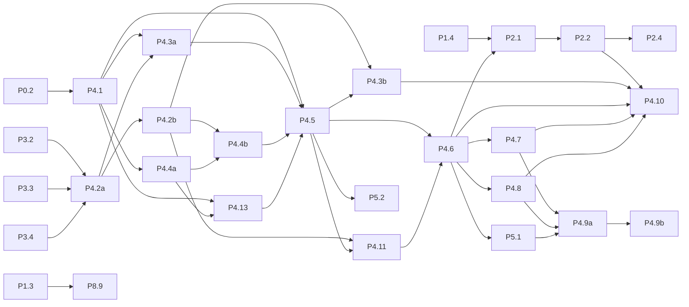

# G5-Lean implementation plan (v9)

Native-question lifetime amendment (2026-10-11): the [governing conversation ontology](../.g5/ontology/features/conversations.g5.md#separate-durable-questions-from-native-transport) and [Agent API §8.2](agent-api-surface-v9.md#82-native-request-projection-and-reply) supersede this historical plan's execution-bound question deadlines, blanket exit/transfer invalidation and requirements to ask a fresh question after Continue. Confirmed deferred questions have no automatic expiry and retain their identity across saved native session restoration. The current owner answers on attached ready compute through the matching native tool and fresh callback; first-answer immutability and delivery-evidence rules remain. Permissions and ordinary process-bound requests keep their existing execution-bound rules. This amendment changes no Codex transport, introduces no fallback prompt and grants no VM wake authority.

Status: v9 backend-refactor implementation plan, revised 2026-09-18. It succeeds [lean-implementation-plan-v8.md](lean-implementation-plan-v8.md) and preserves earlier versions and merged PR history. The latest user scope decision removes the dedicated review/explainer returned-results workflow; P4.14 is withdrawn and its identifier reserved. Owner-only runtime access, Git-only reader browsing, exact-name fork creation, shared agent sessions, native provider questions and the removal of workspace search and user Commit/Flush-now remain. The 2026-09-19 [MVP scope amendment](v9-mvp-scope-amendment.md) keeps the original's microVM, host and credential mechanisms, moves P4.12 after the MVP and adds P8.10 to P8.14. The [v9 tracker](lean-implementation-status-v9.md) carries this dependency map. Only merged rows on origin/main establish available implementation dependencies. This is a plan, not implementation or deployment evidence.

The design (i.e, [lean-backend-design-v9.md](lean-backend-design-v9.md)) is authoritative; when a prompt and the design disagree, the design wins and the prompt is corrected. The three companion notes ([workspace-vm-api-v9.md](workspace-vm-api-v9.md), [worker-host-api-v9.md](worker-host-api-v9.md), [agent-api-surface-v9.md](agent-api-surface-v9.md)) are normative for field-level detail where the design adopts them.

---

## 1. How to use this plan

**For the person running the program.** For the MVP, follow the three-person schedule in §5.3; afterwards land PRs wave by wave (§5.4). A PR may start only when everything it depends on has merged to `main` on https://github.com/G5Labs/G5-Lean; nothing is started against a stand-in. Each PR names the capability that owns it (§4); the owner of that capability reviews it, and the program owner merges on convergence. Before starting a PR, confirm in the v9 status file on `origin/main` that its dependencies are merged (§2, item 1) and run the GitHub checks of §6.0: a merged PR matched by its `P<id> ` title prefix and a closed issue for every dependency.

**For an agent starting a PR.** Copy the PR's prompt from §6 into a fresh session in this repository, or take it from the PR's GitHub issue (§6.0: one `MVP` issue per scheduled PR, assigned to its executor, carrying the frame and the prompt). The prompt says what to read first, what to build or delete, what not to touch, how to prove it works, and how to finish. The conventions in §2 and the frame in §6.0 (dependency gate, exact PR title, tracker row, issue closure) apply to every PR and are part of the prompt by reference.

**Sizing.** S under 1K changed lines, M 1K to 4K, L 4K to 10K, XL over 10K. Deletion-heavy PRs are XL by line count but mechanical; the reviewer's job there is checking that nothing retained still references the deleted code, which the compiler and tests do for us.

---

## 2. Conventions for every PR

1. **Start from the latest `main`, and only when your dependencies are in.** Your PR's dependencies must already be merged. Read the v9 status file from `origin/main`, not from a local checkout: `git -C G5-Lean fetch origin main && git -C G5-Lean show origin/main:docs/lean-implementation-status-v9.md`. Your row's Depends on cell lists the dependencies, and each is merged when its own row has a non-empty Branch cell; an empty Branch means not merged, whatever GitHub shows in flight. To read one row, pipe the file through `grep -E '^\| P4\.2a \|'` with that row's id in place of `P4.2a`. If a dependency is not merged, stop and report instead of starting; never start against a stand-in. The gate in §6.0 adds two GitHub checks per dependency, a merged PR matched by its `P<id> ` title prefix and a closed issue, and all three checks must agree. Then fetch and branch from `origin/main`, never from a local `main` that may be stale: `git -C G5-Lean fetch origin main && git -C G5-Lean worktree add ../G5-Lean-wt-<pr-id> -b lean/<pr-id>-<slug> origin/main`, where `<pr-id>` is the exact id from §5.1, suffix included (for example `P4.2a`). Work in that worktree, never in the primary checkout. Run `git branch --unset-upstream` after creating the branch so a bare `git push` can never target `main`. Do not touch other worktrees. Before your first build, run the validation ladder once on `origin/main`; a failure that predates your branch is pre-existing and must be recorded. If it leaves either required PR lane red, repair the shared failure within authorized scope or keep the PR open; a pre-existing failure is not a waiver.
2. **Keep your branch current.** Before you open the PR, and after every round of review changes, run `git fetch origin && git rebase origin/main` (rebase, never merge `main` into your branch). Resolve conflicts yourself; the usual hotspots are migration numbering, your row in `docs/lean-implementation-status-v9.md`, and `Cargo.lock`. If the rebase brought in changes to a crate you touched, re-run the validation ladder for that crate before pushing. Push with `git push --force-with-lease` after a rebase. Never rebase or amend after the PR is approved unless the reviewer asks.
3. **Read first.** Every prompt lists design sections, companion notes and research notes. Read them before opening code. Line numbers drift; symbol names are stable.
4. **Scope discipline.** Do exactly what the PR says. If the PR cannot be completed without a change listed under "Do not", stop and report it in the PR description under "Blocked"; do not widen the PR. Unrelated cleanups go into a note in the v9 status file, not into the diff.
5. **Buildable at every merge.** The workspace must compile and the retained tests must pass at the end of the PR. A `// LEAN-TODO(P<x.y>)` marker may document deferred implementation but never substitutes for a passing retained test or CI lane. Update retained workflows and fixtures in the same PR that retires their API or command. Grep for markers with your PR id before you finish.
6. **Schema edits are forward migrations.** `001_lean_baseline.sql` and every applied migration are immutable, checksum-guarded files; never edit one, never repair the SQLx ledger. Add `NNN_<description>.sql` with the next unused number (coordinate numbering at rebase), append its SHA384 to `backend/g5-api/src/db/migrations/checksums.sha384`, and follow [database-migrations.md](database-migrations.md): validate a fresh install and an upgrade from the previous schema on a copy of real rows, and re-run to prove the no-op path. Every prompt of the draft 6 plan that said "edit the baseline" now means "add a migration". Regenerate the SQLx offline cache when queries change (`just db-prepare`, with `just dev-up`).
7. **Tests.** Agree the layered test strategy before the first runtime implementation PR: unit tests for state transitions and policy, integration tests at real API/dispatcher/Git boundaries, and value-loop end-to-end tests for edit/resume, reader fork, ordinary agent/session continuation and transfer. Keep that strategy current as each owning PR lands; P8.6 is later CI simplification, not permission to defer new-boundary coverage. Add the acceptance tests named in the prompt. Retarget or delete tests only for behavior the PR removes; never delete a test to make a retained behavior pass. Classify every removed test in the PR description (deleted protocol / covered elsewhere / rehomed). Fake providers: tests point `G5_CLAUDE_PATH` / `G5_CODEX_PATH` at the fake binaries.
8. **Validation ladder** (the prompt lists required items; these touch rules add to that list and cannot be dropped by an individual prompt): `SQLX_OFFLINE=true cargo check --workspace --all-targets --offline`; `just fmt-check` and `just lint` plus `cargo clippy --workspace --all-targets -- -D warnings` (Cloud Build lints test targets); `SQLX_OFFLINE=true cargo test -p <crate> --lib` for touched crates; `just test-integration` (needs `just dev-up`) when routes or services change; `npm --prefix frontend run build && npm --prefix frontend test` when the frontend changes; `just docker-ci` for PRs that touch worker, host, isolation, dispatcher or CI configuration; `python3 scripts/check-layout.py` and `just commands-check` when files move or recipes change; the migration checks of item 6 when a migration is added.
9. **Commits and PR description.** Conventional subject line `<area>: <what>`. End every commit message with `Co-Authored-By: Claude Fable 5.1 <noreply@anthropic.com>`. The PR description uses the template in §2.1 and ends with `🤖 Generated with [Claude Code](https://claude.com/claude-code)`. Only after the user explicitly authorizes publishing a PR, push the branch and open it with `gh pr create --repo G5Labs/G5-Lean --base main --head lean/<pr-id>-<slug> --title "P<id> <title>" --body-file <file>`. The title starts with the exact PR id from §5.1, suffix included, followed by a space (for example `P4.2a g5d dispatch: listener, private protocol, files, ports, status`); the status row, the PR and the issue are matched by it, so never abbreviate the id, never drop the suffix, never reuse an id. The issue mirroring the PR carries the same title, and the description states `Closes #<issue>` so the issue closes at merge (§6.0). Record the branch and the PR URL in your status row (item 10). Do not merge your own PR. Both `g5-ci-rust` and `g5-ci-e2e` must pass on the exact current head before merge. Record the local validation and the current-head CI result; neither review completion nor CI alone proves user-visible acceptance.
10. **Status file.** In the same PR, fill your row in `docs/lean-implementation-status-v9.md`: the Branch column with the branch name and the PR link, the Notes column with one line on what landed and the `LEAN-TODO` markers left. Never mark a row as in progress: a row stays empty until its PR merges, because other agents read a non-empty Branch on `origin/main` as "merged". Never edit another PR's Branch or Notes. The Depends on column is a copy of §5.1: leave it as it is; only a PR that changes the dependencies in §5.1 edits it, in every row it changes. The PR description (§2.1) holds the full record and stays true after every review round.
11. **Implementation and deployment are separate.** Implementation prompts do not authorize deployment. The Platform CI/CD owner runs the separately authorized QA and release procedure in §7.2. Cloud Build stays the CI system. Each PR must update CI setup, seed fixtures, command invocations, readiness queries and explicit crate/test lists affected by the component it introduces or retires; these edits are in scope and cannot wait for P8.6. Add a new crate to archive, execution, coverage and local docker-ci lists in its introducing PR. P8.6 owns later simplification, not basic coverage or repair of retained lanes.
12. **Ownership.** Every PR carries the capability that owns it (§4). Ask that owner's questions in the PR, not another owner's. A change that crosses into another capability's code is a deviation to record, not a reason to widen the PR.
13. **Publication requires an explicit ask.** Preparing or implementing this plan does not authorize a PR, GitHub issue or other public artifact. Keep the result in the requested worktree until the user explicitly asks to publish; findings stay in local review notes and the v9 status file.

14. **CI failure triage.** Record the failing stage, exact head, logs and comparison with a main build. A reasoned rerun for an identified infrastructure failure is allowed and records the requester/reason; repeat failures require diagnosis, not blind retries. Do not disable retained coverage or treat a retry-pass as proof that a stateful race is fixed. Repair failures in authorized scope or keep the PR open and record the blocker. Required lanes remain mandatory even for inherited failures. There is no CI-owner-only rerun rule and no waiver based on a fixed number of green runs.
15. **Review scope and evidence.** Each author/reviewer checks acceptance against the exact candidate, records meaningful regressions and fault points, and re-runs affected checks after changes. A production-boundary mutation or a demonstrably failing pre-fix case is useful evidence for a regression; a fixed mutation quota, model pairing, review-round count or commit-count rule is not an acceptance substitute.

### 2.1 PR description template

```
## P<id> <title>

Owner: <Workspace | Agents | Worker & Host | Git and governance | Platform>
Design: lean-backend-design-v9.md §<sections>
Depends on: P<..> (merged)
Issue: Closes #<n>

### What changed
- ...

### Deleted
- ...

### Tests
- added: ...
- retargeted: ...
- removed (behavior removed by this PR, classified): ...

### Migrations
- <NNN_name.sql>: fresh install and upgrade validated | none

### Validation run
- cargo check / lint / fmt: pass
- <crate> tests: pass (N tests)
- integration / docker-ci: pass | not run (why)
- exact-head g5-ci-rust / g5-ci-e2e build ids and outcomes: ...
- reruns: stage, reason, requester and previous build | none
- implemented / locally validated / CI validated / deployed / observed: state only evidenced levels

### LEAN-TODO markers left
- ...

### Blocked / deviations
- none
```

### 2.2 Test strategy, harness ownership and readiness

This section is the test-strategy artifact; §7.1 is its boundary-to-PR acceptance register. The Platform program owner records the Workspace, Agents and Worker & Host owners' review and any grouping decision in the tracker’s **Readiness checkpoint** before P4.1 or any runtime PR begins. That checkpoint was recorded in the tracker on 2026-09-18, with the strategy below as the accepted one. The normal dependency check in §2.1 also checks this checkpoint. Revisit it after P4.5/P4.11, after P4.10, or when an interface changes materially. Keep decisions and exceptions here instead of introducing a T0 implementation PR or duplicate test ledger.

| Layer | Production boundary and permitted harness | Owning PR / execution |
|---|---|---|
| Policy and protocol | Real validators/state transitions with deterministic clocks, Git fixture vectors and fault injection; helpers are not independent reimplementations of the lifecycle. | Each introducing PR; Rust unit tests in g5-ci-rust and docker-ci. |
| API/dispatcher integration | P4.4a supplies a test-support host peer in g5-internal-api using the real ctl codec, API tunnel, journal sequence/ack path, scripted inventory and reconnect/delay/duplicate faults. P4.5 composes it with a real g5d dispatch child over loopback. P4.2a owns the real dispatcher/mux fixture. | P4.4a/P4.5/P4.6; just test-integration and Cloud Build rust integration, without KVM. |
| Host substrate | Host-test control plane drives the real g5d host, libkrun, guest UID, passt and mounted runtime bundle; fake VMM only for deterministic unit faults. | P4.4b; required Linux KVM isolation coverage in g5-ci-e2e and local docker-ci where supported. Process tests cannot establish VM isolation. |
| User flows | Browser/API callers drive real lifecycle, dispatch and Git; fake provider binaries replace only the external CLI/upstream. P4.5 supplies shared workspace/fork/Resume/transfer fixtures and six authorized/unauthorized identities; subsequent owners extend them. | P2.2/P4.7/P4.8/P4.10/P5.1/P5.2/P8.9; retained Rust e2e and Playwright lanes. |

Test-only process hosting may start g5d dispatch through the host harness for local browser flows, with the same facade and fencing. It is never advertised as a SaaS isolation backend or silently substituted for a required KVM run. Every runtime-facade RPC/stream open is observable through a test-injected call log at the real boundary; zero-reader-call tests assert that log is empty. This does not require a permanent runtime_facade_audit database table or product endpoint. Mutable lifecycle/browser tests create independent workspaces for each attempt; a retry does not reuse a half-mutated workspace. Accessibility coverage includes the new disabled-control explanations, task history and terminal transcript, without blanket exemptions for new screens.

Each introducing PR owns test fixtures, command/schema compatibility in both CI lanes and fixture scenarios for its boundary. P4.5 adds workspace-VM stack/fixtures; P4.9a/P4.9b remove retired host-up/worker queries only after replacement tests run. A missing scenario in explicitly configured fake-provider tests fails loudly. The value-loop matrix is extended in the owning PRs for Save/stop/Resume, reader fork, transfer, preview, terminal and search removal. Cross-workspace Git objects, the isolated preview origin and guest egress are accepted exposures for the MVP, equal to the original's, owned after the MVP by P8.12, P8.13 and P8.11; P8.8 lists them.

P4.1 and P4.5 remain XL. Review schema/backfill, fork, lifecycle and transfer in bounded internal stages with capability owners; check each intermediate retained path. A mandatory split based on numbered-item count or line count is not adopted: the meeting asked to reassess fragmentation, and a split must first preserve coherent cutover and passing retained tests. If implementation shows a real blocking seam, amend §5.1, graph, prompts and tracker together before changing PR identifiers.

---

## 3. Historical baseline and the v9 delta

### 3.1 Landed from the draft 6 plan (snapshot carried from v7)

| PR | Merged as | Note |
|---|---|---|
| P0.1, P0.2 | #1, #3 | baseline tag; one baseline migration (now frozen) |
| P1.1, P1.2, P1.3, P1.4 | #24, #18, #31, #35 | refs authoritative for reads; receive-pack policy; projection convergence; head-operation registry deleted |
| P2.3, P2.5 | #29, #33 | worker native writes and push; native-git profiles |
| P3.1, P3.2, P3.3, P3.4, P3.5 | #12, #34, #46, #47, #44 | CLI pin and fakes; Rust provider runner; `task_questions`; `chat_session_files`; `naive_react` gone |
| P8.2, P8.3 | #11, #21 | IDE mockup, hidden settings, takeover remnants; GitHub-only login |
| out of plan | #5, #7, #8, #10, CI2 #22, CI3 #32 | dev-stack and CI fixes, recorded in their PRs |

### 3.2 CI/CD in the QA GCP project (historical v7 snapshot)

Landed by the CI/CD owner: #2 QA infrastructure, #4 CI write isolation, #6 QA data-service labels, #9 firmware boot probe, #13 and #36 to #39 worker image publishing and artifact IAM, #15 CI repository-specific inputs, #41 rustls advisory, #42 worker image repin, #43 greenfield database bootstrap, #45 QA bootstrap key and RLS contracts, #50 migration checksum guard and deployment pauses (with `docs/database-migrations.md` and `docs/qa-database-reset.md`). Recorded as open in v7 (recheck the tracker and GitHub before implementation): #51 (QA worker image defaults), #53 (seeder authority scope), #66 (E2E workflow repairs). Design notes landed as #48 (worker host API), #72 (agent API surface) and the workspace VM API note.

### 3.3 Draft 7's effect on the remaining draft 6 PRs (historical delta)

This table records the prior plan, not current instructions. In particular, the interim P2.1 server-side Save commit is superseded by §3.7 and the rewritten P2.1 prompt: public Save waits for the real VM/module facade and never commits.

| PR | Change |
|---|---|
| P2.1, P2.2, P2.4 | unchanged in substance; P2.1 stays an interim server-side Save so the CRDT deletion can proceed in parallel with the VM runtime; P4.5 replaces the write path |
| P4.1 | a forward migration instead of a baseline edit; adds `workspace_flushes`, `epoch`, inbox and host columns; no longer depends on P2.4 |
| P4.2 | the dispatcher exposes the Workspace Runtime API and a module runtime; no `proc.*`, `git.*`, `agent.run_turn`; dispositions table; `agent.turn` moves to P4.11; split into P4.2a (listener, private protocol, files, ports, status) and P4.2b (module runtime, journal, dispositions, built-in modules) |
| P4.3 | "Checkpoint task and restore" becomes "Flush, receipts and restore": no cron; immutable per-flush refs; receipt verified by the API; quiescence rule; split into P4.3a (shutdown flush, receipts, restore, stopped reads) and P4.3b (live flush and fork) |
| P4.4 | the worker-host-api protocol: `ctl` stream, versioning, `VmSpec`, journaled `vm.event`, renewable host credential, lease bound; proxies move to P4.12; split into P4.4a (the `ctl` protocol on both ends, no VM boot) and P4.4b (`VmSpec`, boot and stop, lease, relay) |
| P4.5 | five actions (restart added), teardown reasons and deadlines, the stop sequence with the flush, Save ordering, the Workspace Runtime facade; placement moves to P4.13 |
| P4.6 | invocation through the facade; G1 to G4 of the draft 6 review and the cancellation retention rule; runner wait and `suspended`; inbox reservations |
| P4.7 | inbox columns and the queued strip; base workspaces without a VM |
| P4.8, P4.9, P4.10, P5.1, P5.2 | as before, on the new surfaces; one preview per workspace; restart button; `source: flush`; P4.9 is split into P4.9a (host and worker) and P4.9b (API and frontend) |
| P6.2 | G5: one ref transaction with a receipt ref |
| P7.2 | "Rewrite the baseline" becomes "Schema cleanup migrations and after-metrics" |
| P8.4 | the renewable host credential moves to P4.4a; the rest unchanged |
| P1.5, P1.6, P6.1, P6.3, P6.4, P7.1, P8.1, P8.5, P8.6 | unchanged apart from design references and the migration rule |

### 3.4 Outstanding markers (historical v7 snapshot)

`LEAN-TODO(P4.8)` 55, `LEAN-TODO(P1.5)` 51, `LEAN-TODO(P6.4)` 16, `LEAN-TODO(P2.4)` 13, `LEAN-TODO(P8.6)` 5, `LEAN-TODO(P4.6)` 3, `LEAN-TODO(P6.1)` 2, `LEAN-TODO(P5.1)`, `LEAN-TODO(P4.7)`, `LEAN-TODO(P4.5)`, `LEAN-TODO(P4.1)` one each. Each owning PR resolves its markers; `grep -rn LEAN-TODO` is the ledger.


### 3.5 What v9 changes, including sibling paths

| PRs | Required v9 revision |
|---|---|
| P4.1 | Add exactly one `owner_user_id`, durable fork operations whose unfinished rows hold name claims, a transfer operation/audit record and preview task fields; migrate membership to read access; retain prior audit identity without introducing per-message writer UI. |
| P2.1, P2.2, P4.3a, P4.3b | Owner-only Save/upload after explicit Resume; owner-live versus non-owner durable-Git reads across files/docs/ontology/Changes; a reader forks a pinned durable source without contacting its VM. |
| P4.2a, P4.2b, P4.4a, P4.4b | Carry workspace owner identity to git configuration and owner-only credential references; module capability checks prohibit non-owner VM access; service lifecycle permits no wall-clock deadline. |
| P4.5 | Six workspace actions, with create routed through the sole fork service and recorded transfer through stop with reason `transfer`; enforce owner at every mutation boundary, including receive-pack; serialize transfer with admission, host release and owner update. |
| P4.6 | Add service task lifecycle and explicit-owner-start dispatch for preview, exempt it from bounded execution slots and wall-clock expiry, and suppress service auto-retry/successors; reauthorize all owner work at dispatch after transfer. |
| P4.7, P4.8, P4.11 | One owner's account and one shared session lifecycle across typed and templated agent inputs; preserve queued work/history and native-request audit through transfer while invalidating requests from stopped processes. Reader cannot send, answer, edit queued input or create/cancel arbitrary tasks. Keep command and preview distinct. |
| P4.10, P5.2 | Owner-aware controls and transfer UX; readers retain durable Git/history browsing plus Fork; terminal is owner-only, including stream admission and transfer closure. |
| P4.12 | One workspace-scoped owner provider account; session path is metering only; no session-scoped grants or cross-user credential selection. |
| P5.1 | Preserve the `preview` product/task kind; task list visibility, launch audit, cancellation, replacement, owner-only launch/cancel/relay authorization, explicit owner start and idle, workspace identity and no automatic restart. Remove only the obsolete transport/session implementation. |
| P4.9a, P4.9b, P7.1, P7.2 | Retire old preview infrastructure only after P5.1; retain service tasks, queue views, audit rows, owner fields and transfer state through cleanup. |
| P1.5, P1.6, P6.1–P6.4 | Owner-only Publish, PR creation and workspace approval writes, while governance constraints still apply; removing legacy RBAC must not restore member/admin write bypasses. |
| P3.6, P3.7, P8.7, P8.8, P9.1–P9.4 | Provider continuations, rollout, audits and self-hosted scenarios preserve owner authority, transfer fencing and non-restarting preview tasks. |

Current-code grounding: `backend/g5-api-core/src/services/workspace/workspace_service.rs` has `is_workspace_admin`, `can_manage_workspace_members` and `add_workspace_member`, which currently combine org roles, creator identity and `admin|editor|viewer` membership. These are separate authority paths to replace, not proof that v9 ownership already exists. HTTP boundaries live in `backend/g5-api-routes/src/routes/` (including `workspaces.rs`, `git.rs`, `tasks.rs`, `task_questions.rs`, `preview.rs` and `preview_profiles.rs`); trace their service calls, `git_policy.rs`, task state owners and RLS before editing. Earlier prompts' shorthand `routes/...` refers to that route crate. Also trace `frontend/src/components/preview/PreviewControl.tsx` → create/cancel-job routes and `frontend/src/components/execution/BottomDrawer.tsx` → `onAbortTask`: both must converge on preview task cancellation. `ProviderAccountService::resolve_frozen_for_dispatch` and its `config_service.rs` caller currently resolve a saved account id; v9 must not treat a prior owner’s saved id as current authority. Existing implementation status is inherited history, not a fresh deployment observation.


### 3.6 Shared branch name and fork-only creation

A working workspace remains multi-repository: `[(repo1, sameName), (repo2, sameName), ...]`, including every member repository such as the docs repository. Store its common destination in `workspaces.branch_name`; per-repository destination overrides are forbidden. Base views are read-only views of existing protected/default refs and may use different source names such as `main` and `master`; those refs are not newly allocated working-workspace branches. Equality of the fork-created destination branch name across members is required, not a naming convention. Keep `workspace_repos.base_branch` as the per-repository upstream/update target inherited from the source mapping; it is distinct from both the common destination and the fork manifest’s pinned `source_branch/source_oid`. A fork of a working workspace snapshots that workspace’s working branch without changing each member’s inherited upstream target. The proposed workspace name is the exact Git-valid branch name: no slugification, generated `feat/` prefix, UUID suffix, automatic rename or per-repository override. Forking a workspace, including a fork from base, is the only way to create a new workspace branch in member repositories. Any retained Create, clone/carry or “Fork and…” entry point must invoke that same fork service.

`workspace_forks` is the sole durable name-claim authority: every `pending` or `aborting` row claims its immutable exact `proposed_name` across the complete frozen member repository IDs. There is no `workspace_fork_reservations` table or replacement normalized claim store. In a READ COMMITTED transaction, lock the existing `repos` rows for the full member set in canonical ID order, then verify the locked rows are exactly the required same-org eligible member set and issue a separate fresh SELECT for unfinished claims. Resolve a matching idempotency key first: unfinished replay locks its stored members, rechecks status/digest/authorization and resumes that same row without self-conflict; terminal replay returns the recorded outcome without needing historical repos. A concurrently inserted duplicate uses the unique-key retry path. Reject any overlapping repository with an equal name or a slash-delimited ancestor/descendant name, using literal Git names rather than unescaped SQL wildcard matching. Locking only matching fork rows cannot protect an empty result; a combined locking/query statement or an older transaction snapshot is insufficient after waiting. Insert the complete pending claim before committing and before slow provider/flush work. The server checks all unfinished current-org claims regardless of the caller’s workspace read ACL, while conflict responses disclose no hidden fork identity, owner or metadata.

Before creating any branch, check actual internal Git refs and connected providers’ current refs in every member, including refs absent from projections. Provider checks are read-only; unavailable verification never means a free name. Existing names and ref-prefix conflicts reject the whole fork even at equal OIDs. Source OIDs, intended refs and progress may be pinned after claim admission but must be fixed before Git writes; the claim name/member IDs never change. Every platform ref creator, including protected-ref bootstrap/import, observes these claims. Repository deletion refuses or waits while an unfinished manifest names it. Ref mutation, retry, cleanup and finalization use the same repository lock order and current-operation status check, keeping slow network/flush work outside database locks. Create each branch and `refs/g5/forks/<fork_id>` proof in one Git create-if-absent transaction. Complete only with verified all-member refs and atomic workspace publication; mark aborted only after verified cleanup of operation-proven unchanged refs. Pending/aborting claims survive restart, timeout and `recovery_required`; neither age nor retry exhaustion releases them. A partial workspace is never runnable. These database claims do not make an external provider namespace atomic; provider publication still checks current absence independently.

| Boundary | Existing PR scope |
|---|---|
| Same-name mapping and durable operation schema | P4.1: `workspace_forks`, its immutable claim key and member/source/ref manifest; pending/aborting rows are the only claims; migration preflight catches old divergent mappings without silently renaming refs. |
| Core create/fork API, naming and recoverable Git writes | P4.5: exact name validation, canonical repo-row locking and fresh unfinished-manifest conflict checks, all-repo preflight, stopped/base fork, create alias, completion/recovery and pending-workspace admission. |
| Owner live-source fork | P4.3b: compose owner-authorized source flush/quiescence with the P4.5 fork operation; pin its complete receipt, keep the same reservation across retries, and never create a runnable partial fork. |
| All other branch producers and consumers | P2.1, P4.2b, P4.3a, P4.4b, P4.6–P4.8, P1.5 and P6.1–P6.2: Save, Changes, restore/native push, dispatch, chat/job carry, receive-pack, Publish and PR/merge preserve the exact shared name; none creates or repairs an absent workspace ref outside the fork service. |
| UX and end-to-end verification | P4.5 lands the minimal shared fork dialog; P4.3b and P5 reuse it, and P4.10 integrates it with the full workspace shell: one exact-name field; invalid/colliding names return actionable errors and keep the dialog open; no hidden suffix or per-repo override; no navigation to runnable partial workspaces. |
| Cleanup, audits and recovery tooling | P7.2, P8.8, P9.3: retain pending/aborting manifests as claims and check crash, cleanup, backup/restore and concurrent overlapping-repository cases. |

Current producers to replace include `WorkspaceService::create_workspace`, `workspace_branch_name_slug`, `generate_branch_name`, `mint_canonical_branch_name` and the fallback that mints a branch when no durable mapping is found in `backend/g5-api-core/src/services/workspace/workspace_service.rs`. Today the generated name is `feat/<slug>-<uuid fragment>` with a full-UUID collision fallback, and the collision query reads `workspace_branches`; neither satisfies the new exact-name/actual-Git contract. Trace their clone, add-member and route callers as well as `backend/g5-api-routes/src/routes/git.rs`. Base registration/onboarding binds existing protected/default refs per repository, preserving their possibly different names; initial protected-ref repository bootstrap stays outside working-workspace branch allocation. None of these paths may mint a new working workspace branch or silently normalize customer defaults. Existing workspace-name rename/member-edit routes must preserve the shared mapping or reject an unsupported change; they are not a second branch-creation mechanism. The branch/fork revisions preserve the earlier PR identifiers. The subsequent scope below adds P8.9 for complete workspace-search removal; all other changes revise existing unmerged prompts.

### 3.7 Search removal, agent sessions and native provider requests

Workspace search is removed end to end by P8.9: its box/results, API/status/reindex endpoints, background queue/indexing/embeddings, settings, schema and feature-specific tests/tooling. Preserve chat-history search, editor Find, agent-local code search and document/ontology projections. P8.9 is an MVP exit gate and an input to cleanup/audits; no surviving screen or seed tool may resurrect it.

User Commit and “Flush now” controls, their API/module actions and the flush reason `explicit` are removed. Save only writes files through the real VM facade after P4.6; the old plan for an interim P2.1 server-side commit is superseded and must not be implemented. Agent native git cadence and lifecycle `workspace.flush` materialization own commit creation. Push remains available for existing commits and cannot stage, commit or turn a snapshot into a branch commit. PR creation never performs an automatic commit or convenience flush; when dirty, ask the agent to checkpoint, and when merely ahead offer Push. Owner terminal/laptop native Git remains an existing escape hatch, not a second platform Commit action.

The target `tasks.kind` is exactly `agent | command | preview`. Every agent workflow has a `chat_sessions` row, transcript in `chat_messages` and provider artifacts in `chat_session_files`; these physical names stay. Human initiation supplies typed input and workflow initiation supplies a templated initial prompt, then both use the same task/session/inbox/continuation/request/harvest machinery. A resolved, explicitly configured permission policy is persisted independently of origin; no implicit non-chat bypass is allowed. Jobs remain optional orchestration.

A logical agent task keeps its task id, session, `job_id` and dependency edges through interrupted/suspended/retry attempts. `task_attempts` records execution outcomes; dependencies and job completion consult only final logical task success/failure/cancellation. Drain/rollout retry may queue the same task by explicit policy; user Stop, transfer and native-request timeout hold it for owner Continue/Resume. A follow-up after final settlement is a new agent task in the same session, never a replacement for unfinished dependency work.

Native provider requests are live-process requests, not durable custom questions. `provider_requests` projects a native `(exec_id, provider_request_id)` onto the timeline/reply path; process exit, request cancellation, suspension or incarnation loss invalidates every unanswered request. Historical custom question rows stay read-only. Claude direct CLI keeps stdin open for native AskUserQuestion/permission responses; Codex MVP remains noninteractive `exec --json` with no custom fallback. P3.7 later adds `codex app-server` over stdin/stdout for native questions and approvals. Continuing a suspended task starts a new attempt; the provider must ask again if it still needs input, and no old answer is replayed to a new process.

| PRs | Required changes |
|---|---|
| P4.1, P4.6 | Shared session/task/request schema and service; same-task continuation and dependency/job invariants; explicit permission resolution; active native requests are execution-bound. |
| P4.7, P4.8, P4.11 | Typed and templated inputs converge on the same service/module; Claude native control replies; Codex noninteractive; consistent timeline and artifact restore/harvest. |
| P3.6, P3.7, P4.9a, P4.9b, P7.1, P7.2 | Resident/later Codex adapters preserve native lifetime; delete custom ask/permission polling and compatibility producers after cutover; preserve historical audit and physical session tables. |
| P2.2, P4.2b, P4.3a, P4.3b, P4.5, P4.10, P6.1, P6.3 | Remove every product Commit/Flush-now action and explicit flush reason without restoring them through Changes, PR, shortcut or legacy API paths; retain Push of existing commits. |
| P8.9, P8.8, P9.1 | Search removal with retained-feature regressions, audit and packaging checks; historical migration replay still works. |

---

### 3.8 Meeting decisions and stricter ownership in v9

V9 replaces v8's reader preview exception and identical live read rule. Non-owners may read authorized durable Git content and durable control-plane history; they cannot reach VM filesystem/list/watch/stat, Changes modules, runtime inspection, ports, preview HTTP/WebSocket, terminal or execution mutation endpoints. Only the attached owner reads live files. Every non-owner file/tree/docs/ontology/Changes read resolves the last complete verified flush snapshot or committed branch fallback even while the source VM runs, with source/OID/age recorded consistently. Cache keys and subscriptions include the authorization/source boundary; demotion, transfer, revocation and incarnation change invalidate live data and close owner streams.

An owner without an attached running VM sees read-only editors and must explicitly Resume before edit/upload. Save/create/delete/rename/upload must fail without booting when attachment is absent; no UI retry or hidden Save path may call ensure. Execution also requires explicit current-owner Start/Resume authorization. A clearly presented Start workspace and chat/review/preview/terminal action may combine that intent with execution after ready; composing input, persisting history, queued automatic work and browsing never boot a VM. Reader forks always pin already durable Git refs/receipt vectors, never inspect, quiesce or flush the source VM. Owner live capture remains an explicit fork option. All forks remain checked, exact-name, all-member operations; completed children begin stopped and allocate compute only for a deliberate child-owner action.

The latest user scope decision excludes the dedicated review/explainer request, source-versioned result delivery and completion-cleanup product workflow from the backend-refactor MVP. Do not add its tables, candidate envelope, CLI/API/UI, producer/publication barrier, task hold, stop reason, skill or tests. P4.14 is withdrawn and its identifier reserved, with no replacement task or implicit later-phase commitment. Ordinary checked forks, shared conversations and existing task/artifact history remain. A future product proposal must be scoped separately; no remaining PR depends on that proposal.

Ordinary workspaces use the configurable 30-minute draft idle default. Task completion does not trigger a product-specific shutdown.

The meeting supported reviewing PR grouping around API boundaries and reducing unnecessary fragmentation. Before implementation, capability owners review the dependency graph and test plan together and record any consolidation or agreed test-double boundaries. It did not settle a replacement three-PR plan or authorize blanket mocks. Until an explicit amendment changes them, merged production dependencies and the no-stand-in gates below remain binding; test harnesses at real component boundaries are permitted. The same checkpoint reviews autosave preference/default and startup measurements; v9 keeps explicit Save with optional autosave only while attached.

### 3.9 MVP scope amendment (2026-09-19)

For the microVM, the host and for secret and identity management, the MVP keeps what the original G5 built: the mechanisms v9 had put in their place leave the MVP, P4.12 becomes a post-MVP PR and P8.10 to P8.14 hold the dropped scope behind the P8.8 audits. The team's statement is binding: "Environment variables are the initial credential mechanism (today's model); files, secrets managers and HTTPS-proxy capture come later."

P4.1 and P4.2b are in progress and ship as planned; what they land outside the amended scope (schema that stays dormant, the bootstrap capability in `modules.invoke`) is handled by their follow-up PRs, not by new PRs. The per-PR list of removed and replaced items is in [v9-mvp-scope-amendment.md](v9-mvp-scope-amendment.md) §4, and the prompts in §6 apply it item by item.

## 4. Capability tracks, owners and milestones

Ownership follows the capability, not the process a component runs in (design §4.1). The owners in the table are the reviewers of record for their track; the Git and governance track is assigned by the team. Ownership names who reviews, not who executes: for the MVP the executor of each PR is the person the schedule in §5.3 puts on it, and carrying another track's PR is expected.

| Track | Owner | PRs |
|---|---|---|
| Workspace | @zcl-g5 | P2.1, P2.2, P2.4, P4.1, P4.2a, P4.2b, P4.3a, P4.3b, P4.5, P4.10, P5.1, P5.2, P7.2, P8.12, P8.13 |
| Agents | @rahul-g5 | P4.6, P4.7, P4.8, P4.11, P7.1, P8.1, P3.6, P3.7 |
| Worker & Host | @kaihuiz-g5 | P4.4a, P4.4b, P4.9a, P4.9b, P4.12, P4.13, P8.4, P8.7, P8.10, P8.11 |
| Git and governance | to be assigned | P1.5, P1.6, P6.1, P6.2, P6.3, P6.4, the receive-pack half of P4.3a |
| Platform (program owner, CI/CD owner) | | P8.5, P8.6, P8.8, P8.9, P8.14, P9.1 to P9.4 |

**MVP milestone.** Design §13: the nine proposals on the QA environment. In PR terms: P2.1, P2.2, P2.4, P4.1, P4.2a, P4.2b, P4.3a, P4.3b, P4.4a, P4.4b, P4.5, P4.6, P4.7, P4.8, P4.9a, P4.9b, P4.10, P4.11, P4.13, P5.1, P5.2, P8.9 merged. P8.1 is idle-time work, not an MVP gate. Exit criteria are in §7.

**After the MVP, in priority order.** Governance and publish (P1.5, P1.6, P6.1 to P6.4); the pre-launch audits (P8.8); the hardening the audits rank (P4.12, P8.10 to P8.14); lifecycle and schema cleanup (P7.1, P7.2); rollout gates (P8.7) and infra cleanup (P8.4); the self-hosted phase (P9.1 to P9.4); the later provider track (Claude process reuse P3.6 and Codex stdio app-server P3.7); crate consolidation and the CI review (P8.5, P8.6).

---

## 5. PR map, dependencies and waves

### 5.1 PR table

| PR | Title | Owner | Size | Depends on | State |
|---|---|---|---|---|---|
| P1.5 | Remove remote tracking; add protected-branch mirroring and Publish | Git | XL | P1.4, P4.5 | not started |
| P1.6 | Frontend: remove remote-tracking UI, add Publish | Git | M | P1.5 | not started |
| P2.1 | Attached-owner Save/upload and role-aware Git/live reads | Workspace | M | P1.4, P4.6 | not started |
| P2.2 | Frontend explicit Save; remove CRDT from editors | Workspace | XL | P2.1 | not started |
| P2.4 | Delete the backend CRDT layer | Workspace | XL | P2.2 | not started |
| P3.6 | Session-resident Claude CLI process behind `agent.turn` | Agents | L | P4.11, P4.6, P4.7, P4.8 | post-MVP |
| P3.7 | Codex app-server stdio migration with native questions and approvals | Agents | L | P4.11, P4.6, P4.7, P4.8 | post-MVP |
| P4.1 | Migration: ownership, agent sessions and VM runtime | Workspace | XL | P0.2 | not started |
| P4.2a | `g5d dispatch`: listener, private protocol, files, ports, status | Workspace | L | P3.2, P3.3, P3.4 | not started |
| P4.2b | `g5d dispatch`: module runtime, journal, dispositions, built-in modules | Workspace | L | P4.2a | not started |
| P4.3a | Shutdown flush, receipts, restore, stopped reads | Workspace (+Git) | L | P4.1, P4.2a | not started |
| P4.3b | Owner live fork capture and durable reader forks | Workspace | M | P4.2b, P4.5 | not started |
| P4.4a | `g5d host`: the `ctl` protocol on both ends, host credential, event journal, drain | Worker & Host | L | P4.1 | not started |
| P4.4b | `g5d host`: `VmSpec`, boot and stop, lease, stream relay, retained roots | Worker & Host | L | P4.2b, P4.4a | not started |
| P4.5 | API: lifecycle service, six actions and transfer, owner authorization, Workspace Runtime facade | Workspace | XL | P4.1, P4.3a, P4.4b, P4.13 | not started |
| P4.6 | Dispatch, shared agent lifecycle, same-task continuations and native requests | Agents | L | P4.5, P4.11 | not started |
| P4.7 | Typed-input agent sessions and inbox; delete sticky runtimes | Agents | XL | P4.6 | not started |
| P4.8 | Templated-input agent sessions and optional jobs; delete job/task branches and merge | Agents | XL | P4.6 | not started |
| P4.9a | Delete per-task execution on the host and in the worker | Worker & Host | L | P4.7, P4.8, P5.1 | not started |
| P4.9b | Delete the workers table, per-task routes, loops and UI | Worker & Host | L | P4.9a | not started |
| P4.10 | Frontend: workspace VM status, owner controls, Transfer, reads and Changes | Workspace | L | P2.2, P4.3b, P4.6, P4.7, P4.8 | not started |
| P4.11 | The `agent.turn` module and the per-turn CLI adapters | Agents | L | P4.2b, P4.5 | not started |
| P4.12 | Host proxies: owner provider account, git and platform credential proxy, grant updates | Worker & Host | L | P4.4b | post-MVP |
| P4.13 | Host registry, host states, placement, quotas, drain and the operator API | Worker & Host | M | P4.1, P4.4a | not started |
| P5.1 | Owner-only preview service tasks on the workspace VM (`workspace.preview`) | Workspace | L | P4.6 | not started |
| P5.2 | Browser terminal | Workspace | M | P4.5 | not started |
| P6.1 | `pull_requests`, `approval_rules`, `approval_decisions`, `g5d pr` | Git | L | P1.5, P4.6, P4.8 | not started |
| P6.2 | The merge operation | Git | L | P6.1 | not started |
| P6.3 | Governance frontend | Git | L | P6.2 | not started |
| P6.4 | Delete governance legacy | Git | XL | P6.2, P6.3 | not started |
| P7.1 | Lifecycle cleanup: one status enum, delete the kernel | Agents | L | P4.9b, P6.4 | not started |
| P7.2 | Schema cleanup migrations and after-metrics | Workspace | M | P7.1, P8.9 | not started |
| P8.1 | Remove internal issue tracking | Agents | XL | P3.2 | idle-time work |
| P8.4 | Infra cleanup: dormant MIG, customer images, disabled workflows | Worker & Host | M | P4.9a, P4.9b | not started |
| P8.5 | Crate consolidation | Platform | XL | P7.2 | not started |
| P8.6 | CI review | Platform | S | P8.5 | not started |
| P8.7 | Versioned rollout: protocol gates, feature flags, drain-and-recreate runbook | Worker & Host | M | P4.7, P4.8, P5.1, P4.13, P8.14 | not started |
| P8.8 | Pre-launch audits: security, fault tolerance, scalability | Platform | S | P2.4, P4.3b, P4.9b, P4.10, P5.1, P5.2, P8.9 | not started |
| P8.9 | Remove workspace search end to end | Platform | L | P1.3 | not started |
| P8.10 | Host registration exchange and renewable host credential | Worker & Host | M | P4.4a, P4.13 | post-MVP |
| P8.11 | Guest egress enforcement, network mode and runtime process isolation | Worker & Host | L | P4.4b | post-MVP |
| P8.12 | Git object views and scoped receive-pack | Workspace (+Git) | L | P4.3a, P4.4b | post-MVP |
| P8.13 | Preview origin isolation on a separate registrable domain | Workspace | M | P5.1 | post-MVP |
| P8.14 | Operational policies: host lease timer and deploy guard, image and fleet policy, configuration authority, retention, admission bounds, GC and backup barrier | Platform | L | P4.5, P4.13 | post-MVP |
| P9.1 | Self-hosted bundle on the workspace-VM model | Platform | L | P4.9a, P8.4, P8.9 | later phase |
| P9.2 | Microsoft Entra platform login for self-hosted installations | Platform | M | P9.1 | later phase |
| P9.3 | Backup barrier and restore of Postgres and the git store; upgrade drain | Platform | M | P4.3a, P9.1, P8.14 | later phase |
| P9.4 | Azure canary on the workspace-VM host | Platform | M | P9.1, P9.2, P9.3 | later phase |

Merged PRs (P0.1, P0.2, P1.1 to P1.4, P2.3, P2.5, P3.1 to P3.5, P8.2, P8.3) keep their rows in the tracker.

### 5.2 Dependency graph



The graph focuses on the MVP; §5.1 is the complete dependency list. V9 adds real gates: P4.5 supplies lifecycle/files, P4.6 supplies real module/association checks, and only then P2.1 cuts over public Save/read routes without any interim commit behavior. P2.2 switches editors after those routes exist; P4.10 needs P2.2, live fork, Changes and both agent-session producers for its real UI flows; P5.1 needs normal task dispatch; P5.2 needs the facade; P4.9a may remove the old preview registry only after its task-backed replacement lands. P4.8 requires the same P4.6 shared agent lifecycle as chat before real job dispatch; P1.5 uses P4.5’s owner/transfer admission checks. P6.1 depends on the Changes facade and migrated tasks; P6.3 builds its Merge UI after P6.2; P8.7 tests continuation/dependencies for migrated chat/workflow work and preview teardown against their real implementations. The post-MVP provider adapters require P4.6/P4.7/P4.8 native-request and shared-session behavior; P9.1 packages the P8.9 search-free runtime. P4.5, P4.7, P4.8, P5.1 and P5.2 no longer depend on P4.12, which is post-MVP: the MVP delivers credentials as environment variables and enforces no guest egress (§3.9). P4.3a no longer depends on P4.4a, whose only reason was the host-only git-view route, and P4.4b no longer depends on P4.3a, whose only reason was its scoped packs. P4.11 follows P4.5 real session-file routes; no service is implemented against an unmerged producer. Agents stop hooks arrive with P4.6 before any migrated execution can run. Every dependent builds on merged code, never on a stand-in. P8.9 follows the landed projection-convergence producer (P1.3), runs independently of the VM chain, and gates the MVP, P7.2 schema cleanup and P8.8 audits. The v9 tracker must carry exactly these dependencies.

### 5.3 MVP schedule for three people

The plan §2.2 readiness checkpoint is recorded in the tracker (2026-09-18), and round 1 has started: P4.1 and P4.2b are both in progress. Each row below is a dependency-safe round, not a calendar estimate: every dependency of a PR in a row is merged in an earlier row or in the historical baseline. Ownership (§4) names reviewers; the columns allocate executors. A person who finishes early takes the highest-ranked actually ready work; no one starts against an in-flight dependency. Recompute after every merge/interface amendment. The schedule is mirrored to GitHub issues labelled `MVP`, one per PR, titled `P<id> <title>` and assigned to the executor in its column (§6.0). Test fixtures drive the real boundary and are not substitute production services.

| Round | zcl | kaihui | rahul |
|---|---|---|---|
| 1 | — | P4.2b | P4.1 |
| 2 | P4.4a | — | — |
| 3 | P4.3a | P4.13 | — |
| 4 | P4.4b | — | — |
| 5 | P4.5 | — | — |
| 6 | P4.11 | P4.3b | P5.2 |
| 7 | P4.6 | — | — |
| 8 | P2.1 | P4.7 | P4.8 |
| 9 | P5.1 | P2.2 | — |
| 10 | P4.9a | P2.4 | P4.10 |
| 11 | P4.9b | — | — |

The longest outstanding dependency path is now P4.1 → P4.4a → P4.4b → P4.5 → P4.11 → P4.6 → P2.1 → P2.2 → P4.10 (9 PRs by dependency depth, not duration), equal in length to the chain ending in P4.9a → P4.9b. P4.3a no longer waits for P4.4a and could run beside it; it stays with zcl, who carries ten of the twenty PRs, so the table has eleven rounds while the dependency depth is nine. P4.11’s real session-file dependency adds an edge after P4.5; the prior runtime-retirement-only chain is not the program’s critical path. Prefer ready work by longest remaining path to an MVP exit, then capability availability. P8.9 and P4.2a are merged; P8.1 is lower-priority idle work after MVP-ready work. Branch/Notes semantics in the tracker remain unchanged: they record merged work on main, not this proposed schedule.

### 5.4 Waves after the MVP

| Wave | PRs | Owners | Notes |
|---|---|---|---|
| 7 | P1.5, P1.6, P6.1, P8.4, P8.8 | Git ×3, Host, Platform | P1.6 and P6.1 follow P1.5 |
| 7b | P4.12, P8.10, P8.11, P8.12, P8.13, P8.14, then P8.7 | Host ×4, Workspace ×2, Platform | ranked by the P8.8 audit; P8.7 follows P8.14 |
| 8 | P6.2, then P6.3; P3.6 | Git ×2, Agents | P6.3 uses the merged merge route |
| 9 | P6.4, P3.7 | Git, Agents | |
| 10 | P7.1, then P7.2 | Agents, Workspace | sequential |
| 11 | P9.1, then P9.2 and P9.3 | Platform | the self-hosted phase |
| 12 | P9.4 | Platform | |
| 13 | P8.5, then P8.6 | Platform | sequential |

---

## 6. PR prompts

Each prompt is self-contained apart from §2 of this document and the frame in §6.0, which it references and whose `Frame:` line closes it. Paths are relative to the repository root. Prompts for merged PRs are in the draft 6 plan.

### 6.0 Common frame: dependency gate, PR title, tracker row, issue

The MVP schedule (§5.3) is mirrored to GitHub issues on https://github.com/G5Labs/G5-Lean: one issue per planned PR, labelled `MVP`, assigned to the executor named in §5.3, titled exactly `P<id> <title>` (the id and the Title cell of §5.1, verbatim), and carrying this frame, instantiated for that PR, followed by the PR's prompt from this section verbatim. The frame is part of every prompt in this section, whether the prompt is read from the issue or from this file; each prompt ends with a `Frame:` line that instantiates it. `P<id>` and `<title>` are the PR's own id and §5.1 title, `<dep>` each id in its Depends on cell, `<issue>` its issue number, `<slug>` a short branch slug.

```
Dependency gate. Before any work, for every <dep> in this PR's Depends on cell (§5.1), run these checks. All must pass and agree; otherwise stop and report instead of starting. Never start against a stand-in, an in-flight PR or a local checkout.
1. Tracker row merged: `git fetch origin main && git show origin/main:docs/lean-implementation-status-v9.md | grep -E '^\| <dep> \|'` (escape the dot: `P4\.2a`) prints the row, and its Branch cell, the fourth column, is non-empty.
2. PR merged, matched by title: `gh pr list --repo G5Labs/G5-Lean --state merged --limit 500 --json number,title,mergedAt --jq '.[] | select(.title | startswith("<dep> "))'` prints exactly one PR. An open, draft or closed-but-unmerged PR is not merged, whatever its checks show.
3. Issue closed: `gh issue list --repo G5Labs/G5-Lean --state all --limit 500 --json number,title,state --jq '.[] | select(.title | startswith("<dep> "))'` prints an issue whose state is CLOSED. It may print nothing only for a dependency merged before the issue mirror existed: P0.1, P0.2, P1.1, P1.2, P1.3, P1.4, P2.3, P2.5, P3.1, P3.2, P3.3, P3.4, P3.5, P8.2, P8.3, CI2, CI3. An OPEN issue means not merged.
4. Readiness checkpoint: `git show origin/main:docs/lean-implementation-status-v9.md | grep -E '^\*\*Readiness checkpoint:\*\*'` must not read `pending` before P4.1 or any runtime PR starts (§2.2, §5.3).
A disagreement (a merged PR whose issue is open, a filled Branch cell without a merged PR, a closed issue without a merged PR) blocks the start as much as a missing dependency: comment the discrepancy on this PR's issue and report it to the person who assigned it. Then create the worktree and branch of §2 item 1: `lean/P<id>-<slug>` from `origin/main`.

<the PR's prompt from this section>

Finish.
1. The PR title is exactly `P<id> <title>`: the §5.1 id with its suffix, one space, the §5.1 Title cell verbatim, equal to the issue title. Dependents match merged PRs and closed issues by the `P<id> ` prefix, so never abbreviate the id, drop the suffix, reuse an id or put anything before it.
2. In the same PR, fill this PR's row in docs/lean-implementation-status-v9.md (§2 item 10): the Branch cell with `lean/P<id>-<slug>` and the PR link, the Notes cell with one line on what landed and the LEAN-TODO markers left. Leave every other row and the Depends on column untouched; nothing but the landing PR writes this row, so on origin/main it fills exactly when the PR merges.
3. The PR description (§2.1) states `Closes #<issue>` so the issue closes when the PR merges; that closure is check 3 for every PR that depends on this one. Never close the issue by hand before the merge; if the PR is abandoned, say so on the issue and leave it open.
4. Push and open the PR only after the explicit ask of §2 item 9: `gh pr create --repo G5Labs/G5-Lean --base main --head lean/P<id>-<slug> --title 'P<id> <title>' --body-file <file>`, the title in single quotes because §5.1 titles may contain backticks. Do not merge your own PR.
```

### P1.5 — Remove remote tracking; add protected-branch mirroring and Publish

```
You are implementing P1.5 of docs/lean-implementation-plan-v9.md in G5-Lean. Read plan §2, design v9 §5.6, §3.2 (remote tracking row), and docs/research/research-git-workspace.md §C.3 step 4, §C.4, §G. Depends on P1.4, P4.5 (P1.4 merged). Owner: Git and governance.

Goal: the only provider interactions are (a) inbound mirroring of protected branches and (b) explicit server-side publish of a workspace branch.

Do:
1. Resolve the acting user against the current `workspaces.owner_user_id` before Publish or provider binding; the workspace-scoped provider token belongs to that owner. Org admin read access is not a write bypass. Revalidate admission/owner under the same serialization boundary used by transfer before accepting a ref-changing request. Keep protected-branch mirroring a distinct server operation with its existing provider integration identity.
2. Inbound: backend/g5-api-core/src/maintenance/protected_branch_mirror.rs: every 5 minutes (configurable) and through the protected-ref mirror already delivered by P4.3a; webhooks are newly implemented here, not inferred from a nullable secret column, fetch `refs/heads/<protected>` from the provider into the mirror with the connecting user's stored token (`ScmTokenManager`), under a per-repo lock that P6.2 will share. Before any local namespace creation, use P4.5’s canonical repo-row lock and separate fresh pending/aborting workspace_forks claim query; a protected-ref import may not occupy an unfinished fork’s exact or prefix-conflicting name. Publish the branch hint on change.
3. Outbound: `POST /api/v1/workspaces/:id/publish` (scope workspaces:write): publish every member repo's workspace branch to the provider with the acting owner's token and the exact same name: create-if-absent for the first counterpart, then lease updates only for its owned publication. Refactor `push_branch_ff_or_lease` from workspace_pull_request_provider_lifecycle.rs to enforce those two phases (move it to a small `provider_push.rs`; the lifecycle file is deleted in P6.4). Reduce Make Remote to "bind repo to provider URL, then publish".
4. Delete: `branch_integration_service.rs`, `branch_sync_runs_service.rs`, `remote_tracking_merge.rs`, maintenance `branch_integration_worker.rs`, `branch_integration_scheduler`, `base_auto_pull_scheduler`, `remote_advisory_pinger`, `retained_publication_sweep`'s remote-tracking duties; routes `/push_to_remote`, `/push_mode`, `/base_auto_pull`, `/sync`, `/branches/:b/sync_runs*`, `/merge_runs*`, `/remote_tracking*`, `/approved_rebase_publish`, `/auto_pull`; CLI `g5d remote`; every `LEAN-TODO(P1.5)` site (51 on main; the landing's initial-tracking, convergence and merge-completion consumers, the baseline-ref and integration-queue follow-ups, fork and make-remote metadata).
5. Migration `NNN_remove_remote_tracking.sql`: drop `branch_integration_queue`, `branch_integration_remote_pair_leases`, `branch_sync_runs`; drop `workspaces.{push_mode, base_auto_pull_enabled, base_auto_pull_actor_user_id}` and `workspace_branch_repos.{remote_branch, baseline_commit, sync_paused_reason, last_sync_at, remote_tip_advisory_sha, remote_tip_advisory_observed_at, auto_pull_enabled, tracking_mode}`; the `job_merge_runs.source_kind='remote_tracking'` path; `refs/g5-tracking/*` pruned by a one-time maintenance pass.
6. Tests: retire remote_tracking_*.rs and job_merge_* remote-tracking tests; add protected_branch_mirror.rs (fetch updates the mirror, workspace branches are never fetched) and api_workspace_publish.rs (publish pushes the branch with lease; base workspace publish refused).

7. Publish uses the exact workspace branch name for every member and its provider counterpart. Require a completed fork and an existing internal member ref; publishing/binding cannot create a new internal workspace branch, manufacture a missing one, select a per-repo alias or append a collision suffix. First publication creates that already established workspace branch’s provider counterpart with create-if-absent, even though the fork previously verified its absence; if the remote name has appeared since preflight, return a collision without overwrite/adoption even when its OID matches. Persist publication ownership/outcome and apply subsequent lease updates only to that owned publication; a lost initial-publish reply must be reconciled with operation evidence rather than assuming matching OID proves ownership. Preserve protected-ref checks; do not mistake provider publication for authority to create another workspace branch.

8. Multi-repo Publish forwards each member’s exact same name; pending fork/missing internal branch and attempted per-repo alias are rejected, with no fallback ref or suffix. A provider name appearing after fork preflight rejects initial publication without overwrite, including an equal-OID branch; only an owned publication can later use a lease update. Provider lease failure does not mutate the internal workspace mapping. A reader and a non-owning org admin cannot publish or bind; an owner can; an old-owner request racing transfer cannot publish after the owner commit; protected mirror behavior remains intact.
9. N111/N113/N116/N118: MVP inbound protected-ref polling/freshness is P4.3a and must already serve base/fork/review sources. This later PR removes legacy tracking and adds outbound publication/webhook integration. A webhook requires configured secret plus provider-native raw-body signature verification, coalesces to authenticated exact-protected-ref fetch, never writes payload OIDs, and rejects missing/invalid secret. Register or expose webhook absent. Tests cover replay/burst coalescing, forged SHA, missing secret and invalid signature. Legacy sync never overwrites protected mirror/workspace heads during the transition.

Do not: touch PR creation or merge (P6), the frontend (P1.6).

Acceptance: `grep -rn "tracking_mode\|push_mode\|branch_integration\|auto_pull\|LEAN-TODO(P1.5)" backend` is empty; mirror and publish tests pass; docker-ci passes after retiring only removed remote-tracking scenarios and preserving/retargeting retained publication coverage in the same change; a skipped retained test is not a passing result.
Validation: cargo check, lint, fmt, migration checks, `just test-integration`, `just docker-ci`.

Frame (plan §6.0): run the dependency gate for P1.4, P4.5 before any work; PR title exactly "P1.5 Remove remote tracking; add protected-branch mirroring and Publish"; fill the P1.5 row of docs/lean-implementation-status-v9.md in the same PR; put Closes #<issue> in the PR description.

```

### P1.6 — Frontend: remove remote-tracking UI, add Publish

```
You are implementing P1.6 of docs/lean-implementation-plan-v9.md in G5-Lean. Read plan §2, design v9 §5.6, and docs/research/research-frontend-preview-infra.md §1.3 row 16 and §5.1. Depends on P1.5. Owner: Git and governance.

Goal: the workspace UI offers "Publish branch" and nothing about tracking modes, auto-pull, sync runs or merge runs.

Do:
1. Delete frontend/src/components/workspace/{RemoteTrackingActions, BranchTrackingIcon, BranchTrackingPopover, BranchAutoPullControl, CoordinatedRepoSyncModal}.tsx, the merge-routing parts of MakeRemoteDialog.tsx (keep "connect repo to provider"), and hooks/useRemoteTracking.ts; remove push-mode and auto-pull controls from settings; remove the WS handlers for `workspace.remote_tip_advisory_updated` and the dead `workspace.authoritative_cut_advanced` handler.
2. Add a Publish button (ReposBar) calling `POST /workspaces/:id/publish` with toasts; disabled on base workspaces and for readers; an org admin must first transfer ownership. Refresh capability state on ownership/access events and handle a server refusal for a stale open page.
3. Delete Playwright flows remote-tracking.spec.ts, remote-tracking-fork.spec.ts, coordinated-repo-sync.spec.ts, workspace-sync.spec.ts; add a publish flow to workspace.spec.ts.
4. Update frontend/src/lib/types.ts and api-schemas.ts.

Do not: touch editors, drafts, chat, PR/approval components.

Acceptance: `npm --prefix frontend run build`, `npm --prefix frontend test` and `just test-playwright` pass; grep for `remote_tracking|pushMode|autoPull` in frontend/src is empty.
Validation: frontend build and tests, Playwright lane of docker-ci.

Frame (plan §6.0): run the dependency gate for P1.5 before any work; PR title exactly "P1.6 Frontend: remove remote-tracking UI, add Publish"; fill the P1.6 row of docs/lean-implementation-status-v9.md in the same PR; put Closes #<issue> in the PR description.
```

### P2.1 — Attached-owner Save/upload and role-aware Git/live reads

```
You are implementing P2.1 of docs/lean-implementation-plan-v9.md in G5-Lean. Read plan §2 and §3.8, design v9 §5.4, §6.6, §9, docs/workspace-vm-api-v9.md and the historical CRDT research. Depends on P1.4 (merged), P4.6. Owner: Workspace.

Goal: every file, document, ontology and upload mutation uses the already attached owner's VM with no implicit boot/commit. Non-owner repository browsing always uses durable Git; only the attached owner sees live files. The P4.5/P4.6 facade and association checks are real merged dependencies, never stand-ins.

Do:
1. Centralize current owner, running attachment/incarnation and lifecycle/transfer admission checks for Save/create/delete/rename/upload/docs/ontology mutation. Return WORKSPACE_NOT_RUNNING when no VM is attached, without ensure or queued wake; return stopping/owner-hold/branch-mismatch errors as appropriate. Query workspace.changes on the expected running incarnation, then fs.write/delete/rename with expected_vm_id/epoch and expected_hash. Base views stay read-only. No operation creates or repairs a missing member ref.
2. PUT /workspaces/:id/files/*path accepts content/expected_hash and returns conflict/current content+hash on stale hash. Route uploads, document and ontology writes through their actual file mapping and this same service, including all alternate and legacy routes. No Save/upload route stages, commits, pushes or updates refs. Retire CRDT overlays as a source for migrated routes/RepoReadView, retaining legacy code solely for the P2.2 cutover and explicit P2.4 removal.
3. Resolve role and source before contacting runtime: owner plus attached running VM may fs.read/list/stat; every non-owner, and an owner without a running attachment, reads the last complete verified flush snapshot or committed branch fallback from Git. The same source vector governs tree, file, docs, ontology, read-only history/diff and Changes responses; never call a VM module to compute a reader's diff. Return source, per-repo OIDs, snapshot/observation time and stale/loss indicators, not a claim that Git equals the live filesystem. Keep document/ontology projection convergence and reject incomplete receipts.
4. Authorize/cache reads by workspace, actor/current capability, source kind/vector and owner/incarnation generation. Demotion, transfer, access revocation and incarnation changes close live watchers/streams, invalidate private cached content and refetch from the authorized durable source. Readers subscribe only to durable branch/flush/projection/history events; no file.changed, ports, runtime inspection or VM filesystem watcher reaches them. API, internal routes and front-end caches must enforce the same rule.
5. Boundary tests with a real dispatcher/facade: stopped Save/upload and every sibling mutation fails with no vm.start, ensure, file write or ref side effect; explicit Resume followed by matching-hash Save changes content without HEAD/index/ref changes. Cover stale hash, transfer races, open admission, missing refs, two-repo association and concurrent stop/flush with an admitted write. Native agent Git and lifecycle flush still capture admitted writes separately.
6. Read boundary tests compare owner-live versus reader-durable content while VM files differ from Git, including docs/ontology/tree/Changes and a second repo; stopped owner sees Git; neither browse nor reader fork boots/flushes a source. Revoke/demote an owner with cached pages and open watches; assert no later live payload arrives and a durable-source refetch replaces it. Include incomplete receipts, projection lag, source OID/age, base views and access removal. Retarget retained editor/projection fixtures without adding search/indexing dependencies.

7. N47/N48/N55: use the companion file field contract and cap before VM transport; stopped Save/Upload makes zero VM calls. Every flush doc/ontology view uses pinned historical Git; committed projection needs exact applied_oid. Read status is control-plane only. Test binary roundtrip/stale hash/create conflict/escaping paths, branch advance between tree/doc fetch, projection lag, and zero VM calls for readers/status.

Do not: add Commit/Flush-now, implicit Save/PR commit or boot, a branch-creation fallback, runtime stand-ins, or delete CRDT before P2.2/P2.4.

Acceptance: all sibling mutation routes require an attached owner; no non-owner content read reaches the VM; source provenance is consistent and stale live data is revoked. Public Save exists only after real dependencies merge.
Validation: cargo check/lint/fmt, API/docs/ontology/upload and authorization integration tests, just docker-ci with actual dispatcher and Git side-effect assertions.

Frame (plan §6.0): run the dependency gate for P1.4, P4.6 before any work; PR title exactly "P2.1 Attached-owner Save/upload and role-aware Git/live reads"; fill the P2.1 row of docs/lean-implementation-status-v9.md in the same PR; put Closes #<issue> in the PR description.

```

### P2.2 — Frontend explicit Save; remove CRDT from editors

```
You are implementing P2.2 of docs/lean-implementation-plan-v9.md in G5-Lean. Read plan §2, design v9 §9.2, §9.3, and docs/research/research-crdt-docs.md §F and research-frontend-preview-infra.md §1.3 rows 4 to 8. Depends on P2.1. Owner: Workspace.

Goal: no Yjs in the frontend. Editors hold local state and save explicitly.

Do:
1. Render every editor and upload control read-only for a non-owner or an owner without a running attachment. The latter sees explicit Resume; Save and autosave never start a VM. Non-owners browse durable Git rather than identical live content. A stale owner page must handle an authorization refusal without issuing alternate write calls; ownership/access changes refresh controls and preserve unsaved local content for the user to copy or fork. No author-per-message UI or writer-role selector is introduced.
2. CodeEditor.tsx: Monaco with a local model; Save (Ctrl+S) calls the P2.1 PUT with `expected_hash`; on 409 show a reload-or-overwrite dialog; optional autosave-on-blur behind a user preference, enabled only for the attached owner; dirty indicator per tab; the source marker, per-repo OID and snapshot age shown in the tab (live | flush | committed). Demotion/transfer clears live caches/watchers and loads the authorized Git source.
3. SpecEditor.tsx (block editor), StructuredQuestionEditor, EditableInline, questionAnswerWrite.ts, htmlDocAnswerBridge.tsx, ExplainerOutputView.tsx, JobOutputView.tsx: replace the `Y.Text` binding with a local document model and the same Save path; JobQuestionDocView.tsx already renders without Yjs and is the template.
4. Comments: anchor by `(path, line, line hash)`; adjust useComments.ts and the comment components; if `comment_index` lacks the hash, add it with a migration.
5. Delete frontend/src/lib/crdt.ts, hooks/useDraft.tsx, components/draft/*, useAutoCommitBeforeAction.ts, CRDT tests and mocks (test/crdt*.test.tsx, test/__mocks__/y-websocket.ts, vitest.config.crdt.ts, e2e/crdt-*.test.ts), the `draft.*` handlers in lib/ws.ts, and the deps yjs, y-websocket, y-monaco. Remove the WorkspacePage `crdt.yDoc/provider` plumbing and the 2.5 s file-tree polling (refetch durable views on branch/flush/projection events; only attached owners use file.changed).
6. Remove user Commit buttons/dialogs, /commit product shortcuts, auto-commit-before-action hooks and request builders while retaining Save and Push of already-created commits. A native agent/owner-terminal Git operation is not a product Commit API. Retarget navigation/action tests so no action creates a commit as a side effect.
7. Playwright: delete crdt-*.spec.ts, drafts.spec.ts, manual-commit-crdt-rollover.spec.ts, ui-auto-commit-before-actions.spec.ts, workspace-overlay-collaboration.spec.ts, draft-session-scope-isolation.spec.ts, typing-latency.spec.ts; add explicit-save.spec.ts (save, conflict dialog, spec editor save, comment anchor survives a save).

8. N56: persist actual byte/blob content_hash and bounded context with base commit/line/hash; HEAD alone is not a dirty-buffer identity. Render only hash-confirmed hunk/unique contextual mapping; duplicate or deleted anchors show ambiguous/orphan markers. Tests cover inserted lines, deleted line, duplicate blank/braces, live dirty comment then older receipt read and cross-branch mapping. No guessed nearest duplicate.

Do not: touch chat, jobs or PR components; change backend code except the comment anchor column.

Acceptance: `grep -rn "yjs\|y-websocket\|y-monaco\|Y\.Doc" frontend/src` is empty; frontend build and tests pass; the Playwright explicit-save flow passes.
Validation: frontend build and tests, Playwright lane of docker-ci.

Frame (plan §6.0): run the dependency gate for P2.1 before any work; PR title exactly "P2.2 Frontend explicit Save; remove CRDT from editors"; fill the P2.2 row of docs/lean-implementation-status-v9.md in the same PR; put Closes #<issue> in the PR description.

```

### P2.4 — Delete the backend CRDT layer

```
You are implementing P2.4 of docs/lean-implementation-plan-v9.md in G5-Lean. Read plan §2, design v9 §3.2 (CRDT row), §9, and docs/research/research-crdt-docs.md §G. Depends on P2.2. Owner: Workspace.

Goal: nothing in the repository references Yjs, drafts or the task-commit protocol.

Do:
1. Delete user Commit/commit-all/pre-commit-check draft routes with their custom mutations as part of the draft route deletion; keep read-only commit history/diff views, native agent Git and lifecycle materialization. No replacement platform Commit API is added. Delete crates/modules: backend/g5-crdt (remove from Cargo.toml members), backend/g5-api-core/src/crdt/*, backend/g5d-foundation/src/crdt/* (including the relocated task_rebase_gate and connected_checkout), backend/g5-api-core/src/services/draft_service.rs, backend/g5-api-routes/src/routes/drafts.rs, backend/g5-workspace-ops/src/draft.rs (callers assume clean), backend/g5-api-data/src/models/draft.rs, the `/api/v1/yjs/:workspaceId/:branchId` route and `crdt_ws_adapter`, the internal routes `/tasks/:id/crdt/edit-file-replace` and `/tasks/:id/drafts/commit-all`, `draft.*` WsEvents and `Channel::Draft`, `CrdtConfig` env vars, `yrs` from workspace deps; the host supervisor's CRDT peer and fs→CRDT bridge (`LEAN-TODO(P2.4)` in backend/g5d-host/src/supervisor.rs); every other `LEAN-TODO(P2.4)` site (the landing's draft rollovers, dirty bookkeeping, task overlay watermark).
2. Migration `NNN_remove_crdt.sql`: drop `draft_sessions`, `draft_updates`, `draft_participants`, `task_commit_requests`, `task_commit_frontier_cuts`, `task_commit_frontier_receipts`; drop `task_crdt_head_commits` from the assignment DTO; set the sticky-runtime `teardown_repository_scopes` to empty (P4.7 deletes sticky entirely).
3. Remove `crdt` from the instance-info feature list and every mention in Helm, compose and env examples (`G5_CRDT_*`, `G5_TASK_CRDT_PERSISTENCE_ENABLED`, `G5_CRDT_PERSISTENCE_BARRIER_EXACT_V2_ENABLED`) and the single-replica CRDT comment in infra/helm/g5/values.yaml.
4. Delete exclusive tests (api_drafts.rs, workspace_overlay_drafts.rs, draft_session_scope_contract.rs, e2e crdt_collab.rs, crdt_draft_ops.rs, persistent_task_crdt_restart.rs, Playwright leftovers) and retarget any test that only used drafts as a way to create a commit to the P2.1 Save API or plain git; classify every removed test.

Do not: touch task lifecycle, sticky runtimes beyond that field, or governance.

Acceptance: `grep -rn "yrs\|crdt\|Crdt\|draft_session\|DocumentHandle" backend frontend/src --include='*.rs' --include='*.ts' --include='*.tsx'` returns nothing except historical comments; the workspace compiles; docker-ci passes.
Validation: cargo check, lint, fmt, migration checks, `just test-integration`, `just docker-ci`.

Frame (plan §6.0): run the dependency gate for P2.2 before any work; PR title exactly "P2.4 Delete the backend CRDT layer"; fill the P2.4 row of docs/lean-implementation-status-v9.md in the same PR; put Closes #<issue> in the PR description.
```

### P3.6 — Session-resident Claude CLI process behind `agent.turn` (post-MVP)

```
You are implementing P3.6 of docs/lean-implementation-plan-v9.md in G5-Lean. Read plan §2, design v9 §8.1, §8.3, §8.7, §17.2, the historical docs/lean-provider-cli-contract.md §2.1 as baseline evidence only, and docs/agent-api-surface-v9.md §8 and §10 (the direct CLI/native protocol); separately probe every deferred steering/interrupt/model/permission control on the exact pin before designing process reuse. Depends on P4.11, P4.6, P4.7, P4.8. Owner: Agents.

P4.11 already keeps stdin open during a single attempt for native control responses; residency across turns is the separate optimization in this PR.

Goal: a second Claude adapter for the `agent.turn` module that keeps the CLI process resident across turns in the shared agent session so a queued message can steer or follow a running turn without a cold start, an interrupt can be sent in band, and a model or permission change can apply without a new process; behind the same module input, event and outcome schemas; selected per session by a feature flag with the per-turn adapter as the rollback lane. The Claude Agent SDK is not used; its published `sdk.d.ts` may be used to generate or check the Rust event types.

Do:
1. Provider process/session state is always bound to the workspace owner’s current VM incarnation. Ownership transfer interrupts and reaps the process before owner/account change; restoring a session retains conversation history only, and new-owner turns use their account. Readers cannot steer, grant permissions, answer questions or invoke these adapters; preview grants no reader authority.
2. Probes first, recorded as fixtures with `tools/fake-provider-cli/record.sh` on the pinned CLI: a second user message written while a turn runs (folded into the turn or queued until the next one, and how `--replay-user-messages` echoes it); the in-band interrupt control message (does the turn end, does the process survive, which frames follow); `session_state_changed` under `CLAUDE_CODE_EMIT_SESSION_STATE_EVENTS=1` for turn-end settlement; memory of one process across many turns. Record each outcome in the versioned v9 provider companion before writing adapter code, preserving the earlier provider contract; a capability the probe does not confirm is not implemented.
3. The resident adapter: one process per shared agent session from its first turn until the session idles (a per-session idle timeout shorter than the VM's), the VM stops, or the user closes the chat; turn boundaries from the exact-pin residency probe (result frame plus verified idle evidence such as `session_state_changed idle`, with EOF/exit required at process teardown); record this deliberate later-phase refinement of the MVP settlement contract in design §8.3; `input.accepted` journaled per message on the replay echo; steering as a stdin write when the probe confirmed folding, otherwise queued delivery to the next turn on the same process; interrupt in band when confirmed, else SIGINT; the execution identity stays per turn (`exec_id` per attempt), so the journal, dispositions and outcomes are unchanged. A process is never left resident while a question is open past its runner wait (suspension reaps it, design §8.4) or while a background job it announced still runs.
4. Selection per session by a `configs` flag; the per-turn adapter stays the default until the gates pass in QA. Extend `fake-claude` to run several turns on one process.
5. Native requests remain bound to the active execution and provider request id even when the process survives a turn. Invalidate outstanding requests at the owning attempt boundary and before rebinding; no old reply may steer a later task. Continue a held task under its existing id/dependencies; a post-terminal follow-up is a new task in the same session. Typed and templated origins use identical explicit permission policy resolution.
6. Gates (design §8.7): exhaustiveness fixtures over the recorded frames, unknown discriminant and contradictory-evidence tests, the golden turns including steering, in-band interrupt and a session that outlives an idle stop, the durability test, the redaction tests, and a memory budget over 200 turns; a short amendment to the design recording the confirmed capabilities.

Do not: change the module schemas; remove the per-turn adapter (a later PR after rollout); introduce the Claude Agent SDK or a Node adapter; change Workspace or Worker & Host code.

Acceptance: both adapters pass the same golden turns; the flag switches a session between them; a queued message reaches a resident process without a cold start; docker-ci passes.
Validation: cargo check, lint, fmt, `cargo test -p <module crate>`, `just docker-ci`.

Frame (plan §6.0): run the dependency gate for P4.11, P4.6, P4.7, P4.8 before any work; PR title exactly "P3.6 Session-resident Claude CLI process behind `agent.turn`"; fill the P3.6 row of docs/lean-implementation-status-v9.md in the same PR; put Closes #<issue> in the PR description.
```

### P3.7 — Codex app-server stdio migration with native questions and approvals (post-MVP)

```
You are implementing P3.7 of docs/lean-implementation-plan-v9.md in G5-Lean. Read plan §2, design v9 §8.3, §8.4, §17.2, and docs/agent-api-surface-v9.md for the pinned provider-native protocol contract. Depends on P4.11, P4.6, P4.7, P4.8. Owner: Agents.

Goal: later-phase migration from noninteractive `codex exec --json` to `codex app-server` over stdin/stdout, adding native questions and approvals to the same shared agent-session and logical-task lifecycle. No custom ask_user or MCP question fallback is introduced.

Do:
1. Probe the exact pinned Codex binary and record initialization/version negotiation, thread start/resume, turn start, native request_user_input/question and command/file-change approval requests, responses, cancellation, turn completion and process exit. Implement only verified fields/capabilities; extend fake-codex with those frames and negative cases. JSON-RPC is carried over the child process stdin/stdout, not a network service or SDK/Node adapter.
2. Map provider-native server request ids to `provider_requests(exec_id, provider_request_id)` and the existing timeline. Owner replies pass through the persisted single-winner reply path to that exact live process. Request cancellation/process exit invalidates pending rows; API retries cannot answer twice or replay a response into another attempt. Unsupported question/approval variants fail closed with a visible code.
3. Configure sandbox and approval policy explicitly per resolved session/workflow setting, independent of typed/templated origin; reject unsupported combinations before dispatch. Preserve current owner billing, workspace/session identity, same-task dependencies/job membership, request wait/Continue behavior and restore/harvest semantics. Do not restore obsolete credentials or request ids with session files.
4. Introduce the adapter behind a per-session capability flag with `exec --json` as the noninteractive rollback lane until exact-pin contract fixtures and QA gates pass. A rollback rejects interactive-policy launches; it does not fall back to a custom question mechanism. Record the confirmed process/turn lifetime and settlement rule using native turn completion plus the adapter's deliberate process cleanup, without treating an open long-lived server stdout as evidence a turn is unfinished.
5. Tests: typed and templated sessions both ask/answer native questions; allow/deny approvals; duplicate response and reconnect; timeout/cancel/transfer/VM loss invalidates the exact request; Continue retains logical task/dependencies and requires a newly emitted question; follow-up after terminal creates a new task in the same session; no stale reply reaches another process; both provider modes pass the shared session/history/artifact and owner policy suite.

Do not: use ask_user, g5d ask or custom request_permission polling; change Claude protocol; remove the exec rollback lane before verified rollout.

Acceptance: a pinned app-server native question and approval round trip completes over stdin/stdout and the fake boundary suite passes for both human and workflow starts. The product exposes native interactivity only when the selected adapter actually supports it.
Validation: cargo check, lint, fmt, module/API/frontend tests, `just test-integration`, `just docker-ci`.

Frame (plan §6.0): run the dependency gate for P4.11, P4.6, P4.7, P4.8 before any work; PR title exactly "P3.7 Codex app-server stdio migration with native questions and approvals"; fill the P3.7 row of docs/lean-implementation-status-v9.md in the same PR; put Closes #<issue> in the PR description.
```

### P4.1 — Migration: ownership, agent sessions and VM runtime

```
You are implementing P4.1 of docs/lean-implementation-plan-v9.md in G5-Lean. Read plan §2 (item 6), design v9 §5.1, §6.2 (host record), §7.1, §8.1, §12, and docs/database-migrations.md. Depends on P0.2 (merged).
Owner: Workspace; reviewed with Agents and Worker & Host.

Goal: forward migration(s), models and required query/DTO compatibility for one owner per workspace, read-only membership, durable ownership transfer and workspace fork operations, exact shared branch mappings, unified agent sessions and logical attempts, preview service tasks, native provider requests, VM/runtime state and the event contract. Route admission and the transfer orchestrator land in P4.5; do not invent a second ownership source.

Do:
1. Create workspace_vms from design §5.1 including org_id, all eight stop reasons, stop_operation_id, stop_generation, stop_retry_at NULL, pending nudge fields, typed start_intent JSON, idle_retry_after and separate Git/session loss timestamps. Add lifecycle_generation to workspaces. The one active owner/generation-bound intent is the capacity queue record; do not add another queue or workspace_start_authorizations table.
2. Create workspace_flushes from design §5.1 with required_repo_ids, origin=flush|fork_copy, source_flush_id, nullable VM/epoch only for fork_copy, local_branch_oid/local_head_oid/head_ref/sequencer/snapshot manifest, pruned_at, and completion index. Snapshot is the only materialization, so do not store a constant materialization column. Add repo_mirror_refs observation state for MVP protected-ref mirroring (P4.3a).
3. Add nullable owner_user_id during the compatibility window, backfill only eligible active owner/admin/member creators, and ship preflight/report plus an explicit reviewed JSON mapping command/runbook for unresolved owners; do not create a permanent resolution table or silently select an admin. Freeze producers and require zero unresolved rows before P4.5 makes ownership NOT NULL. New paths fail closed on WORKSPACE_OWNER_UNRESOLVED. workspace_members targets a role-free read invite list; keep legacy role columns/compatible readers until P4.5 atomically activates new authorization; created_by is provenance only. Transfers have unique (workspace_id, requested_by, idempotency_key) and request_digest. Keep typed workspace_settings for idle/response/retention/permission defaults; viewer ownership/fork/transfer is refused. Replace creator-based scoped/list read authority and membership/visibility administration during activation in P4.5.
4. Target `tasks.kind = agent|command|preview`; add the shared `chat_session_id` association for every agent task, optional `job_id`, a requested/default permission policy in tasks.spec plus an immutable resolved snapshot per attempt and continuation_reason/hold_reason state (continuation pending is derived, not another boolean). Human input and workflow prompt origin are provenance only. Backfill existing chat tasks and workflow session/transcript associations deterministically; inventory any historical continuation/successor references and retain their audit plus a documented mapping of unresolved job/dependency identity, never infer final success from a prior interrupted attempt; do not guess a bypass permission policy from job origin. Stage target constraints until P4.7/P4.8 cut over retained producers, with an explicit compatibility mapping and final tightening in P4.9b. Keep task/dependency/job identity through continuation; never copy edges to successor rows. `tasks`: add `attempt int default 1`, `vm_id text NULL`, `epoch bigint NULL`, `start_confirmed bool default false`, limits only in `tasks.spec.limits` (no separate wall_clock_limit_secs column); retain/add kind `preview` and its launcher audit identity, with service lifecycle, no bounded concurrency slot, no wall-clock limit and no auto-retry on VM loss. Preserve existing `preview` history and task-list identity when migrating legacy preview jobs; do not delete the product kind. Add a durable per-workspace replacement/admission record (or equivalent locked generation) so queued/starting/running preview start and cancel intents serialize. Widen the CHECK/shared enum to legacy values plus queued/succeeded/waiting; retained producers keep legacy values until cutover, while P4.6 writes only the six target values. `task_attempts(org_id, task_id, attempt, vm_id, epoch, start_confirmed, policy_snapshot_ref, started_at, ended_at, outcome jsonb, reason, acked_event_seq bigint default 0, PRIMARY KEY (task_id, attempt))`.
5. Add task_dependencies alongside legacy tasks.depends_on uuid[]: task_dependencies(org_id, workspace_id, task_id, depends_on_task_id, PRIMARY KEY(task_id, depends_on_task_id)); same-org/workspace composite FKs, no self/cyclic edges, graph frozen at admission and RESTRICT deletion of referenced task identity. Backfill/deduplicate arrays, report missing/cross-workspace/cyclic edges, retain the array as authority for unmigrated producers through one compatibility adapter (never independent dual writers), and reconcile any post-backfill legacy writes at each producer cutover. Drop the array only after P4.8/P4.9b confirm all producers/readers migrated; test a dependency added by a retained producer after initial backfill. Cut scheduler readiness, failure propagation, job aggregation, API/CLI/DTO, history and continuation tests over together in P4.6/P4.8. Jobs stay optional; dependencies and same-task continuation remain MVP requirements. tasks.attempt selects the current attempt; task_attempts owns vm_id/epoch/start_confirmed/outcome, while matching task fields are synchronous projections updated in the same transaction. Old-attempt events cannot replace the selector or projection.
6. `task_events`: rename `timeline_entries` to `task_events` (a view named `timeline_entries` is acceptable for one release), add `attempt int`, `vm_id text`, `seq bigint`, `UNIQUE (task_id, attempt, vm_id, seq)` (nullable for rows written by the pre-dispatcher path; P7.2 tightens).
7. Add provider_requests from design §7.1/Agent API §6.5: tenant/session/task/attempt binding with same-org foreign keys; derive execution identity, VM and epoch from the immutable attempt rather than persisting divergent copies. Store bounded private payload, redacted display and immutable first response inline as JSONB; unique (task_id, attempt, provider_request_id). Keep pending|reply_pending|responded|invalidated and the durable accepted-but-undelivered reply outbox. Each private body is bounded to 64 KiB of UTF-8 JSON; only sanitized display enters reader-visible task_events, never the raw supervisor control envelope. Identical answer retries return the existing response; a different answer returns 409. Only the exact request/response-digest journal evidence after native transport write settles delivery; no mutable response_version or reference-only body storage. Preserve legacy task_questions read-only during the bounded P4.7/P4.8 cutover; no old answer becomes a fresh native request.
8. Keep chat_sessions, chat_messages and chat_session_files for shared agent sessions. Add session_inputs as the sole mutable FIFO inbox authority: typed/workflow/continuation provenance, content/attachments, revision, queued|reserved|delivered|delivery_unknown|withdrawn, frozen reservation and task/attempt binding. Reserve a stable transcript message ID before provider handoff; input.accepted atomically marks delivery and materializes exactly one linked chat_messages user/system row. Delivered input is immutable; streaming assistant/tool rows keep their own status lifecycle. UI overlays queued input with transcript; history search uses delivered transcript only. Stage/backfill legacy pending rows into the inbox and delivered rows with stable links without duplicate history; cut each producer/query/attachment/edit/withdraw path over in P4.7/P4.8. No queued editing or uncertain-delivery protections are removed. Add chat_sessions.permission_policy/session_manifest_generation and session-file incarnation/generation fields from design §8.
9. `worker_hosts`: add `status` value `unreachable`, `slots_total`, `slot_cpus`, `slot_mem_mib`, `scratch_disk_mib`, `runtime_identity jsonb`, `capabilities text[]`, `credential_expires_at`, `drain_requested_at`, `last_error` where absent; leave the per-task columns for P4.9b to drop.
10. Establish one authority per configuration key (design §12): typed workspace_settings for workspace runtime/concurrency/spend/idle/response/retention/permission policy; configs only registered org/user defaults, org operational settings and feature flags, with no workspace scope or duplicate typed key. Provider credentials remain in their encrypted credential/account domain, never generic plaintext config. Map and validate each legacy key, retire old writers, and reject duplicate/unknown keys before cutover. The existing user_preferences fields are legacy supervisor/escalation/autonomous-task controls, not UI-only preferences: replace their API/model/frontend consumers and the database trigger/function that stamps tasks.async_decision_policy with P4.7/P4.8, then forward-drop the table in P7.2 only after all stamped-policy readers are retired, preserving unrelated notifications. All retained settings are tenant-scoped with same-org validation. The live stamp_task_async_decision_policy trigger maps autonomous_async_tasks to task execution policy; stage its replacement per producer and explicitly resolve policies for retained queued/held work, never map autonomous=true to bypass permissions. The existing org_configs/user_configs/workspace_configs encrypted secret maps remain authoritative until an explicitly named encrypted destination preserves each scope/ACL, resolver/redaction and backup/restore contract; mapping settings_json alone cannot authorize deletion of those rows. Retain secret-only storage in the target inventory meanwhile; no generic value column holds secrets.
11. Add nullable `workspaces.branch_name` and the `workspace_repos` mapping (including `base_branch`) of design §5.1; these are target fields/tables, not present in today’s schema. Backfill from current `workspace_branches`, `workspace_branch_repos` and the docs member, preserving each member’s selected protected/default update target. Keep a documented compatibility adapter for retained producers/consumers until P4.5 switches them to the checked fork; new legacy writes during this interval must remain visible to the final reconciliation. This additive migration must not reject still-supported create/clone operations merely because their generated names differ from workspace display names. Report divergent member names and invalid mappings for explicit reconciliation; do not pretend they satisfy the target invariant or expose them to the new runtime. P4.5 performs the final backfill/reconciliation and activates strict common-name/name-equality admission and constraints as part of its producer cutover. Base views have existing per-repo protected/default sources and need not share a name; no working destination is allocated for them. Destination mapping constraints must not equate different source names/OIDs or the inherited per-repo base target with the new destination. Add `workspace_forks` as the durable fork operation/manifest: operation and idempotency identity, requester/owner, source workspace, proposed workspace id, exact proposed name, fixed full member repo set, pinned per-repo `source_branch/source_oid` and optional flush OIDs (separate from each member’s inherited `base_branch` update target), exact intended branch and `refs/g5/forks/<fork_id>` receipt refs/OIDs, connected provider target/preflight results, per-repo create/receipt-provenance/cleanup progress, status and error. Use each pending/aborting `workspace_forks` row as the only durable claim; do not create `workspace_fork_reservations` or a replacement claim table. Require a Git-valid exact `proposed_name` and a nonempty duplicate-free member-ID manifest, immutable after insertion. Source OIDs/preflight/progress are pinned later before their effects without changing that claim key. Validate same-org existing repo IDs under the P4.5 repo-row locks; repository deletion must honor unfinished manifests rather than rely on a removed reservation-row foreign key. A simple partial index on `(org_id) WHERE status IN ('pending', 'aborting')` supports current-org active scans; it is not an element-level uniqueness constraint. P4.5 supplies READ COMMITTED locking plus the separate fresh conflict query for exact/prefix exclusion. This removes a planned table only: no applied migration is rewritten or dropped. A retry with the same key and payload resolves to the same operation; key reuse with different name/member/source input is rejected. Pending operations are distinct from completed runnable workspaces; completion records one mapping using the same exact name in every member repo. Target constraints/validation must forbid per-repo working-destination name divergence and duplicate member ids without rejecting base views with different protected/default source names; stage name-equality enforcement with P4.5 as above. Existing mismatched names/mappings require a migration preflight report and explicit reconciliation; do not silently rename Git branches, normalize names or manufacture missing refs.
12. Constrain new `workspace_flushes.reason` to shutdown/fork; preserve legacy explicit-reason history read-only if any exists, never accept it for new writes.
13. Keep ordinary task output, shared conversation/artifact history and existing authorized reads. Do not create dedicated review requests/results/replies, attempt result candidates or request-specific source/producer/publication state. The new result-delivery product workflow is outside this plan. Removing it does not remove normal agent terminal outcomes, dependency settlement or existing document/ontology projections.
14. Persist lifecycle/start authorization on workspace_vms.start_intent bound to the current owner/generation; no duplicate owner_resume_required flag. Ordinary stop intent is identified by stop_operation_id, current VM/epoch, stop_generation and stop_retry_at, with lifecycle status/error. It cannot be silently overwritten; release or explicit safe supersession fences stale retries. No result/request-driven stop and no shorter review-child idle policy. Test stop/release/Resume and transfer/rollout races through the actual lifecycle service.
15. Append the SHA384 to the checksum catalog; regenerate the SQLx cache; adjust models and the few queries that name `timeline_entries`.

16. Migrate old chat_turn and non-chat task/session fixtures without losing task ids, dependency edges, job membership or artifacts; unresolved permission settings block affected dispatch rather than infer elevated rights. Reject a live native request reused across attempts/incarnations; custom question history remains readable but cannot be answered by the new runtime. Schema/migration fixtures include ordinary stop-intent/release recovery and a multi-repo workspace with matching names, a differing docs branch, an old slug/UUID-derived working branch, base sources named `main`/`master` and a working-source fork inheriting different base targets, duplicate repo members, branch/operation-receipt manifests, unverified provider preflight, valid pending/aborting claim manifests and immutable name/member IDs, rejected empty/duplicate/cross-org members, and pending plus stuck-aborting forks retained across restart. Concurrent conflict enforcement belongs to P4.5’s real multi-connection tests, not a claimed JSON uniqueness constraint. Reject or report inconsistent existing mappings before cutover; preserve all applied migrations. Fresh/upgrade/no-op migration paths include old admin/editor/viewer memberships, historical preview tasks, org-visible/invite-only workspaces, an eligible creator and unresolved owner rows; additive migration reports unresolved ownership without inventing it; P4.5 strict cutover aborts atomically unless the preflight is empty. Cross-org/invalid-owner bindings are rejected throughout; NOT NULL activates at cutover. Existing migrations and checksums remain unchanged.
17. Implement every design §7.1 target task column beside legacy task_type; do not rename task_type while retained RLS/readers use it. Backfill workspace_id from jobs.workspace_id, report unresolved rows before NOT NULL; add spec/outcome/created_by/started_at/ended_at/chat_session_id, drop job_id NOT NULL, and backfill max_duration_secs into spec.limits.wall_clock_ms without a second target limit field. Historical task_type mapping: chat/regular/sync/explainer_generate→agent, bootstrap/golden_builder→command (retired golden rows remain nondispatchable), preview→preview, merge→NULL historical-only. New agent rows require session; legacy unmapped rows cannot dispatch. Widen status CHECK and shared TaskStatus enum before P4.6. Add session_files_state/generation, typed permission policy and continuation/system notice origin with the Agent API tenant/attempt constraints; no dedicated review-result schema. Test seeded legacy kinds/statuses, orphan workspace preflight, uniqueness/FKs, all six new statuses and RLS; do not revise existing migrations.
18. N89: §8.1 schema notation retains baseline physical names agent_provider, provider_state, message_index, artifacts and input_tokens/output_tokens, including role=tool; do not add aliases provider/index/attachments/usage beside them. Add a dedicated nullable provider_session_id only for the native session handle, with explicit adapter cutover. Fresh/upgrade tests exercise each physical field and reject duplicate semantic columns. N103: size is XL; ordered migrations and bounded review stages preserve a single atomic readiness/cutover contract without assuming a mandatory four-PR split.
19. Host model: add worker_hosts canonical kind and physical last_heartbeat (API last_heartbeat_at), registration hash/expiry/redeemed/revoked fields, credential_generation, identity hash/change time, drain_reason; worker_vm_events with org RLS/durable ack; lease sequence/start deadline and image source/OID vector. Allowed images live in existing org configs. No separate host-token table is needed.

20. Add orgs.access_generation bigint NOT NULL DEFAULT 0 on the existing org row. Every org membership/role and workspace invite/visibility/owner/deletion change bumps it in the same transaction under the org authorization barrier. Manifest MVP access_generations is exactly [{scope_kind:org, scope_id:org_id, generation}]; coarse invalidation clears all org caches/tickets/streams, and current generation never grants access by itself. P4.3a/P4.5 wire all writers/read-admission/delivery consumers; test revocation with unchanged root OIDs. Register org-only workspace_egress_policy {version,digest,allow:[{ipv4_cidr,protocol:tcp|udp,ports:[...]}]} in existing configs; empty allow is default and platform denies prevail. Worker & Host owns validation/admin in P4.13; Platform pins DNS/passt and host UID/nftables policy. No additional table.

21. N15/N21–25/N58/N67/N74/N81/N100: every new tenant table/join/event/operation gets org_id, ENABLE/FORCE RLS, baseline grants and same-org reference constraints. owner_user_id is nullable only during the fail-closed migration window. Ship owner/mapping preflight against dev/QA and an operator mapping command; archive approved mappings and command evidence. Legacy branch tables stay authoritative until P4.5; stamp rebuildable projections backfilled_from_legacy_at. Never automatically change old display names or Git refs to satisfy equality. Fork uniqueness is (org, requester, key); digest binds original request inputs and separately pinned source OIDs. Deletion preserves retained task/session/audit history under explicit retention and FK policy; it has no dedicated result-product references. Fresh/upgrade/no-op and cross-tenant tests cover every new table, pending fork-copy and unresolved mappings.

22. Add workspace_vms.boot_spec jsonb NULL and source_manifest_digest NULL. They hold the validated server-issued VmSpec with secret/account references only, never resolved secrets/tokens, and SHA256 canonical {incarnation,repos,restore}. P4.5 pins the source roots under the shared Git/GC barrier and saves both atomically with current placement before vm.start. Immutable within the incarnation, reused for ambiguous delivery, they are the Git-view endpoint authority; source pins survive until release. Release may clear them; grant rotation never rewrites source identity.

Do not: implement lifecycle orchestration or model proxies; no baseline edit. Do not grant authority through a compatibility membership role.

Acceptance: fresh install, upgrade and no-op re-run pass with only `workspace_forks` carrying durable fork claims and no reservation table. Pending/aborting rows reject malformed, empty or duplicate member manifests and preserve immutable name/member identity while recovery progress changes; same-org reference validation and active-claim query/index fixtures pass. `just test-integration` and `just docker-ci 4c` pass, including prerequisites, API migration and fixture seeding.
Validation: migration checks, `just db-prepare`, cargo check, `just test-integration`, `just docker-ci 4c`.

Frame (plan §6.0): run the dependency gate for P0.2 before any work; PR title exactly "P4.1 Migration: ownership, agent sessions and VM runtime"; fill the P4.1 row of docs/lean-implementation-status-v9.md in the same PR; put Closes #<issue> in the PR description.


```

### P4.2a — `g5d dispatch`: listener, private protocol, files, ports, status

```
You are implementing P4.2a of docs/lean-implementation-plan-v9.md in G5-Lean. Read plan §2, design v9 §6.6 (the runtime API and the private protocol), §4.2, docs/workspace-vm-api-v9.md §1, §2 (Files, Ports, Workspace status, Runtime inspection), §4, and docs/research/research-exec-isolation.md §E.6 (guest listener + mux + token pattern), §H. Depends on P3.2, P3.3, P3.4 (merged).
Owner: Workspace.

Goal: a new `g5d dispatch` subcommand that runs inside a workspace VM, accepts the host's authenticated connection, serves the file, port and live inspection surfaces of the Workspace Runtime API and the private lifecycle protocol, and can be run locally against a directory. The module runtime is P4.2b, the flush is P4.3a, terminals are P5.2, the preview is P5.1; none of them is stubbed here, and the method set this PR serves is exactly the set below.

Do:
1. The dispatcher receives the workspace owner git identity as workspace runtime configuration; commits created in this VM, including platform flush materialization, use that owner. No session/preview launcher may override it. Public callers reach file methods only through the owner-aware facade; private admission close/open is reserved for platform lifecycle coordination.
2. New crate backend/g5d-dispatch (add to Cargo.toml members and to the `g5d` binary as `Command::Dispatch`). Config from env: `G5D_WORKSPACE_ID`, `G5D_VM_ID`, `G5D_EPOCH`, `G5D_WORKSPACE_TOKEN`, `G5D_API_URL`, `G5D_DISPATCH_PORT`, repo layout from `/work/.g5/layout.json`, `HOME=/home/agent`, state dir `/var/lib/g5d`.
3. Listener: accept one authenticated connection from the host on the guest port (32-byte token frame first, as backend/g5d-host/src/preview_attach_wire.rs does), then multiplex with `g5_internal_api::stream_mux`: channel `rpc` (JSON-RPC 2.0, newline-delimited). A new connection replaces the old.
4. Methods: `fs.list/read/stat/write(path, content, encoding, expected_hash)/delete/rename/watch` with the `file.changed` watcher; `ports.list` with `port.opened/closed` (reuse backend/g5d-worker/src/port_scan.rs); `runtime.inspect.summary`; the private protocol `runtime.ready` (sent to the peer on boot with `vm_id`, `epoch`, `dispatcher_contract_version`), `lease.renew` (a request to the peer at half the TTL; the returned token is installed only when its `vm_id` claim matches), `health`, `admission.close/open` (close returns when in-flight `fs` mutations finish and refuses new ones until open). A method outside this set answers `method_not_found`; nothing is stubbed.
5. Platform excludes and identity: write `/var/lib/g5d/excludes` (`.g5/cache/` and the other runtime subdirectories) and set `core.excludesFile` in a global gitconfig for the processes this VM runs (reuse task_git_config.rs); a git credential helper that serves the dispatcher's own token for the internal git service (used by P4.3a's flush; provider processes never receive it, P4.11).
6. Tests (crate unit plus an integration test that runs `g5d dispatch` against a temp directory with a test client on the mux): auth token rejected; every method above; a write with a stale hash returns 409; `file.changed` after a native write; `admission.close` waits for an in-flight write and refuses a new one; `lease.renew` installs a token only when the claim matches; `runtime.ready` carries the identity.

7. N69/N98/N106: add the crate to every applicable explicit CI/archive/coverage/local test list and prove its tests executed; require just docker-ci under §2.8. Native git add -A with platform gitconfig excludes runtime .g5/cache and other declared runtime directories while retaining tracked product files. This tests the installed excludes boundary, not only the flush filter.
8. runtime.ready must include vm_id, epoch, module_catalog_version and dispatcher_contract_version. Add a test-only dispatcher root override for real-process integration fixtures; no process fallback may claim production isolation.

9. N47/N48: workspace status belongs only to GET /workspaces/:id/vm in P4.5; dispatcher workspace.status.get must return method_not_found. Implement Workspace VM API §2.1 exactly: repository-format blob hashes, explicit create/update semantics, UTF-8/base64, 32 MiB decoded limit advertised by API, no overwrite rename, and race-safe descriptor-relative no-symlink confinement excluding .git/runtime paths. Real dispatcher tests cover current/stale/missing/null hashes, binary roundtrip, cap+1 rejection, .git/absolute/parent/symlink escapes and no writes after refusal.

Do not: implement modules, the journal or dispositions (P4.2b), the flush (P4.3a), terminals (P5.2), the preview (P5.1); touch the host or the API.

Acceptance: the crate's tests pass; `g5d dispatch --help` works from the built binary; the served method set equals the list above.
Validation: cargo check, lint, fmt, `cargo test -p g5d-dispatch`.

Frame (plan §6.0): run the dependency gate for P3.2, P3.3, P3.4 before any work; PR title exactly "P4.2a `g5d dispatch`: listener, private protocol, files, ports, status"; fill the P4.2a row of docs/lean-implementation-status-v9.md in the same PR; put Closes #<issue> in the PR description.


```

### P4.2b — `g5d dispatch`: module runtime, journal, dispositions, built-in modules

```
You are implementing P4.2b of docs/lean-implementation-plan-v9.md in G5-Lean. Read plan §2, design v9 §6.6, §6.7, §7.5 (journaled events, replay, durable cancellation), docs/workspace-vm-api-v9.md §2 (Modules, Module diagnostics, Diagnostic bundle), §3, §4. Depends on P4.2a. Owner: Workspace.

Goal: the declared-module runtime of the dispatcher: the catalog, invocation with dispositions, the event journal with replay and acknowledgement, the retained disposition table, module diagnostics, and the built-in `workspace.changes`, `workspace.bootstrap` and `workspace.diagnostics` modules. `agent.turn` (P4.11) and `workspace.preview` (P5.1) register their catalog entries in their own PRs.

Do:
1. Preserve the distinction between bounded_run and service lifecycle in catalog/runtime validation: a service may have no wall-clock limit. All VM module/read/port capabilities are owner-scoped; a preview capability is limited to declared workspace.preview service operations and their read/port needs; it cannot authorize `workspace.changes`, arbitrary argv, another module or a file mutation RPC. Owner-only preview API authorization is enforced from persisted task kind by P4.6/P5.1, not from a caller-selected module label.
2. Catalog: `/opt/g5/modules/catalog.json` in the host runtime bundle at /opt/g5, hash-pinned, with the declaration fields of design §6.7; `modules.list/describe`; resolution, input validation, capability intersection with the `grant_id`; a private process runner with the limits (time, CPU, memory, output).
3. `modules.invoke/status/cancel` with dispositions `started | already_running | already_finished(outcome) | cancelled` idempotent on `exec_id`; the admission barrier of P4.2a extended to module invocations.
4. Add the private per-execution native-reply delivery primitive `modules.input.respond` with workspace_id, expected_vm_id, expected_epoch, task_id, attempt, exec_id, provider_request_id, request_id, response_digest, bounded validated_response JSON and idempotency_key=request_id. Resolve only the validated provider response supplied by the control plane; deliver through the owning module control channel and return delivered|already_delivered|request_gone|stale_execution. Journal the delivery disposition before acknowledgment, deduplicate identical retries, reject conflicting response digests/stale executions, and retain the no-redelivery result for the attempt lifetime. This is not arbitrary stdin or a public steering API. The agent module handles the concrete provider frame in P4.11; exercise the runtime primitive with a real test module rather than a stub production handler.
5. Event journal: per `exec_id`, an append-only file under `/var/lib/g5d/journal/<exec_id>` with a per-execution `seq`; every event journaled before it is streamed on `rpc`; `events.replay(exec_id, from_seq)` streams from the journal then live; `events.ack` prunes; `outcomes.pending`; a disk budget with oldest-acknowledged-first pruning; the outcome is the last event. A separate small dispositions table under `/var/lib/g5d/dispositions` holds `cancelled` and `already_finished` (with the outcome digest) per `exec_id` for the life of the incarnation, never pruned with the journal; `modules.cancel` records a cancellation disposition even for an unknown `exec_id`, and a later `invoke` of that identity returns `cancelled` without spawning.
6. Built-in modules: `workspace.changes` (`get`, `push`, `update` refused when dirty, `switch_back`, thin wrappers over the git binary honoring the excludes file and the P4.2a credential helper), `workspace.bootstrap` (`run` = `g5d bootstrap`), `workspace.diagnostics` (`capture(profile)`, `probe(name)` with the four fixed probes); `modules.logs/events/history` and `diagnostics.capture/probe`.
7. Tests: invoke idempotency by `exec_id` returns the right disposition; cancel before invoke then invoke returns `cancelled` even after the journal was pruned; journal replay after a client disconnect mid-run yields a complete ordered list; ack prunes; a module over its limit is stopped with a definite outcome; native-response delivery/duplicate/conflict/ended-execution tests with the test module; catalog integrity probe; `workspace.changes get` reports the association, dirty set and ahead/behind; `update` refused when dirty.

8. `workspace.changes` uses the authoritative exact shared branch name in every member repository. Push/switch_back preserve that existing destination association; Update selects each member’s own `workspace_repos.base_branch` upstream target and updates the existing destination without renaming it. Neither target selection nor a differing base source may mint or recreate a missing working-workspace branch. Reject a member mapping that differs from the workspace name; show a missing branch/association error instead of hiding it through `git push` create semantics. Local restore/checkout may materialize a local tracking branch from an existing authorized internal ref, but cannot create a new internal workspace ref.

9. For platform-shipped workspace.bootstrap only, modules.invoke mints/delivers a private supervisor capability bound to module version/hash, command attempt, job/org/workspace, current owner/lifecycle generation, VM/epoch, exact POST /api/internal/jobs/:job_id/tasks and graph caps. Keep authority outside provider/repository descendants; host transport is the exact-route broker of Agent API §6.6. No generic provider/shell platform bridge or credential is added.

10. Two-repo Changes reports and push/switch-back preserve the exact destination name, while Update uses different member base targets such as `main`/`master`; missing internal ref, one divergent member mapping and native local checkout to another branch do not cause automatic internal branch creation.
11. Agent API §5 defines catalog limits; reject bounded modules missing limits, and count agent and command invoke intents against bounded_execution_slots (preview exempt). Use canonical task.<uuid>.<attempt>.<vm_uuid>/operation.<uuid>.1.<vm_uuid> identities with real journal/disposition retries. Redact every configured secret value regardless of key across C2/log boundaries, including split chunks. Deliver the real spawn_test_dispatcher harness used by later API/provider tests; no replacement fake TaskService.
12. N98/N106: reject module-control argv/env/cwd/signal overrides and undeclared host/escaping paths before resolution or process spawn; validate allowed typed module inputs rather than banning ordinary prompt text containing those words. Test built-in and fixture modules with a zero-spawn observation. Run just docker-ci.
13. Export modules/catalog.json and its content hash for the host runtime bundle mounted at /opt/g5, never the repository-selected guest image.

14. N36: use canonical tagged task and operation execution IDs from Agent API; Changes/diagnostics do not synthesize task rows. Operation retries/cancel-before-start/history follow the same journal/disposition contract and shared bounded execution limits. Test distinct concurrent operation identities, same-ID replay, cancellation at stop and owner attribution. Changes exposes foreign/detached HEAD and interrupted-sequencer markers.

Do not: implement `agent.turn` (P4.11), the flush (P4.3a), the preview (P5.1); touch the host or the API.

Acceptance: the crate's tests pass; every module operation above is real; `workspace.changes commit` is absent/unknown and Push never stages or creates a commit, including a dirty tree.
Validation: cargo check, lint, fmt, `cargo test -p g5d-dispatch`.

Frame (plan §6.0): run the dependency gate for P4.2a before any work; PR title exactly "P4.2b `g5d dispatch`: module runtime, journal, dispositions, built-in modules"; fill the P4.2b row of docs/lean-implementation-status-v9.md in the same PR; put Closes #<issue> in the PR description.


```

### P4.3a — Shutdown flush, receipts, restore, stopped reads

```
You are implementing P4.3a of docs/lean-implementation-plan-v9.md in G5-Lean. Read plan §2, design v9 §5.3 (all; its authorized object views and scoped receive-pack are post-MVP, P8.12), §5.4 (all), §5.5, §9.1, §9.4, docs/workspace-vm-api-v9.md §5, and historical design v7 §0 (docs/lean-backend-design-v7.md) items 2 and 3 (why receipts and quiescence). Depends on P4.1, P4.2a. Owner: Workspace; the receive-pack rule with Git and governance.

Goal: the dispatcher's `workspace.flush` for reason `shutdown`, the receipt in the API, restore on attach, `source: flush` reads, and the receive-pack rule for flush refs. The only accepted reasons are `shutdown` and, after P4.3b, `fork`; reject `explicit` and unknown values without side effects. There is no periodic checkpoint. Live flushes (`fork`) and their quiescence are P4.3b; a `workspace.flush` with reason `fork` is refused with `unsupported_reason` until then.

Do:
1. Apply v9 role/source routing across files, docs, ontology, Changes and internal Git clone/fetch. Only an attached owner may read live VM files; readers always resolve authorized Git receipts/branches, with source/OID/age. Durable reads never contact a VM or call ensure. In receive-pack, user pushes/rewrites require the current workspace owner, including laptop pushes. This PR implements identity/ref-scope enforcement. P4.5 activates the running-incarnation/open-admission gate together with the real lifecycle producer; do not prematurely gate all retained pushes on an unproducible running row. Current-incarnation lifecycle flush while stopping and server fork/import/merge are distinct narrowly scoped service authorities; read access alone, org-admin status, creator identity or stale membership roles cannot authorize them. Share serialization with ownership admission so a transfer cannot leave an in-flight former-owner ref update after ownership changes.
2. Implement design §5.4 receipt-first capture for every member: freeze required set, retain mapped local branch separately from HEAD, record HEAD/ref/sequencer and create immutable /snapshot plus /branch refs. Same capture retries keep ID/vector/OIDs; a recomputed capture gets a new failed/successor attempt. Size preflight enforces per-file/tree/pack defaults and FLUSH_TOO_LARGE without silently excluding files. Quiesce/admission is verified before shutdown capture.
3. API start validates current incarnation and required member set; complete proves exact duplicate-free membership, both refs/OIDs/commit types, HEAD reachability and clean invariants before atomic last_flush_id update. Identical complete retry succeeds; changed vector conflicts. Retention keeps newest two plus current, pending fork and active reader/restore pins under shared locks; receipt rows retain pruned_at. Sweep incomplete/orphan refs with producer checks; today's `repo_gc.rs` stays as it is. Pending fork-copy refs are pinned by the fork manifest before child receipt publication. Packed-object GC with grace, the shared repo-write/backup barriers and the bounded IOPS budget moved to P8.14 (post-MVP).
4. Restore follows design §5.5 for cold and warm roots: clear stale sequencer state, force tree materialization, restore mapped branch at local_branch_oid separately from recorded foreign/detached HEAD, then apply snapshot as unstaged bytes/modes/symlinks. Interrupted operations remain detached with explicit marker. Null-receipt warm restore forces the current internal branch tree too. Never auto-merge a newer origin or trust HEAD/status as proof of equal bytes.
5. Receive-pack permits only current incarnation receipt-backed creates of /snapshot and /branch leaves for a frozen member; unknown receipt returns FLUSH_REF_UNKNOWN. Same-OID replay is accepted; update/delete refused for network identities. Server fork-copy/cleanup authority is separate and bound to durable fork manifest.
6. All Git-only source routes resolve the selected complete receipt without a VM call. Flush docs/ontology render through historical Git; they never project flush refs into single-version rows. Committed projection reads require applied_oid equality in the same database snapshot or fall back to Git with lag marker. flush.completed invalidates source caches. Add MVP protected-ref polling/observation rows per design §5.6: exact ref fetch, repo connection credential, shared lock/CAS, force-rewrite notice, missing-provider retention and stale/fetch-failed labels. P1.5 later reuses this mirror rather than delivering the first MVP source update.
7. Tests use the real dispatcher and bare/receive-pack mirrors: foreign/detached HEAD with an unpushed mapped-branch commit; interrupted rebase; incomplete/duplicate member vector; unreachable HEAD; clean mismatch; failed second push and identical retry; warm root with later commit/dirty files/operation state and null receipt; byte/mode/symlink equality to cold restore; tracked-ignored capture; size caps never yield partial-success receipts; pending fork pin versus prune; unknown receipt ref rejected; owner lease expectation unchanged. Poll tests cover fast-forward, forced rewrite, deletion, provider failure, 50 unrelated heads unchanged and stale labels; protected-ref bootstrap/import namespace creation must honor pending/aborting fork claims under P4.5’s same repo-row lock and fresh-query discipline, with that integration activated when the sole fork producer lands. These target actual boundaries, not source-text correspondence. The packed-object reclamation test moved to P8.14 (post-MVP).

8. Restore/receive-pack branch invariant: every working-workspace destination member ref must already exist at the exact shared workspace name; a base read resolves its per-repo protected/default ref without creating or renaming it. Rehydrating a VM’s local checkout is not authority to create an absent internal branch. At receive-pack reject ordinary workspace branch create/recreate commands from every network identity, including owner laptop, current VM token and agent/native push; no database association, matching old OID or owner permission turns a zero-old-OID create into an update. Reject receive-pack creation/update/deletion of the server-only `refs/g5/forks/*` receipt namespace as well. Keep the separately scoped immutable flush-ref creation rule above. The authorized server-side fork service in P4.5 is the sole ordinary workspace-branch creator; internal Git reads enforce the authorized ref set. Object-set enforcement against guessed OIDs moved to P8.12 (post-MVP).

9. Moved to P8.12 (post-MVP) by the 2026-09-19 scope amendment.
10. A deterministic FLUSH_TOO_LARGE/invalid-proof failure never produces a complete receipt by omitting captured files. Persist the typed last_error.flush_block record/fingerprint/limits/bounded offending sizes/blocked_since; unrelated errors update last_error.latest without clearing it, deduplicate owner workspace.flush_blocked notification and expose the operator blocked-age/category. Disable periodic idle retries (`idle_retry_after=NULL`) until a repaired explicit Stop/Restart/Delete/live-fork action succeeds. Transient idle errors alone retain the five-minute cooldown. No new Flush-now action or automatic force/size-loss policy is added; only existing explicit force Delete or authorized deadline teardown can record loss.
11. Add dispatcher/lifecycle fixture cases for oversized tracked/nonignored files, same-fingerprint idle ticks making no repeated capture, owner notification once, successful explicit retry after repair/limit change, and recorded-loss paths only under existing authority. The Git-scope regressions in `backend/g5-api/tests/api_git.rs` moved to P8.12 (post-MVP).

12. An owner/VM/agent receive-pack create or recreation of an absent workspace ref is denied even with a correct workspace mapping; an authorized update of an existing owner branch and an immutable flush-ref creation still succeed, while forged fork receipt creation/update/delete is denied. Restore cannot repair a missing member ref by pushing it.  Reader/admin reads return durable Git despite divergent live VM contents; attached-owner reads return live content without a boot; invite removal revokes read/clone/fetch; laptop pushes by a reader, former owner or stopped current owner fail; current-owner laptop updates to existing mapped refs succeed under retained lifecycle admission; P4.5 adds running-VM/open-admission cases. Flush snapshots capture a preview profile’s tracked edits if present; preview read-only intent does not cause those edits to be discarded.
13. N9/N64/N106: implement and test owner/ref-scope checks now; P4.5 alone activates running-VM admission with the lifecycle producer. Upload-pack and receive-pack otherwise serve the authoritative repository as today, with the owner, ref-scope and flush-ref rules of this PR. Run just docker-ci. Cross-workspace S1 object isolation and its tests moved to P8.12 (post-MVP).

14. Moved to P8.12 (post-MVP) by the 2026-09-19 scope amendment.

15. N2/N11/N12/N16/N28/N29/N31/N32/N33/N55/N111/N113/N116: P8.7 owns SaaS paired backup scheduling/rehearsal. No partial snapshot/excluded-largest-file success policy is permitted. Add a pin/deletion race test and restore from retained previous receipt after recorded deadline loss. Mirror poll is MVP; legacy synchronization may not update protected heads behind the new writer. The shared maintenance barrier moved to P8.14 (post-MVP).

Do not: implement live flushes or fork (P4.3b), the stop sequence (P4.5) or host commands (P4.4b); build authorized object views, scoped receive-pack through temporary repositories, view cache budgets or the host-only git-views route (P8.12, post-MVP); add packed-object GC, the IOPS budget or the maintenance barrier (P8.14, post-MVP).

Acceptance: All capture/receipt/restore/mirror tests pass at the production boundaries. Permitted native pushes still succeed. Oversized cuts preserve prior receipt and live repair access, stop idle retry loops, notify owner and expose blocked state; explicit repaired lifecycle retry clears the block. No periodic flush task, Commit or Flush-now surface exists.
Validation: cargo check, lint, fmt, `cargo test -p g5d-dispatch`, `just test-integration`.

Frame (plan §6.0): run the dependency gate for P4.1, P4.2a before any work; PR title exactly "P4.3a Shutdown flush, receipts, restore, stopped reads"; fill the P4.3a row of docs/lean-implementation-status-v9.md in the same PR; put Closes #<issue> in the PR description.


```

### P4.3b — Owner live fork capture and durable reader forks

```
You are implementing P4.3b of docs/lean-implementation-plan-v9.md in G5-Lean. Read plan §2/§3.8, design v9 §5.4 and §5.8, and the runtime/sharing companions. Depends on P4.2b, P4.5. Owner: Workspace.

Goal: the sole checked fork service supports explicit owner live capture while readers fork only already durable Git. Creating either child never allocates a VM by itself. No standalone flush control or explicit reason exists.

Do:
1. A reader may create a child they own from the selected verified Git receipt/branch vector, even while the source owner is busy. Do not inspect source VM state/files, close source admission, request a source flush, wait for source agents, interrupt terminals or cancel preview. Record the Git source/OIDs/time visibly so the reader knows which durable state they forked. P4.5 supplies this branch/receipt path and remains its only creator.
2. Only the current source owner may explicitly request live capture. For reason fork, close module/file admission, wait for admitted mutations and bounded executions up to quiesce_secs (default 30); refuse WORKSPACE_BUSY unless that owner also chose interrupt. Record terminals/preview as concurrent writers under the existing contract. Capture every member through P4.3a, reopen admission on all completion/refusal/failure paths, and never permit a reader to select this path through payload flags.
3. Extend the existing workspace_forks operation, not a second creator: admit its complete immutable name/member claim through P4.5’s canonical repo-row locks and fresh pending/aborting query, then check actual internal/provider collisions before disruptive capture. The admitted claim remains while source OIDs/receipt are pinned; never expose an empty or partially populated member claim. Pin the complete receipt once and create exact branch-plus-operation-receipt refs under P4.5's create-if-absent/recovery rules. Failure creates no runnable partial child; retry never mixes newer source members. Reader durable-source capture requires only read access and the durable source barrier, not source-owner account authority.
4. The common fork UI distinguishes the durable source and explicit owner live option. Collision requires another exact name; no suffix or per-repo override. Completed forks remain stopped. A separate explicit child-owner Start/Resume, including a clearly presented Start workspace and chat/preview/terminal action, may run only after completion. No invisible attach follows browsing or creation.
5. Tests: removed explicit/user-flush paths fail without wake/ref write; owner busy live fork refuses then succeeds with authorized interrupt; admitted write/delete/rename is captured consistently across members; barriers reopen after refusal/failure; owner live fork preserves dirty content. A reader forks a busy source using Git only, even with open source terminal/preview, without any source RPC, flush or interruption. Pending/retried child creation starts no VM; explicit child start after completion restores the pinned vector with child-owner identity.

6. collision in any member/provider fails before creation; source flush failure creates no refs; second-repo failure/retry retains one source vector and name; overlapping forks, transfer, source access revocation and deletion cannot create an unauthorized/partial child. Durable reader forks and explicit owner live forks share the same exact-name operation and idempotency rules.
7. N2/N16/N23/N37/N100: reader fork pins source before pruning and makes zero source VM calls. Child branch uses local_branch_oid, not foreign HEAD; child receipt origin=fork_copy has fresh ID/null incarnation, normalized child HEAD and selected tree snapshot parented by its branch. Test foreign/detached source, concurrent source pruning, copy failure/retry, malformed receipt origin, and digest mismatch. Stuck cleanup remains aborting/recovery_required, so the operation row itself retains the claim without TTL release; reconcile checks current status under the same repo locks and uses expected-OID proof, never unconditional release.

Do not: change shutdown receipt shape, copy source credentials, or add a source-VM permission to a reader.

Acceptance: all listed boundary tests pass; fork creation is lazy, and a reader cannot cause source runtime work.
Validation: cargo check/lint/fmt, dispatcher tests, just test-integration, just docker-ci and shared-fork Playwright flows.

Frame (plan §6.0): run the dependency gate for P4.2b, P4.5 before any work; PR title exactly "P4.3b Owner live fork capture and durable reader forks"; fill the P4.3b row of docs/lean-implementation-status-v9.md in the same PR; put Closes #<issue> in the PR description.

```

### P4.4a — `g5d host`: the `ctl` protocol on both ends, host credential, event journal, drain

```
You are implementing P4.4a of docs/lean-implementation-plan-v9.md in G5-Lean. Read plan §2, design v9 §6.1 (host states), §6.2 (all), §6.10 (drain), docs/worker-host-api-v9.md §2, §3 (all; normative), §8, §12. Depends on P4.1. Owner: Worker & Host.

Goal: the versioned `ctl` stream between a host and the control plane, on both ends, with everything that does not need a VM: hello, accept and reject with version negotiation, heartbeat, the journaled `vm.event` channel with acknowledgement, `host.drain` and `host.drained`, host-monotonic processing budgets and idempotency keys with retained results, and the control-plane client. Booting VMs is P4.4b; nothing here pretends to.

Do:
1. Moved to P4.12 (post-MVP) by the 2026-09-19 scope amendment.
2. Protocol types include host hello/accept/reject, heartbeat, durable vm.event/ack, lease.renew, roots.purge, drain/drained, budget/idempotency envelopes and command refusals. The `ctl` tunnel authenticates with today's 24 h host JWT, as today's tunnel does. lease.acquire and vm.status(refresh_lease?) with its host-monotonic fields moved to P8.14, grants.resolve to P4.12, and the credential-renewal types and POST /api/internal/hosts/:host_id/register to P8.10 (all post-MVP).
3. Host side (backend/g5d-host): the `ctl` stream on the existing tunnel; version negotiation with self-drain on `host.reject` (refuse `vm.start`, keep running VMs, retry with backoff); a queued command beyond its local processing budget refused as `expired`; results retained for `result_retention_secs`; `host.drain` (refuse `vm.start`, report `host.drained` when no VM remains); the `vm.event` journal (monotonic `seq` per VM, replay of unacknowledged events on reconnect before anything else); heartbeat every `heartbeat_secs` with the fields of design §6.2; the tunnel authenticated with today's 24 h host JWT (`mint_host_jwt` in backend/g5-api-core/src/auth/jwt.rs), as today's tunnel is. The renewable host credential (`host.credential.renew`) moved to P8.10 and the lease timers kept through a self-drain to P8.14 (both post-MVP).
4. Control-plane side: `HostCommandClient` (commands with budget_ms and idempotency keys, timeouts that are not negative results, retry with the same key); ingestion of `vm.event` on the unique key `(vm_id, seq)` with `vm.event.ack`; hello and heartbeat answered with the current-incarnation set read from `workspace_vms`; `lease.renew` handled by extending `lease_expires_at` from the handling time (the dispatcher and host halves of renewal arrive with P4.4b). The credential-renewal refusal moved to P8.10 (post-MVP).
5. Tests: version reject leads to self-drain that keeps VMs; a `vm.event` survives a tunnel drop and is replayed before other traffic; a command beyond its processing budget is refused; a retried command gets the retained result; `host.drain` reports `drained`. The credential-renewal test moved to P8.10 and the kept lease timers to P8.14 (both post-MVP).

6. Moved to P8.10 (post-MVP) by the 2026-09-19 scope amendment.
7. Moved to P8.10 (post-MVP) by the 2026-09-19 scope amendment.

8. The `ctl` tunnel authenticates with today's 24 h host JWT (`POST /orgs/:org/worker-hosts` mints it through `mint_host_jwt`), as today's tunnel does; this PR adds no enrollment route. Test fixtures provision host rows/tokens through that existing provisioning route and token service. Never remove the old path while CI still requires an unavailable replacement. POST /api/internal/hosts/:host_id/register, the one-use hash/TTL exchange, the canonical credential mint/verify and the GCE bootstrap adaptation moved to P8.10 (post-MVP).
9. N7/N70/N106: supply the scripted host protocol peer described in §2.2 and test journal replay through the real tunnel. CI host bring-up (the four seed/start/wait chains) stays as it is; this PR does not retarget it. Run just docker-ci including its host bring-up and both required PR lanes. The CI registration/readiness retargeting moved to P8.10 (post-MVP).
10. Implement worker-host §§2–5 identity-bound tunnel (authenticated with today's host JWT), roots.purge, generated incarnation sets, budget_ms envelope, and durable worker_vm_events insertion/ack. Persist host journal/seq over process restart. Tests exercise replay after lost ack, old-incarnation event history, replaced tunnel and invalid identity. Command budget is not the lease safety mechanism. The exact host credential type/hash/generation, the registration protocol types and the revocation test moved to P8.10, lease.acquire to P8.14 and grants.resolve to P4.12 (all post-MVP).

Do not: boot VMs, validate images, implement lease timers/proxies/placement or operator issuance UX; add the register route, the one-use exchange, the renewable host credential, credential generations or the runtime identity hash (P8.10, post-MVP), `lease.acquire` or `vm.status(refresh_lease)` (P8.14, post-MVP), `grants.resolve` or `vm.grants.update` payloads (P4.12, post-MVP); retarget the four CI seed/start/wait chains. Host registry columns belong to P4.1; P4.13 owns issuance/provisioning, not another schema or transport.

Acceptance: V9 host authenticates the `ctl` tunnel with today's host JWT, negotiates ctl, heartbeats and journals/replays events. The four named seed/start/wait chains remain runnable with correct protocol and both required CI lanes pass on this candidate; bounded legacy compatibility ends in P4.9a/b.
Validation: cargo check, lint, fmt, `cargo test -p g5d-host -p g5-internal-api`, `just test-integration`. Also run `python3 scripts/test_cloudbuild_waitfor_order.py` and `python3 scripts/test_ci_docker_contract.py`, extending assertions for this PR's exact changes.

Frame (plan §6.0): run the dependency gate for P4.1 before any work; PR title exactly "P4.4a `g5d host`: the `ctl` protocol on both ends, host credential, event journal, drain"; fill the P4.4a row of docs/lean-implementation-status-v9.md in the same PR; put Closes #<issue> in the PR description.

```

### P4.4b — `g5d host`: `VmSpec`, boot and stop, lease, stream relay, retained roots

```
You are implementing P4.4b of docs/lean-implementation-plan-v9.md in G5-Lean. Read plan §2, design v9 §6.2 (commands), §6.3, §6.4, §6.10 (limits), docs/worker-host-api-v9.md §3.2, §4, §5, §7, §7.1, §10, and docs/research/research-exec-isolation.md §A, §D, §E. Depends on P4.2b, P4.4a. Owner: Worker & Host.

Goal: the host boots and stops workspace VMs from an explicitly owner-authorized `VmSpec`, connects to each VM's dispatcher, relays streams, relays the dispatcher's `lease.renew` to the control plane, reports its inventory on reconnect and keeps retained roots. Per-task assignment stays in place until P4.7/P4.8 move work off it; this PR adds the new path beside it.

Do:
1. Build a VM whose boot environment is built as today, with the incarnation token as `G5D_WORKSPACE_TOKEN` and with no secrets and no grants: the API resolves the current owner’s provider key and the workspace’s repository/task secrets at dispatch and they ride it (P4.6, P4.11); the launcher of preview is never a credential source. A transfer requires host-confirmed exit before the owner commit; the next attach obtains the new owner identity and account afresh. Warm roots may cache ignored files/objects, never old provider credentials or an obsolete git author configuration. The provider-account grant references and the boot-time secrets moved to P4.12 (post-MVP).
2. `VmSpec` of design §6.3 with `spec_version`, validated in the documented order with the named refusals; the boot environment carries neither `credential_grants` nor `secrets_env`, because all secrets ride the dispatch (item 1). `credential_grants` and `secrets_env`, their resolution through the control plane at boot (`boot_failed(grant_unresolved)`) and the proxies that serve the grants moved to P4.12 (post-MVP).
3. Boot with libkrun (backend/g5d-isolation) with entry `/opt/g5/bin/g5d dispatch`, mounts for `/work`, the full read-only `/opt/g5` host runtime bundle, provider assets, scratch disk, the layout JSON in `/work/.g5/` including the `restore` block from `VmSpec.restore`, the env of design §6.3, and the guest `/etc/hosts` seeded from the configured `G5D_GUEST_HOST_ALIASES`; connect to the dispatcher listener with the per-VM token (reuse the preview-attach wiring) and relay `rpc`, `pty` and `http` streams (one `http` stream per TCP connection; `pty` and `http` acceptors in the guest arrive with P5.2 and P5.1, whose tests exercise those tags); `vm.status`; `vm.stop graceful` as SIGTERM to the VMM process group with SIGKILL at `grace_secs`, fenced by ownership only (any `vm_id` this host runs is stopped, current or not; `not_found` for one it does not run; never `stale`); `workspace_busy` when a previous incarnation of the same workspace has not exited; the limits of design §6.2 with definite refusals; `G5D_HOST_MAX_MICROVMS` shared by old per-task VMs and new workspace VMs during the transition.
4. Lease: the MVP has no host-side kill timer. The host relays the dispatcher's `lease.renew` to the control plane and forwards the renewed token to the dispatcher; the API grants and extends the lease (P4.5). A VM that is no longer current is stopped by the reconnect inventory rule (item 5) or by `vm.stop`, never by a host timer. The host-originated lease.acquire, the monotonic timer with its bound and sequence fencing, `lease_expired_killed`, the `stale_killed` answer to a stale renewal and the delayed-cancelled-start proof moved to P8.14 (post-MVP); the `stale_killed` event of the inventory rule (item 5) stays.
5. Reconnect: `host.hello` carries the inventory; on `host.accept` kill every VM not in `current_incarnations`, then replay the unacknowledged `vm.event` journal.
6. Retain roots/scratch under normal retention/purge rules. Keep today's URL-keyed bare cache and materializer (backend/g5d-foundation/src/workspace/repo_cache.rs) for restore and fork materialization. Record three-run cold/warm/new-child timings and bytes with the existing pinned fixture recipe. Enforce the host cache budgets and pressure behavior in the host companion; failed materialization remains fail-closed. The GitObjectViewManifestV1 materializer and its scoped cache identity moved to P8.12 (post-MVP).
7. Tests: backend/g5d/tests/host_up_smoke.rs extended; a test control plane driving start, stop, status and inventory over the tunnel; a workspace VM boots from a `VmSpec`, the dispatcher reports `ready`, an `fs.read` over the relayed `rpc` channel works, `vm.stop` stops it; a reconnect with an unknown `vm_id` kills that VM; a lost `vm.start` result is resolved by the inventory; `vm.stop` for a superseded `vm_id` the host still runs stops it and frees the slot while `vm.start` and stream opens for it are refused; `workspace_busy`; the docker-ci isolation lane boots a workspace VM to `ready`. The host-timer expiry test moved to P8.14 (post-MVP).

8. Validate the `VmSpec` member layout against one exact shared destination branch name and a completed fork operation/mapping, carrying each member’s independent base/update target. Never boot an incomplete fork or silently substitute a generated per-repo branch. A retained root restores the same named member refs and cannot fill a missing internal branch by creating it.

9. Moved to P8.11 (post-MVP) by the 2026-09-19 scope amendment.
10. Moved to P8.14 (post-MVP) by the 2026-09-19 scope amendment.

11. Moved to P8.12 (post-MVP) by the 2026-09-19 scope amendment.
12. Moved to P8.11 (post-MVP) by the 2026-09-19 scope amendment.

13. Moved to P8.11 (post-MVP) by the 2026-09-19 scope amendment.
14. Adopt worker-host §5 timing defaults and slot/boot locks; failures release reservations. Stage /opt/g5 full bundle via scripts/stage-local-worker-runtime.sh, compare ready catalog hashes, test a guest-image impostor cannot shadow it. Network mode stays selectable by `G5D_VM_NET` (TSI by default, passt on GCE) and passt starts with no firewall rules, as today. vm.stop signals/reaps VMM, not guest init. Add generation-specific roots.purge, image timeout vs digest mismatch handling, and the three-scenario cache recipe in worker-host §7. The host-originated lease acquisition moved to P8.14 and host egress and runtime/repository process isolation to P8.11 (both post-MVP).

15. Moved to P8.12 (post-MVP) by the 2026-09-19 scope amendment.

Do not: implement the proxies or `vm.grants.update` (P4.12, post-MVP), placement or the host registry (P4.13), the API's `workspace_vms` logic (P4.5), or delete per-task paths (P4.9a); install egress rules or runtime process isolation (P8.11, post-MVP), resolve credential grants or `secrets_env` (P4.12, post-MVP), arm a host lease timer or send `lease.acquire` (P8.14, post-MVP), consume git-view artifacts or build the manifest materializer (P8.12, post-MVP).

Acceptance: Real VM boots the pinned dispatcher, serves fs.read and stops/reaps correctly. Cold/warm/new-child measurements accompany both required passing lanes; process fixtures cannot satisfy substrate acceptance.
Validation: cargo check, lint, fmt, `cargo test -p g5d-host -p g5d`, `just docker-ci`. Also run `python3 scripts/test_cloudbuild_waitfor_order.py` and `python3 scripts/test_ci_docker_contract.py`, extending assertions for this PR's exact changes.

Frame (plan §6.0): run the dependency gate for P4.2b, P4.4a before any work; PR title exactly "P4.4b `g5d host`: `VmSpec`, boot and stop, lease, stream relay, retained roots"; fill the P4.4b row of docs/lean-implementation-status-v9.md in the same PR; put Closes #<issue> in the PR description.

```

### P4.5 — API: lifecycle service, six actions and transfer, owner authorization, Workspace Runtime facade

```
You are implementing P4.5 of docs/lean-implementation-plan-v9.md in G5-Lean. Read plan §2, design v9 §5.2, §5.5, §5.8 (all), §6.1, §6.4, §6.6 (the facade), §9.1, §9.2, docs/workspace-vm-api-v9.md §1, §2, §4, docs/agent-api-surface-v9.md §4.1, and historical design v7 §0 (docs/lean-backend-design-v7.md) item 9 (Save ordering). Depends on P4.1, P4.3a, P4.4b, P4.13. Owner: Workspace. Module executions and the Agents stop hooks do not exist yet; P4.6 adds their step to the stop sequence and the module surfaces to the facade.

Goal: the API owns `workspace_vms`, the six workspace actions, the teardown reasons and the stop sequence with the flush, the idle reconciler, the incarnation fence at every boundary, and the Workspace Runtime facade that every other platform system uses. Apply current-owner authorization to retained legacy task/job/chat routes now, before their dispatcher migration; do not leave an interim writer-role or creator bypass.

Do:
1. Make `owner_user_id` the sole workspace write authority, separate from org-admin read access and org-wide/invite visibility. Centralize and apply current-owner checks to lifecycle actions, retained file/docs/ontology mutation routes, push/update/switch-back, internal git receive-pack from VM or laptop, preview-profile/config edits, task/job/chat/question mutation, terminal admission and workspace PR/approval routes. A reader may browse durable Git/history and accept/create a checked child they own; no reader VM filesystem/watch/module/inspection/ports/preview/terminal action is allowed. Owner-absent-VM file/ref mutations fail rather than boot, including laptop receive-pack. Membership/visibility administration must not mint a second writer. Reauthorize under the lifecycle/admission lock so an old-owner request accepted earlier cannot execute after transfer commits. Org admins must transfer first to write.
2. `WorkspaceVmService`: `resume` (CAS on the row: `starting`, new `vm_id`, `epoch + 1`, the host from P4.13's placement, the image resolved from the org default or `.g5/workspace.yaml`, a start-acquisition deadline; the API grants the lease at placement and extends it on `lease.renew`, lease expiry marks the row failed and the fence rejects the old token; the API mints the incarnation token at placement with a platform default expiry of 24 h, not the lease TTL, and the dispatcher installs the renewed token that `lease.renew` returns; build the `VmSpec` with `restore` from `last_flush_id` and neither `credential_grants` nor `secrets_env` (all secrets ride the dispatch, P4.6); send `vm.start`; `queued_for_capacity` when placement returns `no_capacity`), `ready` (`vm.event ready` → `running`, record `module_catalog_version`), `stop(reason, deadline)` (the stop sequence of design §5.8: decide → close admission (the facade refuses new work; `admission.close` on the dispatcher drains file mutations) → quiesce: close the terminals and the preview where P5.2 and P5.1 have landed → `workspace.flush shutdown`, retry with backoff, abort for user/restart/transfer/idle on failure; proceed at the deadline for `drain|rollout|credential|capacity` recording `unflushed_loss_at` → harvest the session files → `vm.stop graceful`, waiting for the host's `exited` event or `stopped(exit)` result while the row stays `stopping` → release: `stopped`, `vm_id` cleared, `last_flush_id`), `restart` (stop with reason `restart`, then resume), `delete` (stop or force, delete branch, flush refs and receipts, rows), `create` (an alias of the single workspace-fork service below: stopped/base source, exact name in all members, completed mapping before rows/carry are published and no automatic resume; a separately authorized child-owner start may follow completion; owner live-source flush is added by P4.3b). Base workspaces never get a VM. Idle reconciler: use the ordinary typed workspace idle timeout (30-minute draft org default), and stop with reason `idle` when `last_activity_at + idle_timeout` passed and nothing counts as activity (bounded running executions, an open owner terminal, preview traffic, file RPC while already running, an open question within its runner wait; merely having a preview service process does not disable idle stop). The host-originated lease moved to P8.14, and `credential_grants` and `secrets_env` to P4.12 (all post-MVP).
3. Teardown nudge: for deadline-bound reasons, a notification to the current owner and a `notice` appended to every running chat session before the stop sequence starts; the deadline default 30 minutes after the nudge.
4. Fence: reject a token whose `vm_id` is not the row's current one at receive-pack and upload-pack (git.rs), session-file routes (tag rows with `vm_id` and `epoch`; resolve `LEAN-TODO(P4.5)`), task event and outcome routes, question routes, flush routes and facade replies; accept `starting|running|stopping`. Reconciler: lease expiry or a host `exited|oom|lease_expired_killed|stale_killed` event in any status → `failed`, `vm_id` and `host_id` cleared, active executions settled (interim mapping onto today's failure path until P4.6); a `stopping` row whose VM a host still lists gets the idempotent `vm.stop` re-sent (a lifecycle crash after the stop command) and is released on the host's exit.
5. Workspace Runtime facade: `workspace.runtime.ensure(request)` and `get` returning the handle of docs/agent-api-surface-v9.md §4.1, `workspace.runtime.events`, and the files, ports, status and inspection surfaces of P4.2a, each bound to `workspace_id`, `expected_vm_id`, actor or grant, deadline and idempotency key; the only code that opens `rpc`, `pty` or `http` streams through P4.4a's client (the module and event surfaces are added by P4.6, the terminal by P5.2, the preview by P5.1).
6. Provide and test the real filesystem facade: authorize current owner, require a running attachment or return WORKSPACE_NOT_RUNNING with no ensure, reject WORKSPACE_STOPPING, then fs.write/read/list bound to that expected incarnation. All reader content requests resolve Git before any runtime access. Do not switch public file/docs/ontology Save/read routes yet: P4.6 first adds the real Changes association query, then P2.1 cuts those routes over atomically to VM Save with no commit side effects. Existing CRDT compatibility remains until that cut and P2.2/P2.4; no new interim server-commit path is added. Test facade methods directly against the real dispatcher, not a stub association module.
7. Routes: `POST /workspaces/:id/{resume,stop,restart,delete,transfer}`, `GET /workspaces/:id/vm`; only an explicit current-owner Start/Resume intent or clearly presented compound Start workspace and execute intent may authorize `ensure` (the full dispatch loop is P4.6). Mere chat input persistence, queued work and reader requests cannot start a VM. Read/status/clone/fetch routes never wake; non-owner content reads do not call the VM at all. `GET /workspaces/:id/changes` arrives with P4.6. Add no public Commit or standalone Flush endpoint; legacy draft Commit APIs retire with P2.2/P2.4 and are never reintroduced in the new runtime. The private lifecycle flush accepts only shutdown/fork.
8. Tests: api_workspace_vms.rs: six actions, including transfer; a base workspace has no VM; idle stop; the stop sequence refuses new filesystem-facade mutations, completes an in-flight write whose content is in the receipt, aborts on a failed flush for a user stop with admission reopened, proceeds at the deadline for a drain and records the loss; a reconciler tick right after admission closes does not mark loss; stale `vm_id` refused at git, session files, events, questions, flush routes and facade replies; reconnect inventory kills a stale VM; an authorized facade mutation with no VM returns WORKSPACE_NOT_RUNNING and issues no vm.start or write; explicit owner Resume followed by mutation works; P4.6 adds the association module and P2.1 tests the complete public Save ordering; live read and write through a running dispatcher (docker-ci with a workspace VM); a restart picks up a changed `base_image`; release follows the host's exit and a restart right after a stop never sees `workspace_busy`; a lifecycle restart after `vm.stop` re-sends it and then releases.

9. Transfer cutover guard: inventory both new workspace-VM work and retained per-task/sticky legacy execution before admission. Until P4.7/P4.8 migrate the relevant producers and stop hooks, refuse transfer with a clear `WORKSPACE_LEGACY_WORK_PENDING` blocker while any legacy task/job/chat is nonterminal, claimed, waiting, held, recovering or sticky, and show it in the UI. Do not complete a transfer by stopping only `workspace_vms` while an old task VM or sticky process can keep spending the former owner account. A safely stopped/drained workspace may transfer. Test the actual retained task/sticky state owners, races with their launch, and recheck under admission before owner commit. Remove this restriction only after no uncoordinated legacy producer remains.
10. Transfer: owner may transfer to any current eligible same-org non-viewer member; org admin may transfer to any current eligible same-org non-viewer member, including themselves. Persist an idempotent operation naming actor/from/to, take the workspace lifecycle/admission lock, close all owner-work admission, run stop with reason `transfer` (interrupt executions via P4.6 when present, close terminal/preview, flush, harvest, await host exit and release), then atomically compare-and-swap the owner and append the completed audit record. Hold admission through the owner commit; a stopped workspace transfers with no VM work. Failed flush aborts transfer, preserves old owner and reopens admission; already stopped preview is not restarted. Reject stale actor/owner/target membership on replay; repeated identical request returns the same result, competing transfers have one winner. Resume after a crash at flush/host-exit/owner-commit boundaries without a half-owned running VM or duplicate audit. Transfer preserves sessions, logical tasks, native-question history, PRs and dependency edges; stopped-process native requests are invalidated and cannot be answered after transfer. It leaves the VM stopped and owner work queued without a valid start intent until the new owner explicitly resumes (record a new owner/generation-bound start intent only on that action); queued tasks, stale compound starts and preview cannot release that hold. Old owner retains only the read access conferred by visibility/invites. Owner-specific tokens/streams/grant updates from the released incarnation are fenced; membership removal/departure never silently assigns a new owner.

11. Sole fork service: all public Create/Fork, fork-from-base, clone/carry and “Fork and…” callers use one `workspace_forks` operation. Validate the supplied workspace name as the exact Git branch name without trimming/coercing invalid input into another value, slugification, generated prefixes, UUID suffixes or per-member overrides. Resolve the idempotency key/digest before refreshing source members/OIDs: an authorized terminal replay returns its recorded outcome without needing historical repo rows; an unfinished replay uses stored frozen members/name, takes their canonical locks, rereads status/digest/authorization and resumes that same row without self-conflict. Changed input is IDEMPOTENCY_KEY_REUSED. If new, authorize the source and freeze the complete member set including docs. In one READ COMMITTED transaction, lock every existing `repos` row in canonical ID order, require the locked rows equal the full frozen distinct same-org eligible member set (reject if deletion won while waiting), recheck the idempotency key, and only after all locks are acquired issue a separate fresh conflict SELECT over current-org `workspace_forks WHERE status IN ('pending','aborting')`. Exclude only the proven same operation during an unfinished replay; a concurrent new duplicate resolves through the unique-key retry path. The privileged service query must see claims from private workspaces the caller cannot browse; never reuse a workspace-list/read-ACL filter. A conflict means at least one overlapping member and literal equal or slash-prefix-related names (`feature` versus `feature/x`); escape or avoid wildcard semantics. Return name unavailable without revealing a private operation/workspace/owner. A single statement/CTE or pre-lock/REPEATABLE READ snapshot may miss a row committed while waiting and is forbidden. Do not lock only matching fork rows: no matching row means no gap lock. Insert the pending row with immutable full member IDs and exact proposed_name atomically, then release database locks before provider verification or live flush. Idempotent retries reuse that operation; disjoint sets still obey ordinary workspace-name uniqueness. No separate reservation table or generic lock framework is added.

Inspect actual internal `refs/heads` and connected providers’ current refs in every member before any branch create, including refs absent from projections and Git file/directory namespace conflicts. A provider check uses the recorded connection and is read-only; auth, availability or verification failure keeps the operation retryable and is never evidence of absence. An existing ref conflicts even at the desired source OID; reject the whole fork without changing or adopting it. Recheck local namespace under the shared repo/Git mutation lock before creation. Provider availability is an observation, not a global lock; later external provider races remain subject to create-if-absent publication. Every platform namespace creator, including protected-ref bootstrap/import/mirror paths, acquires the same repo lock and fresh active-claim check before local ref creation. Repository deletion uses that lock and refuses or waits for all pending/aborting manifests naming the repo; it cannot remove the row used to serialize their claims.
12. Pin the per-repo source_branch/source_oid or complete verified flush vector once under the durable source/read barrier; a reader path must not take source VM admission or call flush, while an explicitly owner-authorized live capture uses P4.3b; inherit each member’s `workspace_repos.base_branch` update target independently of the pinned snapshot source, record the operation’s intended destination refs/OIDs and provenance before Git writes, and create each exact destination ref together with `refs/g5/forks/<fork_id>` in one per-repository Git ref transaction, both create-if-absent (never force/update). The receipt is server-only, records this operation’s planned OID and cannot be created or changed by network receive-pack. Copy the receipt/flush references when appropriate, using the same operation. The direct Create route may select a base source but cannot bypass fork validation. Base registration/onboarding binds existing per-repository protected/default refs; their names may differ, and initial protected-ref repository bootstrap remains outside this working-branch allocation. Preserve those customer defaults and do not create a working ref. Retire `workspace_branch_name_slug`, `generate_branch_name`, `mint_canonical_branch_name` and resolver fallback creation, plus sibling clone/add-member/rename/legacy branch endpoints that otherwise mint/reuse refs. Preserve base/read-only binding operations; a working-workspace member-set or branch-identity change must create a new fork through this service or reject as unsupported, never attach an existing matching writable branch or silently create refs. Receive-pack continues to permit owner-authorized updates only, never ordinary branch creation or recreation.
13. Completion/recovery: a durable manifest owns the fixed member set, source vector and per-repo outcome. No workspace VM, task, terminal, preview, Publish or user push can use the new workspace while the operation is pending or partially applied. Completion creates a stopped child, not an implicit boot; only its owner can explicitly authorize Start/Resume afterward. Commit the completed workspace/mapping and status=completed only after all member refs are verified; that status transition releases the operation-backed claim. Every retry, ref create/delete, cleanup and finalization reacquires the same canonical repo-row locks and checks current fork status, sharing local Git mutation serialization, so a stale worker cannot create after abort or cleanup. Keep these critical sections bounded and slow provider/flush work outside them. Mark status=aborted only after proving cleanup complete for every member; no timeout, retry limit, API restart or recovery_required flag releases a pending/aborting claim. A lost reply or API restart resumes the same operation and pinned inputs, never rechecks into a new source version or invents a new name. Recognize a successful Git create whose acknowledgement was lost only through the matching per-repo operation receipt and durable manifest; an equal branch OID alone is not proof that a pre-existing ref belongs to this operation. A matching receipt with an absent/different branch is an explicit recovery conflict, not permission to overwrite it. On failure, either retry the pending operation or roll back only refs proven created by its receipt, with compare-and-swap against the exact OIDs it created; delete the operation’s branch/receipt consistently in a ref transaction. Preserve a ref changed by another authorized operation and keep unresolved recovery/reservations explicit; never blanket-delete the proposed name across repos. Keep status=aborting and its full immutable claim through ambiguous partial failure, including paused reconciliation, so another overlapping fork cannot adopt the partial result. Never edit the claim key to retry a different name/member set; settle the original operation first and admit a new operation. Enforce status CAS under those locks: only pending starts source capture/ref creation or becomes completed; pending→aborting retains the full claim, permits cleanup only and can reach aborted only after verified cleanup plus quiescent/fenced writers. Terminal states cannot reopen. A stale finalizer cannot publish after abort wins.
14. Fork boundary tests: two member repos and a docs member produce byte-for-byte the supplied branch name; fork from base and stopped receipt both preserve source refs; invalid names produce no ref; collision only in the final repo or a Git-only ref absent from database projection rejects the whole request before the first create; an existing identical-OID branch still conflicts. Include a provider-only collision, a prefix conflict, and provider verification unavailable; each refuses before any new branch. Base registration with defaults `main`/`master` remains valid, and forking it creates the same exact destination name in both repositories at their distinct pinned OIDs without renaming the defaults. A fork from a working workspace snapshots its working branch while retaining each member’s original base/update target. Use genuinely concurrent PostgreSQL connections: race admission of equal names over partially overlapping sets in reverse order and `feature` versus `feature/x`, assert one winner per conflicting pair, and prove a waiter sees the winner’s committed pending row in the separate post-lock SELECT. Include initially empty claim results, unrelated/disjoint names, literal `_`/`%` name handling, and a hidden private-workspace claim that blocks without metadata disclosure. Inject a create-if-absent race, duplicate requests, conflicting idempotency payloads, a lost response and process crashes before/after each atomic branch-plus-receipt create and before/after metadata completion. Inject second-repo creation failure and cleanup failure, a missing/mismatched receipt and a foreign equal-OID branch, and advance one operation-created ref before cleanup: no foreign/changed ref is deleted, reservations survive unresolved recovery, and no partial workspace admits a VM/task/preview/terminal/Publish. After restart, pending and aborting rows still exclude new claims; timeout or retry exhaustion cannot free them. Race delayed create workers against abort/cleanup/status commit and verify no ref reappears after release. Race protected-ref bootstrap/import and repository deletion against admitted claims; they wait/refuse without bypass or lost member identity. Retry returns the same completed workspace or recoverable operation, never a suffixed replacement. Exercise legacy Create/clone/add-member and receive-pack paths so no alternate creator remains. Add unfinished self-retry without name conflict, changed-key-payload refusal, simultaneous identical idempotency requests, completed/aborted replay after historical repository deletion, and deletion committing before the last repository lock: admission must reject missing/ineligible members without a claim or Git effect. Race a finalizer against pending→aborting after all refs exist: only pending→completed may publish; aborting can only clean up and reach verified aborted, never return to pending.

15. Land the minimal shared Create/Fork dialog with this service: one exact-name field, member/source display including docs, invalid-name and per-repo/provider conflict errors asking for a different name, retryable verification errors, and pending/recovery state. Preserve the idempotency key on retries, wait for complete mapping before navigation/follow-on actions, and require resolved cleanup before submitting changed inputs. All currently retained creation entry points use it; no generated name, suffix or per-repo override survives. P4.3b adds live-source controls to this landed component, P5 entry points reuse it, and P4.10 integrates it with the new workspace shell. Add Playwright coverage for base/stopped creation, a collision only in another member/provider, choosing a different name, and reload/retry of a pending operation.

16. P4.1's compatibility producer retains a reconciliation marker while legacy mapping writers remain. Deliver a preflight/dry-run and idempotent compare-and-swap apply command. An operator approves the source revision, row/ref versions and one bulk policy for unambiguous existing common-name mappings: keep the already identical Git-valid branch across every member and, if needed, explicitly approve adopting that name as workspace display/name while retaining URL slug. The command creates/renames/overwrites no ref. Owner assignment uses only an explicitly approved eligible existing owner/creator policy, never arbitrary fallback. Divergent names, missing refs, collisions, unknown/ineligible owners and changed input versions are a blocked report requiring explicit resolution/re-preflight. Helm cannot flip authoritative readers/writers or tighten CHECKs until every live row is marked reconciled and validations pass. Test common-name multi-repo bulk success/idempotent resume, writer drift, divergent mappings and orphan owners; no suffix, silent rename or invented owner.


17. Keep ordinary lifecycle stop/retry/release and explicit Resume independent of task-output content. Finishing an agent turn does not auto-stop or delete its workspace; normal idle policy applies. No product-explicit lifecycle stop hook or review child conversion is added.

18. The GET lifecycle status/UI exposes durable flush_blocked category/age and actionable owner repair/retry guidance. No periodic idle retry occurs for unchanged or changed files after a deterministic block; only explicit retry of the intended lifecycle action reopens capture. No independent Flush UI. Owner notification is deduplicated by failure fingerprint, and scoped operator status/alerts identify a blocked capacity consumer without leaking file paths to readers. Test API restart, repeated idle ticks, owner repair+retry, transfer attempt and authorized capacity/deadline loss without silent release.
19. Moved to P8.14 (post-MVP) by the 2026-09-19 scope amendment.
20. Moved to P8.14 (post-MVP) by the 2026-09-19 scope amendment.
21. Add named api_token_principal_matrix in backend/g5-api/tests/api_workspace_vms.rs. Swap user, host and incarnation credentials across user routes, host ctl, dispatcher lifecycle/session-file routes and bootstrap graph endpoint; reject wrong issuer/audience/use/expiry/org/workspace/VM/epoch/generation/method, even when IDs match. Include positive current-owner user calls and dispatcher flush/harvest; P4.6 extends this matrix with scoped bootstrap creation; ordinary provider/shell guessed execution IDs grant nothing. Receipt replay and revoked credentials cannot cross the type boundary. The broker_token_principal_matrix moved to P4.12, the host-enrollment cases to P8.10 and the host-only Git-view artifact cases to P8.12 (all post-MVP).
22. Cut over scripts/seed-test-workspace.sh, seed-e2e-fixtures, seed-pa-workspace and seed-playwright-workspace to checked exact-name mappings and explicit owner Start before exact VM readiness. Use all four existing host chains: seed-ci-org → start-workers → wait-workers; seed-value-loop-org → start-value-loop-worker → wait-value-loop-workers; seed-rust-e2e-org → start-rust-e2e-worker → wait-rust-e2e-workers (with start-rust-e2e-api); seed-pa-org → start-pa-worker → wait-pa-workers. Provider-agent fixtures wait on wait-pa-workers, Rust fixtures on wait-rust-e2e-workers; shared browser fixtures use the main host. Retire create_doc-on-base/unattached writes through legitimate repository setup/fork or attached-owner writes. Base/Save reads never start compute; readiness assertions bind org/workspace/host.

23. Run the fork tests through real API/service boundaries backed by multiple bare Git repositories and persisted pending/aborting manifest claims, with independent database connections for races. Add a fork racing source transfer/deletion and membership-set change; either the pinned authorized operation completes or fails explicitly without changing its destination name/member set. Owner and admin transfer paths, non-owner denial, invalid/cross-org target, stopped transfer without boot, successful running transfer with edits restored and new-owner git identity, flush failure leaving old owner, duplicate and competing transfers, crash/retry after flush/host exit/owner commit, concurrent stop/resume/facade-write/laptop receive-pack, stale streams/VM callbacks/grant updates, and loss of target membership before commit. Reader preview/ports/terminal/filesystem/watch/inspect/ensure/command/module/lifecycle/write requests fail, including copied owner URLs/tickets. Transfer invalidates live caches/streams, never auto-resumes and requires fresh new-owner Start/Resume; neither queued work nor reader requests dispatch held owner work.
24. Land the actual session-file manifest/content/PUT server routes of Agent API §6.5 with trusted supervisor execution authentication, vm_id/epoch and manifest-generation fencing before P4.11 (new P4.11 prerequisite). Run the same recorded client fixtures against the real router. Prepare stops/freezes session manifest, final harvest persists it, and Agent stop commit joins release after confirmed host exit. Deterministic over-cap files may be durably unrestorable; required outcome/journal/receipt failure follows stop-reason abort or recorded deadline loss.
25. N63/N64/N70/N98: activate current-owner plus running-incarnation and open-admission receive-pack gating with the lifecycle producer; stopped/stopping pushes fail with no vm.start. Add the shared workspace-VM integration/browser fixtures, real facade call log and six principals from §2.2. Compose the P4.4a peer with real dispatcher for lifecycle tests and run the real KVM host separately. Fork-dialog tests land here; P4.10 extends them. The implementer records local/exact-head CI evidence; authorized Platform deployment and QA observations are separate §7.2 steps.
26. Use typed separate user/host/incarnation validators and route allowlist. The API grants the lease at placement and extends it on `lease.renew`; lease expiry marks the row failed and the fence rejects the old token. Resolve code-member committed heads only with IMAGE_INVALID/AMBIGUOUS before boot; no dirty-overlay/default fallback. Purge intents survive reconnect and transfer waits for old root/scratch purge. The incarnation token is minted at placement with a platform default expiry of 24 h, not the lease TTL, and the fence enforces currency; retry image_unavailable once elsewhere, never retry unchanged integrity-invalid spec. The lease.acquire authority with its delayed/cancelled-start rule, the image provenance vector/audit and the allowed-images check (IMAGE_NOT_ALLOWED) moved to P8.14, and the rule that the token's exp equals the issued grant to P4.12 (all post-MVP).

27. Moved to P8.14 (post-MVP) by the 2026-09-19 scope amendment. The `orgs.access_generation` column from P4.1 stays unwired.

28. N13/N14/N21/N22/N24/N25/N30/N37/N47/N58/N59/N60/N67/N76–82/N93/N100/N114/N115/N120/N121: implement design §5.8 as one lifecycle authority. GET /workspaces/:id/vm is DB/last-report only for every actor/state. Resume/restart are the only ordinary start-intent writers; compound task/input/intent creation is atomic, TTL/cancel/three-definite-failure/generation fencing survive restart, and queued work cannot fabricate demand. Pending transfer/stopping precedes NOT_RUNNING; admitted Save/laptop push holds the mutation lease through completion and transfer waits for it. Nudge keeps running/admission open until pending_stop_deadline_at, then a separate flush/harvest deadline applies. Persist owner-only notification plus platform session notices once per operation, with an MVP operator capacity-stop route and API credential-expiry reconciler. Agents prepare/harvest/stop commit follows the companion: normal durable-state failure aborts while known-running; deadline loss records exact missing state; only invalid provider bundles may use marked fallback; stale harvest never grants release; final stop commit and VM release are atomic after exit. Tests inject harvest, journal, DB-commit and lost-exit failures and restart between nudge/deadline. Transfer checks/purges retained roots, aborts ineligible recovered targets, and atomically notifies old/new owner. Invite/visibility is owner-only (admins transfer first); scoped read/list predicates replace creator with current owner. Block owner removal/demotion until ordinary transfer/delete. Base lifecycle rejected. The existing rate limiter (`middleware/rate_limit.rs`) stays as it is. operator reconcile cannot delete foreign/advanced refs. Deliver the stuck-state runbook with these routes, not only later fleet rollout. The per-operation fork/provider/launch bounds moved to P8.14 (post-MVP).

29. Migration activation: under stopped legacy producers rebuild workspace_repos and run owner/mapping preflight against dev/QA; require reviewed resolutions and zero unresolved rows before NOT NULL/name equality/member constraints activate. Do not silently or automatically rename legacy display names; only the explicitly approved existing-common-ref adoption policy above may update a name. Move projection_convergence.rs binding to workspace_repos. Rewrite retained task claim UPDATE and config_service -> resolve_frozen_for_dispatch so no old-owner pending/retry/held work can launch after transfer; inventory and lock all nonterminal legacy work, not only running processes. Remove workspaces.status from models/DTO/update/filter producers. Regression matrix includes former creator of invite_only, queued legacy transfer race, ineligible transfer target, viewer, stopped base and unresolved owner.

30. Use the workspace_vms.boot_spec column introduced by P4.1. It holds the validated server-issued VmSpec and never resolved secrets/tokens. P4.5 pins the source roots under the shared Git/GC barrier and saves it atomically with current placement before vm.start. Immutable within the incarnation, it is reused for ambiguous delivery; source pins survive until release. Release may clear it. Test API crash before/after send, moved source ref/GC and changed retry spec; no unpinned/newer source substitution. `source_manifest_digest` (the SHA256 of canonical {incarnation,repos,restore}, the Git-view endpoint authority and the stale host artifact request test) moved to P8.12 (post-MVP); the column from P4.1 stays unwired.

31. Moved to P8.14 (post-MVP) by the 2026-09-19 scope amendment.

Do not: switch public Save/read routes or add an interim Save commit (P2.1 follows P4.6); implement the dispatch loop, two-phase invocation, the six-state model or the module surfaces of the facade (P4.6); live-source flush/quiescence integration (P4.3b); placement (P4.13); the proxies, `credential_grants` or `secrets_env` (P4.12, post-MVP); the deploy guard and its lease-observation route, `orgs.access_generation` wiring, the allowed-images check and image provenance, per-operation admission bounds or a host-originated lease (P8.14, post-MVP); `source_manifest_digest` or the Git-view artifact route (P8.12, post-MVP).

Acceptance: All lifecycle/fork/transfer/facade tests and named api_token_principal_matrix pass. Real concurrent database tests prove pending/aborting operation rows alone exclude equal/prefix names across overlapping repos, a lock waiter uses a fresh snapshot, private claims remain effective without information disclosure, and restart/timeout/stale workers cannot release or bypass unfinished cleanup. Bootstrap/import and repository deletion honor those claims; verified completion/abort alone releases them, with proof-ref/CAS recovery intact. Approved bulk common-name migration is idempotent and unresolved/changed mappings block cutover. Durable flush_block notification/repair tests pass without idle retry loops. Every named CI host chain and explicit fixture Start passes in both required lanes. A real workspace can be created, mutated through the facade, stopped and restored.
Validation: cargo check, lint, fmt, frontend build/tests, `just test-integration`, and `just docker-ci` including the shared fork-dialog Playwright cases. Also run `python3 scripts/test_cloudbuild_waitfor_order.py` and `python3 scripts/test_ci_docker_contract.py`, extending assertions for this PR's exact changes.

Frame (plan §6.0): run the dependency gate for P4.1, P4.3a, P4.4b, P4.13 before any work; PR title exactly "P4.5 API: lifecycle service, six actions and transfer, owner authorization, Workspace Runtime facade"; fill the P4.5 row of docs/lean-implementation-status-v9.md in the same PR; put Closes #<issue> in the PR description.


```

### P4.6 — Dispatch, shared agent lifecycle, same-task continuations and native requests

```
You are implementing P4.6 of docs/lean-implementation-plan-v9.md in G5-Lean. Read plan §2, design v9 §7.1 to §7.5 (all), §8.1 (inbox), §8.4, docs/agent-api-surface-v9.md §3, §4.2, §4.3, §8, §12, the draft 6 review G1 to G4 (docs/lean-backend-design-v6-review.md) and historical design v7 §0 (docs/lean-backend-design-v7.md) item 7 (durable cancellation). Depends on P4.5, P4.11. Owner: Agents.

Goal: the six-state task model and the dispatch and event contract, with `TaskService::apply(event)` as the only writer of task state, invoking modules through the Workspace Runtime facade, whose module and event surfaces this PR adds. This PR provides the shared agent session/task/inbox/native-request service used by both typed-input and templated-workflow producers; their cutovers are P4.7/P4.8. Physical tables remain chat_sessions/chat_messages/chat_session_files; no separate workflow transcript. Ordinary task output and artifacts stay in the shared history.

Do:
1. Make task admission/cancellation kind-aware at every producer, generic task/job endpoint, facade and reconciler: only the owner creates/mutates/cancels every task kind, including preview. Never trust a client-supplied kind to cancel an unrelated task or invoke arbitrary modules. Record the preview launcher for audit and task list display, not provider identity. Replace current provider selection through `ProviderAccountService::resolve_frozen_for_dispatch`/`config_service.rs` where it trusts a saved submitter or prior-owner account id: resolve the current incarnation owner account at dispatch, and freeze only that authorized selection for the attempt. A task/session’s historical account id must never pick the billing principal after transfer. Reauthorize queued owner work at dispatch against the workspace owner and honor the typed start-intent/generation gate and pending transfer admission; only explicit current-owner Start/Resume releases the hold; stale starts and queued work do not.
2. Facade: add `modules.describe/invoke/status/cancel`, `modules.input.respond`, `modules.events.replay/ack` and `modules.outcomes.pending` to the Workspace Runtime facade (P4.5), bound to `expected_vm_id`; add to the stop sequence the quiesce step that interrupts module executions through `modules.cancel` and the Agents stop coordination (`agents.workspace_stops.prepare` before the flush, `commit` after the harvest); add `GET /workspaces/:id/changes` over `workspace.changes get` and the real Changes association-check helper. For attached owners query the authorized running incarnation and return WORKSPACE_BRANCH_MISMATCH on mismatch; reader/stopped Changes resolve Git receipts/branches without a module call. Test the module/facade behavior here; P2.1 uses it for public Save after explicit owner attachment and proves the full no-commit file/docs/ontology route ordering. No interim Save commit or stub is added.
3. Implement task_lifecycle.rs with logical states queued|running|waiting|succeeded|failed|cancelled and separate attempt outcomes. An interrupted/suspended/retryable-vm-lost attempt ends without completing its logical agent task: preserve its task id, session, job_id and dependency edges, then hold waiting or queue the next attempt according to explicit continuation policy. User Stop, idle, transfer, ungraceful VM loss and native-request timeout require owner Continue/Resume. Drain/rollout may requeue the same task only with recorded continuation authorization for the previously running current owner, invalidated by a later stop/transfer/request completion; automatic retries inside a still-running authorized incarnation remain eligible. No successor_task_id algorithm remains for continuations. Dependency readiness and job rollup consult final logical outcomes only; no child or downstream task runs because an attempt was suspended/interrupted. True final success/failure/cancel settles once; Continue racing cancel cannot resurrect a terminal task. A follow-up after terminal settlement creates a new agent task in the same session with its own dependencies. Enforce one active logical agent task per session across queued/running/waiting, including a held task with no running process; extra inputs queue behind it and cannot silently clear a hold. The old kernel remains only for not-yet-migrated producers, deleted by P7.1.
4. Logical task completion follows authoritative attempt outcome and the existing continuation/dependency policy. Settle output/transcript and task state atomically; only final logical success releases dependents. There is no separate review-result publication prerequisite, candidate capture or publication_pending hold. A normal agent final message remains conversation output.
5. The shared creation service resolves provider/model/permission policy from explicit saved configuration, validates adapter capabilities before a task can run, and freezes that policy per attempt in immutable task_attempts.policy_snapshot_ref (or an equivalent immutable snapshot); tasks.spec records requested/default policy and cannot be the only historical policy record across continuations. Replace permission_mode_or_job_default, RunnerSpec implicit bypass defaults and related producer shortcuts; migrate existing concrete settings or require a choice when missing/unsupported. An explicitly selected elevated policy is possible, but typed versus templated origin never selects it. Policy changes are owner actions; a continuation re-resolves permitted current settings without reviving old account or request authority.
6. Dispatch loop (maintenance, 2 s + triggers): select dependency-ready queued tasks, but never treat a queued row as authority to boot; require the persisted explicit current-owner Start/Resume or compound-start operation before workspace.runtime.ensure can start a stopped/failed workspace. Exclude every kind behind pending transfer, a stale lifecycle generation or missing valid start authorization; for running VMs with a free bounded-execution slot (or a preview service task, which uses no such slot) reserve any inbox input, record attempt, vm_id, epoch, the freshly resolved immutable policy_snapshot_ref, status=running and start_confirmed=false in one update and call `modules.invoke(exec_id, "agent.turn" | "workspace.bootstrap" | "workspace.preview" (preview catalog handler lands in P5.1), …)` with `expected_vm_id`; on a disposition set start_confirmed=true and apply already_finished or cancelled to the attempt according to its persisted stop/cancel intent: explicit logical cancellation is terminal, while lifecycle interruption may leave the same logical task held/queued; re-send unconfirmed starts every iteration and on reconnect only while their incarnation is current; never re-send for a terminal task; `modules.cancel` retried until acknowledged. The dispatch carries the current owner's resolved provider key and the workspace's repository and task secrets, the way `TaskAssignment.secrets` travel today, and the dispatcher puts them in the environment of the process it launches.
7. Preview service tasks use the same durable queued/running/terminal task and event machinery but no bounded concurrency slot, no wall-clock deadline, no “process started means success”, no question successor and no auto-retry after VM stop/loss. Route cancellation through the task state owner and `modules.cancel`/service stop, with durable cancellation-before-invoke and idempotent replacement intents. A service process exit settles its task. Merely running a service does not keep the VM awake; preview traffic updates activity. Preview can start only under current-owner explicit start authorization and cannot clear a transfer hold. P5.1 adds the actual preview catalog entry, routes and frontend; until then do not expose a producer that invokes an absent module.
8. Loss: when an incarnation is no longer current, settle every active execution bound to it, confirmed or not, as vm_lost. Eligible agent continuation retains the same logical task but waits for explicit owner Resume after ungraceful loss; it cannot authorize a replacement VM. Preview is terminal on loss and never auto-requeued.
9. Event ingestion: per-execution `seq`, unique `(task_id, attempt, vm_id, seq)` insert-ignore, `task_attempts.acked_event_seq` acknowledged to the dispatcher; the attempt outcome persisted with the agent assistant-message update (when kind=agent) and logical-task decision in one transaction before the ack; on (re)connect send watermarks and outstanding intents, replay, reconcile (confirmed-running unknown → `vm_lost`; processes for terminal tasks → cancel).
10. Reconciler (30 s): incarnation loss settles the attempt and invalidates all live native requests (draining is still live); request wait expiry interrupts/reaps the owning execution, invalidates its unanswered rows, and leaves the logical agent task waiting for explicit Continue. Apply bounded wall-clock and explicit retry policy separately; re-offer eligible queued and unconfirmed attempts only. Replace P3.3 question reaper hooks for migrated work; no custom answer expiry or late-answer successor logic survives in this path.
11. Native request projection/reply service: provider request events create provider_requests uniquely keyed to task/attempt/provider_request_id (VM/epoch/exec derived from that immutable attempt), with semantic question or permission kind and redacted timeline payload. Consume provider_request.opened/replied/invalidated events, keeping question versus permission semantics distinct. Only the current owner may reply to a pending request for the exact still-running execution; claim one reply idempotently, route it through modules.input.respond with workspace_id/expected_vm_id/expected_epoch/task_id/attempt/exec_id/provider_request_id/request_id/response_digest/validated_response/idempotency_key=request_id, and record responded only from the journaled provider_request.replied event with matching execution/request/response_digest and transport_write evidence. API reconnect rehydrates cards, not provider processes or custom polls. Persist invalidation before accepting any reply after cancellation/exit/suspension/loss; reject duplicate conflicting answers, stale attempts and provider request-id reuse across executions. A reply racing timeout/process exit has one authoritative winner and cannot wake or create a task. Continue creates a fresh attempt under the same logical task; only a new provider request is answerable. Keep legacy custom question history read-only for migrated producers, with no custom MCP/CLI fallback.
12. Inbox: a continuation resumes the recorded accepted-input cut and session history; it does not reinsert or blindly replay the original typed/template prompt as a new task. Persist continuation identity before scheduling. Reservation and delivery states on `session_inputs`; journaled input.accepted atomically materializes the uniquely linked delivered chat_messages row (queued → reserved on dispatch → delivered on the journaled `input.accepted` event, never on the `started` disposition; a confirmed pre-handoff failure releases the reservation to queued; absence of the input.accepted event alone is not proof the provider received nothing; `delivery_unknown` on loss of the incarnation before an acknowledged `input.accepted`; reconcile the same-attempt journal/outcome and available provider session evidence before any retry, preserving an explicit uncertain result if handoff cannot be established rather than automatically replaying input); withdraw and edit of queued rows.
13. Tests: every logical/attempt transition; typed and templated tasks share the same service; stopped queued tasks remain held until explicit owner Start/Resume, and a compound start launches exactly once after ready; crash between record/invoke retries the same exec_id once; acceptance reservation failures and loss/replay preserve transcript/reservation deduplication, while ambiguous handoff remains truthfully delivery_unknown without blind redelivery or a promise of exactly-once model side effects; journal duplicates/out-of-order events and old-attempt acknowledgements cannot mutate the new attempt. For a job with A→B and a jobless task, interrupt/suspend/retry A across multiple attempts and API/VM restart: A keeps its id/session/job/edges, B and job success remain blocked until A truly succeeds. Final failure/cancel follows explicit dependency failure policy; Continue racing cancel never revives it; a stop-induced modules.cancel disposition interrupts only the attempt while explicit task cancel terminalizes the logical task; terminal follow-up uses a new task id and same session. Native question and permission answer/timeout/process-exit/cancel/transfer races have one result, invalidate dead requests, and never replay old responses or create successors. A request answered while its process is live continues that attempt; timeout reaps it, leaves logical waiting and disables the old card; Continue can only answer a newly emitted request. Codex MVP produces no interactive request/fallback. Explicit policy tests cross human/workflow origins and reject unsupported/missing configuration without implicit bypass; changing owner/session policy before Continue creates a new immutable attempt snapshot without rewriting the prior one.

14. Dispatch must reject/hold tasks for a destination whose `workspace_forks` operation is not completed, including preview and compound-start paths. It reads the fixed member mapping with one shared name; task dispatch never creates/repairs internal member refs to recover a missing branch.

15. Implement Agent API §6.6 initial BootstrapTaskGraphV1 admission at retained POST /api/internal/jobs/:job_id/tasks, authorized by the incarnation token and the API's existing check that the caller owns the running bootstrap task (`submit_task_graph` and `lock_and_authorize_bootstrap_task_mutation` in backend/g5-api-routes/src/routes/internal.rs), re-keyed from worker to incarnation; not execution ID or legacy worker-token auth. Reuse typed analysis-node DTO; validate frozen job profile/template/explicit policy, bounded graph/repo references and every child prerequisite on the bootstrap logical task. Atomically create child tasks/sessions/edges plus immutable jobs.spec.bootstrap_graph_receipt (canonical graph digest and component→task mapping). Identical authorized retry replays; changed payload conflicts; no partial graph or authority from caller-selected owner/policy/session. Test positive trusted graph, replay/lost response, wrong module/job/owner/generation/route, cycles and 1 MiB/1024-node/4096-edge draft caps. Generic provider task-write tools remain deferred. The invoke-bound private bootstrap capability moved to P4.12 (post-MVP).

16. Reader task creation/cancel cannot escape preview kind; preview runs alongside a full bounded slot and survives the bounded wall-clock sweep; cancel/replay never respawns it; stop/loss/restart yields no preview successor. Owner transfer racing dispatch/question answer/cancel leaves one settled attempt, retained request audit/history and no dispatch until new-owner resume. Test these at TaskService/facade production boundaries, not a parallel test state machine.
17. Use only the canonical task columns and hold/cause vocabularies in Agent API §2.2.1; fixed MVP fail_dependents covers jobless DAGs too. Apply outcome-to-chat table atomically; usage is recorded as today (adapter result usage plus the in-guest proxy's provider usage into `usage_records`). input.accepted names one frozen reservation plus system_notice_ids; unknown delivery requires owner redelivery/cancel, no blind Continue. Create one continuation session_inputs row at next-attempt admission. Replied events alone settle native responses; RPC acknowledgement alone does not. Test every hold/status tuple, duplicate/out-of-order C3 and response events, exact exec encoding, dependency cycles and uncertain delivery. Preview loss sweeps old-incarnation replacement intents without reviving cancelled tasks; capacity reserves commands as well as agents. The request-id billing rule with display-only adapter usage moved to P4.12 (post-MVP).
18. N70: TaskService/facade tests consume the shared protocol peer and real dispatcher fixture, not an independent task-state model. Required race tests run in Cloud Build rust integration; composed KVM flows run in the host isolation lane.

19. N36/N115/N121: service operation identities do not create tasks. Platform nudge system rows create neither task nor separate provider frame; the next ordinary reserved input carries a bounded preamble and system_notice_ids. Journal acceptance atomically marks those notices delivered; cancellation/release withdraws remaining notices. Test no new provider on nudge, idle-session exclusion, held-session inclusion and duplicate-free replay. Keep native system notices distinct from provider C2 notices.

Do not: delete sticky runtimes, worker pins or job branches (P4.7, P4.8); delete the old kernel (P7.1); mint or require a bootstrap capability or add request-id billing (P4.12, post-MVP).

Acceptance: listed tests pass; `TaskService::apply` is the only writer for tasks that carry a `vm_id`.
Validation: cargo check, lint, fmt, `cargo test -p g5-api-core --lib`, `just test-integration`.

Frame (plan §6.0): run the dependency gate for P4.5, P4.11 before any work; PR title exactly "P4.6 Dispatch, shared agent lifecycle, same-task continuations and native requests"; fill the P4.6 row of docs/lean-implementation-status-v9.md in the same PR; put Closes #<issue> in the PR description.


```

### P4.7 — Typed-input agent sessions and inbox; delete sticky runtimes

```
You are implementing P4.7 of docs/lean-implementation-plan-v9.md in G5-Lean. Read plan §2, design v9 §5.2 (base workspaces), §8.1, §8.2, §8.6, §8.8, docs/agent-api-surface-v9.md §8, and docs/research/research-chat.md (all, especially B, D, G). Depends on P4.6. Owner: Agents.

Goal: human typed input creates an `agent` task in the shared session lifecycle provided by P4.6, exactly like P4.8 templated workflow input. Messages during an active turn queue; no sticky runtime, worker pin, route classification or implicit workspace fork exists.

Do:
1. Keep sessions, task history, reservations and request audit attached to the workspace across transfer. Replace the P4.5 legacy-transfer blocker for chat only after every sticky/chat producer and credential-bearing execution is covered by the workspace stop protocol; retained non-chat legacy work continues to block until P4.8. Historical author/launcher data remains audit provenance, never authority. Transfer invalidates requests from the stopped process. The new owner manages queued input and explicitly continues the same held logical task; only newly emitted native requests can be answered, using the new owner account. Readers browse chat/task history identically but cannot send, answer or edit queued input. Transfer closes the old turn through the stop sequence; provider session/history restoration must not restore old credentials.
2. Chat send (routes/chat.rs, chat_service.rs): enqueue a session_inputs row as queued (no delivered transcript message until journaled input.accepted) and, if no nonterminal logical agent task exists in the session, an `agent` task linked to the shared session with `spec` (provider, model, explicitly resolved permission policy, provider_session_id, the reservation); otherwise the row waits behind the existing queued/running/waiting task, including during suspension; typing cannot bypass Continue/Resume or create another task to evade dependencies; the P4.6 loop dispatches. Streaming: module events → `chat.chunk`, `chat.message_updated`, `chat.done`, `chat.error` with today's names; timeline into `task_events`. Only the current owner may send, edit/withdraw queued messages, cancel chat turns or answer questions; base workspaces refuse chat with a "fork first" answer. Chat-session fork/carry copies its rows only as part of the completed workspace fork service when a new workspace is requested; it cannot bypass exact-name validation, all-member branch creation or the pending-fork admission gate. A within-workspace session fork does not create a workspace branch. Interrupted/suspended continuations increment the attempt on the same logical task, preserving job/dependency edges and adding a continuation note without replaying stale native responses. After final settlement, a typed follow-up creates a new task in that same session.
3. Delete: `chat_sticky_runtimes` and every sticky column, the `sticky_runtime.rs` service, both runtime keepers, parked runtimes in the supervisor, `chat_worker_loss.rs`, `ChatWorkerRoute` classification, `required_worker_id`, `branch_mode`, `attach_preview_task_id`, `chat_sessions.status`, `session_type='task'` and continue-in-merged-workspace, chat context links (`chat_context_service.rs`, the two tables, 4 routes, `g5d chat context`, ChatContextLinks.tsx), `agent_approval_handoffs` (`LEAN-TODO(P4.7)`), heartbeat sticky riders in g5-internal-api DTOs, and the `authz.*sticky*` SQL functions and trigger, all through a migration.
4. Frontend: ChatPanel loses worker pins, sticky badges, context links, "continue in merged workspace", worker conflict logic (lib/chatWorkerConflict.ts, WorkspacePageChatWorkerPin); a queued strip with edit and withdraw; owner-aware controls with no multi-writer author label per message; a native question/permission timeline card with reply controls only while its exact process/request is live; invalidated cards remain readable without a VM and offer Continue for the held task, not a stale answer action.
5. Tests: api_chat.rs retargeted to the task-backed turn; e2e chat scenarios (chat_agent.rs, chat_wait_input.rs, timeline_streaming.rs) on the dispatcher with fake providers; Playwright chat.spec.ts and chat-timeline-recovery.spec.ts plus a queued-message flow; delete sticky and context-link tests; the durability test of design §8.7 (VM killed after transport acceptance and before harvest acknowledgment: preserve recorded transcript/reservation truth, reconcile available evidence, and expose ambiguous delivery without blindly resending or claiming exactly-once model effects).

6. Shared-session coverage: typed initiation and an equivalent templated initial message use the same transcript/event/artifact code; explicit permission policy never changes solely because origin differs. Preserve GET /sessions/search and its index/query/UI contract when P8.9 removes workspace search.

7. Reader and non-owning admin chat/answer/queued-input mutations are refused; new owner can edit queued input and Continue the same held task after transfer; the new attempt uses new-owner billing and newly emitted native requests, old-owner request replay cannot write, history remains intact, and neither a reader request nor queued input persistence boots or drains the owner’s inbox.
8. Implement the owner-visible delivery_unknown warning and explicit possibly-duplicate redelivery versus Cancel. Exclude uncertain input from fallback; re-reserve same id/revision with incremented generation only on owner action. System continuation rows are not editable human messages. Three inputs queued during a turn produce three separate reservations/acceptance events, never coalescing. Chat assistant status follows Agent API §9 independently of held logical task. Preserve byte-exact private session restore and test persist_failed latest generation forces fresh-session delivered-history fallback.

9. use session_inputs for enqueue/edit/withdraw/reserve/unknown-delivery recovery and render it alongside delivered transcript. input.accepted inserts the stable linked chat_message and marks delivery atomically; duplicate acceptance after reconnect yields one message. Preserve attachment bindings, FIFO ordering, delivered-history search/fork/fallback and assistant event ordering. Migrate legacy pending/delivered rows without losing IDs or fabricating acceptance; remove retired supervisor/escalation/autonomous user-preference API/settings controls.

Do not: touch non-chat job kinds (P4.8) or the host's per-task code (P4.9a).


Acceptance: two chat sessions run concurrently in one workspace VM with fake providers; a stopped workspace requires explicit owner Start/Resume or clearly labeled compound start before a message executes; a message during a turn is queued and delivered next; stop mid-turn records an interrupted attempt and keeps the same logical task waiting; Continue starts one new attempt and any old question card is unanswerable; `grep -rn "sticky\|required_worker_id\|context_link" backend frontend/src` is empty.
Validation: cargo check, lint, fmt, migration checks, `just test-integration`, `just docker-ci`.

Frame (plan §6.0): run the dependency gate for P4.6 before any work; PR title exactly "P4.7 Typed-input agent sessions and inbox; delete sticky runtimes"; fill the P4.7 row of docs/lean-implementation-status-v9.md in the same PR; put Closes #<issue> in the PR description.
```

### P4.8 — Templated-input agent sessions and optional jobs; delete job/task branches and merge

```
You are implementing P4.8 of docs/lean-implementation-plan-v9.md in G5-Lean. Read plan §2, design v9 §7.1, §7.3, §7.4, §6.7 (`workspace.bootstrap`), and docs/research/research-task-lifecycle.md §A.3, §A.4, §E; research-governance.md §C.3. Depends on P4.6. Owner: Agents.

Goal: every retained agent workflow (uplift, downlift, sync, explainer, agent_review, custom) starts with a templated initial message in the same chat_sessions/chat_messages/chat_session_files model and agent-task lifecycle as typed chat. Jobs are optional orchestration; command and preview remain separate task kinds. There are no job/task branches or job merge.

Do:
1. Remove the P4.5 legacy-transfer blocker for migrated job/task paths only after every producer is under current-owner admission and the common stop sequence, with no legacy VM/process/account left behind. Retain a blocker for any remaining old preview execution until P5.1 completes its cutover. `preview` remains a separate service task kind and queue item, not an agent profile or a bounded command child. Preserve its existing producer/visibility until P5.1 migrates it, with owner-only admission enforced by P4.5 throughout the interim. Owner-only admission and cancellation apply to all jobs/tasks, including preview; reject reader attempts through a profile, child task, bootstrap command or cancel cascade. Child executions and native git commits run as the current workspace owner, never the historical job launcher after transfer.
2. Job kinds become profiles: a `jobs.spec` carrying the profile name and parameters; child tasks are `agent` (`agent.turn` with the profile's templated initial message and explicitly resolved permission policy) or `command` (`workspace.bootstrap run` for uplift's deterministic DAG, which submits the initial typed child graph to POST /api/internal/jobs/:job_id/tasks with the incarnation token, authorized API-side by the owns-the-running-bootstrap-task check of P4.6 item 15; an execution ID is correlation, not authority). Remove `job/<id>` and `task/<id>` branch creation (job_service.rs, task_service.rs, the P1.1 task-branch initializer), the `branch_name`/`base_commit` task columns' git meaning (keep informational `base_sha`), and make agent tasks push to the workspace branch natively (the target is now always the workspace branch); resolve every `LEAN-TODO(P4.8)` (55 on main, including `workspace_branches` authority-scope columns and the consumer input/receipt tables keyed by advance id). Remove from the dispatcher the bootstrap capability mint and delivery that P4.2b landed, because graph submission is authorized API-side with the incarnation token and the existing owns-the-running-bootstrap-task check. The capability route moved to P4.12 (post-MVP).
3. Delete obsolete job/task execution merge services/routes, g5d job merge and execution-only schemas after tracing their retained consumers. Preserve existing historical output/provenance through shared chat_messages/artifacts or a documented read-only compatibility reader in this PR; migrate each retained projection/history consumer before dropping its store. Do not keep per-task branches/workers and do not introduce a dedicated review-result service as the replacement. Existing docs/ontology/explainer projections remain supported; classify removed protocol tests versus migrated coverage.
4. Job status derives from final logical child-task states; cancel cascades to each logical task and invalidates native requests. A child may have multiple attempts without changing its id/job/dependencies or completing the job early. Continue on a held child is supported through the common task/session action; remove separate job pause/resume and rollback machinery. A workflow may run jobless; do not manufacture a job just to create a session.
5. Map today's uplift/downlift/sync/explainer/approval_review and ad-hoc agent flows onto the shared session service: allocate or reuse a session (concurrent job children require distinct sessions; same-session work serializes), persist the templated initial message, reserve/deliver through the same inbox, stream the same timeline, restore/harvest chat_session_files, and allow owner follow-up in that session. No task-id-only provider URL or separate non-chat transcript/files shortcut remains. Resolve permission policy from explicit saved workflow/session configuration, never origin-derived bypassPermissions/approval_policy=never. Claude workflows can use the same native questions/permissions as typed input; Codex exec workflows stay noninteractive and reject unsupported policies. the ontology, docs and explainer projections keep working from pushed commits (they are outside the MVP acceptance but must not break).
6. Tests: shared-session equivalence for typed/templated input; jobless agent task; workflow transcript/files resume and human follow-up; A→B dependencies across interruption/suspension/transfer/retry and native waits with no premature child/job success; explicit permission policies across origins; historical custom-question migration and stale-answer rejection. Also e2e full_pipeline.rs, job_lifecycle.rs, task_dependencies.rs, sync_job_one_task.rs, explainer_creation.rs, bootstrap_ontology.rs on the dispatcher with fake providers; api_jobs.rs retargeted; Playwright jobs.spec.ts, workspace-generate.spec.ts, job-progress.spec.ts.

7. Native agent commits/pushes and bootstrap child tasks use the exact existing branch name shared by every workspace member; job/task branches remain removed. Do not let a task start in a pending fork or recreate an absent workspace ref through native `git push`; propagate the association/ref error and require the workspace fork/recovery service to resolve it.

8. Existing review/explainer profiles are ordinary templated agent workflows in shared sessions; preserve their normal conversation/output/projection behavior. Do not introduce reviewer acceptance, automatic child creation, cross-workspace result delivery, dedicated report UI or result-driven compute release. Users can explicitly fork and run ordinary agents under the same owner rules.

9. Use the exact trusted-bootstrap graph producer/receipt from Agent API §6.6 and P4.6; no shell g5d token or provider tool bridge. Freeze the retained job template/profile/policy server-side, pass typed initial graph once, preserve component-to-task map and bootstrap dependency through continuations. Extend real job workflow tests for authorized initial graph retry, stale owner/incarnation, changed graph refusal and downstream release only on final logical success. The capability wording moved to P4.12 (post-MVP).

10. A reader cannot create/cancel ordinary jobs, bootstrap children or agent tasks; preview history remains visible to authorized readers and is cancellable only by the current owner throughout cutover; owner-transfer Continue/Resume reauthorizes queued children and does not use a former launcher’s provider account.
11. All resolved DAGs use fixed fail_dependents in MVP; a held prerequisite does not cascade, terminal failure/cancellation fails unstarted dependents. Cap job fan-out by free workspace slots and catalog limits; commands count too, preview does not. Trusted bootstrap graph submission is authorized API-side by the incarnation token and the owns-the-running-bootstrap-task check. Regression A→B across interruptions proves one final dependency release. The explicit bootstrap capability moved to P4.12 (post-MVP).

12. workflow and continuation producers enqueue through the same session_inputs reservation/materialization path as typed input; no direct delivered-message bypass. Preserve optional jobs and normalized task_dependencies across interruption, holds and retries. Retire remaining legacy user_preferences consumers; no task-origin or old autonomous preference may bypass explicit permissions or Start/Resume.

Do not: implement formal approvals/provider PR publication or merge (P6); delete host per-task code (P4.9a); keep or re-add a bootstrap capability (P4.12, post-MVP).


Acceptance: an explicitly started uplift job with two child tasks runs concurrently in one VM and both commits land on the workspace branch; `grep -rn "job/\|task/\|LEAN-TODO(P4.8)" backend` finds no obsolete branch naming or P4.8 marker; no job-merge execution path remains. Any historical result/projection compatibility is explicitly scoped to remains tested, and grants no legacy write/execute capability.
Validation: cargo check, lint, fmt, migration checks, `just test-integration`, `just docker-ci`.

Frame (plan §6.0): run the dependency gate for P4.6 before any work; PR title exactly "P4.8 Templated-input agent sessions and optional jobs; delete job/task branches and merge"; fill the P4.8 row of docs/lean-implementation-status-v9.md in the same PR; put Closes #<issue> in the PR description.
```

### P4.9a — Delete per-task execution on the host and in the worker

```
You are implementing P4.9a of docs/lean-implementation-plan-v9.md in G5-Lean. Read plan §2, design v9 §3.2, §6.2 (removed list), and docs/research/research-exec-isolation.md §C, §D, §F. Depends on P4.7, P4.8, P5.1.
Owner: Worker & Host.

Goal: the host and the worker crates contain only the workspace-VM path.

Do:
1. P5.1 is a hard dependency before deleting `preview_vms`, preview boot/session transport or the per-task preview worker. Retain the `preview` task kind, launcher audit, current service task and task-queue cancellation path; grep-based deletion acceptance must not demand that these retained concepts disappear. Retarget worker/preview fixtures in this same PR.
2. Host: delete from backend/g5d-host the per-task assignment loop (poll/claim/ack/nack/ observation), `Materializer` per task, `WorkspaceMaterializer`, rootfs-per-task COW (keep template extraction and one COW per workspace VM), the handoff file, deferred and superseded bookkeeping, capacity backoff, saturated probe, the `preview_vms` registry (P5.1 replaced it), golden_builder.rs, golden_consumer.rs, golden_maintenance.rs, the discard fence, per-task attestation; the transition sharing of `G5D_HOST_MAX_MICROVMS` becomes plain slots. Do not delete the in-guest LLM proxy (backend/g5d-worker/src/llm_proxy.rs) or its start path: the MVP keeps it, as the original does. backend/g5d-foundation: delete golden/, workspace/materialize.rs; preserve effective Git object caching for restore/forks through repo_cache.rs or its tested replacement. Audit tenant/repository scope, permissions, symlink/path safety and credential scrubbing; do not retain unsafe sharing merely for speed or delete useful caching merely because the old materializer is gone. Record cold/warm/new-fork startup measurements before/after cutover, including cache miss/eviction and stale-owner roots.
3. Worker: after P4.7/P4.8 migrate all agent producers, delete the custom ask_user and request_permission MCP implementations/registration, g5d ask command and custom question polling adapters, their CLI parser/config/env switches and exclusive tests. Preserve every unrelated g5-tools/g5d MCP tool and native Claude protocol support. Scan embedded profiles, fake binaries, command manifests and retained workflows for old tool instructions; regenerate the command catalog in this PR. Worker: delete backend/g5d-worker/src/{poll.rs, inbox.rs, task_agent.rs per-task lifecycle parts, task_env.rs per-task credential injection, build_telemetry.rs, view_task_builder.rs task-branch parts}, `g5d worker`, `g5d task poll|claim|retry`, `g5d golden-build`, `g5d preview-attach-listener`; fold the surviving runner into the module crate of P4.11 if it still lives in g5d-worker.
4. Infra: remove golden knobs and per-task env from the host's startup_script.rs and the self-hosted host script's per-task paths (leave the bundle runnable with `LEAN-TODO(P9.1)` where the host container command changes).
5. Tests: retarget or delete the host and worker tests that drove the per-task path; classify every removed test.

6. In infra/ci/cloudbuild-ci-e2e.yaml, scripts/seed-ci-org.sh and retained compose/Justfile fixtures, convert all four start commands from host-up to g5d host and replace readiness with bound v9 host waits: seed-ci-org → start-workers → wait-workers; seed-value-loop-org → start-value-loop-worker → wait-value-loop-workers; seed-rust-e2e-org → start-rust-e2e-worker → wait-rust-e2e-workers (with start-rust-e2e-api); seed-pa-org → start-pa-worker → wait-pa-workers. Preserve fixture waitFor ordering, failure markers, teardown and artifact dependencies. Workspaces are explicitly started only after their checked fork and host readiness. Extend scripts/test_cloudbuild_waitfor_order.py and scripts/test_ci_docker_contract.py with these exact producer/consumer edges. P8.6 is not the owner of repairing broken callers.

7. N7: retarget every retained Cloud Build/docker-ci start-workers/start-value-loop-worker/start-rust-e2e-worker/start-pa-worker and wait step affected by per-task deletion to g5d host and workspace-VM readiness. Both required CI lanes must pass on this head; P8.6 is not the owner of these repairs.
8. Before removing old cache code repeat P4.4b fixed-fixture/pinned-lane cold/warm/child three-run wall-time and Git-byte measurements and record/explain differences in current-head evidence.

Do not: remove the API/frontend worker model or Helm worker deployment (P4.9b); required retained Cloud Build/compose launch fixtures move here; approvals/PRs; the Terraform MIG (P8.4).

Acceptance: no active producer/tool/CLI invokes the custom question mechanism; unrelated MCP smoke tests and native Claude/Codex capability tests pass; the inventory proves per-task assignment/golden paths gone while the scoped restore materializer remains; docker-ci passes with the worker lanes replaced by dispatcher lanes. All four explicitly named seed/start/wait chains and their fixture dependencies pass on this candidate in both required lanes; no retained worker-table/token readiness caller survives its owning deletion.
Validation: cargo check, lint, fmt, `cargo test -p g5d-host -p g5d-worker -p g5d`, `just docker-ci`. Also run `python3 scripts/test_cloudbuild_waitfor_order.py` and `python3 scripts/test_ci_docker_contract.py`, extending assertions for this PR's exact changes.

Frame (plan §6.0): run the dependency gate for P4.7, P4.8, P5.1 before any work; PR title exactly "P4.9a Delete per-task execution on the host and in the worker"; fill the P4.9a row of docs/lean-implementation-status-v9.md in the same PR; put Closes #<issue> in the PR description.

```

### P4.9b — Delete the workers table, per-task routes, loops and UI

```
You are implementing P4.9b of docs/lean-implementation-plan-v9.md in G5-Lean. Read plan §2, design v9 §3.2, §7.5, §12, and docs/research/research-task-lifecycle.md §A.3, §A.4. Depends on P4.9a.
Owner: Worker & Host.

Goal: nothing in the API, the frontend or the deployment files serves per-task workers any more.

Do:
1. Remove legacy task_questions create/poll/answer/consumed/suspend routes, services/reapers, custom WsEvents/client hooks and mutable UI after the agent producer cutovers. Preserve read-only historical question audit, converting its presentation to history-only where necessary; provider_requests is the only active native request projection. Finalize tasks.kind=agent|command|preview and required agent-session association after a final backfill/reconciliation of rows created during compatibility. Scan generic task/job/chat/internal endpoints and schema validators for a remaining chat_turn producer or origin-derived permission bypass. Tests reject removed routes and stale custom answers without waking a VM, while native replies and unrelated MCP tools remain functional.
2. Preserve the shared task-list preview rows and cancel actions, kind-aware task authorization, transfer progress/audit and owner capabilities when deleting worker capacity/previewLinks UI. The workspace task queue is the user-visible task authority; no hidden service-only replacement is allowed.
3. API: a migration dropping `workers`, `worker_tokens`, `worker_session_generation`, `host_discard_fence_*`, `task_execution_attempts`, `builder_task_specs`, `session_build_telemetry`, `workspace_prebuild_state`, `runtime_attribution_events`, `cloud_orphan_sightings` if unused, and the per-task host columns; delete the `/api/v1/orgs/:id/workers*` and `/workspaces/:id/workers*` routes, the worker registration, heartbeat, poll, claim and ack internal routes, `WorkerTokenScope`, and the shared DTOs they used; maintenance loops `golden_builder_triggers`, `lease_reaper` (P4.6's reconciler replaced it), `build_telemetry_aggregation`, `attribution_retention`.
4. Frontend: delete WorkersDropdown, ConnectedWorkerPill, WorkspaceCapacityIndicator, capacity/previewLinks, worker pinning, `useWorkers.ts`, settings "concurrent tasks / cloud workers" (keep idle timeout as the VM idle setting).
5. Infra: remove the worker Deployment/HPA and per-task env from Helm and compose; keep `G5D_HOST_MAX_MICROVMS`.
6. Tests: retarget or delete the API and frontend tests that drove per-task workers; classify every removed test.

7. In infra/ci/cloudbuild-ci-e2e.yaml, scripts/seed-ci-org.sh and retained compose/Justfile fixtures, remove remaining workers-table/worker_tokens queries only after bound v9 host and explicit workspace-VM waits are runnable: seed-ci-org → start-workers → wait-workers; seed-value-loop-org → start-value-loop-worker → wait-value-loop-workers; seed-rust-e2e-org → start-rust-e2e-worker → wait-rust-e2e-workers (with start-rust-e2e-api); seed-pa-org → start-pa-worker → wait-pa-workers. Preserve fixture waitFor ordering, failure markers, teardown and artifact dependencies. Workspaces are explicitly started only after their checked fork and host readiness. Extend scripts/test_cloudbuild_waitfor_order.py and scripts/test_ci_docker_contract.py with these exact producer/consumer edges. P8.6 is not the owner of repairing broken callers.

8. N7/N96: delete remaining host-up/per-task readiness and workers-table queries from retained workflows/fixtures in the same change. Delete the legacy-execution transfer inventory, WORKSPACE_LEGACY_WORK_PENDING branch and frontend banner only after no retained producer can run outside common coordination. Test transfer with new-runtime running agent and queued preview; no old-owner execution survives. Both required lanes must pass.
9. Whether `worker_tokens` is dropped waits for P9.1, which decides self-hosted host registration: keep the table, and what today's host registration reads from it, out of the item 3 migration until then. The note on the one-use registration fields and /api/internal/hosts/:host_id/register moved to P8.10 (post-MVP).

Do not: touch approvals/PRs or the Terraform MIG (P8.4).

Acceptance: `grep -rn "worker_session_generation\|claim_task\|poll_for_task" backend frontend/src` is empty; docker-ci passes. All four explicitly named seed/start/wait chains and their fixture dependencies pass on this candidate in both required lanes; no retained worker-table/token readiness caller survives its owning deletion.
Validation: cargo check, lint, fmt, migration checks, `just test-integration`, frontend build and tests, `just docker-ci`. Also run `python3 scripts/test_cloudbuild_waitfor_order.py` and `python3 scripts/test_ci_docker_contract.py`, extending assertions for this PR's exact changes.

Frame (plan §6.0): run the dependency gate for P4.9a before any work; PR title exactly "P4.9b Delete the workers table, per-task routes, loops and UI"; fill the P4.9b row of docs/lean-implementation-status-v9.md in the same PR; put Closes #<issue> in the PR description.

```

### P4.10 — Frontend: workspace VM status, owner controls, Transfer, reads and Changes

```
You are implementing P4.10 of docs/lean-implementation-plan-v9.md in G5-Lean. Read plan §2, design v9 §5.7, §5.8, §6.6 (concurrency), §9.1, §9.2, and docs/research/research-frontend-preview-infra.md §1.1, §1.3. Depends on P2.2, P4.3b, P4.6, P4.7, P4.8. Owner: Workspace.

Goal: the workspace shell shows current ownership/VM state, reads owner-live or reader-durable files, and exposes Changes, Push of existing commits, Update from origin, Restart and the association check. User Commit and Flush-now actions are absent.

Do:
1. Show the current owner and read access separately. Only owner controls expose Save, Push/Update/Switch back, Stop/Resume/Restart/Delete and agent-session/terminal mutations; readers retain durable Git/history browsing and Fork only, with no preview/ports/live VM view. Add Transfer for the owner or org admin, selecting a current org member, displaying stop/flush progress, the legacy-execution cutover blocker and failure, and showing the completed transfer audit. A non-owning admin must transfer before editing. Invalidate capability state on transfer/access events and handle server refusal from a stale browser; never infer write access from the creator or an invite role.
2. Status strip: VM state (stopped/starting/running/stopping/failed, `queued_for_capacity` with position) with Resume, Stop and Restart; explicit Resume or clearly labeled Start workspace and execute while stopped; Save/upload never wake it; `WORKSPACE_STOPPING` handling; the last flush time as read-only status; the loss notice when `unflushed_loss_at` is set; the teardown nudge banner with its deadline.
3. Reads: show source (live/flush/committed), OID and age in tree/editors/docs/ontology/Changes. Only attached owners subscribe to file.changed; reader or stopped-owner views follow durable Git/projection events. Invalidate live cache/watchers/ports on transfer/demotion/revocation and refetch the authorized Git source; base workspaces render read-only with "Fork and…" on chat, preview and terminal.
4. Changes panel from GET /workspaces/:id/changes (workspace.changes get only for attached owners, durable receipt/branch projection otherwise), diff from the read routes, a Push button for existing commits, without a Commit button/dialog/API/module call, "Update from origin" with ahead/behind display; association mismatch banner with "Switch back"; the receipt's dirty set while stopped.
5. Multi-execution notice when more than one execution is running.
6. Remove `useFileTree` polling and all user Commit/Flush-now affordances, menu items, keyboard/slash shortcuts, request builders and tests for those actions; respect P8.9 workspace-search removal without reintroducing its header slot, results or state keys.
7. Agent task/session UI: typed and templated starts share one conversation timeline, queued-input controls and native question/approval cards. Invalidated cards are history-only; Continue resumes the same waiting logical task, while follow-up after success/failure/cancel creates a new task in the same session. Display the resolved explicit permission policy and Codex MVP noninteractive capability without synthesizing custom questions.
8. Playwright: workspace-vm.spec.ts (resume/stop/resume with restored edits using a fake provider that writes a file; restart), changes-and-push.spec.ts (Push never commits; agent/lifecycle changes remain visible), association-mismatch.spec.ts (a terminal `git checkout` then Save; needs P5.2 or a fake-provider checkout), absence tests for Commit/Flush-now and direct removed-action calls.

9. Extend the shared creation/fork dialog already landed in P4.5 and used by P4.3b; integrate it with this workspace shell. It uses one name field whose value is the exact proposed Git branch name across the displayed member repositories; retain multi-repo selection/display and include docs. Show one destination name with each member’s source/upstream target separately, so sources `main`/`master` can create the same destination without any default-branch rename. Fork from base and ordinary Create use the same backend fork service. Validate without silently normalizing user input; display invalid-name/all-repo/provider collision responses and ask for a different name, keeping the dialog open; for a retryable provider-verification failure, preserve the same name/operation and offer retry rather than falsely claiming a collision. Never append a generated prefix, slug, UUID or numeric suffix, reuse an existing branch or permit a per-repo branch-name override. Show pending/recovering/failed fork state without opening a runnable workspace until the operation completes. Preserve the operation idempotency key for retry of the same request; editing the name/member/source input creates a new request only after prior cleanup/reservation state is resolved. Fork and chat/preview/terminal carries the exact name and waits for completion; then present/retain explicit child-owner Start workspace and execute intent. A passive completed fork stays stopped.

10. Stopped owner editor/upload/Save remains read-only until explicit Resume; queued chat and opening a passive page cannot boot. Non-owner tree/docs/ontology/Changes uses Git while live owner files differ; transfer/demotion invalidates cached live payloads and subscriptions. Playwright multi-repo fork/base-fork shows identical exact name in every member, rejects invalid input and a collision found only in another repo or its provider, plus provider verification failure, then allows the user to choose a different name; assert no auto-suffix/normalization. Refresh/retry a pending partial fork without opening tasks or changing its operation; every “Fork and…” path shares these responses. Owner, reader, org admin and no-access views on org-visible and invite-only workspaces; old-owner open tabs after transfer; stopped reads without wake; transfer flush error and successful new-owner resume; fork controls cannot let a reader interrupt source work.
11. Render pending preparation/accepted-stopped/running-confirmed request phases distinctly, terminal missing-result failures, self-review without a redundant self-accept action, and request withdrawal separately from owner-only child cancellation. Render delivery_unknown explicit redelivery/Cancel and system continuation/nudge provenance; show PREVIEW_NOT_READY separately from task running. A failed latest session harvest visibly switches the next fresh incarnation to transcript fallback.

12. Show running and pending image/source before explicit Start/Restart; commit alone cannot restart. Durable reader and owner live subscriptions share delivery authorization; async socket close is not a leak window. The approved-image allowlist and `access_generation` revocation are P8.14 (post-MVP).

13. N14/N21/N22/N76/N77/N80/N114/N115: owner-only sharing panel, queue position/cancel/expiry, nudge deadline and separate stopping/error/loss status are driven by durable control-plane fields. Replace WorkspaceStatus/STATUS_TO_STATE and legacy filters/chips with VM lifecycle state. Base actions show fork; viewer cannot acquire owner actions. Former owner invite_only and stream revocation browser cases verify current authority, not creator provenance.

Do not: touch preview/terminal panels (P5), PR/approvals (P6), the chat panel (P4.7).

Acceptance: build and tests pass; Playwright flows pass against the docker-ci stack with a workspace VM.
Validation: frontend build and tests, Playwright lane of docker-ci.

Frame (plan §6.0): run the dependency gate for P2.2, P4.3b, P4.6, P4.7, P4.8 before any work; PR title exactly "P4.10 Frontend: workspace VM status, owner controls, Transfer, reads and Changes"; fill the P4.10 row of docs/lean-implementation-status-v9.md in the same PR; put Closes #<issue> in the PR description.


```

### P4.11 — The `agent.turn` module and the per-turn CLI adapters

```
You are implementing P4.11 of docs/lean-implementation-plan-v9.md in G5-Lean. Read plan §2, design v9 §6.7, §8, and docs/agent-api-surface-v9.md for the current provider-native schema/protocol. The older lean-provider-cli-contract.md remains historical evidence; record new pin/protocol results in agent-api-surface-v9.md, not by overwriting that earlier contract. Depends on P4.2b, P4.5. Owner: Agents.

Goal: agent.turn runs one direct provider CLI process per attempt for all agent workflows, with shared session restore/harvest, native Claude question/permission protocol and noninteractive Codex exec. It emits provider-neutral events and exactly one attempt outcome; stdin lifetime is provider-specific.

Do:
1. Create the agent.turn module crate/manifest with AgentTurnInputV1, event/outcome types from the shared schema. Every input names a real shared session, frozen initial/continuation message reservation and explicit resolved permission policy; typed/workflow origin does not choose policy. Use the inline bounded prompt.text plus SHA-256 rendered from the frozen reservation; verify the digest before spawn. No prompt_ref route/table and no inline argv/host paths. The owner's provider key and the repository and task secrets arrive with the dispatch the way `TaskAssignment.secrets` travel today; the Agents owner confirms the `AgentTurnInputV1` fields when this PR starts. Restore chat_session_files before either provider and harvest afterward with the current vm_id/epoch; fallback history comes from delivered chat_messages for every agent workflow. The "no inline credentials" rule moved to P4.12 (post-MVP).
2. Move/delegate runner modules to the common implementation. `agent.turn` starts today's in-guest `llm_proxy` (backend/g5d-worker/src/llm_proxy.rs, unix socket) with the provider key received with the dispatch and builds the provider environment as the P3.2 runner does. Keep owner Git identity and execution/session IDs as correlation. Existing `g5d` and MCP platform tools keep authenticating with the incarnation token in the environment, as today. Session artifacts never restore old credentials or requests. Isolated module tests use controlled protocol boundaries, with composed turns owned by P4.7/P4.8. The guest-local model broker, the host listener, the rule that no token or write capability reaches repository/provider descendants and the deferral of provider-native platform-write tools moved to P4.12 (post-MVP).
3. Exact-pin protocol probes are a required gate before advertising Claude native interactivity: record the direct CLI stream-json invocation with --permission-prompt-tool stdio, AskUserQuestion, permission allow/deny, control_cancel_request, result/EOF/exit, and unsupported frames. Anthropic SDK source is a protocol reference only; do not introduce the SDK or Node adapter. A local binary differing from the repository pin is not evidence the pin supports a field; fail/hold the feature until pinned fixtures validate it.
4. Claude: write the initial user frame and read control_request {request_id, request:{subtype:can_use_tool, tool_name, input,...}} frames from stdout while keeping stdin open for native replies. Classify AskUserQuestion as a question and other tool permission requests as permissions. Project native requests through provider_request.opened/replied/invalidated events into provider_requests; an authorized modules.input.respond delivery on the module control channel becomes the exact matching control_response envelope, preserving input and adding native answers for AskUserQuestion, or explicit allow/deny for permissions. Journal protocol/request events and prevent competing writes. control_cancel_request, attempt completion, timeout, cancel and process loss invalidate pending requests. Keeping stdin open does not enable arbitrary mid-turn steering. Once the result is received and pending requests are resolved/invalidated, close stdin, drain EOF and settle with exit evidence; enforce bounded cleanup if the provider fails to exit.
5. Codex MVP: retain codex exec --json with configured noninteractive policy. Write/close prompt stdin according to that CLI contract; classify JSON events and settle from turn.completed, EOF and exit. Do not install custom ask_user/request_permission MCP adapters, g5d ask or another fallback when Codex needs interaction. Reject unsupported interactive policies before spawn with a clear capability error. P3.7 later adds app-server over stdin/stdout.
6. Input delivery: journal input.accepted for the exact reservation/message revision only after successful transport handoff (Claude initial user-frame write while stdin remains open for control; Codex prompt write plus EOF); the pinned recordings must validate those boundaries, which are not proof of downstream model effects. A native control reply is never input.accepted for the initial prompt. Restore/spawn/write failures release an unaccepted reservation; loss/replay ambiguity uses delivery_unknown and the common reconciliation contract, never duplicate typed or templated input.
7. Native wait: publish the request with its execution-bound deadline; the supervisor coordinates timeout against an already-claimed live reply, then interrupts/reaps, invalidates all unanswered requests, harvests and emits suspended once. TaskService maps it to the same logical task waiting for Continue. A provider that ignores a timeout or later emits success cannot override the winning suspended outcome. There is no long-poll custom question API, consumed-answer version or late-answer successor. New attempts may prompt again only through fresh native requests.
8. Trace backend/g5d-worker/src/runner/{claude,codex,mod}.rs, backend/g5d-cli/src/{tool_surface_contract,mcp,tool,lib}.rs and their fakes/profiles/command manifests. Retire custom question registration/flags from this new module: no g5-tools ask_user/request_permission or g5d ask. Keep unrelated MCP tools. Legacy per-task adapters may remain solely until P4.7/P4.8 cut over all their producers; P4.9a removes the legacy command/tool implementations and P4.9b the old mutable API. New dispatcher code cannot call them or fall back to them.
9. Tests with exact-pin recordings plus fakes: typed and templated sessions new/resumed/fallback, explicit policy cross-origin, Claude multiple-choice/freeform question render payload and native response, allow/deny, request cancellation, duplicate/stale answer, API reconnect, result while pending, EOF/nonzero/unknown frame, timeout vs answer/cancel, old request id reused in a new attempt, transfer and artifact credential scrubbing. Verify no stale response reaches a replacement process, Codex emits no custom fallback, unrelated MCP tools still work, native replies do not consume inbox messages, and each run emits exactly one outcome. Extend fake_provider_chat_turn to modules.invoke and add the equivalent workflow scenario.

10. AgentPermissionPolicyV1 and its exact-pin mapping table are the only new policy contract; reject unsupported/missing combinations before spawn and snapshot argv for admitted cases. Inline prompt.text/hash replaces undefined prompt_ref. Use real P4.5 session-file routes with shared exact fixtures. Journal provider_request.replied only after complete native write, evidence=transport_write; timeout/partial write cannot fabricate provider acknowledgement. Record native fixtures with an interactive stdin driver (the current recorder disables AskUserQuestion), and verify Codex exec stdin EOF/no questions. Return session_files_state and forbid stale-generation restore after over-cap failure. Redact all configured values, preserving raw private artifacts. The platform-write bridge and shell-authority rule moved to P4.12 (post-MVP).
11. N69: introducing module/adapter crates must join all applicable CI lists in this PR. P4.7/P4.8 own full provider-turn integration with today's in-guest `llm_proxy` (the P4.12 host proxy is post-MVP); isolated adapter tests use controlled protocol boundaries and do not pretend those later services already exist.
12. Moved to P4.12 (post-MVP) by the 2026-09-19 scope amendment. Its process-isolation sentence is kept in P8.11 and its base_image sentence in P8.14.

13. N11/N13/N115/N121: session harvest keeps today's 128 MiB per-file cap and enforces immutable invalidation of an over-cap/invalid generation; no stale previous file is restored after failed new harvest. Render bounded platform notice preamble with ordinary input and system_notice_ids; retain one ordinary input per attempt. Test notice accepted/lost/withdrawn and delivered-history fallback without obsolete files. The 1 GiB per-session cap moved to P8.14 (post-MVP).

Do not: write task lifecycle state directly (P4.6 owns it), add host proxies, a guest-local model broker or a rule that keeps the token from repository/provider descendants (P4.12, post-MVP), add resident Claude process reuse (P3.6), or add Codex interactivity ahead of P3.7.

Acceptance: both direct CLI adapters run through g5d dispatch using the same session artifacts/events. Claude's pinned native question and permission round trips pass; Codex MVP is explicitly noninteractive. The module exposes no custom question tool.
Validation: cargo check, lint, fmt, module/dispatcher tests, `just docker-ci` with recorded fixtures and fake-provider boundary tests.

Frame (plan §6.0): run the dependency gate for P4.2b, P4.5 before any work; PR title exactly "P4.11 The `agent.turn` module and the per-turn CLI adapters"; fill the P4.11 row of docs/lean-implementation-status-v9.md in the same PR; put Closes #<issue> in the PR description.


```

### P4.12 — Host proxies: owner provider account, git and platform credential proxy, grant updates (post-MVP)

```
Scope note (2026-09-19): this PR left the MVP. The MVP delivers credentials as environment variables, as the original does (docs/v9-mvp-scope-amendment.md). Do not start it before the P8.8 audit schedules it.

You are implementing P4.12 of docs/lean-implementation-plan-v9.md in G5-Lean. Read plan §2, design v9 §6.5, §5.3 (identities), §11.1, docs/worker-host-api-v9.md §6 (all) and §13. Depends on P4.4b. Owner: Worker & Host.

Goal: one host-side listener per VM (`g5-llm`) that terminates the provider CLIs' HTTP, attaches the workspace owner’s provider credential, provides scoped internal-Git and trusted-supervisor platform brokers, refuses non-current incarnations, meters usage per session, and rotates grants for the same owner live. Provider credentials never enter provider process environments; repository/task secrets remain workspace-scoped and available as designed.

Do:
1. Listener: a per-VM port on host loopback, reached from the guest through the passt door, seeded as `g5-llm` in the guest's `/etc/hosts` at boot; guarded by the per-VM proxy secret minted at boot and passed to the dispatcher only; closes with the VM. The `vm.grants.update` command handler (types from P4.4a): full replacement, atomic swap, `applied | stale | grant_unresolved`.
2. Model traffic: strip `/s/<session_id>` for usage/routing, select the workspace-scoped `llm_provider` grant bound to the current owner, attach the credential, re-originate over HTTPS to the provider or gateway; refusals `403 stale_incarnation`, `400 missing_session`, `403 no_grant`, `413 body_too_large`, `403 wrong_vm`; usage per session recorded to `usage_records` through the control plane; `GET /_g5/status` inside the VM and the `sessions` view on `vm.status`.
3. Git: authenticate the trusted dispatcher to the host; repository commands use the restricted guest-local broker. Grants bind exact internal origin/repository and upload/receive-pack operations. Reject external write paths, redirects and encoded/other-repository escapes before attaching credentials. Flush uses dispatcher-only lifecycle authority; no token is exposed to repository/provider descendants.
4. No generic provider/shell/MCP API injector or private provider-write bridge. Dispatcher lifecycle uses typed incarnation authority; only the platform-shipped workspace.bootstrap supervisor crosses the exact POST /api/internal/jobs/:job_id/tasks host-broker route with the invoke-bound capability and typed graph/owner/job checks of Agent API §6.6. Descendants cannot receive the capability or select another route/job. Native questions use the separate CLI control protocol.
5. Resolve grants through scoped ctl grants.resolve and atomically swap complete generations on vm.grants.update. Re-resolve only an attached credential after upstream 401, single-flight at most once per grant per 60 seconds, with backoff to 15 minutes and 5-second timeout; suppression returns the original error. Same-owner rotation applies on the next request. Reject session-selected accounts, owner-changing updates, stale generations/incarnations and arbitrary ref requests; transfer releases before rebind.
6. Remove the legacy in-guest credential-holding LLM proxy path; retain the new unprivileged guest-local broker and the credential hand-in (`ANTHROPIC_UNIX_SOCKET`, `LEAN-TODO(P8.6)` in agent_runner.rs) for workspace VMs.
7. Tests: proxy unit tests for every refusal; a fake upstream proving credential injection and re-origination; no credential in the guest environment (the P3.2 carrier allowlist and a receipt test); a grant update taking effect on the next request; two sessions using the same owner grant despite different historical authors, and owner-only preview using workspace identity; a reader preview attempt never resolves a grant or opens a proxy; the git push from a workspace VM to the internal service succeeding with no token in the VM; docker-ci isolation lane.

8. Install the exact translated own-loopback listener/DNS tuples atomically with P4.4b UID/nftables rules before guest admission; the passt door is not broad link-local or loopback permission. Require the dispatcher secret even for proxy status. Re-run workspace-vm-egress with the real broker, expected upstream reply, raw guest denial and rotation/reuse cases.
9. Add named api_token_principal_matrix in backend/g5-api/tests/api_workspace_vms.rs and broker_token_principal_matrix in the real P4.12 broker integration fixture. Swap user, host and incarnation credentials across user routes, host enrollment/ctl, host-only scoped Git-view artifact, dispatcher lifecycle/session-file routes and bootstrap graph endpoint; reject wrong issuer/audience/use/expiry/org/workspace/VM/epoch/generation/method, even when IDs match. At this PR, exercise the real broker with controlled upstream fixtures, positive current host artifact fetch and allowed typed lifecycle transport; guessed execution IDs grant nothing. P4.5 extends the same fixture with real lifecycle/user server routes and P4.6 with real scoped bootstrap creation; P4.7/P4.8 supply full provider turns. Do not claim an unavailable service implementation passed. Receipt replay and revoked credentials cannot cross the type boundary.

10. Owner transfer closes old streams/listener before account change; resumed VM uses only new-owner credentials, including restored historical sessions; stale grant update/retry and crafted session prefix cannot select former-owner/reader credentials. Same-owner rotation takes effect on the next request without a VM restart. No per-user task-secret isolation is introduced.
11. Proxy upstream request_id is the unique billing key, not the task/attempt tuple; replay durable metering after VM/API loss. Adapter usage never records spend. Register task/attempt tags through trusted execution authority, allowlist quota headers and retain unknown costs as unknown. Integration: N requests then VM loss still yield N billing records; replayed adapter display events do not add any.
12. N72: dependency-local proxy tests use a host-test guest HTTP/Git fixture client, not a fabricated agent.turn or lifecycle service. Internal Git is the MVP write target; external write credential grants are not introduced to make this test pass. Full provider turns are tested by P4.7/P4.8 after composition.
13. Restricted model/internal-Git brokers replace the generic guest /api injector. Execution capabilities never reach repo descendants; spoofed sibling/guessed exec IDs produce no writes. Exact Git repository/operation/origin scopes deny external receive-pack/redirects/encoded escapes with zero credential forwarding. grants.resolve checks current placement/ref generation; one 401 refresh per grant/60s, backoff15m/timeout5s, single-flight. Atomic lease-token installation updates host proxy before dispatcher. Fake provider CLI must issue a real HTTP probe; KVM tests cover metadata/sibling/listener/direct-egress and private-runtime access failures.

Moved here by the 2026-09-19 scope amendment:
- From P4.4a item 1: Version `VmSpec`/grant payloads for workspace-scoped owner credentials. `vm.grants.update` cannot add a session owner or swap the human owner of a running VM; ownership transfer always uses stop/release followed by a future attach. Session identifiers remain routing/usage metadata only.
- From P4.4a item 2 (phrase, grants.resolve only): "lease.acquire/renew, grants.resolve, roots.purge,"
- From P4.4a item 10 (phrase, grants.resolve only): "lease.acquire/grants.resolve/roots.purge,"
- From P4.4b item 1 (clause, the provider-account references and the secrets placed in the VM at boot): "Build a VM with only the current owner’s provider-account references and the workspace’s repository/task secrets;"
- From P4.4b item 2 (clause): "`credential_grants` and `secrets_env` resolved through the control plane at boot with values kept in host memory (`boot_failed(grant_unresolved)` on failure; `secrets_env` goes into the dispatcher's environment; the grants are served by P4.12's proxies)."
- From P4.4b item 4 (sentence): "Install renewed token in host proxy grants before forwarding to the dispatcher."
- From P4.5 item 2 (clause): "`credential_grants` and `secrets_env` (the host resolves them, P4.4b; the proxies that serve the grants are P4.12);"
- From P4.5 item 21 (phrase): "and broker_token_principal_matrix in the real P4.12 broker integration fixture."
- From P4.5 item 26 (clause, a token that expires with the lease needs the token out of process environments): "Token exp equals issued grant;"
- From P4.6 item 15 (phrase): "using the private bootstrap capability, not execution ID or legacy worker-token auth."
- From P4.6 item 17 (clause): "adapter usage is display-only, proxy request-id records bill once."
- From P4.7 opening: "Depends on P4.6, P4.12 (real providers in QA reach the model through the host proxies)."
- From P4.8 item 2 (clause): "which submits the initial typed child graph through the exact-route trusted bootstrap capability of Agent API §6.6; an execution ID is correlation, not authority"
- From P4.8 item 9 (phrase): "stale owner/capability,"
- From P4.8 item 11 (sentence): "Trusted bootstrap graph submission has an explicit owner-authorized command/job capability; provider descendants cannot use it."
- From P4.9a item 2 (phrase, from the list of things P4.9a deletes): "the in-guest LLM proxy start path (P4.12 moved it to the host);"
- From P4.11 item 1 (sentence, the no-inline-credentials rule): "No prompt_ref route/table and no inline credentials/argv/host paths."
- From P4.11 item 2 (rewritten in the MVP; the original item in full): Move/delegate runner modules to the common implementation. Providers use the restricted guest-local model broker http://127.0.0.1:<broker_port>/s/<session_id>; only trusted dispatcher authenticates to the host listener. Keep owner Git identity and execution/session IDs as correlation; do not pass generic G5D_API_URL, host secret or execution write capability to repository/provider descendants. Generic provider-native platform-write tools are deferred; only trusted lifecycle/bootstrap supervisors have the scoped routes defined in Agent API §6. Session artifacts never restore old credentials or requests. P4.12 supplies real proxies; isolated module tests use the controlled broker boundary, with composed turns owned by P4.7/P4.8.
- From P4.11 item 10 (sentence): "No generic provider-native platform-write bridge is an MVP dependency; shell g5d cannot use env IDs or a same-UID socket as authority."
- From P4.11 item 11 (clause): "P4.7/P4.8 own full provider-turn integration with the real P4.12 proxy;"
- From P4.11 item 12 (sentences, its other two sentences are in P8.11 and P8.14): "Generic provider/MCP/shell platform-write tools are deferred beyond MVP. Plain shell g5d writes fail closed; scoped trusted lifecycle/bootstrap supervision follows Worker Host §6 and Agent API §6.6 and is not provider tool authority."
- From P5.2 item 2 (phrase, proxied egress): "with the module environment (proxied egress, task secrets),"
- From plan §2.2, row Host substrate: "mounted runtime bundle and proxies;"
- From plan §7, row Runtime: "and is fenced and proxied on the host without session credential authority"
- From plan §7.1, row Host protocol, lease and proxies (the rotation and execution-ID part; typed credentials are P8.10): "typed credentials, atomic rotation and guessed execution IDs cannot escape the allowed routes."

Do not: implement `gh` and the per-VM CA (later, §17.2); touch the API's grant persistence beyond the resolve and update routes.

Acceptance: Real host-test HTTP/Git client receives upstream responses with scoped credential injection, while repository/provider descendants see no credentials/capability. broker_token_principal_matrix, redirect/encoded-path/current-fence/rotation/metering and strict workspace-vm-egress positive/negative probes pass without KVM/passt/rule skips. Allowed lifecycle/bootstrap transport scopes and denials pass against controlled upstream fixtures; real lifecycle/bootstrap application acceptance is owned by P4.5/P4.6; generic platform mutations with guessed IDs fail. P4.7/P4.8 compose full provider turns.
Validation: cargo check, lint, fmt, `cargo test -p g5d-host`, `just docker-ci`. Also run `python3 scripts/test_cloudbuild_waitfor_order.py` and `python3 scripts/test_ci_docker_contract.py`, extending assertions for this PR's exact changes.

Frame (plan §6.0): run the dependency gate for P4.4b before any work; PR title exactly "P4.12 Host proxies: owner provider account, git and platform credential proxy, grant updates"; fill the P4.12 row of docs/lean-implementation-status-v9.md in the same PR; put Closes #<issue> in the PR description.

```

### P4.13 — Host registry, host states, placement, quotas, drain and the operator API

```
You are implementing P4.13 of docs/lean-implementation-plan-v9.md in G5-Lean. Read plan §2, design v9 §6.1 (host states), §6.2 (operator API), §6.10, docs/worker-host-api-v9.md §2, §7, §8. Depends on P4.1, P4.4a. Owner: Worker & Host.

Goal: the control-plane side of the fleet: the host record of design §12, host states including `unreachable`, occupancy derived from `workspace_vms`, placement, org quotas, drain orchestration and the operator routes.

Do:
1. WorkerHostService uses the existing provisioning route and token service for GCE, self-hosted and macOS: `POST /orgs/:org/worker-hosts` mints today's 24 h host JWT, delivered as today. Preserve canonical kind, last_heartbeat, state transitions and heartbeat inventory; self-reported runtime identity is not attestation. The P4.4a one-use exchange and issue/reissue/revoke with generation fencing moved to P8.10 (post-MVP).
2. Placement function `place(workspace, org)`: a host in the org's region with a free slot holding the workspace's retained root, else any host in the region with a free slot, else `no_capacity`; `max_running_vms` quota enforced before `vm.start`; `slot_unavailable` and `workspace_busy` re-placement rules. Occupancy is `count(workspace_vms where host_id = ? and status in (starting, running, stopping))`.
3. MVP credential/capacity/drain triggers call the P4.5 per-VM stop primitive once available, preserving deadline/notice/retry authority. This PR supplies host drain request/state/client plumbing; P4.5 composes it for MVP. P8.7 adds fleet rotation/rollout, not the first credential-expiry response.
4. Operator routes: `POST /orgs/:org/worker-hosts`, `GET /orgs/:org/worker-hosts` (with derived occupancy and heartbeat summary), `POST …/:host/drain`, `DELETE …/:host` (drain then terminate or forget; `force=true` records the loss per VM); `POST …/:host/runtime-labels/refresh` and the registry-authoritative labels stay as today. The retirement of `runtime-labels/refresh` and the per-host image columns moved to P8.14 (post-MVP).
5. Tests: api_worker_hosts.rs: state transitions including `unreachable` and reconnect; placement preferring the retained root, then the region, then `no_capacity`; quota; occupancy derived; the drain route sends `host.drain` and marks the host draining; operator routes.

6. Moved to P8.14 (the deploy-guard placement lock) and P8.11 (the org egress policy and the macOS rule), both post-MVP, by the 2026-09-19 scope amendment.

7. Operator provisioning and self-hosted token issuance use the existing provisioning route and token service. One host belongs to one org; the fallback-region basket for stockouts stays as today; max_running_vms defaults to 10 active starting/running/stopping. MVP pools are operator-provisioned with zero hosts initially, not autoscaled. Lock org quota and host reservation during placement. Add credential drain trigger/deadline, retained-root purge reconciliation, host/event metrics and alerts. Tests prove termination closes a live tunnel and unexpired credential cannot reconnect. The extension of the one-use registration exchange moved to P8.10; the allowed-images org-admin API and the worker_host_region rule (no silent cross-region fallback) moved to P8.14 (all post-MVP).

8. N21/N25/N120: placement queue is workspace_vms.start_intent. Reconcile every two seconds and on capacity events, FIFO within org; max_running_vms counts starting/running/stopping. Expired/cancelled/wrong-owner/wrong-generation demand cannot boot. Bind placement and slot claim atomically; repeated boot ambiguity does not create duplicate attempts. P8.7 reuses P4.5 nudge/stop primitive; per-VM capacity/credential triggers already exist in MVP.

Do not: implement the stop sequence itself (P4.5), the fleet drain/rollout orchestration (P8.7), the one-use registration exchange (P8.10, post-MVP), the org egress policy (P8.11, post-MVP), the deploy-guard placement lock, the allowed-images API or the region rule (P8.14, post-MVP), or retire `runtime-labels/refresh`; credential/capacity triggers are MVP and call the P4.5 API-owned per-VM stop primitive; P4.4a/P4.4b host command plumbing cannot bypass its flush/harvest/release policy.

Acceptance: Registry/state/operator tests pass; P4.5 composes MVP per-VM stop triggers.
Validation: cargo check, lint, fmt, `just test-integration`.

Frame (plan §6.0): run the dependency gate for P4.1, P4.4a before any work; PR title exactly "P4.13 Host registry, host states, placement, quotas, drain and the operator API"; fill the P4.13 row of docs/lean-implementation-status-v9.md in the same PR; put Closes #<issue> in the PR description.


```


### P5.1 — Owner-only preview service tasks on the workspace VM (`workspace.preview`)

```
You are implementing P5.1 of docs/lean-implementation-plan-v9.md in G5-Lean. Read plan §2/§3.8, design v9 §6.8, §7.1, §5.1 and §5.8, runtime/host sharing contracts and the historical preview research. Depends on P4.6. Owner: Workspace, reviewed with Agents and Worker & Host.

Goal: the owner's Preview button creates a visible, cancellable preview task with service lifecycle on that workspace's VM. Non-owners cannot start, replace, stop, cancel, view, attach, list ports or use preview HTTP/WebSocket, including already-running previews. They may browse durable task history and fork into their own workspace.

Do:
1. Preserve preview in task kind/schema/list/detail/timeline/queue with launcher audit. TaskService remains the state owner; queued/running task settles only on cancellation/replacement/service exit/VM stop/loss. No bounded execution slot, wall-clock expiry, retry or automatic restart is introduced.
2. Require current ownership and admission at every dedicated and generic create/cancel route, dispatch, module and relay boundary. Starting a stopped workspace requires an explicit owner Start workspace and preview intent persisted with the operation, not a hidden ensure from browsing/queued work. Honor transfer/new-owner Resume holds; stale former-owner requests cannot authorize boot or dispatch. Persisted task kind is authoritative, not a supplied label.
3. workspace.preview start(profile)/stop/status resolves a repository profile, never arbitrary client argv/environment. Workspace owner identity/secrets apply: the API attaches the repository and task secrets to the preview dispatch and the dispatcher puts them in the environment of the preview process. The profile's tracked-write prohibition remains unenforced; intentional edits appear in owner live Changes and subsequent durable flush. Non-owner denial removes the prior reader-execution exception, not the need to acknowledge owner profile side effects.
4. Serialize replacement/cancel via the workspace preview admission record. Durably cancel/reap the old task before a new service serves; duplicate keys return the original result, concurrent starts have one winner, and stale outcomes/stops cannot settle the replacement. Exercise cancel-before-invoke, lost replies and reconnect using the shared journal/dispositions protocol.
5. Moved to P8.13 (post-MVP) by the 2026-09-19 scope amendment.
6. Retire job_preview_sessions and legacy boot/session/attach transport after preserving task history; retarget PreviewControl and BottomDrawer/onAbortTask plus API/CLI consumers. Narrow the legacy transfer blocker when preview enters common stop coordination; P4.9b deletes the mechanism after all producers are gone. P4.9a waits for this replacement before deleting its old host registry.
7. UI shows Preview/ports/Cancel/live browser only for the current owner, with explicit start intent when stopped. Readers see durable task status/history and Fork for execution; base workspaces likewise fork through the common exact-name dialog. All follow-on actions wait for a complete mapping and separate child-owner start authorization. No generated branch naming or auto-start after passive fork.
8. Boundary regressions: owner start/cancel/view, reader/admin/no-access denial at all routes including copied tickets and direct generic cancellation, task queue visibility, full bounded capacity, explicit start/capacity wait, replacement races, lost reply/reconnect, stop/transfer then resume without restart, stale old-owner messages/tickets, tracked edit captured in flush, and ports opened by an owner agent turn. Reader attempts neither expose live bytes nor update VM activity or wake work. Retain Playwright preview/task-queue cancellation coverage for the owner.

9. Moved to P8.13 (post-MVP) by the 2026-09-19 scope amendment.
10. Moved to P8.13 (post-MVP) by the 2026-09-19 scope amendment.

11. Readiness uses configured port-open/probe fact: task running before serving, 503 PREVIEW_NOT_READY until ready, port closure alone does not complete it. Test A replacement B waiting at VM loss; B terminalizes without later Resume launch, A preserves an already-committed cancellation. Bind sweeps to old incarnation/start authorization, not later independent owner Start.
12. N9/N96: preview origin handling stays as today (`routes/preview.rs`: a per-preview subdomain under the platform domain when `G5_PREVIEW_HOST_SUFFIX` is set, with the single-use handoff ticket, the `__Host-g5_preview` cookie and CSP; the path relay otherwise), re-keyed from job to preview task, with the owner-only checks. Narrow the legacy transfer blocker once preview uses common stop coordination; P4.9b owns final deletion. Add preview browser fixtures for HTTP/WebSocket, early exit and tracked-file writes plus task-queue cancellation; do not assume those fixture tests already exist. The fail-closed isolated preview origin and the S2 hostile-JavaScript browser tests moved to P8.13 (post-MVP).
13. Count admitted owner HTTP or new WS/stream once (10s coalescing), never keepalive bytes; reader denials do not count. The mandatory separate-domain preview origin and its browser regression probes moved to P8.13 (post-MVP).

Do not: grant readers preview viewing, add per-reader credentials or filesystem overlays, or implement terminal here; move preview to a separate registrable domain, remove today's origin fallback, add `PREVIEW_ORIGIN_UNCONFIGURED`, two-domain CI TLS fixtures or QA preview DNS/certificates (P8.13, post-MVP).

Acceptance: Owner-only visible/cancellable preview service and existing lifecycle tests pass. Preview HTTP/POST/WS works through today's origin handling, keyed by the preview task.
Validation: cargo check/lint/fmt, migration checks, just test-integration, frontend build/tests, just docker-ci and Playwright preview/task-queue flows. Also run `python3 scripts/test_cloudbuild_waitfor_order.py` and `python3 scripts/test_ci_docker_contract.py`, extending assertions for this PR's exact changes.

Frame (plan §6.0): run the dependency gate for P4.6 before any work; PR title exactly "P5.1 Owner-only preview service tasks on the workspace VM (`workspace.preview`)"; fill the P5.1 row of docs/lean-implementation-status-v9.md in the same PR; put Closes #<issue> in the PR description.

```

### P5.2 — Browser terminal

```
You are implementing P5.2 of docs/lean-implementation-plan-v9.md in G5-Lean. Read plan §2, design v9 §6.9, §6.6 (terminal row), and docs/research/research-exec-isolation.md §H. Depends on P4.5. Owner: Workspace.

Goal: a browser terminal into the workspace VM, the user's escape hatch.

Do:
1. Authorize terminal open/write/resize/reattach against current ownership at the API stream boundary; reader and non-owning org admin cannot open a terminal. Close and reap terminal streams before transfer flush/owner change and refuse delayed packets from the old stream/incarnation. Shell git identity and secrets come from the workspace owner/configuration, never a historic session author.
2. Dispatcher: `terminal.open(cols, rows)`, `terminal.write`, `terminal.resize`, `terminal.close` over a dedicated `pty` stream using backend/g5d-foundation/src/terminal (TerminalManager); shell as uid 1000 in `/work` with the module environment (the repository and task secrets that the API attaches to `terminal.open`), bounded by `max_pty_streams_per_vm`. Proxied egress moved to P4.12 (post-MVP).
3. API: `WS /api/v1/workspaces/:id/terminal` (current workspace owner only, requires a running VM or explicit Start workspace and open terminal authorization before attachment) bridging the browser WebSocket to the `pty` stream through the host tunnel; terminal activity counts as VM activity; open terminals are reported to the flush as concurrent writers and closed by the stop sequence.
4. Frontend: xterm.js panel in the bottom drawer; resize handling; survives editor navigation within the page; base workspaces offer "Fork and open a terminal".
5. Tests: dispatcher pty test; API bridge test with a fake dispatcher; Playwright terminal.spec.ts (echo a command, resize).

6. Any “Fork and preview/terminal” action delegates to the exact-name, all-member fork dialog/service landed by P4.5 (and later integrated into the workspace shell by P4.10) and waits for its completed mapping. A name collision asks for another name; a pending or partially failed fork never wakes or exposes a destination VM. Do not derive a profile-/session-/task-specific branch name.

7. Reader/admin terminal denial, owner command, transfer while terminal is active, stale write/reattach after transfer, and new-owner terminal identity. Browser navigation preserves only the valid owner session.
8. Expose terminal output through an accessible transcript for users and browser assertions; test real input/output/resize and stream closure on ownership revocation. A test-only xterm buffer hook may supplement, not replace, the visible transcript. New terminal controls must pass the retained accessibility checks.

Do not: record terminal sessions or add auditing; route the shell through host proxies (P4.12, post-MVP). Keep the live-VM debug-transfer bypass deferred; terminal access never authorizes a second human writer.

Acceptance: a command typed in the browser runs in the VM and its output appears; docker-ci passes.
Validation: cargo check, lint, fmt, frontend build and tests, `just docker-ci`.

Frame (plan §6.0): run the dependency gate for P4.5 before any work; PR title exactly "P5.2 Browser terminal"; fill the P5.2 row of docs/lean-implementation-status-v9.md in the same PR; put Closes #<issue> in the PR description.

```

### P6.1 — `pull_requests`, `approval_rules`, `approval_decisions`, `g5d pr`

```
You are implementing P6.1 of docs/lean-implementation-plan-v9.md in G5-Lean. Read plan §2, design v9 §10.1 to §10.3, §11.1, and docs/research/research-governance.md §B, §D. Depends on P1.5, P4.6, P4.8. Owner: Git and governance.

Goal: the post-MVP governance model and user-authorized routes/CLI, independent of any dedicated review-result workflow. Provider PRs are mirrored at Publish; a PR is created from the source branch. Provider-initiated platform writes remain deferred until a separately specified transport passes its pinned-provider isolation gate.

Do:
1. All workspace PR/decision mutations require current workspace ownership in addition to approval/governance rules. Readers (including a non-owning org admin) browse PRs and decisions but cannot create/close a PR or record a workspace approval; they must transfer or fork to work with an agent. Attribute workspace agent decisions to the current owner, preserve prior decision/history attribution and recorded reviewed-SHA evidence across transfer, and fence old-incarnation requests. Org-admin approval-rule administration remains a separate org capability.
2. Migration: `pull_requests` (design §10.2 shape including the merge-operation columns), `approval_rules`, `approval_decisions` (design §10.3); drop the old `workspace_pull_requests`, `_events`, `_provider_repos` tables (their code is deleted in P6.4; here replace the routes' data source).
3. Routes: `POST /workspaces/:id/pull-requests` (reads the source OID from git, refuses with the `workspace.changes get` projection when dirty or ahead; the UI asks the agent to checkpoint dirty changes or offers Push of existing commits when only ahead, never commits/flushes/stages as part of PR creation, records `published_sha`, publishes via P1.5's provider push, opens a provider PR when the repo has a provider), `GET`, `POST .../close`, `POST .../decisions` (records the `source_sha` the approver saw; the only writer of decisions), org routes for `approval_rules` CRUD (org admin), provider branch-protection read at repo connect with a warning flag.
4. `head_sha` as a projection of the source branch under P1.3's convergence (`pr_head`).
5. User-authenticated CLI: g5d pr create|status|review --approve|--request-changes --sha uses the existing laptop/device-flow user credentials and the same eligibility/source-OID checks as UI. No generic VM token, provider shell identity or G5D_EXEC_ID grants permission. Ordinary agent review text may inform a human decision, but is not an implicit approval. Do not add dedicated result submit/get/list or request/reply APIs, and do not require an automatic reviewer-owned child. Provider-native write transport is a separate deferred capability, not a prerequisite silently attached to this PR.
6. Tests: api_pull_requests.rs (create publishes and mirrors; a dirty tree is refused with the projection; decisions retain the PR repository and reviewed SHA after a new push; a matching SHA is expected to preserve approval validity when other requirements are met, while eligibility after a new push awaits the §10.3 changed-head checks), api_approval_rules.rs, CLI tests for `g5d pr`.

7. PR creation/materialization requires the completed workspace fork mapping and exact existing member branch names. It may publish their provider counterparts through P1.5’s create-if-absent initial-publication and owned-publication lease rules but cannot create/repair an internal workspace branch or remap one member to avoid a collision. Retain the multi-repo source vector in PR/approval behavior.

8. PR creation on a dirty/ahead tree never stages, commits or flushes-to-branch, including retries; a clean pushed branch works. Reader PR/decision mutation denial through browser and `g5d` routes; transfer preserves PR/history and each decision’s recorded reviewed SHA; an old-owner in-flight request cannot write after the owner commit; new-owner actions retain all required approval constraints.
9. migrate retained legacy PR identities and historical decisions through explicit provider/repository/source mapping before dropping their tables; no match by coincidental SHA. This phase has no dependency on a dedicated review-result product. Verify user-authorized CLI success plus wrong user/runtime principal refusals.

Do not: implement merge (P6.2); touch the frontend (P6.3); delete the old approval services (P6.4).

Acceptance: tests pass; an eligible user opens a PR through UI or authenticated laptop CLI from a clean pushed source, and decisions record the reviewed repository SHA without assuming that a later head change invalidates them. An uncredentialed provider/repository shell cannot perform platform writes.
Validation: cargo check, lint, fmt, migration checks, `just test-integration`.

Frame (plan §6.0): run the dependency gate for P1.5, P4.6, P4.8 before any work; PR title exactly "P6.1 `pull_requests`, `approval_rules`, `approval_decisions`, `g5d pr`"; fill the P6.1 row of docs/lean-implementation-status-v9.md in the same PR; put Closes #<issue> in the PR description.
```

### P6.2 — The merge operation

```
You are implementing P6.2 of docs/lean-implementation-plan-v9.md in G5-Lean. Read plan §2, design v9 §10.6 (all), §5.3 (merge receipt ref row), §5.6 (per-repo lock), and the draft 6 review G5 (docs/lean-backend-design-v6-review.md). Depends on P6.1. Owner: Git and governance.

Goal: `POST /pull-requests/:id/merge` as the only path for user-requested protected-ref changes (repository bootstrap/provider imports remain API-only setup/sync paths), implemented as the persisted, resumable operation of design §10.6 with a receipt ref for local merges.

Do:
1. Keep owner authorization for workspace-initiated merge/publication alongside the existing approval and protected-ref policy. A local merge into another workspace branch requires that target workspace’s current owner, checked under the target’s transfer/admission barrier; source ownership or org-admin read access cannot authorize writing someone else’s target; org-admin read access does not bypass it. Serialize new mutation admission with transfer and persist authorization for an already-admitted merge operation so retry/recovery cannot silently become a new old-owner operation. Recovery of an applied operation still completes its durable receipt, rather than claiming ownership transfer undoes a provider-side merge.
2. Implement the six steps exactly: pin (or resume an unresolved operation by `merge_op_id`/`merge_state`), authorize using the §10.3 approval-validity policy against decisions with recorded reviewed SHAs and the separately pinned merge source OID, mergeability on the bare mirror, the provider path (republish if `published_sha` differs; provider merge API with the expected SHA on GitHub and GitLab; durable `provider_merged`; import under the per-repo lock shared with inbound mirroring; retry import without re-pinning; reconcile ambiguous replies by reading the provider PR and attribute only if the merged head equals the pinned source), the local-only path (write the merge commit, persist `merge_result_sha`, then one `git update-ref --stdin` transaction that compare-and-swaps the target and creates `refs/g5/merges/<merge_op_id>`; recovery reads the receipt ref), failure only before application; receipt refs pruned when the PR closes or 30 days after `applied`.
3. Receive-pack: the API server identity is the only writer of protected refs and of `refs/g5/merges/*`; no network path.
4. A retry loop for unresolved operations (maintenance, backoff).
5. Tests: api_merge_operation.rs: refused without decisions eligible under the defined §10.3 policy; cover a matching reviewed/source SHA with other approval requirements met, and cover changed-head validity after the additional checks are specified without assuming every mismatch invalidates approval; an internal push after publication makes the merge republish and pass the expected SHA; a source push racing the merge is refused by the provider precondition (fake provider server); crash before and after the provider call, lost success reply, inbound target update during merge, provider success then import failure, local ref transaction success then crash before the metadata commit, and a local merge applied then the target fast-forwarded by its owner before recovery (recovery reports `applied` from the receipt); a rewritten target with no receipt is `failed`; a remotely merged PR at a different head is not attributed.

6. Local merge/import updates an existing authorized target ref; an absent workspace target is an error, not a request to create/recreate it. Respect pending/aborting workspace_forks claims under the same repo-row locking and fresh conflict-query discipline, including any permitted protected-ref bootstrap/import creation, and preserve the shared member-name mapping; only the fork service creates ordinary workspace refs. Preserve receipt-ref creation as the distinct internal operation already specified above.

Do not: touch the frontend (P6.3).

Acceptance: listed tests pass against a fake GitHub/GitLab HTTP server.
Validation: cargo check, lint, fmt, `just test-integration`.

Frame (plan §6.0): run the dependency gate for P6.1 before any work; PR title exactly "P6.2 The merge operation"; fill the P6.2 row of docs/lean-implementation-status-v9.md in the same PR; put Closes #<issue> in the PR description.
```

### P6.3 — Governance frontend

```
You are implementing P6.3 of docs/lean-implementation-plan-v9.md in G5-Lean. Read plan §2, design v9 §10, and docs/research/research-frontend-preview-infra.md §1.3 rows 13 to 15. Depends on P6.2.
Owner: Git and governance.

Goal: one PR panel and one approvals surface on the new tables, with explicit instructions on what an approval means.

Do:
1. Gate create/close/publication and workspace-target writes on current ownership and normal lifecycle admission. Formal approve/request-changes uses P6.1 eligible human approver rules, current read access and reviewed-SHA recording; it does not require ownership of the source workspace. Merge eligibility uses the separately defined §10.3 policy. A formal decision grants no filesystem, task or runtime write authority. Readers retain authorized PR/history browsing.
2. PullRequestPanel/List/CreatePullRequestDialog on `pull_requests`; the create dialog shows the `workspace.changes` projection and shows not-ready when dirty with an agent-checkpoint instruction, or offers Push for existing unpushed commits; it never offers Commit/Flush-now or automatically stages/commits/flushes; show the current source SHA, each decision’s recorded reviewed SHA and policy-determined eligibility, provider PR link, merge state and error; a Merge button calling the P6.2 route (visible when the rule is satisfied, otherwise explains what is missing).
3. Approvals: replace WorkspaceApprovalsPageContent and OrgApprovalsPageContent with an org-level `approval_rules` editor and a per-PR decision UI (approve / request changes with note) that states what approving means; show each exact reviewed source SHA and policy-determined eligibility after new commits; do not label a decision stale solely because the head changed. This later governance UI does not add a dedicated reviewer-request/result product.
4. Delete PrepareToShipModal, ReviewChangesModal, RebaseChangeGraphPreview, the change-graph views (SourceControlChangeGraphView*), workspace merge modals, `useWorkspaceApprovals`, `useOrgApprovals`, approvalStages, and the `stages` status band panels.
5. Playwright: pull-requests.spec.ts, approvals.spec.ts; delete org-approvals.spec.ts, the old workspace-pull-requests.spec.ts, source-control-change-graph.spec.ts.

Do not: touch backend code beyond DTO alignment.

Acceptance: build and tests pass; Playwright flows pass in docker-ci.
Validation: frontend build and tests, Playwright lane.

Frame (plan §6.0): run the dependency gate for P6.2 before any work; PR title exactly "P6.3 Governance frontend"; fill the P6.3 row of docs/lean-implementation-status-v9.md in the same PR; put Closes #<issue> in the PR description.
```

### P6.4 — Delete governance legacy

```
You are implementing P6.4 of docs/lean-implementation-plan-v9.md in G5-Lean. Read plan §2, design v9 §10.4, §10.5, and docs/research/research-governance.md §G. Depends on P6.2, P6.3. Owner: Git and governance.

Goal: nothing remains of the approval ledger, coordinated publication, PR provider lifecycle, mutation policy or fine-grained scopes.

Do:
1. Removing governance/mutation-policy code preserves current-owner checks, decisions’ recorded reviewed-SHA evidence, policy-based eligibility and retained PR/history reads. Do not introduce a dedicated review-result workflow as a replacement or delete ordinary conversation/artifact history.
2. Delete services approval_config_service.rs, approval_definition_service.rs, approval_review_service.rs, coordinated_repo_publication.rs, workspace_pull_request_provider_lifecycle.rs (after moving any helper P6.2 still uses), workspace_mutation_policy.rs and every `ensure_workspace_mutable` call, routes org_approvals.rs, workspace_approvals.rs, the merge/rebase routes left in workspaces.rs, `source_control_change_graph_service.rs` and its route; every `LEAN-TODO(P6.4)` site.
3. Migration: drop approval_definitions, approval_configs, approval_requests, approval_statuses, approval_review_runs, merge_evaluations, `jobs.approval_context`, `workspaces.{mutation_policy*, stages, merge_target_workspace_id}`, `user_scope_grants`, `workspace_permission_overrides`, `org_default_scopes`, `oauth_scopes`, the validator functions and governance triggers; collapse permission_service.rs to the four org roles for org administration/read visibility, workspace visibility/read invites, the single `owner_user_id` write seat and the checked durable reader-fork operation (delete routes/permissions.rs except `/auth/me/scopes`).
4. Delete tests: api_agent_approval_*.rs, api_workspace_approvals.rs, api_org_approvals.rs, approval_*_static.rs, approval_request_retention.rs, route_auth_static.rs entries for removed routes, e2e approval_review_live.rs, merge_source_publish.rs leftovers.
5. Maintenance: delete `approval_request_retention`.

6. The complete owner/reader/admin/no-access matrix still passes after legacy permission deletion, including direct API/CLI/git mutations, membership-role injection, generic task cancellation, stale credentials and post-transfer requests.

Do not: touch login providers.

Acceptance: `grep -rn "approval_definition\|approval_request\|mutation_policy\|scope_grant\|LEAN-TODO(P6.4)" backend frontend/src` is empty; docker-ci passes.
Validation: cargo check, lint, fmt, migration checks, `just test-integration`, `just docker-ci`.

Frame (plan §6.0): run the dependency gate for P6.2, P6.3 before any work; PR title exactly "P6.4 Delete governance legacy"; fill the P6.4 row of docs/lean-implementation-status-v9.md in the same PR; put Closes #<issue> in the PR description.
```

### P7.1 — Lifecycle cleanup: one status enum, delete the kernel

```
You are implementing P7.1 of docs/lean-implementation-plan-v9.md in G5-Lean. Read plan §2, design v9 §7.1, §7.2, §12, and docs/research/research-task-lifecycle.md §B, §H. Depends on P4.9b, P6.4. Owner: Agents.

Goal: one task status vocabulary (`queued|running|waiting|succeeded|failed|cancelled`) and a separate attempt-outcome vocabulary in the database, Rust and the frontend; the old execution kernel is gone.

Do:
1. Preserve owner/transfer/audit state and the preview service task kind through cleanup. A preview may share the task status enum but retains no bounded concurrency slot, wall-clock limit or auto-successor; retain queue/history/launcher identity and task-specific cancellation authorization. Remove legacy membership write roles without reintroducing creator/admin write fallbacks.
2. Delete backend/g5-api-core/src/services/execution_lifecycle/*, the `LifecycleCommand`/`JobRollupKind` families, lock plans, `apply_lifecycle` call sites (all now go through P4.6's `TaskService::apply`), task status values `pending|completed|claimed|paused|blocked|rolled_back|recovering|recovery_blocked` and `merged`, `task_question_windows`, `human_escalations`, `human_escalation_questions`, `task_completion_constraints`, `task_checkpoints`, review-checkpoint columns on jobs, `pruned`, `is_checkpoint`, `max_retries` semantics, the `scheduler` remnants, `TaskType` enum drift, through a migration.
3. Frontend: TaskDTO.status uses six logical values, kind is agent|command|preview, and attempt outcomes are a distinct typed field. Preserve the shared agent session and Continue action for a held task; remove only legacy job pause/resume/rollback controls. Job rollup/dependencies consult logical final outcomes, not an interrupted/suspended attempt. No successor-task or custom late-answer state machine remains.
4. Tests: dependency/job preservation across multiple attempts and native wait/cancel races, typed/templated common lifecycle and post-terminal follow-up; api_tasks.rs and api_jobs.rs retargeted to the six states; delete task_lifecycle_contract parts for removed states; e2e task_lifecycle_contract.rs updated.

5. Before narrowing the status CHECK, backfill pending→queued and completed→succeeded. For claimed/paused/blocked/recovering/recovery_blocked rows, require the relevant retained execution stopped and preserve them held waiting with truthful reason or terminal failure; no automatic dispatch of ambiguous historical work. rolled_back→cancelled and merged→succeeded preserve provenance. Validate no unmapped row remains, then narrow to exactly queued/running/waiting/succeeded/failed/cancelled and remove old writers. Keep attempt reason timed_out distinct from outcome status and chat projection.

Do not: rewrite schema beyond this PR's drops (P7.2).

Acceptance: `grep -rn "recovery_blocked\|rolled_back\|LifecycleCommand" backend frontend/src` is empty; the three status vocabularies are identical.
Validation: cargo check, lint, fmt, migration checks, `just test-integration`, frontend tests.

Frame (plan §6.0): run the dependency gate for P4.9b, P6.4 before any work; PR title exactly "P7.1 Lifecycle cleanup: one status enum, delete the kernel"; fill the P7.1 row of docs/lean-implementation-status-v9.md in the same PR; put Closes #<issue> in the PR description.
```

### P7.2 — Schema cleanup migrations and after-metrics

```
You are implementing P7.2 of docs/lean-implementation-plan-v9.md in G5-Lean. Read plan §2 (item 6), design v9 §12, and docs/database-migrations.md. Depends on P7.1, P8.9. Owner: Workspace.

Goal: the live schema contains the design's table set, reached by forward migrations, clean of every table, column, function, trigger and policy whose last consumer is gone; the baseline file is untouched.

Do:
1. Preserve owner/transfer/audit state and the preview service task kind through cleanup. A preview may share the task status enum but retains no bounded concurrency slot, wall-clock limit or auto-successor; retain queue/history/launcher identity and task-specific cancellation authorization. Remove legacy membership write roles without reintroducing creator/admin write fallbacks.
2. Inventory the live schema against design §12 and the tables the code still queries (grep `sqlx::query` and the models); write one migration (or a few, in order) that drops what nothing uses, tightens what earlier PRs left loose (`task_events.attempt/ vm_id/seq` NOT NULL, `tasks.vm_id` semantics, drop `head_commit` columns replaced by `head_sha_cache`, provider enums, session_inputs delivery/reservation constraints and unique delivered message link), and finalizes the per-key config migration from design §12 after all consumers cut over; workspace runtime keys stay in typed workspace_settings, registered org/user keys use configs, credentials remain encrypted in their own domain, and retired user_preferences is forward-dropped only after its API/UI/service audit.
3. Validate fresh install and upgrade on a copy of the QA database's rows; regenerate the SQLx offline cache; `just test-integration` and `just docker-ci`.
4. Record the "after" metrics in your status row's Notes and in the PR description, with the same commands P0.1 used (PR #1 holds the before-metrics) and the live table count.

5. Keep the physical shared session tables chat_sessions/chat_messages/chat_session_files, task_attempts and execution-bound provider_requests; preserve historical custom request audit read-only rather than re-enabling its API. P8.9 already removes live workspace-search tables/settings; do not recreate them when migrating config.
6. Preserve `workspace_forks` pending/aborting member manifests as the sole durable claims, `refs/g5/forks/*` operation receipts and idempotency outcomes through schema cleanup. Do not introduce or retain a separate fork-reservation store; no existing migration creates the removed planned table. Old branch-name columns may be removed only after every producer/consumer reads the required single name and pending operations can still recover; do not discard partial-failure provenance or free reservations as an incidental cleanup.

7. N11/N55/N76: remove unused workspaces.status column/CHECK/type after P4.5/P4.10 consumers are gone; inventory projection_convergence legacy joins. Add bounded retention for fully settled terminal task events and raw usage (initial 90 days) while preserving aggregates, unacknowledged recovery, ordinary task/conversation/artifact provenance and org-required audit. Do not mandate monthly partitioning without workload evidence; test retention eligibility and no active recovery deletion.

8. replace the retained timeline_cleanup.rs producer with design §12 terminal/settled/acknowledged-prefix eligibility and the existing 30-day default (the 90-day retention is P8.14, post-MVP); retain attempt ack/dedupe watermarks after payload pruning and return a history boundary. Test lost ack, replay after prune, held continuation, stale attempts and retained transcripts/outcomes. Keep raw provider session bytes in Postgres for MVP (zstd is wire-only); measure file/session sizes, bytes rewritten per turn, WAL/TOAST, harvest/restore and backup/restore duration before proposing private artifact storage. No performance claim follows from the 128 MiB cap alone.

Do not: change behavior; edit any applied migration.


Acceptance: table count matches the design within a few tables and every difference is explained in the PR; upgrade from the previous schema passes; docker-ci passes.
Validation: migration checks, `just db-prepare`, cargo check, `just test-integration`, `just docker-ci`.

Frame (plan §6.0): run the dependency gate for P7.1, P8.9 before any work; PR title exactly "P7.2 Schema cleanup migrations and after-metrics"; fill the P7.2 row of docs/lean-implementation-status-v9.md in the same PR; put Closes #<issue> in the PR description.

```

### P8.1 — Remove internal issue tracking

```
You are implementing P8.1 of docs/lean-implementation-plan-v9.md in G5-Lean. Read plan §2, design v9 §3.2 (issue tracking row), §11.3, and docs/deployment-gate-audit.md §1 (issue tracking row). Depends on P3.2 (merged). Owner: Agents.

Goal: the issue tracker module is gone; platform bug reporting, comments and notifications stay.

Do:
1. delete backend/g5-api-routes/src/routes/issues.rs, the internal issue endpoints in routes/internal.rs, backend/g5-api-core/src/services/{issue_service, issue_attachment_store}.rs, maintenance `issue_inference` and `issue_attachment_scanner`, backend/g5d-runtime-core/src/issue_tracking.rs, backend/g5d-tooling/src/tools/{issue_ops, issue_context, search_issues, add_issue_comment, update_issue}.rs and their MCP registration, `g5d issue`, frontend IssuesPage and components/issues/*, hooks/useIssues.ts, the issue tab/URL/WS wiring, `issue.*` WS events, `G5_ISSUE_TRACKING_ENABLED`, and a migration dropping the thirteen issue and hotlist tables; the `g5-report-issue` skill. Keep `platform_issue_outbox` and the platform bug report button.

Do not: touch anything else.

Acceptance: `grep -rni "issue_tracking\|hotlist\|IssuesPage\|file_issue" backend frontend/src assets` is empty except platform-issue code; docker-ci passes.
Validation: cargo check, lint, fmt, migration checks, frontend build and tests, `just docker-ci`.

Frame (plan §6.0): run the dependency gate for P3.2 before any work; PR title exactly "P8.1 Remove internal issue tracking"; fill the P8.1 row of docs/lean-implementation-status-v9.md in the same PR; put Closes #<issue> in the PR description.
```

### P8.4 — Infra cleanup

Current scope refinement ([#343](https://github.com/G5Labs/G5-Lean/issues/343)): the CI removal slice retires the PR1884 cutover and unreachable QA deploy wiring. Keep customer userland image recipes/builds and their promoted digests while organization defaults track them; this is separate from retiring customer-specific platform worker deployments. The broader infrastructure cleanup remains open.

```
You are implementing P8.4 of docs/lean-implementation-plan-v9.md in G5-Lean. Read plan §2, design v9 §6.10, §16.1, and docs/research/research-frontend-preview-infra.md §3, §5.3. Depends on P4.9a, P4.9b. Owner: Worker & Host.

Goal: infrastructure matches the workspace-VM fleet and the deployment targets.

Do:
1. remove the Terraform `worker_host` and `tungsten_worker_host` MIG modules and daily scheduler (target size is zero everywhere), retired customer-specific platform worker packaging (retain the userland images used by organization defaults), the disabled GitHub workflows (ci.yml, e2e.yml, release.yml, base-image.yml), Helm worker Deployment/HPA templates and the Istio template, per-task env from startup_script.rs and compose; rebuild or retire the pre-Lean Local Setup binaries under infra/local-setup that still embed sidecar-era strings; keep the self-hosted bundle and the Azure canary lane runnable (P9.x rewrites them); update runbooks and README. The renewable host credential is post-MVP (P8.10), not landed in P4.4a; cloud hosts keep the 24 h host JWT and the API-side rotation (`cloud/rotation.rs`).

Do not: change CI lanes (P8.6 owns them, including the PR1884 cutover removal slice).

Acceptance: `terraform validate` on each environment, `helm template` on each overlay, the self-hosted bundle contract tests and the Azure canary's local contract tests pass.
Validation: `just helm-lint`, `just infra-plan env=dev` (plan only), `python3 scripts/run-ci-script-tests.py`.

Frame (plan §6.0): run the dependency gate for P4.9a, P4.9b before any work; PR title exactly "P8.4 Infra cleanup: dormant MIG, customer images, disabled workflows"; fill the P8.4 row of docs/lean-implementation-status-v9.md in the same PR; put Closes #<issue> in the PR description.
```

### P8.5 — Crate consolidation

```
You are implementing P8.5 of docs/lean-implementation-plan-v9.md in G5-Lean. Read plan §2, design v9 §4.1, and docs/relocation-validation.md. Depends on P7.2. Owner: Platform.

Goal: fewer crates with clear ownership by capability, no behavior change.

Do:
1. propose the target layout in the PR description first (for example: `g5-api` with one module per bounded context: workspace, agents, hosts, git; `g5d` = cli + dispatch + agent-turn + host + isolation + tooling + foundation; shared: `g5-scm`, `g5-storage`, `g5-auth`, `g5-authz`, `g5-semantic`, `g5-internal-api`), then move modules, fix paths, keep public APIs used by tests, update Cargo.toml, Dockerfiles, Justfile, scripts/check-layout.py and docs/architecture.md.

Do not: change behavior or delete code.

Acceptance: workspace builds; all tests pass; `just commands-check` and `python3 scripts/check-layout.py` pass; docker-ci passes.
Validation: full ladder and `just docker-ci`.

Frame (plan §6.0): run the dependency gate for P7.2 before any work; PR title exactly "P8.5 Crate consolidation"; fill the P8.5 row of docs/lean-implementation-status-v9.md in the same PR; put Closes #<issue> in the PR description.
```

### P8.6 — CI review

Current scope refinement ([#343](https://github.com/G5Labs/G5-Lean/issues/343)): retire the cutover and unreachable QA notification/canary/downstream steps as a bounded removal slice. Preserve customer userland image publication, build and explicit deploy modes, the deployment queue/freshness guards, migrations and worker-image validation. The final CI inventory/results and post-consolidation review below remain outstanding.

```
You are implementing P8.6 of docs/lean-implementation-plan-v9.md in G5-Lean. Read plan §2 and design v9 §16.1. Depends on P8.5.
Owner: Platform.

Goal: Cloud Build reflects the lean repository; nothing else changes.

Do:
1. prune infra/ci/cloudbuild-*.yaml of retired lanes (worker per-task lanes, golden canaries, retired customer-specific platform worker lanes, CRDT lanes), name the dispatcher and workspace-VM lanes, verify `fake-provider-cli` and every new crate already execute in each applicable CI lane; introducing PRs own coverage and crate-list edits (§2.11), make sure `just docker-ci` phases map to the new lanes, resolve the remaining `LEAN-TODO(P8.6)` markers (live-microVM e2e lanes rewritten on native git or pruned; the in-guest proxy socket path), update docs/just-commands.md, and run the CI contract tests (scripts/test_ci_docker_contract.py, scripts/test_cloudbuild_waitfor_order.py).

2. N7/N69/N97: audit previously maintained lane/fixture/crate coverage; do not postpone required MVP tests or make any required lane advisory. Consolidation keeps the per-candidate release rehearsal and artifact evidence owned by P8.7.

Do not: change application code.

Acceptance: contract tests pass; a full `just docker-ci` passes locally; both PR lanes run green on a docs-only PR.
Validation: `python3 scripts/run-ci-script-tests.py`, `just docker-ci`.

Frame (plan §6.0): run the dependency gate for P8.5 before any work; PR title exactly "P8.6 CI review"; fill the P8.6 row of docs/lean-implementation-status-v9.md in the same PR; put Closes #<issue> in the PR description.

```

### P8.7 — Versioned rollout: protocol gates, feature flags, drain-and-recreate runbook

```
You are implementing P8.7 of docs/lean-implementation-plan-v9.md in G5-Lean. Read plan §2, design v9 §6.2 (versioning), §6.10, §5.8 (teardown reasons), and docs/worker-host-api-v9.md §3.0. Depends on P4.7, P4.8, P5.1, P4.13, P8.14.
Owner: Worker & Host, with the CI/CD owner.

Goal: a rollout can be executed and rehearsed: the control plane deploys first and accepts the current and previous host protocol version, hosts are replaced by drain, workspaces are moved to a new image by a rollout drain with a nudge, and feature flags gate behavior that must switch independently of a deploy.

Do:
1. Drain/rollout/upgrade does not revive a preview service task; only eligible bounded agent work queues a new attempt on the same logical task. Re-resolve the current owner/account on attach, honor any transfer admission/dispatch hold, and serialize transfer against automatic lifecycle operations. A delayed rollout resume cannot reopen an old owner incarnation or release a user-stop, idle, loss, new-owner barrier. Only explicitly recorded continuation authorization for the previously running current owner survives a deliberate drain/rollout, not arbitrary queued demand.
2. A compatibility test in the Rust lane that decodes the previous protocol version's messages and specs against the current control plane (fixtures recorded per version).
3. `configs` feature flags read by the lifecycle service, the dispatcher (through `VmSpec.config`) and the adapters, with a documented list.
4. Drain and rollout orchestration in the operator API: the drain that P4.13 records now runs the stop sequence with reason `drain` for every VM on the host, retries failed flushes until the deadline, records the loss on force, sends `vm.stop`, and terminates on `host.drained`; rotation = provision the replacement, drain, terminate; `POST /orgs/:org/rollouts` naming the new image or dispatcher version: for each running workspace, the nudge, the deadline, the stop sequence with reason `rollout`, and a resume only when the previously running current owner has recorded continuation authorization still valid against stop/transfer/lifecycle generation; otherwise show held work awaiting explicit owner Resume; progress on `drains` and `rollouts` rows (migration).
5. A runbook `docs/rollout.md`: order of operations, the QA rehearsal (control-plane deploy with an old host connected; a host drain; a workspace rollout with a running fake-provider turn continuing after the resume), and rollback.
6. Tests: the compatibility test; api_rollouts.rs (nudge delivered, deadline interrupt, flush, resume with the new image, a new attempt on the same logical task with the continue note, retaining job/dependency edges; old native requests invalidated and never replayed).

7. Use the P8.14 scripts/deploy-with-workspace-lease-guard.py inside helm-deploy for API Recreate before host/workspace rollout. Hold the external DB-session placement barrier through preflight, Helm and host renewal verification. Record conservative host remaining evidence, actual outage/recovery and configured 15s start +120s outage +60s recovery draft budgets (195s threshold under 300s TTL). Refresh immediately before Helm; missing/stale/insufficient host evidence refuses. No independent preflight step may exit/release the lock before Helm. Preserve repo image-pin consent (P8.14) and typed continuation authority.
8. For each exact candidate digest rehearse within-bound active-agent/native-wait/flush/capacity and above-bound truthful fencing/loss, current/previous protocol compatibility and guard-failure behavior. This extends the P8.14 guard tests and deploy gate. Fault-injected flush loss halts rotation; runbook/gate preparation does not authorize a deploy.

9. A live preview settles during drain/rollout and stays terminal after resume; a running owner turn may continue by the bounded-work rule; transfer racing rollout/drain has one owner, no stale account and no implicit release of the transfer hold.
10. The continue note is the TaskService-authored continuation row/reservation defined by Agent API §8.3, created once on authorized next-attempt admission and named by input.accepted. It is not replay of the original human prompt or a generic wake grant. Verify superseded owner/transfer holds, notice delivery and task/job identity through rollout.
11. N63/N97: rollout.md records the §7.2 promotion path and requires rehearsal for every candidate digest, not once ever. Fault-injected flush failure/loss halts rotation. Preparing the runbook and gates does not authorize deployment.
12. Reuse the P8.14 host-monotonic deploy guard with its configured start/outage/recovery budgets. Rehearse active work/native question/flush/capacity queue without lease loss inside budget; above-budget outage truthfully loses/fences, never grace-revives. Credential refusal (the P8.10 renewable credential once landed; until then the 24 h host JWT nearing expiry) triggers API-owned drain by expiry margin. Rollout honors allowed repo pins (the P8.14 allowlist), holds revoked or changed pins for explicit owner start, and records metrics/baseline evidence.

13. N31/N37/N114/N115/N120: SaaS paired Cloud SQL/Filestore backup scheduling and manifest reuse the P8.14 maintenance barrier. Production readiness requires an actual paired restore rehearsal, initial target RPO 24h/RTO 4h measured and reported. Runbook covers pending fork cleanup, transfer target invalidation, purge retry, invalidated session fallback and nudge recovery. Fleet drain/rollout calls the already-MVP capacity/credential stop primitive and proves owner-only notice once, nudge-to-quiesce transition and separate flush deadline.

Do not: change the host protocol itself.

Acceptance: Exact-candidate compatibility, within-bound running-work/native-wait/flush/capacity rehearsal, above-bound loss and guard-refusal cases pass and are recorded in rollout.md. Rehearsal is per candidate, not once ever; deployment still requires separate authorization. Fleet operations reuse the P8.14 deploy guard and prove no expired lease revival.
Validation: cargo check, lint, fmt, `just test-integration`, the QA rehearsal.

Frame (plan §6.0): run the dependency gate for P4.7, P4.8, P5.1, P4.13, P8.14 before any work; PR title exactly "P8.7 Versioned rollout: protocol gates, feature flags, drain-and-recreate runbook"; fill the P8.7 row of docs/lean-implementation-status-v9.md in the same PR; put Closes #<issue> in the PR description.


```

### P8.8 — Pre-launch audits

```
You are implementing P8.8 of docs/lean-implementation-plan-v9.md in G5-Lean. Read plan §2, design v9 §4.3, §6.4, §6.5, §7.5, §12. Depends on P2.4, P4.3b, P4.9b, P4.10, P5.1, P5.2, P8.9 (the MVP milestone). Owner: Platform, with every capability owner.

Goal: written audits of the APIs and the data model before launch: security (the fence, the proxies, the module capability grants, RLS, the token surfaces), fault tolerance (every crash point in the stop sequence, the flush, the dispatch contract and the merge operation, each with its recovery and its test), and scalability (the single API replica, the tunnel registry, the event bus, the git store). The table list is written down after the APIs.

Do:
1. Produce `docs/audits/{security,fault-tolerance,scalability}.md` with findings ranked by severity, each with its evidence (a test, a probe, a trace) and its owner; open no issues yourself (plan §2.13): the program owner files them after the user approves.

2. Audit the v9 authority matrix at real HTTP/WS/internal-git/module boundaries: org-visible/invited/admin reads; one owner writer; Git-only reader content and checked durable forks; owner-only all preview/port/live filesystem/watch/inspection access; no reader arbitrary-command or kind-confusion escape; no admin/creator/member-role bypass; transfer flush/host-exit/audit atomicity and recovery; owner-only credential routing; revoked read/preview tickets. Profile tracked-write behavior remains an owner-execution limitation; reader preview cancellation is forbidden in v9, not an accepted nuisance. Audit cache/subscription invalidation after demotion/transfer and stopped-owner mutation refusal including laptop receive-pack. Also audit the exact-name/all-member fork boundary: internal/provider Git collision checks, provider verification failures, pending/aborting manifest claims with concurrent post-lock fresh-snapshot and private-claim tests, atomic branch-plus-fork-receipt create-if-absent, operation idempotency, partial cleanup provenance/CAS, pending workspace admission and every legacy/API/native/provider route that could recreate an absent branch. Verify all required regressions run on the exact candidate.

3. Workspace + Platform own an explicit user-erasure/Git-history policy decision in docs/audits/security.md and a scoped follow-up before enabling any erasure feature. It is deferred from the backend-refactor MVP, separate from retained owner-departure guards and tenant offboarding. Document retained Git authorship/org content, provider artifacts, backup/retention behavior and who authorizes deletion; do not claim author-ID rewriting erases content. P8.8 audits the already-implemented MVP boundaries (owner-only authority, the incarnation fence, transfer, the token surfaces), never supplies their first tests; the object, preview-origin, egress and deploy-guard boundaries are post-MVP (P8.12, P8.13, P8.11, P8.14).

4. audit search removal versus retained functions, absence of user Commit/Flush-now routes and side effects, shared typed/templated policy/session behavior, dependency/job preservation across attempts, and native-request answer/exit/timeout/stale-reply races. The existing v8 security review remains historical evidence; v9 wording does not close its findings or prove implementation. Audit ordinary transcript/artifact retention and lifecycle recovery alongside the authority changes; the dedicated returned-results product is excluded.
5. N9: record S1 cross-workspace Git objects, S2 preview origin and passt/metadata guest egress as accepted MVP exposures (docs/v9-mvp-scope-amendment.md §2), equal to the original's; verify the MVP's own boundaries (owner-only authority, the incarnation fence, transfer) on the exact candidate; rank P4.12 and P8.10 to P8.14 and state which of them must land before launch.

6. N60/N118: audit owner departure/demotion guard and full tenant offboarding: drain/purge hosts/roots/repos/secrets/provider accounts before tenant-row delete, with durable retry/audit. User erasure/Git-history policy is separate and must not claim author-id rewriting erases org content. Inventory authenticated webhook route only once P1.5 implements it; reject missing secret and untrusted payload OID.

Acceptance: the three documents exist and every finding names an owner.
Validation: none beyond the probes the documents record.

Frame (plan §6.0): run the dependency gate for P2.4, P4.3b, P4.9b, P4.10, P5.1, P5.2, P8.9 before any work; PR title exactly "P8.8 Pre-launch audits: security, fault tolerance, scalability"; fill the P8.8 row of docs/lean-implementation-status-v9.md in the same PR; put Closes #<issue> in the PR description.


```

### P8.9 — Remove workspace search end to end

```
You are implementing P8.9 of docs/lean-implementation-plan-v9.md in G5-Lean. Read plan §2 and §3.7, design v9 removal/retention contracts, and the production paths below. Depends on P1.3 (merged). Owner: Platform, reviewed with Workspace for projections/editor behavior and Agents for retained session/local search.

Goal: remove workspace-wide search completely, including its box/results, APIs, indexing, embeddings, settings/schema and dedicated tests/tooling. Keep chat-history search, editor Find, agent-local code search and document/ontology projections. This is an MVP gate and may run independently of VM implementation.

Do:
1. Trace WorkspacePage.tsx and TopBar.tsx docked/mobile/detached SearchBar state into components/search/{SearchBar,SearchPanelShared,SearchHighlight}, hooks/useSearch, routes/types/schemas/MSW and navigation handlers. Delete the workspace query/results surface, its state/storage keys, shortcuts (if any), ranking/highlight-only support and user-guide references. Shared primitives survive only when an actual retained caller needs them. Do not delete URLSearchParams, workspace-list filtering or unrelated text-filter widgets just because their name contains search.
2. Remove routes/search.rs and its router/scope-map registration, GET /workspaces/:id/search, /instance/search/status, internal workspace /search/reindex and corresponding auth allowlists/route DTOs. Delete SearchService and AppState/maintenance construction, g5-api-data search models, search_indexer and search_reindex_queue consumers. Follow projection_convergence.rs search consumer/enqueue/watermark logic, ontology_reconciler.rs coupling, clone/setup callbacks and internal reindex callers so no producer writes a deleted queue. Preserve ref-OID convergence and docs/ontology/explainer projection processing; search completion cannot remain a prerequisite for projection health or readiness.
3. Remove SearchService embedding calls/providers/chunking/index status and current usage generation; remove workspace_settings embedding_model/embedding_dimensions/embedding_provider from contracts/models/SQL/settings routes/frontend schemas and seeds. Remove search-specific config, environment variables, diagnostics, metrics, status panels and optional embedding-only secret references after verifying all consumers. Shared owner-provider credentials and historical usage/accounting rows are retained; do not delete unrelated provider access or audit because its request_type once included embedding.
4. Add forward migration(s) dropping search_documents, search_reindex_queue and their indexes, RLS/triggers/functions/constraints, plus only search-specific projection_state consumer rows/settings. Inventory vector extension dependents; remove live search-only vector objects/extension after the tables when nothing retained needs them. Never edit applied migrations/checksums. The immutable baseline references vector/search, so fresh-install replay must retain migration-time pgvector capability until an explicit append-only-compatible bootstrap strategy exists; do not switch to an incapable plain-Postgres image just to remove a string. Distinguish this historical bootstrap requirement from forbidden runtime indexing/embedding. Validate fresh install, upgrade with queued/running indexing rows, and re-run; no new runtime process may query the dropped tables during upgrade.
5. Retarget seed scripts calling /search/reindex (bankworkflow, compliance, demo, multirepo grounding, ontology examples, test workspace and tinydb), integration pipeline helpers, local test-DB setup, Compose/self-host defaults, Cloud Build and active workflow contracts, docs and tooling. Remove embedding/search-only runtime packages/services/options where real consumers are gone, retaining only the migration bootstrap dependency explained above. Shutdown/retire all search worker/enqueue producers before destructive schema migration; stale prior-version workers must not keep running against the new schema. Include restart/upgrade sequencing in the local runbook; no deployment in this PR.
6. Delete dedicated api_search/useSearch/SearchBar/search-results tests and frontend search/navigation flows for the removed behavior; classify deletions. Retarget mixed projection_convergence/indexer_pipeline_integration/clone/seed/auth/settings/route tests instead of deleting coverage for retained behavior. Keep GET /workspaces/:id/sessions/search, its chat_service query and any transcript full-text indexes, ChatPanel search UI, Monaco/editor Find, and g5d-foundation::search plus g5d-tooling::tools::search/semantic_search (agent-local in-memory code search). A local indexer is not the removed platform background indexer. Keep related agent skill allowlists and unrelated MCP tools.
7. Boundary regressions: no search box/results/mobile/detached surface; removed public/internal/status endpoints absent; changed Git ref still converges docs/ontology without enqueueing search; mixed legacy queue rows do not trigger network embedding on startup/restart; workspace create/clone/settings/seed flows work with removed columns; no embedding calls in fake-network traces. Chat-history query returns expected messages, editor Find finds text, agent semantic_search finds a fixture file, and pushed docs/ontology render after convergence. Test fresh schema and upgrade with actual retained producer/consumer code, not string-only absence checks.

8. Prepare the search-removal rollout note for David and the team, describing retained chat-history search/editor Find/agent-local search/projections. Sending it is a separate user-authorized release action, not part of this implementation prompt.

Do not: remove the retained search/find/projection behaviors, wipe historical usage, delete unrelated MCP tools, rewrite baseline migrations, or replace Git projection convergence with search indexing.

Acceptance: all workspace-search production paths and configuration are gone; retained boundary tests above pass; fresh migration replay and upgrade succeed with no indexing/embedding workers or calls. Record any bootstrap-only vector dependency honestly rather than claiming the immutable history disappeared.
Validation: cargo check/lint/fmt, migration checks and db-prepare, API/projection integration tests, frontend build/tests and retained Playwright flows, seed/tooling smoke tests and just docker-ci for changed database/CI packaging.

Frame (plan §6.0): run the dependency gate for P1.3 before any work; PR title exactly "P8.9 Remove workspace search end to end"; fill the P8.9 row of docs/lean-implementation-status-v9.md in the same PR; put Closes #<issue> in the PR description.
```

### P8.10 — Host registration exchange and renewable host credential (post-MVP)

```
You are implementing P8.10 of docs/lean-implementation-plan-v9.md in G5-Lean. Read plan §2, docs/v9-mvp-scope-amendment.md and the design sections marked post-MVP for this id. Depends on P4.4a, P4.13. Owner: Worker & Host. The Do items are the text that the 2026-09-19 amendment moved out of the MVP prompts, verbatim and prefixed with its origin; "this PR" and "here" inside them now mean this PR. The P4.1 columns this PR wires (`registration_*`, `credential_generation`, `credential_expires_at`, the identity hash, `runtime_identity`) stayed dormant through the MVP; if P7.2 already dropped them, add them back by forward migration.

Goal: replace the fixed 24 h host JWT with the one-use registration exchange and the renewable, generation-fenced host credential for every host kind, retarget CI host bring-up to it, and so end the daily rotation of cloud hosts.

Do:
1. From P4.4a Goal (phrase): "the renewable host credential,"
2. From P4.4a item 2 (phrase and sentence, the credential-renewal protocol type and the register route): "credential renewal/drain/drained,"; "Implement all-kind POST /api/internal/hosts/:host_id/register using P4.1 hash/expiry/redeemed/revoked fields and canonical typed mint/verify."
3. From P4.4a item 3 (clause): "the renewable host credential replacing the fixed 24 h host JWT (`host.credential.renew` from 2 h before expiry; the old credential valid until its expiry)."
4. From P4.4a item 4 (clause): "credential renewal refused while the host is `draining`, `terminated`, or its runtime identity changed;"
5. From P4.4a item 5 (clause): "credential renewal refused while draining and the old credential still valid;"
6. From P4.4a item 6: GCE, self-hosted and macOS use the same one-hour single-use exchange. GCE differs only by token delivery through its existing secret channel. Row/path/claim/hello identity and credential generation match. Lost response requires operator reissue on the same row, revoking the earlier generation. worker_tokens cannot enroll a v9 host.
7. From P4.4a item 7: Extend real ctl/API tests: expired/replayed/revoked/wrong-host enrollment for every kind, lost-response reissue, token audience/use, replaced tunnel, event replay/lost ack and credential renewal/revocation. Retarget scripts/seed-ci-org.sh and these exact Cloud Build chains: seed-ci-org → start-workers → wait-workers; seed-value-loop-org → start-value-loop-worker → wait-value-loop-workers; seed-rust-e2e-org → start-rust-e2e-worker → wait-rust-e2e-workers (with start-rust-e2e-api); seed-pa-org → start-pa-worker → wait-pa-workers. Host-ready waits verify the bound row/tunnel/generation/heartbeat, never workers-table state or a VM that fixtures have not created. Keep distinctly named legacy bootstrap outputs only until their last legacy host-up caller migrates; never remove its only runnable credential early.
8. From P4.4a item 8: implement POST /api/internal/hosts/:host_id/register, one-use hash/TTL exchange, canonical credential mint/verify and retained GCE bootstrap adaptation here using P4.1 fields, before removing old host JWTs. Test fixtures provision bound host rows/tokens; P4.13 adds operator issuance/provisioning UX on this producer. Never remove the old path while CI still requires an unavailable replacement.
9. From P4.4a item 9 (sentence): "Retarget CI host registration/readiness steps when replacing host JWTs; do not depend on deleted worker-token registration."
10. From P4.4a item 10 (phrases, the credential type/hash/generation, the registration types and the revocation test): "exact host credential/type/hash/generation, identity-bound tunnel and registration protocol types"; "invalid identity and revocation"
11. From P4.13 item 1 (sentences): "WorkerHostService uses P4.4a one-use exchange for GCE, self-hosted and macOS. GCE receives the token via existing secret bootstrap; other operators receive it once. Implement issue/reissue/revoke on the same row with generation fencing using P4.1 columns."
12. From P4.13 item 7 (sentence): "Extend the P4.4a one-use registration exchange with operator provisioning and self-hosted token issuance (TTL1h/hash on worker_hosts), replay/expiry/wrong-host tests, identity canonicalization and credential generation revocation."
13. From P4.5 item 21 (phrase, the host-enrollment cases of api_token_principal_matrix): "host enrollment/ctl,"
14. From P4.9b item 9: Removing legacy worker_tokens/workers must preserve worker_hosts one-use registration fields and /api/internal/hosts/:host_id/register. Re-run registration/replay/revocation tests after the migration.

Do not: start before the P8.8 audit schedules this PR.

Acceptance: the moved acceptance clauses. From P4.4a: "V9 host enrolls exactly once, negotiates ctl, heartbeats, journals/replays events and renews/revokes the typed credential. All-kind identity/generation and token-use tests pass; worker_tokens cannot enroll it." From P4.13: "api_worker_hosts.rs proves all three host kinds share expiry/replay/reissue/revocation exchange with no GCE bypass." From plan §7.1, row Host protocol, lease and proxies (the typed-credential part; rotation and execution IDs belong to P4.12): "typed credentials, atomic rotation and guessed execution IDs cannot escape the allowed routes."
Validation: as in the originating prompts (P4.4a, P4.13, P4.9b): cargo check, lint, fmt, `cargo test -p g5d-host -p g5-internal-api`, migration checks when a migration is added, `just test-integration`, `just docker-ci` including its host bring-up and both required PR lanes. Also run `python3 scripts/test_cloudbuild_waitfor_order.py` and `python3 scripts/test_ci_docker_contract.py`, extending assertions for this PR's exact changes.

Frame (plan §6.0): run the dependency gate for P4.4a, P4.13 before any work; PR title exactly "P8.10 Host registration exchange and renewable host credential"; fill the P8.10 row of docs/lean-implementation-status-v9.md in the same PR; put Closes #<issue> in the PR description.
```

### P8.11 — Guest egress enforcement, network mode and runtime process isolation (post-MVP)

```
You are implementing P8.11 of docs/lean-implementation-plan-v9.md in G5-Lean. Read plan §2, docs/v9-mvp-scope-amendment.md and the design sections marked post-MVP for this id. Depends on P4.4b. Owner: Worker & Host. The Do items are the text that the 2026-09-19 amendment moved out of the MVP prompts, verbatim and prefixed with its origin; "this PR" and "here" inside them now mean this PR. The `workspace_egress_policy` config key registered by P4.1 stayed dormant through the MVP; if P7.2 already dropped it, register it again.

Goal: the host enforces guest egress (nftables per-UID rules on passt, pinned DNS, the org `workspace_egress_policy`), passt becomes the only network mode, and trusted runtime and repository processes are isolated from each other in the guest.

Do:
1. From P4.4b item 9: Before any sidecar socket/VMM admission install exclusive-per-incarnation passt host UID and nftables OUTPUT policy from Worker Host §6.1: exact translated own-proxy and controlled DNS tuples, platform deny precedence, restricted response conntrack, no IPv6 and default-deny org destinations. Pin/verify passt DNS forwarding. Missing UID/rules/version refuses boot_failed(egress_unavailable); purge flow marks before UID/port reuse. No process or macOS production fallback. Fixed policy fixtures use the real spec parser until P4.13 administration exists.
2. From P4.4b item 12: Add backend/g5d/tests/workspace_vm_egress.rs using real libkrun+passt+nftables and private fixture roots. Probe positive controlled DNS/own trusted proxy/approved destination and dispatcher relay responses; deny unauthenticated proxy, metadata, other link-local, host/sibling ports, unauthorized direct egress, DNS aliases/redirects and IPv6. Test install failure and stale UID/port/conntrack reuse. Add strict workspace-vm-egress in infra/ci/cloudbuild-ci-e2e.yaml with waitFor setup-kvm-libkrun and build-worker-image. It runs scripts/stage-local-worker-runtime.sh into its own private fixture output before the test, rather than borrowing mutable staging inside start-workers. assert-ci-status explicitly waits for it and validates its non-skipped success receipt; artifact lists archive the evidence. Extend test_cloudbuild_waitfor_order.py for these exact edges. Missing KVM/passt/rules fails; skip-capable isolation-backends/docker-ci1b cannot satisfy this gate. Add a matching no-skip local target; P9.1 reuses it.
3. From P4.4b item 13: N9/N70: the host egress isolation/passt metadata probe is mandatory in the real VM lane before VM admission is enabled. Test-only process hosting is allowed for local composed flows but cannot satisfy substrate/isolation acceptance.
4. From P4.4b item 14 (sentence): "Install host egress and runtime/repository process isolation before boot; real KVM/passt lane fails closed when absent."
5. From P4.13 item 6 (sentences): "Add org-admin registered workspace_egress_policy validation/update and resolve immutable version/digest/IPv4 CIDR/protocol/ports into VmSpec. Platform deny precedence, pinned DNS and UID/rules remain non-overridable. Until equivalent enforcement exists, macOS development mode gets only synthetic local test authority, never production grants."
6. From P4.11 item 12 (sentence): "Rootless/unprivileged repository execution cannot read supervisor tokens or inherit its FDs."

Do not: start before the P8.8 audit schedules this PR.

Acceptance: the moved acceptance clauses. From P4.4b (the egress probes; the cache test belongs to P8.12): "The named strict workspace-vm-egress positive/negative/cleanup probes and workspace_vm_cache_excludes_sibling_objects run without skips." From P4.13: "Unknown/malformed/permissive-over-platform egress policies fail, and non-enforcing macOS cannot get production grants." From P4.9a (and P4.9b, the egress half): "The strict egress and scoped-cache regressions remain required." From plan §7.1, row Preview origin and guest egress (removed by the amendment, the egress half): "Strict workspace-vm-egress tests exact DNS/proxy/approved egress success and metadata/link-local/sibling/direct/IPv6 denial plus stale UID/conntrack cleanup with no skips."
Validation: as in the originating prompts (P4.4b, P4.13): cargo check, lint, fmt, `cargo test -p g5d-host -p g5d`, `just test-integration`, `just docker-ci`. Also run `python3 scripts/test_cloudbuild_waitfor_order.py` and `python3 scripts/test_ci_docker_contract.py`, extending assertions for this PR's exact changes.

Frame (plan §6.0): run the dependency gate for P4.4b before any work; PR title exactly "P8.11 Guest egress enforcement, network mode and runtime process isolation"; fill the P8.11 row of docs/lean-implementation-status-v9.md in the same PR; put Closes #<issue> in the PR description.
```

### P8.12 — Git object views and scoped receive-pack (post-MVP)

```
You are implementing P8.12 of docs/lean-implementation-plan-v9.md in G5-Lean. Read plan §2, docs/v9-mvp-scope-amendment.md and the design sections marked post-MVP for this id. Depends on P4.3a, P4.4b. Owner: Workspace; the receive-pack rule with Git and governance. The Do items are the text that the 2026-09-19 amendment moved out of the MVP prompts, verbatim and prefixed with its origin; "this PR" and "here" inside them now mean this PR. The `workspace_vms.source_manifest_digest` column from P4.1 stayed dormant through the MVP; if P7.2 already dropped it, add it back by forward migration.

Goal: workspaces that share a repository can no longer fetch or adopt each other's objects by OID: authorized object views for upload-pack and arbitrary-OID reads, scoped receive-pack through temporary repositories, view cache budgets, and the host-only git-view artifact that the host materializer consumes.

Do:
1. From P4.3a opening (Read list): "design v9 §5.3 (all, including authorized object views and scoped receive-pack)"
2. From P4.3a item 8 (clause): "internal Git reads enforce the authorized ref and object set, including guessed OIDs."
3. From P4.3a item 9: Implement GitObjectViewManifestV1 and the immutable service-private authorized object view of design §5.3. Resolve the current principal/access generations/exact sorted root vector, pin it, build a temporary empty bare repo with a verified self-contained pack of only its reachable closure, install selected refs and atomically promote. Never copy a global pack containing extra objects, inherit global config/hooks/replace/shallow state, or attach unrestricted alternates. Both info/refs and upload-pack use only that view; arbitrary-OID file/tree/download/diff/projection paths enforce the same reachable set. Re-resolve scope on each operation, fence delivery at ACL changes, and retry stale advertisement/root selection without widening the scope.

Add scoped receive-pack through a writable temporary bare transaction repo initialized only from that authorized view. Thin bases/connectivity resolve against this request's quarantine plus authorized existing objects. Ref/receipt policy is checked before provisional Git execution and again under the current mutation/ACL/incarnation/receipt barriers before authoritative import. Import a verified self-contained pack of accepted reachable objects, then atomically old-OID-CAS all accepted authoritative refs. Only then emit branch hints and report success. No authoritative ref changes on missing hidden tip/parent/tree/blob/thin base, scope revocation, stale CAS or other denial. A global object lookup must never repair an incomplete uploaded closure.

Implement Platform-owned view budgets from §5.3: 64 GiB cache/API instance, 16 GiB/org, 8 GiB/view, two concurrent builders and one/org, 180-second build budget, 900-second unpinned idle TTL, 2× maximum-view reservation and 10% free-space reserve. Coalesce same-key builds; account temporary import/build storage; evict unpinned LRU only; reclaim interrupted temporary builds. Named size/capacity/time failures never fall back to the authoritative bare repo. Record bytes/object counts/build time/cache hit and cold/warm/ref-churn evidence. Host consumers use the same authenticated immutable manifest/artifact; this is no new database table.
4. From P4.3a item 11 (sentences): "Extend `backend/g5-api/tests/api_git.rs` using real smart HTTP and bare repos: planned `git_scope_excludes_sibling_refs_and_objects`, `git_scope_rejects_hidden_closure_and_thin_base`, and `git_scope_generation_eviction_and_build_recovery`. Excluded private B is warmed before A; test advertisement/named and known commit/blob/snapshot fetches as user and incarnation, hidden-tip/no-pack, uploaded hidden-parent/tree and hidden-base thin pushes, permitted full/native/thin pushes, ACL revocation during build/stream, root rewrite between advertise/fetch, incomplete promotion, capacity/time/eviction and pack contents. A mutation swapping in the global object directory must fail even if hideRefs remains."
5. From P4.3a item 13 (sentences): "Cross-workspace S1 object isolation is required on upload-pack, arbitrary-OID read APIs and receive-pack: a push cannot adopt hidden global objects by guessed OID; validate new closure against authorized existing objects plus quarantined uploaded objects. Test advertisements, guessed wants and hidden-parent/hidden-tip pushes with no unauthorized ref update."; "A historical security document is not a substitute for this test."
6. From P4.3a item 14: Implement host-only POST /api/internal/workspaces/:workspace_id/git-views/:repo_id with {vm_id,epoch,source_manifest_digest}. Require current assigned g5-host credential, starting/running placement, unexpired lease, owner/access generation and server-pinned source. Return bounded multipart/mixed containing only manifest.json (<=64KiB) then repo.pack (<=view bound); no arbitrary extraction/global-pack URL. User, incarnation and provider credentials fail. Source digest is SHA256 canonical server-issued VmSpec {incarnation,repos,restore}; repos.branch_oid pins the mapped existing ref even with null receipt, and restore fields take precedence. Host verifies manifest/pack/object-set hashes and never chooses newer roots. Include route in token-principal and revocation/stream tests.
7. From P4.4b item 6 (sentences): "Replace the URL-keyed whole-bare materializer with GitObjectViewManifestV1 artifacts from P4.3a. Cache identity binds org, repo, principal/workspace-and-owner scope, access generations and exact root/OID vector plus immutable artifact digest; current VmSpec/incarnation/epoch/lease is revalidated at use. Materialize only the verified self-contained closure into clean guest `.git`, without inherited global refs/reflogs/unreachable packs/alternates/credentials/listeners. Never reflink the legacy URL-only global bare cache into a guest. Host-private object sharing, if retained, must export the same checked closure before guest exposure. Eviction restores from current authorized Git, never broadens scope."
8. From P4.4b item 11: Extend `tests/e2e/src/scenarios/workspace_clone_materialization.rs` with planned `workspace_vm_cache_excludes_sibling_objects` in the real host/VM lane; reuse host smoke/materializer test support. Warm private workspace B, then materialize excluded A on the same org/repo/host; A's `git for-each-ref`/`cat-file` cannot find B's secret tip/blob/dirty receipt. Repeat with narrower authorization, owner transfer, stale manifest, warm retained root, eviction and missing artifact. Test that replacing the scoped exporter with the old bare-cache copy fails. Wire the selector into required lane/catalog evidence rather than relying on a pure cache-key unit test.
9. From P4.4b item 15: Consume P4.3a host-only Git-view artifact through the direct host-authenticated control-plane connection using vm_id/epoch/source_manifest_digest. Validate fixed multipart names/lengths and manifest/pack/object-set digests against saved VmSpec including repos.branch_oid for null-receipt boot. No user/incarnation token or fresh unpinned ref lookup substitutes. P4.3a is a hard dependency.
10. From P4.5 item 21 (phrases, the Git-view cases of api_token_principal_matrix): "host-only scoped Git-view artifact,"; "assigned-host artifact fetch,"
11. From P4.5 item 30 (the `source_manifest_digest` half; the original item in full): Use the workspace_vms.boot_spec and source_manifest_digest columns introduced by P4.1. They hold the validated server-issued VmSpec with secret/account references only, never resolved secrets/tokens, and SHA256 canonical {incarnation,repos,restore}. P4.5 pins the source roots under the shared Git/GC barrier and saves both atomically with current placement before vm.start. Immutable within the incarnation, reused for ambiguous delivery, they are the Git-view endpoint authority; source pins survive until release. Release may clear them; grant rotation never rewrites source identity. Test API crash before/after send, moved source ref/GC, changed retry spec and stale host artifact request; no unpinned/newer source substitution.

Do not: start before the P8.8 audit schedules this PR.

Acceptance: the moved acceptance clauses. From P4.3a (the Git-scope, excluded-sibling and cached-view clauses): "All capture/receipt/restore/mirror/GC tests and the named Git-scope regressions pass at the production boundaries. An excluded sibling object is unavailable through fetch, arbitrary-OID APIs, receive-pack connectivity and thin-base resolution; permitted native pushes still succeed. Cached views contain only the authorized closure, survive restart/eviction safely and never fall back on failure." From P4.4b (the cache test; the egress probes belong to P8.11): "The named strict workspace-vm-egress positive/negative/cleanup probes and workspace_vm_cache_excludes_sibling_objects run without skips." From P4.4b: "an excluded sibling object never enters guest packs even after warm-cache/eviction/transfer." From P4.9a (and P4.9b, the scoped-cache half): "The strict egress and scoped-cache regressions remain required." From plan §7.1, row Git object confidentiality (removed by the amendment): "Real smart HTTP denies excluded sibling refs/known OIDs and hidden-tip/parent/tree/thin-base pushes; allowed native pushes work. Isolated packs have no global alternates/unrelated objects. Host-only artifact and warm-private-sibling→excluded-guest materialization pass, including org ACL generation revocation, eviction/build failure and no fallback." From plan §7.1, row Attachment and cache: "Cold/warm/new-fork restore consumes scope-bearing immutable manifests and authorized packs; warm excluded-sibling, transfer, eviction and missing-artifact cases cannot expose objects or credentials."
Validation: as in the originating prompts (P4.3a, P4.4b, P4.5): cargo check, lint, fmt, `cargo test -p g5d-dispatch`, `cargo test -p g5d-host -p g5d`, `just test-integration`, `just docker-ci`. Also run `python3 scripts/test_cloudbuild_waitfor_order.py` and `python3 scripts/test_ci_docker_contract.py`, extending assertions for this PR's exact changes.

Frame (plan §6.0): run the dependency gate for P4.3a, P4.4b before any work; PR title exactly "P8.12 Git object views and scoped receive-pack"; fill the P8.12 row of docs/lean-implementation-status-v9.md in the same PR; put Closes #<issue> in the PR description.
```

### P8.13 — Preview origin isolation on a separate registrable domain (post-MVP)

```
You are implementing P8.13 of docs/lean-implementation-plan-v9.md in G5-Lean. Read plan §2, docs/v9-mvp-scope-amendment.md and the design sections marked post-MVP for this id. Depends on P5.1. Owner: Workspace, reviewed with Agents and Worker & Host. The Do items are the text that the 2026-09-19 amendment moved out of the MVP prompts, verbatim and prefixed with its origin; "this PR" and "here" inside them now mean this PR.

Goal: preview content is served only from a per-workspace origin on a separate registrable domain, with no same-origin fallback, together with the two-domain CI TLS fixtures and the QA DNS and certificate work.

Do:
1. From P5.1 item 5: Serve all repository HTML/HTTP/WebSocket content only at the configured per-workspace/port origin on a separate registrable domain. Platform-origin entry routes only authorize/bootstrap/redirect and never relay guest bytes for any method, including POST and WebSocket upgrade. Missing/invalid origin configuration returns 503 PREVIEW_ORIGIN_UNCONFIGURED. In `routes/preview.rs`, remove missing-suffix relative URL, legacy path cookie in both modes and non-GET/HEAD inline-serving fallback; trusted PreviewHostOrigin routing alone reaches the data relay. Remove PreviewBrowserView's sameOrigin mint/retry/navigation/render branches and adapt relative-URL fixtures in its tests/usePreviewSession tests, plus BottomDrawer/new-tab and Ports siblings. Host-only Secure HttpOnly tickets bind owner/session/workspace/incarnation/access generation. Embedded mode uses SameSite=None; Partitioned and a one-use handoff on proved supported browser configurations; retained SameSite=Lax alone cannot authenticate a cross-site iframe. If embedded ticket storage is unsupported, show Open in new tab using the isolated top-level session; never enable same-origin serving. Recheck ownership on streams and future delivery; normal preview-origin POST/WS still works.
2. From P5.1 item 9: Provision QA origin before enabling preview: use an actually controlled separate registrable domain, not preview.qa.g5labs.ai or preview.g5labs.ai. Add the correct preview-zone/project inputs or per-domain zone selection to `infra/terraform/modules/networking/main.tf`, whose wildcard A and certificate-validation CNAMEs currently use only the platform zone; update `infra/qa/foundation/main.tf`, `infra/qa/platform/main.tf` and `infra/helm/g5/values-qa.yaml` with delegated DNS, wildcard certificate/cert map/ingress and platform hostname coverage where the map replaces its certificate. Bind Helm outputs and validate deployed DNS and ACTIVE TLS. Do not invent domain ownership; platform deployment inputs carry that prerequisite.

In the same PR update `infra/ci/cloudbuild-ci-e2e.yaml` API/edge/browser setup and `infra/docker/docker-compose.test.yml` fixture to route two distinct test registrable domains (e.g. g5-platform.test and g5-preview.test) through candidate ingress with a generated test CA installed in the browser. Inject preview suffix into every API instance exercised by this lane; verify wildcard routing/TLS before launching tests. No public wildcard dependency or same-origin development bypass. Missing prerequisites fail the lane with a setup error, never skip the positive preview test. Preserve one explicit missing-configuration negative fixture.
3. From P5.1 item 10: Extend real route/host middleware tests with `preview_platform_origin_never_relays_guest_bytes` for GET/HEAD/POST/OPTIONS/WS, no suffix, invalid host and forged host-marker claims; the marker comes only from trusted routing. Add `frontend/e2e/flows/preview-origin-isolation.spec.ts`, reusing the real served fixture of `citation-repo-routing.spec.ts`'s `nativePreviewUsesExplicitApplicationOwnerAndServes`. In iframe and new tab the hostile page probes parent DOM/storage, credentialed refresh/read/mutation, cookie injection, platform service-worker scope and postMessage. Assert no platform authority or guest bytes on platform paths using API effect logs as well as browser observations; a preview's own-origin service worker or failed-CORS request emission is not falsely described as impossible. Verify positive normal preview HTTP/POST/WS, embedded ticket storage and explicit new-tab fallback in the declared browser matrix. Register exact selectors in the value-loop/lane catalog and required g5-ci-e2e receipt. Restoring the same-origin fallback must fail the test.
4. From P5.1 item 12 (sentence): "fail closed without the isolated untrusted preview origin; add S2 hostile-JavaScript browser tests."
5. From P5.1 item 13 (sentences): "Mandatory preview origin on separate registrable domain, host-only ticket, no platform cookie or same-origin HTML fallback; missing config503 PREVIEW_ORIGIN_UNCONFIGURED. Browser regression probes frame/new-tab DOM/storage/session refresh/API/CORS/CSRF/postMessage."

Do not: start before the P8.8 audit schedules this PR.

Acceptance: the moved acceptance clauses. From P5.1: "Platform-origin relay paths cannot serve guest content under any method; configured isolated-origin HTTP/POST/WS works, missing config returns503, and hostile iframe/new-tab probes cannot use platform authority. The supported embedded-cookie path and explicit isolated new-tab fallback both pass. QA DNS/TLS/config readiness and CI two-domain TLS/browser fixtures have exact-candidate evidence; these are prerequisites, not deferred P8.8 advice." From plan §7.1, row Preview origin and guest egress (removed by the amendment, the preview half): "Provisioned two-domain TLS preview HTTP/POST/WS succeeds; every platform-origin relay method refuses guest content and absent config returns503. Hostile iframe/new-tab cannot use platform authority; supported partitioned-cookie path and isolated new-tab fallback pass." From plan §7.2: "Platform records the actual separately controlled preview registrable domain, DNS/wildcard TLS readiness and configuration digest, plus CI two-domain TLS/browser receipts before claiming preview available."
Validation: as in the originating prompt (P5.1): cargo check/lint/fmt, migration checks, just test-integration, frontend build/tests, just docker-ci and Playwright preview/task-queue flows. Also run `python3 scripts/test_cloudbuild_waitfor_order.py` and `python3 scripts/test_ci_docker_contract.py`, extending assertions for this PR's exact changes.

Frame (plan §6.0): run the dependency gate for P5.1 before any work; PR title exactly "P8.13 Preview origin isolation on a separate registrable domain"; fill the P8.13 row of docs/lean-implementation-status-v9.md in the same PR; put Closes #<issue> in the PR description.
```

### P8.14 — Operational policies: host lease timer and deploy guard, image and fleet policy, configuration authority, retention, admission bounds, GC and backup barrier (post-MVP)

```
You are implementing P8.14 of docs/lean-implementation-plan-v9.md in G5-Lean. Read plan §2, docs/v9-mvp-scope-amendment.md and the design sections marked post-MVP for this id. Depends on P4.5, P4.13. Owner: Platform, with Worker & Host for the lease timer and Workspace for the lifecycle parts. The Do items are the text that the 2026-09-19 amendment moved out of the MVP prompts, verbatim and prefixed with its origin; "this PR" and "here" inside them now mean this PR. The `orgs.access_generation` column from P4.1 stayed dormant through the MVP; if P7.2 already dropped it, add it back by forward migration. Amendment §2 rows 15 and 16 also cover what P4.1 shipped and no MVP PR extended (configuration authority, the 90-day retention rewrite, bundle retention); the design text marked post-MVP for this id specifies them.

Goal: the operational policies that left the MVP: the host-side lease kill timer together with the deploy guard that protects running VMs from it, image and fleet policy, single-authority configuration, retention and caps, per-operation admission bounds, packed-object GC and the backup/maintenance barrier.

Do:
1. From P4.4a item 2 (phrase and sentence, lease.acquire and the refresh_lease status; lease.renew stays in the MVP): "lease.acquire/renew,"; "Define vm.status(refresh_lease?) with host-monotonic {vm_id, epoch, lease_seq, lease_remaining_ms}; refresh requests normal renewal and grants no authority by itself."
2. From P4.4a item 3 (phrase, the lease timers kept through a self-drain): "keep running VMs and lease timers,"
3. From P4.4a item 5 (clause, the timers): "self-drain that keeps VMs and timers;"
4. From P4.4a item 10 (phrase, lease.acquire only): "lease.acquire/grants.resolve/roots.purge,"
5. From P4.4b opening (Read list): "historical design v7 §0 (docs/lean-backend-design-v7.md) item 5 (the lease bound)"
6. From P4.4b Goal (clause): "enforces the per-VM lease with the bound of design §6.4,"
7. From P4.4b item 4: Lease: before boot/proxy admission the host sends lease.acquire for the current starting VM and arms its monotonic timer from request departure plus the returned TTL. Renew uses the same bound, sequence fencing and no expired revival. The API grants only current placement with valid start intent; duplicate sequence does not extend the grant. Install renewed token in host proxy grants before forwarding to the dispatcher. Expiry kills/reaps and emits lease_expired_killed; stale answer emits stale_killed. Use worker-host §5 defaults and prove a delayed cancelled start cannot boot.
8. From P4.4b item 7 (clause): "a delayed renewal reply followed by a partition expires the host timer before the server grant;"
9. From P4.4b item 10: vm.status(refresh_lease=true) asks for fresh normal renewal then samples actual monotonic remaining duration/sequence. Test delayed replies, host process restart, original-departure retry and expired observations; API wall-clock expiry is never the host safety bound.
10. From P4.4b item 14 (sentence): "Before any VMM/proxy admission acquire the host-originated lease; both acquire and renew use send-monotonic-time+TTL, sequence fencing and no expired revival."
11. From P4.5 item 2 (clause): "host-originated lease.acquire grants the actual bounded lease;"
12. From P4.5 item 26 (sentence): "Placement CAS records pending acquisition, and lease.acquire alone grants authority; delayed/cancelled starts cannot boot."
13. From P4.5 item 19: Implement new `scripts/deploy-with-workspace-lease-guard.py`, invoked inside existing `infra/ci/cloudbuild-deploy.yaml` `helm-deploy`. The external wrapper holds PG session advisory key `(0x47354c39,1)` across preflight, Helm Recreate and renewed-host verification; a completed preflight step cannot hold this authority. Placement uses try-shared transaction lock, keeping durable start intents queued while blocked. Renewals/stops/releases continue. Under the guard enumerate all current starting/running/stopping placements and obtain `vm.status(refresh_lease=true)`; subtract full request RTT and observation age from host remaining duration, match VM/epoch/lease sequence and require conservative remaining > configured start delay + outage + recovery. Defaults15+120+60=195seconds, TTL300seconds, are unmeasured draft bounds. Missing/unreachable/stale/insufficient evidence refuses deploy. Recheck immediately before Helm; refresh if start window elapsed. Verify each surviving host inventory and first renewal after API readiness within recovery budget; record token-free evidence. Finally close DB connection/release lock on success/failure/timeout; never extend expired lease to make rollout succeed. Existing authorization/freshness gates still apply.
14. From P4.5 item 20: Extend new backend/g5-api/tests/api_workspace_vms.rs real API/scripted-host fixture with api_restart_within_live_lease and api_restart_after_lease_expiry. Restart inside the conservative bound preserves VM/epoch, fs RPC, capacity intent and flush recovery with no false loss/duplicate boot; above-bound outage fences and records loss. Test API-expiry overestimation, stale/missing host observations, guard disconnect, starting/stopping hosts and omitted-incarnation refusal. P4.6–P4.8 extend with active agent/native-wait variants. The first authorized MVP QA deploy uses this guard; P8.7 expands it.
15. From P4.5 item 31: Add operator-only POST /api/internal/ops/workspace-leases/observe for the external guard, using existing deployment-operator authentication/authorization (not host/user-workspace scope). It enumerates all placements in the authorized deployment scope, dispatches vm.status(refresh_lease=true) to assigned hosts and returns VM/epoch/lease sequence, sampled remaining duration and conservative request timing with explicit missing/unreachable entries. The wrapper verifies complete coverage under its DB-session placement lock; ordinary GET /workspaces/:id/vm remains DB-only. Test wrong token/principal/scope, missing host, stale sequence, omitted placement and reconnect races. This route cannot start/extend authority itself; refresh uses normal renewal.
16. From P4.13 item 6 (sentences): "Placement takes try-shared transaction advisory key (0x47354c39,1), paired with P4.5 external deploy guard. When blocked, retain typed start_intent and report deployment wait, never allocate an incarnation."
17. From P4.5 item 26 (sentence, the provenance vector/audit and the NOT_ALLOWED allowlist check; the rest stays in the MVP): "Record image provenance vector/audit and resolve code-member committed heads only with IMAGE_INVALID/AMBIGUOUS/NOT_ALLOWED before boot; no dirty-overlay/default fallback."
18. From P4.13 item 4 (clause): "retire `POST …/:host/runtime-labels/refresh` and the per-host image columns."
19. From P4.13 item 7 (phrases): "configs worker_host_region defaults to deployment region (no silent cross-region fallback),"; "Add allowed-images org-admin API,"
20. From P4.11 item 12 (sentence): "Profiles require explicit request before editing base_image."
21. From P4.5 item 27: Add orgs.access_generation bigint NOT NULL DEFAULT 0 on the existing org row. Every org membership/role and workspace invite/visibility/owner/deletion change bumps it in the same transaction under the org authorization barrier. Manifest MVP access_generations is exactly [{scope_kind:org, scope_id:org_id, generation}]; coarse invalidation clears all org caches/tickets/streams, and current generation never grants access by itself. P4.3a/P4.5 wire all writers/read-admission/delivery consumers; test revocation with unchanged root OIDs.
22. From P4.5 item 28 (sentence): "Fork/provider/launch limits are bounded and return 429 Retry-After."
23. From P4.11 item 13 (clause): "session harvest enforces 1 GiB per-session cap"
24. From P4.10 item 12 (phrases, the approved-image allowlist and `access_generation` revocation): "Show running and pending approved image/source before explicit Start/Restart;"; "share generation revocation and delivery authorization;"
25. From P7.2 item 8 (phrase, the 90-day retention; P7.2 keeps the 30-day default): "eligibility and 90-day default;"
26. From P4.3a item 3 (sentence, the packed-object GC, barrier and IOPS part; the sweep stays in the MVP): "Sweep incomplete/orphan refs with producer checks and packed-object GC with grace, shared repo-write/backup barriers and bounded IOPS."
27. From P4.3a item 7 (clause): "packed-object reclamation after grace;"
28. From P4.3a item 15 (sentence): "deliver shared maintenance barrier now, not first in P9.3: pause/reject every authoritative Git/receipt writer and GC with bounded expiry, Retry-After and recovery tests."

Do not: start before the P8.8 audit schedules this PR.

Acceptance: the moved acceptance clauses. From P4.4b (the expiry part): "Real VM boots the pinned dispatcher, serves fs.read, stops/reaps and expires correctly." From P4.4b: "Host lease observations obey monotonic safety;" From P4.5 (the API-restart tests): "All lifecycle/fork/transfer/facade tests and named api_token_principal_matrix and API-restart tests pass." From P4.5: "External lease guard holds through Helm and renewed-host verification, refuses incomplete evidence and preserves in-bound live VM authority." From P4.13: "Placement/quota serialize with the deploy guard; blocked intent survives." From P4.3a (the GC tests): "All capture/receipt/restore/mirror/GC tests" From plan §7.1, row Host protocol, lease and proxies: "initial acquire and delayed renewal cannot outlive the API grant;" From plan §7.1, row MVP control-plane deployment (removed by the amendment): "External placement guard stays held through preflight/Helm/recovery; fresh host-monotonic remaining bound exceeds configured start+outage+recovery budget. Positive in-bound restart preserves VM/epoch; missing/stale evidence refuses, above-bound outage truthfully fences/loss. Every authorized MVP QA deploy uses this gate." From plan §7.2: "P4.5 deploy-guard evidence includes all active VM identities, host remaining/RTT/age, configured budgets and post-ready renewals for the exact candidate; missing prerequisites block deployment/acceptance."
Validation: as in the originating prompts (P4.3a, P4.4a, P4.4b, P4.5, P4.11, P4.13): cargo check, lint, fmt, `cargo test -p g5d-host -p g5d -p g5-internal-api -p g5d-dispatch`, migration checks when a migration is added, `just test-integration`, `just docker-ci`. Also run `python3 scripts/test_cloudbuild_waitfor_order.py` and `python3 scripts/test_ci_docker_contract.py`, extending assertions for this PR's exact changes.

Frame (plan §6.0): run the dependency gate for P4.5, P4.13 before any work; PR title exactly "P8.14 Operational policies: host lease timer and deploy guard, image and fleet policy, configuration authority, retention, admission bounds, GC and backup barrier"; fill the P8.14 row of docs/lean-implementation-status-v9.md in the same PR; put Closes #<issue> in the PR description.
```

### P9.1 — Self-hosted bundle on the workspace-VM model (later phase)

```
You are implementing P9.1 of docs/lean-implementation-plan-v9.md in G5-Lean. Read plan §2, design v9 §16.2, §16.3, §6.2, §6.3, §6.5, infra/self-hosted/README.md, infra/self-hosted/scripts/g5-workerhost.sh and scripts/self-hosted-azure/*. Depends on P4.9a, P8.4, P8.9. Owner: Platform.

Goal: a self-hosted control plane on a pre-provisioned VM and one or more pre-provisioned worker-host VMs inside the customer's network run the workspace-VM model with no auxiliary service.

Do:
1. Package the P8.9 search-free runtime: no search/embedding service, endpoint, setting or reindex tool. Preserve migration-time pgvector capability required to replay immutable migrations, plus chat-history search and docs/ontology projection checks.
2. Carry the v9 owner/read-access model into this deployment path: no self-hosted or alternate-login bypass; transfer requires the same flush/host-release/account replacement, and backup/restore retains owner membership integrity, transfer audit/operation/hold and preview task history. A restored or upgrade-stopped preview is terminal and never auto-restarted. Verify reader live-VM/preview access is denied, Git-only reads persist while the owner VM runs, explicit owner start gates survive restore, and shared session/task/dependency state and the ordinary generation-bound VM stop intent survive without losing ordinary conversation/task/artifact history.
3. Compose: the in-box worker service becomes `g5d-host` (the host daemon with `/dev/kvm`, the `ctl` tunnel to `g5-api`, slots from `G5D_HOST_MAX_MICROVMS`, retained roots and scratch under `/var/lib/g5/hosts`); keep `postgres`, `db-migrate`, `g5-api`, `g5-api-indexer` for retained docs/ontology projections only, and `edge` (amended 2026-10-09: `redis` dropped from the bundle, G5Labs/G5-Lean#405); `compose.kvm.yml` unchanged in purpose.
4. Worker-host installer: `install.sh --worker-host` and `g5-workerhost.sh` run the host container as `g5d host` with the registration token; keep `G5D_GUEST_HOST_ALIASES` and `G5D_GIT_HTTP_ALLOW_HOSTS` as host configuration so a host inside the VPC reaches the control plane at its private address and seeds the guest's `/etc/hosts`; document the private-DNS alternative.
5. Require KVM and the strict P4.4b/P4.12 host boundary (P4.12 is post-MVP) for production workspace execution; remove the old acknowledgement-based G5D_ISOLATION_MODE=process fallback. Synthetic local process fixtures receive no production grants. Update design §16 and installation checks consistently.
6. Rewrite the installation guide (`docs/self-hosted-installation.md`, replacing the stale PDF's content): deployment models, the responsibility split, host requirements per workspace VM, install, operate, register worker hosts, secrets (provider keys and task secrets as environment variables, as in the MVP; provider keys held on the host only once P4.12 has landed), flush and loss semantics, upgrade, backup (P9.3).
7. Contract tests: `scripts/test-self-hosted-bundle.sh` extended for the host service; the dry-run installer paths.

8. The isolated preview domain (P8.13) and the one-use host registration exchange (P8.10) are post-MVP: the bundle requires them, with no same-origin fallback or reusable legacy worker-token join, only once they have landed. Until then it packages the MVP's preview origin handling and host registration, and this PR decides self-hosted host registration and with it whether `worker_tokens` is dropped (P4.9b item 9).

Do not: change the license and registry-token flow; touch the Azure workflow (P9.4).

Acceptance: `just up` on a KVM host brings the stack and one host to `ready`; a workspace is created, chats with the fake provider, stops with a receipt and resumes; the bundle contract tests pass.
Validation: bundle contract tests, a manual KVM-host run recorded in the PR.

Frame (plan §6.0): run the dependency gate for P4.9a, P8.4, P8.9 before any work; PR title exactly "P9.1 Self-hosted bundle on the workspace-VM model"; fill the P9.1 row of docs/lean-implementation-status-v9.md in the same PR; put Closes #<issue> in the PR description.


```

### P9.2 — Microsoft Entra platform login for self-hosted installations (later phase)

```
You are implementing P9.2 of docs/lean-implementation-plan-v9.md in G5-Lean. Read plan §2, design v9 §10.4, §16.3, the P8.3 pull request (#21) for what was removed, and the reference clone /Users/zliu/Workspace/G5-original-reference/generation/g5-api-core/src/auth/oauth.rs, generation/g5-api-foundation/src/config.rs, generation/self-hosted/env.template, generation/scripts/self-hosted-azure/entra-login-smoke.js. Depends on P9.1.
Owner: Platform.

Goal: self-hosted installations can sign users in with Microsoft Entra ID; the SaaS keeps GitHub only.

Do:
1. Carry the v9 owner/read-access model into this deployment path: no self-hosted or alternate-login bypass; transfer requires the same flush/host-release/account replacement, and backup/restore retains owner membership integrity, transfer audit/operation/hold and preview task history. A restored or upgrade-stopped preview is terminal and never auto-restarted. Verify reader live-VM/preview access is denied, Git-only reads persist while the owner VM runs, explicit owner start gates survive restore, and shared session/task/dependency state and the ordinary generation-bound VM stop intent survive without losing ordinary conversation/task/artifact history.
2. Re-add the Microsoft OAuth adapter (OIDC userinfo with the id-token email fallback, tenant, `G5_MICROSOFT_*` settings including the default org role map) behind `G5_OAUTH_ENABLED_PROVIDERS`, off unless configured; the login catalog entry and frontend icon; callback `/api/v1/auth/callback/microsoft`.
3. Self-hosted env template, `apply-install-env.py` keys, README and the guide.
4. Tests: api_auth.rs Entra cases restored from the reference clone; the installer contract; `entra-login-smoke.js` restored beside the GitHub smoke for the canary.

Do not: re-add Google or GitLab platform login; change SCM connections.

Acceptance: an Entra login completes in docker-ci against a fake OIDC server; the SaaS configuration advertises `["github"]` only.
Validation: cargo check, lint, `just test-integration`, `just docker-ci` login lane.

Frame (plan §6.0): run the dependency gate for P9.1 before any work; PR title exactly "P9.2 Microsoft Entra platform login for self-hosted installations"; fill the P9.2 row of docs/lean-implementation-status-v9.md in the same PR; put Closes #<issue> in the PR description.
```

### P9.3 — Backup barrier and restore of Postgres and the git store; upgrade drain (later phase)

```
You are implementing P9.3 of docs/lean-implementation-plan-v9.md in G5-Lean. Read plan §2, design v9 §16.3, §16.4, §5.4 (retention), §5.8, design v9 §16.4 (why the barrier), and infra/self-hosted/scripts/g5-selfhost.sh (`backup_cmd`, `restore_cmd`, the upgrade flow). Depends on P4.3a, P9.1, P8.14. Owner: Platform.

Goal: `just backup` produces a consistent pair of Postgres dump and git store; `just restore` restores both; `just upgrade` drains workspaces before migrating.

Do:
1. Carry the v9 owner/read-access model into this deployment path: no self-hosted or alternate-login bypass; transfer requires the same flush/host-release/account replacement, and backup/restore retains owner membership integrity, transfer audit/operation/hold and preview task history. A restored or upgrade-stopped preview is terminal and never auto-restarted. Verify reader live-VM/preview access is denied, Git-only reads persist while the owner VM runs, explicit owner start gates survive restore, and shared session/task/dependency state and the ordinary generation-bound VM stop intent survive without losing ordinary conversation/task/artifact history.
2. API: `POST /api/internal/maintenance/barrier` (start, end, status) that makes the git service refuse ref writes (receive-pack 503 with retry-after; agents retry), refuses receipt completion, merges, forks, publishes and workspace deletions with `MAINTENANCE_BARRIER`, and lets reads, chats and module executions continue; a barrier auto-expires after `max_barrier_secs`.
3. `just backup`: start the barrier, `pg_dump -Fc`, `git bundle --all` per bare repo (or a filesystem snapshot when the store is on a snapshot-capable volume), copy the configuration, end the barrier, write `backup_manifest.json` with both digests and the barrier id; verify the dump and every bundle.
4. `just restore <backup>`: stop the app services, restore the dump and the bundles into an empty store, refuse a mismatched pair, run projection convergence on start, and verify that every complete receipt and every workspace branch resolves.
5. `just upgrade`: drain every workspace through the stop sequence (an operator route with a deadline) before the pre-upgrade backup and migrations; control-plane-first order for the host container.
6. Tests: a workspace deleted and another rewritten during a backup are wholly in or wholly out of the restored installation; every restored receipt resolves; the Azure canary's backup and restore step (P9.4) uses this path.

7. The backup barrier preserves ordinary task/session/input/dependency and workspace stop/start intent state. Coordinate pending forks before the paired Postgres/Git snapshot: retain pending/aborting workspace_forks manifests as the claims, refs/g5/forks/* evidence and operation-created refs. Restore resumes or safely aborts the same fork, never publishes a partial workspace or clears reservations merely because a process died. Test capture between member ref creates and during CAS cleanup.

8. N31: reuse the P8.14 shared maintenance barrier and SaaS pairing/restore contract, do not first implement them here. This PR owns self-hosted packaging, backup commands and restore scripting only.

Do not: change the SaaS backup (Cloud SQL and Filestore snapshots are the SaaS path and are documented, not scripted, here).

Acceptance: the consistency test passes; `just backup` and `just restore` round-trip a workspace with a receipt.
Validation: bundle contract tests, `just test-integration` for the barrier.

Frame (plan §6.0): run the dependency gate for P4.3a, P9.1, P8.14 before any work; PR title exactly "P9.3 Backup barrier and restore of Postgres and the git store; upgrade drain"; fill the P9.3 row of docs/lean-implementation-status-v9.md in the same PR; put Closes #<issue> in the PR description.

```

### P9.4 — Azure canary on the workspace-VM host (later phase)

```
You are implementing P9.4 of docs/lean-implementation-plan-v9.md in G5-Lean. Read plan §2, design v9 §16.2, §16.3, .github/workflows/self-hosted-azure-install.yml and scripts/self-hosted-azure/*. Depends on P9.1, P9.2, P9.3. Owner: Platform.

Goal: the manual Azure canary installs the control plane and one nested-virtualization worker host on a VNet with private DNS, and proves the workspace-VM model, Entra login, VPC-internal routing, backup and restore, down and up, and upgrade.

Do:
1. update the workflow and scripts to `g5d host` (registration, slots, the private address through `G5D_GUEST_HOST_ALIASES` or private DNS), add a workspace smoke (create, chat with the fake provider, stop with a receipt, resume, verify the file), the Entra smoke beside the GitHub smoke, the P9.3 backup and restore step, and the contract test `scripts/test-self-hosted-azure-microvm-canary.sh`.

2. Carry the v9 owner/read-access model into this deployment path: no self-hosted or alternate-login bypass; transfer requires the same flush/host-release/account replacement, and backup/restore retains owner membership integrity, transfer audit/operation/hold and preview task history. A restored or upgrade-stopped preview is terminal and never auto-restarted. Verify reader live-VM/preview access is denied, Git-only reads persist while the owner VM runs, explicit owner start gates survive restore, and shared session/task/dependency state and the ordinary generation-bound VM stop intent survive without losing ordinary conversation/task/artifact history.

Do not: make the workflow run on push.

Acceptance: a manual dispatch runs green once; the summary JSON records the release image and the smoke results.
Validation: the workflow's local contract tests; one dispatched run.

Frame (plan §6.0): run the dependency gate for P9.1, P9.2, P9.3 before any work; PR title exactly "P9.4 Azure canary on the workspace-VM host"; fill the P9.4 row of docs/lean-implementation-status-v9.md in the same PR; put Closes #<issue> in the PR description.
```

---

## 7. Milestone and phase exit criteria

| Milestone | Done when |
|---|---|
| CRDT gone (P2.x) | no `yjs`/`yrs` anywhere; explicit Save with the conflict dialog; agents commit and push natively |
| Runtime (P4.2a, P4.2b, P4.3a, P4.4a, P4.4b, P4.11, P4.13) | a workspace VM boots from a `VmSpec` with the current owner account/git identity, restores from a receipt, runs a fake-provider `agent.turn` invocation through the module runtime with events journaled, flushes with a verified receipt, and is fenced by its incarnation, with credentials delivered as environment variables as in the original |
| **MVP** (P4.5 to P4.8, P4.10, P5.x, P4.3b, P4.9a, P4.9b, P2.4, P8.9) | one VM per multi-repo workspace, with the exact shared branch name and fork-only all-member creation/collision recovery: two concurrent chats with queued messages, explicit owner Start/Resume for execution, stop with a receipt and resume with the restored edits and unpushed commits, restart with a new image, host kill recovery to the last receipt, a stale VM fenced everywhere, a complete timeline across an API restart, a native question answered only while its owning process lives, invalidation on stop, and same-task Continue preserving dependencies/job state, visible cancellable preview service task on the VM with owner-only start/cancel/view, no bounded slot/timeout/auto-restart, owner-only terminal, successful/aborted transfer with audit and new-owner billing, no reader write/credential escape, no old per-task execution/custom question code, no workspace search or user Commit/Flush-now controls, retained chat-history search/editor Find/agent-local search/docs+ontology projections; the Platform owner records ordinary backend-flow observations under §7.2 |
| Governance | a PR cannot merge without decisions eligible under the defined approval-validity policy, with each reviewed repository SHA retained; the merge operation recovers from every listed crash point; no remote-tracking code |
| Cleanup | one status enum; the kernel deleted; the live schema is the design's table set by forward migrations |
| Rollout | the QA rehearsal of P8.7 passes |
| Self-hosted | a pre-provisioned control plane and worker host run the workspace-VM model with Entra login, private routing, and a consistent backup and restore; the Azure canary is green |
| Platform | crates consolidated; CI lanes reflect the lean repository and gate merges |


### 7.1 V9 acceptance matrix

| Boundary | Required observation on the exact candidate | Owning PRs |
|---|---|---|
| Workspace authority | Exactly one non-null owner; read access from org admin/visibility/invites; reader and non-owning admin denied every ordinary mutation, including direct API, CLI and laptop push; old creator/member roles confer no writes. | P4.1, P2.1, P4.3a, P4.5, P6.4 |
| Reads | Only attached owner sees live files; all non-owner content and stopped-owner content use complete verified Git snapshot/branch fallback with OID/age. No reader VM call/watch/diff/port leak; demotion clears caches/streams; browse never starts a VM. | P2.1, P4.3a, P4.5, P4.10 |
| Preview task | Button creates a queued/running `preview` task with launcher audit; only the owner cancels it from the shared task queue; readers see durable history but cannot start/replace/cancel/view/relay/list ports; copied tickets and stale owners fail. | P4.6, P5.1, P4.9a, P4.9b |
| Preview lifetime | Explicit owner Start/Resume authorizes dispatch/capacity queue; traffic is activity; idle default/override applies; no bounded slot or wall-clock limit; stop/loss/restart/transfer never auto-restart the service. | P4.5, P4.6, P5.1, P8.7 |
| Preview identity and writes | Workspace identity/secrets used regardless of launcher; repository profile is selected without client argv injection; tracked-write contract is documented as unenforced, and an intentional fixture edit appears in Changes/flush. | P4.2b, P5.1 |
| Transfer | Owner/admin transfers to a same-org member; admission closes, work/terminal/preview stops, flush succeeds, host exits/releases, owner and audit commit; flush failure preserves old owner; stopped transfer does no VM work; retries/races/crashes do not duplicate audit or admit old-owner writes. | P4.1, P4.5, P4.6, P4.9b, P5.2 |
| Shared sessions and continuations | Workspace sessions/tasks/PRs/history and request audit survive; new owner explicitly continues the same logical task with dependency/job identity preserved and may answer only newly emitted live native requests using their account; former owner only retains normal read access; neither queued work nor a reader request can release held owner work. | P4.5, P4.7, P4.8, P4.10, P4.11, P5.1, P6.1 |
| Fork | Reader owns the fork; every member uses exactly the proposed Git-valid workspace name; base/Create/live paths share one fork service; any internal/provider member collision rejects all before creation; unavailable provider checks never imply availability; pending/aborting operation-backed claims exclude overlapping exact/prefix names through canonical repo-row locks and a separate fresh READ COMMITTED query, including private claims without disclosure; retry/restart/partial Git failure expose no runnable partial workspace and clean up only operation-owned unchanged refs; verified completion/abort alone releases claims and bootstrap/import/repository deletion cannot bypass them. No source-owner account copied; a reader cannot interrupt a busy source or close its terminal. | P4.1, P4.5, P4.3b, P4.10, P5.1 |

| Attachment and cache | Stopped owner Save/upload/laptop push fails without boot. Explicit Start authorizes execution. Startup measurements retained. | P2.1, P2.2, P4.3a, P4.4b, P4.5, P4.9a, P4.10 |
| Host protocol and lease | Durable vm.event replay/ack survives API/tunnel loss; stale incarnation requests fail while current stopping flush remains allowed; superseded vm.stop still reaps/releases. | P4.4a, P4.4b, P4.5, P4.13 |
| Branch creation boundary | Owner/VM/agent receive-pack and Save/Changes/native/Publish/PR/merge routes update only existing associated ordinary workspace refs; none can create or recreate a missing workspace branch outside the fork service. Server-only fork receipts prove retry/cleanup ownership; immutable flush and merge receipt refs retain their separate internal policy. Initial provider publication is create-if-absent, with later lease updates limited to owned publication. | P2.1, P4.2b, P4.3a, P4.5, P4.6, P4.8, P1.5, P6.1, P6.2 |
| Native provider requests | Claude direct CLI uses native AskUserQuestion/permission control replies; no custom ask_user/request_permission/g5d ask; Codex MVP exec is noninteractive and P3.7 gates later app-server stdio. Dead requests are history-only, never replayed to a new attempt; timeout/answer/cancel/exit races settle once. | P4.1, P4.6–P4.11, P3.7 |
| Search removal and retained functions | Workspace UI/API/indexer/embedding/settings/schema/tooling gone; chat-history search, editor Find, local agent code search and docs/ontology convergence still work, including schema upgrade/restart. | P8.9, P8.8 |
| Commit and flush controls | No user Commit, automatic PR commit, Flush-now UI/API or explicit reason; Push only sends existing commits. Agent Git cadence and shutdown/fork flush preserve changes. | P2.2, P4.2b–P4.3b, P4.5, P4.10, P6.1, P6.3 |
| Deterministic flush failure | Complete capture never silently omits files. Durable flush_block survives restart/unrelated errors, deduplicates owner notice, stops automatic idle retries and exposes operator blocked age; repaired explicit lifecycle retry clears it. | P4.3a, P4.5 |

The three security boundaries of the v8 security review (Git object confidentiality, preview origin, guest egress) are accepted exposures for the MVP and are listed by P8.8 ([amendment](v9-mvp-scope-amendment.md) §2).

Test the authoritative production boundary with a regression that fails under the superseded v8 behavior; include delayed events, retries and partial recovery, not only helper/unit mirrors. Distinguish implemented, locally validated, exact-head CI validated, deployed and observed. Both required CI lanes must be green before merge; any acceptance gap stays explicit. Communicate the accepted change from live multi-writer collaboration to ownership transfer/forking to the team through the eventual user-authorized release process.


### 7.2 Authorized QA observation and release procedure

The separately controlled preview registrable domain, its DNS/wildcard TLS readiness and configuration digest, the CI two-domain TLS/browser receipts and the deploy-guard evidence (all active VM identities, host remaining/RTT/age, configured budgets and post-ready renewals) are no longer prerequisites of an MVP QA candidate: they belong to P8.13 and P8.14 and are recorded when those PRs land. These documentation edits do not deploy or observe QA.

The Platform program owner owns acceptance; the CI/CD owner performs deployments only under separate authorization. No command in this documentation revision unpauses a trigger or deploys a service. Before changing QA pauses, satisfy docs/database-migrations.md on the complete compatible schema/producer set, with an upgrade rehearsal on a copy of QA rows; P4.1 alone is not a sufficient unpause condition while mapping/producer cutover remains pending. Record the authorization, candidate commit, schema/migration set, API/host/runtime image digests, deploy build id and smoke outcomes in the tracker’s QA evidence section. Keep implementation completion separate from that observation.

At compatible checkpoints after P4.5, P4.6, migrated chat/workflows and P4.10, the program owner schedules an authorized QA candidate and records which flows are available. Smoke explicit Start, typed fake-provider turn, Save→stop receipt→Resume, reader fork with exact shared name and zero source calls, native request lifetime, preview/terminal owner gating, transfer and the ordinary backend security probes. An unavailable later flow is recorded pending. The MVP is observed only when every in-scope §7.1 boundary has exact-candidate evidence; no dedicated result workflow is included.

P8.7 supplies the release checklist: promote the same immutable artifacts and migration set through QA, staging and production; never rebuild under the same version. For each release, rehearse compatibility, upgrade and drain on that candidate, including backup/restore readiness, measured recovery time and loss probes. Rotate one production host first with a configurable initial 30-minute soak, then proceed only if the candidate gates remain green. Any rollout-related unflushed_loss, lease_expired_killed, failed durability barrier or unexpected owner/credential crossover stops further rotation; preserve evidence and follow the runbook recovery/abort path, never automatically roll back an irreversible schema change. Record actual observations and approved exceptions; no production deployment is authorized by a green documentation or implementation PR.
