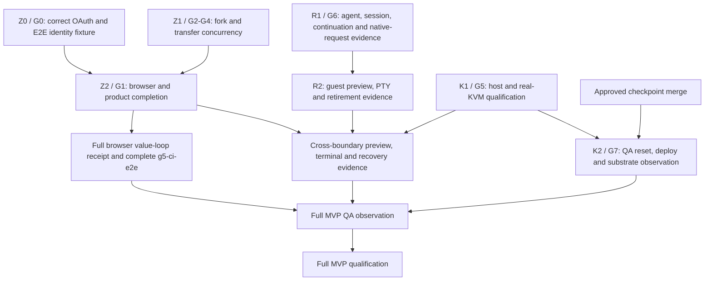

# Workspace VM backend integration checkpoint: status and handoff

Status date: 2026-09-22

This document records the intentionally incomplete backend integration checkpoint for [PR #117](https://github.com/G5Labs/G5-Lean/pull/117). It applies the checkpoint criteria in [mvp-milestone-split.md](mvp-milestone-split.md) to the implementation plan in [lean-mvp-1stream-implementation-plan-v9.md](lean-mvp-1stream-implementation-plan-v9.md).

This checkpoint is not full MVP delivery, a deployment, or completed QA. The implementation for all 18 MVP packages is present, but browser completion, deployed QA observation, and the explicit remaining evidence and concurrency work in this document are deferred beyond the checkpoint. The status words below have these meanings:

- **Implemented**: production code for the package or checkpoint is present on the candidate branch.
- **Locally validated**: a focused local test or static validation exercised the relevant production boundary on the exact candidate unless stated otherwise.
- **Cloud/microVM validated**: exact-candidate Cloud Build exercised the named boundary, including real Linux KVM where applicable.
- **Deferred**: intentionally outside this checkpoint under the milestone split.
- **Still unverified**: required evidence does not yet exist. This is not a claim that the behavior is broken.

## 1. Candidate and checkpoint decision

| Field | Value |
|---|---|
| Candidate SHA | `8df668e4a442e83ae4389e892b7eab1eb058a57c` |
| Branch | `lean/mvp-workspace-cutover` |
| Pull request | [#117 — Workspace VM backend integration checkpoint](https://github.com/G5Labs/G5-Lean/pull/117) |
| Base branch | `main` |
| Merged inputs | P4.1 [#109](https://github.com/G5Labs/G5-Lean/pull/109), P4.2b [#108](https://github.com/G5Labs/G5-Lean/pull/108), P4.2a [#105](https://github.com/G5Labs/G5-Lean/pull/105), P1.4 [#35](https://github.com/G5Labs/G5-Lean/pull/35), and P8.9 [#104](https://github.com/G5Labs/G5-Lean/pull/104) |
| Branch state when evidence was recorded | Committed, pushed, clean, and local `HEAD` equal to the PR head |
| Latest completed Claude review | Round 9 of the allowed 15 rounds, using `claude-fable-5-1`, adaptive thinking, and max effort |
| Review verdict | No significant remaining backend findings |
| Deployment/observation | Not deployed; no user-visible QA observation claimed |

The narrow checkpoint criteria are met on this SHA:

1. `g5-ci-rust` passed on the exact PR head.
2. The backend and microVM portions of `g5-ci-e2e` passed on the exact PR head, including `/dev/kvm` and libkrun setup, fresh migration/bootstrap, host startup and readiness, Rust E2E, the retained API/value-loop backend selectors, and API smoke.
3. Claude round 9 found no unresolved P0/P1 backend issue.
4. Fresh database creation, migrations 001–016, validation preflight, and an isolated two-pass production reseeder rehearsal passed.
5. The branch was committed, pushed, clean, and all checkpoint evidence referred to the same SHA.

The complete `g5-ci-e2e` GitHub check is red. Its required backend/microVM stages passed, while browser stages and their dependent aggregate/receipt stages failed. The milestone split explicitly permits those browser-only failures to be deferred. This exception applies only to the intentional checkpoint; it does not satisfy the full-MVP rule in the implementation plan that both complete CI lanes must be green before final MVP merge.

PR #117 has not been merged. The milestone split requires program-owner approval before the checkpoint merge.

## 2. Validation evidence

### 2.1 Exact-head Cloud Build

| Lane | Build | Exact revision | Result | Evidence |
|---|---|---|---|---|
| `g5-ci-rust` | [`ead9c7fc-5009-47c8-ab19-edb9cb18e9da`](https://console.cloud.google.com/cloud-build/builds;region=us-central1/ead9c7fc-5009-47c8-ab19-edb9cb18e9da?project=89784110315) | `8df668e4a442e83ae4389e892b7eab1eb058a57c` | **SUCCESS** | All Rust gates passed, including KVM isolation, self-contained artifact validation, and `smoke-libkrun-quick`. Started `2026-09-22T18:13:26Z`; finished `2026-09-22T18:24:54Z`. |
| `g5-ci-e2e` | [`a9e62b7e-e400-4503-8be8-b35dc69f68c2`](https://console.cloud.google.com/cloud-build/builds;region=us-central1/a9e62b7e-e400-4503-8be8-b35dc69f68c2?project=89784110315) | `8df668e4a442e83ae4389e892b7eab1eb058a57c` | **FAILURE: browser-only beyond this checkpoint** | Every required backend/microVM stage passed. Three browser stages failed; the final browser-dependent receipt and aggregate therefore failed. Started `2026-09-22T18:13:28Z`; finished `2026-09-22T19:00:11Z`. |

The successful `g5-ci-e2e` backend/microVM stages were:

- Migration version uniqueness and checksums.
- PostgreSQL startup, CI migrator provisioning, runtime-role bootstrap, application migration, E2E migration, and E2E runtime-role bootstrap.
- `setup-kvm-libkrun`, with `/dev/kvm` present and libkrun available through pkg-config.
- Frontend lint, build, and unit tests.
- API and worker runtime artifacts and images.
- API, Redis, OAuth stub, client, and complete E2E stack startup/readiness.
- All four retained seed/start/wait chains: CI organization, value-loop organization, Rust-E2E organization/API/worker, and provider-agent organization/worker.
- `rust-e2e`: 23 retained tests, comprising one browser-interaction test, fourteen stale-build cancellation tests, one Codex control-frame test, six comment-notification tests, and one value-loop test.
- `value-loop-rust-api-profiles`: eight selectors.
- `api-smoke`.

The failed deferred stages were:

- `playwright-e2e-shard-1`: 8 unique failures.
- `playwright-e2e-shard-2`: 28 unique failures.
- `provider-agent-playwright-e2e`: 8 unique failures.
- `finalize-value-loop-receipt`: failed because mandatory browser selectors failed.
- `assert-ci-status`: failed because the complete E2E aggregate includes the browser failures.

### 2.2 Exact-head local validation

| Command or check | Result |
|---|---|
| `just validation-preflight` | All 9 phases passed. |
| `cargo test -p g5-api-core --lib` | 964 passed. |
| `cargo test -p g5-api --test api_task_lifecycle` | 20 passed. |
| `cargo test -p g5-api --test api_workspaces` | 42 passed. |
| `cargo test -p g5d --test dispatch_modules` | 21 passed. |
| Affected-target formatting, strict Clippy, and diff checks | Passed. |

A broader local all-target `g5d` check reported one pre-existing warning at `backend/g5d/tests/isolation_backends.rs:441`; the exact Cloud Rust Clippy gate passed. The local macOS host has no `/dev/kvm`, so real microVM proof comes from the exact-head Cloud builds rather than a local substitute.

### 2.3 Fresh database and reseeder rehearsal

An isolated local database named `g5_qa_reseed_8df668e` was created from scratch. Migrations 001–016 were applied, and `scripts/seed-prod-org.sh` was executed twice with only Secret Manager writes stubbed. After the second run, the database contained one organization, one base workspace, one branch, one admin invitation, one active bootstrap token, and one revoked prior token. The rehearsal database was dropped afterward.

This proves the local fresh-schema and repeated-seeder path. It does not prove the deployed QA reset or user-visible QA behavior. The actual QA reset, deployment, and observation remain G7 below and must follow `docs/qa-database-reset.md` against an exact merged `main` commit.

## 3. Review status

Claude review round 9 was requested only after the exact-head local validation above. The review used the required command settings: model `claude-fable-5-1`, adaptive thinking, and max effort. It independently reran the two new focused regressions and the two full API suites, inspected the five round-8 resolutions, and reported: **“No significant findings remain.”**

The review retained three non-blocking follow-ups:

- **F1, low severity:** two concurrent requests that rediscover and resume the same pending live-fork operation may both recapture and re-interrupt the source. One can then abort the operation still being driven by the other. Durable state remains consistent, making this a liveness and user-experience defect rather than known corruption.
- **F2, coverage gap:** no deterministic regression currently forces ownership transfer to complete during clone-merge Git preparation and then proves that landing is rejected without ref changes.
- **F3, coverage gap:** the two new fork race branches are supported by code inspection but lack deterministic regression barriers.

No unresolved P0/P1 issue spans the host, guest-runtime, and workspace-control boundaries.

## 4. S1–S6 checkpoint matrix

| Checkpoint | Implemented | Locally validated | Cloud/microVM validated | Deferred | Still unverified |
|---|---|---|---|---|---|
| **S1 — Runtime and durability foundations** | Host `ctl`, registry/placement, VM boot/stop/relay/retained roots, and receipt/restore code are present. | Host/API/unit coverage and validation preflight passed. | Real KVM/libkrun setup, host startup/readiness, worker images, retained seed chains, and Rust E2E passed. | Deployment and QA observation. | Recorded cold/warm/new-child measurements and deployed host-loss, reconnect, drain, and retained-root recovery. |
| **S2 — Lifecycle, ownership, transfer, and fork** | Six lifecycle actions, transfer, owner authorization, live owner fork, and durable reader fork are present. | `g5-api-core` and `api_workspaces` passed on the exact candidate. | API/value-loop backend stages and the live host substrate passed. | Transfer/fork browser flows and deployed observation. | F1 concurrent fork resumption and F2/F3 deterministic race tests; deployed transfer/fork behavior. |
| **S3 — Agent runtime, sessions, inputs, and jobs** | `agent.turn`, common dispatch, continuations, native requests, typed sessions/inbox, templated inputs/jobs, and legacy task-branch removal are present. | Task-lifecycle, dispatcher-module, and API-core suites passed. | Rust E2E, value-loop Rust/API profiles, dispatcher/host startup, and API smoke passed. | Provider-agent browser flows. | Deployed native-request, continuation, dependency, and input-recovery observation. |
| **S4 — Save, CRDT removal, reads, and workspace UI** | Attached-owner Save/upload, role-aware reads, explicit frontend Save, backend/frontend CRDT removal, and workspace shell changes are present. | Backend focused suites and earlier frontend focused/unit validation passed. | Frontend lint/build/unit, fresh migration, Rust/API selectors, and API smoke passed. | Playwright Save, project-doc, editor, Changes, lifecycle, and read flows. | User-visible Save/read/Changes behavior under the corrected browser identity. |
| **S5 — Preview and terminal** | Owner-only preview task and browser terminal paths are present. | Focused API/runtime/frontend validation was completed before this candidate. | Task, relay, host, API, and microVM substrate passed. | Preview and terminal Playwright flows. | User-visible HTTP/WebSocket preview, tracked-write display, PTY interaction, resize, stop, and transfer fencing. |
| **S6 — Legacy execution retirement and final cutover** | Per-task host/worker execution, workers table/routes/loops/UI, and retired callers are removed or retargeted. | Inventories, migrations, preflight, and affected tests passed. | Fresh-schema authorities and all retained host chains passed. | Browser cleanup and deployed QA. | Deployed proof that no retained caller uses a removed authority or execution path. |

## 5. Package-level matrix

“Cloud partial” means exact-candidate Cloud exercised the package’s backend substrate but did not complete every package-specific acceptance scenario.

| Package | Implemented | Locally validated | Cloud/microVM validated | Deferred | Still unverified / confirmed gap | Owner/workstream |
|---|---|---|---|---|---|---|
| **P4.4a — `g5d host`: the `ctl` protocol on both ends, host credential, event journal, and drain** | Yes | Yes | Yes: host startup/readiness and real microVM lane | Deployed observation | Deployed reconnect, replay, and drain evidence | kaihuiz-g5 / K1 |
| **P4.13 — Host registry, host states, placement, quotas, drain, and the operator API** | Yes | Yes | Partial: registry-backed startup and retained host chains | Deployed capacity/drain exercise | Production-like placement, capacity, operator drain, and reconnect observation | kaihuiz-g5 / K1 |
| **P4.4b — `g5d host`: `VmSpec`, boot and stop, lease, stream relay, and retained roots** | Yes | Yes | Yes: real KVM/libkrun VM substrate | Deployed host-loss exercise | Cold/warm/new-child measurements and deployed loss/recovery | kaihuiz-g5 / K1 |
| **P4.3a — Shutdown flush, receipts, restore, and stopped reads** | Yes | Yes | Partial: live host/API substrate and backend selectors | Deployed restore observation | End-to-end cold/warm multi-repository receipt restore under QA | zcl-g5 for receipt/read authority; kaihuiz-g5 for host roots / Z and K1 |
| **P4.5 — API lifecycle service, six actions and transfer, owner authorization, and Workspace Runtime facade** | Yes | Yes on exact candidate | Backend/API substrate passed | Browser and deployed transfer flows | User-visible transfer and lifecycle observation | zcl-g5 / Z1 and Z2 |
| **P4.3b — Owner live fork capture and durable reader forks** | Yes | Yes on exact candidate | Backend partial | Browser and deployed fork flows | F1–F3 concurrency and coverage gaps | zcl-g5 / Z1 and Z2 |
| **P4.11 — The `agent.turn` module and per-turn CLI adapters** | Yes | Yes on exact candidate | Backend/Rust E2E passed | Native provider browser/QA flows | Live Claude question/permission and Codex noninteractive observation | rahul-g5 / R1 |
| **P4.6 — Dispatch, shared agent lifecycle, same-task continuations, and native requests** | Yes | Yes on exact candidate | Backend/Rust E2E passed | Provider-agent browser and QA | Restart/loss continuation, dependency, and native-request acceptance | rahul-g5 / R1 |
| **P4.7 — Typed-input agent sessions and inbox; delete sticky runtimes** | Yes | Yes on exact candidate | Cloud partial through retained Rust/API paths | Chat browser/QA | Concurrent typed turns, queued input, and recovery observation | rahul-g5 / R1 |
| **P4.8 — Templated-input agent sessions and optional jobs; delete job/task branches and merge** | Yes | Yes | Backend/Rust E2E passed | Jobs browser/QA | Concurrent templated inputs and dependency/job recovery observation | rahul-g5 / R1 |
| **P2.1 — Attached-owner Save/upload and role-aware Git/live reads** | Yes | Yes | Backend selectors and API smoke | Save/read browser/QA | Correct-identity owner/member/stopped read and Save flow | zcl-g5 / Z2 |
| **P2.2 — Frontend explicit Save; remove CRDT from editors** | Yes | Yes | Frontend lint/build/unit passed | Playwright | Explicit Save and editor behavior in a real browser | zcl-g5 / Z2 |
| **P2.4 — Delete the backend CRDT layer** | Yes | Yes | Fresh migration and backend gates passed | Deployed proof | No deployed retained caller depends on removed CRDT state | zcl-g5 / Z2 and G7 |
| **P4.10 — Frontend workspace VM status, owner controls, Transfer, reads, and Changes** | Yes | Yes | Frontend lint/build/unit passed | Playwright | Complete owner/member workspace shell under corrected identity | zcl-g5 / Z2 |
| **P5.1 — Owner-only preview service tasks on the workspace VM (`workspace.preview`)** | Yes | Yes | Backend task/host/microVM substrate passed | Browser preview | HTTP/WebSocket preview and tracked-write acceptance | zcl-g5 for API/UI, rahul-g5 for guest task, kaihuiz-g5 for relay / Z2, R2, K1 |
| **P5.2 — Browser terminal** | Yes | Yes | Backend host/relay/microVM substrate passed | Browser PTY | Interactive PTY, resize, reconnect, stop, and transfer fencing | zcl-g5 for UI, rahul-g5 for guest PTY, kaihuiz-g5 for relay / Z2, R2, K1 |
| **P4.9a — Delete per-task execution on the host and in the worker** | Yes | Yes | Retained host chains passed | Deployed inventory | No legacy host or guest producer remains in deployed paths | kaihuiz-g5 for host retirement and rahul-g5 for guest retirement / K1 and R2 |
| **P4.9b — Delete the workers table, per-task routes, loops, and UI** | Yes | Yes | Fresh authority and retained host chains passed | Browser and deployed QA | No deployed API/UI/guest/host caller depends on retired workers authority | zcl-g5 for API/UI, rahul-g5 and kaihuiz-g5 for remaining callers / Z2, R2, K1 |

## 6. Confirmed remaining gaps

### G0 — Correct the shared browser OAuth identity fixture

- **Confirmed problem:** Playwright can create duplicate `g5_refresh` cookies. The workspace-clone path creates a cookie at `/`, while OAuth login retains one at `/api/v1/auth`. Refresh can select the older identity, leaving local storage authenticated as the wrong user. This explains observed owner-only 403/404 failures without showing a backend authorization defect.
- **Authoritative state owner:** the browser authentication fixture and cookie jar; zcl-g5 owns the controlled E2E fixture contract.
- **Production execution path:** workspace-clone helper → browser cookie jar → auth refresh → local-storage access token → owner-only workspace APIs.
- **Affected producers:** `frontend/e2e/helpers.ts`, `frontend/e2e/auth.setup.ts`, and the workspace-clone fixture setup.
- **Affected consumers and sibling paths:** Save, Changes, lifecycle, preview, project-doc, terminal, member fork, and provider-agent browser flows.
- **Expected files:** `frontend/e2e/helpers.ts`, `frontend/e2e/auth.setup.ts`, `frontend/e2e/flows/workspace-clone.spec.ts`, and focused fixture tests if needed.
- **Required regression:** in OAuth mode, assert that the active access-token subject is the intended user after identity creation/switching, assert a single effective refresh cookie, then run the affected owner/member flows.
- **Dependencies:** none. Because seed and E2E fixture contracts are controlled shared files, this is prerequisite Z0.

### G1 — Resolve browser suites after identity correction

- **Confirmed problem:** exact-head browser failures cover explicit Save/editor content, Changes/push, project-doc creation/upload/render/modals, member-fork setup, collision expectations, source-control history fixtures, terminal resize/navigation, preview/lifecycle, and provider-agent cleanup/streaming. Several failures are known cascades from G0; the remainder have not yet been classified after a correct identity is established.
- **Authoritative state owner:** zcl-g5 for frontend and fixture state. Route a residual failure to rahul-g5 only when it occurs after `runtime.ready` in dispatcher/module/task/session/provider execution, or to kaihuiz-g5 when it occurs before `runtime.ready` in placement, VM, credential, retained-root, or relay behavior.
- **Production execution path:** Playwright fixture → frontend component/hook → public API or WebSocket → lifecycle/runtime owner.
- **Affected producers:** frontend fixtures, page/components/hooks, and only any backend producer proven incorrect after G0.
- **Affected consumers and sibling paths:** both Playwright shards, provider-agent Playwright, and the final value-loop browser receipt.
- **Expected files:** `frontend/src/**`, `frontend/e2e/**`; backend files only after tracing proves a backend producer defect.
- **Required acceptance:** all previously failing selectors pass with the intended identity; the backend/microVM stages remain green; final receipt failures disappear for their real cause rather than by weakening coverage.
- **Dependencies:** G0. Fork browser scenarios also depend on G2–G4 where they exercise those races.

### G2 — Serialize duplicate concurrent resumption of one pending live fork

- **Confirmed problem:** two lost-key retries may rediscover the same active fork operation, both capture/re-interrupt the source VM, and allow one resumer to abort the operation being driven by the other. State remains consistent, but progress and user experience are not reliable.
- **Authoritative state owner:** `WorkspaceForkService` and the active `workspace_forks` operation; zcl-g5.
- **Production execution path:** clone API → active-operation discovery → `capture_live_source` → dispatcher fork interrupt/open → finalize or abort.
- **Affected producers:** `backend/g5-api-core/src/services/workspace_fork_service.rs`.
- **Affected consumers and sibling paths:** workspace clone route, dispatcher fork-mode interrupt/open consumer, operation cleanup, retry/recovery, and browser fork flow.
- **Expected files:** `backend/g5-api-core/src/services/workspace_fork_service.rs`, `backend/g5-api/tests/api_workspaces.rs`; dispatcher code changes only if independent tracing proves the control-plane serialization is insufficient.
- **Required regression:** hold two new-idempotency-key resumptions at deterministic barriers, prove one capture/finalize, no duplicate source interrupt, no abort of the winning operation, and idempotent completion for both callers.
- **Dependencies:** no interface or schema change is currently required.

### G3 — Add the transfer-during-clone-merge-preparation regression

- **Missing evidence:** code inspection shows the owner share lock and recheck occur after Git preparation and remain held through landing, but no deterministic test completes a transfer during preparation.
- **Authoritative state owner:** workspace ownership and clone-merge landing fence; zcl-g5.
- **Production execution path:** clone merge request → prepare Git objects/tree → application transaction → owner lock and transfer recheck → fenced mapping/branch/repository landing.
- **Affected producers:** `backend/g5-api-core/src/services/workspace_service.rs` and `backend/g5-api-routes/src/routes/workspaces.rs`.
- **Affected consumers and sibling paths:** workspace merge endpoint, transfer completion, branch landing, and ref visibility.
- **Expected files:** the two production files above only if the regression exposes a defect; otherwise `backend/g5-api/tests/api_workspaces.rs`.
- **Required regression:** pause after preparation, complete transfer, resume landing, require rejection, and prove no ref or mapping changed.
- **Dependencies:** none.

### G4 — Add deterministic coverage for the two fork race branches

- **Missing evidence:** active-operation completion after the second repo-lock check and competing fresh private/name claims are handled in code but lack deterministic regressions.
- **Authoritative state owner:** fork admission/finalization and durable name claims; zcl-g5.
- **Production execution path:** clone API → operation discovery/admission → canonical repo-row locks → fresh conflict query → capture/finalize or already-applied result.
- **Affected producers:** `backend/g5-api-core/src/services/workspace_fork_service.rs`.
- **Affected consumers and sibling paths:** base/Create/live fork callers, private-claim nondisclosure, retry/recovery, and cleanup.
- **Expected files:** `backend/g5-api-core/src/services/workspace_fork_service.rs` only if a defect appears, plus `backend/g5-api/tests/api_workspaces.rs`.
- **Required regressions:** deterministic barriers for a completed resumer observed after repo locks and for a competing fresh private/exact-name claim; prove no runnable partial workspace, information leak, or cleanup of another operation’s refs.
- **Dependencies:** G2 if the same per-operation serialization primitive is used.

### G5 — Complete host acceptance evidence

- **Missing evidence:** cold, warm, and new-child measurements and deployed loss/reconnect/drain/retained-root behavior have not been recorded.
- **Authoritative state owner:** host registry, VM custody, retained roots, and host-side relay; kaihuiz-g5.
- **Production execution path:** API `HostCommandClient` → `g5d-host` control protocol → `g5d-isolation` libkrun → dispatcher `runtime.ready` and stream relay → stop/reap/root retention.
- **Affected producers:** `backend/g5d-host/**`, `backend/g5d-isolation/**`, host registry/placement services, and host integration fixtures.
- **Affected consumers and sibling paths:** lifecycle start/stop, preview/terminal relay, receipt restore, host reconnect, drain, capacity, and superseded-VM cleanup.
- **Expected files:** `backend/g5d-host/**`, `backend/g5d-isolation/**`, `backend/g5-api-core/src/services/worker_host_service.rs`, relevant host/API tests, and Cloud test configuration only if a proven harness defect requires a separately owned prerequisite.
- **Required acceptance:** real-KVM cold/warm/new-child timings; host loss and reconnect; event replay/ack; drain; unknown/superseded VM cleanup; retained-root restore; no process fallback.
- **Dependencies:** none under frozen protocols. Coordinates with R2 and Z2 for preview/terminal end-to-end evidence.

### G6 — Complete guest runtime and agent acceptance evidence

- **Missing evidence:** live native Claude question/permission handling, Codex noninteractive behavior, continuation/dependency/input recovery across restart/loss, and guest preview/PTY behavior are not completely observed.
- **Authoritative state owner:** dispatcher task attempts, module execution/journal, `agent.turn`, sessions, inputs, continuations, dependencies, and provider requests; rahul-g5.
- **Production execution path:** API dispatch/admission → host relay after `runtime.ready` → `g5d-dispatch` module invocation → `g5d-agent-turn` provider adapter or preview/PTY service → journal/events/replies → API lifecycle.
- **Affected producers:** `backend/g5d-dispatch/**`, `backend/g5d-agent-turn/**`, `backend/g5-api-core/src/services/agent_dispatch.rs`, and `backend/g5-api-core/src/services/task_lifecycle.rs`.
- **Affected consumers and sibling paths:** typed and templated inputs, continuations, dependencies, native provider requests, preview service, PTY, Rust E2E, and provider-agent browser flows.
- **Expected files:** the directories and services above, `backend/g5d/tests/dispatch_modules.rs`, `backend/g5-api/tests/api_task_lifecycle.rs`, and `tests/e2e/src/**`.
- **Required acceptance:** concurrent typed and templated turns, queued next input, dependency ordering, same-task continuation, native question/permission settle-once behavior, restart/loss recovery, preview service behavior, PTY interaction, and proof that no legacy guest producer remains.
- **Dependencies:** R2 follows the core R1 runtime work. End-to-end preview/terminal observation coordinates through frozen protocols with K1 and Z2.

### G7 — Reset, deploy, and observe QA

- **Missing evidence:** the exact merged commit has not been deployed, the QA database has not been reset/reseeded for this checkpoint, and user-visible acceptance has not been observed.
- **Authoritative state owner:** Cloud SQL and deployment/host registry for cutover; each package owner for its product/runtime observation.
- **Production execution path:** merge exact checkpoint → build immutable artifacts → backup/reset QA database → migrations 001–016 → production reseeder twice → deploy API and host artifacts → run acceptance observations.
- **Affected producers:** `docs/qa-database-reset.md`, migration and seeder paths, deployment configuration, API/host/runtime images, and environment-specific host provisioning.
- **Affected consumers and sibling paths:** every S1–S6 acceptance boundary.
- **Expected files:** no code is expected. If rehearsal exposes a defect, route it to the authoritative producer and open a separately reviewable fix.
- **Required acceptance:** record merged SHA, migration set, image digests, deployment build ID, reseed results, host readiness, and user-visible Start, Save, stop/restore, transfer, fork, native request, preview, terminal, and host-loss results.
- **Dependencies:** explicit checkpoint merge approval and merge, then G5 plus the relevant completed G1–G6 work for full MVP observation.

## 7. Dependency graph

Root-cause routing remains:

- Before `runtime.ready`, or for VM exit, placement, capacity, credential, retained-root, and host-relay failures: kaihuiz-g5.
- After `runtime.ready`, for dispatcher, module, agent-turn, task/session/input, continuation, dependency, and provider-request failures: rahul-g5.
- For ownership, lifecycle API, fork, transfer, Save/read, receipt presentation, and UI failures: zcl-g5.
- A fixture that disagrees with a confirmed correct producer belongs to the fixture owner.
- An unclear producer/consumer contract requires a named prerequisite interface task before dependent work proceeds.

## 8. Prerequisite shared-interface work

### Z0 — Browser OAuth and E2E fixture identity contract

Z0 is the only currently identified prerequisite change to a controlled shared file/contract. It is owned by zcl-g5 and should merge before browser-dependent work starts.

- **Exact scope:** make fixture-created and OAuth-login identities deterministic; remove the duplicate effective refresh-cookie path; assert the active subject before owner-only operations.
- **Expected files:** `frontend/e2e/helpers.ts`, `frontend/e2e/auth.setup.ts`, `frontend/e2e/flows/workspace-clone.spec.ts`, and focused fixture tests.
- **Acceptance criteria:** OAuth-mode access-token subject is the intended member; only one effective refresh cookie is available to refresh; focused Save, lifecycle, fork, preview, and provider-agent setup no longer fail under the previous identity.
- **Focused validation:** `just validation-preflight`, `just ci-docker-prepare`, focused `just ci-docker-7 '<spec or grep selector>'`, then `just ci-docker-down` when finished.
- **Frozen interfaces:** public API response shapes, lifecycle states, seed identities, and backend authorization remain unchanged.
- **Blocked work:** Z2 and the browser part of the final value-loop receipt. K1 and R1 may proceed without editing the controlled fixture files.
- **Estimated effort:** 1 engineer-day.

No change is currently justified to the API-to-host protocol, host-to-dispatcher mux, dispatcher module schemas, workspace lifecycle states, task-attempt/input schema, public API shapes, migrations/checksums, `g5-internal-api`, Cloud Build configuration, or shared runtime test peers. If investigation proves one necessary, create a separate prerequisite with one owner and list every blocked workstream before changing it.

## 9. Parallel workstream plans

### zcl-g5 — Workspace control plane and product surface

Estimated total: 6–7 engineer-days.

#### Z1 — Fork and transfer concurrency closure

- **Scope:** resolve G2 and add the G3/G4 deterministic regressions. Fix production code only where the regressions prove a defect.
- **Expected files:** `backend/g5-api-core/src/services/workspace_fork_service.rs`, `backend/g5-api-core/src/services/workspace_service.rs`, `backend/g5-api-routes/src/routes/workspaces.rs`, and `backend/g5-api/tests/api_workspaces.rs`.
- **Acceptance criteria:** one pending live-fork operation has one active resumer/capture; retries converge without aborting the winner; transfer during merge preparation prevents landing without ref changes; private and exact-name fork claims remain atomic and nondisclosing.
- **Focused validation:** `cargo test -p g5-api --test api_workspaces`, `cargo test -p g5-api-core --lib`, `just validation-preflight`.
- **Frozen interfaces:** lifecycle transitions, public API responses, workspace-fork schema, migration numbering/checksums, dispatcher fork protocol, and Git ref policy.
- **Dependencies/blockers:** G2 and G3 can start independently of Z0; G4 may share the G2 synchronization mechanism. No schema change is expected.
- **Suggested merge order:** after Z0 if the team wants one shared baseline, otherwise independently before browser fork acceptance.
- **Estimated effort:** 2 engineer-days.

#### Z2 — Browser and product completion

- **Scope:** re-run and classify every G1 failure after Z0, then fix the authoritative frontend/fixture producer. Cover explicit Save, reads, Changes, project docs, lifecycle/transfer/fork, preview, terminal, and provider-agent UI flows.
- **Expected files:** `frontend/src/**` and `frontend/e2e/**`; backend files only with traced evidence that the backend producer is wrong.
- **Acceptance criteria:** both Playwright shards and provider-agent Playwright pass; the browser-dependent value-loop receipt completes; browser failures are not hidden by skipped or weakened assertions; backend/microVM stages stay green.
- **Focused validation:** `npm --prefix frontend run build`, `npm --prefix frontend test`, `just ci-docker-prepare`, focused `just ci-docker-7 '<spec or grep selector>'`, full Phase 7, and `just ci-docker-down`.
- **Frozen interfaces:** public API response shapes, lifecycle states, task/input schema, API-to-host protocol, host-to-dispatcher mux, and dispatcher module schemas.
- **Dependencies/blockers:** Z0; Z1 for browser scenarios that exercise fork/transfer races; coordinate residual runtime failures with K1/R1/R2 under the routing rules.
- **Suggested merge order:** after Z0 and Z1, independently reviewable as the product/browser completion PR.
- **Estimated effort:** 3–4 engineer-days.

### kaihuiz-g5 — Host and infrastructure substrate

Estimated total: 5–7 engineer-days.

#### K1 — Host and real-KVM qualification

- **Scope:** complete G5 acceptance evidence and fix only host-rooted defects exposed by it. Record cold/warm/new-child timings and exercise loss, reconnect, replay, drain, retained roots, relay, and superseded VM cleanup.
- **Expected files:** `backend/g5d-host/**`, `backend/g5d-isolation/**`, host registry/placement services and tests, and relevant Rust E2E scenarios. Treat Cloud Build files as controlled and use a separate prerequisite if they must change.
- **Acceptance criteria:** all named host cases pass on real Linux KVM without process fallback; evidence records the exact SHA and timings; host-rooted preview/terminal relay paths pass with frozen protocols.
- **Focused validation:** `cargo test -p g5d-host`, `cargo test -p g5d-isolation`, relevant host/API tests, `just ci-docker-5 '<exact nextest selector>'`, and exact-head Cloud Rust/E2E microVM stages.
- **Frozen interfaces:** API-to-host control, host-to-dispatcher mux, lifecycle transitions, `g5-internal-api`, migration/checksum history, and common Cloud/runtime peers.
- **Dependencies/blockers:** can start after the checkpoint baseline. Coordinate preview/terminal boundaries with R2 and Z2 without concurrent protocol edits.
- **Suggested merge order:** parallel with Z1 and R1; before K2 and full cross-boundary QA.
- **Estimated effort:** 3–4 engineer-days.

#### K2 — QA reset and deployment substrate

- **Scope:** execute G7’s infrastructure portion using `docs/qa-database-reset.md`; preserve and report exact artifacts and state transitions. Do not introduce code unless the run exposes a traced defect.
- **Expected files:** normally none. Runbook corrections, if proven necessary, should be a small independently reviewed documentation or infrastructure PR.
- **Acceptance criteria:** backup/reset record, migrations 001–016, two-pass reseed, one active bootstrap token with prior token revoked, exact image digests, host ready, deployment build ID, and rollback/recovery limits recorded.
- **Focused validation:** the commands in `docs/qa-database-reset.md`, migration checksum/version checks, production reseeder verification queries, deployment health/readiness, and host registry checks.
- **Frozen interfaces:** all protocol and schema contracts; existing migrations and checksums remain immutable.
- **Dependencies/blockers:** explicit checkpoint merge and an exact merged `main` SHA; K1 before host acceptance observation; coordinate the QA window with zcl-g5 and rahul-g5.
- **Suggested merge order:** operational step after checkpoint merge and K1, before claiming full MVP QA.
- **Estimated effort:** 2–3 engineer-days.

### rahul-g5 — Guest runtime and agent execution substrate

Estimated total: 5–7 engineer-days.

#### R1 — Agent, session, continuation, and native-request qualification

- **Scope:** complete the core of G6: typed and templated inputs, shared sessions/inbox, continuations, dependencies, restart/loss recovery, and native provider requests. Fix defects at the dispatcher/task-attempt owner.
- **Expected files:** `backend/g5d-dispatch/**`, `backend/g5d-agent-turn/**`, `backend/g5-api-core/src/services/agent_dispatch.rs`, `backend/g5-api-core/src/services/task_lifecycle.rs`, `backend/g5d/tests/dispatch_modules.rs`, `backend/g5-api/tests/api_task_lifecycle.rs`, and relevant Rust E2E scenarios.
- **Acceptance criteria:** concurrent typed and templated turns, queued input, dependency ordering, continuation, native Claude question/permission, noninteractive Codex, and restart/loss settle correctly once with durable replay.
- **Focused validation:** `cargo test -p g5d --test dispatch_modules`, `cargo test -p g5-api --test api_task_lifecycle`, relevant `g5d-dispatch`/`g5d-agent-turn` unit tests, `just ci-docker-6 '<Rust E2E selector>'`, and exact-head Cloud Rust/E2E backend stages.
- **Frozen interfaces:** host-to-dispatcher mux, dispatcher module schemas, task-attempt and queued-input schema, lifecycle states, public APIs, and migration/checksum history.
- **Dependencies/blockers:** can start after the checkpoint baseline; no browser prerequisite.
- **Suggested merge order:** parallel with Z1 and K1; before R2.
- **Estimated effort:** 3–4 engineer-days.

#### R2 — Guest preview/PTY and execution-retirement evidence

- **Scope:** complete guest-side preview and PTY acceptance and prove no retired per-task guest producer remains. UI and host relay changes remain with their respective owners.
- **Expected files:** dispatcher preview/PTY/module code, `g5d-agent-turn` only where shared execution is involved, Rust E2E scenarios, and retirement inventories/tests.
- **Acceptance criteria:** preview service and PTY behave correctly after `runtime.ready`; cancellation, stop, reconnect, and transfer fencing work at the guest boundary; no legacy task-VM execution producer remains.
- **Focused validation:** relevant dispatcher/module unit tests, `cargo test -p g5d --test dispatch_modules`, focused `just ci-docker-6 '<Rust E2E selector>'`, then exact-head Cloud backend/microVM stages.
- **Frozen interfaces:** API-to-host control, host-to-dispatcher mux, module schemas, public APIs, lifecycle states, and shared browser fixture contracts.
- **Dependencies/blockers:** R1; coordinate host relay with K1 and browser/UI acceptance with Z2.
- **Suggested merge order:** after R1 and in coordination with K1; before full cross-boundary preview/terminal QA.
- **Estimated effort:** 2–3 engineer-days.

Recommended merge order after the checkpoint is Z0 first; Z1, K1, and R1 in parallel; then Z2 and R2; K2 after the checkpoint merge and K1. Run exact-head Rust and complete E2E qualification after all required streams converge. Perform full QA observation only after the relevant G1–G6 work has landed and exact artifacts are available.

## 10. Work intentionally deferred beyond the checkpoint

- The complete Playwright shards, provider-agent Playwright, and browser-dependent value-loop receipt.
- The OAuth refresh-cookie/identity fixture correction and reclassification of failures after it lands.
- Editor and project-document content/save/modal flows.
- Workspace Changes/push, lifecycle, transfer, fork, collision, and history browser flows.
- Preview and terminal navigation, HTTP/WebSocket, tracked-write, interaction, and resize flows.
- Provider-agent chat cleanup, streaming, session, and lifecycle browser flows.
- F1 duplicate concurrent live-fork resumer serialization.
- F2 transfer-during-clone-merge-preparation regression.
- F3 deterministic tests for the two fork race branches.
- Host cold/warm/new-child measurements and deployed host-loss/reconnect/drain/retained-root evidence.
- Complete guest native-request, continuation/dependency/input recovery, preview, and PTY observation.
- Actual QA reset/reseed, deployment, immutable artifact recording, and user-visible S1–S6 acceptance observation.

## 11. Handoff state and next action

At the time this report was prepared, local `HEAD`, the upstream branch, and PR #117 all identified `8df668e4a442e83ae4389e892b7eab1eb058a57c`, and the worktree was clean before this new report file was created. `just ci-docker-down` had removed this worktree’s validation services, disposable volumes, and generated image tags.

This report itself is intentionally uncommitted pending program-owner review. After review, update any disputed classification or assignment, add the document to PR #117 in a new commit, re-run validation appropriate to a documentation-only candidate change, and ensure all merge evidence refers to the resulting new exact PR head. Do not reuse the old SHA’s exact-head claim after the document commit changes the PR head.

Do not merge the checkpoint until the program owner explicitly approves the merge after reviewing this handoff.
