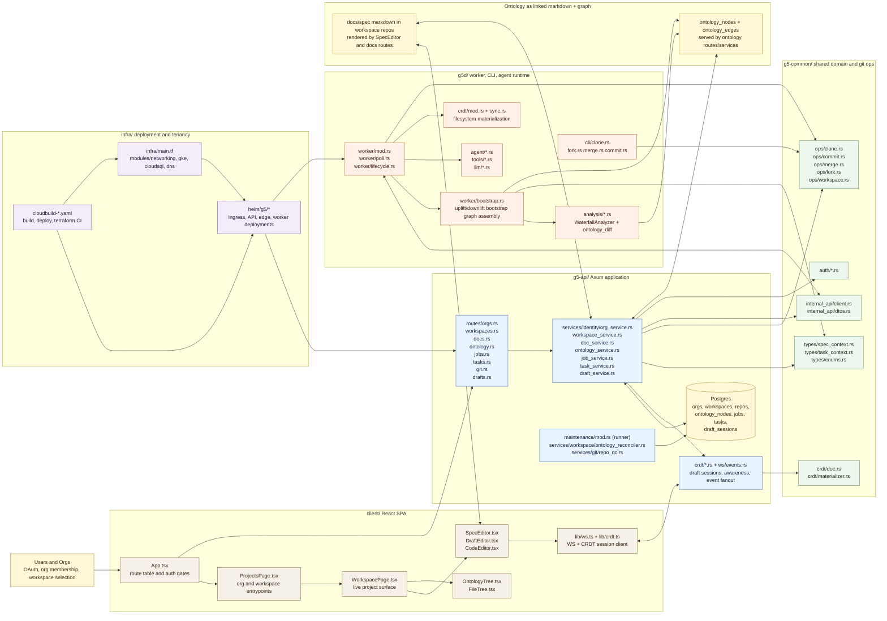

# G5 Codebase Architecture

This diagram maps the repository structure to the core architectural claim:

1. linked-markdown ontology
2. uplift/downlift graph-propagation workflows
3. project/workspace git primitive
4. multi-tenant platform and worker runtime

## Repository Map

## How The Statement Maps To Code

```mermaid
flowchart TB
  classDef pillar fill:#f8f8f8,stroke:#444,color:#111,stroke-width:1px;
  classDef impl fill:#eef4ff,stroke:#5879a6,color:#162235,stroke-width:1px;

  P1["1. Extensible ontology built from linked markdown documents"]:::pillar
  P2["2. Uplift and downlift graph-propagation workflows"]:::pillar
  P3["3. Project primitive with Git-like semantics"]:::pillar
  P4["4. Multi-tenant platform for users, orgs, projects, and workflows"]:::pillar

  P1 --> I11["client/src/components/editor/SpecEditor.tsx<br/>client/src/components/tree/OntologyTree.tsx"]:::impl
  P1 --> I12["g5-api/src/routes/docs.rs<br/>g5-api/src/routes/ontology.rs"]:::impl
  P1 --> I13["g5-api-core/src/services/workspace/doc_service.rs<br/>g5-api-core/src/services/workspace/ontology_service.rs"]:::impl
  P1 --> I14["g5-api/src/models/doc.rs<br/>g5-api/src/models/ontology.rs"]:::impl

  P2 --> I21["g5d/src/worker/bootstrap.rs<br/>bootstrap orchestration for uplift/downlift"]:::impl
  P2 --> I22["g5d/src/analysis/*.rs<br/>WaterfallAnalyzer and ontology diff"]:::impl
  P2 --> I23["g5-api-core/src/services/agents/job_service.rs<br/>g5-api-core/src/services/agents/task_service.rs"]:::impl
  P2 --> I24["g5-common/src/types/spec_context.rs<br/>g5-common/src/types/task_context.rs"]:::impl
  P2 --> I25["g5d/src/prompts/templates/uplift_guidance.tera<br/>downlift_guidance.tera"]:::impl

  P3 --> I31["g5-api/src/routes/git.rs<br/>g5-api/src/routes/drafts.rs"]:::impl
  P3 --> I32["g5-api-core/src/services/workspace/workspace_service.rs<br/>g5-api-core/src/services/git/workspace_ops.rs"]:::impl
  P3 --> I33["g5-common/src/ops/clone.rs<br/>commit.rs merge.rs fork.rs workspace.rs"]:::impl
  P3 --> I34["client/src/components/workspace/*<br/>DraftEditor.tsx CodeEditor.tsx CommitModal.tsx"]:::impl
  P3 --> I35["g5-api/src/crdt/*.rs<br/>g5-common/src/crdt/*.rs<br/>g5d/src/crdt/*.rs"]:::impl

  P4 --> I41["client/src/App.tsx<br/>ProjectsPage.tsx WorkspacePage.tsx SettingsPage.tsx"]:::impl
  P4 --> I42["g5-api/src/routes/auth.rs orgs.rs workspaces.rs users.rs permissions.rs worker_tokens.rs"]:::impl
  P4 --> I43["g5-api-core/src/services/identity/auth_service.rs org_service.rs permission_service.rs<br/>g5-api-core/src/services/workspace/workspace_service.rs"]:::impl
  P4 --> I44["g5-authz/src/*<br/>multi-tenant RBAC"]:::impl
  P4 --> I45["infra/main.tf modules/*<br/>infra/helm/g5/*<br/>cloudbuild-*.yaml"]:::impl
  P4 --> I46["g5d/src/worker/*<br/>multi-worker task execution runtime"]:::impl
```

## Reading Guide

- `client/` is the user-facing multi-tenant IDE and project shell.
- `g5-api/` is the control plane: auth, orgs, workspaces, docs, ontology, jobs, drafts, git, and websocket events.
- `g5-common/` holds the shared domain model and the reusable git/workspace operations that both API and workers rely on.
- `g5d/` is the execution plane: worker polling, bootstrap analysis, agent loops, CRDT materialization, CLI, and isolated codegen tasks.
- `infra/` is the deployment plane for the hosted platform.

Together these modules support the claim that G5 is not just a code editor or job queue: it is an ontology-centric, Git-backed, multi-tenant coordination platform for uplift, downlift, and code generation.
