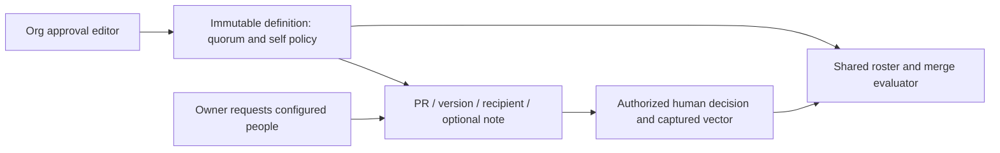

# Workspace landing and review prototype

This continues the review-flow design formerly in UXv2 `docs/review-flow.md` (branch `codex/review-flow`, baseline `0fc98fb`). The user redirected implementation to a separate G5-Lean branch and the current QA workbench. This document is the active design for the prototype and its production implementation; the earlier UXv2 demo is historical. The [October 15 workspace-wide amendment](#october-15-workspace-wide-approval-amendment), refined by the [October 16 combined approver amendment](#october-16-combined-approver-amendment), governs the current design; the earlier phase-specific verification below qualifies the prior contract.

## October 20 member-deactivation integration

Required Rust and E2E checks passed on `50df1a6e9`, including the strict 52-loop/33-selector receipt and every referenced artifact. Before merge, main advanced to `57c9fc4204abe442d94cc35dbd51c28e4595e5ca` with member deactivation and conflicts. The rebase onto that main is complete; require new exact-head CI qualification before merge.

Reconcile ontology before dependent code: preserve main's active-membership authority, incarnation-bound deactivation cleanup, explicit reactivation, and tab-close behavior. New definition versions and human review requests require active recipients locked through assignment commit; retain inactive people separately from departed members in existing definitions, requests and decisions. Preserve this PR's addressed-request/self-approval rules, independent request identities, combined quorum, workspace-wide placement and clone-parent formal admission. Deactivation does not rewrite historical decisions or introduce another quorum policy. Apply active-recipient filtering to this PR's replacement request controls as well as main's editor.

Main's published migration 099 is immutable. Move only this PR's five unmerged migrations from 099–103 to 100–104, preserving each SQL body and all published main SQL; update checksums and upgrade-test references. Verify both the new activity schema and review upgrade path using real PostgreSQL, run frontend and strict compile checks, then publish the complete batch after the prior CI run has ended. Merge only after required checks and the exact-head receipt pass; clean task resources after confirmed merge.

### Revocation browser qualification follow-up

Published `a864466c8` passes required Rust CI `e166cdc1-ad00-4b9f-b523-cc963607b207`, all 43 steps. E2E `bb19cd69-d1bf-4315-8512-c0553fcf2194` ends with one functional failure, RV10 membership revocation; its provider/receipt/final gates consequently fail. All three attempts receive the expected 403 but cannot find the old dialog alert. Downloaded browser error contexts show the public landing page. Main's `useAuth` organization-access recovery intentionally clears live organization queries and navigates away when the API reports missing membership. Preserve that recovery and the current authority contract; do not keep a revoked workspace mounted to satisfy the old assertion.

The unchanged private-draft contract is verified at its actual browser session store, scoped by person/workspace/PR/request: capture the stored draft after editing, then require the same bytes after denied submission and navigation away. Also require removal of the old dialog and absence of any stored decision. This replaces the obsolete in-dialog rendering expectation while strengthening the authorization-boundary check. No production authorization, draft implementation, test title/identity, budget or receipt rule changes. Existing normal navigation/reload cases cover reopening a retained draft; this refusal case verifies retention after forced recovery. Focused verification passes all 63 auth-context/private-draft component cases and the 33-file affected E2E TypeScript scope. Discovery preserves every one of the 148 test IDs, titles and exact declared budgets. Scoped formatting and diff checks pass. The updated RV10 case passes on its first attempt in df751ecfb Cloud E2E at 02:11 UTC (50.692 seconds), including unchanged private draft storage after forced navigation. Both browser shards, the provider lane and receipt generation pass in that run; the full E2E gate still fails on the separate native cleanup deadline below. No local live-browser qualification is claimed, and the next published head still requires complete Cloud qualification.

### Phase-aware formal-review qualification

On `df751ecfb`, required Rust CI passes all 43 steps, while the Rust E2E lane reports an effective approved formal review with cleanup pending at its combined 240-second test deadline. The effective time is 226 seconds after admission, leaving only 14 seconds for asynchronous Stop/reap/delete. Exported API logs confirm host stop/release at 01:48:25.714 without establishing final metadata deletion. That run ends with 68 successful steps; only Rust E2E and its final status assertion fail. The first follow-up separates effective settlement from the existing five-minute cleanup-attempt budget and preserves the sealed verdict, digest and assignment during cleanup.

The next published head `2bdb93a33` passes Rust CI but reaches the 240-second effectiveness deadline while still in `start`, without an accepted input or failure cause. Actual workflow inspection confirms `start` has a 15-minute budget including capacity/VM readiness and task acceptance; only durable input acceptance advances to `execute`. Exported host logs show this exact review VM became ready at 02:42:18.647, six seconds after the test cutoff, with a 1.735-second boot-to-ready interval. Thus capacity/readiness must not consume the separate synthetic-execution check either. This report does not establish a failed verdict or a production defect; do not bypass server admission, force a stage, or retry the review.

Use bounded read-only report waits for the existing capture and readiness boundaries (five and 15 minutes), then retain the 240-second synthetic effectiveness bound after accepted input and the independent five-minute cleanup bound. Server stage deadlines and operational failures remain enforced. Require the effective stage, substantive verdict, exact artifact digest and frozen assignment to remain unchanged on every cleanup observation. All four provider/outcome cases, actual workspace tombstone/VM absence, retained transcript/content and source/target immutability assertions remain required. The receipt still fails on any unfinished phase; no skip, new execution, workflow retry or gate waiver is added. These are test consumers of the existing [effectiveness and recovery contract](../.g5/ontology/features/agent_approvals.g5.md#g5.agent-approval.recovery), with no production policy change.

The first split passes strict Rust 1.97.1 g5-e2e/all-target Clippy, formatting and diff checks; source comparison proves every provider/outcome setup path and post-cleanup evidence/resource/refusal assertion is unchanged. The added capture/readiness waits pass strict pinned g5-e2e/all-target Clippy, formatting and diff checks; source comparison preserves all setup and post-cleanup assertions. The 2bdb93a33 run ends with 68 successful steps and only Rust E2E plus its final status assertion failed; both browser shards, provider tests and receipt generation pass. Require actual phase-aware Linux VM qualification on the next published head.

### Scoped review and local qualification

The combined request path retains configured-recipient/self-approval validation and main's active-membership locks through assignment commit. The replacement request picker excludes inactive reviewers, rejects a selection that becomes ineligible on refresh, and preserves their names, activity marker and decisions in history. The existing real HTTP deactivation regression now uses the PR-scoped Flow fixture; it retains rejection of explicit, derived and mixed inactive assignments, unchanged historical requests/decisions, active-person assignment and explicit reactivation. No approval policy or denial assertion was weakened.

Main's membership-upgrade regression now stops at its own migration099 before comparing policy identities; later review migrations deliberately add privacy policies. The fresh full-catalog and populated review upgrades still run separately. The EXPLAIN regression accepts numeric JSON row-count/loop representations, preserving the minimum128 rows, exactly one InitPlan execution, tenant isolation and next-statement revocation checks. All published main SQL and this PR's five SQL bodies are unchanged, with 103 unique/checksummed files through104.

Local qualification passes all 4,917 frontend cases in313 files; full frontend TypeScript; production and independent demo builds; scoped ESLint/Prettier; the actual locked dependency audit with empty ignore list; and 135 real PostgreSQL cases:50migration/upgrade,28workspace approval,32formal review,2combined evaluation and23membership activity. Strict Rust1.97.1 workspace/all-target Clippy and formatting pass; final numeric-representation regression is rechecked after formatting. Scoped native self-review found and repaired fixture integration issues above. No independent-agent/model/proof review is claimed. All33 CodeRabbit threads remain resolved, with no fresh bot review. Required new-head Cloud Rust/E2E and strict receipt qualification remain pending.

## October 20 browser-budget and next-main follow-up

Continue the same authorized loop from published `990db4cbd4f88d7b15a52ab28833a9dfce3de209` onto freshly fetched main `60e99ccce688abdc30b815b3360353758a8def6c`. Both current-head jobs have ended: Rust `2c91f8c1-e929-4e19-922e-9551bf8a0fb3` succeeds in all 43 steps; E2E `1f3fd59f-e9d0-459f-9064-3cb799298321` has 68 successful steps and fails browser shard 2 plus the final status assertion. Browser attempt diagnostics contain no failed/timed-out test; the actual cause is `G5_TEST_BUDGET_UNDECLARED`. The shared review fixture raises each test to 420 seconds after load, role cases raise to 360 seconds, and RV9 raises to 900 seconds. Main's reporter sees 120 seconds at load and deliberately rejects those runtime raises even when the test passes. Preserve its guard and all existing deadlines/assertions; move these exact budgets to declarations, using an untitled group for the single 900-second case. Check unchanged test identities and exact new declared budgets before publication.

Ontology reconciliation precedes dependent conflicts. Main withdraws the entire preview run-log feature and `g5.preview.run-log`, retaining `g5.preview.trigger-state` through `previewIndicator.ts`. Its amended `g5.preview.service.exit-diagnostics` keeps the masked failure tail in the task outcome and removes per-line task-output events pending the separately designed output-stream replacement. Preserve that explicit owner withdrawal rather than resurrecting old component/model names or stream behavior. Preserve this PR's workspace-wide review, stopped-reader privacy and clone-parent admission contracts. Main adds no migration after 098; keep published SQL and PR additions 099–103 unchanged.

Main's newer dependency repair removes the legacy wrapper entirely by adopting native roots for SQLx and the affected WebSocket clients, and removes the temporary advisory ignore. Retain its dependency/feature selection and empty ignore list exactly as latest main. The earlier adoption of main's temporary ignore is historical, superseded by this newer merged implementation; no new TLS design is introduced here. Re-run the actual locked audit and strict compile, then qualify the new integrated head in required Cloud Rust/E2E. Previous passing evidence is historical until that run.

Budget repair validation preserves all 148 discovered test IDs and titles across projects (including setup): 6 role cases declare 360 seconds, 138 ordinary review cases declare 420 seconds, 3 RV9 cases declare 900 seconds, and the setup case retains 120 seconds. These are the existing effective limits, moved to load-time configuration; no test body assertion or reporter gate changes. The fixture retains TestInfo for cleanup evidence and failure propagation. New actual browser execution remains required.

All local focused PostgreSQL checks on `990db4cbd` finish successfully: 49 migration/upgrade, 6 Guided API, 32 formal API and 2 combined-evaluation cases (89 total, including the locked-gate matrix). The task-owned PG server is stopped. The original review/clone-parent implementation is unchanged. No independent-agent review or model checking is claimed.

### Review and qualification of the next-main batch

Scoped self-review preserves main's preview withdrawal and native-root selection, this PR's workspace-wide approval/privacy contracts, and the existing timeout guard. The source and metadata contain no live run-log block or component resurrection. All main dependency/feature/audit and preview implementation files match fetched main exactly; the advisory ignore list is empty. All main SQL and PR SQL bodies are unchanged, with unique/checksummed PR versions 099–103.

The full frontend suite passes 4,891 cases in 311 files after the intentional upstream feature removal. Full frontend types, production and independent demo builds pass. Affected E2E types and rebase-after budget snapshots pass: all 148 IDs, titles and exact declared deadlines match the repaired snapshot. No runtime timeout mutation remains in the corrected fixture/role/RV9 cases. The actual locked dependency audit passes all four categories without an exception. Strict Rust 1.97.1 workspace/all-target Clippy, Rustfmt, scoped Prettier and diff checks pass; new Linux Rust/E2E and strict receipt qualification remain required. All 33 CodeRabbit threads remain resolved and no fresh bot review is claimed.

## October 20 renewed latest-main publication

The human renews the instruction to rebase onto the most recent origin/main, push, fix confident in-scope CI/CodeRabbit findings and publish batches after each CI run ends. Resume that integration now from `21f9a6391` onto fetched `2d2280032bee7db31a42c95894f4d04c64cf634e`; the prior runs have ended. The human subsequently says **“adopt main's fix”**, superseding the earlier keep-gate/wait decision. Adopt main's exact TLS lockfile and advisory configuration; add no custom guard. Require new exact-head qualification.

Reconcile ontology before dependent code: preserve main's `g5.ui.guided-panel` and expanded `g5.ui.journey-evidence` (owner skip, honest unknown/running/error states, reader controls, keyboard/motion behavior), alongside this PR's `g5.workbench.gates` (one workspace-wide Approvals control; no phase/guided approval meters). Main's Guided presentation does not supersede the explicit workspace-wide review amendment. Keep its declared test budgets, progress backstop and port-scan regression repair without weakening test assertions or strict receipts. Main's published `098_workspace_journey_skipped.sql` stays byte-identical; move only this unmerged PR's five migrations from 098–102 to 099–103, preserving SQL bodies and updating catalog/checksum/upgrade references. Preserve main's exact dependency selection and advisory configuration under the explicit adoption instruction.

### Review summary for the renewed integration

Scoped self-review uses the existing design and reconciled ontology; no independent reviewer or model checking is claimed. A preview conflict resolution initially dropped part of the transfer scenario. Source comparison caught this before publication; the complete live-write, transfer, quiescence and resumed-write checks were restored from main, with only the existing stopped-reader denial adapted. The pre-repair state is retained in the rebased history; final diff inspection and affected E2E type/discovery checks cover the repair.

| Commitment | Actual path and discriminating check | Current result |
| --- | --- | --- |
| Main Guided behavior with workspace-wide approvals (`g5.ui.guided-panel`, `g5.ui.journey-evidence`, `g5.workbench.gates`) | Guided component/page and owner/reader, skip, unknown/running/error, keyboard, absent phase roster and pending-approval phase-move regressions | All 4,902 frontend cases in 312 files pass; full frontend types and production/demo builds pass. |
| Published migration integrity and populated restricted-role upgrades | Main SQL byte comparison; five PR SQL bodies compared with the backup; unique/checksummed 099–103 additions; real PostgreSQL upgrade cases | Byte identity, checksums and version uniqueness pass; all 49 real migration/upgrade and 6 Guided API cases pass. Formal/combined API execution continues alongside publication. |
| Clone-parent admission and locked combined approval policy | Unchanged `approval_review_service.rs`; actual formal API and combined-evaluator regressions | Source comparison passes; fresh API execution is running. |
| Adopt main's certificate-advisory fix | Exact main `Cargo.lock`/`deny.toml`; real cargo-deny 0.19.0 locked audit | Advisories, bans, licenses and sources pass. Strict Rust 1.97.1 workspace/all-target Clippy and Rustfmt pass. |
| Preserve preview transfer privacy and complete browser evidence | Complete transfer flow and main's declared budgets; stopped reads refused to both actors, retained writes checked after resume | Affected browser discovery passes (172 cases across projects, 8 files); 33 affected E2E TypeScript files/imports pass. New Linux VM/browser execution and exact-head receipt remain required. |

Scoped ESLint has no errors. The broader all-E2E type check finds three unchanged nullable-fixture errors in `project-doc-creation.spec.ts` (1386, 1713, 1714), outside this integration; no all-E2E type success is claimed. CodeRabbit has 33 resolved threads and no fresh bot review. No current-head Cloud pass or QA deployment is claimed before publication and qualification.

## October 20 certificate-advisory follow-up

### Ontology changes and governance

The human's latest instruction is **“adopt main's fix”**. This supersedes the earlier “Keep gate; wait for upstream correction” choice. Adopt the exact `Cargo.lock` and `deny.toml` from fetched main `2d2280032bee7db31a42c95894f4d04c64cf634e`, including the TLS patches and existing RUSTSEC-2026-0381 exception introduced by [PR #671](https://github.com/G5Labs/G5-Lean/pull/671). The proposed custom dependency-graph guard remains unimplemented. Preserve other advisory, license, source and ban checks. This follows main's existing implementation and the human's explicit integration choice; no new exception mechanism or runtime TLS configuration is introduced by this PR.

### Outcome, evidence and limits

Main upgrades `rustls-webpki` 0.103.14 → 0.103.16 and `webpki-roots` 1.0.9 → 1.0.10. The remaining `webpki-roots` 0.26.11 compatibility package contains only `pub use parent::TLS_SERVER_ROOTS` and forwards to patched 1.0.10; its checksum is `521bc38abb08001b01866da9f51eb7c5d647a19260e00054a8c7fd5f9e57f7a9`. SQLx 0.8 and tokio-tungstenite 0.24 require it. [RustSec's roots advisory](https://github.com/RustSec/advisory-db/blob/main/crates/webpki-roots/RUSTSEC-2026-0381.md) still lists only `>=1.0.10` as patched. Main compensates by ignoring that advisory. The ignore is advisory-wide: cargo-deny 0.19.0 supports only ID/reason, so its comment does not mechanically restrict it to the wrapper. This limitation is retained under the explicit adoption instruction. [RUSTSEC-2026-0382](https://github.com/RustSec/advisory-db/blob/main/crates/rustls-webpki/RUSTSEC-2026-0382.md) remains enforced. Upstream fixes: [root removal](https://github.com/rustls/webpki-roots/pull/133), [verifier fix](https://github.com/rustls/webpki/pull/546).

Earlier local patch verification passed strict Rust 1.97.1 workspace/all-target Clippy. Library tests passed 2,724 cases before seven unchanged g5d Mac platform failures (six Linux isolation, one absent `setsid`); this is not a green full local unit run. New integrated Linux qualification remains required.

The previous published head `21f9a63912c0dce2f00c034bcc2584a20c97b4e9` passed E2E `89e505f0-8533-4026-be39-f6e557b2f2b6`, all 70 steps with zero failed browser attempts. Its downloaded receipt and artifacts validate that SHA, catalog, 52 loops and 33 selectors. Rust `e00338ff-5dc9-469b-a975-d212c1cf38e9` failed on the newly published advisories. Both runs ended; their evidence does not qualify the newly rebased batch. Run the actual audit and proportionate integration checks, then publish and require exact-head Rust/E2E plus the strict receipt before the authorized merge.

## October 20 main-advance follow-up

The first rebase candidate `e54da5a8049e623ebb5237220a9fd88be59d40ac` passed both required Cloud checks (Rust `d1563204-418e-4b27-9c6d-8a14e1d326ee`, E2E `d61dca77-d9a9-49ad-8c73-6e6f1e751ae0`). All 70 E2E steps passed; its downloaded strict receipt validates the exact candidate, catalog, 52 loops, 33 selectors and referenced artifacts. Main advanced to `e4bf606a16c748eb308050279237f10811e15898` during that run and introduced conflicts. Continue the authorized rebase/CI loop from the clean published candidate, retained under `codex/issue-447-pr-448-before-oct20-main-followup`.

Ontology reconciliation precedes code: retain main's separate System Engineering Rebase action, Integration Engineering Create PR/Merge actions, guided toggle, dynamic/hover defaults, fork-picker workspace creation, movable Chat control and shared unsent draft. The new ship-actions block references this PR's existing single workspace-wide Approvals control instead of restoring phase-group Approval actions; the underlying human request moved Create PR and added Rebase, without superseding the October 15 approval amendment. Preserve both the new ship/rebase page regression and the six owner/non-owner phase-navigation cases. The browser density case scrolls to Approvals, which remains after configured actions including Rebase.

Main independently fixed the preview module collision by naming its helper `previewRunLogModel.ts`. Use that upstream helper and the original `PreviewRunLog.tsx` component/test names, dropping this branch's now-redundant `PreviewRunLogPanel` rename. Preserve main's deterministic organization-admin route regression. No migration or backend behavior changed in this new main delta. The earlier green head and local results remain historical evidence; run proportionate frontend integration checks and require new exact-head Rust/E2E qualification before completion.

Local qualification of this follow-up passes all 4,896 frontend cases across 312 files, complete frontend TypeScript checking, the production build, zero-error scoped ESLint and scoped Prettier, plus pinned Rust 1.97.1 strict workspace/all-target Clippy and both diff checks. All 30 UI ontology blocks have unique paired anchors and metadata. Migration files are unchanged from the green candidate. The inherited backend repair and its 215 focused passing cases are unchanged; full required Rust/E2E execution and a new exact-head receipt remain the publication qualification.

Cloud follow-up on `00da682ab`: Rust passes, including all 1,673 API integration cases. The dynamic ribbon, separate Rebase/PR actions and workspace-wide approval browser cases pass on their first attempts. Role-navigation and review cases fail because fresh member/reviewer browsers use main's new hover-sidebar default: its open Guided panel intercepts the task-description click. Main pins a full sidebar only in the primary auth storage state. Pin that same explicit test preference through the existing settings helper in both role-navigation and shared review alignment setup, including separately signed-in reviewers. Keep ordinary clicks, visibility, focus, ownership, stopped-VM and persistence assertions unchanged; preserve the production default. The fixture TypeScript check also exposes main's existing `expandOntologyTree` call passing `sidebar-ontology-tab` to a helper whose type omits that real section; include it in the helper's accepted IDs, with no runtime change. This is fixture integration within existing intent. The complete run ends failed: all 63 failed attempts are either the hover panel intercepting clicks or stacked sidebar sections absent; the provider receipt wait and final receipt rejection follow the delayed/missing broad-shard report. Keep their gates and limits unchanged. Scoped fixture TypeScript checking passes after the real Ontology-ID type omission is repaired; Prettier, both diff checks and discovery of all 49 Chromium review/role flow cases plus auth setup pass. No local full VM/E2E execution is claimed. Main remains `e4bf606a1`; publish this bounded batch after the ended run, then require new exact-head Rust/E2E checks and the strict receipt before the explicitly authorized merge.

## October 20 latest-main rebase and CI follow-up

Continue from published `120b8ec79b3730c66b5ae50538d491c6726d6795` onto freshly fetched main `88e3ee787876f04b726775f157c6dc9dfdb02d47`, preserving the prior branch under `codex/issue-447-pr-448-before-oct20-rebase`. The owner explicitly requests the rebase, remote publication and confident in-scope CI/CodeRabbit repairs in batches after each run finishes, continuing until required CI is green. The earlier head subsequently passed both required checks: Rust `73ab84cc-868e-4ca3-9316-1d41be97e1f0` and E2E `d71eb464-4689-4e06-8c96-3375e5867e7f`. Rebased qualification must identify the new published head.

Reconcile affected ontology before dependent code: preserve the October 15 workspace-wide, merge-only approval amendment and addressed decisions, complete captured vectors, retained evidence and the child-parent target repair. Main's stage paragraph changed formatting, so it does not supersede the explicit human amendment. Keep both the review destination contracts and main's preview-state/run-log and dynamic-header contracts. The one Approvals action remains after configured actions and before owner/VM controls, follows the ribbon's measured rendered density and participates in its width calculation. Preserve main's current file-backed ontology navigation/editor and ontology-change comparison together with this PR's review and file-comparison entry points; custom sidebar order retains Ontology while retiring the duplicate Approvals rail section. Reuse the existing Source Control hint handling, preserving restored selected files and adding main's ontology-changes hint without a duplicate Source Control branch.

Retain main's host-capacity/VM custody and uncertain-start recovery, frozen launch permissions, queued-input controls, preview diagnostics and person-session GitHub App authority. Main's published migrations 096/097 stay byte-for-byte; resequence only this unmerged PR's five additions to 098–102, retaining their SQL bodies and updating catalog/upgrade-test references. Do not rewrite a deployed migration ledger. Native integration review and focused/full Rust/frontend checks precede publication, followed by exact-head Cloud Rust/E2E and the strict value-loop receipt. No new independent-agent or model-checking review is requested.

Local follow-up: main's `PreviewRunLog.tsx` component and `previewRunLog.ts` helper share a module basename differing only by case; on macOS an extensionless component import resolves to the helper. Full TypeScript checking reports TS1149/missing export, and the full suite reproduces three invalid-component failures. Give the component and its test the distinct `PreviewRunLogPanel` filename, preserving their exports and implementation and updating imports/owning metadata. Keep the separate helper and its tests unchanged. This is a bounded portability repair, not a preview-policy change. Ribbon density/visibility and the restored Ontology rail expectations are covered by actual component/page tests and the existing dynamic browser flow.

Local rebase qualification passes on pinned Rust 1.97.1: all 49 migration/upgrade cases (including main 097, populated/restricted-role upgrades and uniqueness), 32 formal-review, 2 combined-evaluation, 70 workspace-review, 27 human-approval, 8 definition, 13 canonical Git/document, 12 route-authorization and 2 final-schema privacy cases (215 total). All 4,875 frontend cases, complete TypeScript checking, production/demo builds, zero-error scoped ESLint, scoped Prettier, strict workspace/all-target Clippy, Rustfmt and both diff checks pass. The five changed ontology owners retain paired unique anchors/IDs/metadata. Main’s SQL and all five resequenced PR SQL bodies are byte-identical. The new density/disappearing-action component checks and actual full-size page shape pass; the existing real browser density case now verifies Approvals at full/compact widths and as the last scrolled action. Real native-provider/VM and full browser execution remain required Cloud qualification; no new local VM claim is made. The prior E2E run has ended green, allowing the rebased batch to be published; require new-head Rust/E2E checks and receipt evidence. CodeRabbit remains paused with all 33 existing threads resolved.

## October 19 latest-main integration

Continue issue #447 / PR #448 from remote head `7d8aeefad9397ddc5bd7474b41bb40b3db846078` in the isolated local branch `codex/issue-447-pr-448`. Rebase onto main `404f8b357`; earlier exact-head receipts remain historical until the integrated candidate passes required CI.

Ontology reconciliation before dependent conflict resolution: preserve the workspace landing and final ribbon Approvals action, workspace-wide requirements, addressed human requests, immutable request notes, complete repository vectors, personal checkpoints and combined quorum from this design. Main's later document contract (`g5.documents.projection-recovery`, `g5.documents.node-retirement`, `g5.documents.generate-inputs`) supersedes projection/node machinery: adapt review browsing to Files/current Markdown and retain the file-based semantic change graph without restoring retired workers, schema or node surfaces. Retain current-authority WebSocket revocation, task-based navigation after Job/AQL retirement, Admin-owned organization configuration and owner-only workspace configuration, email ownership and forward-only deployment. The standalone demo remains independent.

Main's `g5.agent-approval.*` contracts govern formal agent execution: explicit admission, frozen assignment, confined temporary resources, retained evidence, seal-before-effectiveness, pending requests after failed attempts, and independently retryable cleanup. Preserve these owners and their authority rather than restoring the former in-place agent runner. Integrate their effective evidence with #448's shared combined human/agent quorum without weakening evidence eligibility, addressed human authority or current merge admission. Source/target access and private resource boundaries remain enforced.

Review inventory: reconcile changed ontology first, then resolve affected code and consumers; inspect migration numbering/catalogs, retired API/DTO references, request and verdict producers, locked merge evaluator, Home/navigation, stopped/pushed readers, browser fixtures and mandatory receipt selectors. Reuse the existing review summary and coverage matrix; record local checks, Cloud failures/repairs and exact-head CI separately. The user authorizes publishing the rebased PR branch, collecting CodeRabbit feedback and CI errors, fixing locally while a run completes, and repeating publication until green. No new independent-agent review is requested for this follow-up.

Local integration evidence (October 19): the locked Rust workspace/all-target compile, production frontend build, full frontend TypeScript check and zero-error lint pass. The populated 098 upgrade passes under a real non-superuser/non-BYPASSRLS migration role. All 70 workspace-review, 27 human-approval, 33 comment, 12 route-authorization and 28 preserved formal-agent integration cases pass. Both populated migration-upgrade regressions and the independently built standalone demo pass. The 13-case combined quorum regression now drives main's real formal-review coordinator through terminal provider-receipt injection, persistence and sealing before comparing outgoing state with the independently locked merge gate; all cases pass. The 70 sidebar/semantic-navigation cases pass; other affected page/native-comment cases retain their focused passing evidence. New migrations are 096–099, following main's published 095 without changing published migration bytes. Node-comment and retired projection/job-writer fixtures are adapted to main's supported interfaces; the file-based semantic change graph remains available.

The approved compatibility repair is applied. The legacy phase-chain regression fails with HTTP 500 before the repair and now passes through fresh admission, frozen retry, exact replay and a real concurrent current/frozen race: exactly one attempt wins and the other conflicts, preserving the stored key/phase and original frozen assignment. All 4,661 frontend tests, the production build and full TypeScript check pass after restoring main’s UI scope. The full 29-case formal-review suite and the 13-outcome locked-gate matrix pass after the repair. A further self-review regression proves the missing legacy commit-confirmation fence before correction and passes afterward under real owner authority, verifying the same durable receipt after commit. Published migrations remain unchanged and all 98 migration checksums/versions pass. Strict all-target Clippy passes on CI’s pinned Rust 1.97.1; the earlier local Homebrew 1.99 run reported six deprecations in unchanged main host code. The real dispatcher catalog check also passes. Required new-head Cloud qualification remains pending. The original remote `7d8aeefad` receipt is historical. Initial conflict-parser truncation was repaired before publication from the automatic three-way merge, and this task’s erroneous rerere records were removed.

Compatibility self-review found that main’s uncertain-COMMIT confirmation waits on the immutable stored request key. A reused legacy key differs from the canonical workspace-wide admission key, so taking only the canonical lock would let confirmation report absence before the original transaction finishes. Preserve the canonical slot lock for every fresh/frozen attempt and also retain the existing legacy request-key fence when the keys differ. This adds no durable state or new authority; it preserves main’s recovery guarantee. The regression checks the actual producer’s held PostgreSQL fence before commit and the confirmation consumer’s same-review receipt after commit, alongside the public concurrent-attempt checks.

Cloud follow-up at `5dabb2b1c` exposes two integration gaps: the new `workspace_revision_events` table follows migration 095 and therefore missed its one-time formal-resource policy inventory; UUID document/view routes rebuild file-derived metadata but drop retained uplift/downlift history. Continue the existing privacy and document-retention commitments: add migration 100 with the same four command-specific restrictive policies on the journal, without changing published migration bytes or grants, and preserve only the four historical run markers from the already-authorized retained row while content and file-derived metadata continue using the captured authorized source. Extend the real formal-context matrix to journal visibility/insertion and the canonical document regression to both UUID document and view routes. Both original failures reproduce locally before repair. The full current Cloud run must finish before publishing this batch. After repair, both final-schema inventory cases, all 13 canonical Git/document cases and all 30 formal-review cases pass on pinned Rust 1.97.1, including the actual journal visibility/insertion context matrix and both UUID routes’ retained timestamps and commit markers. Migration 100 leaves all earlier migration bytes unchanged.

The current browser run also finds that adding the workspace Current changes mirror appends `?view=changes` to the existing task-output route. Preserve main’s canonical task deep link while retaining #448’s workspace-level Current changes URL: the tab mirror emits no view hint when the selected changes surface is the task route’s default. Reproduce the older-task detail lookup with an empty initial history page, then retain the existing broad browser task-history/pagination case as real E2E qualification. The component regression fails with the same unwanted query before correction and passes afterward, alongside the workspace-level Changes URL. All 225 affected navigation cases, all 4,662 frontend cases, full TypeScript checking, production build, zero-error scoped lint and strict pinned-toolchain Clippy pass. Only the already-running Cloud run remains to finish before publishing this repair batch.

Late first-run browser failures share `RATE_LIMITED` with a roughly 24-hour retry from review actor invitation setup. Main’s email owner caps new invitation mail at 100 per organization/day; three real OAuth actors per isolated review fixture exhaust that quota. Reuse the existing local-stack `G5_EMAIL_VOLUME_LIMITS=off` option only for disposable Cloud and compose test APIs whose mail endpoint is `http://oauth-stub:9876`, matching the development stack. Keep the production default, public-provider refusal guard, quota tests, actual invitation/OAuth flow and strict first-attempt receipt. Validate config admission/refusal and actual past-cap local delivery plus Cloud config contracts; the complete real browser suite must qualify again on the repair head. The first run finishes with 1,612/1,614 Rust integration cases passing and 19 browser failures: the task URL plus 18 fixture invitations refused by the shared email quota. The 22 Cloud configuration contracts and catalog-producer check pass; real local delivery past the cap, unchanged concurrent production-cap refusal/no-write behavior and the default/public-provider config guard all pass. Required new-head Cloud qualification remains pending.

## October 20 QA child-workspace approval repair

The owner reports `source workspace has no merge target` when requesting Test agent approval in `rahul-test-child`. A real HTTP/PostgreSQL regression reproduces that exact 422 before repair: the approval projection finds requirements through the clone parent, while formal admission reads only the nullable explicit override. Resolve the configured destination in the existing shared-locked source read using the established explicit-override-else-clone-parent convention. Retain current target authorization, frozen assignment and the checked fork/lifecycle owners; an invalid explicit override must still fail rather than select another destination. This restores the existing configured-target contract and introduces no new authority, state or recovery path.

The regression follows public admission, actual checked fork and frozen target, then provider-terminal-receipt injection through persistence, sealing, effective settlement and cleanup. A separate public refusal case gives a deleted explicit override a valid parent with an attached requirement, proving no fallback. The missing-target case clears both target fields; existing explicit-override precedence and inaccessible-target cases remain applicable. All 32 formal-review API integration cases pass after repair. The existing four-case native-provider VM scenario now uses parent inheritance for both approved cases and an explicit override distinct from lineage for both rejected cases, verifying the stored topology without adding VM executions. Strict Rust workspace/all-target Clippy and formatting pass, including the changed VM scenario. Exact-head Cloud validation is pending. The subsequent rebase onto `88e3ee787`, including migration resequencing, is recorded in the October 20 latest-main section above; its new head requires separate Cloud qualification. Live QA configuration is not yet confirmed: the browser requires login and current gcloud credentials require reauthentication.

## October 16 combined approver amendment

Governs the approval expansion requested after the October 15 phase correction. Source: [human direction and All clarification](../.g5/chat_intent/qa-review-prototype/request.md#october-16-combined-approver-policy). Update [combined quorum](../.g5/ontology/features/reviews.g5.md#g5.governance.approval.quorum) in place; retain workspace-wide merge-only requirements, phase recommendations, addressed human authority, immutable definition versions and existing reviewed-cut/artifact eligibility.

Before dependent changes, rebase the isolated branch from main 8c445bc92 onto latest main c3fe52b72. The resulting tree 66886dc22 exactly equals the clean end-state merge of the previously green 39ec8892c and new main; preserve merge-time target verification, remote-sync retention, restored Git origin and the hosts-list change. No approval-model code changes precede this rebase.

Reuse the existing optional agent, configured human list, immutable launch policy and nonempty-composition validation. Extend definition persistence/DTOs with one boolean, `humanApprovalsOverrideAgent`, default true, in a new additive migration. Retain `requireAllReviewers` and `allowSelfApproval`, whose new-definition/API defaults remain false. No new lifecycle, table, request producer or verdict writer is needed. Apply the combined policy to current latest definitions; preserve existing explicit quorum/self choices and immutable historical records. The new override setting defaults true for existing versions as well, rather than introducing a legacy evaluator.

The shared requirement evaluator remains the single authority for outgoing status and pinned merge admission. First apply existing actor/self and version/head/artifact eligibility. Any human no blocks. All requires every eligible human plus the configured agent to say yes, regardless of override. Any-of accepts a human or agent yes when there is no no; an agent no is ignored only when override is enabled and at least one eligible human says yes. Agent pending/deferred does not veto Any-of; agent-only still needs an eligible agent yes. No eligible yes remains pending, never vacuously approved. A disallowed self vote is neither positive evidence nor a veto. Keep independent requests/checkpoints and original agent evidence in history even when overridden.

Keep people selection, optional agent/prompt and the earliest-phase dropdown in the regular form. Always expose a collapsed Advanced disclosure, including human-only definitions, containing All/Any-of, human override and self approval; retain agent harness/model/effort there when configured. Explain combined quorum and human veto accurately on definition cards and the workspace approval page. Collapsing Advanced must preserve entered settings.

Self-review: this removes the independent agent AND condition without weakening agent evidence validity or allowing a human to manufacture an agent verdict. The existing definition/decision locks protect policy publication versus merge admission; reuse them unchanged. Validate a populated migration, definition defaults and versioned edits, the human/agent outcome matrix including veto and override-off, All despite override-on, agent-only/human-only and self eligibility, plus agreement between outgoing and merge projections. Exercise the real browser configuration/save/reopen flow and existing agent-launch coverage. Follow the requested focused-to-workspace validation sequence, then independent CLI review within its authorized limit and exact-head Cloud CI.

Local implementation verification passes: the smallest real HTTP/Postgres regression checks 13 human/agent outcome combinations against both outgoing status and pinned merge admission, preserves original agent results and leaves unanswered human requests pending. All 72 affected API, migration, locking, review and architecture cases pass; 8 evaluator/evidence and 4 definition/launch unit cases pass, including disallowed self approval supplying no override. The editor/workspace 62 and approval-consumer 86 UI cases pass. The real Chromium localhost round-trip passes creation, API defaults, versioned edits, collapse/reopen and persisted policy; its separate OAuth setup also passes. Production/browser types, production build, zero-error ESLint (548 existing warnings), scoped Prettier, migration checksums/uniqueness, locked all-target workspace check, strict all-target Clippy with empty RUSTFLAGS, Rustfmt and both diff checks pass. Initial test setup issues (missing required rejection note, invalid empty reviewed vector, wrong frontend working directory and sandboxed Chromium launch) are corrected without weakening production policy or assertions.

Localhost:3002 now serves the verified frontend and updated API/indexer. Preserve the existing database/personas/repos: take a fresh database/binary backup, checksum-match and relabel only the three unpublished local migration numbers, then use the normal repair-aware migrator to apply main 086 and new 090. All 90 migrations are successful; original entrypoints are restored and both processes are running. The expanded policy defaults are visually verified. No full local Docker CI is run. Main remains c3fe52b72; published 39ec8892c has both required Cloud jobs complete and green, but that receipt predates this policy. New-head Cloud qualification remains pending. The human authorized a fresh maximum six Claude rounds for this expansion after the previous follow-up exhausted its separate allowance.

Fresh Claude CLI round 1 reviews all 19 changed paths at 42f7d5699 after the local checks, with gh/gcloud access outside the sandbox and read-only instructions. It reports no significant supported findings; independent inspection agrees on quorum, eligibility, persistence, version preservation, UI placement and request independence. Stop at 1 of the authorized maximum 6. A final native evidence check notices that the page admission is derived from its roster; strengthen the same 13-case regression to call the merge gate's independent definition/status SQL under its policy locks, comparing its verdict and overall admission with the page. All 13 cases pass against the actual locked gate. This adds assertions only; reviewed production bytes are unchanged. All 5 affected agent-evaluation and 3 policy-lock cases pass again, followed by the final locked all-target workspace check, strict Clippy, Rustfmt and both diff checks. The test-only strengthening requires no preview refresh or further production review. New-head Cloud CI remains the publication qualification.

Cloud qualification at 8600e06cc passes the required Rust job, including the locked-gate regression, and the real browser policy round-trip on its first attempt. Both browser shards and all provider-agent tests complete, but the strict receipt rejects RV4's successful retry: its first attempt fails during the fixture's initial file GET with typed `503 SERVICE_UNAVAILABLE / HOST_TUNNEL_CLOSED`, before review assertions; retry 1 passes. Preserve the receipt and all product assertions. Bound recovery to ten 500ms retries of that read-only fixture GET for that exact transport condition; return all other responses and the exhausted error unchanged, preserve the returned hash and never replay the CAS write. A deterministic fault-injection regression fails before the repair and passes afterward, with bounded-exhaustion, unrelated-response and thrown-error coverage. No production transport policy changes or broader host investigation follow this fixture diagnosis. Rebase onto main 52de45120, preserving its guest mount-namespace root contract; the rebased pre-repair tree exactly matches the computed clean merge. Guest-only mount/Docker execution remains qualified in Cloud, since this Mac has no compatible guest/KVM stack.

The fixture repair passes all 10 fault-injection cases and 31 related workspace review cases, production and fixture TypeScript, scoped lint and Prettier. Both portable guest-init cases, all 40 authoritative reader/native-operation guards, guest script syntax and dedicated-lane inventory pass after the rebase. The final locked all-target workspace check, strict all-target Clippy with empty RUSTFLAGS, Rustfmt and branch/local diff checks pass before requesting scoped Claude round 2. Full Cloud qualification of the repaired head remains pending; the earlier RV4 retry is diagnosis evidence, not a passing receipt.

## Current production status — October 12 completion work

The production application now implements the landing implementation card and PR vector reader, saved-base comparisons and parent notice, shared review dialogs, PR-scoped requests and decisions, canonical discussion in files and timeline, captured pushed vectors, personal checkpoints, named file comparisons, and recorded complete-vector history. The initial-slice and acceptance-only notes below are historical records, superseded by this section and the production completion amendment.

Verification so far: 292 API/Postgres/Git integration regression cases pass across review journeys, comments, approval policy, Home, PR/merge recovery, timeline, external issues, tenant boundaries, pushed reads and publication. After integrating main, the latest full frontend run passes all 4,735 tests, including stable request operations, navigation hydration, native editor reviewer comments and live timeline updates. Linux backend CI at 6a6862edd passes all 3,579 library, 1,451 API integration and 205 dispatcher tests, including strict Clippy. TypeScript, scoped lint and the production build pass. Runtime-catalog compatibility through the real dispatcher, panic, service-placement, route-SQL and secondary-identifier authorization guards pass. The new dialogs reuse browser-safe UUID and comment-anchor helpers, including plain HTTP. Implementation has been self-reviewed and fixes incorporate external automated PR review; there has been no independent human review.

The exact-candidate Linux qualification result is recorded in [PR #448’s required checks](https://github.com/G5Labs/G5-Lean/pull/448/checks), including the mandatory RV1–RV10 receipt. Final qualification remains gated on those checks; the implementation inventory above is complete. The dated execution records below distinguish earlier failures from later repairs. A fresh isolated local Compose stack resolved the old credential blocker; this Mac's Docker has no `/dev/kvm`, so mandatory VM journeys run in Linux CI. Earlier CI exposed the fixture's incorrect file-write hash, now replaced by the server-returned hash. The 82ce976a4 run then found an outdated API runtime-catalog pin, which rejected VM boots before browser qualification; that pin is corrected and its compatibility test passes. The CI inline-script size regression is repaired without changing selectors. The independent mock continues on port 8792. The existing Submit PR save/push contract is retained; a stopped workspace with pending unpushed work must be started before that action can include it.

## October 13 approval-policy amendment

Navigation clarification (October 13): the human means the rightmost icon in the action list, before owner/VM/details/chat controls, not the far right of the ribbon. Production and the independent demo use the action-list end slot. Base intentionally has no phase template actions; a fork has its phase's full configured action set. The local instance exposed a dev-login bug: only the bearer was installed, so the fork picker's ordinary organization switch failed without a refresh cookie. Dev login now redeems its fixture refresh token through the existing refresh endpoint before installing the returned bearer, preserving the server's HttpOnly cookie and organization authorization checks. No production login or fork policy changes.

Comparison base: PR #448 at `84506e08f`, rebased onto `origin/main` at `fbd01f09e`. Preserve main's removal of blob capability routes and new SVG branding. Historical main-merge resolutions remain compatible. Restore review migration 081 after the rebase; 076 belongs to native questions.

Ontology changes: `g5.workbench.landing` moves the shared Approvals destination from the rail to the last ribbon action before workspace controls, retaining the existing URL and excluding review copies. `g5.workbench.issues` removes its rail entry. `g5.governance.approval.request` permits the explicitly configured/requested owner only when both requested and current definition versions allow self approval. New `g5.governance.approval.quorum` owns any/all human quorum, denial veto, independent agent requirement and defaults. Paired metadata links this human follow-up and qualifies prior evidence. The current contracts supersede historical unconditional non-owner and rail-only descriptions below.

| Governing block | Implementation obligation |
| --- | --- |
| [Landing](../.g5/ontology/features/ui.g5.md#g5.workbench.landing) | One Approvals control after the phase action icons and before workspace controls across phases; stable routes, reader/stopped access, review-copy exclusion. |
| [Addressed request](../.g5/ontology/features/reviews.g5.md#g5.governance.approval.request) | Recheck requested and current self-approval policy under the existing definition/ownership locks; no requestless decision or cross-recipient authority. |
| [Human quorum](../.g5/ontology/features/reviews.g5.md#g5.governance.approval.quorum) | New definitions default to any/no denial, self off; preserve immutable existing all policy, require configured agent, keep empty eligible human roster pending. |
| [Requirement administration](../.g5/ontology/features/reviews.g5.md#g5.governance.approval.requirements) | Org admins version policy; UI projection and pinned workspace-wide merge admission use the same evaluator for all attached target requirements. |
| [Reviewed version](../.g5/ontology/features/reviews.g5.md#g5.governance.approval.version) | Preserve complete pushed vectors, personal checkpoints and independent requests; no new push invalidation policy. |
| [Git projections](../.g5/ontology/features/documents.g5.md#g5.documents.projection-recovery) | Live document creation keeps its existing pending marker until committed projection observes the path; older committed convergence must retain the new ID. Scoped footer evidence is amended; governing meaning is unchanged. |

Add two columns to existing versioned definitions, expose them through existing DTOs and editor, and reuse existing request/decision locks and evaluator. Preserve old version behavior; the database and omitted API-field defaults for newly inserted versions are any reviewer/self off. A blank editor uses those defaults; editing an existing definition pre-fills its saved policy and sends the visible choices explicitly, just as it preserves its name and reviewers. Changing only a description must not silently weaken an explicit all-reviewer rule or replace an existing self-approval choice. The quorum covers eligible configured human reviewers; a denial vetoes approval and a configured agent must independently approve. A disallowed owner is excluded from quorum, with no vacuous success when all configured humans are ineligible. Policy changes affect current eligibility while request version and history remain immutable. The owner's Request review and their addressed Review requests control share the existing action area.

Acceptance: defaults and explicit any/all/self choices survive create/edit/read; one approval passes any while another request remains pending; denial blocks any and all; all waits for eligible reviewers; agent requirements remain enforced; owner attempts fail by default and pass only with configured, requested, explicitly enabled policy; transfer/policy changes recheck eligibility; reload, stopped access and retry preserve independent captured-vector decisions. Add real HTTP/Postgres regressions and browser/value-loop coverage in the existing RV suites, then run affected tests and architecture guards before one final workspace check, strict Clippy, formatting and diff check. Only then invoke Claude review (maximum six rounds), rerun affected checks after repairs, publish one verified push and let required Cloud CI run full validation.

Review summary: actual definition persistence is append-only; request/decision paths already use the definition and workspace locks, and merge admission records a pinned verdict. Home pending actions and UI owner branching currently assume non-owner-only decisions and must be reconciled. Existing versions must not be rewritten. Prior exact-head receipts cover the old policy only. Local amendment evidence: 348 affected frontend cases, 89 API/process and guard cases (including all four new policy regressions and the real 081 → 082 upgrade), plus the shared quorum evaluator and 38 receipt/CI-order checks pass. One Home capture-observer assertion failed alongside other tests and passes alone with its exact selector; its global observer is shared across tests and the production Home filtering is unchanged. No product/test assertion is relaxed and test scope is not expanded for that fixture assumption. Nine consumer-boundary guards also pass. Workspace check, production/mock builds, production and browser TypeScript, migration uniqueness/checksums, Rust formatting, changed-source Prettier and diff checks pass. Scoped ESLint has no errors (89 existing warnings). The full frontend formatter fails on 20 files byte-identical to the previous PR head; focused checking of `utils.ts` from that head reproduces the failure. Those unrelated files remain unchanged. Strict workspace Clippy with `RUSTFLAGS` warning suppression disabled passes. Claude review and the new 49-case browser receipt remain pending. The remaining CodeRabbit fixture-cleanup comment is obsolete: current code raises cleanup errors after the finally block, preserving setup failures. The legacy human-flow removal comment is also already addressed in the existing head.

### Independent Claude review — round 1

CLI review ran after the local verification above, with gh/gcloud access outside the sandbox and a six-round maximum. Claude found one medium interpretation concern: preserving all/self-enabled settings in the edit form might conflict with “defaults” for a new published version. The implementer disagrees: the human specified defaults, not resetting existing explicit choices on each edit. The review prompt’s “creating/publishing … defaults” sentence described omitted API-field behavior and was agent wording, not an additional human instruction. The ordinary editor visibly pre-fills existing policy and sends explicit selections; resetting on a description-only edit would silently change its rule. The design now distinguishes blank-editor defaults, omitted API defaults and explicit edit values. Claude otherwise verified the shared evaluator, owner/request/version authority, Home parity, migration preservation, rightmost ribbon position and preserved revision/reader contracts. Two stale comments are corrected; no policy code is changed for this concern. In round 2 Claude accepted the pushback and withdrew the unsupported finding after checking the actual human instruction and existing editor behavior. No significant supported findings remain; review stopped after two rounds of the six-round maximum. Post-review all 25 approval API cases plus the populated migration upgrade and 103 editor/review/navigation cases pass. Final post-review workspace check, strict Clippy, Rust formatting, migration catalogs and diff checks pass. Before publication main advanced to `77cea91ff` with org Admin navigation and an additive external-check merge gate, so rebase/integration verification and the new Cloud CI receipt remain pending.

## Ontology changes and governance

The [human direction](../.g5/chat_intent/qa-review-prototype/request.md) authorizes the local interactive mock and, after approval, production implementation in issue #447 and draft PR #448. [UI](../.g5/ontology/features/ui.g5.md) owns the landing page and action ribbon; [workspace phase state](../.g5/ontology/features/workspaces.g5.md#g5.workspace.phase-state) retains its existing owner; [security](../.g5/ontology/concepts/security.g5.md) limits live state to its owner; [workspaces](../.g5/ontology/features/workspaces.g5.md) owns multi-repository membership and parent comparison. [Workspace reviews](../.g5/ontology/features/reviews.g5.md) owns actual production approvals.

The initial ontology addition was `g5.workbench.review-prototype`, a conditional contract for the isolated preview. Production now implements `g5.workbench.landing` and reconciles the rail wording in `g5.workbench.issues`. Governance binds addressed human decisions to pushed multi-repository vectors and annotates later changes; the existing merge-admission evaluator remains authoritative. This work adds no new policy for invalidating an approval after a push. The completion amendment records the reconciled production contracts and evidence.

## Design

Repurpose the existing Activity destination as **Workspace**, using a dashboard icon. The user rejected the house because global Home already uses it. A hamburger conventionally opens navigation; the dashboard icon distinguishes the workspace landing. Preserve Activity's chronological feed beneath a compact task summary. Clearly separate task/issue intent from the submitted PR's implementation and decisions. Before submission, only work and discussion appear; formal reviews require a submitted PR. The task issue opens its full detail; task and implementation cards clamp their previews and open scrollable full descriptions.

Retain QA’s remaining icon-only rail, glyphs, order, spacing and labels, replacing Activity’s glyph/label with Workspace. Place **Approvals** after the action icons and before the owner, VM and other workspace controls in the top ribbon across Business, System and Integration Engineering, remove its rail entry and omit repeated approval-opening ribbon actions. It contains organization-configured requirements and reviewers, history, and a single action position: Request review for the owner; Review requests (N) for assigned reviewers and Leave feedback for unrequested general discussion. The final dialog action is Submit review and explicitly names the selected type. An unrequested person can leave general feedback only; formal decisions require a request. Self approval is off by default; an owner may decide only when configured, requested, and explicitly allowed by both the request’s version and the current definition. Requested types remain separate tasks; choosing one type never submits a decision for another. Each required type appears once with its requested reviewers nested below; the same workspace-wide state is visible in every phase. Phase chevrons still change workspace phase; they do not filter shared history.

The landing page links compact change summaries to Source Control, Project Docs and Ontology. Those destinations carry richer file and semantic context plus canonical threads. Comments and replies use the same records in both places. No arbitrary revision comparison picker is introduced.

| Content choice | Meaning |
|---|---|
| All files | No comparison; the running owner sees current content, everyone else sees pushed content. |
| Uncommitted changes | Owner + running only: local HEAD → working tree (including dirty files). |
| All unpushed changes | Owner + running only: pushed vector → working tree, including committed and uncommitted work. |
| Pushed vs workspace base | Saved workspace base vector → pushed vector; available while stopped and the landing page default. |
| Pushed vs parent | Parent's latest pushed vector → workspace pushed vector; available while stopped. |
| Since my last review | Selected type's latest submitted review by this person → pushed vector; separate from the basic file choices. |

Project Docs, Source Control and Files expose the same choices with their appropriate file sets. Base and parent are distinct named snapshots; the mock does not offer arbitrary refs. Parent movement is a notice, never a silent change to the landing page baseline. In this prototype, the saved workspace base means the recorded starting revisions the workspace branched from (confirmed by the human).

Formal decisions capture a pushed vector when the review dialog opens. A subsequent push is disclosed without rebinding the decision. Changed repositories are annotated separately from approval validity. Multi-reviewer requests are independent; one decision cannot satisfy another person's request. Owner fixtures never approve themselves. Stopping compute does not disable durable requests, comments or decisions.

## Reuse and scope

Read-only inspection of QA `rahul-test` and `preview-test` on October 11 established the native phase/ribbon shell, existing Activity summary and timeline, repeated Approvals action, stopped read access, and multi-repo membership. No QA state was changed. Base is not special-cased by name.

The standalone frontend entry imports the actual PhaseChevrons, ActionRibbon, Button, Modal and theme. A preview-local projection removes approval ribbon actions. The wrapper shell and data are fixtures, with no Auth/API connection. This avoids coupling an experimental navigation choice to backend mutations or pretending mock approval records are durable. Sample controls cover owner/reviewer/viewer, PR presence and compute state. Reload resets data.

## Review and acceptance

Self-review: one shared chronology, no approval before PR, no owner approval, current work never exposed to readers, vectors include both repositories, each approval type has its own last-review checkpoint, and moved navigation does not alter production phase or authorization policy. Prototype interactions must cover pre-PR submission, configured review requests, two-person independence, approve/request changes, comments/replies across views, stopped access, owner current edits, first/returning review, docs-only push and an in-flight review target.

Implementation self-review (October 11): fixed a draft-resumption defect that reset the selected outcome, retained the reviewer comment while inspecting a newer push, and excluded the last-review comparison before a PR exists. The dashboard glyph honors the final icon instruction without replacing global Home. No independent review was performed.

Verified: 16 focused model/component tests; full frontend TypeScript check; scoped ESLint; standalone production build. Browser walkthroughs covered stopped owner PR submission, configured two-person Business review requests, changes requested, returning reviewer approval, independent pending recipients, owner replies shared with document context, owner-only live edits and stopped fallback, docs-only last-review comparison, unassigned viewers, and a concurrent push with draft resumption. Desktop and narrow in-app layouts were inspected. Backend/provider integration, persistence, live production authorization and the full G5 stack E2E suite remain unexecuted and outside this isolated mock.

## October 12 refinement

Human correction: restore QA’s original rail icons; expose all files, uncommitted, all unpushed, pushed/base and pushed/parent consistently in Project Docs, Source Control and Files, with live comparisons owner-only. Distinguish reviewers with one/multiple requests and reviewers arriving without requests. Make the issue clickable, allow longer descriptions and disclose parent advancement without changing the base comparison.

Confirmed by the human: unrequested contributions are general feedback only. Leave feedback posts a canonical timeline discussion entry; it does not create an approval, clear a request, or advance a last-reviewed checkpoint. Review requests (N) offers only the types requested from that person, with one decision per submission. Formal decisions still require a PR and configured recipient. Saved base versus current parent terminology is confirmed. Self-review for this amendment found and fixed cross-type draft carryover, feedback replies incorrectly inheriting the selected file, and stale scenario notices. Formal decisions are request-gated in both the UI and model; feedback remains a projection of canonical discussion events. The full-description region is keyboard-focusable for scrolling. No independent review was performed.

Verified October 12: 25 focused component/model tests, full frontend TypeScript check, scoped ESLint and standalone production build. Browser walkthroughs verified separate Business/Security decisions and drafts, general feedback shared with the timeline, a pre-PR owner with no formal review records, uncommitted versus committed-plus-dirty comparisons, an unchanged file in All files, owner-only live edits, non-owner pushed content while the workspace runs, saved-base versus current-parent content, the full task dialog, and stopped-owner PR submission followed by two configured Integration Engineering requests and an independent changes-request decision. All three engineering phases are covered by the component regression flow. The rail matches QA’s original nine glyphs/order/dimensions with Activity replaced and Approvals appended. Earlier October 11 walkthrough evidence remains applicable to unchanged flows. The demo is local sample data; backend/provider persistence and production full-stack E2E remain unexecuted and outside scope.

Landing presentation follow-up (October 12): use one understated line below the change summary: “Changes compared with workspace base.” followed by whether the parent advanced and in which repositories. Remove the separate parent banner and comparison link; the existing file-view selector still offers parent comparison. The implementation card’s “PR submitted” badge opens a compact pushed-revision dialog listing each repository and commit. Remove the inline revision expander; before submission, “No PR yet” stays a plain status badge. Read-only description dialogs use the close icon and Escape, without a duplicate Done button.

Commit-vector refinement (October 12): Source Control’s “Commit History” popup and the landing page’s “PR submitted” popup use the same table component. Each row is one complete recorded workspace revision; repositories are columns. Every row contains all member SHAs, including unchanged members, with their original push times. The current PR popup shows the latest pushed vector as one row. History shows these vectors newest first, marks the current pushed state and saved workspace base, and loads older history including inherited history before the base. Selecting a row inspects its changes across repositories against the preceding recorded vector; there is no arbitrary-ref picker or primary per-repository history selector. Commit metadata remains available in this workspace context. Remove “Return to workspace” from all content views; retain Workspace navigation in the rail.

This supersedes the earlier per-repository history presentation. Local code inspection confirms `BranchCommitMember` records expected/proposed heads for each member, and `build_members` refuses incomplete materialized workspace cuts. Review publications also carry commit vectors. These contracts support the complete-vector UX, but do not by themselves establish a production history API or retained historical push timestamps. The mock stores explicit ordered full-vector fixtures; it must not invent historical workspace snapshots by interleaving unrelated Git commit timestamps. Production integration must supply recorded complete vectors and actual push evidence, with missing metadata shown as unknown. Git commit time and push time stay distinct. No production API or approval-validity policy is changed.

Vector self-review and verification: one `WorkspaceCommit[]` owns explicit complete revision records; the PR popup resolves the current pushed vector from those same records, and a docs-only push appends a complete vector while retaining the application commit and its original push time. Earlier records and review checkpoints remain unchanged. No independent review was performed. The existing discussion regression test caught an over-broad cleanup of the selected-file binding; it was restored before final verification. Fixture workspace creation now precedes its recorded work. Thirty focused model/component tests, full frontend TypeScript check, scoped ESLint, standalone build and diff whitespace checks pass. Browser walkthroughs verified complete history rows, older inherited history and the saved base, a two-repository transition with file inspection, Escape dismissal, docs-only push carry-forward, identical current PR/history values, and the portable build. Production history/push-evidence integration and full-stack E2E remain unimplemented and unexecuted by scope.

## Initial production slice — historical, superseded by completion work

The human approved the mock and requested an issue, a PR containing that mock first, and production implementation on the same branch/worktree. Keep the independent `review-mock.html` entry and port 8792 available for demos; production development uses its existing separate Vite configuration/port.

The initial slice began with the production navigation and task-description surface: the existing `workspace_activity` route becomes the Workspace landing, its rail glyph becomes the dashboard, and Approvals becomes a direct rail destination after the existing sections. Existing `?view=activity` and `?view=approvals` links continue to resolve. The Approvals rail entry uses the existing tab handler without imposing a phase; selected phase filters remain the approvals page's responsibility. Remove approval-opening actions from the rendered workbench ribbon, including nested/custom view actions, without rewriting the saved action configuration or other actions. Preserve custom sidebar ordering, classic layouts, reader permissions and review-copy exclusions. The task header gains full-description reading while retaining its existing issue/description/README data provenance and trust boundary.

Reuse assessment: existing approval requests already bind actors and phases, and the durable Activity API supplies timeline events; neither is a reason to add a second record store. Existing approval policy permits owner decisions and marks a single source SHA stale after pushes, whereas the agreed flow forbids self-approval, uses pushed vectors and defers validity. Those consequential governance/API changes remain explicit follow-on work in this draft PR; moving navigation must not pretend to implement them. The real landing implementation/PR card, persisted unified review interactions, content comparisons, recorded vector history and full-stack coverage remain tracked in #447. This first production slice adds no backend mutations or replacement approval policy.

Production self-review (October 12): navigation reuses the existing Activity and Approvals tab handlers, updates restored Activity labels, preserves custom sidebar order while migrating old defaults, and treats both destinations as direct actions in expanded, rail and hover modes. The rendered ribbon projection removes nested approval actions without changing saved configuration; tests cover all three phases. The description dialog retains the existing purpose source precedence, external Markdown trust flag and single-close/Escape interaction. No independent review was performed.

Verification: 172 tests across ten focused and regression files pass, covering production navigation, description rendering, tab restoration/admin/review consumers, Activity and the standalone mock. Full frontend TypeScript checking, the production build, the standalone mock build and whitespace checks pass. Changed production files introduce no ESLint diagnostics against HEAD (116 existing warnings remain). The browser still serves the mock at `http://127.0.0.1:8792/review-mock.html`. Real-stack coverage in `frontend/e2e/flows/alignment-shell.spec.ts` has been updated but is unexecuted: `just validation-preflight` passed, then `just ci-docker-7 'e2e/flows/alignment-shell.spec.ts'` stopped during setup because retained local G5 data has no retained credential bundle. Restore that bundle or deliberately migrate/reprovision the local stack before rerunning; existing data was not reset. This slice does not establish production review-policy conformance or complete #447.

## Owner and non-owner E2E/value-loop coverage

The October 12 coverage audit found that only two existing alignment-shell tests had changed, no review-flow entries were registered in the value-loop catalog, and mock tests did not establish persistence or server authorization. At that point the legacy phase-approval flow accepted owner decisions before a PR existed; that historical regression coverage did not establish the new review contract. The human explicitly requires owners and non-owners in the test plan.

Use separate authenticated browser contexts: **O** is the workspace owner; **R** is a non-owner with an addressed review request; **V** is an authorized non-owner without that request. Organization role and workspace ownership are independent: include an unrequested organization admin in permission regressions, without granting owner/current-content privileges. Use ordinary workspaces, never the name Base as a substitute for a reader fixture. A role toggle in the sample-data mock is not proof of server authorization.

| Loop | Owner side | Non-owner side | Required durable outcome |
| --- | --- | --- | --- |
| RV1 — Read and navigate | O opens landing, issue and full task/implementation descriptions, moves phase, opens Approvals. | R and V read the same authorized task, submitted implementation and timeline; Approvals opens in each phase without owner controls. | One shared timeline, valid deep links and reload, original rail preserved, one close control/keyboard dismissal. No formal approval before PR. |
| RV2 — Submit and request | O submits PR, selects an org-configured approval type and its configured recipients. | R sees only their addressed tasks; V cannot request on O’s behalf. | PR implementation is separate from task; pushed complete vector, request actor/type/recipient and timeline event persist. Invalid recipients and owner self-approval are refused server-side. |
| RV3 — Independent decisions | O observes multiple requirements and recipients without settling any themself. | R1 approves one type and requests changes for another; R2’s request stays pending. V cannot submit a formal decision. | Exactly one request/type/recipient settles per submission; drafts and pending counts are independent, including across phases. |
| RV4 — Feedback to revision | O replies in timeline/file context, changes work, pushes and requests another review as needed. | R requests changes, reads the response and revised content, then approves. | One canonical discussion/anchor in both views, chronological persisted events, distinct review decisions and revision evidence. |
| RV5 — General discussion | O reads and replies to unsolicited feedback, including before PR submission. | V leaves general feedback; a configured but unrequested reviewer also has feedback-only access. | Comments/replies persist without satisfying an approval, clearing a request or advancing a formal checkpoint. |
| RV6 — Returning reviewer | O pushes docs-only, code-only and both-repository changes. | R returns to their own last submitted PR/type checkpoint; a first-time R gets an honest fallback; V gets no fabricated checkpoint. | Correct per-reviewer/per-PR/per-type diff and changed-repository annotations; no invented approval-invalidation policy. |
| RV7 — Push during review | O pushes while R has an open review draft. | R inspects the newer push, returns to the draft and submits against the explicitly captured pushed vector. | Draft text/outcome survive; no silent retarget, mixed vector or settlement of another request. |
| RV8 — Compare content | Running O sees all files, uncommitted, all unpushed, pushed/base and pushed/parent; stopped O sees durable choices only. | R and V see pushed content in every compute state, including direct API/deep-link attempts for current files. | Identical mode meanings in Docs/Source Control/Files, accurate saved-base counts/parent notice, rich Ontology links, no live bytes or owner VM access for non-owners. |
| RV9 — Read revision history | O reads PR state/history while also holding dirty and unpushed work. | R and V read the same complete published vectors while running or stopped. | Same table values in PR/history, unchanged members carried forward, inherited history and paging, adjacent-vector diffs, actual push times or unknown; no synthetic snapshots from per-repo commit dates. |
| RV10 — Recover and retain boundaries | O retries failed PR/request/comment operations; ownership or membership may change during an open interaction. | R retries a failed decision, V retries feedback, and a revoked/former owner is refused privileged actions. | Draft retention, no duplicate decisions/events on retry, no success UI without persistence; independent concurrent submissions; stale/cancelled/misaddressed requests and cross-workspace/org IDs refused. |

For every applicable row exercise O and non-owner roles in both running and stopped states and across BE/SE/IE. Pair positive paths with direct API refusal checks; do not infer authorization from hidden buttons. Repeat durable results after browser reload and in the other actor’s context. Current-content privacy must assert exact code/docs bytes and repository OIDs, not just mode labels, and verify that reading does not start or disturb the owner’s VM. Use existing M2 save/push, M10 sharing and anchored-comment tests as regression dependencies, not substitutes for these new comparisons and review loops. Cover empty/unavailable issue/PR/history data, pagination, untrusted Markdown, keyboard focus and narrow layouts in focused tests around these journeys.

Historical acceptance-only ledger (superseded by the current production status and completion evidence below):
- RV1 navigation and task-description subset: `frontend/e2e/flows/workspace-landing-roles.spec.ts` writes two real-stack scenarios (running and stopped), each with independently signed-in owner/member contexts and all three phases. It checks full-description reading and focus return, shared Approvals navigation, forbidden non-owner phase mutation, unchanged ownership and unchanged compute identity. `WorkspacePageAlignment.test.tsx` adds six production component cases (owner/non-owner × BE/SE/IE). PR descriptions, assigned-reviewer behavior and the rest of RV1 still depend on subsequent implementation.
- RV2–RV10 now have executable production acceptance cases in the four `workspace-review-*.spec.ts` files, described below. They are written, not runtime-verified. The backend’s legacy self-approval/pre-PR behavior and the unfinished production surfaces must be reconciled before those cases can pass. They are neither skipped nor marked expected failures; prototype tests remain supporting evidence only.
- RV1–RV10 are mandatory entries in `tests/e2e/value_loop_matrix.tsv`, with the expected-loop sets and Cloud Build receipt producers updated. RV1 includes the navigation, journey and usability files together; the partial navigation scenario cannot qualify it alone. Registration states what must pass, not that it has passed. The receipt rejects missing, skipped, failed or retry-only execution.

Coverage follow-up self-review: the full CI frontend run at `298eb3d82` exposed three omitted regressions: the new Workspace label had leaked into classic Activity tabs; persisted sidebar-order expectations lacked the added Approvals ID; new raw buttons lacked required test IDs. This follow-up preserves classic Activity naming, updates storage-migration assertions without changing their visible classic order, and labels production/mock buttons. These repairs change no review policy or demo behavior. Full-stack execution remains blocked by the retained local credential bundle prerequisite recorded above; listing Playwright cases does not execute them.

Verification of this follow-up: all 4,528 frontend tests across 287 files pass, including the six new owner/non-owner cases and all five previously failing CI cases. Full frontend TypeScript checking passes; scoped ESLint reports zero errors (96 existing warnings); the standalone mock build passes. Playwright discovers both new Chromium scenarios, but real-stack execution and value-loop receipts remain unverified because of the local credential prerequisite.

## Executable acceptance suite — historical test-first record

The human authorized implementation of the necessary acceptance tests following the completeness audit. This is test-first implementation of the accepted behavior in the same branch and worktree; it does not claim that the initial production slice implements the complete flow. There are **45 new Chromium cases**, plus the two existing role/navigation cases, mapped to RV1–RV10:

| File under `frontend/e2e/flows/` | Acceptance outcomes |
| --- | --- |
| `workspace-review-journey.spec.ts` | Owner submission and configured requests, separate task/implementation reading, all three roles, BE/SE/IE × running/stopped, independent decisions and drafts, pre/post-PR unsolicited feedback and owner replies. |
| `workspace-review-content.spec.ts` | Owner/reviewer diffs and anchored discussion in Source Control/Docs/Files, canonical timeline/reply/deep-link round trips, current-content privacy with exact bytes/OIDs, base/parent and ontology links, reviewer/type/PR checkpoints, concurrent push, vector/history parity, renamed/deleted anchors. |
| `workspace-review-recovery.spec.ts` | Owner-only submission, pre-PR requests admitted under the [request PR rule](../.g5/ontology/features/reviews.g5.md#g5.governance.approval.request-pr), self/unrequested refusals, picker validation, stale or misaddressed IDs, cancellation, concurrent reviewers, double submit, failed and lost-response retries, membership removal, ownership transfer and cross-org definitions. |
| `workspace-approval-status.spec.ts` | The #974 journey: a pre-PR request and decision, one requirement status agreeing across Approvals, Overview, Home and Prepare to Ship, approval kept after a push with changed currentness, Request again, cancel → Request outstanding approvals, and the exact merge blocker. |
| `workspace-review-usability.spec.ts` | Keyboard/focus/scrolling, narrow layouts, accessible dialogs, hostile Markdown, timeline ordering/paging/phase filters, full-vector history paging, feedback retry, explicit read errors and recovery. |

`frontend/e2e/workspace-review.ts` creates separate authenticated owner, two reviewer and unrequested visitor contexts in the disposable OAuth stack. It creates isolated parent/child workspaces, configures definitions through real APIs, writes real code and Project Docs, commits through the native terminal and pushes complete vectors. The owner is deliberately included in one configured definition so the refusal test cannot pass merely because the owner is unconfigured. The visitor is configured but unrequested for the same reason. Organization creation and definitions remain in the disposable stack, matching existing organization tests; G5 has no organization-delete API. Workspace and browser cleanup is attempted even on failures. The fixture refuses public/QA hosts and missing required stack flags.

Success paths never fulfill mocked API responses or import the prototype. Browser interception is limited to transport fault injection, including letting the real server commit before losing its response. Tests compare server-persisted request IDs, actors, outcomes and complete vectors; comment/reply cases verify canonical identity in the editor and timeline after reload in another person's context. Revision fixtures use different real commits, including unchanged members. No test establishes an approval-invalidation policy after a push.

At the test-first stage, semantic labels followed the approved mock; production now implements these observation points. Minimal observation hooks are an explicitly test-first integration contract: `workspace-review-diff` with `diff-before` / `diff-after`; a `Workspace timeline` region whose articles expose canonical `data-comment-id` and `data-occurred-at`; `workspace-change-row` / `workspace-change-summary`; comparison-before/after containers; and the shared `Workspace commit vectors` table. One table row is one workspace revision, repository cells carry `data-repo-id`, full commit labels remain accessible, and actual push times use `time[datetime]` labelled `Pushed at`. These hooks do not authorize a second store or endpoint. The existing linked-issue click and fallback/read-error component regressions remain in `TimelineStatusHeader.test.tsx`; they are component evidence, not a real external-tracker E2E claim.

Self-review found and corrected a fixed ten-selector assumption in the CI receipt recorder, a row/column assertion that did not match the accepted vector table, relative locator scoping, sidebar/terminal reopen behavior, cleanup that could mask a failed test, and an unavailable org-delete cleanup operation. The receipt now checks exact catalog membership excluding its two dedicated provider selectors; a regression proves omission of the new content suite cannot qualify the catalog. No independent review was performed.

Verification: strict TypeScript checking of all new E2E sources and fixtures passes. Playwright discovers **47 Chromium cases across five files**. The 24 Python catalog/receipt tests, 18 CI-routing contract tests and the actual Rust catalog test pass; the Cloud Build producer/catalog check passes. All 114 focused existing frontend regressions pass (landing, owner/non-owner page behavior, issue links, timeline and mock). Full-stack execution was attempted with `just ci-docker-7 'e2e/flows/workspace-review-.*spec.ts'`: preflight passed, but setup refused retained local dev data without its original credential bundle. No data was reset. At that historical acceptance-only stage, **0 of these 47 cases had runtime qualification**, and no passing RV receipt is claimed. The draft PR must remain incomplete until production behavior satisfies the suites and the real-stack run passes. The independently served mock continues returning HTTP 200 at `http://127.0.0.1:8792/review-mock.html`.

## Production completion amendment — October 12

The human authorized completion of the whole accepted flow. Existing code inspection corrected the earlier status: decisions already contain `reviewed_git_heads`, but the service captures them at submission, allows requestless owner decisions, and creates an automatic pending successor. Human requests now bind to one open PR, exact definition version, phase and recipient. Only configured non-owner recipients are admitted. A settled task stays settled; another explicit owner request creates a new task. Decisions retain the complete pushed vector selected when the dialog opens, validate that vector against recorded publication evidence, and include it in idempotent replay identity. Checkpoints derive from those decisions for the current PR/person/type/phase. Historical decisions stay visible with changed-repository annotations; this does not establish a new approval-validity policy or change the separate existing merge admission evaluator.

Canonical `comment_index` and `comment_replies` records serve general workspace discussion as well as line anchors. Current readers may start a general thread or comment on authorized pushed content; only the owner may attach current-work anchors. Owner resolve/delete and author edit permissions remain. Client-generated message identities make lost-response retries return the same persisted message or refuse conflicting reuse. Timeline entries project those records and approval requests, rather than copying discussions into another store.

The existing landing primitive does not retain its complete cut. Add an observational workspace revision journal, not a second source of Git head authority. Successful server landings and native pushes record complete published cuts with actual observation/push evidence, preserving unchanged members' known push times. Git remains authoritative even if post-acceptance bookkeeping fails; missing evidence is shown as unknown and never reconstructed from commit dates. Fork manifests already retain the exact starting vector and provide the saved base; reuse them instead of inventing another mutable baseline. History includes recorded ancestor vectors at or before that fork cut, with cursor paging. Named content comparisons resolve authorized vectors server-side; they never accept arbitrary caller refs. Running owner live reads reuse the admitted VM reader; other readers use published refs, not retained dirty flush overlays.

The production implementation is complete; exact-candidate verification is gated by the required PR checks. The independently served prototype at port 8792 remains isolated from production development.

Production review findings (self-review, in progress): a shared docs reader and old commit-history reader previously admitted flush snapshots into stopped/reader content. Their durable paths now capture published refs; the running-owner live overlay remains explicit. The runtime inspection operation is read-only, uses fixed Git commands and exact paths, and does not fetch, change refs, stage or invoke external diff drivers. Existing Source Control commit/update/push actions remain reachable through Current changes. Historical line discussion resolves its canonical stored comment identity and recorded pushed cut, rather than rebinding to today's line after rename/deletion. Ordinary phase URLs and timeline list semantics remain compatible.

Historical-vector retention amendment: ordinary Git garbage collection can remove a rewritten pushed commit even while a review/comment refers to it. Recording a vector therefore retains its members under immutable Git evidence refs; these refs do not select or move workspace heads, do not grant read access, and carry no extra retry state. A failed observation may leave an unreachable-from-UI retention ref, but never a falsely published vector. Existing repository read authority remains unchanged.

Review-decision discussion uses a canonical workspace comment root linked from the immutable decision. The timeline projects that root inside its approval event once; replies use the same thread API as file/general discussion and never change the decision or checkpoint. This completes owner responses to requested changes without a second discussion store.

Review-copy integration finding: the older Push review operation automatically converted one broad “approve” verdict into decisions for several configured requirements and phases. That conflicts with the agreed independent requested-type decisions. Keep review-copy rounds as suggestions and feedback; the dialog explains that formal sign-offs are submitted in the source workspace's Approvals view. Publishing a round neither settles requests nor advances a formal last-reviewed checkpoint, even when a reviewer is configured or has pending requests. Remove the implicit approval bridge rather than retain a second decision path with an ambiguous target.

Completion self-review follow-up: named review read projections now live in the workspace service, with route authorization proofs checking workspace-bound comments, personal checkpoints, admitted historical vectors and repository membership. Existing Home and merge-recovery tests use addressed non-owner tasks instead of self-approval; request settlement creates no successor, and a new request is explicit. Review-copy, stopped dirty-snapshot, tenant-revocation and mixed-timeline regressions preserve their original coverage under those rules. Historical tables include removed member columns and identify the current recorded vector. Replies and general-feedback drafts remain readable but cannot be submitted after a policy change. All affected local regressions pass; exact-candidate VM/browser qualification is still outstanding.

Stop-transition self-review: durable write authority does not imply a running VM. Live file choices now use the owner/VM gate, and the file/diff query identity changes when compute stops so cached dirty bytes cannot remain in All files. Five regression cases cover running owners, stopped writable owners, readers, and stopping from both All files and All unpushed changes. The next Linux run found a test-only TypeScript option error before browser execution; removing the unsupported role-query option preserves its exact string match.

Publication integration self-review: the compact landing dialog now uses the existing publication gate, including review-copy exclusions and an ownership change while a draft is open. A successful local PR with incomplete provider publication keeps its description and shows the partial outcome instead of dismissing the dialog. A formal request disappearing after PR closure shows an explicit refusal while retaining its original PR-bound draft. These are existing boundary and recovery commitments, not new publication or approval policy.

Browser regression integration: older phase-meter and approval-history journeys still created owner decisions before a PR and expected automatic successor requests. The live run confirmed the pre-PR refusal. They now submit a PR, use a separately authenticated requested reviewer and explicitly request another review, preserving phase-specific merge admission and immutable history assertions. The Approvals page uses one shared URL-backed phase selector for requested reviews and the merge roster. Fifty component regressions and strict browser-source type checking pass; the migrated browser cases await execution.

Durable Changes amendment: the legacy `/changes` report must follow the same pushed-only boundary as Files, Project Docs and review comparisons. A stop receipt is recovery evidence, not publication. Durable reports expose published branch heads without unpublished local heads, snapshot OIDs, dirty paths or sequencer state. Running-owner native Changes remains unchanged. Lifecycle regressions must verify unpublished work after resume, while asserting it is absent from stopped browsing.

Browser execution follow-up: Linux executed 3,579 unit tests, 1,446 API integration tests and 205 dispatcher tests successfully at `37ae53974`; strict Clippy found three scoped warnings, now repaired and checked with `cargo clippy -p g5-api-core --all-targets -- -D warnings`. The browser suite reached execution but the 45 review cases failed their disposable-host precondition, not product assertions. CI now supplies that hostname explicitly. Existing lifecycle tests are reconciled with pushed-only stopped browsing while retaining exact restored-byte and ownership checks. Locally, 37 timeline/home/approval integration tests, the retained-flush owner/reader privacy regression, 50 approval component tests, strict E2E TypeScript and 21 CI ordering tests pass. Full value-loop qualification remains pending the new Linux run; none of these results is presented as a passing browser receipt.

Request retry amendment: an owner submission carries a stable client operation ID. Each recipient request derives its persisted identity from that operation, workspace and actor, so an exact retry returns the original request even after settlement. Reusing an operation for a different PR/type/version/phase is refused. A different operation targeting an already-pending request is refused rather than ambiguously attached to an earlier submission. Legacy callers without an operation ID retain pending-chain reuse. This uses existing request identities and the workspace fence, without a new operation store.

## Review summary

Self-review covers the approved production flow and materially affected legacy readers, review-copy publication, Home attention, merge admission and runtime catalog. No independent reviewer or formal model check was used. The bounded ontology-to-code pass additionally found durable Changes metadata leaking recovery state and a lost-request-response race after settlement; both are repaired under the existing owner/current-content and retry commitments.

| Governing commitment | Actual path and counterexample | Evidence / remaining qualification |
| --- | --- | --- |
| `g5.workbench.landing`, `g5.workbench.issues`, `g5.workbench.review-prototype` | Workspace Activity handlers, implementation/task readers and one rightmost top-ribbon Approvals destination; classic layouts and all BE/SE/IE routes retain their own navigation. Full-reader focus, external Markdown and missing-data cases are included. | Full frontend suite and production build pass. RV1/RV2 passed in the pre-merge browser run; merged qualification is recorded by the required PR checks. |
| `g5.governance.approval.request` | Workspace approvals route/service recheck owner request authority, open PR, exact definition and addressed non-owner; decisions settle one task; explicit re-request and client operation replay survive a settled original. | 20 real API tests pass, plus dialog/page regressions. RV2/RV3/RV10 are mandatory in the exact-candidate browser receipt. |
| `g5.governance.approval.version` | Immutable `reviewed_git_heads`, publication evidence and personal current-PR/type/phase lookup; no implicit retarget when code or docs push. Existing merge validity evaluation is retained separately. | Real Postgres/Git push-during-review, replay-conflict and checkpoint tests pass. RV6/RV7 passed in the pre-merge browser run and remain mandatory after integration. |
| `g5.documents.comments.identity`, `g5.documents.comments.authority` | Canonical roots and replies project in timeline; historical anchors resolve their recorded pushed cut, including rename/deletion. General feedback and review-copy rounds never settle requests. | Comment, mixed-timeline, file-suggestion and review-copy API regressions pass. RV4/RV5, including native editor retry and live timeline refresh, passed in the pre-merge browser run. |
| `g5.workspace.review-revisions`, current-owner runtime authority | Named comparisons, normal file/docs reads, history and durable Changes use pushed refs for non-owners/stopped workspaces. Live queries require a running owner; stop switches query identity and removes current-mode choices. | Real retained-flush owner/reader regression passes; component stop-transition coverage passes. RV8 privacy and migrated lifecycle cases passed before integration; the ontology evidence assertion is repaired and requires the merged receipt. |
| Git authority and historical evidence | Journal observes full vectors; immutable Git refs retain evidence; saved fork base stays fixed; parent and inherited history are access-checked. Missing push times remain unknown, removed members remain table columns. | API/Git retention, lineage, named-cut and history tests plus vector component tests pass. RV9 real 26-push browser paging passed before integration and remains mandatory in the merged receipt. |
| Durable mutation authority and recovery | Existing publication gate, policy/ownership transitions, PR closure, idempotent canonical message/decision/request identities, provider partial outcomes and preserved drafts. Schema 081 keeps old evidence unassigned and enables forced tenant RLS. | Real API/tenant/migration regressions, retry/partial-publication component cases and strict scoped lint pass. RV10 is mandatory in the exact-candidate browser receipt; fixture and read-recovery repairs are documented below. |

Remaining qualification is execution evidence, not another UX approval. The Linux candidate must produce passing mandatory RV1–RV10 receipts before this draft PR is considered ready; any browser defects discovered remain implementation work in this branch.

PR-review follow-up (initial findings): external automated review identified remaining risks in publication evidence failure isolation, legacy approval history filtering, owner unpushed comment anchors, internal document synchronization after the durable-reader change, the review-decision reply anchor, ontology deep-link hydration and test option/fault-injection matching. These are being verified against current consumers before repair. The read fence deliberately prevents mixed vectors; removing it to avoid push waits would violate that commitment. Shared reader locking is an appropriate optimization, while continued waiting for an in-flight writer is intentional.

Confirmed repairs from the PR review: approval history retains closed-PR and legacy decisions while current eligibility uses only open-PR tasks; owner current-work anchors remain accepted; docs projection jobs retain their recovery-cut reader while public document reads use published content and metadata; decision replies have canonical timeline anchors; ontology deep links wait for workspace identity. Publication observations use a savepoint after accepted ref updates, and a forced SQL observation failure verifies that published bytes remain available. Vector readers take a shared workspace fence; added/removed repositories enumerate paths without loading every blob. Classic sidebars do not mount review queries. Browser qualification exposed a fixed-height landing summary squeezing Reply controls: the summary, filters and feed now share one page scroll, starting at the summary, preserving earlier-page scroll position. This is the accepted single landing surface, with no extra navigation or policy decision.

Verification of this repair batch: all 4,561 frontend tests pass; 57 real comment/approval/review-flow API tests and 43 document/view/projection/Git regression tests pass, including the forced journal failure and retained-private-document metadata cases. Public ID-based document and view reads now derive presentation from the authorized path reader, while internal projection/readback retains its own existing semantics. Current-work comments link to the current file with an explicit unpushed annotation rather than claiming a historical pushed anchor. Reply polling runs only for visible or actively edited threads. Linux browser evidence at d745646a9 has passed owner/requested/unrequested landing and submission across BE/SE/IE while running and BE/SE while stopped; the timeline-size defect and older private-recovery test assumptions are fixed locally and await candidate rerun. The re-review reload case was reproduced locally: the default Chat view could erase a consumed Approvals URL before the restored content tab became active. The hint now remains pending until both tab selection and Chat dismissal complete. Three consecutive real local browser runs pass approval → explicit re-request → changes requested, with refreshes between decisions; the backend used for that focused browser reproduction is the earlier isolated local image, so exact-head Linux qualification remains required. Shared review DTOs now live in the central type module; latest-change inspection explicitly labels its separate tab so the original draft remains open.

The 6b65ca537 Linux run exposed a classic-layout regression in the M1 agent outcome: clicking a dirty file entered the new review content and hid the existing Changes management surface. Classic dirty-file navigation now retains its original Changes view; the workbench review comparison continues through its own sidebar. The existing M1, push and repository-history browser cases remain unchanged and must pass, preserving their original live-byte and push guarantees.

Backend CI at 6b65ca537 passed 3,579 library tests, 205 dispatcher tests and 1,450/1,451 API integration tests. The single failure was the secondary-identifier audit for the newly added `clientRequestId`; the explicit manifest now records its workspace/requester/recipient namespace and full retry-payload checks, with all 12 route-authorization tests passing locally. No authority exemption or known-gap entry was added.

The RV8 preparation helper could mistake a transient restored Terminal for the final root landing; it now addresses the production Terminal deep link explicitly and still requires a connected real shell before any commit. The URL-hydration fence covers the other named center views too, preserving their hint until Chat dismissal and tab selection finish. Owner/reviewer diff-comment-reply journeys have passed across Source Control, Docs and Files in the 6b65 Linux run.

Latest local candidate verification: all 4,566 frontend tests pass with no unhandled errors, production TypeScript/build passes, scoped lint has no errors, and the 12 route authorization guards pass. The real Linux run has now passed all six RV1/RV2 phase/compute journeys and all six RV4 owner/reviewer content discussion journeys. It also confirms that the remaining review reload and terminal-preparation failures need the repaired candidate; no complete RV1–RV10 receipt is claimed yet.

Candidate b07eacebe verification: all 3,579 library, 205 dispatcher and 1,451 API integration cases passed. Strict Clippy found unused shared fixture members in independently compiled test binaries and three obsolete approval-test helpers. The shared helper now follows the existing test-harness convention, and the obsolete functions are removed; all API test targets pass local Clippy apart from an explicitly excluded pre-existing macOS-only dispatcher assignment warning. Linux retains the unchanged strict warning gate.

The same browser run passes the repaired re-review/reload and classic Changes/history cases, all six RV1/RV2 phase/compute cases, and all six owner/reviewer RV4 discussion round trips. RV8 setup found that its earlier terminal expires while the fixture visits three other actors: the dispatcher intentionally has a 15-second detached-PTY grace. The helper now uses the visible Open new terminal action only after the explicit Session ended state, and still requires a connected real shell and exact commit completion. This does not alter terminal lifetime, mask transport failures or change the dedicated reconnect tests. Full RV1–RV10 qualification remains pending the repaired candidate.

The RV5 feedback round trip initially inspected an offscreen thread after reopening the top of the landing page. Replies intentionally load when their thread becomes visible. The shared timeline helper now scrolls the canonical entry into view before asserting its persisted reply, retaining the unique-ID/content checks and the product's bounded reply-fetch behavior.

Final consumer review found that native Files/Project Docs/Ontology still inherited the older owner-only new-thread control, although the new diff reader and server accepted pushed-file comments from readers. The native boundary now applies the same pushed-file authority; suggestion-edit buffers do not advertise commenting on unpublished text. A native comment receives an immutable commit anchor only when its displayed bytes match the pushed read, so an owner’s live/unsaved text cannot masquerade as a historical pushed file. Three added page regressions cover reader suggestion editing and native document/ontology commenting; existing owner-unsaved and stopped-owner cases assert the correct revision presence. The full 4,569-test frontend suite and production build pass. RV4 now also exercises native Files/Project Docs → canonical timeline for owner and reviewer; these extended browser assertions await the next candidate.

Recovery-case contract audit corrected exact refusal expectations to the actual admission order: a missing addressed request is a conflict, an unavailable definition version is not found, and a workspace with no PR refuses before inspecting a foreign request. The tests still require the specific refusal and unchanged persisted requests/decisions; no broad 4xx acceptance or authority exception was introduced.

Live-consumer audit: native comment mutations and websocket events now refresh the canonical timeline and new diff/reply caches as well as legacy editors, including a first fetch still in flight. The landing observes changes in the existing polled review snapshot (requests, decisions, PR, pushed vector, phase) to refresh its timeline; unchanged polls do not re-read paged GitHub history. RV3/RV4 now assert that the owner's already-open timeline receives another person's decision/native comment without reload. Focused live timeline/websocket regressions pass. The 6a6862edd VM run passes both running and stopped owner/private-content comparisons. Its parent-advance test exposed an assertion mixing rendered innerText with textContent; the corrected assertion compares each change link's text, retaining exact stable-count checks.

The live-refresh candidate passes all 4,579 frontend tests across 292 files, production TypeScript/build, strict review E2E source checking and scoped lint (no errors). The extended no-reload and native-editor assertions remain explicitly pending Linux browser execution.

Additional runtime assertion audit: comparison messages are scoped to their content status rather than matching unrelated read-only/loading banners. History paging consistently uses “Load earlier revisions.” These keep the expected behavior intact while allowing the remaining browser journeys to reach their state and persistence checks.

Native new-thread retry repair: both native editors retain a caller-owned message ID in the existing per-draft composer store until success or cancellation and pass it through the page to the existing idempotent comment API. This closes the lost-success-response duplicate-thread path without new persistence. Rich/code editor regressions assert an identical retry payload and a distinct ID for a subsequent comment. RV4's reviewer Files journey now drops a real saved response, retries, and checks the same persisted thread ID and a single timeline root. All 4,579 frontend tests, production build and scoped lint pass after this repair; browser qualification remains pending.

Responsive qualification clarification: G5's existing WorkspacePage switches to the separate chat-only MobileLayout below 1024px. The desktop review acceptance viewport is therefore 1024×720, the narrowest supported workbench, rather than 960px. Adding review navigation to the mobile product is a separate scope question raised with the user; absent that direction, this change preserves the existing breakpoint and mobile behavior. Desktop keyboard, focus, full-description scrolling and accessibility assertions remain unchanged.

Recovery harness repair: the running Linux recovery cases exposed removal of browser interception before the pending POST had been aborted, allowing the request to escape the intended transport failure. The helper now completes fetch/abort before unregistering, and a real Chromium/local HTTP experiment verifies both before-save and after-save failures followed by a successful retry. Strict E2E TypeScript checking passes. These are test-injection repairs; persisted retry behavior still requires the repaired Linux acceptance run.

Usability runtime follow-up: the real isolated local application passes the 1024px owner/reader full-description, hostile-Markdown, focus-trap/restore, WCAG dialog and review-action checks. Native scroll regions use End (modifier variants differ on macOS). The Linux paging case passed only on retry because its next click raced the loading label; it now waits for the actual article count to increase before checking for another page. The local diagnostic uses the earlier isolated API image and cannot qualify the complete candidate.

The 6a6862edd browser run passed simultaneous independent reviewers and reached a passing membership-revocation body; teardown failed because re-removing the already revoked member is rejected by member-ID admission with a specific missing-member validation response. Cleanup now recognizes only that exact actor/org response. The 26-real-push history case retains its 15-minute Playwright limit and declares the existing @long reporter convention; without that declaration the independent three-minute watchdog interrupted both workers. Remaining history, permission-transfer and lost-response cases require the next run.

## Main integration amendment — October 12

Main advanced to `75db6d988` while production qualification was running. Reconcile its title-bar removal and default-open Guided rail with this flow: retain the newer shell/global controls and Guided behavior, rename only Activity to Workspace, preserve the shared Approvals destination, and keep all review entry links routed there. Guided phase rosters are read-only summaries of the same requirements; they do not restore owner self-approval or a second decision path. The native-task execution refactor and Base-administrator publication operations retain their own authority. Canonical discussions, PR-bound non-owner decisions and owner-only current content remain the review commitments. Security fixes and current-owner checks from main are retained. The unreleased review migration moves after main's migrations; the combined runtime catalog must include both sets of operations. Resolve scoped ontology before dependent conflicts, then repeat integration qualification for the merged code. The independently served approved mock remains unchanged.

Merge-consumer review: the new ordinary agent-task admission restricts agent review requests to a known owner of a writable non-Base workspace. The legacy roster now applies that same gate; it does not suppress addressed human decisions. Three regressions cover non-owners, unknown ownership and read-only workspaces. Main's Guided data loads separately from document evidence, so its page test waits for the persisted mark before asserting it. Both outgoing sidebar defaults migrate to the combined order while customized orders remain preserved.

The repaired Linux run reaches the ontology link and opens the actual Diff Graph. Its cards use file titles, not the document H1. The acceptance case now selects the ontology artifact and verifies its semantic evidence in the existing details pane for owner and non-owner, rather than expecting document content before selection. Saved-base count stability and the separate parent comparison assertions passed before that assertion.

The merged candidate passes 4,733 frontend tests across 305 files, the production and standalone-mock builds, strict browser-test TypeScript, 260 targeted API/SQL/Git and authority regressions, migration uniqueness/checksums, and the real dispatcher catalog probe. One local API case hit a connection-pool timeout under parallel load and passed in isolation. The pre-merge Linux backend run also passed; the merged full Linux candidate remains to be published and qualified. Removed the unreachable legacy human mutation UI so the captured-vector dialog is the only human decision path.

Post-closure presentation: the implementation card says “No open PR” when there is no active PR, including after closing a reviewed PR. Historical approval evidence stays on the timeline; a new PR still starts its own checkpoints. The existing new-PR browser case now verifies that transition explicitly.

Legacy-evidence clarification: existing human approval records without a PR link remain historical evidence and are labelled “Historical approval · not linked to a PR” on the timeline. The nullable PR identity already stored on decisions supplies that annotation; no old decision is assigned retroactively or turned into a new checkpoint. This makes pre-upgrade data compatible with the explicit-after-submission contract without deleting history.

Final pre-merge browser evidence at `4b7726efd`: 42 of the 45 new review cases pass on their first attempt, including six owner/reviewer content round trips, native lost-response retry, live timeline refresh, independent decisions across all phases, ownership refusal during transfer, multi-repository checkpoints and 26-push history pagination. Three cases failed overall: ontology content was asserted before selecting its graph artifact; history recovery tried to click inside the rail overlay after reload had closed it; and successful transfer left immutable same-org membership references during fixture cleanup. The repaired tests select the actual semantic evidence, reopen the intentional overlay, and recognize only the known historical-reference refusal for explicitly completed transfer participants after workspace deletion. No product assertion is relaxed. An unrelated uploaded-document metadata assertion passed on retry. The provider lane did not start because parallel fixture seeders collided during their shared base-image inspection; only those short seed preparations are now sequential, while the isolated test lanes retain their overlap. Full frontend validation after the final presentation changes passes 4,735 tests. The merged candidate still requires a complete Linux receipt.

The focused isolated local browser check now passes history read failure → explicit error → Retry → cleared error and restored vector table for both owner and non-owner after reload. It also exposed an overly broad negative test regex matching “not load history”; the test now targets the real empty-state sentence and explicitly waits for the error to clear. This used the earlier isolated local API/frontend image and does not replace merged Linux qualification.

At `30e929c29`, all 47 review/navigation Chromium cases pass on their first attempt; all 45 new RV cases have no skips or retries. Both browser shards, the provider-agent lane and the complete RV1–RV10 value-loop receipt pass. Full frontend (4,735 tests), full backend CI (3,577 library, 1,471 API integration, 215 dispatcher cases plus strict/static gates) also pass. The aggregate E2E check exposed one remaining static CI guard: it assumed the provider fixture step still preceded the browser fixture step. Its step boundaries and dependency assertion now match the verified short-preparation serialization; test-lane isolation and overlap assertions remain intact. This is a test-only repair after the production acceptance pass. All 16 related Rust CI contracts, all 21 Python ordering checks and E2E Rust formatting pass locally after the repair. The saved receipt contains 52 passed loops and 33 passed selectors; the publication rerun must also clear the aggregate CI gate.

## October 13 latest-main integration amendment

Immediately before Cloud CI, main advanced from `fbd01f09e` to `77cea91ff`. Its new `g5.governance.pr.checks.surface` and `g5.governance.merge.external-policy` compose with human quorum: an approved human requirement never bypasses the separate organization external-check gate. Preserve the new org Admin route, external-check toggle on the approval library, org-only policy and Prepare to Ship status display. Existing captured-vector/reader/request boundaries remain governing. Main adds a new center-tab kind; its Admin deep link must use the existing pending-hint hydration fence so the default Chat cannot erase it. Reconcile ontology before code conflicts, retain both scopes and rerun overlapping approval/navigation/merge/config tests and final workspace validation on the rebased candidate. No new policy or state is introduced by this reconciliation.

Main reconciliation evidence: external-check policy and its metadata are retained alongside quorum, with both additive blocks and paired footers. The previous merge was reconciled by a three-way tree, preserving the new Admin URL while retaining review-content routing. The pending-hint map includes the new `org_admin` type. First-entry and restored-Admin component paths already pass before this consistency extension; no reproduced Admin failure is claimed. Integration checks follow on the merged source.

Independent Claude round 3 verified the `77cea91ff` integration after all merged checks passed: no significant supported findings, unchanged policy/migrations, additive external-check gate, preserved rightmost ribbon and both Admin/review URL mappings. Verification on that candidate: 126 API/merge/guard cases, 292 frontend cases, eight external-check verdicts and the org-only boolean guard pass; full workspace check and strict Clippy (suppression disabled), production build/type checks, changed E2E types, formatting/diff/catalog checks pass. Review stopped at three rounds of six.

Before publication shared `origin/main` advanced again to `8e0c2450b` (PR #471, meeting workflow). Preserve its `g5.workbench.meeting` question-set contract, upload/extract/apply ribbon actions and docs-repository membership role in guest materialization. Meeting answers remain distinct from addressed PR approvals; they confer no formal sign-off. The inspected three-way tree has no new textual conflicts and changes no quorum policy or migrations. Reconcile this ontology before code and verify the overlapping ribbon/page/upload/builtin/guest-role interfaces; no new storage, authority or recovery mechanism is added.

Final pre-publication latest-main candidate at `8e0c2450b`: the complete meeting integration diff matches upstream's 21 changed files; approval policy, request/decision logic, migrations and review controls are byte-identical to the independently reviewed amendment. Four real policy cases, 181 ribbon/page/upload/prototype cases, guest membership-role projection and eight workbench-builtin tests pass. Full workspace check, strict all-target Clippy with warning suppression disabled, Rust formatting, diff and migration catalog checks pass again. Production/mock builds, production TypeScript and strict changed browser-source TypeScript pass. No policy or authority changes were added after the three-round independent review. New Cloud CI execution remains pending publication.

The final pre-push fetch found `98ab7f9a8` (OAuth security PR #481). Preserve its browser-bound/PKCE OAuth attempts, local return-path check, absolute refresh lifetime and the adapted OAuth stub/Rust E2E client. These security contracts strengthen actor authentication and do not grant approval authority or change quorum, requests or revisions. The inspected three-way tree is conflict-free, adds no migrations and changes no reviewed approval code. Verify auth and approval regressions and repeat final workspace validation before the one publication push.

Publication candidate on `98ab7f9a8`: all 48 authentication and 25 approval API cases pass; full all-target workspace check and strict Clippy (warning suppression disabled), Rust formatting, diff and migration catalogs pass again. Frontend source is unchanged from the passing meeting-integration builds/types/prototype/ribbon cases. The independent review completed in three rounds with no significant findings; subsequent upstream integrations preserve its approval code byte-for-byte. Required Cloud CI and the PR description own the current published-head execution evidence for the 49 mandatory browser scenarios and complete value-loop receipt. Local registration does not assert a passing remote execution.

## October 13 Cloud review fixes

CodeRabbit's scoped findings are independently assessed. Correct the obsolete rail wording in current ontology/design and move the independent demo's Approvals control to the same rightmost ribbon position. The review picker uses the same eligible request set as its action, while retaining a selected unavailable request for its saved draft and exact lost-acknowledgement retry. Native editor comment identities survive retries and reset on cancel/new thread; corrupt stored comparison drafts receive a fresh identity. The static authorization guard now requires both scope/request positions and checks ordering, with negative fixtures for missing and reversed guards. MSW projects any/all quorum, denial veto and the independent required-agent slot; an empty eligible human roster cannot grant an approval. A deferred decision without supplied text creates a neutral “Decision withdrawn” canonical timeline comment. Correct the old alignment browser sidebar inventory and the approval-library empty-state explanation.

Keep migration 081 atomic and unchanged: the optional suggestion to split existing foreign-key/check validation into another migration has no demonstrated deployment lock problem and is unrelated to these correctness findings. Its reviewed checksum and populated upgrade coverage remain intact. The two old cleanup-error and legacy-human-UI findings were already repaired before this amendment. No new persistence or authority is introduced by this batch.

Batch self-verification: smallest withdrawal API regression, 97 focused frontend cases, all 539 affected frontend cases and 94 API/architecture cases pass. Final all-target workspace check and strict Clippy (warning suppression disabled), Rust formatting, diff, full frontend/changed browser TypeScript, production/demo builds and changed-file Prettier pass. Scoped lint has no errors and 52 existing warnings. Latest main remains `98ab7f9a8`. Claude round 4 reviews only this verified batch. The current published candidate’s Rust Cloud CI passed; its browser CI remains pending.

Independent Claude round 4 completed read-only after all self-checks and found no significant supported findings. It verified retry identities, quorum/agent mock parity, request eligibility, guard negatives, withdrawal text and demo/ontology placement; it concurred with the migration-nit assessment. Review stops at four of the six permitted rounds. No code changes followed this review. Required Cloud CI owns final published-head qualification.

The next incremental CodeRabbit review found an unhydrated cached-comparison window. A focused regression reproduced a newly committed file comparison exposing the previous draft before passive hydration. Consolidate the five independent draft fields into one comparison-keyed view state, hide/disable its form/actions until that key matches, and guard submission. Response updates additionally address the captured key and message ID; completion cannot erase a replacement draft or its stored identity. This uses the existing session-storage payload and introduces no persistence or authority. The reproducing regression now passes, as does a late-response/navigation/replacement regression, all 185 affected frontend cases and nine consumer-boundary guards. Final validation and Claude round 5 precede publication.

Final hydration-candidate workspace check, strict Clippy with warnings enabled, Rust formatting/diff, full frontend TypeScript, production build and scoped lint/Prettier pass. Claude round 5 found no significant supported issues after independently checking the commit-time readiness gate and key/UUID-bound response/storage updates. No code changes followed that review; five of six rounds have been used. Final published-head Cloud checks remain the browser execution authority.

## October 13 resumed Cloud diagnosis

After Google reauthentication, the failed-head `55fa50b71` logs and Playwright report identify exactly one unexpected case: `org-approvals.spec.ts`'s create/edit library round-trip still expects the retired “Everyone below must approve” caption after creating a definition. The production card correctly displays the new any-reviewer default. Update that existing case to assert the blank editor and persisted v1 default to any/self off, then select all/self on during edit and verify v2's stored values and corresponding card caption. No production behavior changes for this repair. The focused local selector uses a fresh isolated stack because the running historical stack has review-flow migration 076, incompatible with current main's meeting migration 076; its retained test secret bundle is reused without modifying development data. The initial missing-default-bundle preflight was resolved with that existing bundle.

The exact `55fa50b71` Cloud receipt (`b40b1a40-8473-4046-8591-53d1b53436b2`) passes all 52 required loops and 33 selectors, including every RV1–RV10 loop. Rust E2E, API profiles, Playwright shard 2 and provider-agent browser E2E passed; shard 1's sole failed case is the stale caption assertion above. Full backend Cloud CI passed. This establishes review-flow runtime qualification on that head, while complete repository qualification remains gated on repairing and rerunning the library case. CodeRabbit's final-head review has no actionable findings. The 16 affected approval-library component cases pass; focused browser execution and final repair validation precede the sixth and last permitted independent review round.

The focused Chromium library round-trip passed without retries (4.9 seconds), with OAuth setup passing first, against the current API/client and fresh migrated database. The standard Phase 7 prerequisite refuses this Mac's absent `/dev/kvm` at Phase 4b; the org-only case was therefore run directly against the healthy HTTP services without claiming local VM qualification or changing the VM guard. The older Cloud receipt remains the actual VM-flow evidence. Affected library component tests pass (16 cases). The correction changes only E2E assertions and scoped evidence metadata; production source remains byte-identical to the passing backend and RV-loop candidate.

Final repair validation passes: eight definition API cases, 16 library component cases, 17 receipt guards, the single no-retry Chromium round-trip, full workspace check, strict all-target Clippy with warning suppression disabled, Rust formatting/diff, full frontend and strict E2E TypeScript, and changed-file Prettier. Claude round 6 reviewed only the verified assertions and scoped evidence updates, found no significant supported findings, and confirmed no remaining significant disagreement across the six permitted rounds. No production changes followed review. Final full-repository qualification belongs to the required checks on the next published head.

### October 13 local-instance follow-up

The real local UI reproduced the missing refresh-session failure before the fork dialog. Dev login now redeems the fixture's refresh token through the existing server refresh operation before installing its bearer. After rebuilding, Olivia signed in, forked Base into `fork-ribbon-test`, and started its real native-host VM successfully; the verification VM was stopped to free its slot. Base's deliberate lack of phase actions explains its minimal ribbon, while the new fork displays the phase actions and Approvals directly before workspace controls. Updated independent mock and self-contained artifact use the same placement.

Latest-main integration at `26605ef84` preserves its bounded committed-tree/file contract and narrow GitHub PR-read grant. The merge-preserving rebase reused the earlier reviewed resolutions only in files unchanged by this main delta. The new bounded `tracked_paths` signature exposed two review-flow callers; they now reuse the complete bounded `list_tree` enumeration (object headers only, 250,000-entry / 32 MiB budget, whole refusal on truncation), preserving complete review summaries instead of treating a partial cut as complete. Selected comparison sides now preflight immutable object metadata against the shared 32 MiB file ceiling before loading bytes, retaining absent/deleted-file behavior. A real API regression refuses an oversized comparison file. This is compatibility work against the same review design and main's `g5.documents.read.bounds`, with no new review state. Final integrated self-verification passes: 158 focused frontend cases, 108 adjacent login/fork/ribbon cases (overlapping coverage), six real review-flow API cases, two bounded-file API cases and 15 authorization/projection guards. Full frontend TypeScript, scoped ESLint (zero errors; existing warnings), changed-file Prettier, production and independent demo builds, all-target workspace check, strict Clippy with warning suppression disabled, Rust formatting and diff checks pass. The same local stack was rebuilt and restarted with retained data; native Git advertisement now returns 200 after matching the API/indexer process identity to the volume's g5 UID 10001, and the launcher supplies the immutable image default for unconfigured/new organizations. No wildcard safe-directory exemption or additional credential copy is used. The original six Claude review rounds remain complete; this bounded human clarification and latest-main compatibility amendment are self-reviewed, with no additional CLI round beyond the requested cap. New Cloud qualification is pending.

Browser placement assertion follow-up: the running/stopped quorum journeys still asserted the superseded far-right workspace-control position. They now assert that Approvals is the last `ribbon-end-actions` button and absent from `ribbon-trailing`. The exact DOM boundary passes against the real local API/client for the running approval workspace and the stopped verification fork; 108 affected component cases, the browser file's strict TypeScript check, formatting, final workspace check/Clippy/Rust formatting and diff checks pass. The policy journey is left to the required Cloud selector rather than repeated locally.

Native Mac validation limit: the verification fork starts and stops, but its shutdown receipt reaches `DEADLINE_EXCEEDED`. No file edits were made; the real saved-base comparison proves zero changed files. Git advertisement's separate ownership failure is repaired (200 under the intended app UID). Native shutdown persistence is not qualified by this UI verification and is recorded separately from required Linux Cloud receipt evidence; no production VM lifecycle code was changed by the placement/login follow-up.

## October 13 final qualification follow-up

Initial finding: `create_doc_impl` stamps `content_hash` from live initial bytes, but committed projection cleanup treats that same non-NULL marker as proof that it projected a committed file. Convergence against the still-older published docs tree can therefore delete the newly created metadata between the route's commit and readback, producing the observed setup 404. The repair must preserve the existing pending-projection marker until a real committed projection observes the path, without caching live content or adding state. Regression inventory: real owner HTTP create → committed-only sync of the older tree → same-ID HTTP read; then committed materialization and actual removal must still project and prune. This is a bounded implementation repair under Git content authority and document source labeling, with no changed human contract.

Main advanced to `28a6ed474` before this qualification. Its batch reader budgets and explicit local process-host isolation contract are compatible with the review design and are retained. The merge-preserving rebase reused the previous historical resolutions only in 17 paths unchanged by this main delta; the resulting tree delta equals the incoming main delta. Six independent Claude rounds are already complete; subsequent bounded repairs use incremental self-review within the user's six-round cap.

The smallest production-boundary regression reproduces the missing-document 404 deterministically before repair: owner HTTP create succeeds, committed-only HTTP sync of the unchanged pushed tree deletes that ID, and its HTTP read returns 404. The repair leaves the existing NULL-hash pending marker on live creation and preserves content-derived link metadata. Only actual committed projection stamps the hash; the regression also requires same-ID committed materialization and pruning after a real committed deletion. No live bytes are persisted in the DB and no new storage or recovery layer is added.

Incremental self-review and final local checks: 72 affected HTTP/Postgres and architecture checks, 41 document-service unit tests and eight bounded-reader tests pass. Full all-target workspace check, strict Clippy with warning suppression disabled, Rust formatting and diff checks pass. The integrated API/frontend images are rebuilt and healthy. Native Mac persistence is now verified under the repaired stack and refreshed current-branch host: an owner saves and reads a new sentinel, stops, resumes into the next epoch and reads identical bytes, removes it, then stops cleanly. The final epoch-4 shutdown receipt `5ec2e277-a9a6-4931-8f77-643cc8964949` is complete, covers both repositories and has no receipt or VM error. This closes the earlier local qualification gap without changing lifecycle policy/code; its historical timeout is retained above. The focused no-retry RV9 browser rerun passes: OAuth setup and the full 26-push history pagination case finish in 3.4 minutes on their first attempt. New Cloud qualification is pending.

| Commitment | Actual boundary | Discriminating check | Result |
| --- | --- | --- | --- |
| Git owns content; committed projections describe committed paths | `create_doc_impl` pending marker and committed sync/prune | Real HTTP create + older-cut sync + same-ID read, followed by real committed materialization and deletion | Fails with 404 before repair; passes after, with no live bytes cached in DB |
| Owner live writes survive a successful shutdown and a new incarnation | File HTTP API → native dispatcher flush → receipt → resume | New sentinel survives stop/resume; cleanup stop has complete two-repository receipt and no errors | Pass on the current integrated stack; earlier failed receipt remains historical evidence |

## October 14 completeness review and latest-main rebase

Review baseline: issue #447 and PR #448 at `6ed5ac25d`; current main is `143d93ff2`. The separate `codex/issue-447-review` worktree preserves the original merge and reuses its resolutions only for paths unchanged by the new main delta. Main’s preview-host isolation, cookie security, managed capacity and agent recording limits remain intact. These do not change addressed review authority, captured vectors or the deferred approval-invalidation policy. In Cloud CI, preserve HTTPS preview host resolution and explicitly admit only the new disposable app host in the existing review-fixture safety check.

Initial reproduced integration finding: the migration catalog rejects duplicate versions 81 and 82, now owned by main’s Base idle-timeout and managed-capacity migrations. Move the unpublished review migrations to 083/084 without changing their SQL or main’s checksums, and update the populated policy-upgrade selector and governing metadata. Historical 081/082 evidence above belongs to the previous catalog. Self-review and new verification remain in progress; prior green checks do not qualify this rebased head.

Initial completeness finding: the landing change summary links Source Control, Project Docs and Ontology but omits the issue’s requested Files destination. Add that existing named file comparison destination with its total changed-file count; retain the same saved-base comparison and existing viewer/owner boundaries. Verify the rendered production summary and extend the existing navigation assertion.

The rendered Files-summary regression fails before the fix and passes afterward. The final affected frontend run passes 136 cases (the wider initial audit passes 406), full frontend and changed E2E TypeScript, production/demo builds, scoped ESLint/Prettier and 45 receipt/CI-order contracts pass. A headless browser using the reviewed frontend on separate port 3003 and the existing API verifies that independently authenticated Olivia (owner) and Max (non-owner) can follow Files to the saved-base vector comparison on `approval-test`; no workspace content or compute state is changed. This reuses the prior API and is frontend navigation evidence, not qualification of the rebased backend or the full RV8 journey.

The renumbered populated policy upgrade passes, as do 120 affected HTTP/Postgres/Git/migration/architecture cases, including the actual main 081 and 082 upgrades under their deployment-role constraints. The first upgrade launch used the unconfigured default port and was stopped; the explicitly configured port-5435 run passes. Current full workspace validation and independent review are pending.

| Commitment | Actual implementation boundary | Check / result in this audit |
| --- | --- | --- |
| One landing/timeline and stable phase-independent Approvals | WorkspacePage, ActionRibbon, activity projection and review components | 406 initial frontend cases; affected 136 pass after the only UI repair; two real role browser navigation checks pass |
| Addressed PR/type/phase/recipient authority, retries, any/all quorum, denial veto and self-policy revocation | ApprovalConfigService admission/settlement, shared roster/merge evaluator and immutable definition versions | Actual HTTP/Postgres approval and lock regressions pass; eight evaluator cases pass; older changed-revision evidence retains the pre-existing merge evaluator |
| Complete published vectors, unchanged member times, saved fork base/current parent and personal checkpoints | Publication observation/fork manifest, review-flow routes and scoped queries | Six real review-flow cases and authoritative Git-reader cases pass, including push during review, retry retarget refusal and oversized file refusal |
| Owner-only current content; readers and stopped workspaces use pushed content | Existing runtime owner fence and published-only Files/Docs/Changes readers | Real fork/reader/retained-cut regressions pass; native comparisons and immutable Git retention pass |
| Durable canonical discussion, exact message retries and independent request decisions | CommentService, comment/reply records, activity query and editor integrations | Real HTTP comment/timeline suites and frontend editor/discussion regressions pass |
| Upgrade current main without rewriting deployed SQL | Main migrations 081/082 plus review 083/084 and checksum manifest | Duplicate guard fails before renumbering; uniqueness, checksums and all three populated upgrade tests pass after |
| Independent demo remains buildable | Separate review-mock entry/configuration | Production and standalone demo builds pass |

The bounded reverse pass from the changed/governing ontology back to this inventory found no additional in-scope contract discrepancy. Full running/stopped RV1–RV10 qualification on the rebased backend, including the extended RV8 browser case, remains assigned to required Cloud CI. No new approval-invalidation rule, storage layer or lifecycle policy is introduced.

Final local candidate validation passes: all-target workspace check and strict all-target Clippy with `RUSTFLAGS=''`, Rust formatting, changed frontend/browser formatting, diff checks and migration catalog guards. Supporting checks pass: eight quorum evaluator tests, three native comparison/retention cases, three builtin validation cases, four CI lane-inventory guards and the real dispatcher catalog compatibility process test. The process test initially lacked macOS’s libkrun runtime search path and passed with `DYLD_LIBRARY_PATH=/opt/homebrew/lib`; no source workaround was introduced. Main was fetched again and remains `143d93ff2`. Claude CLI review begins only after these passing checks; this newly requested audit has its own six-round ceiling, independent of the historical delivery ledger above.

### Independent review and outcome

Claude CLI independently reviewed `587b2dcd5` after all self-checks passed, with gh/gcloud access outside the sandbox and the verification results supplied. This audit stops after round 1 of its six-round limit: no significant supported findings or disagreements remain. The reviewer checked migration bytes/version semantics, Files count/destination coherence, pending projection side effects, main’s security/CI preservation, bounded reads and the core quorum/self-policy/settlement paths. The optional CI comment tidy-up is omitted because it changes no behavior and is outside the necessary repair. Source remains unchanged after review; complete running/stopped RV1–RV10 qualification belongs to required Cloud checks on the published head, reported in PR #448.

The standalone existing demo is serving successfully on port 8792 (HTTP 200); it was not running when this audit began. The retained local API/data remains unchanged. Review summary: the two reproduced in-scope gaps are repaired; independent static review and local validation are complete, with final backend/browser qualification delegated to the existing required Cloud gates.

### October 14 Cloud qualification repair

Initial Cloud result on `d24c63063`: backend build `80a837d9-e1cd-449d-a595-65890ed0bf25` fails only at the early `rust-deny` step before broad backend tests complete. Its advisory database reports four new rustls advisories (RUSTSEC-2026-0346–0349) against the shared main lockfile’s `0.23.45`, all fixed in `0.23.46`. Cargo.lock, manifests and deny policy are byte-identical to current main `143d93ff2`; the problem is unrelated to review-flow code but blocks required qualification. The bounded repair updates that one transitive patch version without relaxing the advisory gate. Rerun the failing security phase first, then affected transport/auth regressions and one final workspace validation before independent incremental review and a batched push. The original full E2E build continues during local repair verification; no redundant full local Docker run is authorized by this dependency-only failure.

Focused repair verification: the primary RustSec database confirms all four October 14 advisories are patched by 0.23.46. The official checksum-verified cargo-deny 0.19.0 rerun passes advisories, bans, licenses and sources with no policy change. `cargo fetch --locked` accepts a Rustls-only version/checksum delta (unrelated resolver churn was restored). All 55 real auth/review HTTP cases and 79 auth/internal transport unit cases pass. Final workspace validation and incremental independent review follow before publication. Delayed trigger events also produced a duplicate same-head E2E build; it was canceled while preserving the original run. The duplicate backend run reached the same known advisory failure. No unrelated Cloud build was touched.

The security candidate’s final locked all-target workspace check, strict all-target Clippy with warnings enabled, Rust formatting and diff checks all pass. No application or frontend source changed, so earlier scoped frontend evidence remains applicable. Incremental Claude review round 2 is requested only now, after the 55 API + 79 unit cases and security/final checks are green. Required Cloud qualification remains pending for the new lockfile.

Claude’s incremental round 2 reviewed `c685c23df` after those checks passed and found no significant supported issue. It independently confirmed the four patched ranges, the single Rustls node/version/checksum, preserved locked graph and unchanged empty advisory-ignore list; no feature or application code changed. Review stops at two rounds of the six-round ceiling with no significant disagreement. Final required backend/E2E checks on the next published head own qualification; the earlier failed security run and partial old-head E2E execution remain historical evidence.

### Late pre-submission display audit

A targeted source-to-contract pass found an uncovered clause in issue #447: before a PR exists, formal pending approvals must not appear. The shared human request/decision actions already enforce that boundary, but alignment phase chevrons and the timeline header consume configured merge-requirement state directly; a configured requirement therefore renders `0/1 pending` even before submission. This is a later discovery, not a finding retroactively attributed to either independent review. Reproduce it at the real WorkspacePage rendering boundary before changing code. Keep the backend evaluator and requirement administration unchanged; use the existing canonical open-PR projection to admit formal human status display and preserve post-submission meters and independent agent controls. Check materially affected Guided and Approvals consumers in the same bounded repair.

The new WorkspacePage regression reproduces the gap (three meter elements, including the pending IE requirement, with `No open PR`). Reconcile `g5.workbench.landing` and `g5.workbench.gates` with the existing issue’s submission boundary before dependent UI repair. Canonical `useWorkspaceReviewFlow` already provides authorized open-PR presence and a periodic refresh; reuse it rather than adding state or depending on the non-periodic source-PR list. Unknown/error reads must stay loading/unavailable, not imply an absent PR. The unchanged backend requirement projection continues to enforce merge, and existing agent rows/actions remain available before a human PR review.

The bounded display repair keeps the alignment phase meters and timeline approval chip absent before a submitted PR. Guided human statuses follow the same boundary while independent agent entries remain available; Approvals keeps configured human names/types inspectable without pending badges, decision timestamps or comments before submission. Failed/unknown PR reads show loading or unavailable, never fabricate absence. Raw merge admission, requirement administration and agent request/cancel controls are unchanged. Existing positive approval fixtures now explicitly seed a submitted PR. RV1/RV2's existing owner/requested/visitor × BE/SE/IE × running/stopped journeys assert no pre-PR meters or pending header.

Self-verification before Claude audit round 3: the WorkspacePage boundary case first fails with three pre-PR meters and passes after repair, alongside the positive submitted-PR case. Affected frontend coverage totals 197 passing cases (179 review/Guided/Approvals/page/helper cases plus 18 chevron/header cases); one new agent-control assertion initially used the wrong existing label, then passes on its sole-selector replay with `Request review`. All 20 real review HTTP/Postgres and route-auth guard cases pass. The first sandboxed API invocation cannot reach local Postgres (OS permission denied); the same tests outside that network sandbox pass with the existing service and no code/setup change. Full frontend TypeScript, strict changed-E2E TypeScript, production build, scoped lint (zero errors, existing warnings), Prettier, final locked all-target workspace check, strict all-target Clippy with warnings enabled, Rust formatting and diff checks pass. Current main remains `143d93ff2`. The published `15ad1f813` Rust Cloud check passes; its browser run is still in progress and neither qualifies this later UI increment. Only now request the third read-only incremental Claude review; six rounds remain a ceiling.

Claude CLI audit round 3 independently reviewed `dc0bc3cd5` only after that self-verification and found no significant supported defects. It confirmed all landing consumers are alignment-only, canonical PR reads distinguish absent/loading/error, configured human names remain inspectable, and post-PR/agent/authorization behavior and raw merge enforcement remain intact. The implementer agrees with its non-blocking observation that the legacy classic status band is outside this alignment landing scope; no expansion is made. Review stops at three of this audit's six-round ceiling, with no significant disagreement. One batched publication now receives required exact-head Cloud qualification; the prior published Rust success and partial browser execution remain historical evidence.

### Focused Cloud browser expectation correction

On `273a640c7`, Rust Cloud CI and the value-loop Rust API profiles pass. The first broad Playwright shard reports 157 passes and one deterministic failure: `alignment-shell.spec.ts` still expects a `not-requested` formal chip on a fresh fork with no PR. All three configured CI attempts stop at that same old assertion. This is the old test expectation contradicting #447's now-enforced pre-PR boundary, not a new production defect. The sole-selector local replay reproduces the identical missing-chip error. After changing only that assertion to require `No open PR` and no formal chip, the same scenario (including all existing navigation, phase move, filter and reload assertions) passes with retries disabled in 13.1 seconds; authentication setup also passes (15.7 seconds total). The retained services and reviewed frontend are reused; no stack restart, full local Docker run or broader replay is performed. The first local OAuth bootstrap on the isolated alternate frontend port returns refresh 401, so the retained stack's supported test-token bootstrap is used; this is focused UI evidence, not OAuth/backend qualification of the new candidate.

Application source, backend admission and all review rules remain exactly as independently reviewed at `dc0bc3cd5`. Strict changed-E2E TypeScript and Prettier pass. One final locked all-target workspace check, strict Clippy with RUSTFLAGS='', Rust formatting and diff checks follow the passing selector before incremental review and one verified publication batch. Other Cloud browser branches keep running to collect their outcomes before publication; no unrelated scope is added.

The corrected selector's final workspace check, strict Clippy, Rust formatting and diff checks all pass. Claude CLI audit round 4 then independently confirms this two-file increment is a faithful obsolete-assertion correction with no coverage or gate loss: the settled `No open PR` anchor prevents a loading/error false pass, the directly tested `not-requested` branch remains covered in its valid component context, and the existing phase/navigation/reload assertions remain intact. No significant finding or disagreement remains. Review stops at four of this audit's six-round ceiling. Application source is byte-identical to the clean round-3 candidate; only the verified browser assertion and evidence ledger change. Collect the other running Cloud browser outcomes, then publish one batch for exact-head qualification.

The remaining `273a640c7` browser branches complete successfully: Playwright shard 2, provider-agent browser E2E and `finalize-value-loop-receipt` all pass. The exported receipt matches that exact SHA and qualifies all 52 loops / 33 selectors, including RV1–RV10 and the extended pre-PR role checks. The overall broad gate remains red solely for shard 1's obsolete fresh-fork chip assertion (157 other passes); that failure is not waived. The corrected selector has already passed locally without retry and the fourth independent review is clean. There are no further supported repairs to batch. Publish the test-only correction and evidence after a fresh main check; required full Cloud checks on the newly published head own final qualification.

### Second latest-main reconciliation

Immediately before final publication, origin/main advances from `143d93ff2` to `2045261f8` (issue #478 creation, parent/sub-issue and quick-add work, plus the same Rustls patch). Read its governing external-issue and workbench ontology and the existing #478 design before rebasing dependent code. These commitments are compatible: retain main's member/owner-authored stateless creation, same-target parent relationship, owner-only related-task linking and review-copy refusal; keep Done/Reopen deferred. Retain #447's alignment landing, single ribbon Approvals, requested human reviews, captured revision vectors and pre-PR status boundary. Creation/linking does not submit a PR or advance a formal review checkpoint. Preserve main's agent issue-route admission without broadening formal review authority. Reconcile both workbench metadata amendments, including main's enabled quick-add, before code conflict resolution. Main now owns Rustls0.23.46 and its accepted lock graph; retain that graph rather than reintroducing the audit's earlier resolver choice. Continue in this same design, run smallest review regressions followed by affected issue/review/auth/API/frontend and inventory cases, then one final workspace validation before incremental review. No issue-creation redesign or extra publication is part of this audit.

Latest-main rebase result: the source-tree delta vs the pre-rebase candidate has no path outside main's 52 changed files; every upstream path is incorporated. Reuse the prior reviewed historical merge resolution only after confirming each restored file is byte-unchanged between the two main commits. The two real overlaps are workbench ontology and `alignment-shell.spec.ts`; their merged versions retain main's creation/parent/owner-only quick-add direction and new Home Create checks alongside #447's landing/review checks. Remove stale quick-add deferral wording from affected metadata. Cargo.lock is byte-identical to `2045261f8` (including main's tempfile resolution). No new production repair is introduced.

Rebase self-verification: both smallest page regressions (pre-PR absence and submitted-PR/merge refusal) pass; all 309 affected frontend cases pass. Six real review API cases pass, followed by 91 issue/approval/route/service/retired-route API and architecture cases. In the auth batch 48 cases pass and the fixed-ten-second CLI login fixture expires under concurrent load; its sole-selector replay passes in 2.33 seconds. Record that load-sensitive fixture result, with no source/timeout relaxation or further auth-suite expansion. Four real issue CLI process tests and the catalog dispatcher process pass. The first process target name was incorrect and ran nothing; its existing `dispatch_modules` selector is then selected explicitly. The initial standalone SCM probe lacks the providers feature and selects zero; the required feature is supplied for the targeted replay. Forty-five receipt/order contracts, full frontend and changed-E2E TypeScript, production build, scoped lint (zero errors, existing warnings), Prettier, final locked all-target workspace check, strict all-target Clippy with warning suppression disabled, Rust formatting and full-branch/local diff checks pass. The remaining targeted SCM result and fifth independent incremental review follow before publication. Prior `273a640c7` core receipt and its obsolete broad assertion remain historical evidence, not qualification of the new main integration.

The providers-enabled SCM replay passes all five selected identity/parser/creation/sub-issue cases. No further source change follows verification. The latest-main integration is ready for the fifth incremental independent review, with 309 frontend cases, 146 API/auth/guard cases (the one load-sensitive auth case only on its passing focused replay), five CLI/catalog process cases, five SCM cases and 45 receipt/order contracts accounted for. Final check/strict Clippy/types/build/format/diff evidence is green; required Cloud qualification remains assigned to the next exact published head.

Claude CLI audit round 5 independently reviews `7ae7eec57` only after the latest-main checks pass and finds no significant supported defect. It verifies the exact upstream path delta and lock graph, retained #447 changes and main's Home-create/parent/owner-only quick-add behavior, consistent ontology, and disjoint issue-creation/formal-review authority. It agrees the isolated login expiration is a load-sensitive fixture result, not a product repair. Stop at five of this audit's six-round ceiling; no significant disagreement remains. Record this clean result without another application change, fetch main immediately before a protected publication, and let mandatory full exact-head Cloud checks own final qualification.

### Third latest-main reconciliation

The immediate pre-publication fetch advances main again, `2045261f8` → `a95ae38d0` (merged PR #515, organization admin settings and managed-capacity controls). Read the settings, security, lifecycle, runtime and worker-host ontology and the admin-page plan before rebasing code. Retain its explicit human amendment: every newly created workspace, including a review fork, uses the organization's idle default current in the insert transaction, while other settings are copied; existing workspaces stay unchanged. Frozen fork requests still bind requester/source/revision/intent, not an old idle-default value. Retain administrator-only settings access, current-org quota locking and placement limits, managed growth/type/retirement settings and launch rechecks. None grants formal review authority or requires starting a stopped workspace to review. Captured vectors and durable requested-review/comment paths remain #447's governing commitments. Main owns migration083 now; move the unpublished review-flow and policy SQL to084/085 with identical SQL content, and retarget the populated policy upgrade's pre-policy catalog cutoff accordingly. Preserve main's083 validator and restricted-runner test. Continue the same design and use at most the sixth/final independent round after focused/integration/final verification; do not add an admin-settings redesign.

The third rebase's pre-repair tree delta matches exactly main's 48 changed paths (no extra path or omitted upstream file). Historic merge resolutions are reused only after confirming each source file is unchanged between `2045261f8` and `a95ae38d0`; the migration checksum merge separately preserves main's new083. The uniqueness guard first reproduces duplicate083 (`083_org_admin_settings` and the unpublished review flow), then passes after moving only the review SQL to084/085. SHA384 proves both review SQL bodies unchanged (`87946e6a…` and `f3ede563…`), all83 main migration checksums remain unchanged, and exactly the two review entries are added. The real restricted-runner populated083 admin upgrade, the populated084→085 reviewer-policy upgrade, and all six review API cases pass.

Affected verification on main `a95ae38d0`: 268 frontend cases (review/page/Guided/Approvals plus Admin card/page, settings and contract/wait-message consumers) pass; full frontend and strict changed-E2E TypeScript, production build and scoped Prettier pass. The real API/architecture run passes139 more cases: host capacity24, org-admin authority21, admin settings8, setup29, approvals26, fork-owner6, route-auth14 and service-context11. Together with the9 focused review/migration cases,148 pass. The real catalog dispatcher process and45 receipt/order contracts pass. Main's new idle default, administrator-only boundary, quota and managed-capacity choices are preserved; captured review revisions/authority and stopped review paths are unchanged. One final locked all-target workspace check, strict Clippy with RUSTFLAGS='', Rust formatting and full-branch diff checks finish before the sixth/final independent review. No live non-default GCE-machine qualification is claimed for main's separate admin feature.

All final `a95ae38d0` candidate checks complete successfully: locked all-target workspace check, strict all-target Clippy with warning suppression disabled, Rust formatting and full-branch diff checks. No subsequent application or SQL-body change is made. Only now request the sixth/final independent CLI review of the last main integration and byte-preserving migration renumbering, with the executed results and remaining exact-head Cloud gate disclosed.

Claude CLI round 6 (final) independently reviews `d276037aa` after those checks pass and finds no significant supported defect. It confirms migration084/085 SQL identity, unchanged main083/checksums, correct populated cutoff, preserved current-org idle default during fork insertion and disjoint administrator/formal-review authority. No source divergence or dropped review fix is found. The six-round audit is complete; no significant unresolved disagreement remains to escalate. No further review round is requested. Record the result without another application change, recheck main immediately before the protected publication and wait for mandatory full exact-head Cloud qualification. The prior receipts and failed broad assertion remain historical evidence; final qualification is reported by PR #448's current checks and exported receipt.

### CI-only latest-main follow-up after the review ceiling

Final-head `c216aa9b5` has a queued Google Cloud Build suite with zero check runs and no Cloud build after the normal push and one `/gcbrun`; the connection is healthy and other PRs build. Before a targeted suite re-request, main advances `a95ae38d0` → `fa422dfd0` with CI worker-image retries/checksum and QA failure-notifier infrastructure only (14 paths; no application or migration changes). Read its deployment ontology and notifier plan before integrating. Retain fail-closed worker-image selection, bounded retry only for transient HTTP/network failures (not4xx), and the existing non-PR unattended-failure alert policy; PR checks do not alert Slack. No infrastructure is deployed and no Slack message is sent as part of this audit. The six independent rounds are finished clean, so no seventh is requested: preserve the reviewed application/SQL bytes and self-verify this upstream CI-only delta with its contract tests and final applicable checks before re-publication. There is no significant reviewer disagreement to escalate.

The CI-only rebase changes exactly the upstream14 paths; every application/migration/frontend/test/Cargo byte remains identical to the six-round-reviewed candidate. Its migration uniqueness guard passes. The new contract tests pass67 cases (await-worker-image38, notifier8, pipeline-order21); the first combined invocation lacks the scripts import path, then the sole affected module passes with `PYTHONPATH=scripts`. No live Slack/GCE action is performed. A host-toolchain change during this long audit exposes Homebrew Rust1.99 on PATH, while CI pins1.97.1: strict Clippy reports six new standard-library deprecations in unchanged host-cache code. The sole affected crate passes with explicitly prefixed installed1.97.1 binaries; selecting only `rustup run cargo` was insufficient because Cargo's Clippy subcommand still resolved from Homebrew. Preserve source and strict warning policy, and use the complete CI-pinned toolchain PATH for the final workspace check/Clippy/format/diff replay. This is environment alignment, not an atomic-method or scope change.

The complete final workspace replay passes with CI's installed Rust 1.97.1 binaries explicitly first on PATH: locked all-target check, strict all-target Clippy with RUSTFLAGS='', Rust formatting and full-branch diff checks. The failed1.99 probe remains documented; no deprecated-call source edit or warning suppression is added. The CI-only delta is self-verified within the closed six-round audit, and prior application/migration tests apply to the proved byte-identical trees. Recheck main before publication, then request the exact newly published suite if normal CI registration remains missing. No old-head suite is rerun or passed off as current qualification.

### Resumed latest-main reconciliation — host reconnect and preview runtime

The human requests another rebase/publication cycle, collecting confident in-scope CodeRabbit and CI fixes until each running CI completes before the next push. The prior published `fb361b225` qualifies both mandatory Cloud gates and the exact-head receipt (52 loops/33 selectors, RV1–RV10); all 33 review threads are resolved. The fresh fetch advances main from `fa422dfd0` to `b4de8ce5f` (18 commits, 22 changed paths). Before resolving dependent code, read its runtime, preview, deployment and worker-host ontology plus the bake-permission plan and idle-host hello follow-up. Preserve faithful directory metadata only for explicitly named layer directories, template-v3 rebuild/cache invalidation, isolated preview output and bounded persisted failure diagnostics, and fresh unchanged empty-hello idle continuity within the existing 30-second bound. Preview-tail rendering remains deferred. These contracts govern compute and diagnostics without changing addressed review authority, captured pushed vectors or durable stopped-workspace review. Retain both branches' intent and verify actual integration paths; this is a rebase within the same design.

The six independent Claude rounds remain complete with no significant unresolved disagreement. This follow-up self-reviews the new main integration and uses the requested focused/affected/final validation sequence before publication. Current exact-head Cloud qualification belongs to the next published candidate; previous receipts remain historical evidence for the unchanged review implementation.

Rebase reconciliation: all 18 historical conflicts reuse the prior resolution only after proving their main-side bytes unchanged between `fa422dfd0` and `b4de8ce5f`; ontology is resolved first. The final tree adds exactly main's 22 changed paths plus this design update, with every merged byte checked against main or the clean three-way merge. The sole shared path is `backend/g5d/tests/dispatch_modules.rs`, preserving both test additions. The smallest real preview-failure dispatcher regression passes, then 168 OCI cases, 3 stderr/forwarder cases, the real catalog process, 63 API/architecture cases (30 host capacity, 6 review flow, 1 migration inventory, 14 route authorization, 11 service placement and 1 persisted-tail boundary), and 23 Docker-recipe/CI-order contracts pass. Frontend, migrations and review production paths retain the prior qualified bytes. The Linux external-setsid output-channel scenario remains assigned to required Cloud CI; no local full Docker run or live deployment is performed. Final workspace checks and the native listener regression follow before publication.

The native IPv4/IPv6 open/close regression passes on macOS. Final locked all-target workspace check, strict all-target Clippy with warning suppression disabled, and Rust formatting pass with CI-pinned Rust 1.97.1. No production source repair follows the rebase. Check the complete branch and local diff, fetch main immediately before a lease-protected publication, then wait for both required exact-head Cloud gates; collect any confident in-scope CodeRabbit or CI fixes for one verified subsequent push after the running CI completes.

The immediate pre-publication fetch advances main again, `b4de8ce5f` → `3b8c2c97a` (four issue519 commits, 12 paths). Read issue519 and the incoming governance/workbench contracts plus the actual refresh owner, provider lifecycle, scan loop and Activity projection before resolving overlaps. Retain its typed settling classification and five-minute automatic retry budget (one-shot callers still report directly), stage/redacted-reason failures, and one newest unresolved publication failure per open PR counted only since its last completed publication. Completed publication or PR end resolves the entry. This qualifies the landing's chronological feed for publication failures while preserving canonical review discussion, captured revision vectors and addressed reviewer authority. The shared refresh owner still rechecks current heads/access and commits completed-sync evidence; settling is not provider success. Continue this same design, rerun the affected real publication/timeline/review paths and frontend consumers, then one final workspace validation before the single publication. Prior host/preview checks remain valid for their unchanged bytes.

The overlapping rebase retains exactly main's 12 changed paths plus this ledger. Sixteen historical conflict files have unchanged main bytes; the shared Activity component uses a clean three-way merge. Workbench reconciliation preserves the complete prior contract/metadata tail and adds exactly main's six publication-failure lines. A first unpublished resolution accidentally truncated that tail, was caught during the next replay, and was rejected by aborting and restarting the rebase; the corrected full-file verification passes. Every final merged file matches main or its expected three-way reconciliation, including both review and settling metadata.

The overlapping Activity regression passes and all 141 selected frontend cases pass. The PR API batch passes 70/72; the new settling-budget case's child reports exhausted PostgreSQL connection slots and the scan-ownership case exceeds its startup deadline while that concurrent batch runs. Preserve these initial outcomes and replay only those two selectors in quiet isolation before classifying them. No assertion, connection limit or deadline is changed. The remaining test binaries and refresh-unit tests have not run because Cargo stops after the failing PR binary.

Both failed selectors pass in quiet isolation: settling budget 3.94s and scan ownership 1.34s. This confirms the recorded connection-capacity/startup-scheduling assumption without changing production, fixtures, timeouts or database settings; stop expanding that test scope. The other selected binaries pass 38 cases (review 6, timeline 7, route 14, service 11), accounting for 110 API/architecture cases together with the PR batch and its two focused replays. All 141 frontend cases also pass. The refresh-owner unit checks and final TypeScript/build/workspace/format validation complete before publication.

The two refresh-owner classification/message unit checks pass. Final full frontend TypeScript, production build, scoped Prettier/ESLint, locked all-target workspace check, strict all-target Clippy with RUSTFLAGS empty, and Rust formatting pass on the `3b8c2c97a` integration with Rust 1.97.1. The only build notices are the existing bundle-size advisory. No application repair or assertion relaxation is added beyond reconciling the authorized parent changes. Complete the diff check and immediately refresh main before publishing once; the next exact-head Cloud gates and CodeRabbit review remain the final qualification.

### October 15 post-qualification main reconciliation

Both required Cloud gates pass on `a197d469b` (Rust `cb56aa21-2e83-4837-8e78-ba3f9631b752`, E2E `49e00f95-400c-4ad0-8005-dade23742656`); its receipt independently matches the exact commit/current catalog, 52 passing loops/33 selectors and RV1–RV10. CodeRabbit is green with 33 resolved threads. A local connectivity loss interrupts observation; after reconnecting GitHub reports the PR conflicted because main advanced overnight, `3b8c2c97a` → `3d17915df` (105 paths). Reconcile again within this same design before publishing.

Read main's security, conversation and runtime ontology, the current issue544 owner amendment/plan and actual workspace RPC/catalog and Home changes before dependent resolution. Retain person-session-only account/SCM access and current target-org import authority, attachment body bounds, dispatcher-incarnation-bound lease renewal, default-on flush-confirmed native Claude steering with ordinary queued fallback, stable transcript units and accepted post-flush loss, and Home's current-owner filter/action ordering. Preserve main's net state, including its impersonation/indexer rollback. These changes do not grant requested-review authority or alter captured pushed-vector semantics; review discussions and stopped reads remain durable.

Main now owns migrations 084/085 for native steering and subsequent validation. Move only the unpublished review-flow and reviewer-policy migrations to 086/087, preserving both SQL bodies and every main checksum, and make the populated policy fixture apply through 086 before 087. Retain main's native migration/deployment-role coverage. Merge the catalog's existing review inspection operation with native steering, then derive its checksum and matching API pin from the complete merged catalog; preserve the current review catalog version. Confirm actual runtime/catalog compatibility before VM-dependent checks. The six independent Claude rounds remain closed cleanly; self-review this authorized integration, use focused/affected/final checks, then fetch main immediately before one protected push and wait for complete required Cloud qualification before another batch.

The pre-repair rebase delta is exactly main's 105 paths plus this ledger. Thirteen overlap paths match their expected clean three-way merge, derived combined catalog pin or complete checksum union; twelve historical conflict files reuse only unchanged main bytes. The merged catalog contains both `workspace.changes.inspect` and `agent.turn.input.steer`, with SHA256 `fa2b7469177baebdcbc4c25b426912aee28a7b7b4e78a24775125ca466a5570a` also installed in the API's actual VM owner. The real std-only migration inventory guard first fails on duplicate 084/085, then passes after the review-only 086/087 renames. Both review SQL bodies and all 85 main SQL checksums are byte-identical; the policy cutoff now includes 086. Populated upgrades and real catalog-boundary verification follow before dependent VM/process checks.

The real API catalog pin, real dispatcher catalog process and both populated upgrades pass (including native 084/085 and policy 086→087), as does migration uniqueness. All 529 selected frontend cases pass; the real native-steering dispatcher/worker test passes its tool/text/Stop/output-limit modes. The fake-provider suite initially passes 1/3; two cases receive all expected protocol/receipt data, then fail while reading the expected transcript path. Investigate the macOS temporary-directory spelling at that final lookup using only those selectors before classifying the failure; do not change production or assertions. The lease and API batch remains unexecuted after Cargo stops.

The two fake-provider lookups pass with `TMPDIR=/private/tmp` (2.37s and 0.21s), confirming a fixture spelling mismatch: the parent TempDir uses `/var/folders/...`, while the child's current directory is `/private/var/folders/...`, and the transcript slug encodes that path. Protocol delivery assertions already passed; the canonical temporary root fixes only the expected lookup. No source/assertion change and no further provider scope expansion. Together with the initial parallel-tool pass, all three fake-provider cases are accounted for. Four real lease-binding tests and all ten steering API cases pass. CI contracts pass 42 cases; the first Docker module import lacked the scripts path, and its sole-module `PYTHONPATH=scripts` replay passes 18.

The remaining affected API/architecture batch passes 168 cases, accounting for 178 with steering; the 529 frontend cases, frontend and changed-browser TypeScript, production build, scoped Prettier, zero-error ESLint and final locked all-target workspace check pass. Strict Clippy was interrupted before a result was observed; Rust formatting and final diff checks are not yet confirmed. No success is inferred from the lost process or temporary logs.

Before publication, main advances again from `3d17915df` to `eedcc8aed` (issue551; five paths). Read its governance amendment, issue report and actual provider preflight/merge route before dependent resolution. Preserve the live remote target-tip check and pinned target branch refusal, allow GitHub's stale creation-time base SHA to remain advisory after republishing, and expose each failed repository's recorded reason including truncation markers. Retain the existing accepted-merge ancestry check and documented target-tip-to-provider-merge race. These changes do not bypass requested approval or captured revision admission. Incorporate the new real provider regressions and run the review boundary plus affected merge tests before a final workspace validation. Main still owns migrations through085; review086/087 SQL remains unchanged. The six independent review rounds remain complete; no seventh is requested.

The issue551 rebase adds exactly its five incoming paths, each byte-equal to the clean three-way merge. All eighteen historical conflict resolutions are reused only after proving their main-side bytes unchanged; ontology is resolved first. Main's85 SQL bodies/checksums and both review086/087 bodies remain identical. The interrupted host lost temporary build artifacts and stopped Docker; starting the existing daemon restores the retained healthy Postgres fixture, with no stack recreation or database-setting changes. Rebuild the focused real review-vector and provider-merge regressions using the pinned toolchain; prior affected steering/security/frontend evidence remains applicable to unchanged source bytes. All33 existing review threads remain resolved before publication.

On `eedcc8aed`, the smallest real captured-vector/checkpoint regression passes (1.68s), then all six provider-merge cases pass, including accepted republishing after target advance, refusal after a later target move, refusal after provider retargeting, captured-source admission, token redaction and mixed siblings. The affected batch passes60 cases: approvals26, review flow6, populated native and reviewer-policy upgrades plus uniqueness3, route authority14 and service placement11. No source, assertion or fixture relaxation follows. Final workspace validation is running before publication; unchanged frontend/runtime/security evidence from the preceding integration remains applicable.

Final validation on the `eedcc8aed` integration passes with the complete CI-pinned Rust 1.97.1 toolchain and `RUSTFLAGS=''`: locked all-target workspace check (2m52s), strict all-target Clippy (2m01s), Rust formatting and full-branch/local diff checks. No source repair follows the passing affected checks. Publish this one verified batch only after a fresh main/PR-head fetch, then wait for both required Cloud jobs before any subsequent fix push. Required exact-head receipt and new CodeRabbit evidence remain pending for the published candidate; prior green receipts are historical.

### October 15 workspace-wide approval amendment

The human corrects the production localhost preview: approvals are workspace-wide, repeated phase rosters are wrong, Request review needs an optional note, and one approval-type row should contain its actually requested reviewers with one status/timestamp each. They explicitly authorize production implementation and refresh of localhost:3002. This supersedes the earlier phase-specific approval direction; continue this same design. Preserve PR/version/recipient authority, self-approval and quorum policy, complete captured vectors, personal checkpoints and immutable history. Do not reinterpret a configured reviewer pool as several target requirements.

The existing owner remains `ApprovalConfigService`: project and evaluate each attached target definition once, independently of the workbench phase, and use the same evaluator for display/Home and pinned merge admission. All attached requirements become workspace-wide; definition phase associations remain request recommendations, while request/decision phase fields remain historical/compatibility data rather than authority. New chains use one compatibility storage slot, with request identity/pending coordination independent of engineering phase; preserve exact operation retries and note identity. Collapse duplicate legacy pending phase requests to one latest request per workspace/PR/type/recipient while retaining terminal history; fenced writers and a matching database uniqueness boundary prevent recurrence. Historical decisions remain recorded and the latest eligible decision by reviewer/type participates across legacy phases under the existing version/head rules. A new review on a new PR cannot inherit a checkpoint.

An immutable, bounded optional note belongs to the durable request, is visible to its reviewer and in request history/timeline, and is part of exact retry identity. Derive Re-requested from retained requests rather than a new lifecycle flag. Show required approval types once (any/all criterion); nested rows describe actually requested recipients with one dated status. An unrequested type shows Not requested without inventing reviewer requests. Additional requested types remain distinguishable from target requirements. Remove phase approval filters and repeated phase meters/Guided rosters. Retain phase association in definition editing, labelled as a recommendation that never gates phase movement. Show each associated phase as “Recommended for …”; list every type once. The request picker orders associated types by the current phase first, then the remaining phases in BE/SE/IE order (BE/SE/IE, SE/BE/IE, IE/BE/SE respectively); preserve library order within a phase and place unassociated types last. For legacy multi-associations, use the earliest matching association in this picker order without duplicating a type. An empty association is no recommendation, never an inert target requirement. Preserve authorization, stopped access, agent evidence and explicit unavailable states. Refresh the existing local URL with the current built candidate and preserve the retained preview data.

Before dependent implementation, integrate main's incoming browser-session tab-return behavior, corner Chat panel and single report-trigger lifecycle (`eedcc8aed`→`970b28f6d`), including its order-dependent test repairs. Preserve its explicit route/open/reload distinctions, right-edge panel and read-only/Base restrictions, modal focus/report layering, and fresh-open timeline behavior. These are compatible with the shared approvals destination. Reconcile affected ontology first; check every incoming path against its three-way result rather than restoring changed main bytes.

Verification will start with real HTTP/Postgres workspace-wide request/decision/merge and note retry boundaries, then affected API/Home/agent/process and architecture/inventory guards. Add owner/reviewer browser coverage for one type across phase moves, grouped requested recipients, notes, a single dated status, re-request and stopped/reloaded access; keep canonical discussion/vector regressions. Run the final workspace/frontend static validation once on the local candidate, preserve the human's review-round ceiling, recheck main before a batched publication and wait for required exact-head Cloud qualification. Prior green receipts qualify the previous contract only.

Main integration is complete before approval implementation: exactly23 upstream paths are added, with all20 nonmanual paths byte-equal to the clean three-way result. Reconciled ontology retains the fresh-open/reload landing and session tab return, both durable review-reader authority and the new corner Chat contract; the two additional test imports are combined. No migration collision is introduced. The new governing blocks and their scoped metadata now supersede phase-specific approval meaning before dependent code changes.

Compatibility choices: existing phase columns remain immutable historical/transport fields; new requests use the existing `ie` storage vocabulary as a compatibility slot without binding eligibility or merge authority to engineering phase. Accept legacy phase input while removing it from semantic retry/checkpoint identity. Preserve exact request operation IDs. A bounded8KiB normalized optional note is immutable request data and participates in retry equality. A populated upgrade retains the newest duplicate pending phase request per workspace/open-PR/type/version/recipient and supersedes older duplicate phase requests without changing terminal history or captured vectors; phase-independent pending uniqueness constraints and fenced writers enforce that slot without changing existing definition-version lifecycles. In-flight callbacks for superseded requests retain the existing terminal refusal. Verify agent/run reuse and version transitions against the actual owners before relying on these choices.

Human clarification before dependent UI changes: phase association is retained as a recommendation for the earliest sensible review request, and never gates moving phases. Only the configured destination requirements gate merge. The exact picker ordering and zero/multiple-association compatibility above reconcile the saved definition shape without a new phase-policy model.

Agent upgrade compatibility inspection finds that refusing a superseded request alone can leave its in-flight task running. Migration088 also cancels active review-run rows belonging to superseded duplicate requests, reusing the existing startup orphan-job cancellation pass (which already selects every cancelled run and uses ordinary owner task cancellation). Preserve the retained latest run; no new recovery owner or phase-specific cancellation path is added.

Local amendment progress: the workspace-wide real HTTP regression, captured-vector/canonical-reply flows, populated088 restricted-owner upgrade (including cancellation of only duplicate agent runs), agent evaluation, policy locks and existing queued/running orphan cancellation pass. Production frontend builds, all22 request-dialog tests and the60 organization/approval page cases pass after updating superseded phase assertions. The retained localhost3002 preview now serves the built workspace-wide UI/API; its old review81/82 checksums exactly match current86/87 before local history reconciliation, a full database/application backup is retained, main81–85 and review88 are applied, and HTTP200 plus browser inspection confirms one type, recommendation text, one Not requested status and the optional note dialog. Broader affected checks remain in progress; none of this claims final Cloud qualification.

Before final validation, origin/main advances970b28f6d→d679e862f (15paths, issue567): preserve route-organization tab/picker scope, the reserved fork route and per-browser retention of other organizations’ tabs. Preserve durable phase-event storage/serving while hiding phase-change rows from Activity. Reconcile this owning ontology amendment before code conflicts; it does not change review request authority or the shared approval destination.

The production-runner regression rejects088's initial mixed DDL plus NO FORCE form, despite direct SQLx migration success. Preserve the atomic deduplication/unique-index boundary and use the documented008 definer-role protocol instead: exact temporary membership snapshot/restoration, scoped table data grants revoked before completion, unchanged FORCE RLS, and DDL under the ordinary migration owner. Exercise `run_migrations_from_path` in the populated088 test. The older066 full-catalog upgrade fixture must also hand over the existing approval-update function to its migration owner, matching deployed ownership; no runner or role policy is weakened.

The rebased result matches the computed three-way merge outside the three explicitly reconciled files (workbench ontology, Activity panel and kind filters). All incoming organization tab/picker paths are preserved. The actual production runner now passes both populated088 and the historical066→full-catalog upgrade; temporary definer SET access and table grants are asserted restored/revoked. The two incoming tab-return tests required the existing production “Workspace” label with an exact match; their focused replay passes with canonical discussion/timeline tests.

Final local self-verification on d679e862f integration passes: locked all-target workspace check; strict all-target Clippy with `RUSTFLAGS=''` (one owned-comparison test expression corrected, then only the failing phase replayed); Rust formatting; production and browser TypeScript; production build; scoped Prettier and zero-error ESLint (existing warnings remain); diff and complete migration checksum checks. Affected approval UI/request/journey, Home, captured-vector/checkpoint, policy, migration, evaluator, contract and architecture/inventory checks pass. Real pinned admission and local/provider-first HTTP merges prove BE-associated and unassociated target types gate merge without gating phase moves.

The broader75-case pull-request process run passes55 and hits19 local connection-capacity failures (`too many clients` / reserved connection slots), plus the obsolete IE-only policy expectation. The policy test is updated and passes, as does the provider-first BE refusal. One failing refresh case passes unchanged in an exact isolated replay (16.78s), proving the local concurrency/harness limit; no product/database-setting relaxation or additional test-scope expansion follows. Required Cloud CI will qualify the complete repository with its bounded harness.

The previous implementation consumed its six Claude review rounds. The human explicitly authorizes a fresh allowance of up to six rounds for this production follow-up; round1 is requested only after the local self-verification above passes. Prior Claude findings remain resolved. All new running/stopped browser acceptance, current-head Cloud receipts and confident in-scope CodeRabbit follow-ups remain pending before completion.

The final verified API/migrator and production frontend are installed in the retained localhost3002 stack. A reload confirms one required type, recommendation text, one Not requested status and the optional note dialog; API health and the production migrator report success/no pending migrations. Retained data is preserved. Before reconciling only the unpublished local088 checksum, compare its old and final SQL: deduplication/cancellation DML, index and immutable-note function are byte-identical, the actual database function matches, no duplicate pending slots exist, and both tables retain FORCE RLS. Only the execution-role protocol differs; its populated production-runner proof passes. The old SQL/checksum, database and binaries remain backed up outside the repository.

Fresh independent Claude CLI round1 (of the newly authorized maximum6) returns no significant findings after reviewing the amended implementation and uncommitted production-runner/verification fixes. The reviewer receives the passing self-verification and remaining Cloud/browser limits and is reminded of gh/gcloud access outside the sandbox. Independently adjudicate its residual agent-reuse question: the only production agent-request writer intentionally leaves `pull_request_id` NULL (086 adds PR identity for human reviews), while the human writer always uses actor_type human. Migration088 deduplicates the agent NULL-PR/NULL-recipient exact-version slot and enforces it with NULLS NOT DISTINCT. Thus this actual producer boundary admits at most one pending agent candidate; it does not rely on a universal single-open-PR assumption, and arbitrary ORDER BY/LIMIT or new PR semantics would conceal/expand the contract. No code change is warranted and no further review round is needed. The reviewer does not claim executing tests or current-head Cloud qualification.

The human further clarifies configuration while Cloud qualification runs on beb56e1ef: choose exactly one earliest relevant phase with a dropdown, default Integration Engineering, in the regular editor outside Advanced. Replace only the editor state/control and its request serialization; use the existing versioned phases-array transport with one value. Existing arrays remain readable without a data migration; an edit hydrates the earliest legacy association in BE/SE/IE order (IE for an empty list) and publishes the selected one on explicit save. Keep Advanced for agent execution only and retain its exact stored launch values. Update component and real browser round-trip coverage, self-verify, and hold publication until both current Cloud jobs complete. This supersedes the earlier new-configuration multi-association interpretation, without changing legacy read projection or request ordering/merge semantics.

The single-phase editor regression fails5/5 on the old control and passes5/5 after replacement; the90 affected organization/shared-approval/request/helper cases pass. Final workspace check, strict Clippy with RUSTFLAGS empty, formatting/diff checks, full frontend and changed-browser TypeScript, production build, scoped ESLint and Prettier all pass. Request fresh Claude round2 within the same maximum6 only after these results. The real browser definition create/edit round-trip now asserts visible IE default, one selected value, exact versioned API payload and edited-phase persistence. It remains pending Cloud execution; no push interrupts the two current jobs.

Claude fresh round2 reviews the bounded single-dropdown follow-up after all local checks and returns no significant findings; browser inspection confirms the visible default IE dropdown in Details on localhost3002. Current Cloud Rust qualification completes with1564/1566 API tests passing and two failures reproduced by their exact unchanged local selectors. The review-copy case still searches for a separate BE requirement after a recommendation-only version change; update it to assert one type, unchanged pending addressed request/compatibility phase, no formal decision and merge refusal. The populated045 full-catalog fixture leaves the baseline request-update function owned by its bootstrap user; hand it to the restricted migrator, matching actual deployed baseline ownership and the already verified066/088 fixtures. No production policy/permission relaxation or wider test-scope expansion follows. E2E Cloud qualification is still running; hold these fixes for its completion.

Both exact Cloud Rust failures pass after their bounded test/fixture corrections (review-copy1.54s, populated045 production-runner replay1.43s). Browser Cloud logs also identify obsolete `data-phase=all` checks in shared approval navigation and decision-comment lookup inside the old action header. Replace them with visible workspace-wide controls/no phase filter and the single current requested-reviewer row plus its dated decision. The existing re-review test retains its separate immutable two-decision API/history assertions. The definition round-trip advisory/multi-select expectations are already superseded by the reviewed single-dropdown test. No production compatibility attribute or duplicate reviewer row is reintroduced for these selectors.

Before the next publication main advances d679e862f→e90dd02c2 through PR500, reorganizing ontology and workflow documents without production-source changes. Reconcile owning intent first: retain the new root/feature/module layout, current tab/corner-control and unrelated authority/recovery rules. Move this PR’s stable addressed-request, note/status, quorum, captured-vector and revision-evidence blocks to the new workspace-review feature owner; extend the new UI/documents owners for landing, recommendation controls, canonical reader discussion and bounded comparison evidence. Replace incoming older phase-gated/IE-only/all-reviewer interpretations and the broad-verdict open question with the human’s explicit October 15 workspace-wide, any/all, addressed-request direction. Earlier phase-specific formal model evidence stays historical and is not claimed to qualify the amendment; no TLA work is requested. Keep the current design and source-record links connected to those reconciled owners before dependent rebase resolutions. Preserve all compatible main contracts and do not restore its deliberately retired ontology files.

The e90dd02c2 rebase is complete: all production, frontend, test, script, Cargo and CI source bytes match the saved pre-rebase04ad3b541 candidate. Compared with the computed three-way merge, only the eight deliberately reconciled ontology paths and this design’s link/evidence update differ; all other incoming main files are preserved. Seventeen historical source resolutions are reused only after proving the original merge’s main parent is d679e862f and its affected path bytes equal new main. Stable review IDs now live in reviews/UI owners, retired governance/workbench files stay deleted, ID/metadata pairs and explicit anchors are checked, and the active design links point to the new governing owners. No production repair follows this documentation-only upstream integration.

After a host/network interruption, the bounded watcher exits at its deadline; a recovered exact-head GitHub/Cloud read confirms both beb56e1ef jobs completed with failures (E2E completed22:09UTC). The remaining recovery failures select request options by pre-recommendation labels, or expect a different valid legacy phase to misaddress a request. Select the stable definition ID and test invalid compatibility vocabulary instead, retaining workspace/definition/request/cancellation, draft and exact-retry assertions. The provider-native tests themselves all pass with no flaky specs; that stage fails only because the shared browser receipt rejects the already identified failed landing-role selector. Do not alter provider code or expand that test scope. Final local workspace check, strict Clippy, formatting, frontend/build/browser types and migration checksums pass; the full-branch diff check finds only a new blank EOF line in a reconciled ontology footer, removed before replaying that failing check. Current updated browser recovery execution remains pending the next Cloud run.

After observation recovers, main has advanced e90dd02c2→4d76d445f (stale-host placement, bounded detached Stop execution and the collapsed-chat failed-badge removal). Read the incoming lifecycle contract and actual overlapping VM/host owners before resolution. Preserve claim renewal/deadline/CAS fencing and detached admitted Stop execution, runtime-current placement/pinned boot-image evidence, and the simplified badge. The catalog pin moves from WorkspaceVmService into the shared `g5_internal_api::host_ctl` owner; derive its hash/version from the already combined native-steering plus review-inspection catalog so VM admission and host eligibility agree. Remove the obsolete local pin rather than create a second source of truth. Reconcile this integration in the existing design before dependent source resolution; check actual shared catalog and placement tests, affected Stop/review boundaries, then final workspace/frontend validation before the next independent review/publication.

Latest-main integration verification: the actual shared-pin test fails on the old native-only hash, then all8 host-control tests pass with the hash/version derived from the unchanged combined catalog; both actual dispatcher shipped-catalog tests pass (an earlier selector matched0 and is not counted as evidence). Real stale/unpublished-runtime placement, request-independent admitted Stop, workspace-wide note/retry, broad-review feedback and populated045 upgrade selectors pass, as do route-authority and all11 service-layering guards (an initial mistyped target is corrected; no guard assertion is relaxed). All392 affected frontend cases pass, including incoming Chat/Workers behavior. Final locked all-target workspace check, strict Clippy with RUSTFLAGS empty, Rustfmt, both diff checks, frontend/build and changed-browser TypeScript, frontend lint0errors (542warnings), scoped Prettier and migration checksums pass. Compared with the computed4d76d445f three-way result, only the local-pin removal in the now-shared VM owner and the corrected shared catalog hash/version differ before this evidence update; all other upstream source is preserved. Fresh Claude round3 is requested only now, with these results and the remaining current-head Cloud/browser qualification limit.

Fresh Claude CLI round3 returns no significant findings after the verified shared catalog integration and Cloud regression corrections; stop the fresh review cycle at3 of6. The final production binaries, migrator, catalog and frontend are installed in the retained localhost3002 stack; API/frontend health passes and browser inspection confirms the one visible Integration Engineering default dropdown in Details. Before publication main advances4d76d445f→cb42bd986: preserve configured-repository issue reads/search/unlink, the bounded two-line ribbon, exact whitespace/EOF review acceptance and source-verified suggestion/sidebar display. These extend independent issue commands and existing file suggestion behavior, without altering formal addressed approval authority. Merge their additive ontology contracts into the current review owners before code resolution, preserve their production changes, and verify the affected integration before publication.

The cb42bd986 rebase matches its computed three-way merge exactly, preserving every incoming production change and additive owner contract. The incoming browser fixture alone needs two interface adaptations: current viewerUserId instead of the obsolete reviewer boolean, and an async comment callback. Actual browser execution passes all5 cases; browser TypeScript passes with its Vite ambient declarations. All24 review-service unit cases,3 real whitespace/EOF HTTP cases, workspace-wide request/phase-move HTTP regression,14 authority and11 architecture guards,356 affected UI cases, production types/build, scoped Prettier and zero-error ESLint pass. Final locked all-target workspace check, strict Clippy with RUSTFLAGS empty, Rustfmt and both diff checks pass. Fresh Claude CLI round4 is invoked only after these checks and returns no significant supported findings; stop at4 of6. Its actual interface and merge-tree observations are independently confirmed. No production repair follows review. Both preceding Cloud jobs are complete, all their in-scope failures are batched, and CodeRabbit has33threads/0unresolved before publication. Fresh fetch/rebase and exact-head required Cloud qualification remain the publication boundary.

The immediately prepublication fetch advances cb42bd986→cf56dcbd5 only in four macOS VM smoke scripts (DYLD path handoff across SIP-protected shell/Python). Preserve them unchanged. The rebase exactly matches its computed merge tree; every production, frontend, test, Cargo, CI and ontology byte remains identical to the candidate verified and reviewed in round4. Shell syntax and diff checks pass. No repeated application tests, new review round or local VM smoke expansion is warranted by this disjoint incoming-only change.

While01c532138 Cloud qualification runs, main advances cf56dcbd5→b0efd23db and GitHub reports a merge conflict. Read the incoming ontology first: preserve the guest-root authority/#576 disposition and its MicroVM containment and launch-correctness scope; it neither grants platform API approval authority nor changes addressed-review policy. Preserve the local Alex Admin/Jordan Member/Vera Viewer persona roster across login, stub, dev Compose and seed tests. The App login test overlaps this PR’s ordinary-refresh-cookie regression: combine parameterized persona coverage with the actual refresh-token redemption/assertion, preserving both behaviors. Reconcile only this test overlap; keep the production ordinary refresh path and all incoming persona definitions. Verify the affected login/seed/stub integration and final static checks, then focused independent review. Hold publication until both current Cloud jobs finish and collect any in-scope errors before the next batch.

Reconciliation verification passes127 App/approval/request/helper UI cases and9 persona seed tests, Node stub syntax, standalone dev Compose validation, frontend types/build, zero-error ESLint (542existing warnings), scoped App formatting, locked all-target workspace check, strict Clippy with RUSTFLAGS empty, Rustfmt and both diff checks. An initial Compose invocation referenced a nonexistent base file; the correct standalone dev file passes without source changes or stack reset. Only App.test.tsx differs from the computed merge tree, preserving main’s parameterized email assertion plus this PR’s refresh-body assertion; backend, Cargo, CI and E2E source bytes equal01c532138. Fresh Claude round5 is requested only after these checks.

Both required Cloud jobs on01c532138 complete SUCCESS (Rust e5e0fcbb, E2E94c461be); its exact-head receipt validates all52 loops/33selectors with catalog digest e6b09c2f55b1b6db5a90826c57b170c8d984c6ca48b28bf312a673e11a3acf25. The actual single-dropdown create/edit browser round trip passes first attempt (4.97s), and all running/stopped review journeys qualify in that receipt. CodeRabbit remains green with33threads/0unresolved. No errors need collection from this completed run. The subsequent conflict rebase still requires fresh-main publication and its own required Cloud qualification; previous receipts are not attributed to that new head.

Fresh Claude CLI round5 returns no significant supported findings after the complete local verification. It independently confirms the exact eight-path incoming delta, unchanged production refresh flow, all three parameterized personas and both email/refresh assertions with per-case state reset, and the byte-identical17 historical source resolutions. Different merge-tree conflict-placeholder hashes arise only from their marker labels; non-conflicted trees and the intended App.test.tsx resolution agree. Independently confirm these observations; no repair follows review. Stop the cycle at5 of the fresh maximum6. Both previous jobs are complete and successful, so the reconciled batch is ready for a fresh-main check and publication; only the new head’s required Cloud qualification remains.

The next requested main refresh advances b0efd23db→e1d561e1e: retain the Cloud Hypervisor/seed/host-capacity and build changes, center-surface route ownership, the flat Home workspace table and reader-started discussion. Reconcile the comment owner first: eligible readers still anchor actual pushed content or start general discussion, owners alone anchor current unpushed work and moderate, and the incoming current-access hold now lasts through commit for creation, replies and author text edits. Resolving a thread also retains the credential write-scope check. The shared route registry supersedes the older hand-written view mirror; keep the Workspace landing identity, review copy pinning and current-change surface. The incoming Home table summarizes all target requirements once rather than showing the same workspace requirements as three phase gates. Preserve other incoming Home filters, polling, paging, job disclosure and authority.

Main now owns migration086 for min_free_slots. Renumber only this PR's unpublished review migrations086/087/088 to087/088/089, preserving all SQL bytes and every main checksum; move the two upgrade regression selectors and their predecessor cutoffs accordingly. Main's single API integration binary must explicitly register this PR's review-flow and two migration modules, use its shared helpers, and retain the incoming source-preparation module. Incoming discussion fixtures need the existing optional request identity plus actual pushed file/SHA evidence; preserve their access-hold, author and owner assertions. Three incoming route tests still called the renamed landing Activity; use its current Workspace tab label and retain every route-selection assertion. Verification is in progress before the sixth and final allowed fresh Claude review and publication.

Current changes is also a singleton under the incoming URL contract: `?view=changes` opens that existing surface, selection from a content path returns to the workspace root with the hint, and the ordinary mirror does not reopen a tab after it is left. Its actual page regression covers direct open, leaving/reselecting and return from a guide path. No new review or publication authority follows from the route.

Final strict macOS Clippy reproduces15 unused private-helper errors in incoming workload_root/workload_seed/workload_template, whose bytes are identical to main; the focused unchanged isolation-crate check also fails. Correct only their existing portable-build lint configuration: the Linux-only preparation caller is absent on macOS even when the Cloud Hypervisor feature is unified on. Retain strict dead-code checking when that Linux caller is compiled, and preserve all runtime function bodies. Run the portable workload unit selectors and focused strict crate check before repeating final workspace validation.

Scoped integration evidence: all154 affected API/migration/authority/inventory/core/catalog cases pass, including33 canonical discussion HTTP cases,6 review-flow HTTP cases, the phase-move note/retry regression, populated045/066/088/089 upgrade paths,40 authoritative-reader guards and the two shipped-catalog cases. The353-case affected UI run passes352; its sole remaining Base landing selector is corrected to Activity (non-Base remains Workspace) and its focused rerun passes. The new Current changes URL regression and the earlier three route-label regressions pass. Frontend types, production build, scoped Prettier and ESLint0errors/548warnings pass. Portable workload tests pass17 with1 existing explicit Linux-tool ignore; focused strict isolation Clippy passes, with unchanged runtime bodies and Linux lint admission. Final workspace static revalidation is in progress; exact-head Cloud qualification still follows publication.

The next strict check exposes a genuine shared-harness integration issue: four formerly separate API binaries each declare the review-flow fixture module. Register it once under the existing shared helpers and import it from all four consumers, preserving every fixture body and assertion. Re-run the affected consumers first, then one final workspace validation; do not suppress duplicate_mod.

All14 shared-fixture consumer cases pass after the one-owner import change (6 review-flow,1 note/retry,3 admission-lock,4 evaluator). Final locked all-target workspace check, strict all-target Clippy with RUSTFLAGS empty, Rustfmt and both branch/local diff checks pass. Request fresh Claude CLI round6 only after this verification; it is the final round of the authorized maximum6 and does not authorize a broader upstream audit. CodeRabbit has33 threads/0unresolved; both preceding exact-head Cloud jobs already completed successfully. The new rebased head has not yet been published or Cloud-qualified.

Fresh Claude CLI round6 completes with no significant supported findings. It independently reconstructs the expected merge, checks every manual deviation, recomputes migration/anchor hashes and confirms the current-access locks, one shared fixture owner, aggregate Home status, current-change route and platform lint conditions. Its review_approval_sync deletion concern is dismissed with the unchanged-main/earlier-PR-deletion history and absence of compiled references. Stop at the authorized maximum6, with no unresolved significant disagreement. During final self-inspection correct only the new Home label numerator: rejected counts rejections, waiting counts outstanding requirements, approved counts approvals. Distinguish two-approved/one-rejected and one-waiting cases in the existing regression.

Main advances again e1d561e1e→8c445bc92 with ten SpecEditor alternative-preview paths. Read its additive review-alternatives owner before replay: independently addressed cards remain independent decisions, compatible edits compose for display, conflicting alternatives never compose into a new proposed result, and choosing a preview only changes presentation/geometry. The rebase exactly matches the computed three-way tree;23 historical source resolutions are reused only after incoming-side byte identity. All prior API, migration, runtime and CI source is byte-identical to the reviewed integration. The focused Home status-count regression passes; all261 affected projection/renderer/overlay cases and8 actual Chromium discussion/rejection/whitespace/alternative/sidebar/narrow-layout cases pass. Final frontend/static verification follows before one fresh-main publication; no seventh Claude review round is invoked.

Final8c integration qualification passes production/browser TypeScript, production build, zero-error ESLint (548warnings), scoped formatting, locked all-target workspace check, strict all-target Clippy with RUSTFLAGS empty, Rustfmt and both diff checks. No code repair follows the additive rebase. The status-count correction and current editor source are locally verified, all previous Cloud jobs are complete, and the independently reviewed batch is ready for a fresh-main check, one protected push and current-head required Cloud qualification.

Cloud b189a9487 E2E completes with only the frontend-test phase failed:314 files/5034 cases pass, two WorkspacePageAlignment navigation cases fail. The Base stale-job case reaches the correct pinned timeline ID; its Activity/Workspace title depends on the fallback, so select the stable tab identity and preserve the route/selection assertions, without a label-policy expansion. The Source Control case exposes a real merge overlap: the earlier legacy-alias handler shadows main's later restored-tab handler and replaces the restored item without selectedFileKey. Its original local test could pass by reading the fixture before the100ms persistence write. Strengthen that test to observe a fresh actual localStorage write; it then fails on the unchanged candidate with the same missing key. Move the existing restore guard into the one alias handler and remove the unreachable duplicate. Keep fresh links/legacy aliases and Current changes opening behavior. All fixes remain local while the Rust Cloud job continues; no seventh review round or wider harness changes are needed.

The strengthened persistence regression fails before the production guard repair with the exact Cloud missing-key assertion, then passes after it. All31 actual center-URL cases pass (including direct/reloaded Source Control, Current changes, content paths, job routes, hints and Base fallbacks). Frontend types/build and zero-error lint pass. The fresh-write spy is restored at test completion; this avoids a wall-clock assumption and checks actual persisted state. Final workspace validation follows. The six-round review allowance remains exhausted with no significant disagreement; this bounded Cloud regression repair is independently adjudicated and self-verified.

Both b189a9487 Cloud jobs are complete: Rust SUCCESS (6e92c77d,16:33UTC); E2E FAILURE (a51e45e3,16:25UTC), with frontend-test the only failed phase and later phases unexecuted. Its two navigation failures are now fixed; the focused before/after persistence proof, all31 affected URL cases, frontend/build/lint and final locked workspace check/strict Clippy/Rustfmt/diff validation pass. CodeRabbit remains33threads/0unresolved. Fresh fetch confirms main unchanged at8c445bc92 and remote PR head stillb189a9487; publish this complete verified repair batch once, with new exact-head CI still required.

Cloud cb7cacd74 E2E again stops only at frontend-test:314 files/5035 cases pass; the sole failure is the new direct localStorage.setItem spy observing no call, before its value assertion. A focused unchanged jsdom Storage probe stores the value correctly while its method override observes0 calls, proving a fixture observation assumption rather than another production failure. Replace the spy with actual tab selection/persistence: wait until Workspace is saved, return to Source Control, then require its saved active ID and retained file key. The corrected selector passes; its negative control against the old production handler detects the missing key, and the production file is restored byte-identical to cb7c. Do not expand into Storage mocking or global harness policy; no additional production change is warranted. Hold the test-only correction until the current Rust job completes and collect all results.

Both cb7cacd74 Cloud jobs complete: E2E1d03cab5 fails only at the storage-spy assertion; Rust268d922e passes3659 general tests and229 runtime cases, with1599/1600 API cases passing. The only API failure is unchanged api_host_capacity::cancellation_during_cloud_insert_never_reauthorizes_the_vm timing out at its five-second mock-provision wait. All Rust/Cargo/CI/script/E2E bytes equal preceding Rust-green b189a9487; the exact unchanged selector passes alone in1.80s. Record this focused timing evidence and stop expanding unrelated fixture scope; no host-capacity code, timeout or assertion is altered. The observable storage selector passes, its old-handler negative control fails for the missing key, all31 navigation cases pass, and frontend types/lint/scoped formatting plus final locked workspace check/strict Clippy/Rustfmt/diffs pass. The pending batch changes only that test and this evidence. CodeRabbit remains33threads/0unresolved.
