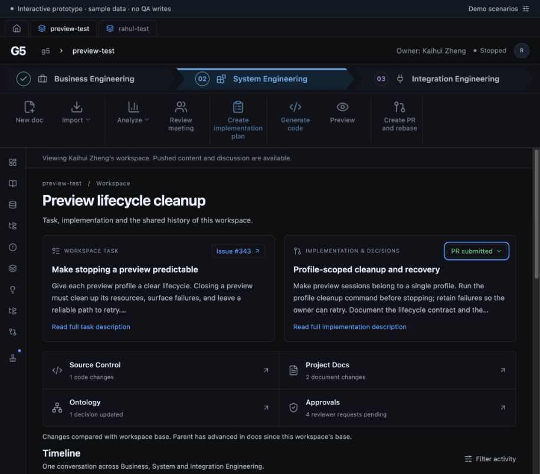
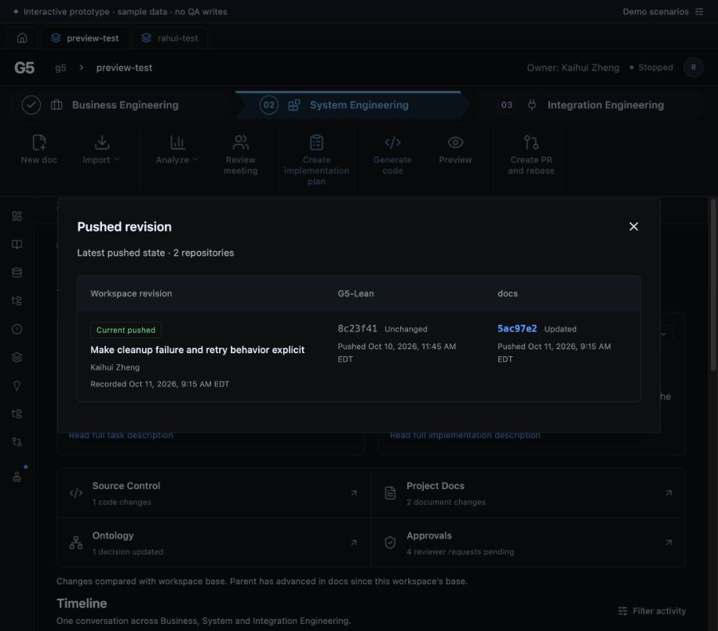
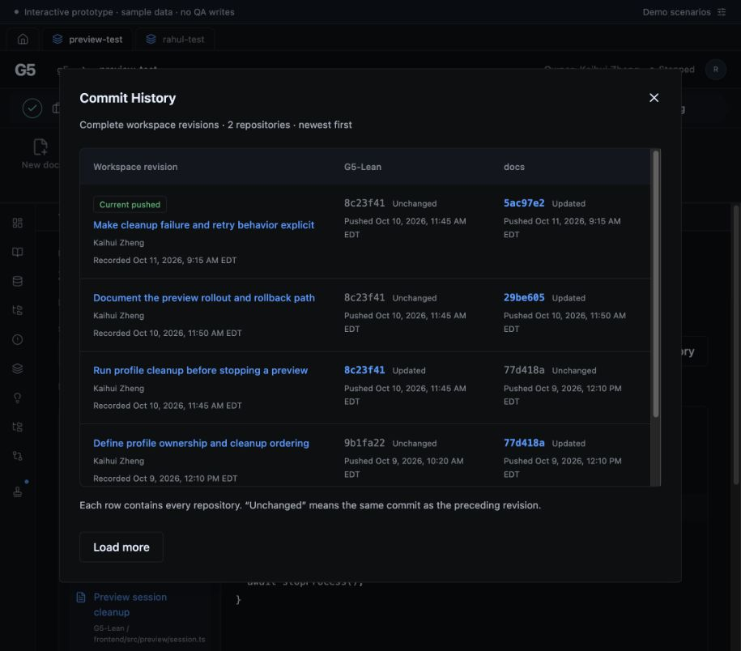

# Workspace landing and review mock

Interactive reference for [#447](https://github.com/G5Labs/G5-Lean/issues/447).
The [agreed flow and continuing implementation design](../review-flow.md) records the decisions.

From `frontend/`, run `npm ci` and `npm run dev:review-mock`, then open
<http://127.0.0.1:8792/review-mock.html>. The standalone entry uses sample data;
it does not invoke production APIs. Keep this server and entry point available
while developing the real workbench on a separate development port.

The source is in [`frontend/src/prototypes/review/`](../../frontend/src/prototypes/review/).
`npm run build:review-mock` builds a portable static demo in `review-mock-dist/`.
The demo's scenario controls cover owners, requested reviewers, general feedback,
pre/post-PR workspaces, stopped/running compute and subsequent pushes.

## Workspace landing

## Current PR revision

## Workspace commit history

