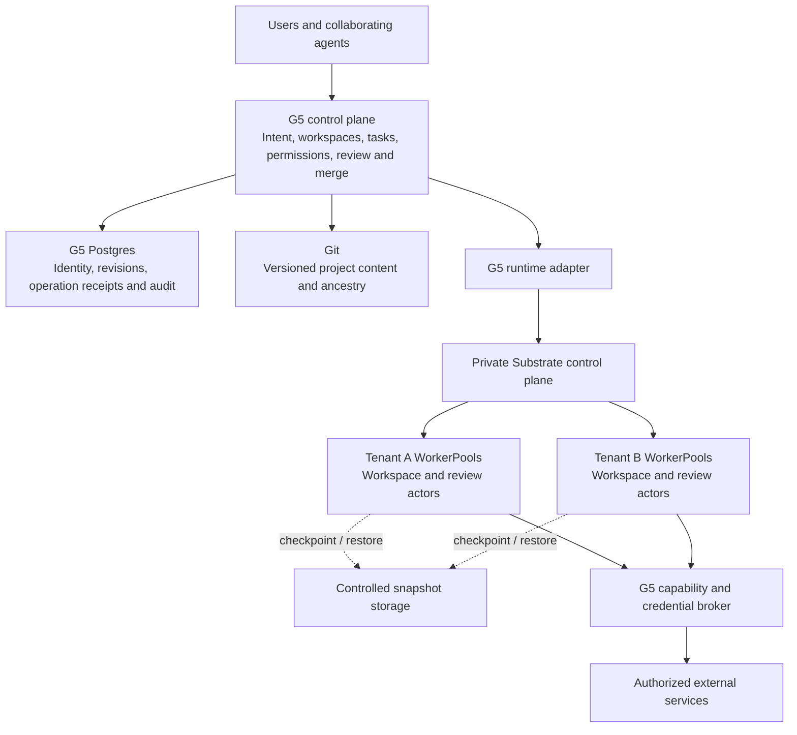

# G5 on Substrate: persistent execution, G5 semantics

| Document | Value |
|---|---|
| Design ID | g5-substrate-backend |
| Version | 0.1 |
| Status | Draft architecture proposal |
| Date | 2026-09-21 |
| Baseline | G5-Lean backend design v9 and this design discussion |
| Scope | Product experience, responsibility boundaries, collaboration, tenancy, security, and validation |
| Authorization | Documentation only; not an implementation plan or approval to change production behavior |
| Driving chat intent | 35aa66ec; session 01a0c559-7dd6-7700-a875-c6cf06b0e079 |

## Potential wins over vanilla v9

[D16. A richer workspace experience from persistent execution]

The opportunity is to offer more capable workspaces while maintaining less G5-specific runtime machinery. Vanilla v9 simplifies G5 around disposable execution and Git-based recovery. Substrate makes persistent, hibernating environments a foundation G5 can use for richer collaboration and faster iteration.

| Potential functional win | Vanilla v9 plan | Proposed Substrate-backed experience |
|---|---|---|
| Resume the whole working environment | Restore project files through Git; reconstruct execution and provider sessions | Resume captured files, tools, compatible process state and local development data |
| Less lifecycle friction | Explicit owner Start/Resume and process-per-turn execution | Authorized interactions wake environments; agents can retain sessions across turns and sleep while waiting |
| More useful experiments and reviews | Contributions primarily carry Git state; a runnable environment must be prepared | Prepared review environments and isolated experiments, with restricted full-state clones when sharing is authorized |
| Repeatable prepared starts | G5 manages bootstrap, retained roots and cache reuse | Versioned images and golden snapshots provide initialized toolchains and approved setup |
| Better recovery and investigation | Git recovery preserves selected project files | Retained runtime checkpoints can reproduce local failure context or restore an experiment |
| More retained environments per tenant | Stopping execution releases capacity but later requires reconstruction | Sleeping environments retain state while active work shares the tenant's execution capacity |

G5 still builds the collaboration experience: permissions, shared drafts, semantic review, Git-backed fork/merge and editing coordination. Substrate supplies mechanisms that make those experiences easier to support; it does not supply the product semantics or automatically make shared editing safe.

[D17. A smaller G5 runtime implementation and maintenance surface]

The largest potential reduction is in lifecycle and recovery code, including the associated failure handling and integration tests:

| G5 responsibility in vanilla v9 | Potential reduction with Substrate |
|---|---|
| Lifecycle Git flush-and-restore | Remove routine hidden recovery refs, snapshot commits, complete flush receipts and working-tree reconstruction once replacement durability is proven |
| Native session teardown and reconstruction | Reduce routine provider-session harvesting, persistence shuttling and reinjection when sessions remain in their environment |
| Physical VM placement and lifecycle | Replace G5-owned placement, launch, suspension/restoration and host reconciliation mechanisms with a runtime adapter and G5-level outcome checks |
| Environment preparation and reuse | Reduce custom bootstrap/cache orchestration through prepared templates and runtime-managed restoration |
| Wake-up and runtime routing | Delegate runtime location and resume-aware routing; retain G5 authorization, admission and user-facing policy |

This also reduces the number of runtime states and recovery transitions G5 engineers must coordinate across Git, session files, hosts and workspace metadata. G5 retains semantic revisions, task outcomes, operation receipts and runtime fencing because those protect product behavior rather than implement a sandbox.

**Expected net result:** a smaller G5 execution backend supporting a more persistent and collaborative product. The savings are qualitative until measured against v9: some complexity moves into Substrate and Kubernetes operations, and G5 still needs credential brokering, safe snapshot retention and collaboration controls. Warm-capacity cost, crash durability and resume performance require validation; this proposal does not claim a measured code-reduction percentage or automatic infrastructure-cost saving.

## Proposal

[I1. G5 defines the meaning of the work] (Tags: human)

Use Agent Substrate as G5's execution infrastructure while retaining the semantic layer in G5. Intent, ontology, grounding, workspace identity, collaboration, task outcomes, fork, review, merge, and publication remain G5 concepts and operations. Git is the proposed mechanism for versioned project content, ancestry, and integration. A Substrate snapshot is execution state; creating or restoring one does not accept a contribution or advance an approved project revision.

[D1. Integrate directly with Substrate]

Build a narrow G5 runtime adapter over Substrate rather than putting AX between them. G5 already needs to define workspace and task semantics; an additional orchestration layer would duplicate those responsibilities. Revisit AX only if a specific capability demonstrably reduces the resulting G5 implementation. This is an architectural recommendation, not a claim that AX has no value for other products. [AX repository](https://github.com/google/ax)

The key change from Lean v9 is to stop treating the workspace disk as a disposable cache reconstructed through Git flush-and-restore. Preserve unfinished execution state through the runtime storage design, while Git records deliberate project revisions. The remaining proposals below are recommendations for review, not previously approved implementation decisions.

## Product experience

[I2. Persistent environments support collaborative work] (Tags: human)

G5 should exploit Substrate's capabilities to improve the experience, rather than preserve restrictions introduced to compensate for weak disk persistence. Collaboration remains central, and the tenant-specific worker allocation model must be preserved at its existing isolation level.

[D2. Environments that resume, branch, and support review]

The proposed experience includes:

- **Continue work:** reopen an environment with unfinished files, tools, and compatible captured process state. Authorized chat or preview access can wake it; G5 applies admission and budget policy before wake-up.
- **Persistent agents:** a task can wait for human input while its environment sleeps. Task identity, questions, cancellation, and completion remain durable G5 records. A running actor does not imply a successful task.
- **Parallel experiments:** create isolated execution environments for competing approaches, compare their intent coverage and verification results, and integrate the chosen contribution through G5 review.
- **Runnable review:** open the exact proposed integration candidate in a prepared environment with review-scoped permissions and suitable fixtures.
- **Useful checkpoints:** attach runtime checkpoints to meaningful events, such as a failing test or the start of a risky experiment, so authorized users can inspect or continue that state.
- **Prepared starts:** use versioned images and golden snapshots for installed toolchains and approved initialization, avoiding repeated setup.

Hibernation is coordinated with active work; it must not suspend a busy task merely because no browser is connected. External sockets may need reconnection, and interrupted external requests require outcome reconciliation. Persistent local process memory does not provide exactly-once external effects. Substrate's interactive and agent demos establish the mechanisms, not a measured G5 resume-latency guarantee. [Jupyter demo](https://github.com/agent-substrate/substrate/blob/main/demos/jupyter/README.md), [agent multiplexing demo](https://github.com/agent-substrate/substrate/blob/main/demos/claude-code-multiplex/README.md)

## Responsibility boundary

[D3. G5 coordinates product operations and delegates runtime mechanics]



| Responsibility | G5 | Substrate |
|---|---|---|
| Workspace, membership, intent and task meaning | Defines and authorizes | No product authority |
| Fork, review, merge and external publication | Selects revisions, evaluates policy, records acceptance | Supplies environments used to execute or verify the operation |
| Runtime lifecycle | Chooses when policy permits create, wake, checkpoint or stop | Performs placement, suspend/resume and snapshot operations |
| Collaboration | Permissions, proposals, attribution, editing coordination | Isolation between execution environments |
| Credentials and network authority | Grants permitted operations and budgets | Supplies runtime identity and configured network enforcement mechanisms |
| Capacity | Tenant allocation, admission, priorities and limits | Worker assignment and lifecycle mechanisms |

The in-environment G5 dispatcher remains small: module execution, native agent integration, files, terminals, previews, safe-point coordination, and semantic event reporting. G5 uses operation IDs and runtime-generation fencing to reconcile lost acknowledgements and reject stale execution. It should not recreate Substrate's physical placement database or scheduler.

## State and identity

[D4. Separate project revisions from execution checkpoints]

| State | Authority and purpose |
|---|---|
| Accepted or explicitly shared project content | Immutable Git objects, identified by a complete G5 revision across member repositories |
| Which revision is accepted, who approved it, task state and permissions | G5 Postgres and G5 policy |
| Unfinished working files and compatible local process state | Active environment storage and its declared durability contract |
| Captured runtime state | Substrate-managed snapshots, with retention managed according to G5 policy |
| Long-lived credentials | External secret custody; brokered access where supported |
| External provider state | Remains external; G5 records requests and outcomes rather than claiming snapshot control over it |

A **G5 workspace** is a stable collaboration object with members, intent, repository membership, revisions, and task history. An **execution environment** belongs to a workspace and has its own purpose, trust boundary, grants, and lifecycle. A **Substrate actor** implements that environment and may move between workers. Actor identity is not workspace ownership.

A workspace can have a primary workbench plus separate experiment, personal, or review environments. Multiple cooperative tasks can share an environment when their trust and concurrency requirements allow it; a new chat turn does not inherently require a new actor.

A **G5 project revision** selects exact content for every member repository. A **G5 checkpoint record** references a runtime snapshot, environment identity, runtime/template version, capture time, and relevant project revision or working-tree manifest. These records are linked, but neither substitutes for the other. Restoring runtime state never rewinds G5 permissions, approvals, task history, or accepted revisions.

## Persistence and runtime recovery

[D5. Use snapshots for continuity without overstating durability]

Substrate distinguishes Full snapshots, which include memory, root filesystem changes, and supported durable data, from Data snapshots, which preserve supported durable volumes without arbitrary root filesystem changes or process memory. Named tags allow retained checkpoints. Local pause and durable suspension have different recovery properties. [Substrate glossary](https://github.com/agent-substrate/substrate/blob/main/docs/glossary.md)

G5 should expose a clear last-durable-checkpoint state and define what an acknowledged file save guarantees. Successfully uploading a checkpoint does not prove that every later live write survives abrupt host failure. Continuous file durability, checkpoint frequency, restore compatibility, and recovery time must be established by storage design and tests before becoming product promises.

External CSI volumes are separate storage resources. Do not assume that creating an actor from a snapshot also copies or atomically checkpoints those volumes. Forkable development databases and fixtures must either reside in snapshot-covered storage or have a separately coordinated export/restore mechanism. [CSI storage](https://github.com/agent-substrate/substrate/blob/main/docs/csi-volumes.md)

G5 retains snapshots referenced by active environments, reviews, or named checkpoints. Deletion checks those references and reconciles failures. The current API documentation warns that deleting a tag still borrowed by an actor can break its later restore. [Snapshot retention contract](https://github.com/agent-substrate/substrate/blob/main/docs/api-guide.md)

Recovery restores an environment only after revalidating current access and execution grants. It reconciles task claims and pending external actions rather than replaying them blindly. A runtime rollback cannot undo a published commit, message, or remote database mutation. A project rollback is a new G5 revision, normally expressed through Git revert or another reviewed change.

## Fork as a G5 operation

[D6. Ordinary forks start from deliberately shared project state]

The normal **Fork workspace** operation creates a new G5 workspace from an authorized, immutable project revision. It establishes repository ancestry, membership, attribution, policy, and ownership in G5; Git branches or internal references represent the selected project content. It does not require a GitHub repository fork.

The workflow is:

1. Authorize the requested source revision and destination tenant/workspace.
2. Pin the complete source repository vector and record the G5 fork lineage.
3. Create the child's versioned project state and fresh execution grants.
4. Materialize a clean environment from an approved image or golden snapshot and the authorized project files.
5. Optionally use a compatible full snapshot as an acceleration only when all captured state is authorized for the recipient and its project state matches the declared fork revision.

A reader cannot trigger capture of another user's arbitrary live filesystem. Uncommitted work remains private until its author deliberately shares a revision. A proposed **Share draft** action can record selected unfinished project files in immutable Git objects without requiring a polished commit history or a manual Git ceremony. The shared revision has an explicit audience and contains no implicit permission to copy private runtime state.

Copy only the authorized Git object closure or selected artifact tree, not an entire private repository object database. Source files and fixtures can themselves contain confidential material or secrets; Git and scanners do not remove the need for access control.

[D7. Full environment clones are a separate restricted capability]

For private experimentation or explicitly shared trust, G5 may clone captured filesystem and process state. This operation preserves the experiment's project baseline and records its provenance, but grants no automatic merge or publication authority.

When the clone contains unfinished files, G5 records their exact eligible artifact baseline so inherited changes are not misattributed to the child. Integrating the child into another target must include any inherited prerequisites that target lacks. Cross-user full-state cloning is permitted only when the recipient is authorized for every captured byte and capability; membership in the same tenant alone is insufficient.

## Review and merge as G5 operations

[D8. Review an immutable integration result with runnable evidence]

G5 review binds together the source revision, common project baseline, target revision, proposed result, and verification evidence. Each revision is a complete multi-repository vector. Git computes textual/content integration; G5 evaluates intent, ontology and grounding consistency, applicable tests, conflict resolutions, and approval policy.

Review submission can publish explicitly selected uncommitted project files as a new immutable source revision. It never quietly adds unrelated runtime files. G5 then prepares the merged candidate against the current target and validates that candidate, rather than relying only on tests run in the source environment.

The review screen presents:

- The exact changes that will enter the target, with source attribution and dependency context.
- Relevant intent, semantic checks, test outcomes, and approval state.
- A runnable candidate environment with review-scoped credentials and declared fixtures.
- Environment differences that affect reproducibility, including a required tool installation not yet expressed in setup configuration.

Reviewer experiments run in disposable derivatives and do not mutate the approved revision. If the target advances or the candidate changes, G5 recomputes it and applies the approval-invalidation policy. A live target's dirty files must be preserved and checked; G5 must not overwrite them or silently publish them. It either requires an explicit target revision before integration or refuses application until local work is safely reconciled.

[D9. Merge integrates project artifacts and records one accepted result]

**Merge changes** is a G5-controlled Git integration. G5 prepares all repository results, checks expected target versions, and records one accepted workspace revision with a durable operation receipt. Partial Git preparation or projection failures must not expose a mixed accepted workspace to G5 readers. Git objects carry content and ancestry; the G5 revision record selects the accepted vector. External Git publication is a separately recoverable step.

After acceptance, affected environments adopt the new revision at a controlled boundary. Dependency installation, migrations, and service restarts are explicit follow-up operations with their own outcomes. A successful merge does not imply a successful deployment or migration.

| Artifact | Normal integration behavior |
|---|---|
| Source, ontology, docs, tests, manifests and lockfiles | Integrate through the reviewed Git candidate |
| Environment setup, migrations and declared fixtures | Integrate their definitions; execute under appropriate policy |
| Package installations, caches and build outputs | Reuse or rebuild as runtime artifacts; do not merge indiscriminately |
| Raw development databases, process memory, credentials and personal session state | Excluded from ordinary merge |

An optional **Replace environment from checkpoint** operation may adopt a chosen runtime state after preserving the old state and rebinding identity. It is distinct from project merge, cannot combine divergent databases or processes, and cannot silently change accepted G5 history. If its files differ from the accepted revision, they are working changes until a G5 revision is accepted.

## Collaboration and execution authority

[D10. Multiple contributors need not share one privileged filesystem]

Replace the blanket owner-only contribution model with G5 capabilities for reading shared revisions, publishing drafts, contributing, reviewing, merging, using previews, and running authorized tasks. Sharing a conversation or project does not automatically grant terminal access or the use of another person's accounts.

The primary collaboration model is a shared logical workspace with isolated execution environments where appropriate. Multiple users and agents can contribute concurrently; G5 serializes acceptance of competing project revisions. A trusted team workbench may also permit multiple editors in one actor, provided they share its execution trust and development credentials.

Substrate does not implement editor synchronization, file conflict resolution, or attribution between people sharing an actor. Live coediting requires G5 coordination. Arbitrary terminals and processes can bypass an application-level edit queue, so such a queue is not a complete multi-writer safety mechanism.

Separate actors also do not make arbitrary shared code safe to run with personal credentials: one contributor can change a script that another user's privileged run executes. Sensitive runs therefore bind scoped authority to a deliberate code revision and task. Prepared, low-privilege review environments support broad collaboration without exposing the author's personal runtime.

## Tenant architecture

[D11. Preserve tenant-specific capacity and isolation]

Use a shared G5 control plane and private Substrate control plane where consistent with the current deployment boundary. Give each tenant an atespace, a Kubernetes namespace for its worker resources, and one or more dedicated WorkerPools. Separate pools may serve different runtime classes or resource sizes. Map environments to tenant-owned actors and maintain tenant ownership on all G5 runtime and snapshot records.

Atespace and Kubernetes namespace are different concepts. Neither implicitly restricts actor placement to that tenant's workers: pool selection is cluster-wide. G5 must stamp protected tenant labels on WorkerPool metadata and require them in G5-controlled template selectors. User-supplied actor settings must not escape this restriction. [Pool selection](https://github.com/agent-substrate/substrate/blob/main/demos/multi-template/README.md)

| Existing or required boundary | Proposed deployment |
|---|---|
| Tenant-specific worker capacity | Dedicated WorkerPools and G5 admission limits |
| Tenant-exclusive host machines | Dedicated node pools with enforced placement and isolation configuration |
| Separate infrastructure administration, customer VPC or strong IAM separation | Separate Substrate installation and corresponding network/storage boundaries |

Separate worker pods do not imply separate machines. Inventory the current tenant host boundary and preserve it; do not infer that boundary from worker naming alone. Shared control-plane and snapshot-mover credentials remain trusted across tenants even when worker nodes are dedicated.

A tenant may retain many more environments than it can run simultaneously. For example, 100 retained environments may share capacity for eight concurrent environments; this is an illustrative allocation, not a fixed actors-per-pod claim. G5 owns admission, priorities, storage quotas and spend limits. Substrate supplies runtime placement. Its HPA example provides an autoscaling starting point, but production draining, scaling limits and warm-capacity policy require validation. [Autoscaling example](https://github.com/agent-substrate/substrate/blob/main/demos/autoscaled-workerpool/README.md)

Tenant pools do not borrow each other's capacity by default. Storage prefixes organize snapshots; real IAM and backend authorization enforce access. Cross-tenant sharing, if later offered, is an explicit project export/import policy, not an unrestricted snapshot-tag operation.

## Security and credentials

[D12. A full snapshot is a sensitive trust boundary]

Treat a full snapshot as potentially containing keys, environment variables, CLI login state, shell history, private data, and secrets already copied into memory. Changing actor identity or deleting a known secret file does not sanitize that state. Encryption at rest does not protect a secret from an authorized recipient who can restore and inspect the environment.

Keep long-lived keys in external custody. G5 should provide a capability and credential broker for supported services, with grants bound to tenant, environment identity, task, permitted operations, destinations, expiry, and budget. Keys stay outside captured workloads where this integration is possible. Services requiring in-process credentials retain a stricter trust boundary and cannot be declared safe for unrestricted full-state sharing.

Forks receive fresh grants. Suspend/resume revalidates existing grants; copied metadata is not authority. G5 must prevent direct network bypass of required broker policy and protect cloud metadata, host management endpoints, neighboring workloads, and the private control plane. Scoped API use is itself authority even when the caller cannot read the underlying key.

The current Substrate API authenticates callers but does not implement tenant-scoped RBAC. Tenant users and agents must not receive general Substrate control credentials. G5 authorizes operations and derives routing from authenticated context rather than trusting actor-selection headers supplied by clients. [Authentication](https://github.com/agent-substrate/substrate/blob/main/docs/authentication.md)

Substrate's configured egress gateway authenticates actor identity and applies destination policy, but the current router documentation states that upstream credential injection is unimplemented. The G5 broker is work this proposal includes, not a turnkey capability attributed to Substrate. [Egress implementation](https://github.com/agent-substrate/substrate/blob/main/cmd/atenet/internal/router/README.md)

## Changes from Lean v9 and complexity reduction

[D13. Remove runtime workarounds while retaining product guarantees]

| Lean v9 mechanism | Proposed direction |
|---|---|
| Disk is a cache; lifecycle Git flush restores unfinished work | Runtime storage and checkpoints preserve unfinished execution state |
| Hidden recovery refs, per-repository flush receipts and working-tree reconstruction | Remove from the normal persistence path after replacement recovery is proven |
| Process-per-turn and routine session-file harvesting/restoration | Permit persistent native sessions; retain durable G5 conversation/task records and needed restart/export support |
| Explicit owner Start/Resume | Authorized, policy-controlled wake on interaction |
| G5 physical host/VM placement and lifecycle machinery | Delegate to Substrate through a narrow adapter |
| Owner-only contribution | G5 capabilities, shared project revisions, and isolated or explicitly trusted execution |
| Process environment carries broad credentials | Broker supported services and narrowly scope unavoidable in-process credentials |

Git commits at Share draft, review, or merge boundaries remain necessary semantic records; they are not a replacement disk-backup scheme. G5 still needs safe operation boundaries, multi-repository acceptance, task reconciliation, snapshot retention, access revocation, credential policy, and concurrency control.

The expected simplification is substantial within runtime lifecycle and recovery responsibilities, but no defensible percentage follows from this discussion. The Lean redesign already removes large parts of the legacy backend. Substrate also introduces Kubernetes operations, snapshot storage and compatibility management, and an upstream dependency. Measure the net reduction against a responsibility inventory and a representative vertical slice.

## Evidence, authority and alternatives

[D14. Preserve governing invariants without importing legacy mechanisms]

This document synthesizes the discussion against [G5-Lean v9](https://github.com/G5Labs/G5-Lean/blob/main/docs/lean-backend-design-v9.md), including the user's clarification that Git flush-and-restore was a persistence workaround. It is a proposed successor direction, not a claim that v9 already specifies this behavior.

The local ontology references below identify invariants to preserve or reconcile during later implementation planning. Their current CRDT, finalizer, host, or runtime bindings are not automatically requirements for the new Lean implementation. No ontology or production code is changed by this document.

| Change area | Governing concept blocks | Why relevant | Effect on later implementation scope |
|---|---|---|---|
| Accepted project state | [Accepted workspace state](g5://ontology/system_invariants/authoritative_workspace_cut#I1), [complete operation acceptance](g5://ontology/system_invariants/authoritative_workspace_cut#D4) | Runtime state must not become a second acceptance authority | Preserve complete revision identity, expected-version checks and recoverable outcomes |
| Multi-repository ownership | [Workspace ownership](g5://ontology/system_invariants/multi_repo_workspace_ownership#D1) | A workspace can span multiple repositories | Fork and review pin the full repository vector |
| Merge workflow | [Merge scope](g5://ontology/core_workflow/merge_workflow#I1) | Integration has product meaning beyond content combination | Preserve G5 authorization, validation and review semantics |
| Tenant and workspace access | [Tenant isolation](g5://ontology/security_policy/tenant_isolation#D1), [nested resource authorization](g5://ontology/security_policy/tenant_isolation#D11) | Tenant membership alone does not authorize every workspace or snapshot | Validate tenant and resource ownership at G5 boundaries |
| Secret custody | [Secret disclosure boundary](g5://ontology/security_policy/secret_custody_and_redaction#D1), [least privilege](g5://ontology/security_policy/secret_custody_and_redaction#D2) | Snapshots can transfer sensitive state | Distinguish project sharing from full-state disclosure |
| Runtime isolation | [MicroVM execution boundary](g5://ontology/system_invariants/microvm_execution_boundary#D1) | Tenant compute allocation must not weaken isolation | Validate the selected Substrate runtime and deployment boundary |

Relevant experience reinforces two general constraints: agents, terminals and capture must reference the same intended project tree; and durable writes, exact reviewed content, and atomic acceptance are separate guarantees. The existing implementation details are not carried forward merely because they solved an older architecture.

**Alternatives considered:** retain v9's Git-based runtime reconstruction; use AX as the mandatory orchestrator; make every cross-user fork a full snapshot clone; or treat environment replacement as merge. This proposal rejects those as defaults because they either retain avoidable runtime machinery, duplicate G5 semantics, or blur collaboration and secret-disclosure boundaries.

## Validation and adoption

[D15. Validate the runtime boundary before replacing recovery machinery]

Substrate describes itself as early development, not ready for production, with unstable APIs. Pin a tested upstream revision and runtime/image set; reconcile documentation against source and experiments rather than treating roadmap items as delivered guarantees. [Project status](https://github.com/agent-substrate/substrate#status-and-compatibility)

The first vertical slice should preserve one tenant's existing isolation, run representative G5 work, hibernate and restore it, and complete a Git-based fork/review/merge cycle. The following are required evidence categories, not results claimed by this document:

| Scenario | Required proof |
|---|---|
| Continuity | Dirty files, tool setup, supported local database state and native sessions behave correctly after suspend/resume and worker movement |
| Abrupt failure | Kill a host during writes; demonstrate the declared recovery point and truthful UI status |
| Safe sharing | A cross-user fork contains only authorized project content and fixtures; no inherited key, session, private Git object or execution grant |
| Review consistency | Source/target drift and local dirty files cannot silently change the reviewed candidate or overwrite work |
| Multi-repository acceptance | Failure midway through preparation or projection never exposes mixed accepted revisions; retries recover the same result |
| Tenant isolation | Missing or tampered selectors, wrong-tenant IDs, raw routing headers and unauthorized snapshot references cannot cross boundaries |
| Credential use | Revocation and clone identity take effect; supported broker paths keep key material out of workloads and reject unauthorized operations |
| Concurrent collaboration | Conflicting edits and competing merges are visible and recoverable; shared editors cannot silently inherit personal authority |
| Lifecycle recovery | Lost acknowledgements, cancellation, sleeping tasks and external side effects reconcile without duplicate execution claims |
| Retention and upgrade | Referenced checkpoints survive cleanup; incompatible snapshots fail clearly and have a tested recovery/export path |
| Capacity and experience | Measure startup/resume latency, snapshot bytes, active capacity, idle cost and saturation behavior with representative G5 workloads |

Adopt per tenant and preserve an exportable accepted Git revision throughout migration. Rollback to the previous backend requires an explicit transfer of unpublished work through a validated path; Git alone cannot reconstruct arbitrary new runtime state. Remove the old flush-and-restore path only after the replacement meets the chosen durability and recovery contract.

The implementation phase must turn this architecture into concrete API/schema contracts, ontology updates, dependency-ordered tasks, and executable acceptance tests. This draft does not authorize that phase.

## Open Questions

[Q1. Durability promised for acknowledged edits] (Tags: high)

The architecture separates project publication from runtime persistence, but the product must choose what a successful Save means under abrupt host loss. This affects storage selection and checkpoint coordination before the old recovery path can be removed. Ordinary hibernation recovery alone is not evidence of continuous file durability.

```g5-question
schema: 1
id: g5-substrate-save-durability
status: open
severity: high
multi_select: false
allow_free_text: true
prompt: "What durability should G5 promise for acknowledged file edits?"
options:
  - label: Durable acknowledged files
    description: "Require a storage path that preserves acknowledged file edits across host loss; retain separate checkpoints for process continuity and forks."
    recommended: true
  - label: Checkpoint-based recovery
    description: "Permit loss since the last durable checkpoint, with a defined recovery window and visible checkpoint status."
answer:
  selected: []
  text: ""
  rationale: ""
  answered_by: null
  answered_at: null
```

[Q2. First collaboration experience] (Tags: high)

Both isolated contribution environments and trusted shared workbenches fit the architecture. Choosing the first delivery scope determines whether live editor synchronization and shared-filesystem coordination are immediate work or a later capability. Neither option permits automatic sharing of personal credentials.

```g5-question
schema: 1
id: g5-substrate-first-collaboration
status: open
severity: high
multi_select: false
allow_free_text: true
prompt: "Which collaboration experience should the first Substrate-backed G5 release include?"
options:
  - label: Shared project with isolated runs
    description: "Multiple contributors share intent, tasks, drafts, previews and reviews while independent execution environments isolate their work."
    recommended: true
  - label: Also include live team workbenches
    description: "Include simultaneous editing of a shared environment for trusted teams, with explicit coordination and shared execution authority."
answer:
  selected: []
  text: ""
  rationale: ""
  answered_by: null
  answered_at: null
```
