# G5 Platform - Getting Started

This guide covers the current core G5 Platform workflow: **Fork** a workspace, **Create** or upload a doc, **Commit** changes, **Sync** work to an agent conversation, **Preview** to review results, and **Publish** or export when ready.

## Key Terms

| Term | What It Means |
| --- | --- |
| **Workspace** | The working area you select from the top bar. Fork a workspace when you want an isolated place to make changes. |
| **Project Docs** | Workspace-authored documents that capture plans, designs, requirements, or test expectations. Project docs can be synced into implementation work. |
| **Core Ontology** | The system map that connects product intent, architecture, policies, and implementation areas. |
| **Sync** | The action that compiles selected project docs into ontology and code through an agent conversation. |
| **Preview** | A temporary workspace run used to review the synced result before publishing, opening a PR, or downloading code. |
| **Task Queue** | The place to watch agent work, review progress, inspect results, and continue work that needs input. |
| **Worker** | The compute that runs agent conversations. It is normal for a workspace to show no active worker while idle. |
| **Chat** | The workspace assistant for planning, writing docs, implementing from docs, debugging, and explaining unfamiliar areas. |

## 1. Log In And Select Your Workspace

1. Click `Login` in the top right.
2. Sign in with the option available in your environment.
3. Before doing anything else, open the workspace switcher in the top bar and select the workspace you want to use.

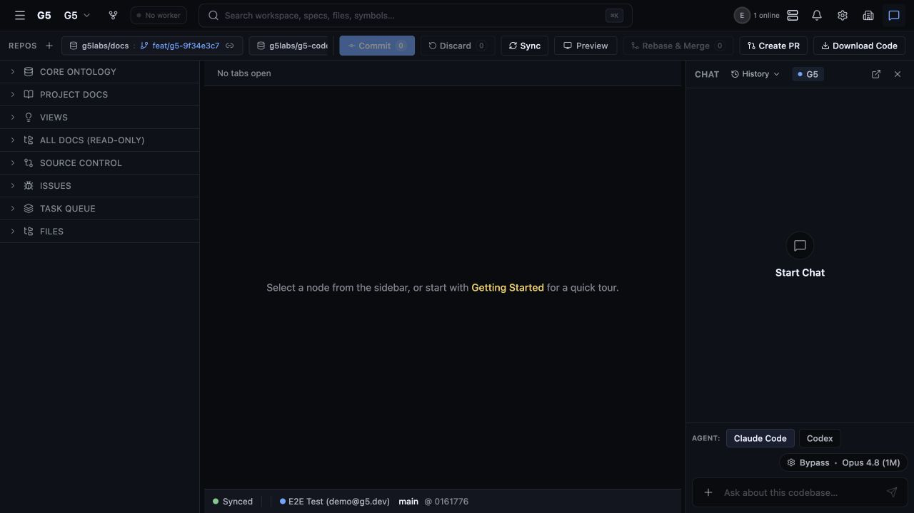

The selected workspace appears in the top bar. The screenshots in this guide use `G5` as an example workspace; choose the workspace your team uses. The workspace switcher also lets you search workspaces, fork a workspace, or remove workspaces when allowed.

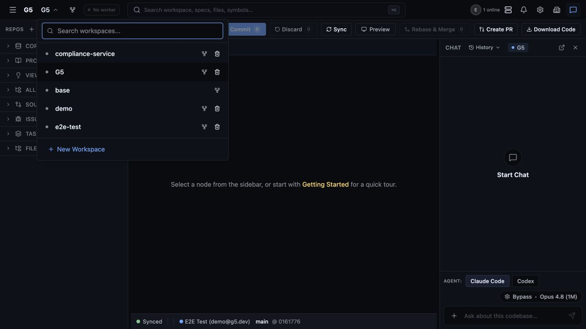

## 2. Know The Main Workspace Surface

The workspace is organized into four main areas:

- Top bar: workspace selection, worker status, notifications, settings, org management, and chat visibility.
- Repo/action strip: repository branches plus `Commit`, `Discard`, `Sync`, `Preview`, `Rebase & Merge`, `Create PR`, and `Download Code`.
- Left navigation: `Core Ontology`, `Project Docs`, `Views`, `All Docs (read-only)`, `Source Control`, `Issues`, `Task Queue`, and `Files`.
- Right chat panel: chat history, agent/provider choices, permission/model settings, project references, and the message box.

Use the repo/action strip as your current-work status bar. `Commit` and `Discard` show the number of dirty files. `Sync` starts the agent workflow for committed or selected intent, such as the Task Queue filter presets design doc created below. `Preview`, `Create PR`, and `Download Code` are available from the same strip when the workspace supports them.

## 3. Start From An Existing Or Forked Workspace

For isolated work, fork the current workspace from the top bar. The fork dialog lets you name the workspace, add a description, and review branch overrides before you create the copy.

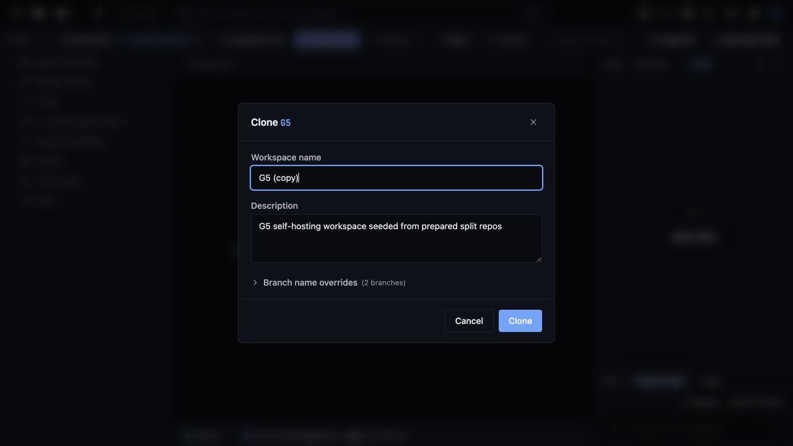

## 4. Browse Ontology, Docs, And Files

Open `Core Ontology` to browse the ontology tree. Expand nodes to move from broad system concepts into specific product, architecture, policy, and testing areas. Click a node, such as `core_workflow`, to open it in a tab.

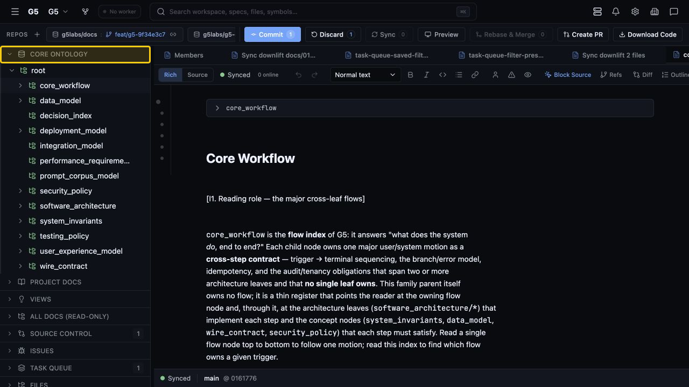

Open `Project Docs` for workspace-authored documents. Click a doc, such as `task-queue-filter-presets-design.md`, to open it in the editor.

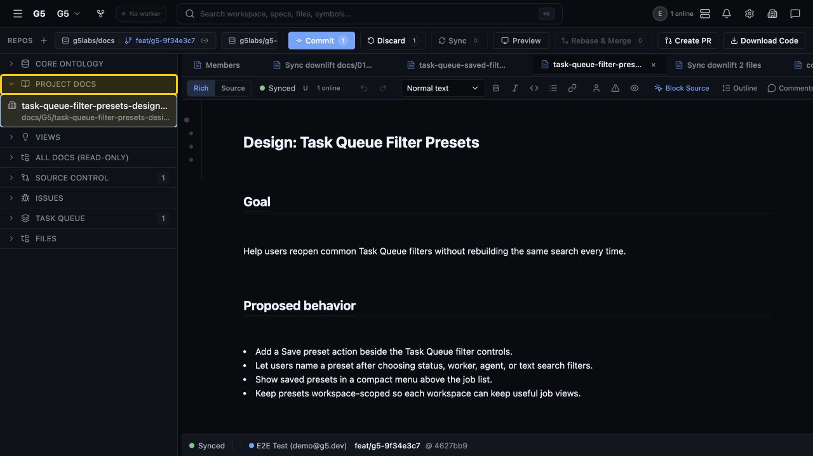

Open `Views` to browse user-facing intent and test views. Click a view to open it in a tab.

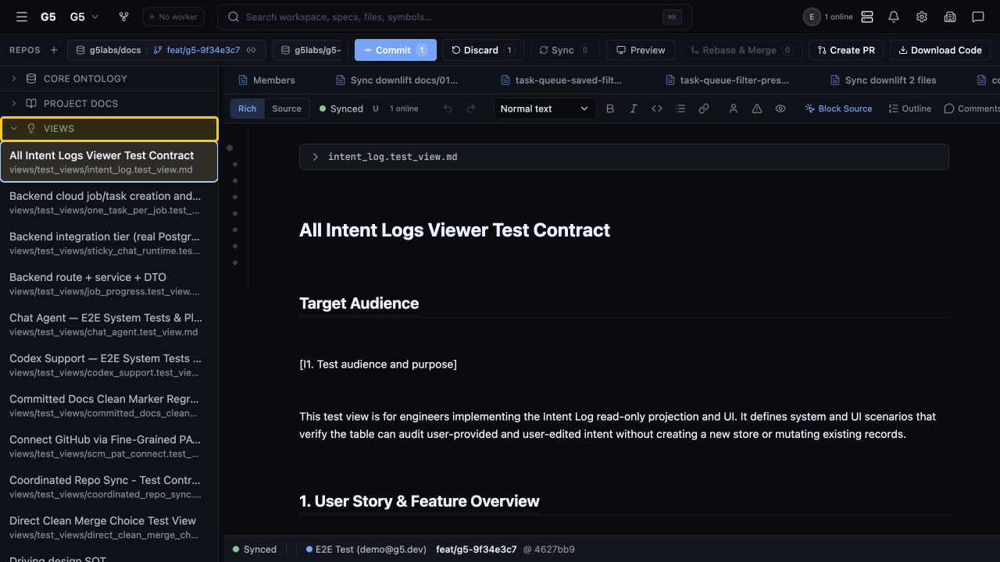

Open `All Docs (read-only)` to browse read-only document groupings.

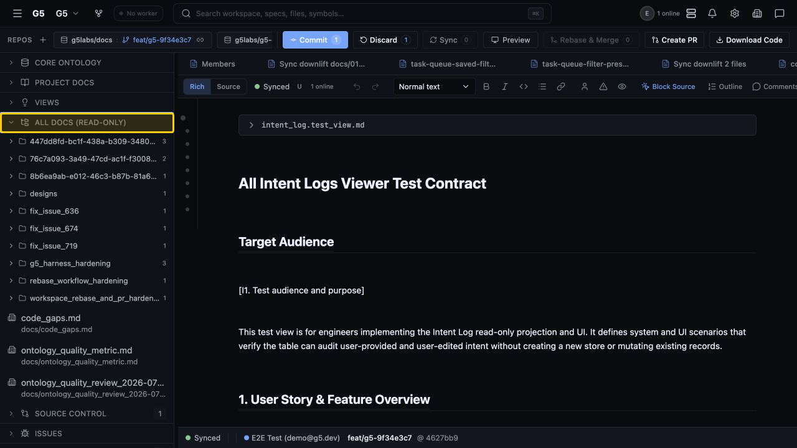

Open `Files` to browse repository files. Expand folders to drill into source files and other artifacts.

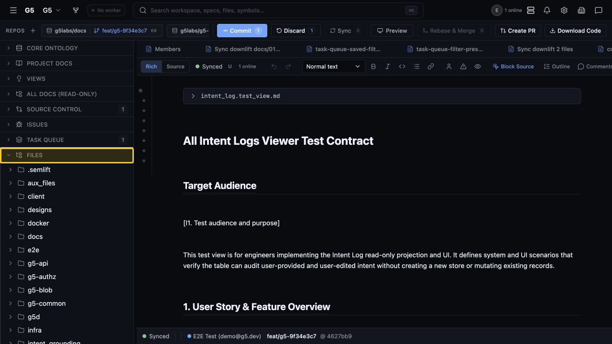

## 5. Create Or Open A Design Doc

Project docs are a good place to draft a design or plan before syncing it into implementation work. In this example, create a plain design doc for a simple Task Queue filter presets feature.

1. Open `Project Docs`.
2. Open the `Project Docs actions` menu.
3. Click `Create project doc`.

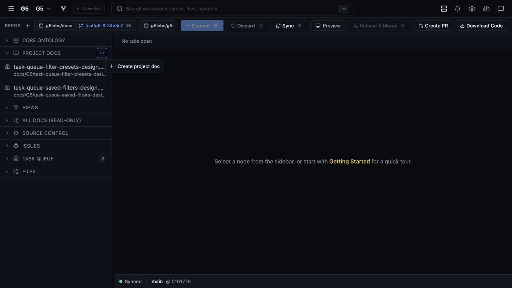

In the `Create Doc` dialog:

1. Leave `Plain doc` selected for a new Markdown doc.
2. Enter a clear filename, such as `task-queue-filter-presets-design`.
3. Click `Create Doc`.

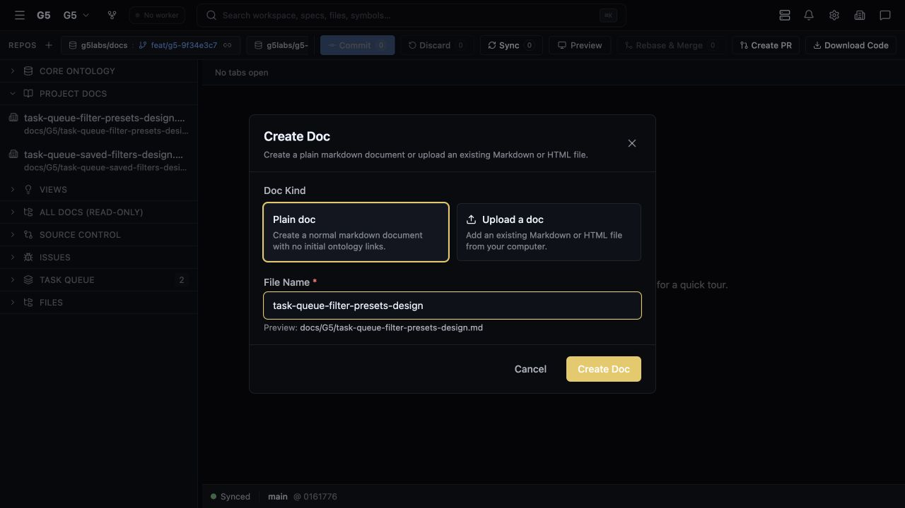

To upload an existing document instead, select `Upload a doc`, choose a Markdown or HTML file, then click `Upload Doc`.

After the doc opens, write the design. Use `Rich` for formatted editing or `Source` for Markdown. In the example doc, the design states the goal, proposed Task Queue preset behavior, and acceptance criteria. When the dirty-file count appears, use `Commit` in the repo/action strip to save the doc to the workspace branch.

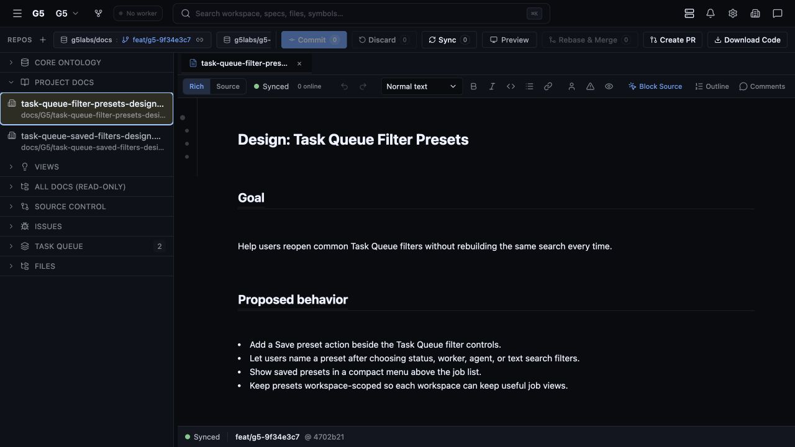

## 6. Commit, Discard, And Source Control

Use `Source Control` to see dirty files before committing. The example workspace contains a second related project doc, `docs/G5/task-queue-saved-filters-design.md`. Selecting this second doc opens a read-only workspace draft diff so you can review what changed before deciding whether to commit or discard it.

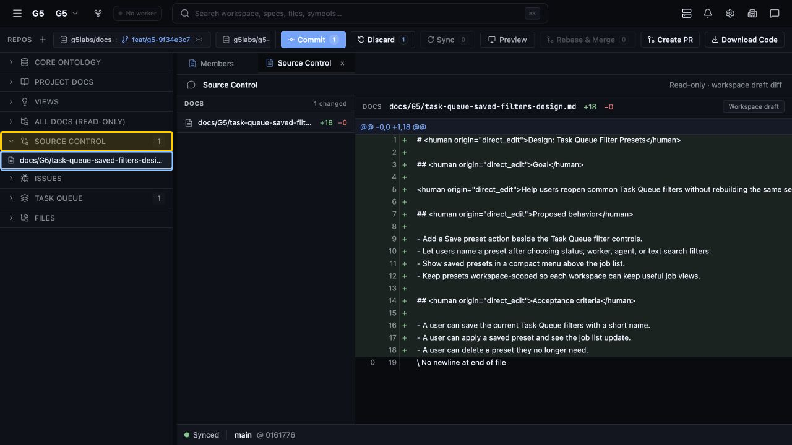

Click `Commit` in the repo/action strip to open the commit modal. Review the branch status, confirm which dirty files are selected, then enter a commit message. The modal keeps `Commit` disabled until a message is present.

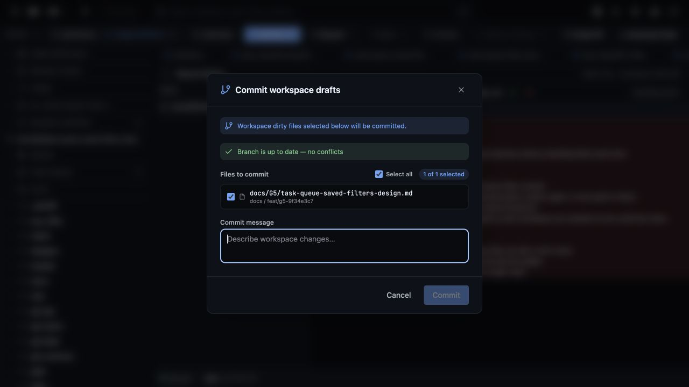

When files are dirty:

- Click `Commit` to save your draft changes to the workspace branch.
- Click `Discard` to throw away the pending draft changes.
- Re-open the changed artifact to verify the saved state before syncing.

## 7. Sync Work In An Agent Conversation

With the project doc open, choose `Sync` to start an agent conversation with the selected document context. Confirm the provider and model, then send the request. The agent works in the current workspace.

## 8. Watch Tasks

Open `Tasks` to see recent work and its status. Choose `Load more tasks` for older history. Selecting a task opens Workspace changes and, when available, its conversation. Review the changed files, read the conversation, and provide input there when needed. Workspace merge and publishing are separate actions after you review the result.

## 9. Preview, Publish, Or Export

Use `Preview` to launch a workspace preview. The dialog includes a preview profile selector, `New profile`, optional TTL, and `Launch preview`.

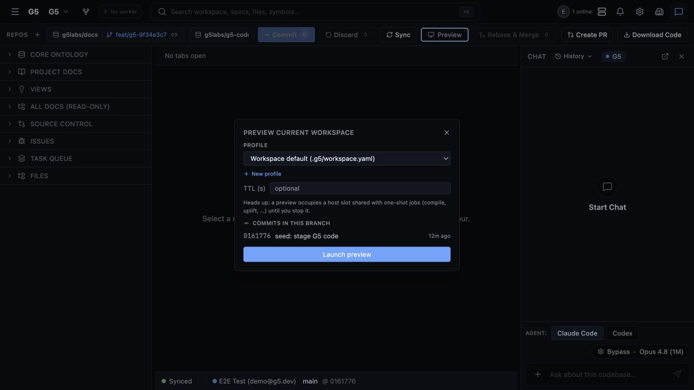

Use `Create PR` to open a workspace pull request into another workspace. Choose the target workspace, then create the PR when ready.

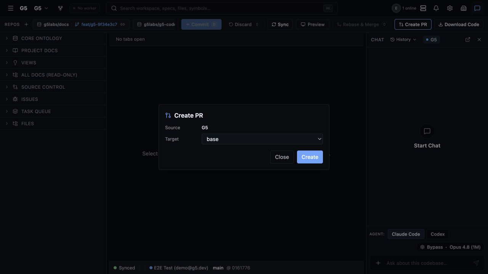

`Rebase & Merge` appears in the repo/action strip when a workspace can be published upstream. `Download Code` exports the committed code from the workspace repositories.

## 10. Use Chat To Plan, Build, And Debug

The chat panel is anchored to the current workspace. Choose the agent, open the mode/model menu, attach project references, then type your question or instruction.

Chat can drive core workspace work: ask it to write a design or plan doc, implement code based on existing docs, debug a failing behavior, investigate test failures, explain an unfamiliar area, or guide an in-progress task. For example, attach `task-queue-filter-presets-design.md` and ask chat to implement the preset menu, explain the affected Task Queue code, or debug a failing test after the sync. When chat produces a change, review it like any other workspace change before committing, syncing, merging, or publishing.

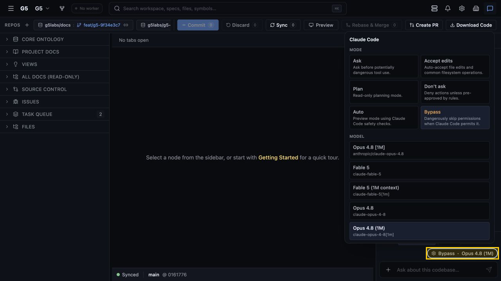

Use project references to attach a view, doc, ontology node, file, or image to the chat context.

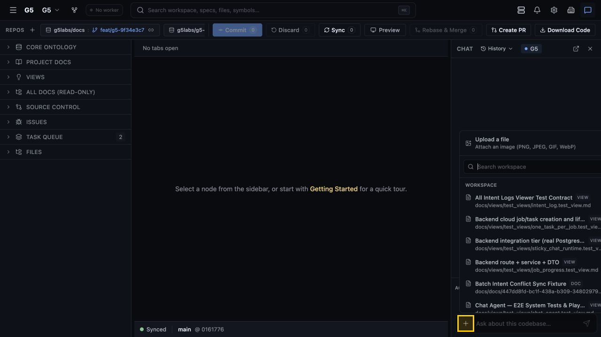

Use `History` to search prior chat sessions.

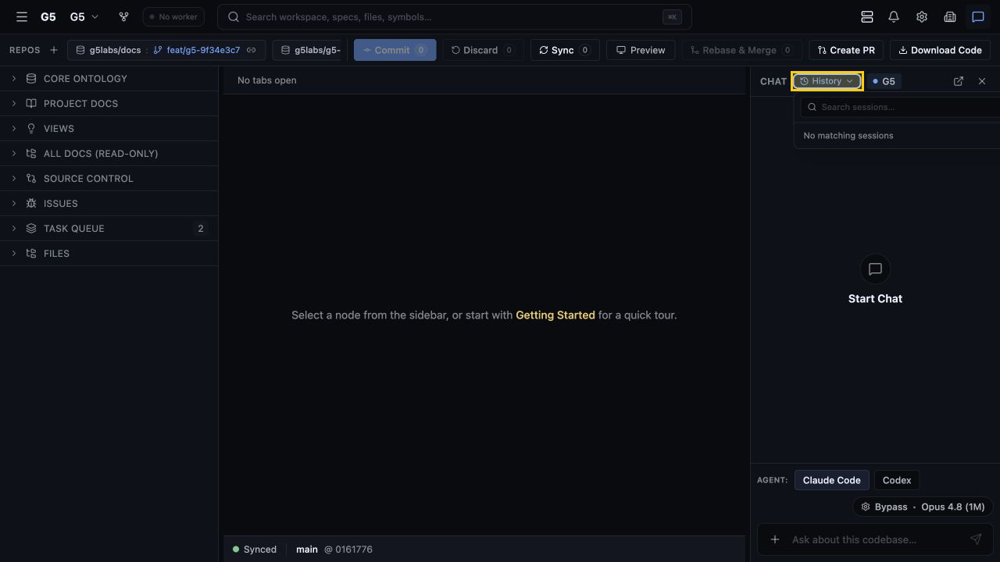

The send button stays disabled until the message box has content.

## 11. Check Worker Status

The worker indicator shows active worker capacity. During the example sync, the top bar changes from `No worker` to a running worker indicator. Open it to see worker host status, preferred worker selection, copy controls, and a link to manage worker hosts.

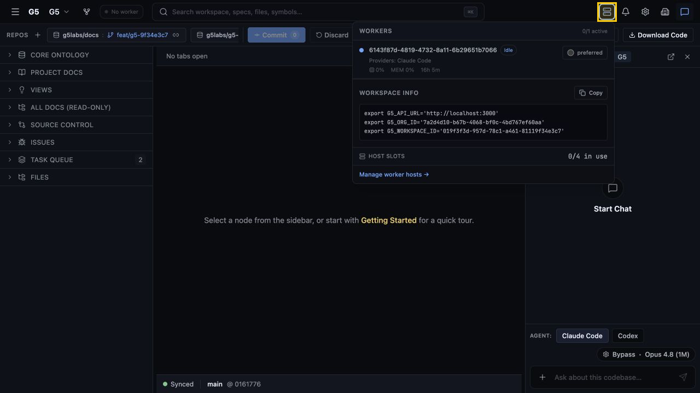

## 12. Settings And Organization Management

Open `Settings` from the top bar to change workspace UI preferences. The current settings surface includes theme choices, dark/light mode, editor display toggles, `Provider runtime`, and `SCM Connections`.

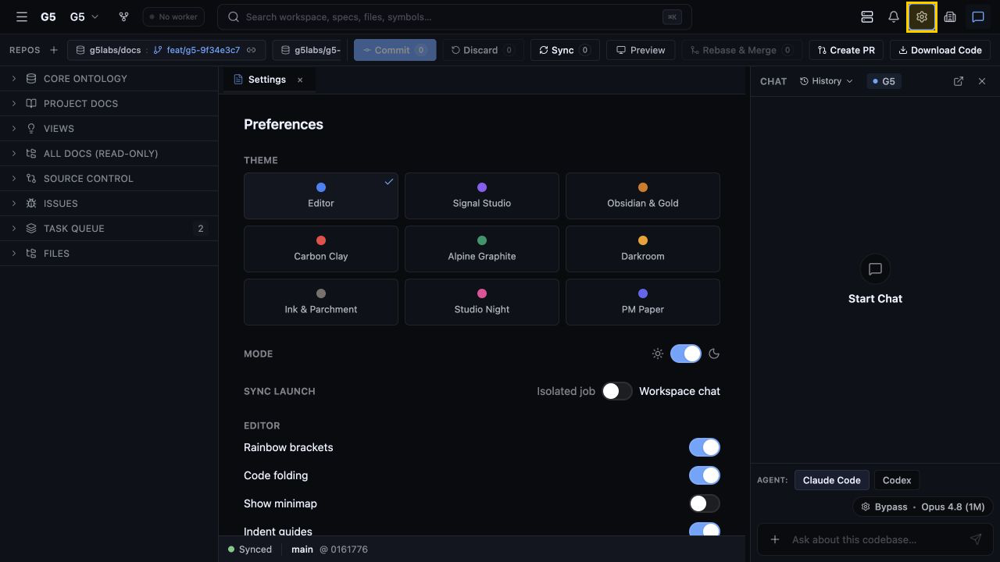

Open `Org management` to switch between organizations, open base workspaces, manage members, manage workers, invite users, create organizations, or sign out.

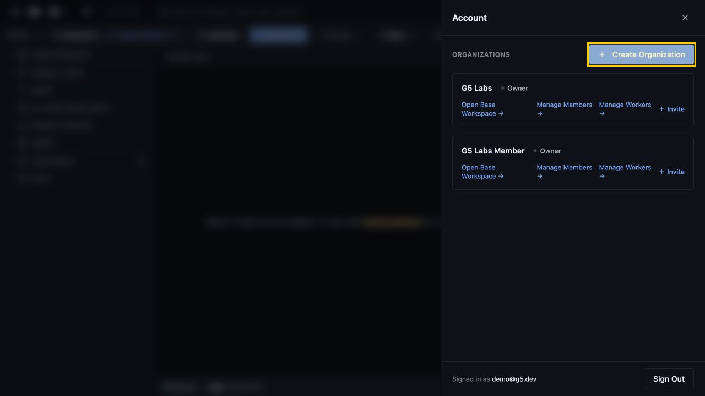

## 13. Core Workflow Summary

1. Log in and select your workspace from the top bar.
2. **Fork** the workspace if you need an isolated branch of work.
3. Inspect the relevant doc, view, ontology node, or file before making changes.
4. **Create** or edit the project doc that owns the intent.
5. **Commit** the draft when the dirty-file count appears.
6. **Sync** the selected committed project docs.
7. Watch the running task in `Tasks`.
8. Review the task details to understand the changes, then **preview** the application.
9. Merge, create a PR, rebase and merge, or download code when the work is ready.

## 14. Control Reference

| Area | Controls |
| --- | --- |
| Workspace top bar | Workspace switcher, fork workspace, worker status, active workers, notifications, settings, org management, chat toggle |
| Repo/action strip | Add repository, make branch remote, commit, discard, sync, preview, rebase and merge, create PR or show PRs, download code |
| Left navigation | Core Ontology, Project Docs, Views, All Docs (read-only), Source Control, Issues, Task Queue, Files |
| Chat panel | History, pop out, close, agent selector, mode/model menu, project reference picker, message box, send |
| Settings/admin | Theme, dark/light mode, editor toggles, Provider runtime, SCM Connections, organization cards, members, workers, invite, sign out |
