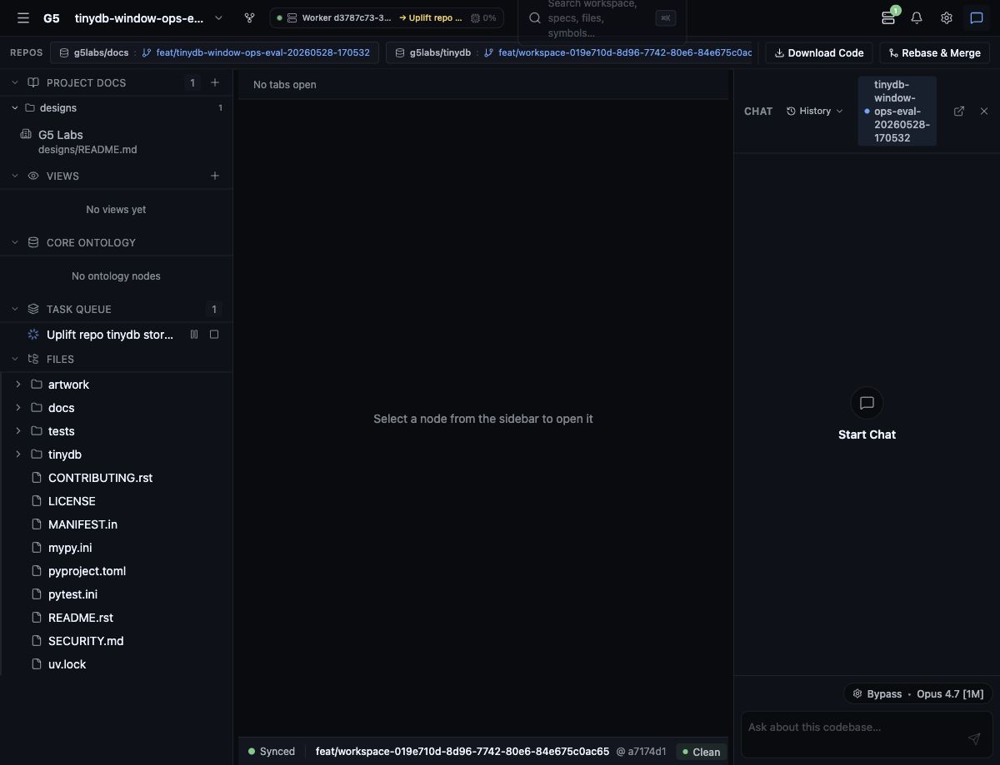
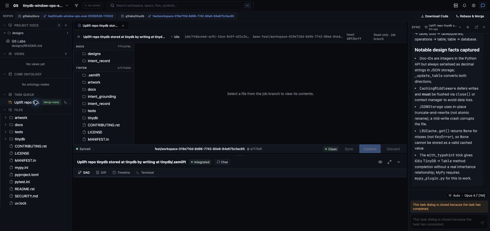
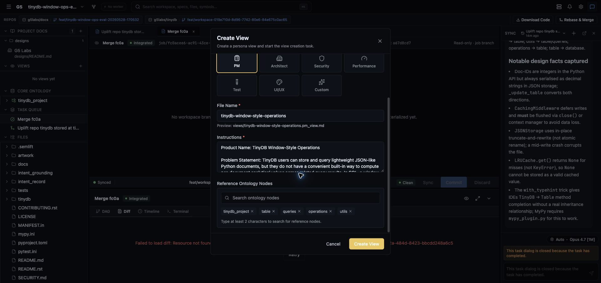
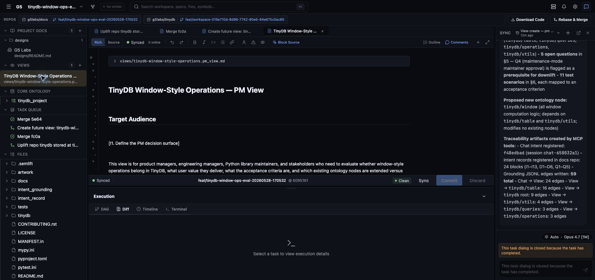
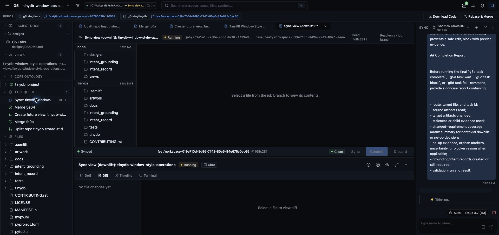
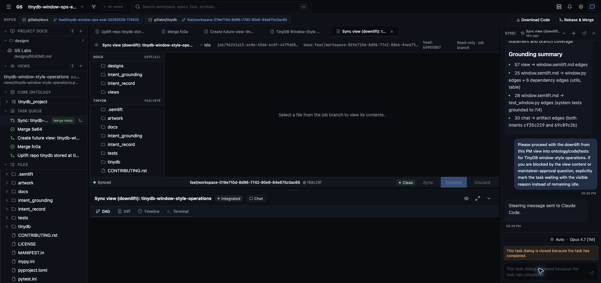
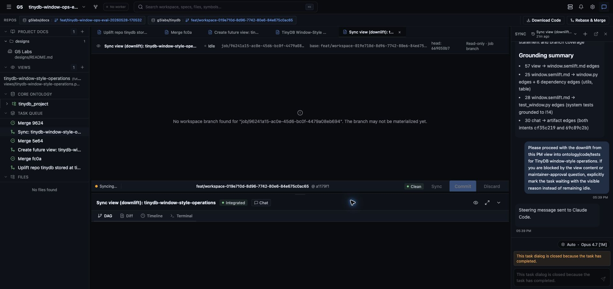

# Using G5 to Enhance an Existing Library — TinyDB Tutorial

This tutorial uses TinyDB window-style operations as the example.

> **New to G5?** Read [Getting Started](getting-started.md) first for the core concepts and key vocabulary. This guide assumes you're already logged in to the workspace surface.

---

## 1. Create A Workspace From A GitHub Repo



*Create the TinyDB workspace from the GitHub repository.*

1. Open the workspace switcher.

2. Click `New Project`.

3. Add the repo URL: `https://github.com/msiemens/tinydb.git`.

4. Use branch `master`.

5. Create the project.

After cloning, open Chat and ask the agent to explore the repository.

---

## 2. Wait For Uplift



*The uplift transcript is active even when progress remains at 0%.*

Follow the task and its conversation. Repository exploration can take several minutes.

When the uplift task is ready, click the task queue merge icon and then `Start Merge`. The ontology tree should eventually show `tinydb_project`.

---

## 3. Create The PM View



*Create the PM view and link relevant TinyDB ontology nodes.*



*The generated PM view captures the feature scope and acceptance criteria.*

1. In the left sidebar, find `Views` and click the `Create view` button.

2. In the Create View modal, set `Feature type` to `Future feature`.

3. Set `Persona` to `PM`.

4. In the file/name field, type exactly:

```
tinydb-window-style-operations
```

5. In the instructions/product input field, paste this exact text:

```
Product Name: TinyDB Window-Style Operations

Problem Statement: TinyDB users can store and query lightweight JSON-like Python documents, but they do not have a convenient built-in way to compute per-document analytical values across related query results. In SQL, a window function performs a calculation across rows related to the current row without collapsing rows into one summary result. For TinyDB, the equivalent is: given a list of matching TinyDB documents, compute additional per-document values based on neighboring, previous, grouped, or related documents, then return each original document with its computed value attached or otherwise made available.

Target Users: Python developers using TinyDB for lightweight local storage; developers building small dashboards, scripts, prototypes, CLIs, notebooks, or local apps; users who want simple analytics over JSON-like documents without adopting a full SQL database; users who need rankings, running totals, event sequencing, or moving averages over query results.

Core Concept: A window-style operation preserves each original document. A normal aggregate answers questions such as total sales amount per customer; a window-style operation answers, for every individual order, this customer's running total up to that order, this order's rank among that customer's orders by amount, the event number within a session, or a moving average of recent readings. The original documents should still be returned.

Example purchase documents:
[
  {"customer": "A", "date": "2026-01-01", "amount": 10},
  {"customer": "A", "date": "2026-01-03", "amount": 15},
  {"customer": "B", "date": "2026-01-02", "amount": 8}
]

Expected capabilities / acceptance criteria:
1. A TinyDB user can run window-style operations over ordinary query result lists without switching to SQL or losing Python dict ergonomics.
2. The API supports grouping/partitioning, deterministic ordering, row number, rank/dense rank, running totals, moving averages, and access to previous/next values where feasible.
3. Results preserve original document identity and doc_id; computed values can be attached under a chosen field or returned alongside the original document without mutating stored records unless explicitly requested.
4. The feature composes with existing Table search/all results, Query predicates, Document objects, and tinydb.operations helpers.
5. Edge cases are clear: missing ordering keys, mixed value types, empty inputs, singleton partitions, ties, non-mutating default behavior, and deterministic tie handling.
6. Tests cover customer running total, per-session event numbering, rank by amount, moving average over recent readings, and no persistent mutation by default.

Create this as a future Product Manager view for the TinyDB codebase. Link to the TinyDB ontology root and identify likely affected nodes such as table/query/operations/utils. Include implementation mapping rows that can drive downlift into TinyDB source and tests.
```

6. In the reference ontology/node selector, select these nodes:

```
tinydb_project
table
queries
operations
utils
```

7. Submit the modal.

After view creation completes, merge the view task. The view should appear in the Views panel.

---

## 4. Downlift From The View



*Start Sync from the PM view to begin downlift.*

1. Open the PM view.

2. Click `Sync`.

3. Click `Start Sync`.

4. Open the new sync task from the task queue.

5. Watch the transcript and diff.

If G5 stops at ontology because implementation is marked as a separate phase, steer the task in the task chat with a clear instruction such as:

```
Please proceed with the downlift from this PM view into ontology/code/tests for TinyDB window-style operations. If blocked, mark the task waiting with the visible reason.
```

---

## 5. Review And Merge



*The downlift completion report shows code, tests, grounding, and validation.*

When the sync task is merge-ready:

1. Review changed files in the Diff tab.

2. Confirm validation results in the task transcript.

3. Click the task queue merge icon.

4. Click `Start Merge`.

For this test, G5 reported `281/281 tests pass` and created TinyDB window operations.

---

## 6. Watch For Publish State



*Final publish state stayed stuck at Syncing with Commit disabled in this test.*

After merge, wait for the workspace to return to `Synced`. In this test, the final state stayed stuck at `Syncing...`, the Files panel showed `No files found`, and Commit remained disabled. Treat that as a product bug rather than a user mistake.

---

## Practical Tips

- Reload can fix stale diffs, but it did not fix the final `Syncing...` state in this run.

- The task queue merge button is easy to miss. Look for the small merge icon beside `Merge ready`.

- G5 task transcripts are useful but noisy. Look for `Write`, `Edit`, `Bash`, test counts, and completion reports.

- A PM view can influence what downlift considers in scope. If you want code, say so explicitly.
