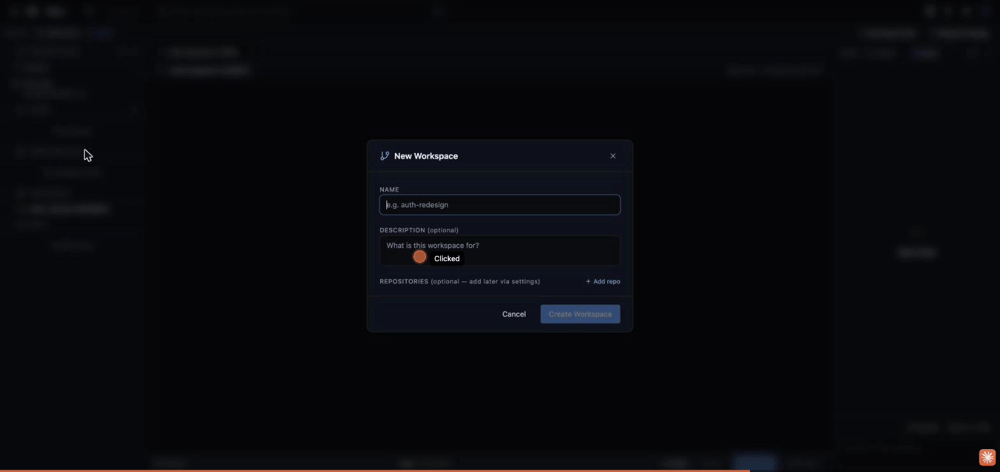
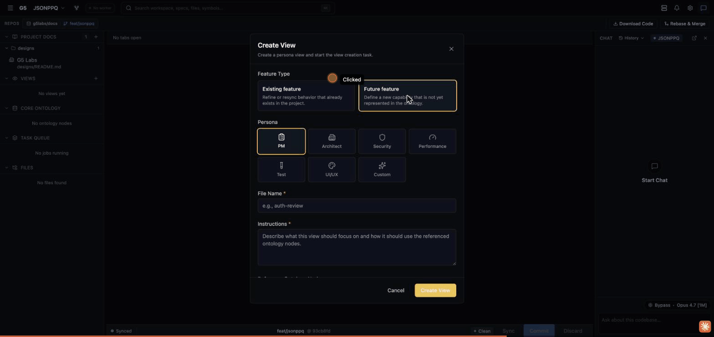
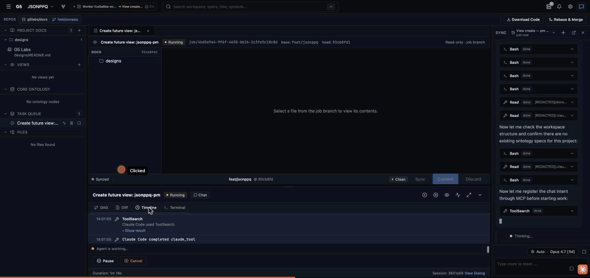
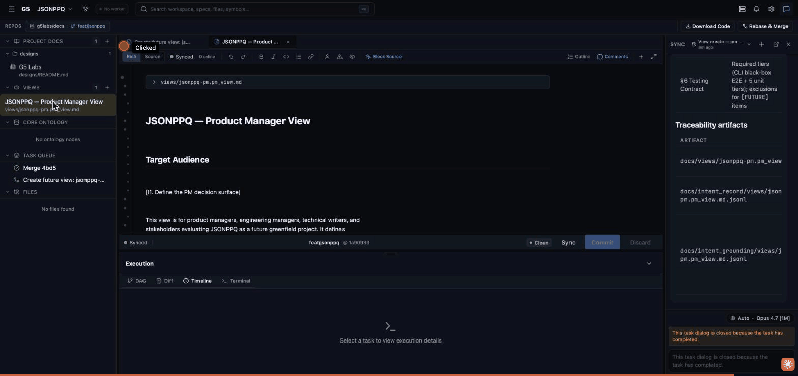
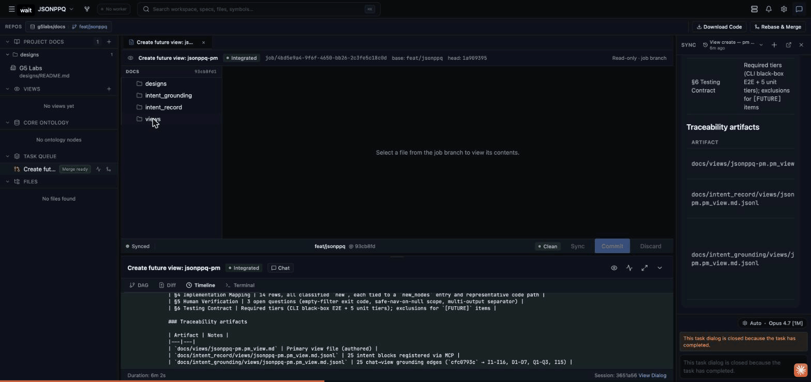
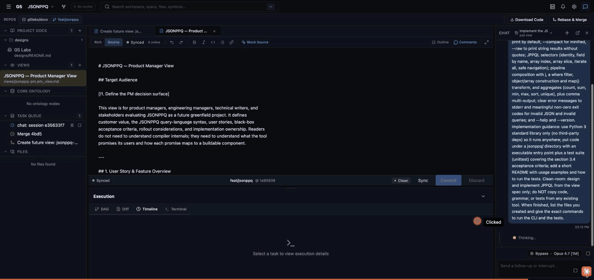
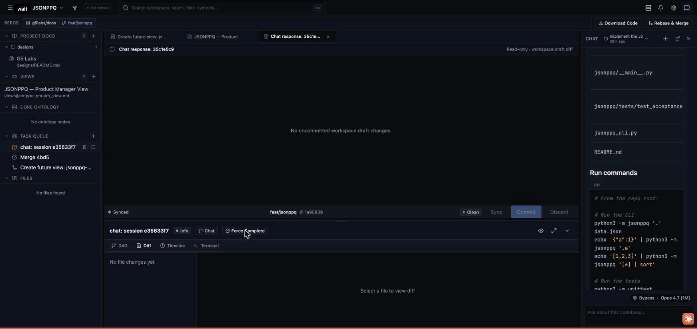

# Using G5 to Build from Scratch — JSONPPQ CLI Tutorial

A step-by-step guide for a brand-new human user, using a real worked example: **building "JSONPPQ," a command-line JSON query tool, from a product spec.**

> **New to G5?** Read [Getting Started](getting-started.md) first for the core concepts and key vocabulary. This guide assumes you're already logged in to the workspace surface.

---

## 1. Create a project

1. Click the **project switcher** (top-left, next to the G5 logo).

2. Click **➕ New Project**.

3. In the **New Workspace** dialog, enter:
    - **Name:** `JSONPPQ`
    - **Description:** *A small, fast command-line tool to query, filter, reshape, and summarize JSON.*
    - Repositories: optional — you can leave this empty for now.

4. Click **Create Workspace**.



G5 creates the project on a fresh feature branch (e.g., `feat/jsonppq`), shown in the bottom status bar. Your Views, Ontology, and Files start empty — that's expected.

---

## 2. Describe intent with a PM View

This is the heart of G5: you author a **persona view** that the agent turns into specs (and later code). Below is **exactly** what to enter, field by field, so you can reproduce this build precisely.

1. In the left sidebar, next to **VIEWS**, click the **➕** ("Create view"). The **Create View** dialog opens.

2. Fill the dialog **exactly** as follows:

| Field | What to select / type |
| --- | --- |
| **Feature Type** | **Future feature** (you're defining a brand-new capability) |
| **Persona** | **PM** |
| **File Name** | type `jsonppq-pm` — G5 previews the target path `views/jsonppq-pm.pm_view.md` |
| **Reference Ontology Nodes** | leave **empty** (a brand-new project has none yet) |
| **Instructions** | paste the entire block in step 3, **verbatim** |

3. Click the **Instructions** box and paste this **exact text** (select all → paste the whole block; do not summarize or shorten it):

```
JSONPPQ is a small, fast command-line tool to query and transform JSON (clean-room: inspired only by the general category of CLI JSON processors; do NOT copy code, grammar, operator sets, or tests from any existing tool; design JSONPPQ's own clear syntax).

Core user flow: the user pipes JSON or passes a file, supplies a short query expression, and gets back the selected/reshaped data, formatted for humans or pipelines.

MVP requirements:
- Read JSON from stdin or a file argument; write to stdout. Pretty-print by default; support --compact and --raw (print string results without quotes).
- Selection/navigation: whole document, field by name, nested path, array element by index, array slice, iterate all elements; opt-in safe navigation where a missing path yields nothing instead of erroring.
- Filtering by condition: comparisons, equality, presence and type checks, boolean combinations.
- Transform/reshape: construct new objects and arrays; map an operation over every element of a collection.
- Aggregate: length/count, sum, min, max, sort, unique.
- Compose steps into a left-to-right pipeline; allow producing multiple outputs.
- Clear, actionable error messages and non-zero exit codes for invalid JSON or invalid queries; provide --help and --version.

Roadmap (not MVP): string ops (split/join/case/trim/match), grouping, CSV/TSV/Base64 output, recursive descent, reduce/accumulate, user-defined functions and CLI parameters, date/time, streaming.

Non-goals: not a general programming language; no schema validation; CLI only; reads local file/stdin only (no network).

For this view: define JSONPPQ's product scope, user stories, and acceptance criteria as black-box CLI tests (pretty-print; field/nested/array selection; filter; map; aggregate; compact/raw output; invalid-input handling; composition; help/version). Define JSONPPQ's own query syntax and document it.
```

4. Click **Create View**. G5 immediately starts the view-creation task (continue to step 4).



> **Why this exact text works:** it states *what the tool promises users* (capabilities, acceptance criteria, non-goals) rather than how to code it, and it spells out the clean-room rule so the agent designs its **own** query language. Vague instructions produce vague views — paste the whole block as-is.

---

## 3. Watch the agent work

G5 starts a **view-creation task**. A worker spins up automatically and you'll see a live **ReAct step stream** in the right panel (Read → Bash → Thinking → tool calls) and a task entry in the **Task Queue**.

Open the task to monitor it. The bottom panel has tabs:
  - **Timeline** — chronological steps + a live **duration** counter (your best "is it progressing?" signal),
  - **Diff** — file changes in the workspace,
  - **Terminal** — commands the agent ran,
  - **DAG** — task graph.

You can **Pause/Cancel**, or type into **"Type more to steer…"** to redirect the agent mid-run.



> **Patience note:** A rich view can take several minutes. A static "0%" chip does **not** mean it's stuck — check the Timeline's duration counter, which keeps climbing.

When finished, the task shows **Integrated / Merge ready** and a completion report (sections authored, intents registered, grounding edges, open questions).



---

## 4. Review & merge

1. Click **Merge** on the completed task (or the **Merge ready** badge).

2. Read the **Merge Workflow** dialog (preflight → rebase docs/views → resolve conflicts → run merge → publish), then click **Start Merge**.

3. After it completes, your new **View** appears under **VIEWS** and the project branch advances.



Open the view from the sidebar to read it; toggle **Rich / Source** to switch between the formatted and raw-markdown views.

---

## 5. Generate the code

A PM view defines *intent*; to get runnable software, ask the agent to implement it. Here is the **exact, copy-pasteable** prompt used for this build.

1. In the right-hand panel, click **New session** to start a fresh **Chat** (the model selector sits at the bottom, e.g. `Opus 4.7`).

2. Click the message box ("Ask about this codebase…"), paste this **exact prompt** as a single line, then press **Send** (Enter):

```
Implement the JSONPPQ MVP defined in the PM view views/jsonppq-pm.pm_view.md (the JPPQL query language and its acceptance criteria). MVP scope: a CLI named jsonppq that reads JSON from stdin or a file argument and writes to stdout; pretty-print by default, --compact for minified, --raw to print string results without quotes; JPPQL selectors (identity, field by name, array index, array slice, iterate all, safe navigation); pipeline composition with |, a where filter, object/array construction and map() transform, and aggregates (count, sum, min, max, sort, unique), plus comma multi-output; clear error messages to stderr and meaningful non-zero exit codes for invalid JSON and invalid queries; and --help and --version. Implementation guidance: use Python 3 standard library only (no third-party deps) so it runs anywhere; put code under a jsonppq/ directory with an executable entry point plus a test suite (unittest) covering the section 3.4 acceptance criteria; add a short README with usage examples and how to run the tests. Clean-room: design and implement JPPQL from the view spec only; do NOT copy code, grammar, or tests from any existing tool. When finished, list the files you created and give the exact commands to run the CLI and the tests.
```

3. Watch the agent create files (visible in the task **Diff** and **Files** once the task completes).

> **Heads-up (observed in this build):** code-gen is slow — the agent may sit on "Thinking" for **~10–15 min with a static "0%"** before any file appears, and finish in **~25–30 min**. That is expected here, *not* a hang: the **Timeline** duration counter keeps climbing. When done, it lists the files (`jsonppq/lexer.py`, `parser.py`, `evaluator.py`, …, `tests/test_acceptance.py`, `README.md`) and the run commands, and reports its tests passing (**41/41** in this build). **Important:** keep the prompt on a **single line** — the chat box sends on **Enter**, so embedded line breaks submit it early. If it stalls, type a nudge into **"Type more to steer…"**.



---

## 6. Test the result

1. Review changes in the task **Diff** and the **Files** tree.

2. To run it yourself, click **Download Code** (top-right) to get the branch as a zip, then run the CLI and its tests locally. (Downloads require your confirmation.)

3. Iterate by sending follow-up chat messages ("add the `--sort-keys` flag", "fix failing test X").



---

## 7. Everyday tips

- **Themes:** Settings → Preferences offers 9 themes (incl. a light "PM Paper") + editor options.

- **Git is always visible:** the bottom bar (Synced / branch@commit / Clean / Sync / Commit / Discard) reflects real Git state — when in doubt, inspect the branch.

- **Agents propose, you decide:** nothing merges without your explicit action.

---

## 8. Troubleshooting

| Symptom | What's happening / what to do |
| --- | --- |
| "No worker / 0 active workers" | Normal while idle; a worker starts when you run a task. |
| Task seems stuck at 0% | Check the **Timeline** duration counter; rich tasks take minutes. Use **Pause/Cancel** if truly hung. |
| Can't find generated code | Confirm the task is **merged**; check the **Files** tree and the project branch in the status bar. |
| Want to change direction mid-run | Type into **"Type more to steer…"** in the task chat. |
